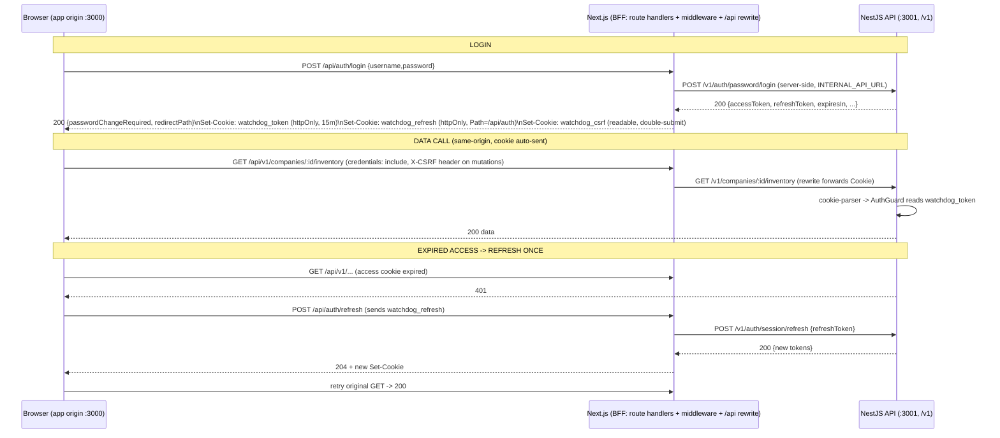

# Auth httpOnly-Cookie BFF Implementation Plan

Fix **"Missing authentication token"** correctly and securely, and complete the **login** experience,
by moving web authentication from JS-readable `localStorage` Bearer tokens to **httpOnly cookies
served through a same-origin BFF (Backend-for-Frontend) proxy**.

> **Status (2026-07-04): IMPLEMENTED & VERIFIED** — all phases done; evidence in
> `docs/agent-memory/auth-httponly-cookie-bff.md`. Note: the access token is chunked into
> `watchdog_token.0..N` cookies (JWT with permissions ≈ 9.4 KB > 4 KB browser cookie limit).
> Outstanding: spec/ADR docs, local web Docker image rebuild (colima OOM), browser pass.

## Linked Spec

- Spec: (to author) `docs/specs/auth-session-cookie-bff.md`
- Roadmap/checklist item: Auth hardening (follows `session-logout-security-plan.md`, `forgot-password-reset-plan.md`)
- Related code: `apps/api/src/modules/auth/*`, `apps/web/src/features/auth/*`, `apps/web/src/common/{auth,api}/*`
- Related ADR: (to author) `docs/adr/000X-httponly-cookie-session.md`

## Purpose

Today a signed-in user still hits `401 "Missing authentication token."` on normal navigation, and the
login flow is half-finished. Both problems share one root cause: **the web app keeps the session token
only in `localStorage` and never establishes a first-class server session.** This plan makes the browser
session a first-party httpOnly cookie, enforces a real route guard, adds token refresh, and finishes the
Thai login UX — removing the token from JavaScript entirely (XSS-safe) as the secure end state.

Decision on approach: **httpOnly cookie BFF** (chosen 2026-07-04). No interim localStorage step.

## Root-Cause Diagnosis (evidence)

| # | Finding | Evidence | Effect |
|---|---------|----------|--------|
| 1 | Token stored only in `localStorage`, never as a cookie | `auth.logic.ts:16` `persistAuthSession` writes `watchdog.accessToken`/`watchdog.refreshToken` only | No cookie ever exists; every "cookie fallback" path is dead |
| 2 | API cookie fallback exists but is **dead code** | `auth.guard.ts:46` reads `req.cookies?.['watchdog_token']`, but **`cookie-parser` is not installed** (no dependency, not wired in `main.ts`) | `req.cookies` is always `undefined`; cookie auth cannot work until enabled |
| 3 | No route guard / redirect | `companies/[companyId]/layout.tsx` calls `createLocalOwnerSession()` unconditionally; there is no `middleware.ts` | Unauthenticated/expired users reach the shell; UI looks logged-in while API calls 401 |
| 4 | No token refresh on the web | API exposes `POST /v1/auth/session/refresh` (`auth.controller.ts:520`) but **no web code calls it** (grep: 0 hits) | Access token (`ACCESS_EXPIRES_IN = 900s`) expires silently → 401s with no recovery |
| 5 | Token-key drift | login writes `watchdog.accessToken`; readers fall back to `watchdog.auth.accessToken` / `watchdog_access_token`; LINE page reads `watchdog_access_token` | A "logged-in" surface can still send no token |
| 6 | Login UX incomplete ("สนเรื" = **login**, typed in Thai IME) | `LoginPage.tsx` is English-only, no logout in shell, no already-logged-in handling, uses fabricated owner session | Login is not actually enforced or finished |

## Goal / Non-Goals

**Goals**
- Authenticated browser requests carry an **httpOnly, Secure, SameSite=Lax** cookie; the JS bundle never holds the token.
- `401 "Missing authentication token."` is eliminated for real sessions; expired access tokens auto-refresh once; hard failures redirect to `/login`.
- `/companies/*` is guarded by Next middleware; `/login` redirects away when already authenticated.
- Login page is Thai-localized and finished (loading/error/redirect/logout/password-change).
- CSRF risk introduced by cookie auth is explicitly mitigated.

**Non-Goals**
- No change to JWT issuance, session table, permission resolution, or the LINE login/link flows' server logic.
- No redesign of the workspace shell beyond wiring real session + logout.
- No move of business mutations into AI/LINE surfaces.

## Target Architecture

Key point: **the browser only ever talks to its own origin (`/api/*`)**. The API is reached server-side
via the existing `next.config.mjs` rewrite (`/api/:path* -> INTERNAL_API_URL`). The cookie is therefore
purely first-party → `SameSite=Lax` is sufficient and there is no cross-origin token exposure.

## Security Decisions

- **Cookies**
  - `watchdog_token` (access): `HttpOnly; Secure(prod); SameSite=Lax; Path=/; Max-Age=900`.
  - `watchdog_refresh` (refresh): `HttpOnly; Secure(prod); SameSite=Lax; Path=/api/auth; Max-Age=<session lifetime>`. Scoping `Path=/api/auth` keeps the refresh token off every data request.
  - `watchdog_csrf` (double-submit token): **not** HttpOnly; `SameSite=Lax; Secure(prod)`. Random value; the client echoes it in an `X-CSRF-Token` header on state-changing requests.
  - `Secure` is on in prod, off in local http; gate via `AppConfigService.isProduction` / `APP_ENV`.
- **CSRF**: cookie auth is auto-sent, so every non-GET `/api/*` request must pass **double-submit CSRF** (`X-CSRF-Token` header == `watchdog_csrf` cookie) verified in a Next route handler / middleware, plus an `Origin`/`Sec-Fetch-Site` allowlist check. `SameSite=Lax` is defense-in-depth, not the only control.
- **No token in JS**: `persistAuthSession`, `getStoredAccessToken`, and localStorage token reads are removed. XSS can no longer exfiltrate the session.
- **Logout / revoke**: `/api/auth/logout` clears all three cookies **and** calls `POST /v1/auth/logout` to revoke the server session (reuse `extractSid`).
- **Least privilege on errors**: 401 body stays generic; never echo token contents.

## Scope

### In Scope
- API: install + wire `cookie-parser`; verify `AuthGuard` cookie path; add cookie-name to config; tests.
- Web BFF: route handlers `app/api/auth/{login,refresh,logout,change-password}/route.ts` that set/clear cookies.
- Web: `middleware.ts` guarding `/companies/*` and `/login`; real session via `GET /v1/auth/me`.
- Web: one shared `apiFetch` (same-origin, `credentials:'include'`, CSRF header, 401→refresh-once) used by **all 17** `features/*/*.api.ts` clients; remove per-file localStorage logic.
- Web: finish `LoginPage` (Thai i18n, already-logged-in, logout wiring in shell).

### Out of Scope
- LINE OA / LIFF link pages' own token handling (dev owner-link page keeps its `watchdog_access_token` dev path; note as edge case).
- Multi-tab proactive refresh / silent background refresh timers (reactive refresh only).
- Session management UI beyond existing "revoke other sessions".

## Phases

### Phase 0 — Discovery & Alignment
- [x] Confirm this plan against `session-logout-security-plan.md` and current `auth.controller.ts`.
- [ ] Author `docs/specs/auth-session-cookie-bff.md` + ADR for the cookie decision.
- [x] Confirm prod topology: are web + API same registrable domain? (affects only `Secure`/domain, not the first-party BFF model).
- Verification: docs merged; no code yet.

### Phase 1 — API: make cookie auth real (currently dead)
- [x] Add `cookie-parser` dependency; `app.use(cookieParser())` in `apps/api/src/main.ts` (before routes).
- [x] Add `Cookie` to CORS `allowedHeaders` is **not** needed (cookies ride the standard `Cookie` header) — confirm `credentials:true` stays.
- [x] Confirm `AuthGuard` (`auth.guard.ts:46`) now receives `req.cookies['watchdog_token']`; add cookie name to `AppConfigService`.
- [x] Keep `Authorization: Bearer` support (LINE dev page, tests, server-to-server) — cookie is additive, header stays primary-or-fallback.
- Tests: unit test `AuthGuard` accepts a request with only the cookie; rejects when neither header nor cookie present; e2e `GET /v1/auth/me` with cookie.

### Phase 2 — Web BFF auth route handlers (set/clear cookies)
- [x] `app/api/auth/login/route.ts`: POST → call `INTERNAL_API_URL /v1/auth/password/login` server-side → on 200 set `watchdog_token`, `watchdog_refresh`, `watchdog_csrf` cookies via `NextResponse.cookies.set`; return `{passwordChangeRequired, companyId, redirectPath}` (no tokens).
- [x] `app/api/auth/refresh/route.ts`: POST → read `watchdog_refresh` cookie → call `/v1/auth/session/refresh` → reset cookies; 204 on success, 401 (clear cookies) on failure.
- [x] `app/api/auth/logout/route.ts`: POST → call `/v1/auth/logout` with current access cookie → clear all cookies.
- [x] `app/api/auth/change-password/route.ts` (or keep client call via `/api/v1` + cookie): password change must re-issue/keep cookie consistent.
- [x] Shared server helper `serverAuthCookies()` for consistent cookie attributes (single source of truth).
- Tests: route-handler unit tests for cookie set/clear + CSRF token generation; verify tokens never appear in the JSON body.

### Phase 3 — Middleware route guard + real session
- [x] `apps/web/middleware.ts`: `matcher` on `/companies/:path*` and `/login`.
  - No `watchdog_token` cookie on `/companies/*` → 302 `/login?next=<path>`.
  - Valid cookie on `/login` → 302 to `/companies/<companyId>/dashboard`.
  - Access cookie missing but refresh present → allow through; client `apiFetch` handles refresh (or middleware pings `/api/auth/refresh`).
- [x] Replace `createLocalOwnerSession()` fabrication in `WorkspaceLayout`/`companies/[companyId]/layout.tsx` with a real session read: `GET /v1/auth/me` (server-side via cookie) → drives permissions/nav. Keep a **local-only** dev fallback behind `APP_ENV=local`.
- Tests: middleware unit tests for the three redirect cases; layout renders nav from real `/auth/me` permissions.

### Phase 4 — Migrate all feature clients to same-origin cookie auth
- [x] Create `apps/web/src/common/api/authed-fetch.ts`: base `/api/v1`, `credentials:'include'`, JSON headers, `X-CSRF-Token` from `watchdog_csrf` on non-GET, and **401 → POST `/api/auth/refresh` once → retry → else `window.location.assign('/login')`**.
- [x] Refactor all 17 `features/*/*.api.ts` (`inventory, crm, banking, procurement, accounts-payable, reimbursements, expenses, tax, accounting-documents, ledger, workflow, ai-suggestions, employee-access, dashboard-notifications, system-partners, platform-foundation, auth`) to use it; delete inlined `localStorage.getItem('watchdog.accessToken')` reads.
- [x] `common/auth/session.ts`: drop `getStoredAccessToken`/`AUTH_STORAGE_KEYS`; `logoutCurrentSession` → `POST /api/auth/logout` then redirect; `revokeOtherSessions` via authed-fetch.
- [x] `common/api/api-error.logic.ts`: keep `unauthorized` mapping; the refresh/redirect lives in `authed-fetch`.
- Tests: one client (e.g. `inventory.api`) exercised for header/credentials shape; 401-refresh-retry unit test on `authed-fetch`.

### Phase 5 — Finish the login experience ("สนเรื")
- [x] `LoginPage.tsx`: call `POST /api/auth/login` (BFF) instead of `loginWithPassword` + `persistAuthSession`; on success follow `redirectPath`; on `passwordChangeRequired` → `/change-password` (cookie already set).
- [x] Thai-localize login/forgot/reset/change-password copy to match the app (reuse `workspace-dictionary` pattern or a small `auth` dictionary).
- [x] Already-logged-in: handled by middleware (Phase 3); add a light client guard as backup.
- [x] Wire **logout** into `WorkspaceShell` user menu → `logoutCurrentSession()`.
- [x] `ChangePasswordPage`, `ForgotPasswordPage`, `ResetPasswordPage`, `VerifyEmailPage`: switch their token reads/writes to the cookie/BFF model.
- Tests: e2e happy path login → dashboard data loads (no 401); expired-access → refresh → success; logout → `/login`; already-logged-in redirect.

### Phase 6 — Cleanup, verification, docs
- [x] Remove dead cookie/localStorage code paths and unused fallback keys.
- [x] Update `.env.example` comments (cookie flags, `INTERNAL_API_URL` role in BFF).
- [x] Full verification matrix (below); update `docs/agent-memory/auth-httponly-cookie-bff.md`.

## Contract / Interface Changes

- **New web endpoints (BFF):** `POST /api/auth/login`, `POST /api/auth/refresh`, `POST /api/auth/logout` (+ optional `change-password`). These are the only auth endpoints the browser calls directly.
- **Unchanged API contracts:** `/v1/auth/*` request/response bodies are unchanged; the API now *also* accepts the `watchdog_token` cookie (already coded, now actually parsed).
- **Removed from client:** direct cross-origin calls to `:3001/v1/auth/password/login` and all `localStorage` token access.

## Security Review Checklist

- [x] Token never present in `document`/`window`/`localStorage`/JS heap after login.
- [x] `watchdog_token` and `watchdog_refresh` are `HttpOnly` + `Secure`(prod) + `SameSite=Lax`; refresh scoped to `Path=/api/auth`.
- [x] Every non-GET `/api/*` verifies double-submit CSRF + Origin allowlist.
- [x] Logout revokes the server session (not just cookie clear) and clears all cookies.
- [x] Refresh rotates the session (`refresh-session.use-case` already issues a new `sid`) and re-resolves permissions.
- [x] 401/expired paths always terminate at `/login`; no infinite refresh loop (refresh attempted at most once per request).
- [x] `mustChangePassword` block (`auth.guard.ts:98`) still enforced under cookie auth.

## Verification Matrix

| Scenario | Expected |
|----------|----------|
| Fresh login → dashboard | Data loads, zero 401, no token in JS |
| Deep-link `/companies/x/inventory` while logged out | 302 → `/login?next=...` |
| Visit `/login` while logged in | 302 → dashboard |
| Access cookie expired, refresh valid | Transparent refresh, request succeeds |
| Refresh cookie expired/revoked | Cookies cleared, redirect `/login` |
| Logout | Server session revoked, cookies gone, `/login` |
| Cross-site POST to `/api/v1/...` without CSRF header | 403 |
| `passwordChangeRequired` login | Lands on `/change-password`, business modules blocked until changed |

Commands: `pnpm --filter @watchdog-bms/api test`, `pnpm --filter web test`, `pnpm test:e2e` (or the repo's Playwright config), plus a manual browser pass of the matrix.

## Rollout / Rollback

- Ship API Phase 1 first (additive; header auth still works → zero downtime).
- Ship web Phases 2–5 together behind a short bake; the cookie and header paths coexist during rollout.
- **Rollback:** revert the web BFF/middleware commits; the API cookie-parser addition is harmless to leave in place. Because header auth is retained on the API throughout, a web rollback restores the previous behavior without an API rollback.

## Risks & Mitigations

- **Prod cross-subdomain cookies:** avoided by the first-party `/api/*` BFF model; verify in Phase 0.
- **CSRF regression from cookie auth:** mitigated by double-submit token + Origin check + SameSite=Lax (Phase 2/4).
- **17-client refactor churn:** centralize in one `authed-fetch`; migrate mechanically, verify one client end-to-end first.
- **Refresh loops:** enforce single refresh attempt per request in `authed-fetch`; middleware never calls data endpoints.
