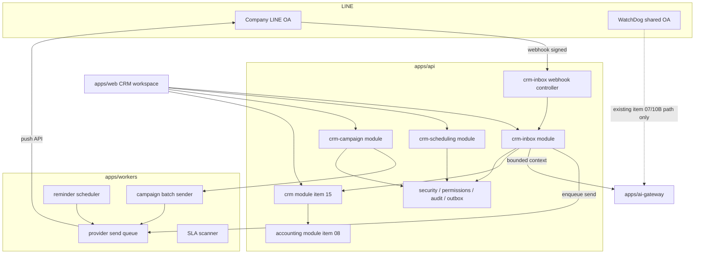
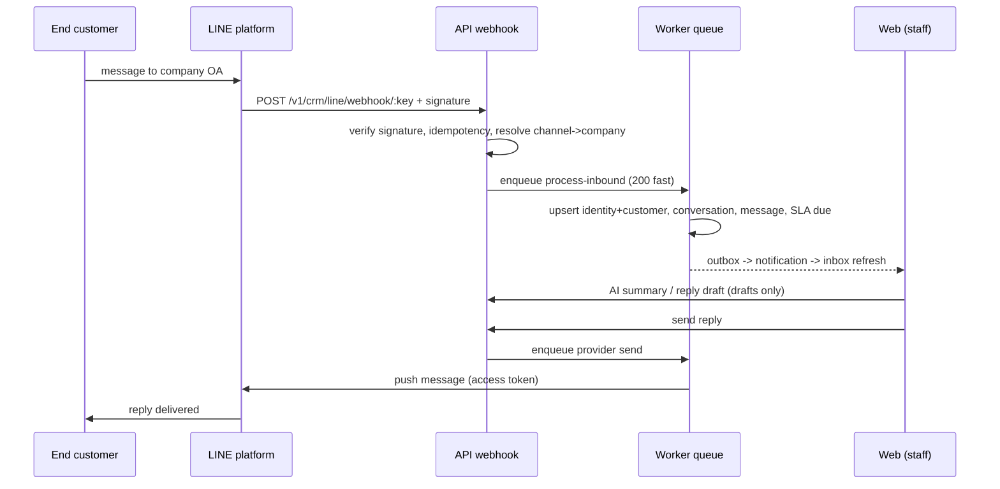

# CRM + Company LINE OA Customer OS Implementation Plan

## Status

Ready for owner review. Proposed roadmap placement: new item **15A. CRM Customer OS — Company LINE OA Inbox, Customer 360, and AI Assist** in [[plans/master-implementation-checklist|Master Implementation Checklist]], directly after item 15.

Implementation owner/model should implement one phase at a time. First handoff scope is Phase 0 and Phase 1 unless owner explicitly expands scope.

Web-first mandate from owner (2026-07-04): build the web workspace surfaces first. Customer rich menus and non-LINE channels are out of the first pass.

Owner update 2026-07-06: item 15A is now in the master checklist. Scope expanded per spec §24–§25: customer LINE Login (LIFF) registration, per-company AI auto-reply toggle gated by an AI-computed trust score (> 80, recomputed after every successful booking), autonomous booking on semantic customer confirmation, and a dedicated CRM customer agent family in the AI Gateway that never reuses the employee/shared-OA agents. Phases 8B–8C below own this scope.

Owner update 2026-07-08: auto-reply with a per-company/per-channel ON/OFF toggle is pulled forward into MVP 1. Implement the toggle, trust-score gate, and safe auto-reply path together with the CRM AI slice, default OFF. Auto-booking still waits for appointments and the Phase 8C booking guardrails.

Owner update 2026-07-12: customer-directory and same-person identity closure tracked in [[agent-memory/customer-management-identity-linking|Customer Management and Identity Linking]] is implemented and locally accepted. Identity re-point/full merge, typed `originSource` + `createdByType`, same-company lineage FKs, race-safe ingestion, consent/erasure egress fences, and durable LINE delivery passed full tests/builds, all 53 migrations from empty PostgreSQL, and authenticated browser smoke. Item 15A remains unchecked for its wider campaigns/service-jobs/live-launch gates, not for this customer-management slice.

## Linked Specs

- Spec: [[specs/crm-line-oa-customer-os-spec|CRM + Company LINE OA Customer OS Spec]]
- Product/service catalog: [[specs/crm-product-service-catalog-spec|CRM Product and Service Catalog Spec]], [[plans/crm-product-service-catalog-plan|implementation plan]]
- Base CRM: [[specs/crm-sales-spec|CRM and Sales Spec]] (item 15 — prerequisite)
- Related specs:
  - [[specs/accounting-documents-spec|Accounting Documents Spec]] (item 08)
  - [[specs/line-ai-channel-auth-spec|LINE AI Channel/Auth Spec]] (shared OA — must stay separate)
  - [[specs/admin-company-onboarding-spec|Admin Company Onboarding Spec]] (feature entitlement)
  - [[specs/employee-access-role-management-v2-phase1-spec|Access v2 Phase 1 Spec]] (capability packs)
  - [[specs/ai-gateway-agents-spec|AI Gateway Spec]], [[specs/ai-draft-suggestion-layer-spec|AI Draft and Suggestion Layer Spec]] (items 10B/17)
  - [[specs/dashboard-notification-spec|Dashboard and Notification Spec]] (item 06)
  - [[specs/workflow-automation-spec|Workflow Automation Spec]] (item 16)
  - [[specs/permission-matrix|Permission Matrix]], [[specs/data-model-core-spec|Data Model Core Spec]], [[specs/web-core-workspace-spec|Web Core Workspace Spec]]
- Related guidelines:
  - [[guidelines/backend-hexagonal-code-style|Backend Hexagonal Code Style Guideline]]
  - [[guidelines/web-frontend-code-style|Web Frontend Code Style Guideline]]
  - [[guidelines/security-implementation-guideline|Security Implementation Guideline]]
- Related ADRs:
  - [[adr/0006-phase-1-platform-stack-defaults|ADR 0006 Platform Stack Defaults]]
  - [[adr/0008-line-ai-access-and-auth|ADR 0008 LINE AI Access and Auth]]

## Purpose

Deliver the owner's CRM + LINE OA product vision on top of the shipped platform:

- Each company connects its **own LINE OA**; end customers keep chatting there.
- Staff work every customer conversation in a web **CRM Inbox** (3-column workspace).
- **Customer 360** aggregates everything known about a customer.
- **AI Assist** helps staff draft and prioritize — human-in-the-loop, never auto-send.
- Conversations convert to deals, tasks, quotation drafts, appointments, and service jobs in-place.
- Owner gets a **Daily Brief** dashboard; Marketing runs consent- and quota-aware **campaigns**.

## Core Rules

1. Two OA types stay strictly separate. WatchDog shared OA = internal users (items 10A/10B rules: never infer company from channel). Company OA = end customers (company resolves FROM the channel record; separate webhook endpoint and code path).
2. End customers are CRM contacts, never internal users/principals. They may authenticate with LINE Login (LIFF) only to register/enrich their own CRM contact + PDPA consent (spec §24); this never creates an internal session, role, or AI Gateway access.
3. AI is staff-assistive by default. Customer-facing auto-reply exists only behind the per-company auto-reply toggle + AI trust score > 80 gate, and the only AI final execute is appointment booking after semantic customer confirmation (spec §24). The staff-assist path keeps no generate-and-send endpoint; the auto-reply path is a separate, gate-checked pipeline in Phase 4, and the booking path remains Phase 8C with no other final mutation.
4. Item 08 owns document lifecycle; item 15 owns base CRM objects; this item extends additively and never duplicates primitives.
5. Company OA credentials are encrypted tenant secrets: masked, reveal-audited, never logged, never platform-admin-readable.
6. Server-side tenant/permission/ABAC checks on every route; web checks are UX only.
7. No hard deletes on user routes; messages/activities append-only.
8. `CrmCustomer.id` is canonical. Exact verified `(channelId,providerUserId)` reuse is deterministic; normalized phone is a human-confirmed duplicate candidate; name-only never auto-links or auto-merges.
9. `/companies/:companyId/customers` from item 15 is the sole customer CRUD directory. Inbox/Customer 360 deep-link there; this item adds masked identity state and link/merge integration, not another customer page.

## Current Repository Context

Snapshot 2026-07-04 (verify again at implementation start):

- Items 01–14 + 10A/10B/10C(+Phase 1) + 11 + 16(core) + 17(core) shipped per checklist notes.
- Item 15 CRM Sales MVP: gate-critical path implemented (8 Prisma models, hexagonal `apps/api/src/modules/crm`, web `features/crm`, `crm.*` permissions); migration deploy + import/merge/segments/export deferred. This item depends on item 15's models and quotation-link boundary being deployed.
- AI Gateway: provider adapters (disabled/bedrock/openai), intake router, internal draft-generate endpoint (item 17), AgentCore-compatible runtime.
- Notification/dashboard (06), workflow (16), attachment/audit/outbox (04), accounting documents (08) primitives all exist — extend, do not duplicate.

## Scope

### In Scope (this item)

- `CompanyMessagingChannel` (LINE OA provider) + settings wizard + credential vault.
- Company-OA webhook ingestion -> identity -> customer -> conversation -> message.
- CRM Inbox web workspace (3-column), reply/notes/assign/status/tags/priority/SLA.
- Message templates and quick replies.
- Customer 360 aggregate page + unified timeline + `CrmCustomer` scoring extensions.
- Masked/read-only LINE identity state, exact identity reuse, and Owner/Admin identity re-point/full merge integration through item 15 APIs.
- AI Assist panel (summary, reply draft, tone, intent, sentiment, lead score, next action) through AI Gateway.
- Create deal/task/quotation-draft/appointment/service-job from conversation.
- Send quotation/invoice message to LINE (document refs; lifecycle stays item 08).
- Appointments (calendar, reminders) and Service Jobs (status board, photos, feedback).
- Campaigns: segments reuse, composer, consent/quota gates, worker send, results.
- Dashboard Daily Brief widgets + notification rules + workflow event sources.
- Permissions, capability packs (`Inbox Agent`, `Campaign Manager`), entitlement flags, audit/outbox, tests.
- Customer LINE Login (LIFF) registration page creating/enriching CRM contact + PDPA consent (Phase 8B).
- Dedicated CRM customer AI agent family in AI Gateway (intake/reply/booking/trust-score, spec §25) — separate from employee LINE agents (Phases 4 + 8C).
- AI auto-reply toggle and AI-computed trust score in Phase 4; autonomous booking on semantic confirmation with deterministic execution guardrails in Phase 8C.

### Out of Scope (backlog)

Facebook/IG/web-chat channels, customer LIFF pages beyond the registration page (booking/quotation-view pages stay backlog), round-robin auto-assign, presence/collision locks, Flex builder, loyalty/coupons, A/B campaigns, telephony, marketplace import (19), external ad publishing (23), billing/seat metering. (AI auto-reply and auto-booking moved IN scope by owner update 2026-07-06; auto-reply is pulled into Phase 4 by owner update 2026-07-08.)

## Architecture Overview

## Implementation Readiness

Start point for the implementing model:

1. Read this plan, then the spec [[specs/crm-line-oa-customer-os-spec|CRM + Company LINE OA Customer OS Spec]].
2. Read item 15 spec + current `apps/api/src/modules/crm` code and its deployment state (Phase 0 blocker below).
3. Read accounting boundary usage in item 15's quotation-link infrastructure.
4. Read security guideline + 10A/10B LINE code to keep webhook paths separate.
5. Inspect `apps/workers` queue registration and item 06 notification providers.
6. Start Phase 0.

Do not tick roadmap item 15A until all phase exit criteria and verification commands are recorded.

## Phases

### Phase 0 — Baseline Reconciliation and Item 15 Deployment Gap

Goal: confirm foundations this item stands on.

Tasks:

- Verify item 15 migration `20260701120000_item15_crm_sales` is deployed to the live/local DB; if not, deploy and smoke CRM CRUD first (item 15 note lists this as NOT done).
- Inventory existing primitives to reuse: attachment, audit, outbox, notification event, workflow triggers, AI Gateway internal endpoints, accounting read models, web shell nav registration, permission registry, feature entitlement.
- Confirm encryption utility/secret-manager pattern available for credential vault; if absent, decide the smallest safe approach (AES-GCM with env/SSM key) and record in memory doc.
- Create `docs/agent-memory/crm-line-oa-customer-os-15a.md` with the memory template.

Exit criteria: item 15 schema deployed; reuse inventory + encryption decision recorded; no code duplicated.

### Phase 1 — Channel Foundation: CompanyMessagingChannel + Webhook Ingestion

Goal: a real company LINE OA connects and inbound messages persist.

Tasks:

- Contracts: channel DTOs/enums; conversation/message enums (shared with Phase 2).
- Prisma: `CompanyMessagingChannel`, `CrmChannelIdentity`, `CrmConversation`, `CrmMessage` (+ additive `CrmCustomer` scoring columns), one migration.
- Permissions: `crm.channel.read/manage`, `crm.inbox.read` registered + role grants.
- Channel module: connect (validate via LINE bot-info call), test, rotate, disable, reveal (step-up-ready, audited), status read; credentials AES-GCM encrypted, masked DTOs.
- Webhook controller `POST /v1/crm/line/webhook/:webhookKey`: signature verify, idempotency, enqueue-then-200; processing job resolves exact identity -> same-company customer -> conversation -> message. New identity + provisional LINE customer creation is race-safe/transactional so concurrent first contact cannot leave an orphan customer; outbox events follow commit.
- LINE provider adapter (infrastructure): bot info, profile fetch, push message, content download, quota read — typed errors, no SDK leakage.
- Settings web page: wizard (two-OA warning card, credential form, webhook URL copy, test button), status card, error states.

Exit criteria: with a real or mocked LINE channel, wizard connects and a signed webhook event produces customer+conversation+message rows; repeated/concurrent events for the exact identity reuse one customer with same-company FK integrity and no orphan; signature/idempotency/permission tests pass; credentials never appear in responses/logs.

### Phase 2 — CRM Inbox Workspace (read, reply, notes, triage)

Goal: staff work conversations end-to-end on web.

Status update 2026-07-08 (code reconciliation): the `/inbox` route now renders the Mangmee `InboxPrototypePage` (static mock, no API); the API-wired inbox described below is bypassed and must be re-wired to `crm-inbox.api` (owner decision A — Mangmee prototype is the go-forward UI). The build history below still holds for the backend and the reference component `apps/web/src/features/crm-inbox/InboxPage.tsx`.

Status 2026-07-06: CORE TRIAGE SLICE DONE per the มั่งมี Flow A design handoff (`design_handoff_mangmee/` — visual source of truth for this workspace): reply (inline LINE push, documented queue deviation), internal notes (separate route/permission = structural send-rejection), assign, status with design auto-advance, mark-read, list search/overdue/chip-counts, and the 3-column inbox at `companies/[companyId]/inbox` with the AI column as placeholder-until-Phase-4. MEDIA SLICE DONE same day: inbound image/file content fetched at ingestion (LINE retention window) and stored durably in Postgres (`AttachmentBlob`, storageProvider `db` — object store not wired yet), served via a `crm.inbox.read`-scoped content route; thread renders image/sticker/location/file bubbles with honest too-large/expired placeholders. Video/audio are explicitly unsupported per owner decision (fail marker + "ยังไม่รองรับ" bubble; voice-to-text comes first as future backlog — spec §26). TEMPLATES SLICE DONE same day (later): `CrmMessageTemplate` model + partial-unique-active migration (`20260706170000`), `crm.template.read|manage` permissions + role grants (ADMIN/MANAGER manage, SALES read, AUDITOR read), CRUD + archive API under `companies/:companyId/crm/templates` (409 on duplicate active title, archived rows uneditable), and the composer gained a 📋 template picker with inline manage (create/archive behind manage permission) plus `/` quick replies (leading slash filters by title/category/body, Enter applies the top match) — live-verified in the inbox (create → `/ทัก` dropdown → insert → duplicate-title 409 surfaced in Thai). TAGS/PRIORITY SLICE DONE same day (fourth pass): zero-migration (fields existed since Phase 1) — `PUT :id/priority` + `PUT :id/tags` under the shipped triage permission `crm.inbox.resolve` (recorded deviation from the spec table's `crm.inbox.reply`; status already lived on `resolve`), bounded tag normalization (trim/case-insensitive dedupe/≤10×≤40), `?tag=` jsonb filter, audit + outbox events; web priority pill+menu in the thread header, sidebar tag editor, list-card badges + click-tag-to-filter — live-verified incl. the negative filter case. SLA POLICY/SCANNER SLICE DONE same day (fifth pass): `CrmInboxPolicy` model + migration (`20260706210000`) with `GET/PUT crm/inbox-policy` under new `crm.inbox.policy_manage` (HIGH, ADMIN), business-hours due computation wired into ingestion (no-row default = spec §22: 30 min within 09:00–18:00 Asia/Bangkok — replaces the Phase-1 flat +30), worker-token `internal/crm/sla-breach-scan` global sweep marking `slaBreachedAt` race-safely + `crm.conversation.sla_breached` outbox + `crm_sla_breach` item 06 notification to assignee + managers, a workers repeat job every 60s, the SLA policy card on settings/line-oa, and list-card countdown chips green→amber(≤15 min)→red — live-verified (scan idempotent, notification in ศูนย์การแจ้งเตือน, chip colors by computed style; LINE-channel delivery still gated on the item 06/17 dispatch gap). ASSIGNMENT ABAC + SPAM SLICE DONE 2026-07-07 (sixth pass) — PHASE 2 COMPLETE: own/assigned + unassigned-pickup scoping mirroring item 15's crm-access pattern (role allowlist; scoped WHERE on list/counts; after-fetch assert on detail/content/send/note/status/priority/tags/read), pickup rule (SALES lost `crm.inbox.assign`; assign route allows self pickup/release for reply-holders; sync-permissions now revokes registry-removed system-role grants), `assignee=me|none` filter + ของฉัน/ยังไม่มีผู้รับ chips with counts, and the spam action (SPAM muted out of the default list + chips, mark-spam zeroes unread, สแปม chip/menu entry, unmark restores) — live-verified with a seeded SALES membership (scoped list, 403 on other's thread, pickup/release matrix, junk-filter 400) and browser click-through for owner + sales. Notification rules for new-unassigned-conversation remain with item 06/16 (only SLA breach ships notifications today); `CrmActivity` appends stay a recorded deviation (audit+outbox instead). Evidence: [[agent-memory/crm-line-oa-customer-os-15a]] media-slice + templates + tags/priority + SLA + ABAC/spam sections + [[agent-memory/design-handoff-mangmee-apply]].

Tasks:

- Conversation list/detail APIs with filters (status, assignee, unassigned, SLA overdue, tags, search) and ABAC scope (own/assigned + pickup).
- Send message use case -> provider send queue in workers with retry/backoff; delivery status updates; failure surfaced.
- Internal notes: `visibility=INTERNAL_NOTE` endpoint + structural send-rejection.
- Assign / status / priority / tags / mark-read / resolve / spam; auto-reopen on inbound after resolved (7-day default); `CrmActivity` appends + audit.
- `CrmMessageTemplate` CRUD + `/` quick replies.
- `CrmInboxPolicy` + SLA due computation (business hours), SLA scanner job (or item 16 SLA trigger), `crm.conversation.sla_breached` events.
- Web: 3-column inbox per spec section 10.2 (list, chat window, sidebar shell), composer with template picker + internal-note tab, empty/loading/error/permission states, 5–10s refetch isolation for later SSE.
- Notification rules: new unassigned conversation, SLA breach, assignment.

Exit criteria: full triage loop works live (message in -> assign -> AI-free reply -> customer receives -> resolve); internal note can never reach LINE (test proves route-level rejection); SLA colors + breach notification verified.

### Phase 3 — Customer 360 + In-Conversation CRM Actions

Goal: one page tells the whole customer story; conversation converts to work items.

Status update 2026-07-08 (code reconciliation): Customer 360 detail `/crm/customers/[id]` is still API-wired and real; but the new Mangmee `/customers` list route renders `CustomersPrototypePage` (static mock) and `/inbox` renders a prototype — the remaining Phase 3 in-conversation actions must be built on the wired-up Mangmee inbox (owner decision A), not the bypassed component.

Status 2026-07-07: CUSTOMER 360 READ MODEL + UNIFIED TIMELINE SLICE DONE (first Phase 3 pass): `GET crm/customers/:id/summary360` + `/timeline` under `crm.customer.read` (routes live in the crm-inbox module — CrmInboxModule already imports CrmModule, so the aggregate injects item 15's exported list use cases + accounting's `ListDocumentsUseCase`; adding the reverse edge would cycle). Per-source permission redaction per the spec aggregate table: a source the caller can't read is `null`/omitted and listed in `redactedSources` (finance = `accounting.document.read` via `CrmCustomer.accountingCounterpartyId`; deals/quotations = `crm.opportunity.read`; tasks = `crm.follow_up.read`; conversations = `crm.inbox.read` inheriting Phase 2 inbox ABAC; activities = `crm.activity.read`) — never a whole-page 403; the customer fetch itself keeps item-15 owned-record scope (SALES 403s on customers they don't own). Timeline merges CrmActivity rows (item 15 already appends stage/close/task-complete/quote-draft) with synthesized events only for what has no activity: deal/task creation, conversation starts (15A activity deviation), finance documents, consent changes; newest-first, `?before` cursor + `limit`, one newest-first page per source (ponytail window — per-source cursor pushdown when an SME customer outgrows it). Inbox list API gained `customerId=` filter (spec-table filter, feeds the 360 conversations tab). Web: `companies/[companyId]/crm/customers/[customerId]` page (header incl. consent badge + Phase-4 placeholder for AI advisory chips, tabs ภาพรวม/ไทม์ไลน์/การสนทนา/ดีล/ใบเสนอราคา/การเงิน/โน้ต/ความยินยอม + นัดหมาย·งานบริการ placeholders-with-reason), inbox sidebar button now opens the 360, timeline/conversation rows deep-link back to the inbox via new `?conversation=` param, ลูกค้า tab rows gained a 360° link. `CrmCustomerDetail` gained `consentUpdatedAt`. Verified: api 1129/1129 (+11), web 188/188, both typechecks; live 9-step curl matrix (owner full blocks incl. INV partially-paid; SALES sees finance redacted + no FINANCE_DOCUMENT events; SALES 403 on other's customer; `customerId` filter exact; junk cursor 400; unknown 404; paging cursor) + browser click-through for owner (tiles, 7-event timeline, finance table, conversation deep-link round trip) and SALES (finance lock card, 403 page) with zero console errors. Remaining Phase 3: in-conversation quick actions (create deal/task/quotation draft from conversation), send quotation/invoice to LINE, payment-proof queue, inbox sidebar column-3 real data beyond the customer card.

Tasks:

- `GET /crm/customers/:id/summary360` + `timeline` aggregate read models with per-source permission redaction (finance via item 08 read APIs).
- Customer 360 page: header, tabs (Overview/Timeline/Conversations/Deals/Quotations/Invoices-Payments/Appointments/ServiceJobs/Notes/Files/Consent) — ship tabs whose sources exist; placeholder-with-reason otherwise.
- Customer identity block: masked/read-only provider identity + link status. Identity re-point is a high-risk partial merge available only to Owner/Admin with `crm.customer.merge`; never accept raw provider id or authorize through update/inbox permissions.
- Owner/Admin merge entry uses item-15 preview showing affected channel identities, conversations, bookings, contacts, opportunities, activities, follow-ups, quotation links, and converted leads; commit requires `crm.customer.merge` + reason and leaves the secondary `MERGED`.
- Inbox sidebar (column 3) real data: identity card, latest deal, open tasks, AI summary slot, quick actions.
- Create-from-conversation flows: deal, follow-up task, quotation draft (item 15 boundary), each prefilled with customer + conversation source ref; activity entries.
- Send quotation/invoice to LINE: `DOCUMENT` message with permission-checked short-lived link; send-activity log on the document link record.
- Payment-proof queue: staff flags inbound image as payment proof -> finance queue view + notification (verification stays items 08/09/13).

Exit criteria: demo flow "chat -> view 360 -> link/reuse canonical customer -> create deal -> quotation draft -> send to LINE -> follow-up task" passes live; cross-company/out-of-scope link fails; Owner/Admin full merge preserves history and booking/customer joins; finance redaction verified for a non-finance role.

### Phase 4 — AI Assist + Toggle-Gated Auto-Reply

Goal: staff get real AI help, and owners can explicitly turn safe customer-facing AI replies on or off.

Tasks:

- API: `ai/summary`, `ai/reply-draft` (incl. tone adjust), `ai/insights` (intent/sentiment/lead score/next action) — bounded, permission-filtered context; `crm.ai.assist` permission.
- AI Gateway: create the dedicated CRM customer agent family (spec §25 — `CrmCustomerIntakeAgent`, `CrmCustomerReplyAgent`, `CrmBookingAgent`, `CrmTrustScoreAgent`) in its own gateway module with its own prompts, tool allowlists, and `POST /internal/ai/crm-*` endpoints, reusing only the provider port + safety envelope (uncertainty, refusal, typed unavailable when provider disabled); never reuse or extend the employee/shared-OA agents (`IntentRouterAgent`, `ResponseComposerAgent`); no CRM persistence in gateway. Phase 4 uses this family for staff assist, trust scoring, and toggle-gated auto-reply only; booking execution stays later.
- `CrmTrustScoreAgent` first pass: AI-computed score + reasoning from bounded customer signals, stored on `CrmCustomer`; unscored or score <= 80 remains staff-draft.
- Persist summary cache on conversation; lead score/sentiment/risk advisory writes to `CrmCustomer` with timestamps; `CrmAiAssistFeedback` capture.
- Web AI Assist panel: labeled outputs, Insert-to-composer (editable), Copy, Regenerate, thumbs feedback, uncertainty + unavailable states.
- Auto-reply settings: add a per-company/per-channel ON/OFF toggle, default OFF, managed under `crm.channel.manage`, visible in LINE OA/CRM settings.
- Auto-reply pipeline: physically separate endpoint/use case from staff-assist; gate on toggle ON, trust score > 80, consent/quota safe, confidence sufficient, safe customer-reply intent, no unsupported media, no complaint/escalation risk, and no final mutation. Toggle OFF or any failed gate returns to staff-draft mode.
- Every auto-sent reply is appended as an AI-sent outbound `CrmMessage`, audited, and visible in the thread. Low-confidence and escalation cases create a staff draft/notification only.
- M-03 outbound hardening: run every model-composed autonomous draft through one API-side deterministic URL/domain, payment, commitment, and PII policy; treat model `needsHuman` as a review signal only; permit URLs only from `CRM_AI_OUTBOUND_ALLOWED_DOMAINS`; and route denials to the existing deduplicated staff-handoff path with an auditable reason.
- M-03 stored-context hardening: version CRM message templates, require explicit current-version AI approval before a template enters autonomous context, clear approval on edit, keep unapproved ACTIVE templates available to staff-assist only, and expose approval state/action in the existing template picker.
- M-03 verification: table-driven adversarial multi-turn/template/catalog corpus, allowlisted-domain positives, template create/edit/approve lifecycle, and integration proof that a high-risk draft creates no AI outbound and no delivery.
- Route-table tests assert staff-assist endpoints cannot send, shared-OA employee webhooks cannot reach CRM customer auto-reply agents, and CRM customer auto-reply cannot reach employee/ERP tools.
- Internal read tools for shared-OA staff AI (`crm.inbox.summary`, `crm.customer.summary360`) under existing `crm.ai.read`.

Exit criteria: assist works against real provider config locally (Bedrock or fake provider for CI); drafts insert into the composer; feedback stored; provider-down degrades gracefully; with toggle OFF all customer replies remain staff-sent; with toggle ON and trust score > 80, one safe customer question can be auto-sent, audited, and marked AI-sent while unsafe/uncertain/unscored cases fall back to staff draft.

### Phase 5 — Dashboard Daily Brief + Owner Surfaces

Goal: owner sees the business in 30 seconds.

Tasks:

- Dashboard providers/widgets: unanswered, SLA breaches, new customers, pipeline value (item 15 provider reuse), quotations awaiting, payments waiting/overdue (item 08 read), appointments today, response-time median.
- AI Daily Insight card via item 17 suggestion template (`crm_daily_brief`), cited + permission-scoped; owner-only delivery default via item 06 (in-app + shared-OA push reusing existing delivery).
- Every widget action-links to filtered queues.

Exit criteria: owner login shows Daily Brief with live counts; each card click lands on the right filtered view; AI insight cites sources.

### Phase 6 — Appointments

Tasks: `CrmAppointment` model/migration; CRUD + calendar query APIs; conflict warning; status transitions; reminder scheduler job -> customer push via company OA + staff notification; web calendar (day/week) + list + modal; Customer 360 tab wiring; permissions `crm.appointment.*`; add a company booking-buffer setting (default 60 minutes, selectable on this page) and enforce it through shared domain/repository logic across staff create, reschedule, availability, race-safe insert, and AI booking; keep the existing 30-minute duration increments and reject past starts.

Exit criteria: appointment created from conversation and calendar; past starts are rejected consistently; changing the buffer immediately changes manual/AI availability and atomic conflict checks; reminder fires at configured offsets to LINE + notification; no-show/cancel/reschedule audited.

Owner gap-closure 2026-07-12 — canonical customer link:

- Make `CrmBooking.customerId` required and foreign-keyed to same-company `CrmCustomer`; retain `customerName` only as a snapshot.
- Backfill every legacy name-only booking to its own provisional CRM customer before adding the constraint; never deduplicate by name during migration.
- Validate active tenant customer on staff create, autonomous create, and customer reassignment; reject staff attempts to mark a booking as LINE-sourced.
- Wire the booking modal to CRM customer search/select and explicit permission-gated quick-create with normalized phone input; capture the staff-origin source separately.
- Prove missing/cross-tenant/inactive customer rejection, staff source validation, LINE customer propagation, migration shape, and web selection/quick-create behavior with focused checks.

Exit criteria addition: every confirmed booking has a valid canonical customer ID, appears in that customer's booking history, and retains an auditable source channel independently of customer identity.

Verification closure 2026-07-12: the canonical customer link, selected-branch/owner ABAC, active customer/staff final rechecks, durable reminder lease/backoff, deterministic LINE retry key, and Customer 360 handoff passed focused and full API tests, Prisma validation/generation, all 53 migrations from an empty disposable PostgreSQL database, and browser smoke. Exact evidence is in [[agent-memory/customer-management-identity-linking]].

### Phase 7 — Service Jobs

Tasks: `CrmServiceJob` model/migration; CRUD + transitions with notes; before/after photos via attachments; cost estimate (decimal-safe); optional invoice prompt (item 08 deep link); feedback request template send; web board/list + detail; Customer 360 tab; permissions `crm.service_job.*`.

Exit criteria: job lifecycle NEW->COMPLETED works with photos and notes; completion can deep-link to invoice creation; history visible in 360.

### Phase 8 — Campaigns and Broadcast

Tasks: `CrmCampaign`/`CrmCampaignRecipient` models; segment rule builder additions on item 15 segments (tag/status/inactive-days/quote-not-accepted at minimum); recipient preview with consent exclusions + quota check; composer with LINE-style preview; schedule/send (step-up gate `crm.campaign.send`); worker batch sender with rate limit, per-recipient idempotency, pause/resume on quota/failure; reply attribution (`conversation.campaignId`); results page; broadcast history; notifications on finish/fail.

Exit criteria: campaign to a filtered segment sends through a real/mocked OA with partial-failure recovery; revoked-consent members provably excluded; results counts reconcile with recipient rows.

### Phase 8B — Customer LINE Login Registration (LIFF)

Goal: customers can register themselves into the company's CRM like a standard CRM membership flow (spec §24).

Tasks:

- LIFF registration page under company branding: LINE Login -> profile fields + PDPA consent capture -> create/enrich `CrmCustomer` + `CrmChannelIdentity` bound to the verified LINE identity.
- Keep query values out of executable HTML; use the shared same-origin LIFF client, no-inline-script CSP/no-referrer/no-store headers, and browser regression with a closing-script payload.
- Strictly no internal principal/session/role: registration endpoints are company-OA-scoped public endpoints with LIFF token verification, rate limits, and tenant isolation.
- Consent records audited; Customer 360 consent tab reflects registration source; re-registration is idempotent (enrich, not duplicate).

Exit criteria: a customer completes LINE Login registration and appears as an enriched, consented CRM contact; no internal session or permission is ever created; cross-tenant/duplicate registration is rejected or merged safely.

### Phase 8C — Customer-Facing AI Booking and Trust Hardening

Goal: add booking autonomy and trust-score hardening after the basic auto-reply toggle is already shipped.

Tasks:

- Trust-score recompute job triggered after every successful booking; unscored customers still stay staff-draft.
- Auto-booking: `CrmBookingAgent` discovery (clarifying questions, nearest-available-slot proposals via the availability read that always loads the current company booking buffer), semantic confirmation detection (คอนเฟิร์ม/ยืนยัน/cf/ok and equivalents understood from context; keyword/phrase lists forbidden); on confirmation the API executes the booking with deterministic guardrails only (slot + current buffer re-check at booking time, tenant/channel scope, idempotency against double-booking, AI-created marker, audit), then triggers trust-score recompute and staff/owner notification.
- Route-table + separation tests: no final mutation other than appointment booking is reachable from the autonomous pipeline.
- Staff-only customer profile extraction: API `POST /crm/customers/ai-profile-extract` requires `crm.customer.create` + `crm.ai.assist`, calls internal `POST /internal/ai/crm-customer-profile-extract`, returns bounded editable suggestions/uncertainty/unavailable, and the dedicated agent has an empty tool allowlist with no persistence path.

Exit criteria: with toggle ON and booking guardrails satisfied, a real conversation flows question -> AI answer -> slot proposal -> semantic confirmation -> appointment created (AI-marked, audited) without staff action; with toggle OFF, score <= 80 for high-risk topics, or no semantic confirmation, the same conversation lands as staff drafts; absence of confirmation keyword lists verified in review; all booking guardrail/separation tests pass.

### Phase 9 — Hardening, Entitlement, and Handoff

Tasks:

- Feature entitlement flags (`crm_line_inbox`, optionally `crm_campaign`, `crm_scheduling`) enforced nav + API.
- Capability packs `Inbox Agent`, `Campaign Manager` registered in 10C+ catalog.
- Security pass: webhook rate anomaly metric, payload bounds, XSS-inert rendering audit, log redaction sweep, cross-tenant test battery.
- Docs: permission matrix update, runbook for OA connect/rotate/incident, agent-memory finalize, Thai summary refresh.
- Full verification: typecheck all packages, API/web/worker suites, migration deploy on live DB, live click-through of the section 20 E2E demo flow.
- Customer identity closure proof: exact/replayed/concurrent LINE identity reuse, same-company FK, masked identity DTO, update-only/Sales denial plus Owner/Admin re-point/merge permission matrix, full-merge reference matrix, audit/outbox, `/customers` loading/error/duplicate/saving states, and browser smoke.
- Record typed customer `originSource` + `createdByType` evidence alongside existing `createdByUserId`; legacy `source` may remain deprecated compatibility only and must not drive policy or matching.

Exit criteria: all spec section 19 acceptance criteria checked with recorded evidence; owner demo script (spec 9.2–9.5 + campaign) passes live.

## Phase Order Rationale

Channel -> Inbox -> 360/actions -> AI -> Owner dashboard -> Scheduling -> Service -> Campaigns mirrors the requirement doc's MVP 1–4 and puts revenue-critical daily-use surfaces before broadcast features. Campaigns come last because they carry the highest external blast risk and depend on identities accumulated by earlier phases.

## Verification Baseline

Record per phase: `pnpm -r typecheck`, focused + full `apps/api` tests, `apps/web` tests, `apps/workers` tests, `prisma validate` + `migrate deploy` against local Postgres, and live browser click-through for UI phases. Real-LINE smoke (tunnel) required at Phases 1–2 sign-off or recorded as owner-accepted external blocker per repo precedent.

## Risks and Mitigations

- Item 15 deferred sub-features (migration deploy, merge/import) — Phase 0 gates on deploy; merge interaction tested in Phase 3.
- Credential handling mistakes — single vault utility + mask-everywhere DTO tests + log sweep.
- Webhook path confusion with shared OA — separate controllers/modules; explicit tests that shared-OA rules (no channel->company inference) still hold on their path.
- LINE API quota/latency — queue-based sends, typed provider errors, retry/backoff, campaign rate limit.
- Scope creep from the UX doc (loyalty, multi-channel, advanced auto-reply policy beyond the ON/OFF MVP toggle) — backlog section is explicit; owner must open new scope.
