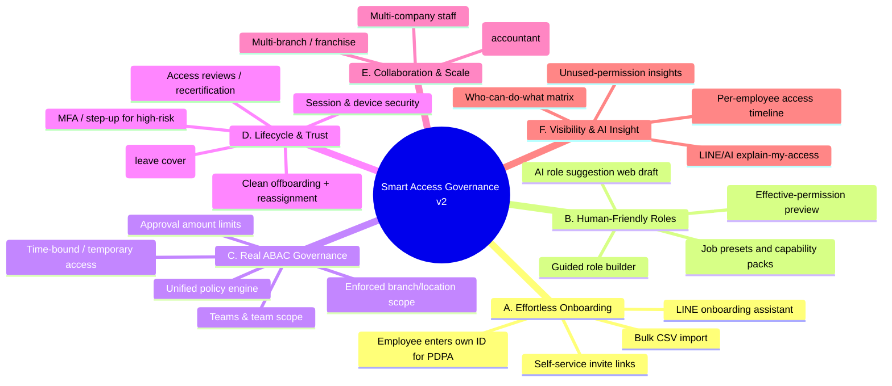
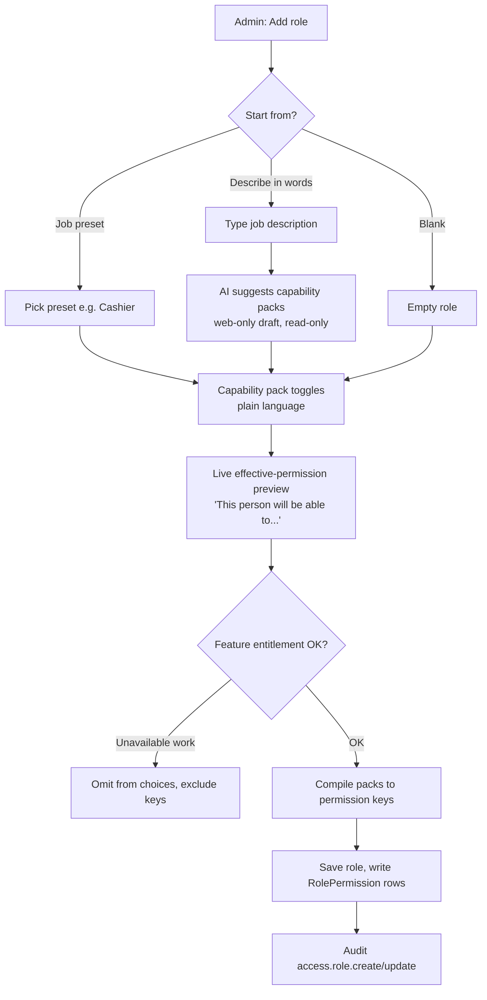
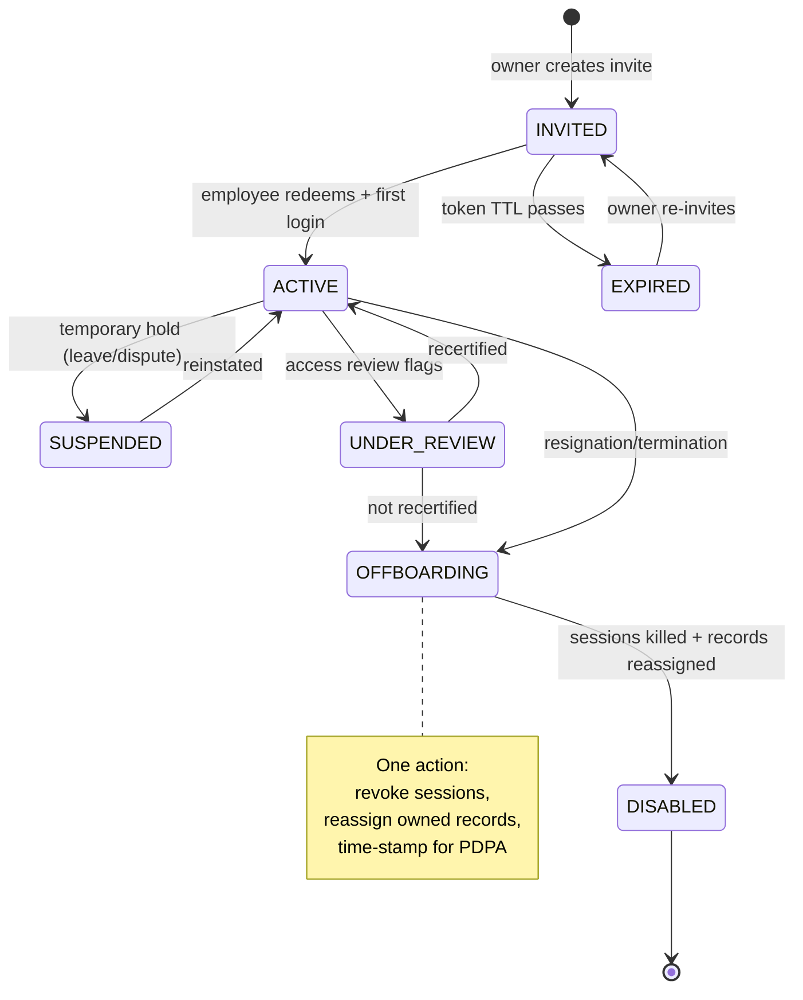
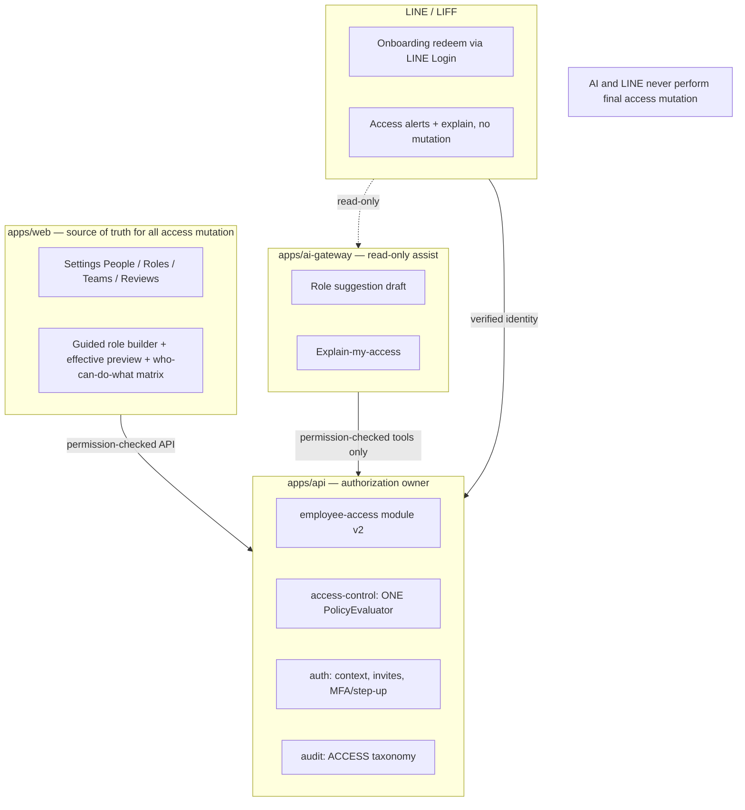

# Employee Access and Role Management v2 — Smart Access Governance Plan

## Status

**Proposed design. Not implemented.** This plan extends the shipped [[plans/employee-access-role-management-plan|Employee Access and Role Management Plan]] (Master Checklist item 10C, done and verified) into a forward-looking "Smart Access Governance" suite for Thai SMEs.

- Canonical order proposal: new roadmap item **10C+ / item 25 — Access Governance & Team Management** (see [§18 Roadmap Placement](#18-roadmap-placement)).
- Design intent: keep every phase a shortest-correct increment on the existing RBAC primitives; ship MVP-first pillars now, mark the rest as owner-pullable backlog (matching the repo's existing Roadmap Backlog idiom).

## Linked Spec

- Phase 1 implement-ready spec: [[specs/employee-access-role-management-v2-phase1-spec|v2 Phase 1 Spec: Capability Packs, Job Presets, Effective-Access]]
- Existing spec: [[specs/employee-access-role-management-spec|Employee Access and Role Management Spec]]
- Existing plan: [[plans/employee-access-role-management-plan|Employee Access and Role Management Plan]] (item 10C, shipped)
- Foundational specs: [[specs/auth-authorization-rbac-spec|Auth/RBAC Spec]], [[specs/permission-matrix|Permission Matrix]], [[specs/line-ai-channel-auth-spec|LINE AI Channel/Auth Spec]], [[specs/line-ai-read-only-assistant-spec|LINE AI Read-Only Assistant Spec]], [[specs/web-core-workspace-spec|Web Core Workspace Spec]], [[specs/data-model-core-spec|Data Model Core Spec]]
- Related plans: [[plans/admin-company-onboarding-plan|Admin Company Onboarding Plan]] (10A), [[plans/workflow-automation-plan|Workflow Automation Plan]] (16), [[plans/session-logout-security-plan|Session & Logout Security Plan]] (02B), [[plans/forgot-password-reset-plan|Forgot Password & Reset Plan]] (02A), [[plans/payroll-hr-compliance-plan|Payroll & HR Compliance Plan]] (20)
- Related ADRs: [[adr/0009-auth-security-email-delivery|ADR 0009 SES Email]], [[adr/0008-line-ai-access-and-auth|ADR 0008 LINE AI Access]]
- Thai summary: `Doc/employee-access-role-management-v2-summary-th.md`

## Purpose

Item 10C proved the foundation: an owner/admin can create a named employee, hand off a one-time password, assign roles, and issue a LINE account-link QR — all permission-gated and audited. That is *access provisioning*. It is not yet *access governance*.

A real Thai SME does not think in 209 permission keys. It thinks in jobs: "this person is a cashier", "this person does the books", "let the new part-timer only see stock", "give the outside accountant read access until we file VAT", "revoke the guy who quit today and hand his customers to someone else". v2 turns raw RBAC into a system an owner with no IT background can operate confidently in minutes, while giving the platform real attribute-based governance (team, branch, amount, and time scope) that modules can enforce consistently instead of ad hoc.

Business outcome: **faster, safer team growth.** Lower time-to-first-login, fewer over-privileged accounts, clean offboarding, and access that an owner can actually understand and trust — because unclear access is the #1 reason SMEs keep sharing the owner password (a pain point named directly in `docs/product/business-model.md`).

## Current Repository Context

### What item 10C already ships (reuse, do not rebuild)

- **Identity/RBAC primitives:** `User`, `UserCredential`, `CompanyMembership`, `Role` (system + company custom, keyed by `scopeKey`+`key`, `isSystem`), `Permission`, `RolePermission`, `MembershipRole`, `AuthSession`, `ExternalIdentity`, `AuditLog`.
- **Employee provisioning:** `EmployeeAccessProfile` (encrypted Thai ID/passport via `identityLast4`/`identityHash`/`identityEncryptedRef`), `EmployeeLineLinkToken` (short-lived, single-use, SHA-256 hashed). Backend module `apps/api/src/modules/employee-access/` (14 use-cases, 3 controllers under `companies/:companyId/settings/{employees,roles,permissions}`), contracts `packages/contracts/src/employee-access.ts`, web `apps/web/src/features/employee-access/`.
- **Permissions:** 10 `access.*` keys in `apps/api/src/modules/auth/permission-registry.ts`; `ROLE_GRANTS` maps role → keys; `COMPANY_PERMISSION_KEYS = PERMISSION_KEYS.filter(k => !k.startsWith('system.'))`.
- **Audit:** `ACCESS_*` action taxonomy in `apps/api/src/modules/audit/domain/models/audit-action.ts`.
- **Branch scope (partial):** `CompanyMembership.branchScopeMode` (`ALL_BRANCHES | SELECTED_BRANCHES | DEFAULT_BRANCH_ONLY`), `MembershipBranchScope`, resolved into `RequestContext.scopes.branchIds` by `PrismaPermissionResolverRepository`.
- **Guards:** `DenyByDefaultGuard` + `@RequirePermissions(...)` + `@Public()`; server-derived `RequestContext`.

### Gaps this plan closes (all verified in code, not assumed)

| # | Gap | Evidence in repo | Business cost |
|---|-----|------------------|---------------|
| G1 | **209 permission keys, no human-friendly grouping.** Owner faces a raw checkbox grid. | `permission-registry.ts` `PERMISSION_KEYS`; web `RoleForm` renders catalog as checkboxes grouped by module only. | Owners default to over-granting or keep sharing owner login. |
| G2 | **No role templates / job presets.** Every custom role is built from scratch. | No preset entity; `SYSTEM_ROLES` are fixed and non-parameterized. | Slow, error-prone role setup; inconsistent access across companies. |
| G3 | **Manual, one-by-one onboarding.** Owner types name + Thai ID + phone per person. No self-service invite, no bulk. | `CreateEmployeeInput` requires `identityNumber`; no invite/bulk use-case; spec lists bulk import + email/SMS as non-goals. | High-friction team growth; owner data-entry burden; PDPA exposure (owner handling others' ID numbers). |
| G4 | **ABAC is aspirational, not real.** Two *unused* policy evaluators exist; `scopes` only ever carries `branchIds`; `teamIds`/`locationIds` are declared but never populated; **no Team entity exists**; MANAGER "team scope" is a code comment, not enforcement. | `modules/access-control/.../policies/*` (`POLICY_EVALUATOR_TOKEN` injected nowhere) and `common/security/abac/*` (imported nowhere); `permission-resolver` only sets `branchIds`; grep: no `teamId` model. | Managers see everything or nothing; no per-team data isolation; approval limits and time-bound access impossible. |
| G5 | **No approval limits / amount thresholds bound to a person or role.** Permission matrix references amount-limit ABAC, but nothing stores or enforces it. | `auth-authorization-rbac-spec` §10 lists "amount approval limit" as a hook; no field/table. | Every approval is all-or-nothing; owner cannot delegate bounded authority. |
| G6 | **No time-bound / temporary access.** Membership is permanent until manually disabled. | No `validFrom`/`validUntil` on membership or role assignment. | Seasonal staff, contractors, and "read until we file tax" cases require manual cleanup that gets forgotten. |
| G7 | **No access-request / self-service elevation workflow.** Only owner/admin can change access, push-only. | No `AccessRequest` entity; not wired to item 16 Workflow. | Owner is a bottleneck; staff work around limits by sharing accounts. |
| G8 | **No delegation.** No "cover my approvals while I'm on leave." | No delegation entity. | Approvals stall during leave; owner temporarily hands out full access. |
| G9 | **Offboarding is disable-only.** No record reassignment, session kill sweep, or checklist. | `SetEmployeeStatusUseCase` flips membership+profile status; sessions revoked only via item 02B path, records (customers/leads/tasks) left dangling. | Orphaned customers/opportunities; ex-staff sessions; audit ambiguity. |
| G10 | **No access review / recertification.** Access never expires or gets re-confirmed. | No review entity/schedule. | Privilege creep; stale access is invisible to the owner. |
| G11 | **No external collaborator model.** Outside accountant = normal single-company membership (explicitly deferred). | `auth-authorization-rbac-spec` §18/§20 "external collaborator model is deferred". | The single most common SME access case (outsourced bookkeeper serving several SMEs) is unserved. |
| G12 | **No MFA / step-up for high-risk actions.** Owner MFA is a "policy/config hook" only. | `auth-authorization-rbac-spec` §18: "OWNER MFA starts as policy/config hooks". | High-risk actions (role change, export, void, period close) rely on password alone. |
| G13 | **No effective-access visibility.** Owner cannot answer "what can this person actually do?" without reading role grants. | `GET /auth/me` returns own context only; no cross-employee effective-access view. | Owner cannot audit or trust the system → falls back to shared credentials. |
| G14 | **AI cannot help with access at all.** The product is AI-first, but access setup gets none of it. | LINE/AI read-only allowlist (item 07) has no access-assist tool. | Misses the product's core differentiator for the hardest-to-use surface. |
| G15 | **Per-person permission switches are read-only and the menu matrix hides channel-specific grants.** | `IndividualPermissionsPrototypePage` disables overrides; no `MembershipMenuOverride` model/write endpoint exists; the `expenses` matrix row maps generic actions but does not expose `expense.receipt.line_upload` separately. | An owner can see “ค่าใช้จ่าย+ใบเสร็จ” enabled yet cannot tell whether that employee can submit a bill through LINE, creating a misleading authorization surface. |

## Design Principles

1. **Deny by default, everywhere.** New capabilities never widen the default grant. Every new permission key starts ungranted except to OWNER (via the existing `COMPANY_PERMISSION_KEYS` filter) and, where justified, ADMIN.
2. **Speak human, store keys.** Owners interact with *jobs* and *capability packs* in plain Thai/English; the system compiles those to the existing permission keys. No new authorization mechanism — a friendlier author-time layer over the same runtime.
3. **One policy engine, not three.** Consolidate the two dead ABAC scaffolds into a single real `PolicyEvaluator` on the existing request-context path. Modules opt in per use-case; no parallel abstractions.
4. **Reuse primitives; extend, don't fork.** Teams, invites, delegation, time-bound access attach to `CompanyMembership`/`MembershipRole`/`Role`. No second user, role, permission, session, or LINE-link system.
5. **AI assists, never mutates access.** AI may *suggest* a role, *explain* access, and *draft* an onboarding — always web-reviewed, permission-checked, and read-only at the final-mutation boundary. The item 07 read-only tool allowlist stays intact.
6. **Business language only.** Company users pick a job and the work it may perform. Raw permission/feature keys belong to internal tooling and never appear in this UI; unavailable work is omitted instead of shown as a technical lock.
7. **Every access change is audited without secrets.** Extend the `ACCESS_*` taxonomy; never log ID numbers, passwords, tokens, or invite secrets.
8. **PDPA-aware.** Minimize collection (self-service lets employees enter their own ID), mask by default, encrypt sensitive identifiers, and support data-subject deletion on offboarding.

## The Six Pillars of Smart Access



Each pillar maps to concrete gaps and phases:

| Pillar | Closes gaps | Phases |
|--------|-------------|--------|
| A. Effortless Onboarding | G3 | 2, 3 |
| B. Human-Friendly Roles | G1, G2, G13, G14 | 1, 6 |
| C. Real ABAC Governance | G4, G5, G6 | 4, 5 |
| D. Lifecycle & Trust | G8, G9, G10, G12 | 7, 8 |
| E. Collaboration & Scale | G11 | 9 |
| F. Visibility & AI Insight | G13, G14 | 1, 6, 8 |

## User Roles

Reuse the ten seeded roles (`OWNER`, `ADMIN`, `MANAGER`, `SALES`, `INVENTORY`, `FINANCE`, `ACCOUNTANT`, `MARKETING`, `STAFF`, `AUDITOR_READONLY`) plus platform `SYSTEM_ADMIN`. v2 adds *composition and scope*, not new base roles:

- **Owner** — sole holder of destructive access-governance authority (approve access requests, run access reviews, appoint admins, configure MFA policy). Protected: last active owner cannot be demoted/disabled (structural today, kept).
- **Admin** — day-to-day people-ops: invite, assign job presets, manage teams, run bulk import, handle offboarding — *within* owner-set guardrails (cannot grant beyond own effective permissions; cannot touch OWNER/SYSTEM_ADMIN; cannot self-elevate).
- **Manager** — team-scoped: approves access requests for own team, delegates own approvals, sees own team's effective access. First real consumer of team ABAC.
- **Employee (any base role)** — completes self-service onboarding, can *request* additional access, views own effective access ("what I can do and why").
- **External collaborator (e.g. outsourced accountant)** — cross-company, scoped, time-boxed read/limited-write membership with its own guardrails.
- **AI assistant user** — receives role suggestions and access explanations; cannot mutate access.

## User Stories

### Pillar A — Effortless Onboarding
- **A1.** As an **owner**, I create an invite link/QR for a new cashier, send it via LINE/chat, and the cashier fills in their own name, ID, and phone — so I never handle their ID number and setup takes seconds.
- **A2.** As an **admin** hiring 12 seasonal staff, I upload a CSV of name/phone/role and the system creates all invites at once, showing me which rows need fixing.
- **A3.** As a **new employee**, I scan the QR, verify via LINE Login, set my password, and land on my allowed home screen — without an owner reading my ID aloud over the phone.
- **A4.** As an **owner**, an invite auto-expires if unused in 72h and I can see who has/hasn't onboarded at a glance.

### Pillar B — Human-Friendly Roles
- **B1.** As an **owner** with no IT background, I pick "Cashier" from a preset list and the person gets exactly the right permissions — I never see the raw permission grid.
- **B2.** As an **admin**, I build a custom role by toggling plain-language capability packs ("Can sell", "Can see money", "Can approve up to ฿X") and I see a live "This person will be able to…" preview before saving.
- **B3.** As an **owner**, I describe a job in one sentence ("front desk, takes orders, no discounts") and AI suggests a starter role I can review and adjust in the web builder.
- **B4.** As an **admin**, I see only work that this company can use and that I am allowed to grant, so unavailable modules do not create confusing locked choices.

### Pillar C — Real ABAC Governance
- **C1.** As a **manager**, I only see and manage my own team's customers, expenses, and staff — not the whole company.
- **C2.** As an **owner** with 3 branches, I scope a staffer to one branch and that limit is enforced in inventory, sales, and reports the same way.
- **C3.** As an **owner**, I let a manager approve reimbursements up to ฿5,000 but anything above routes to me — enforced, not honor-system.
- **C4.** As an **owner**, I grant a contractor access that automatically ends on a chosen date, with no cleanup to remember.

### Pillar D — Lifecycle & Trust
- **D1.** As a **manager** going on leave, I delegate my approval authority to a peer for a fixed window; it reverts automatically.
- **D2.** As an **owner**, when someone quits I run one offboarding action that disables access, kills sessions, and reassigns their open customers/leads/tasks to a chosen colleague.
- **D3.** As an **owner**, every quarter the system asks me to re-confirm who has finance/export access, and flags anyone who hasn't used a granted permission in 90 days.
- **D4.** As an **owner**, high-risk actions (role change, export, void, period close) require a second factor / re-auth, per policy I control.

### Pillar E — Collaboration & Scale
- **E1.** As an **outsourced accountant**, I access several client SMEs from one login, each scoped to accounting/tax read + export, with per-client audit.
- **E2.** As an **owner**, I invite my accounting firm with a time-boxed, accounting-only collaborator role — not a full staff account.

### Pillar F — Visibility & AI Insight
- **F1.** As an **owner**, I open a "who can do what" matrix and instantly see every person's effective capabilities and scope.
- **F2.** As an **employee** in LINE, I ask "why can't I issue this invoice?" and AI explains which permission I'm missing and who can grant it (read-only, no mutation).
- **F3.** As an **owner**, I see per-employee access history (granted, used, changed, reviewed) as one timeline for audit and trust.

## Business Journeys and Flows

### Flow 1 — Self-service invite onboarding (Pillar A)

```mermaid
sequenceDiagram
    actor Owner
    participant Web as Web (Settings > People)
    participant API as API (employee-access)
    participant Employee
    participant LIFF as LINE Login/LIFF
    Owner->>Web: Create invite (job preset, optional prefill)
    Web->>API: POST /settings/invites
    API->>API: Mint EmployeeInvite (hashed token, expiry, preset)
    API-->>Web: invite link + QR (one-time secret shown once)
    Owner-->>Employee: Share link/QR via LINE/chat
    Employee->>LIFF: Open link, verify identity (LINE Login)
    LIFF->>API: Redeem invite (verified identity)
    API->>API: Validate token (unused, unexpired, right company)
    Employee->>API: Submit own name / Thai ID / phone
    API->>API: Create User+Membership+Profile+Role (1 tx), encrypt ID
    API->>API: Issue temp password / force change
    API->>API: Audit access.invite.redeemed (no secrets)
    API-->>Employee: Land on allowed home; LINE already linked
    Note over API,Employee: Owner never handles the ID number (PDPA win)
```

### Flow 2 — Guided role builder with AI suggestion + preview (Pillar B / F)



### Flow 3 — Access request and approval (Pillar C / D, reuses item 16 Workflow)

```mermaid
sequenceDiagram
    actor Employee
    participant Web
    participant API
    participant Approver as Manager/Owner
    participant WF as Workflow (item 16)
    participant Line as LINE alert
    Employee->>Web: Request capability ("approve up to ฿5k")
    Web->>API: POST /settings/access-requests
    API->>API: Create AccessRequest (pending), audit
    API->>WF: Emit approval task
    WF->>Line: Notify approver (read-only summary + web deep link)
    Approver->>Web: Review request (sees effective delta preview)
    Approver->>API: Approve / reject (step-up auth if high-risk)
    API->>API: On approve: grant scoped/time-bound access in 1 tx
    API->>API: Audit access.request.approved (+ policy applied)
    API-->>Employee: Access updated; LINE confirms (no mutation via LINE)
```

### Flow 4 — Unified ABAC policy pipeline (Pillar C)

```mermaid
flowchart LR
    R[HTTP request] --> G[DenyByDefaultGuard]
    G --> P[RequirePermissions key check]
    P --> C[Resolve RequestContext<br/>roles, permissions, scopes]
    subgraph PE [Unified PolicyEvaluator]
      direction TB
      T[TenantBoundary] --> O[OwnRecord]
      O --> TS[TeamScope]
      TS --> BS[Branch/LocationScope]
      BS --> AL[AmountLimit]
      AL --> TW[TimeWindow validFrom-validUntil]
      TW --> PR[PeriodClosed]
    end
    C --> T
    PR -->|first deny wins| D{Decision}
    D -->|allow| U[Use case executes]
    D -->|deny| F[403 + audit denial category]
```



### Flow 5 — Employee access lifecycle state machine (Pillar D)



### Flow 6 — Where things live (architecture boundary)



## Data Model Extensions

Additive only. Reuse `CompanyMembership`, `MembershipRole`, `Role`, `RolePermission`, `AuditLog`, `EmployeeAccessProfile`, `MembershipBranchScope`. New models are proposals; final shapes decided per phase against then-current schema.

```text
# Pillar B — Human-friendly roles
CapabilityPack            # curated, plain-language bundle of permission keys
- id, key, nameTh, nameEn, description, module
- permissionKeys[]        # compiles to existing keys
- featureEntitlementKey?  # gates visibility to subscribed plans
- riskLevel

RoleTemplate (JobPreset)  # e.g. Cashier, Sales, Bookkeeper
- id, key, nameTh, nameEn, description, industryTag?
- capabilityPackKeys[]    # -> permission keys at apply time
- defaultScope: {branch|team|amountLimit} hints
- isSystem                # seeded presets vs company-authored

# Pillar C — Real ABAC
Team
- id, companyId, name, parentTeamId?  # simple hierarchy
- managerMembershipId?
TeamMembership
- id, teamId, membershipId, roleInTeam?
MembershipScope (extends existing branch scope idea)
- membershipId, teamScopeMode, teamIds[], amountApprovalLimit?, currency
MembershipRole (extend)
- + validFrom?, validUntil?   # time-bound role assignment
CompanyMembership (extend)
- + validFrom?, validUntil?   # time-bound membership (contractors/seasonal)

# Pillar A — Onboarding
EmployeeInvite
- id, companyId, tokenHash, status(PENDING|REDEEMED|EXPIRED|REVOKED)
- roleTemplateKey?, prefill{displayName?, phone?}, scopeHints
- issuedByUserId, expiresAt, redeemedByUserId?, redeemedAt
BulkImportBatch / BulkImportRow
- batch: id, companyId, status, counts
- row: batchId, rawData, validationErrors[], resultInviteId?

# Pillar C/D — Requests, delegation, review
AccessRequest
- id, companyId, requesterMembershipId, requestedCapabilityPackKeys[]/roleId
- justification, status(PENDING|APPROVED|REJECTED|EXPIRED)
- approverMembershipId?, decidedAt, appliedGrantRef
AccessDelegation
- id, companyId, fromMembershipId, toMembershipId
- scope(approvalsOnly|roleSet), validFrom, validUntil, status
AccessReviewCycle / AccessReviewItem
- cycle: id, companyId, category(finance|export|admin|all), dueAt, status
- item: cycleId, membershipId, decision(KEEP|REVOKE|REDUCE), reviewedBy, reviewedAt

# Pillar D — MFA / step-up
UserMfaFactor
- id, userId, type(TOTP|LINE), status, enrolledAt
StepUpChallenge
- id, userId, action, status, expiresAt   # short-lived, never logs codes

# Pillar E — External collaborator
ExternalCollaborator
- id, userId, kind(ACCOUNTANT_FIRM|CONSULTANT), firmName?
- (uses normal CompanyMembership per client company + collaborator guardrail flag)
```

## Permission and Contract Additions

New `access.*` keys (deny-by-default; OWNER via filter, ADMIN case-by-case). Names follow `module.resource.action`:

```text
access.invite.issue          access.invite.revoke        access.invite.read
access.bulk_import.run
access.team.read             access.team.manage          access.team.assign
access.scope.manage          # branch/team/amount/time scope on a membership
access.request.read          access.request.submit       access.request.decide
access.delegation.manage
access.review.read           access.review.run           access.review.decide
access.role_template.read    access.role_template.manage
access.effective.read        # who-can-do-what matrix + per-employee effective view
access.mfa.policy.manage
access.collaborator.invite   access.collaborator.manage
```

Contract additions in `packages/contracts/src/employee-access.ts` (extend, don't fork): `CapabilityPack`, `RoleTemplate`, `EffectiveAccessView`, `CreateInviteInput`/`InvitePackage`, `BulkImportResult`, `TeamSummary`, `MembershipScopeInput`, `AccessRequestSummary`, `DelegationInput`, `AccessReviewItem`, `RoleSuggestionDraft`.

## Unified Policy Engine (consolidation, not a new abstraction)

The repo currently has **two dead ABAC scaffolds** (`modules/access-control/.../policies/*` with `POLICY_EVALUATOR_TOKEN` injected nowhere, and `common/security/abac/*` imported nowhere). v2 **deletes one and promotes the other to the single real path**:

- Keep `modules/access-control` `CompositePolicyEvaluator` ("first deny wins"); delete the unused `common/security/abac` duplicate.
- Extend `PolicyContext` with `resourceTeamId?`, `resourceBranchId?`, `amount?`, `now`, `periodState?`.
- Add policies: `TeamScopePolicy`, `BranchScopePolicy` (move inventory's inline `ctx.scopes.branchIds` checks here), `AmountLimitPolicy`, `TimeWindowPolicy`, `PeriodClosedPolicy`.
- Populate `RequestContext.scopes.teamIds` in `PrismaPermissionResolverRepository` (today always undefined).
- Modules opt in per use-case via one injected evaluator — no per-module ABAC reinvention. Migrate the existing inventory branch checks first (proves parity), then expand module by module exactly as the RBAC spec's phased ABAC intent already prescribes.

This is the single most important architectural payoff: it turns G4 from "aspirational comments" into "one enforced engine" without adding a third abstraction (honoring the ponytail rule).

## AI Integration (read-only, web-reviewed)

Reaffirms the item 07 boundary. AI **never** performs a final access mutation.

- **Role suggestion (Pillar B):** an AI Gateway tool takes a natural-language job description and returns a *draft* `RoleSuggestionDraft` (capability packs + rationale). Web renders it in the guided builder for human review/edit/save. No permission is granted by AI.
- **Explain-my-access (Pillar F):** read-only tool answers "why can't I do X?" by comparing the user's effective permissions to the action's required key — surfaces the missing key and who can grant it, with a web deep link. Inherits the requester's own permission scope.
- **Anomaly insight (later):** read-only surfacing of "granted-but-unused" and "unusual escalation" into the owner's access-review queue. Decisions stay human + web.
- LINE surface: onboarding redeem (verified identity) + access alerts/explanations only. LINE refuses invite/role/permission/status/MFA mutation, matching the permission-matrix §8 LINE rules verbatim.

## Phased Roadmap and Todo Lists

Ordered MVP-first. Phases 1–3 deliver the biggest SME usability win at lowest risk; 4–5 add real governance; 6–9 are owner-pullable backlog. Each phase = a shortest-correct increment with its own tests and exit criteria.

### Phase 0 — Discovery and Alignment
**Goal:** confirm current RBAC/ABAC/audit/web state still matches this plan before any code.
- [ ] Re-read item 10C code, permission registry, `permission-resolver.repository.ts`, both ABAC scaffolds, audit taxonomy, web `EmployeeAccessPages.tsx`.
- [ ] Confirm feature-entitlement source of truth for capability-pack gating (`CompanyFeatureEntitlement`), currently unenforced anywhere.
- [ ] Confirm item 16 Workflow can host access-request approval tasks; confirm item 02B session-revocation hook for offboarding.
- [ ] Confirm item 20 Payroll boundary stays separate (v2 stores access identity only, never compensation).
- [ ] Record findings in `docs/agent-memory/employee-access-role-management-v2.md`.
**Exit:** exact files to extend are known; no duplicate auth/role/permission/ABAC/audit system planned.

### Phase 1 — Human-Friendly Roles (Pillar B, F) — *ship first*
**Implement-ready spec:** [[specs/employee-access-role-management-v2-phase1-spec|v2 Phase 1 Spec]] (full capability-pack catalog, job presets, data model, API, and contracts).
**Goal:** an owner never faces a raw permission grid; roles are built from plain-language capability packs and previewed.
- [ ] Define `CapabilityPack` catalog (curated bundles over existing keys) with Thai/English labels; seed system packs.
- [ ] Define `RoleTemplate`/job presets seeded system-wide, covering all decided niches (owner decision #2): **Retail** (Cashier, Sales, Stock/Inventory, Store Manager), **Trading** (Sales, Purchasing, Inventory, AR/AP Finance), **Service** (Front desk, Sales/CRM, Finance, Manager), **E-commerce** (Order ops, Fulfillment/Inventory, Finance), plus cross-cutting **Accounting** (Bookkeeper/Accountant) and **Marketing** presets, and a universal **Read-only/Auditor** preset. Ship a shared base + per-niche pack.
- [ ] Backend: `list-capability-packs`, `list-role-templates`, `apply-role-template` use-cases; extend `create/update-role` to accept packs (compile → keys).
- [ ] Backend: `get-effective-access` use-case (per employee + company matrix), permission `access.effective.read`.
- [ ] Enforce feature-entitlement filtering on pack visibility (closes the 10C deferred item, now that a real gating pattern exists here).
- [ ] Web: guided role builder (plain-language work toggles only), live "This person will be able to…" preview, who-can-do-what matrix; omit locked/ungrantable options and preserve hidden legacy keys on edit.
- [ ] Contracts + permission keys + audit actions.
- [ ] Tests: pack→key compilation, preset apply, entitlement filtering, effective-access correctness, protected-role guards intact.
**Exit:** owner creates a working role from a preset in under a minute without seeing internal keys or lock reasons; no default grant widened and existing hidden grants survive ordinary edits.

**Deferred follow-up — individual overrides and honest menu semantics (owner clarification 2026-07-15):**
- [ ] Implement the real membership-level override store and audited API before enabling the "สิทธิ์เฉพาะบุคคล" switches; do not persist local-only UI state.
- [ ] Define allow/deny precedence against role grants, feature entitlements, branch/team scope, granter ceiling, protected system roles, and last-owner rules, then make the shared permission resolver authoritative for web, API, LIFF, and LINE.
- [ ] Replace the generic expense-menu implication with explicit effective capabilities for own LINE receipt submission, own web upload/draft work, review, confirm, payment, and void. In particular, `expense.receipt.line_upload` must be visible and testable rather than inferred from `expense.read` or `expense.create`.
- [ ] Keep protected system-role defaults code-registered and database-synced; individual overrides are an additional audited layer, not a second role source of truth.
- [ ] Add regression coverage proving the matrix/individual screen and a real LINE webhook resolve the same effective `expense.receipt.line_upload` decision.

### Phase 2 — Self-Service Invite Onboarding (Pillar A) — *ship second*
**Goal:** owner issues an invite link/QR; employee enters own identity and self-onboards. **Primary channel is LINE-Login-verified self-service (owner decision #1); email/SES is a deferred secondary channel — no SES dependency in this phase.**
- [ ] `EmployeeInvite` model + `issue/revoke/list/redeem` use-cases; hashed single-use token, 72h TTL, bound to company + optional preset + scope hints.
- [ ] Redeem flow reuses LINE Login/LIFF verification + `LinkLineIdentityUseCase`; creates User+Membership+Profile+Role in one tx; employee enters own Thai ID/passport (encrypted via existing cipher).
- [ ] Force temp-password change on first web login (reuse existing `mustChangePassword`).
- [ ] Web: invite create card (pick preset, optional prefill), invite status list (pending/redeemed/expired), one-time link/QR handoff, LIFF redeem screen.
- [ ] Audit `access.invite.issue/revoke/redeemed` (no secrets, no ID number).
- [ ] Tests: expired/reused/wrong-company token refusal, self-entered ID encryption, one-tx integrity, PDPA masking.
**Exit:** an employee onboards end-to-end without the owner handling their ID; owner sees onboarding status.

### Phase 3 — Bulk Import (Pillar A)
**Goal:** onboard many staff at once with validation.
- [ ] `BulkImportBatch`/`Row`, `run-bulk-import` use-case (CSV → validated invite rows), permission `access.bulk_import.run`.
- [ ] Per-row validation (duplicate ID/phone, invalid role, entitlement); partial-success report.
- [ ] Web: upload, column map, dry-run preview, error download, confirm.
- [ ] Tests: dedupe, partial failure, rollback semantics, audit per batch.
**Exit:** an admin imports N staff, fixes flagged rows, issues invites in one pass.

### Phase 4 — Unified Policy Engine + Teams + Branch/Team Scope (Pillar C) — *governance core*
**Goal:** one real ABAC engine; MANAGER "team scope" becomes true enforcement.
- [ ] Delete unused `common/security/abac`; promote `access-control` `CompositePolicyEvaluator` to the single path.
- [ ] `Team`/`TeamMembership` models; `access.team.*` keys; web team management.
- [ ] Populate `RequestContext.scopes.teamIds`; add `TeamScopePolicy` + `BranchScopePolicy`.
- [ ] Migrate inventory's inline branch checks to `BranchScopePolicy` (parity proof), then wire employee-access + CRM read paths to team scope.
- [ ] Contracts + `access.scope.manage`; web membership-scope editor (branch/team pickers).
- [ ] Tests: cross-team denial, branch parity with old inventory behavior, deny-first-wins ordering, no regression in existing modules.
**Exit:** a manager sees only their team; branch scope enforced identically across ≥2 modules via one engine.

### Phase 5 — Approval Limits + Time-Bound Access (Pillar C)
**Goal:** bounded and expiring authority.
- [ ] `MembershipScope.amountApprovalLimit`; `AmountLimitPolicy`; wire into reimbursement/expense/PO approval use-cases (items 14/09/12). **Default is strict: require approval from ฿1, configurable per role/membership (owner decision #5); currency defaults to company base currency.**
- [ ] `validFrom/validUntil` on `CompanyMembership` + `MembershipRole`; `TimeWindowPolicy`; scheduled expiry sweep (reuse workers/outbox).
- [ ] Web: amount-limit field on role/membership; date-bounded access UI with expiry badges.
- [ ] Tests: over-limit routes to higher approver, expired access fails closed at the second it lapses, expiry sweep idempotency.
**Exit:** owner delegates bounded, expiring authority that the system enforces without manual cleanup.

### Phase 6 — AI Access Assist (Pillar B, F)
**Goal:** AI suggests roles and explains access, read-only.
- [ ] AI Gateway `suggest-role` tool → `RoleSuggestionDraft` (web-reviewed, no grant).
- [ ] `explain-access` read-only tool (missing-key + who-can-grant), inherits requester scope.
- [ ] Web: "Describe the job" entry into the guided builder; "why can't I…" helper. LINE: explain-only, no mutation.
- [ ] Tests: AI cannot mutate access (boundary test), suggestion stays within entitlement, explanation respects requester permission scope.
**Exit:** owner sets up a role from a sentence; employee gets self-serve access explanations; item 07 boundary intact.

### Phase 7 — Lifecycle: Delegation + Clean Offboarding (Pillar D)
**Goal:** leave-cover delegation and one-action offboarding with reassignment.
- [ ] `AccessDelegation` (approvals-only or role-set, time-boxed, auto-revert); `access.delegation.manage`.
- [ ] Offboarding action: disable membership + revoke all sessions (item 02B) + reassign owned records (CRM/tasks) to chosen colleague + PDPA timestamp — one transaction/orchestration.
- [ ] Web: delegation UI, offboarding wizard (pick successor, preview reassignments).
- [ ] Tests: delegated approval works only in window, offboarding kills sessions + reassigns + fails closed, no orphaned records.
**Exit:** approvals never stall during leave; offboarding leaves no dangling access or records.

### Phase 8 — Access Reviews + MFA/Step-Up (Pillar D, F)
**Goal:** periodic recertification and second-factor for high-risk actions.
- [ ] `AccessReviewCycle`/`Item` + scheduler; **default cadence quarterly, scoped to finance/export/admin categories (owner decision #6)**; all-category review is opt-in per company; owner recertifies by category; "granted-but-unused (90d)" insight.
- [ ] `UserMfaFactor` + `StepUpChallenge`; **LINE-based second factor first (owner decision #3), TOTP later**; enforce step-up on role/permission change, export, document void, and period close/unclose (turns the RBAC spec's MFA "hooks" into real gates).
- [ ] Web: review queue, MFA enrollment, step-up modal. Never log codes.
- [ ] Tests: review decisions apply grants/revokes, step-up required for gated actions, unused-permission detection.
**Exit:** access is recertified on schedule; high-risk actions require a real second factor per owner policy.

### Phase 9 — External Collaborator + Multi-Company (Pillar E) — *backlog, pull on demand*
**Goal:** outsourced accountant/consultant across multiple client SMEs.
- [ ] `ExternalCollaborator` guardrail on top of normal per-client `CompanyMembership`; `access.collaborator.*`. **Collaborator invites are free and do NOT count as one of the customer's billed user seats (owner decision #4).**
- [ ] Cross-company switcher scoped to collaborator; per-client audit isolation; time-boxed by default.
- [ ] Web: invite-collaborator flow (accounting/tax scope preset), client switcher.
- [ ] Tests: collaborator cannot exceed scoped role, per-client isolation, cross-company audit separation.
**Exit:** an accounting firm serves several SMEs from one login with strict, audited, time-boxed scope.

## Integration Verification (per phase, before checking any item)
- Backend/API contract: new use-cases verified against real Postgres + compiled API build (item 10C dev-runner note now resolved).
- Web journey: guided builder, invite redeem, matrix, offboarding wizard exercised in a live browser session with loading/error/forbidden/empty/expired states.
- LINE/AI: onboarding redeem + explain-only paths verified; boundary test proves no access mutation via LINE/AI.
- Security: confirm in DB that invite tokens are hashed, IDs encrypted, MFA codes never stored, audit rows carry no secrets.
- Commands: `pnpm --filter api typecheck|test`, `pnpm --filter web typecheck|test`, `git diff --check -- docs`.

## Acceptance Criteria (suite-level)
- [ ] An owner with no IT background creates a working role from a preset without seeing the raw permission grid.
- [ ] An employee onboards via invite link entering their own identity; owner never handles the ID number.
- [ ] Bulk import creates validated invites with a partial-success report.
- [ ] Exactly one ABAC policy engine is in use; team and branch scope are enforced identically across ≥2 modules.
- [ ] Approval limits and time-bound access are enforced (over-limit routes up; expired access fails closed).
- [ ] AI can suggest and explain access but cannot grant it; LINE performs no access mutation.
- [ ] Delegation and one-action offboarding (disable + session kill + record reassignment) work and are audited.
- [ ] Access reviews recertify on schedule; high-risk actions require step-up per owner policy.
- [ ] External collaborators access multiple SMEs with scoped, time-boxed, per-client-audited access.
- [ ] No default grant is widened; protected system roles and last-owner protection remain intact.
- [ ] Every new sensitive action is audited without secrets; PDPA masking/encryption/deletion holds.

## Security, Privacy, and Compliance
- **PDPA (Thai):** self-service onboarding minimizes owner handling of employee ID numbers; identifiers stay encrypted (`identityEncryptedRef`) and masked by default; offboarding supports data-subject cleanup with timestamps.
- **Deny by default:** every new key ungranted except OWNER (+ justified ADMIN); capability packs cannot exceed the granter's own effective permissions.
- **Secrets:** invite tokens, MFA codes, temp passwords, and LINE tokens are hashed/one-time and never logged or placed in audit metadata.
- **Fail closed:** expired/suspended/offboarded access loses web, LIFF, LINE, deep-link, notification, upload, and AI-tool access immediately (existing membership-inactive behavior, extended to time windows).
- **Step-up:** high-risk access-governance actions gated by MFA per owner policy.

## Rollout and Migration
- Fully backward compatible with item 10C: existing employees, roles, and grants keep working; capability packs are an author-time layer over the same keys.
- Feature-flag/entitlement each pillar so tiers (Starter/Growth/Pro from `business-model.md`, "Employee/role access pack" add-on) can gate advanced governance.
- Seed system capability packs and job presets in a migration; company custom roles remain untouched.
- No data migration required for Phases 1–3; Phases 4–5 add nullable scope/time fields (safe defaults preserve current behavior).

## Metrics / Success (ties to business-model.md)
- Time from invite issue → first web login / LINE link (target: down vs 10C manual flow).
- % employees created via self-service vs manual (adoption of Pillar A).
- Over-privileged accounts reduced (permissions granted but unused, from Pillar F insight).
- Access reviews completed on time; orphaned records after offboarding (target: 0).
- Owner-password-sharing incidents (proxy: number of active named users vs 1).

## Risks
- **Scope creep vs ponytail rule.** Mitigation: strict phasing; each phase is a smallest-correct diff; Pillars E and later are backlog.
- **ABAC unification touches live modules.** Mitigation: migrate inventory branch checks first as a parity proof before expanding; keep "first deny wins" semantics.
- **AI suggestion over-granting.** Mitigation: suggestions are drafts only, entitlement-bounded, always human-reviewed in web; boundary test in CI.
- **MFA UX friction for SMEs.** Mitigation: LINE-based factor first (users already have LINE), TOTP optional; step-up only on high-risk actions.
- **Feature-entitlement enforcement is new.** Mitigation: introduce it here (Phase 1) as the first real consumer, exactly where 10C deferred it.

## Resolved Owner Decisions (2026-07-03)

All six pre-build questions are decided. These are now binding design inputs for the phases above.

1. **Onboarding channel → LINE-Login self-service invite is the primary path.** Email invites (ADR 0009 SES) are a deferred secondary channel, not required for Phase 2. Phase 2 ships LINE-first; no SES dependency to start.
2. **Job presets → seed all target niches, not one.** Ship system presets for **Retail, Trading, Service, and E-commerce**, plus cross-cutting **Accounting** and **Marketing** presets. Phase 1 seeds a shared base + per-niche pack; owners pick the pack matching their business.
3. **MFA → LINE-based second factor first.** TOTP is a later add. Step-up is mandatory by default on: role/permission change, export, document void, and accounting period close/unclose (Phase 8).
4. **External collaborator → free client-invite; does NOT count as an SME seat.** The SME invites its accountant/bookkeeper for free; the collaborator is not billed as one of the customer's user seats. (Billing the accounting firm itself is a separate future decision.) Phase 9 treats collaborator invites as non-seat.
5. **Approval limits → keep strict ฿1 default, configurable per role/membership.** Matches the current permission-matrix strict default; owners raise thresholds later (Phase 5). Amount-limit ABAC ships, defaulting to require approval from ฿1.
6. **Access review → quarterly, high-risk categories only.** Recertify **finance, export, and admin** access every 3 months by default; broader/all-category review is opt-in per company (Phase 8).

### Residual sub-questions (non-blocking, decide during the owning phase)
- Approval-limit currency handling for multi-currency companies (default: company base currency).
- Whether the quarterly access-review reminder is owner-only or also notifies delegated admins.
- TOTP rollout timing after LINE MFA proves out.

## Roadmap Placement
Proposed as a post-critical-path governance milestone that **depends on** item 10C (access provisioning), item 16 (Workflow, for access-request approval), and item 02B (session security, for offboarding). Suggested handling: register Phases 1–3 as **item 10C+** (near-term usability, no new heavy dependencies) and Phases 4–9 as a new roadmap item (e.g. **25 — Access Governance & Team Management**) in the Roadmap Backlog, pulled forward per owner decision. Update [[plans/master-implementation-checklist|Master Implementation Checklist]] and [[plans/implementation-roadmap|Implementation Roadmap]] when accepted.
