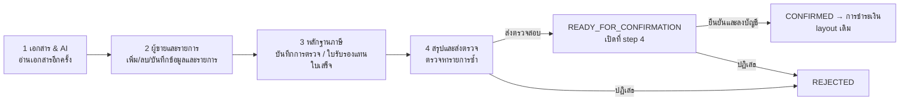

# Expense Detail Modal — Step-by-Step Review Flow (UX Plan)

Status: PLANNED · 2026-07-26
Owner: UX fix for expense review popup (`ExpenseDetailModal`)
Scope: `apps/web` only — no API/contract changes.

## Problem

When an expense draft is open in the detail popup, every action is visible at once:

- Footer: อ่านเอกสารอีกครั้ง · ตรวจหารายการซ้ำ · ปฏิเสธ · ส่งตรวจสอบ
- Body: บันทึกข้อมูลและรายการ (+ เพิ่มรายการ/ลบ per line) · บันทึกการตรวจ · จัดทำใบรับรองแทนใบเสร็จรับเงิน

Users cannot tell what order to work in, and destructive/terminal actions (ปฏิเสธ, ส่งตรวจสอบ) sit beside routine ones. The ask: progressive disclosure — one step at a time — without changing what the system does.

## Design

### Guided mode (stepper)

Active only when the document is editable by the current user:
`canMutateDraft === true` and `status ∈ {DRAFT, NEEDS_REVIEW, READY_FOR_CONFIRMATION}`.
All other cases (read-only viewer, EXTRACTING, CONFIRMED, REJECTED, VOIDED) keep the current continuous-scroll layout and current footer exactly as-is.

Four steps; the sticky chip bar (currently scroll-anchor `navChips`) becomes the stepper header in guided mode. Only the active step's section renders in the body; the footer shows only that step's actions.

| # | key | Shows (existing sections, unchanged internals) | Step actions | Done when (derived from `detail`, server truth) |
|---|-----|------------------------------------------------|--------------|--------------------------------------------------|
| 1 | `document` | Extraction/AI notices, AI data box (status + missing fields) | อ่านเอกสารอีกครั้ง | no attachments (nothing to read) OR `aiVerificationSummaryJson` present |
| 2 | `details` | ExpenseReviewEditSection (vendor + lines, เพิ่ม/ลบ/บันทึกข้อมูลและรายการ) + money summary card | in-body save (unchanged) | vendor name + expense date + ≥ 1 line |
| 3 | `evidence` | DocumentReviewSection (doc type / tax status / category, บันทึกการตรวจ, จัดทำใบรับรองแทนใบเสร็จรับเงิน + substitute receipt sign/approve flow) + price-mismatch warning | in-body actions (unchanged) | `taxEvidenceStatus !== 'PENDING_REVIEW'` AND not classification-blocked AND substitute receipt ready (if relied upon) → else `attention`/`pending` |
| 4 | `review` | Audit checklist card (สรุปการตรวจ) + duplicate warnings card | ตรวจหารายการซ้ำ · ปฏิเสธ · **ส่งตรวจสอบ** (DRAFT/NEEDS_REVIEW) or **ยืนยันและลงบัญชี** (READY_FOR_CONFIRMATION, existing `canConfirmExpense` guard) | duplicates checked (`NO_MATCH`/`OVERRIDDEN`); unresolved duplicate → `attention` |

Navigation rules:

- Chips are freely clickable (jump to any step) — the stepper guides, it does not imprison. ย้อนกลับ/ถัดไป buttons walk sequentially.
- Chip badge per step: ✓ done · ⚠ attention · step number otherwise.
- Initial step on open: first step whose state ≠ done; all done → step 4. `READY_FOR_CONFIRMATION` opens at step 4.
- Payment card is not rendered in guided mode (no actionable/derivable content in these statuses); unchanged elsewhere.

### Button gating (UI-only; backend unchanged)

- ส่งตรวจสอบ: existing `classificationBlocked` guard **plus** step-2 minimum data (vendor name, expense date, ≥1 line). Disabled state gets a tooltip listing what is missing.
- ยืนยันและลงบัญชี: existing guard untouched (`canConfirmExpense`: duplicates resolved, classification ok, substitute ready).
- ปฏิเสธ: moves to step 4 only (still one click away at any time via chip jump). Reject/void reason sub-footer flow unchanged.
- Everything else keeps its current enable/disable conditions and `doAction`/`run` handlers verbatim.

### Flow

## Implementation

1. **`apps/web/src/features/expenses/expenses.model.ts`** — add pure logic (reuse existing helpers; no new deps):
   - `ExpenseReviewStepKey = 'document' | 'details' | 'evidence' | 'review'`
   - `ExpenseReviewStepState = 'done' | 'attention' | 'pending'`
   - `deriveExpenseReviewSteps(detail, canReview)` → ordered `Array<{ key, state }>` implementing the table above (classification via `deriveExpenseClassificationReviewState`, duplicates via `hasUnresolvedDuplicateWarning`, substitute-ready mirrors the existing `substituteReady` expression in `ExpenseDetailModal` — lift it here and reuse from the modal so there is one source of truth).
   - `initialExpenseReviewStep(steps)` → first non-done key, else `'review'`.
2. **`ExpensesPages.tsx` (`ExpenseDetailModal`)** — add `const [step, setStep]`; guided-mode flag as above; chip bar renders steps (guided) or the old anchors (non-guided); body renders active step's existing JSX blocks (move blocks, do not rewrite them); footer switches per step. Existing handlers, guards, tooltips, reject/void sub-footer, preview modal: untouched.
3. **`apps/web/src/common/i18n/workspace-dictionary.ts`** — add th+en: `expenses.step_document`, `expenses.step_review`, `expenses.step_next` (ถัดไป/Next), `expenses.step_back` (ย้อนกลับ/Back), `expenses.step_of` (optional "ขั้นตอน X/4"), `expenses.submit_requires_details` (tooltip). Steps 2–3 reuse `expenses.nav_vendor` / `expenses.nav_documents`.
4. **Tests** — `apps/web/src/features/expenses/expense-review-steps.logic.spec.ts` (node:test, mirror `expenses-audit.logic.spec.ts` pattern): per-step done/pending/attention transitions + initial-step selection (≥ 8 cases, including: no-attachment draft, AI-read draft, missing vendor, PENDING_REVIEW evidence, substitute not ready, unresolved duplicate, all-done, READY_FOR_CONFIRMATION).
5. **`e2e/expenses.spec.ts` EXP-04** — after opening detail: click chip `ผู้ขายและรายการ` → assert money rows; click chip `สรุปและส่งตรวจ` → assert ส่งตรวจสอบ visible. (List-page tests unaffected.)
6. **Docs** — this plan; short "guided step flow" note in `docs/specs/expense-receipt-upload-spec.md` UI section; task memory `docs/agent-memory/expense-detail-stepper-ux.md`.

## Non-goals / guardrails

- No API, contract, or permission changes. No new dependencies.
- No behavior change for read-only users, CONFIRMED/VOIDED/REJECTED/EXTRACTING documents.
- Substitute-receipt sign/approve sub-flow logic untouched (renders inside step 3).
- Keep diffs minimal: relocate existing JSX blocks; do not restyle unrelated parts.

## Verification

- `pnpm --filter @watchdog/web typecheck` · unit specs (node:test) · `pnpm --filter @watchdog/web lint`
- Manual walk: DRAFT with attachment → steps 1→4 → ส่งตรวจสอบ; READY_FOR_CONFIRMATION opens at step 4 with ยืนยันและลงบัญชี; CONFIRMED unchanged; read-only unchanged.
- E2E EXP-01..05 pass against the updated spec when the stack is available.
