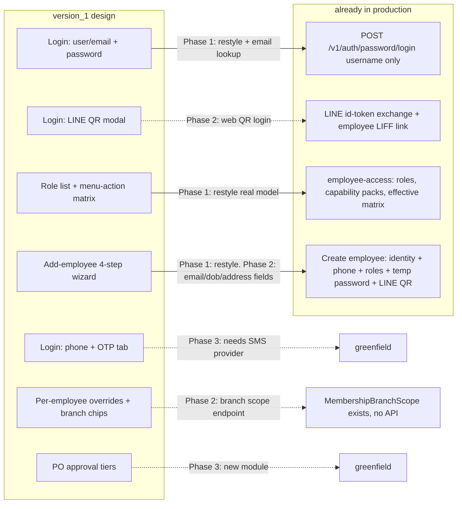

# มั่งมี Auth & Permissions UI Migration Plan

Status: Phase 1 implemented + verified (2026-07-05) — see docs/agent-memory/mangmee-auth-ui-migration.md
Sources of truth:
- Design prototype: `~/Documents/WatchDog/version_1/` (`มั่งมี Login.dc.html`, `มั่งมี Flow A.dc.html`, `มั่งมี Brand Kit.dc.html`, `notes/flow-a-dev-spec.md`, `CLAUDE.md`)
- Existing implementation: `apps/web` (Next.js 16 App Router), `apps/api` (NestJS modular monolith)

## 1. Goal

Migrate the login / logout / permission-management screens to the **มั่งมี** design (green #15803D + gold #F59E0B, IBM Plex Sans Thai + Outfit), while:

1. closing the security gaps found during discovery,
2. handling every error bilingually (th/en) through the existing dictionary i18n,
3. trimming leading/trailing whitespace on **every** input (client and server),
4. making every screen responsive (mobile → desktop),
5. aligning API fields with what the screens actually show.

## 2. Binding design decisions (from version_1/CLAUDE.md and prototype)

| Decision | Rationale |
|---|---|
| UI brand name is **"มั่งมี" only** — never "Mangmee" in UI | user rule in version_1/CLAUDE.md |
| Login keeps the green-gradient hero + floating dashboard card | user rule; do not re-propose alternatives |
| Login form = **username-or-email + password + remember + forgot** | `มั่งมี Login.dc.html` is the final login design; the LINE button was removed by team agreement (comment at line 138), OTP tab exists only in Flow A |
| Green Brand Kit **supersedes** the older purple `flow-a-dev-spec.md` tokens | Brand Kit is newer and self-declared authoritative |
| Permission screens keep the **real RBAC model** (permission keys + capability packs + effective access), restyled to มั่งมี | The prototype's menu×action matrix is a different, simpler model; Phase_1.md mandates "backend is the final authority". Rebuilding the backend model around the prototype matrix would regress the shipped Employee Access v2 system. |

## 3. What exists vs what the design asks for

## 4. Security gaps found (all must be closed in Phase 1)

| # | Vulnerability / gap | Where | Fix |
|---|---|---|---|
| S1 | **No rate limit / lockout on password login** — unlimited online guessing | `POST /v1/auth/password/login`; `AuthRateLimitService` only covers reset/verify | Extend `AuthRateLimitService` with per-identifier and per-IP login buckets (5/15 min per identifier, 20/15 min per IP), audit `auth.login.denied` on 429 |
| S2 | **User-enumeration timing** — scrypt verify is skipped when user not found | `password-login.use-case.ts:20-34` | Verify against a static dummy hash when user/credential missing so both paths cost one scrypt |
| S3 | **Employee/role bodies unvalidated at the HTTP boundary** — contract types have no runtime validation; `whitelist` cannot strip unknown props without decorators | `employee.controller.ts`, `role.controller.ts` | Add class-validator DTO classes mirroring `@watchdog-bms/contracts` types |
| S4 | **No server-side trimming** — ad-hoc trims only; ` admin ` and `admin` are different users at login | global | Global `TrimStringsPipe` (deep-trims all string body values) registered before `ValidationPipe` |
| S5 | Login identifier mismatch — screen says "ชื่อผู้ใช้ หรือ อีเมล" but API resolves username only | `password-login.use-case.ts:20` | Look up by username OR email (case-insensitive email) |
| S6 | Errors are English-only with no stable code — web cannot localize reliably | API-wide | Phase 1: web maps by HTTP status + endpoint context to th/en catalog; API messages remain the developer-facing fallback. Phase 2: add `code` field to auth errors |
| S7 | Remember-me absent — refresh cookie always persists 7 days | web BFF | `remember` flag on login: false → session-scoped cookies (no maxAge), true → current persistent behavior |
| S8 | Mixed-language hardcoded strings in auth screens; no `auth.*` i18n namespace | `apps/web/src/features/auth/*` | Move all auth strings into `workspace-dictionary.ts` (th + en), locale toggle on login page |

Already correct (verified, keep as-is): httpOnly cookie BFF with chunked `watchdog_token`, double-submit CSRF on mutating `/api/v1/*`, same-origin check, deny-by-default guard requiring explicit `@RequirePermissions`, scrypt + timingSafeEqual, hashed one-time tokens, reset revokes all sessions, generic forgot-password response, audit on sensitive employee/role mutations inside the same transaction.

## 5. Phase 1 work items (this migration)

### 5.1 Design foundation (`apps/web`)
- `app/globals.css`: point `--color-brand-*` at the มั่งมี green ramp (25–800 from Brand Kit), add gold accent tokens; keep `--color-info-*` for informational states. Menu active states switch from info-blue to brand-green.
- `app/layout.tsx`: load `IBM Plex Sans Thai` + `Outfit` via `next/font`, set as `--font-family-sans` stack.
- Primitives: `Button.tsx`, `IconButton.tsx`, `Field.tsx`, `CoverLoader.tsx` — replace hardcoded `blue-*` with `brand-*` utilities. `Button` gains the brand gradient primary per Brand Kit.
- `AppSidebar.tsx` wordmark: "มั่งมี" (with gold "มี") replaces "WatchDog BMS" text mark.

### 5.2 i18n + trim utilities (`apps/web`)
- `workspace-dictionary.ts`: new `auth.*` and `error.*` namespaces, th + en, covering every label/placeholder/error on login, forgot, reset, change-password, logout, and the employee-access screens (strings taken verbatim from the prototype for th; en translations added).
- `src/common/forms/trim.ts`: `trimmed(value)` + `trimAll(object)` helpers; every form submit passes values through them. Passwords are trimmed too (explicit product request) — safe because trimming is applied consistently at login, change, reset, and server-side.
- Error mapping: `authErrorMessage` extended to `localizedErrorMessage(error, key, locale)` — maps `ApiError.kind` / HTTP status → dictionary key, falls back to server message.
- Login page gets the th/en toggle (same control as `AppHeader`), locale persisted to `watchdog.workspace.locale`.

### 5.3 Login / logout (`apps/web`)
- `LoginPage.tsx` rebuilt per `มั่งมี Login.dc.html`:
  - Split layout: left hero (gradient, grain, headline, floating dashboard mock) hidden below `lg:`; right form column `max-w-[380px]`.
  - Fields: identifier ("ชื่อผู้ใช้ หรือ อีเมล"), password with show/hide eye toggle, "จดจำการเข้าสู่ระบบ" checkbox, "ลืมรหัสผ่าน?" link.
  - Inputs trimmed on submit; identifier also trimmed on blur.
  - Error banner uses the bilingual catalog (incl. 429 → "พยายามเข้าสู่ระบบบ่อยเกินไป…").
  - Keeps: silent-refresh session check, `?next` handling, dev sign-in (non-production), `passwordChangeRequired` redirect.
- BFF `app/api/auth/login/route.ts`: accepts `remember:boolean`, trims identifier + password, forwards to API; `setAuthCookies` gains `persistent` flag (false → session cookies).
- Logout: unchanged flow (`logoutCurrentSession`), strings moved to i18n; header/user-menu restyled by token change automatically.

### 5.4 Secondary auth screens (`apps/web`)
- `ForgotPasswordPage`, `ResetPasswordPage`, `ChangePasswordPage`, `VerifyEmailPage`: single-column มั่งมี card, all strings via dictionary (currently mixed th/en), all inputs trimmed, `ChangePasswordPage` refactored onto shared `TextField`/`Button`.

### 5.5 Permission management screens (`apps/web`)
`EmployeeAccessPages.tsx` (employees / roles / matrix tabs):
- Replace raw inputs/buttons with shared `TextField`/`SelectField`/`Button`/`Modal`.
- Brand + responsive pass: list/detail grids collapse to single column below `lg:`, tables get `overflow-x-auto`, tab pills wrap.
- All literals → dictionary (th preserved verbatim, en added); destructive confirmations (disable employee, delete role) via shared `Modal` with the prototype's confirmation copy.
- Trim all text inputs (names, identity number, phone, role name, search).
- Search box + role filter chips per Flow A employee list (client-side over the fetched list, matching current data volumes).

### 5.6 API alignment + hardening (`apps/api`)
- `common/pipes/trim-strings.pipe.ts` — global, recursive, body-only trim; registered in `main.ts` before `ValidationPipe`. One spec.
- `password-login.use-case.ts` — accept `identifier`: resolve by `username` OR `email` (lowercased); dummy-hash verify on miss (S2); DTO field stays `username` for backward compatibility but is documented as identifier.
- `auth-rate-limit.service.ts` — add `assertPasswordLoginAllowed(identifier, ip)` + config knobs (`PASSWORD_LOGIN_MAX_PER_IDENTIFIER=5`, `PASSWORD_LOGIN_MAX_PER_IP=20`, `PASSWORD_LOGIN_WINDOW_SECONDS=900`); controller records `auth.login.denied` audit on 429. In-memory, same trade-off as existing buckets (`ponytail:` per-instance; move to Redis with the rest).
- Employee-access boundary DTOs: `create-employee.dto.ts`, `update-employee.dto.ts`, `set-employee-status.dto.ts`, `create-role.dto.ts`, `update-role.dto.ts`, `role-preview.dto.ts` with class-validator, wired into the two controllers.
- Field-alignment audit (screen → API), Phase 1 scope:

| Screen field | API today | Action |
|---|---|---|
| ชื่อผู้ใช้ หรือ อีเมล | `username` only | extend lookup to email (Phase 1) |
| จดจำการเข้าสู่ระบบ | — | BFF cookie persistence flag (Phase 1) |
| ชื่อ-นามสกุล, เลขบัตร/พาสปอร์ต, เบอร์โทร, ตำแหน่ง | `CreateEmployeeInput` | already aligned |
| อีเมลพนักงาน (ใช้เข้าสู่ระบบ) | not in `CreateEmployeeInput` | Phase 2 (User.email exists; needs dedupe + verification flow) |
| สาขาที่สังกัด | `MembershipBranchScope` schema only | Phase 2 endpoint |
| คำนำหน้า, วันเกิด, ที่อยู่ 2 ชุด, LINE ID | not stored | Phase 2 schema + contracts |

### 5.7 Verification
- `pnpm --filter @watchdog-bms/api test` (auth + employee-access + new pipe/rate-limit specs)
- `pnpm --filter @watchdog-bms/web test` (logic specs incl. new trim/i18n specs)
- `pnpm --filter ... typecheck` / build
- Manual: login (th/en, wrong password, 429, remember on/off), logout, forgot→reset, change-password, employees/roles/matrix tabs at 375px / 768px / 1440px widths.

## 6. Phase 2+ backlog (specced, not built)

1. **LINE QR web login** — reuse LIFF channel: web opens modal with QR of a one-time login token (60s TTL like the prototype timer), polls `GET /auth/line/qr-session/:id`, mobile confirm binds via existing `ExternalIdentity`. New endpoints + token table.
2. **Employee email + profile fields** — add `email`, `title`, `dateOfBirth`, `registeredAddress`, `currentAddress`, `lineId` to employee contracts + `EmployeeAccessProfile`; email becomes an alternate login identifier after verification.
3. **Branch assignment API** — `PUT /companies/:companyId/settings/employees/:id/branch-scope` writing `branchScopeMode` + `MembershipBranchScope`; branch chips UI from Flow A.
4. **Phone + OTP login** — requires an SMS provider decision (none in repo); rate-limited OTP issue/verify, 6-digit, 60s resend window per prototype.
5. **PO approval tiers** (`/settings/po-approval`) — new module; tier model `{max, approvers[]}`, simulator, expense-integration event.
6. **Error codes on API** — `{ statusCode, code, message }` so the web maps `code → dictionary` instead of status heuristics.
7. **Redis-backed rate limiting + global throttler** (`main.ts:87` TODO).

## 7. Risks / notes

- Brand flip touches shared primitives; non-auth screens change accent color too — intended (single brand), verified visually on dashboard + settings.
- Trimming passwords changes behavior for any legacy password with edge spaces; temp passwords are generated without spaces, and trim is now applied on both set and verify paths, so no lockout for passwords created after this change. Documented in the Thai summary.
- In-memory login rate limit is per-instance; acceptable at current single-instance deployment, listed for Redis in Phase 2.
