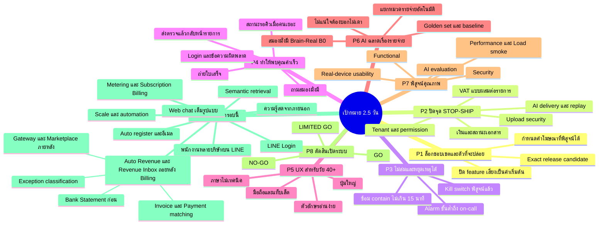
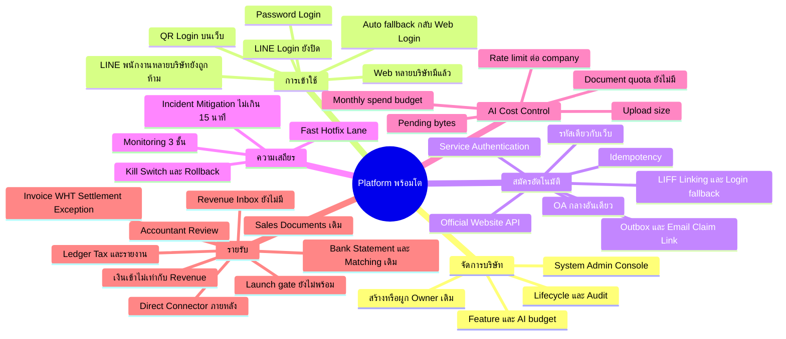
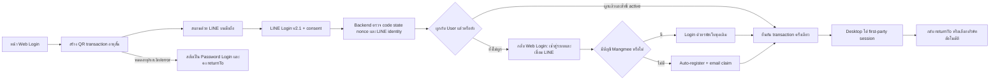
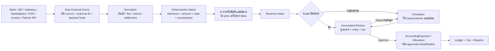

# แผน 2.5 วัน: สมองมั่งมี + เว็บพร้อมทดสอบกับผู้ใช้จริง

สถานะ: **DRAFT v4 สำหรับตัดสินใจและลงมือทำ — จัดลำดับตามเป้าหมาย รับคนให้ไหว → ใช้แล้วชอบ → โตต่อได้ + การตัดสินใจ Owner 2026-08-25: รายรับถอย, AI แยกหมวดรายจ่ายมาก่อน, ระบบจ่ายเงิน/Subscription (P26), สมองมั่งมีไม่ใช่เดโม (Brain-Real B0–B7)**

รูปแบบลำดับงาน: ใช้ `P1`, `P2`, `P3`, ... แทนวันที่

ข้อจำกัด: Developer 1 คน, เวลารวมประมาณ 20 ชั่วโมงทำงาน

ขอบเขตการเปิดใช้ที่ซื่อตรงกับหลักฐาน: **Controlled Beta** ก่อน ไม่ใช่เปิด Marketing วงกว้างทันที

> คำว่า P ในเอกสารนี้หมายถึง “ลำดับการทำงาน” ไม่ใช่ระดับความรุนแรงของบัค
>
> ระดับปัญหาใช้คำว่า `STOP-SHIP`, `สำคัญ`, `ควรปรับ` แยกต่างหาก
>
> P1–P8 คือลำดับลงมือจริงของรอบ 2.5 วัน (ฉบับปรับลำดับตามเป้าหมาย); P9–P25 เป็นป้ายกลุ่มงานของรอบถัดไป — ลำดับลงมือจริงของรอบถัดไปดู “ลำดับลงมือแนะนำและ Gate เปิดวงกว้าง” ต้นหัวข้อ 10

## 1. ข้อสรุปสำหรับผู้บริหาร

หลักจัดลำดับของแผนฉบับนี้ ใช้ตัดสินทุกครั้งที่งานชนกัน:

1. **รับคนให้ไหว** — ระบบต้องไม่ล่ม ใน 3 ความหมาย: ตัวเลขเงิน/สิทธิ์ต้องไม่ผิด (ล่มความเชื่อมั่น), มีตาดูระบบและหยุดเหตุได้ ≤ 15 นาที (ไม่ล่มแบบไม่รู้ตัว), มีหลักฐานรับโหลดจริง (ไม่ล่มเพราะคนเข้าพร้อมกัน)
2. **ใช้แล้วชอบ** — เข้ามาแล้วต้องใช้เป็น: เริ่มงานได้ใน 2 การกด เห็นคุณค่าเร็ว ภาษาคน และงานจบเป็นวงจรชัด
3. **โตต่อได้** — ขยายระบบและเพิ่ม feature แข่งตลาด ทำเมื่อสองข้อแรกไม่เสียหาย; งานกลุ่มนี้เป็นตัวแรกที่ถูกตัดเมื่อเวลาไม่พอ

การตัดสินใจ Owner (2026-08-25) ที่มีผลต่อลำดับ: **ต้องเป็นงานจริง — ฟีเจอร์ที่ผู้ใช้ใช้งานอยู่วันนี้มาก่อนฟีเจอร์อนาคตเสมอ** ผลคือ (1) งานรายรับ/Auto Revenue ถอยออกไปหลังระบบเก็บเงิน (2) AI ต้องแยกหมวดหมู่รายจ่ายให้เก่งก่อนความสามารถ AI อื่น (3) เพิ่ม **ระบบจ่ายเงิน/Subscription** — จำกัดโควตาการใช้ใบเสร็จ ใช้ต่อต้อง subscribe — เข้ามาแทนที่รายรับใน roadmap (P26) (4) **สมองมั่งมีไม่ใช่เดโม** — ต้องตอบฉลาด หาข้อมูลบริษัทได้ เร็วและถูกต้อง; ผลรีวิวสถาปัตยกรรมและลำดับ activation อยู่ใน [Brain answer architecture assessment](../specs/mangmee-brain-answer-architecture-assessment.md) (Brain-Real B0–B7)

เป้าหมายที่ถูกต้องไม่ใช่ “ทำทุกอย่างให้เสร็จใน 2.5 วัน” แต่คือ:

1. ทำให้เส้นทางหลักของเว็บไม่ทำให้ผู้ใช้เสียความเชื่อมั่น
2. ทำให้ผู้ใช้วัย 40+ พบคุณค่าครั้งแรกได้เร็ว โดยไม่ต้องเรียนรู้ระบบก่อน
3. ทำ “สมองมั่งมี” ให้เป็นตัวชูโรงแบบที่พิสูจน์ได้ ไม่โฆษณาเกินของจริง
4. เตรียมโครงสร้างความรู้ที่เพิ่มเรื่องใหม่ภายหลังได้ โดยไม่ต้องรื้อ AI ใหม่
5. เก็บหลักฐานจาก release candidate ตัวเดียว แล้วตัดสิน `GO / LIMITED GO / NO-GO`
6. ใช้ Platform Console และ company onboarding ที่มีอยู่เป็นทางหลักในรอบสั้น โดยยังไม่เปิด auto-registration สู่ Production
7. เตรียม Fast Hotfix Lane ที่หยุดผลกระทบได้ภายใน 15 นาที โดยไม่ข้าม security, migration หรือ release gate
8. ถอยงานรายรับและ **MANGMEE — AUTO REVENUE** ออกไปหลังระบบเก็บเงิน (P26) ตามการตัดสินใจ Owner; คงกฎ “เงินเข้าไม่เท่ากับรายได้เสมอไป” ไว้ใช้เมื่อกลับมาทำ
9. วางโมเดลรายได้ของระบบเอง: จำกัดโควตาการใช้ใบเสร็จ/AI ต่อบริษัท และต้อง subscribe เพื่อใช้ต่อ — รอบนี้ freeze นโยบายและ spec เท่านั้น; enforcement เปิดได้เมื่อ meter + billing (P14 → P26) พร้อม และเอกสารของผู้ใช้ต้องไม่หายเพราะโควตาเต็ม

ผลลัพธ์ที่เป็นไปได้จริงภายในเวลานี้คือ:

- เว็บมีทางเข้าชัดเจน: **ถามสมองมั่งมี** และ **ถ่ายใบเสร็จ**
- แก้หรือปิดกั้นจุดผิดพลาดที่กระทบเงิน ความปลอดภัย และความน่าเชื่อถือ
- alarm + kill switch ซ้อมแล้วจริง และมี load smoke อย่างน้อยระดับ Controlled Beta ก่อนตัดสิน GO
- ส่งค่าใช้จ่ายตรวจแล้วกลับหน้ารายการอัตโนมัติและเห็นสถานะ “รอตรวจสอบ” ทันที
- ใบเสร็จหนึ่งใบรองรับรายการมี VAT และไม่มี VAT ร่วมกัน โดยยอดจากเอกสารกับยอดคำนวณตรวจสอบย้อนกลับได้
- สมองมั่งมีเปิดแบบจำกัดกลุ่ม เฉพาะความสามารถที่ผ่านเกณฑ์
- AI แนะนำหมวดรายจ่ายแม่นขึ้นแบบมีตัวเลขพิสูจน์ (golden set + baseline เทียบหลังปรับ) ไม่ใช่คำโฆษณา
- คำถามนอกขอบเขตถูกปฏิเสธสุภาพ; คลังความรู้ (Knowledge Pack) ถอยไปทำเต็มรูปแบบใน P23
- คำตอบภาษี/บัญชีที่มีความเสี่ยงสูงต้องมีแหล่งอ้างอิง อายุข้อมูล และผู้เชี่ยวชาญรับรอง
- ถ้าหลักฐานไม่ครบ ฟีเจอร์เสี่ยงต้องยัง `off` แต่เดโมและโครงสร้างที่ทำไว้ไม่สูญเปล่า
- ฝั่งเว็บรองรับผู้ใช้หนึ่งคนอยู่หลายบริษัทอยู่แล้ว แต่ต้องพิสูจน์ permission isolation; ฝั่ง LINE ยังต้องแก้นโยบายที่จำกัดเฉพาะ Owner
- ฟีเจอร์รายรับมี engine เอกสารขาย, รับชำระ, Bank Statement และการจับคู่บางส่วนอยู่แล้ว จึงควรต่อยอดเป็น Revenue Inbox โดยไม่สร้าง payment/ledger ซ้ำอีกชุด (**ถอยไปหลัง P26** ตามการตัดสินใจ Owner)
- Auto Revenue ช่วยทำ **cash-to-document reconciliation** ได้ แต่ full bank reconciliation ยังต้องรวมเงินออก, ค่าธรรมเนียม, ดอกเบี้ย, ยอดยกมา–ยอดปลายงวด และรายการที่อนุมัติให้ ignore

สิ่งที่ **ไม่ควรสัญญา** ภายใน 2.5 วัน:

- “ตอบได้ทุกเรื่องเหมือน ChatGPT” โดยไม่มีข้อจำกัด
- คำแนะนำภาษีเฉพาะกรณีที่ใช้แทนนักบัญชีหรือที่ปรึกษาภาษี
- ข้อมูลข่าว กฎหมาย หรืออัตราที่เปลี่ยนล่าสุด ถ้ายังไม่มีระบบค้นข้อมูลสดและตรวจแหล่งที่มา
- เปิดรับผู้ใช้หลักหมื่น/แสนโดยยังไม่มี load test, UAT และ monitoring ของ exact release candidate
- เว็บแชตใหม่เต็มรูปแบบ, ระบบสมัครสมาชิก self-service และ Knowledge Admin ครบวงจรพร้อมกัน
- LINE Login, auto-register จาก `official.mangmeeplus.com`, ส่งอีเมลจริงผ่าน SES และ multi-company สำหรับพนักงานบน LINE ให้เสร็จพร้อม Production ในรอบเดียว
- รับประกันว่า incident ทุกชนิด “แก้ถาวร” ได้ภายใน 15 นาที; เป้าหมายที่วัดได้ควรเป็นรับทราบและหยุดผลกระทบภายใน 15 นาที
- เชื่อม Bank/QR/Gateway/Marketplace/POS ทุกเจ้าและ auto-post บัญชีจริงให้เสร็จใน 2.5 วัน
- อ้างว่า “จับคู่อัตโนมัติ 95%” ก่อนมีข้อมูลจริงและชุดตรวจ false-positive; ช่วง Beta ต้องเน้นจับคู่ถูกก่อนจับคู่เยอะ
- เปิดบังคับ subscribe หรือตัดโควตาใบเสร็จทันที โดยยังไม่มี meter จริง, หน้าชำระเงิน และข้อความแจ้งลูกค้าล่วงหน้า

## 2. ภาพรวมแบบ Mind Map



เส้นทางหลักแบบย่อ:

```text
ผู้ใช้เข้าเว็บ
   ├─ ถามสมองมั่งมี → เลือกคำถามตัวอย่าง → ได้คำตอบ/แหล่งที่มา → ทำขั้นตอนถัดไป
   └─ ถ่ายใบเสร็จ → AI อ่าน → ผู้ใช้ตรวจจุดสำคัญ → จัดหมวด → บันทึก

ทุกเส้นทางต้องมี: กำลังทำอะไร / สำเร็จหรือยัง / ผิดพลาดแล้วทำต่ออย่างไร
```

## 3. นิยาม Feature ชูโรง: “สมองมั่งมี”

ข้อความที่ควรใช้สื่อสาร:

> **ผู้ช่วยธุรกิจที่เข้าใจข้อมูลของกิจการ ตอบคำถามทั่วไปได้ และอธิบายภาษี–บัญชีพื้นฐานพร้อมแหล่งที่มา**

สมองมั่งมีควรเป็น “สมองเดียว หลายโหมด” ไม่ใช่ปล่อย agent หลายตัวตัดสินใจเอง:

| โหมด | ทำอะไร | ข้อจำกัดก่อนเปิด |
|---|---|---|
| คุยทั่วไป | ตอบความรู้ทั่วไปที่คงที่ สนทนาเป็นธรรมชาติ | ไม่ตอบข้อมูลสดถ้าไม่มีแหล่งข้อมูลสด |
| ที่ปรึกษาธุรกิจ | แนะนำแนวคิด การขาย ต้นทุน กระแสเงินสด | ต้องแยก “ความรู้ทั่วไป” ออกจาก “ข้อมูลกิจการจริง” |
| เข้าใจธุรกิจของฉัน | อ่านข้อมูลบริษัทผ่าน API ที่ตรวจสิทธิ์แล้ว | ห้าม AI อ่านฐานข้อมูลตรง และห้ามข้ามบริษัท |
| ภาษีและบัญชี | อธิบายหลักการ ขั้นตอน เอกสาร และข้อควรระวัง | เนื้อหาเสี่ยงสูงต้องมีแหล่งที่มา เวอร์ชัน และผู้เชี่ยวชาญอนุมัติ |
| ลงมือทำ | เสนอขั้นตอนหรือแบบร่างให้ผู้ใช้ยืนยัน | ห้ามแก้ข้อมูลการเงินเองโดยไม่มีสิทธิ์และ confirmation |
| ส่งต่อผู้เชี่ยวชาญ | เมื่อไม่แน่ใจ ข้อมูลเก่า หรือกรณีเฉพาะ | ต้องบอกตรง ๆ ว่าไม่แน่ใจ ไม่เดาคำตอบ |

ตัวอย่างคำถามบนหน้าแรก เพื่อไม่ให้ผู้ใช้เจอช่องว่างแล้วไม่รู้จะถามอะไร:

- “วันนี้มีเงินเข้า–ออกเท่าไร”
- “ค่าใช้จ่ายหมวดไหนเพิ่มขึ้น”
- “ใบเสร็จนี้บันทึกอย่างไร”
- “VAT กับภาษีหัก ณ ที่จ่ายต่างกันอย่างไร”
- “ช่วยคิดวิธีเพิ่มยอดขายแบบความเสี่ยงต่ำ”

## 4. สิ่งที่ตรวจพบ

### 4.1 จุดแข็งที่ควรรักษา

- ระบบมี permission, tenant context, audit และเครื่องมือธุรกิจของ AI อยู่แล้ว ไม่ควรสร้างทางลัดให้ AI ต่อฐานข้อมูลตรง
- Flow ใบเสร็จมีแนวทาง camera-first และมีการตรวจข้อมูลก่อนบันทึกอยู่แล้ว
- Responsive suite ที่มีหลักฐานล่าสุดผ่าน 283 เคส และมี coverage มือถือหลายขนาด
- Unit test และ typecheck ที่ agent รันแบบ read-only ผ่านจำนวนมาก: Web 1,048 เคส, AI Gateway 645 เคส และ API exit 0
- ระบบมี backup และ Production RDS Multi-AZ ตาม memory เดิม แต่ยังต้องพิสูจน์ release candidate ปัจจุบัน

ข้อควรระวัง: ผลทดสอบข้างต้นรันบน branch/commit ที่ตรวจ ณ เวลานั้น ไม่ใช่หลักฐานของ release candidate ที่จะปล่อยจริง จึงห้ามใช้แทน P7

### 4.2 บัคและความเสี่ยงที่ยืนยันจากโค้ดหรือเอกสาร

ป้ายหลักฐานที่ใช้ในตาราง:

- `[โค้ด]` พบเส้นทางหรือพฤติกรรมใน source ปัจจุบัน
- `[เอกสาร]` เจ้าของงานบันทึก residual/blocker ไว้ชัดเจน
- `[ช่องว่างหลักฐาน]` มี patch หรือ test บางส่วนแล้ว แต่ยังไม่มี runtime/UAT proof ของตัวที่จะปล่อย

| ID | ระดับ | สิ่งที่พบ | ทำไมสำคัญ | สิ่งที่ต้องทำ / หลักฐานปิดงาน |
|---|---|---|---|---|
| FIN-01 | **STOP-SHIP** | `[โค้ด][เอกสาร]` จำนวนคงเหลือ 4 ตำแหน่งอาจไม่เป็นศูนย์ แต่ UI ปัดเป็น `฿0.00` ทำให้สถานะยัง `PARTIALLY_PAID` | ผู้ใช้เห็นเงินคงเหลือศูนย์แต่ระบบบอกว่ายังจ่ายไม่ครบ เสียความเชื่อมั่นทันที | กำหนด currency rounding policy เดียวทั้ง API/DB/UI และมี regression case `580.0042` เทียบ `580.00` |
| FIN-02 | **STOP-SHIP ต่อ reimbursement** | `[ช่องว่างหลักฐาน]` threshold, policy snapshot, concurrency และ exact assignee มี patch/test แล้ว แต่ migration clone และ mutation/UAT บางเส้นทางยังเปิด | submit/approve/pay/correct พร้อมกันอาจทำให้เงินหรือผู้อนุมัติผิด | migration clone, duplicate-policy preflight, concurrent submit/approve/pay และ correction/void/cancel ผ่านบน exact candidate |
| DOC-01 | **STOP-SHIP ต่อ check-bill capture** | `[ช่องว่างหลักฐาน]` patch ป้องกันการถือใบเช็กบิลเป็นหลักฐานชำระเงินมีแล้ว แต่ยังไม่มี whole-chain UAT/Production proof | อาจสร้าง expense จากเอกสารที่ยังไม่ใช่หลักฐานชำระเงินจริง | LINE + Web ต้องไม่สร้าง expense ก่อนยืนยัน และ routing ไปใบแทนใบเสร็จต้อง atomic |
| AI-01 | **STOP-SHIP ก่อนเปิด AI การเงิน** | `[เอกสาร]` durable terminal replay, DB-backed intake state, Flex-to-text fallback และ real-provider/UAT replay ยังไม่ครบ | ข้อความอาจค้าง ตอบซ้ำ หรือผู้ใช้ไม่ได้รับผลลัพธ์สุดท้าย | ปิดครบทุก blocker หรือคง financial/semantic flags เป็น `off` |
| AI-02 | **STOP-SHIP ต่อคำโฆษณา** | `[โค้ด][เอกสาร]` “สมองมั่งมี” ด้าน general knowledge/advisor ยังอยู่ใน spec/plan; router ปัจจุบันจัดคำถามทั่วไปและคำแนะนำบางชนิดเป็น unsupported | ถ้าโฆษณาว่าคุยเหมือนคนแต่ของจริงปฏิเสธ จะเสีย Conversion และความเชื่อใจ | เปิดเฉพาะ lane ที่มี implementation + eval ผ่าน และแก้ข้อความการตลาดให้ตรงกับความจริง |
| WEB-01 | สำคัญ | `[โค้ด]` มี route `ai-suggestions` แต่ไม่อยู่ในรายการเมนูที่ render และหน้าปัจจุบันเป็นงาน template/job ไม่ใช่หน้า chat | Feature ชูโรงถูกซ่อน ผู้ใช้หาไม่เจอ | ทำ CTA “ถามสมองมั่งมี” ที่ dashboard; ในรอบนี้ให้ไป LINE/ช่องที่พร้อมจริงก่อน หรือเปิด web chat เมื่อผ่าน gate เท่านั้น |
| WEB-02 | สำคัญ | `[โค้ด]` dashboard มีข้อมูลและ empty state แต่ไม่มี Next Best Action เพื่อเริ่ม “ถาม” หรือ “ถ่ายใบเสร็จ” | ผู้ใช้ใหม่ยังไม่รู้ว่าต้องเริ่มตรงไหน | เพิ่ม hero card 2 ปุ่ม และคำอธิบาย 1 ประโยค |
| WEB-03 | สำคัญ | `[โค้ด]` login ใช้ `noValidate` และไม่มี field-level validation ที่ชัดก่อนเรียก API | ผู้ใช้ 40+ อาจได้รับข้อความ “เข้าสู่ระบบไม่ได้” โดยไม่รู้ว่าช่องไหนผิด | validate ช่องว่าง, focus ช่องแรกที่ผิด, ใช้ข้อความไทย และทดสอบว่าไม่ยิง request เมื่อข้อมูลไม่ครบ |
| WEB-04 | สำคัญ | `[โค้ด]` ชื่อบริษัทเริ่มจาก `companyId`; เมื่อโหลด scope ผิดพลาดบางกรณีถูกกลืน error | ผู้ใช้อาจเห็นรหัสเทคนิค หรือเข้าใจว่าระบบไม่มีสาขา/บริษัท | แสดงสถานะโหลดและปุ่มลองใหม่; ห้ามใช้ raw ID เป็นชื่อที่ผู้ใช้เห็น |
| WEB-05 | สำคัญ | `[โค้ด]` ช่องวันที่ใน flow หนึ่งใช้คำว่า “วันที่อัปโหลดใบเสร็จ” แต่ค่าที่บันทึกคือ `expenseDate` | ผู้ใช้อาจกรอกวันที่วันนี้แทนวันที่ในใบเสร็จ ทำให้บัญชีผิด | เปลี่ยนเป็น “วันที่ในใบเสร็จ” พร้อมตัวอย่าง และมี UI assertion |
| WEB-06 | ควรปรับก่อน beta | `[โค้ด]` route ที่ไม่มีสิทธิ์ redirect แล้วคืน `null` ชั่วคราว | อุปกรณ์ช้าจะดูเหมือนหน้าขาวหรือเว็บค้าง | แสดงสถานะ “กำลังพาไปหน้าที่ใช้ได้…” และมี timeout/error fallback |
| EXP-UX-01 | **สำคัญต่อเส้นทางหลัก** | `[โค้ด][รายงานผู้ใช้]` หลัง API “ส่งตรวจสอบ” สำเร็จ หน้า detail เรียก reload แล้วแสดง toast แต่ไม่ออกจากหน้าเดิม | ผู้ใช้ไม่มั่นใจว่าบันทึกแล้ว ต้องปิดหน้าและกลับไปเช็กรายการทุกครั้ง | เมื่อ API คืน `READY_FOR_CONFIRMATION` ให้ `router.replace` ไปหน้ารายการ, แสดงข้อความสำเร็จ และเน้นแถวที่เพิ่งส่ง; E2E ต้องยืนยัน URL, status และรายการเดียวกัน |
| VAT-MIX-01 | **STOP-SHIP ต่อ expense confirmation** | `[โค้ด][รายงานผู้ใช้]` ระบบรองรับ rate ต่อบรรทัดและมีตัวเลือก mixed VAT แล้ว แต่ confirmation บล็อกทุก `MISMATCH/NEEDS_REVIEW/SOURCE_ONLY`; วิธีแก้ใน UI ซับซ้อนสำหรับใบที่มีทั้งสินค้าเสีย VAT และไม่เสีย VAT | ใบเสร็จที่ถูกต้องตามจริงอาจบันทึกขั้นสุดท้ายไม่ได้ เช่น ผัก/ผลไม้ไม่มี VAT แต่สินค้าอื่นในใบเดียวกันมี VAT | ทำ guided mixed-VAT editor, รักษายอด VAT จากเอกสาร, คำนวณเฉพาะฐานสินค้าที่มี VAT และมี golden/E2E สำหรับ 7%+ไม่มี VAT+rounding |
| GROWTH-01 | สำคัญต่อ Conversion | `[โค้ด]` ไม่พบ customer self-service signup/trial journey; onboarding ที่มีเป็นฝั่ง system admin | คนที่มาจาก Marketing ยังเริ่มเองไม่ได้ | ทำ CTA “ขอทดลองใช้” พร้อม owner รับ lead; self-service เต็มรูปแบบย้ายไป P10–P11 ซึ่งเป็นคิวแรกของรอบถัดไปและเป็นเงื่อนไขของ Gate เปิดวงกว้าง |
| AI-UX-01 | สำคัญ | `[โค้ด]` หน้า AI Suggestions ใช้ศัพท์ provider/risk/citation/confidence และให้กรอก raw `customerId`; การรอผลไม่ชัด | เป็นภาษาของทีมพัฒนา ไม่ใช่ภาษาผู้ใช้ทั่วไป | ซ่อนศัพท์เทคนิค, ใช้ชื่อคน/ลูกค้าให้เลือก, แสดง progress และ refresh อัตโนมัติ |
| LINE-UX-01 | สำคัญ | `[เอกสาร]` ผู้ใช้กด deep link จาก LINE อาจเจอ session เว็บที่เป็นคนละบัญชี | ผู้ใช้คิดว่าไม่มีสิทธิ์หรือข้อมูลหาย ทั้งที่เป็น session mismatch | แสดงชื่อบัญชี/บริษัทปัจจุบันและทางเลือกสลับ/เข้าสู่ระบบใหม่อย่างปลอดภัย |
| A11Y-01 | สำคัญ | `[โค้ด]` loading/banner บางจุดไม่มี live status; modal AI เดิมยังไม่แสดง focus/dialog behavior ครบ | ผู้ใช้ keyboard/screen reader ไม่รู้ว่าสถานะเปลี่ยนหรือออกจาก dialog อย่างไร | เพิ่ม semantic status, dialog name, focus trap, Escape และ accessible close label |
| TAX-01 | **STOP-SHIP ต่อคำตอบภาษีเสี่ยงสูง** | `[เอกสาร]` checklist การรับรอง VAT/WHT/CIT, กำหนดยื่น, format และ citation ยังไม่ครบ | คำตอบผิดอาจสร้างความเสียหายจริง | ต้องมีชื่อผู้ตรวจบัญชี/ภาษี, source URL, effective date และ test case ก่อนเปิด pack |
| SEC-01 | **STOP-SHIP ต่อการเปิดวงกว้าง** | `[ช่องว่างหลักฐาน]` malware scanning ของ receipt มี UAT evidence บางส่วน แต่ Production closure/notification ยังเปิด | ไฟล์อัปโหลดเป็นช่องรับข้อมูลอันตราย | พิสูจน์ clean file, EICAR quarantine, download denied, audit และ alarm บน exact candidate |
| SEC-02 | **STOP-SHIP ต่อการเปิดวงกว้าง** | `[ช่องว่างหลักฐาน]` internal-service tenant boundary ยังมี live closure เช่น private ingress/secret rotation ที่ deferred | token ที่รั่วอาจกระทบ tenant จริง | negative reachability, secret rotation และ cross-company denial ต้องผ่าน |
| QA-01 | **STOP-SHIP ต่อ Marketing วงกว้าง** | `[ช่องว่างหลักฐาน]` full desktop E2E เดิมยังมี 7 failures; tablet 640–1024 และ real-device บาง flow ยังไม่มีหลักฐาน | test บางชุดผ่านไม่ได้แปลว่าเส้นทางลูกค้าจริงผ่าน | รัน critical suite บน exact SHA และเก็บ artifact ของทุก gate |
| OCR-01 | สำคัญ | `[เอกสาร]` telemetry เดิมมี audit rows ที่ไม่มี status และ failure บางชนิดไม่เข้า denominator | คำว่า “OCR แม่น” ยังวัดไม่ได้จริง | deploy outcome observability ที่ครบ แล้วรายงาน success/review/failure โดยไม่ตัด failure ออก |
| PERF-01 | สำคัญ | `[เอกสาร]` fast lane ยัง default-off; provider baseline ที่มีอยู่ช้ากว่าเป้าหมายและยังไม่มี hosted proof | Feature ที่ต้อง “ตอบเร็ว” ยังไม่มีหลักฐานรองรับ | วัด p50/p95/time-to-first-status บน provider และ environment ที่จะเปิดจริง |

หลักฐานอ้างอิงหลักอยู่ในหัวข้อ [16. แหล่งอ้างอิง](#16-แหล่งอ้างอิงใน-repository)

### 4.3 จุดที่ทำให้ใช้ยากหรือสับสน

| จุดสับสน | ผู้ใช้น่าจะคิดอย่างไร | คำแนะนำ | เพื่ออะไร |
|---|---|---|---|
| เมนูระดับบนมีหลายกลุ่มและบาง module ยัง planned | “ต้องกดอันไหนก่อน” | launch mode แสดงเฉพาะงานหลัก 4–6 รายการ | ลดภาระการตัดสินใจ |
| สมองมั่งมีไม่มีทางเข้าที่เด่น | “ระบบนี้มี AI ตรงไหน” | ปุ่มหลักบน dashboard และ shortcut ติดที่เดิม | ให้พบ Feature ชูโรงทันที |
| หน้า AI เดิมใช้ภาษาเทคนิค | “ฉันต้องรู้ provider หรือ customer ID ด้วยหรือ” | แปลเป็นภาษางานของผู้ใช้ และเลือกจากชื่อ | ลดความกลัวว่าจะกรอกผิด |
| empty state ไม่มีคำแนะนำถัดไป | “ไม่มีข้อมูลแล้วต้องทำอะไร” | ใส่ปุ่ม “ถ่ายใบเสร็จแรก” หรือ “ถามมั่งมี” | เร่ง Time to First Value |
| ข้อความ error บางจุดถูกกลืนหรือเป็น generic | “ระบบเสีย หรือฉันทำผิด” | บอกสาเหตุแบบสั้น + ปุ่มแก้ไข/ลองใหม่ | ให้กู้สถานการณ์ได้เอง |
| ตัวอักษร 11–13px และปุ่มบางจุดเล็ก | “อ่านยาก/กดไม่โดน” | ข้อความสำคัญอย่างน้อย 16px, touch target 44×44px | เหมาะกับวัย 40+ และมือถือ |
| redirect บางกรณีคืนหน้าว่างชั่วคราว | “เว็บค้าง” | แสดง “กำลังพาไปหน้าที่ใช้ได้…” | ลดความกังวล |
| ส่งตรวจสำเร็จแต่ยังอยู่หน้ารายละเอียดเดิม | “บันทึกจริงหรือยัง ทำไมยังค้างอยู่” | กลับหน้ารายการอัตโนมัติ, toast “ส่งตรวจเรียบร้อย”, highlight รายการและสถานะ “รอตรวจสอบ” | ปิดวงจรงานให้ชัดและไม่ต้องกดย้อนกลับมาเช็กเอง |
| ใบเดียวมีสินค้ามี VAT และไม่มี VAT | “ต้องเลือก VAT ทั้งใบหรือไม่ แล้วทำไมยอดไม่ตรง” | ให้เลือกต่อรายการด้วยคำว่า “มี VAT 7% / ไม่มี VAT / กำหนดเอง” และสรุปฐาน VAT ที่ใช้ | ลดศัพท์บัญชีและแก้ mixed receipt ได้โดยไม่เดา |
| ยังไม่มี tablet runtime coverage | “บน iPad จัดวางแปลก” | เพิ่ม 768px/1024px ใน critical suite | ครอบคลุมอุปกรณ์จริงของกลุ่มเป้าหมาย |

### 4.4 สิ่งที่ควรเพิ่มและเหตุผล

| สิ่งที่เพิ่ม | ทำในรอบนี้หรือไม่ | เหตุผล |
|---|---|---|
| Hero card “ถามสมองมั่งมี” + “ถ่ายใบเสร็จ” | **ทำ** | ทำให้ผู้ใช้เห็นคุณค่าโดยไม่ต้องสำรวจเมนู |
| คำถามตัวอย่าง 4–5 ข้อ | **ทำ** | ลด blank-page anxiety และสอนขอบเขต AI ไปพร้อมกัน |
| แหล่งที่มา + วันที่ทบทวนคำตอบ | **ทำสำหรับเรื่องเสี่ยง** | สร้างความเชื่อมั่นและตรวจย้อนกลับได้ |
| ปุ่ม “คำตอบนี้ช่วยไหม” + เหตุผลสั้น | ทำถ้าเหลือเวลา; ไม่ขวาง release | ได้ข้อมูลปรับปรุงโดยไม่ต้องเดา |
| โหมดตัวอักษรใหญ่ | ใช้ CSS/design token ที่มีถ้าทำได้สั้น; ที่เหลือ P24 | ช่วยวัย 40+ โดยไม่แก้ทุกหน้าทีละจุด |
| Trial/ขอทดลองใช้ที่เก็บ lead | **ทำอย่างน้อยเป็น CTA** | ตอนนี้ยังไม่มี self-service signup ที่เหมาะกับ Marketing |
| Knowledge Pack registry | ถอยไป P23 (การตัดสินใจ Owner) | เวลางาน AI ของรอบนี้ยกให้หมวดรายจ่ายก่อน |
| AI แยกหมวดรายจ่ายแบบวัดได้ (golden set + baseline + ปรับ) | **ทำ** | เป็นขั้นที่ผู้ใช้เสียเวลาที่สุดในเส้นทางหลัก และ Owner กำหนดให้มาก่อน |
| ระบบจ่ายเงิน/Subscription (จำกัดโควตาใบเสร็จ) | **P26** — รอบนี้ freeze นโยบาย/spec | ต้องมี meter + billing ก่อน enforcement; เอกสารผู้ใช้ห้ามหาย |
| หลังส่งตรวจกลับหน้ารายการพร้อมสถานะ | **ทำ** | ผู้ใช้ต้องรู้ทันทีว่างานจบและไปอยู่ที่ใด |
| Mixed VAT แบบเลือกต่อรายการ | **ทำ** | ใบเสร็จจริงมีทั้งสินค้ามี VAT และไม่มี VAT; ห้ามให้ reconciliation ที่แก้ไม่ได้เป็นทางตัน |
| Knowledge Admin UI / vector DB / live web search | **P23** | เกินเวลาและเพิ่ม failure modes โดยยังไม่จำเป็นต่อ beta |

## 5. แผนปฏิบัติงาน P1–P8

เวลาที่ระบุเป็น timebox เพื่อให้ dev คนเดียวไม่ถูกดึงออกจากเป้าหมาย รวมประมาณ 19.5 ชั่วโมง (กันชน 0.5 ชั่วโมงจากกรอบ 20) หากขั้นใดชน stop condition ให้ใช้ fallback ที่กำหนด ไม่ขยายงานเอง

ลำดับลงมือของรอบนี้: P1 → P2 → P3 (alarm/kill switch) → P4 (คุณค่าเร็ว) → P5 (UX 40+) → P6 (AI แยกหมวดรายจ่าย + Brain-Real B0) → P7 (evidence + load smoke) → P8 (ตัดสิน); เมื่อชนเวลา เลื่อน 6B (Brain-Real B0) ไปหลัง P8 ตามหัวข้อ 12

### P1 — ล็อกขอบเขตและ Release Candidate (1 ชั่วโมง)

**เป้าหมาย:** ทุกคนทดสอบของชิ้นเดียวกัน และรู้ว่าอะไรเปิด/ปิด

งาน:

1. บันทึก exact commit SHA, config และ feature flags
2. ล็อกคำโฆษณาให้ตรงกับความสามารถที่มีจริง
3. กำหนด allowlist ผู้ใช้ Controlled Beta และเจ้าของ kill switch
4. ปิดเป็นค่าเริ่มต้นสำหรับ financial capture, semantic/advisor หรือ mutation ใดที่ยังมี blocker
5. เปิด bug board ชุดเดียว แบ่ง `STOP-SHIP / สำคัญ / ควรปรับ`
6. บันทึกการตัดสินใจ Owner ลง manifest: รายรับ = ถอย (ทางเข้า/เดโมถูกถอดจากรอบนี้), AI แยกหมวดรายจ่าย = งาน AI อันดับหนึ่ง, subscription model = คิว P14 → P26; quota enforcement ยัง `off`; สมองมั่งมี = Brain-Real Track เริ่ม B0 ในรอบนี้ (ไม่ใช่เดโม)

หลักฐานจบ P1:

- release manifest มี SHA, flags, environment, rollback owner และ on-call owner
- ไม่มีคำว่า “พร้อม Production” หรือ “ตอบได้ทุกเรื่อง” ใน copy ถ้ายังไม่มีหลักฐาน
- scope มีเพียง 2 เส้นทางหลัก: ถามสมองมั่งมี และถ่ายใบเสร็จ

### P2 — ปิดหรือกั้นจุด STOP-SHIP (4 ชั่วโมง)

**เป้าหมาย:** ไม่ให้ข้อผิดพลาดด้านเงิน สิทธิ์ ไฟล์ และ AI delivery หลุดถึงผู้ใช้

ลำดับ:

1. แก้ `FIN-01` ด้วย rounding policy เดียว และเพิ่ม regression test
2. แก้ `VAT-MIX-01`: ใบเดียวต้องกำหนด VAT ต่อรายการได้ โดยรายการไม่มี VAT เป็นค่า `0/ไม่เสีย VAT` อย่างชัดเจน และยอดจากเอกสารต้อง reconcile กับเฉพาะฐาน VAT ที่เกี่ยวข้อง
3. ตรวจสถานะ blocker `AI-01`; ปิดเฉพาะข้อที่แก้และพิสูจน์ได้ใน timebox
4. ตรวจ feature flags ของ reimbursement/check-bill/capture ให้ default-safe
5. ตรวจ upload malware และ tenant boundary จากหลักฐานล่าสุด; ถ้า live proof ไม่ครบ ให้ลดวง beta หรือปิด upload lane ที่เสี่ยง
6. ห้ามรวม refactor หรือ architecture ใหม่ที่ไม่จำเป็น

หลักฐานจบ P2:

- test ของจำนวนเงินและสถานะผ่าน
- mixed receipt `VAT 7% + ไม่มี VAT` บันทึก draft, ส่งตรวจและ confirm ได้เมื่อยอดถูกต้อง; ยอดผิดจริงยังถูกบล็อกพร้อมบอกบรรทัดที่ต้องแก้
- terminal replay/fallback มี fault-injection evidence หรือ lane นั้นยัง off
- unauthorized/cross-tenant mutation = 0
- unsafe flags แสดงสถานะได้จาก release manifest

**Stop condition:** ถ้า financial correctness, tenant หรือ malware gate ไม่ผ่าน ห้ามประกาศ Marketing วงกว้าง และห้ามลดเกณฑ์เพื่อให้ทันเวลา

### P3 — Alarm, Kill Switch และซ้อมหยุดเหตุ (2 ชั่วโมง)

**เป้าหมาย:** เห็นเหตุก่อนผู้ใช้แจ้ง และหยุดผลกระทบได้ภายใน 15 นาที ก่อนเปิดรับคนจริง

เดิมงานนี้ทั้งหมดอยู่ P9 หลังตัดสิน GO ซึ่งเท่ากับ “เปิดระบบก่อน แล้วค่อยติดตั้งตาดูระบบ” — ขัดกับเป้าหมายข้อแรก (รับคนให้ไหว) จึงดึงส่วนขั้นต่ำขึ้นมาก่อน GO; ส่วนเต็ม (dashboard ครบชุด, funnel analytics, drill ครบทุก failure class) ยังอยู่ P9

งาน:

1. พิสูจน์จาก release manifest ว่า kill switch / feature `CLOSE` ของ 2 เส้นทางหลักและ AI lane ใช้ได้จริงบน exact candidate ไม่ใช่แค่มี config
2. ตั้ง alarm ขั้นต่ำที่ส่งถึง on-call จริง: login failure spike, 5xx rate, OCR/AI failure และ queue age, upload failure
3. ซ้อม incident 1 รอบบน UAT ตาม timeline หัวข้อ 13.9: alarm → acknowledge ≤ 5 นาที → contain ≤ 15 นาที (ปิด feature หรือ rollback) → verify เส้นทางลูกค้า พร้อม timestamp ทุกขั้น
4. ยืนยัน on-call owner และผู้อนุมัติ T2 สำรอง (หัวข้อ 13.9) ลงใน release manifest

หลักฐานจบ P3:

- kill switch ปิดแล้วพฤติกรรมระบบเปลี่ยนจริง และเปิดคืนได้ บน exact candidate
- alarm ทดสอบแล้วส่งถึงคนจริง ไม่ใช่ค้างใน dashboard ที่ไม่มีคนเปิด
- drill record มี timestamp ครบ alarm → ack → contain → verify และ contain ≤ 15 นาที
- on-call/rollback owner อยู่ใน manifest

**Stop condition:** ถ้า 2 ชั่วโมงไม่พอ ให้ได้อย่างน้อย kill switch ที่พิสูจน์แล้ว + alarm 5xx และ AI failure + drill 1 รอบ; ส่วนที่เหลือบันทึกใน manifest แล้วกลับไปอยู่ P9 — แต่ถ้า kill switch หรือ alarm หลักยังใช้ไม่ได้จริง ห้ามประกาศ GO ให้ได้มากที่สุดแค่ LIMITED GO วง internal

### P4 — ทำให้ผู้ใช้พบคุณค่าเร็ว (3 ชั่วโมง)

**เป้าหมาย:** ผู้ใช้ใหม่เข้าแล้วรู้ทันทีว่าระบบช่วยอะไร

งานที่เป็น smallest correct diff:

1. เพิ่ม dashboard hero 2 ทางเลือก:
   - “ถามสมองมั่งมี”
   - “ถ่ายใบเสร็จ”
2. ถ้า web chat ยังไม่พร้อม ปุ่มแรกเปิด LINE/ช่องทาง Controlled Beta ที่พร้อมจริง พร้อมบอกว่าจะเกิดอะไรขึ้น
3. เพิ่มคำถามตัวอย่างใต้ปุ่ม AI
4. แก้ login validation, receipt date label และข้อความ loading/error/retry ในเส้นทางหลัก รวมสถานะรอคิวเมื่อ OCR/AI หนาแน่น: แสดง “คิวหนาแน่น กำลังรอประมวลผล…” แทนหมุนเงียบ เพราะคนเข้าพร้อมกันแล้วเจอหมุนเฉย ๆ จะรู้สึกว่าระบบล่มทั้งที่แค่คิวยาว
5. หลัง “ส่งตรวจสอบ” สำเร็จ ให้กลับหน้ารายการค่าใช้จ่ายอัตโนมัติ พร้อมข้อความยืนยันและ highlight แถวที่เพิ่งส่ง
6. ซ่อน module planned และเมนูที่ยังใช้ไม่ได้ออกจาก launch navigation

หลักฐานจบ P4:

- ผู้ใช้จากหน้าแรกไปถึง first action ได้ไม่เกิน 2 การกดหลัง login
- input ผิดแสดงข้อความข้างช่องและ focus ถูกจุด
- empty/error state ทุกจุดใน critical journey มี next action
- ระหว่างรอ OCR/AI นาน ผู้ใช้เห็นสถานะบอกว่าระบบกำลังทำอะไร ไม่มีหมุนเงียบหรือ timeout เปล่า
- ส่งตรวจสำเร็จแล้ว URL อยู่หน้ารายการและมองเห็นรายการสถานะ “รอตรวจสอบ” โดยไม่ต้องกดย้อนกลับเอง
- ไม่มี raw company ID, customer ID หรือศัพท์ provider ในหน้าผู้ใช้ทั่วไป

### P5 — UX/UI สำหรับผู้ใช้ 40+ และ low technology (2 ชั่วโมง)

**เป้าหมาย:** อ่านออก กดโดน เข้าใจสถานะ และย้อนกลับได้

ทำต่อเนื่องจาก P4 ทันที เพราะแตะไฟล์ชุดเดียวกัน (login, dashboard, receipt flow) — ไม่ควรมีงานอื่นคั่นกลางให้สลับ context

กติกาหน้าสำคัญ:

- ข้อความงานหลักอย่างน้อย 16px; ข้อความช่วยเหลือไม่เล็กจนต้องซูม
- ปุ่ม/พื้นที่แตะอย่างน้อย 44×44px และเว้นระยะไม่ให้กดผิด
- หนึ่งหน้ามี primary action เดียวที่เด่นที่สุด
- ใช้คำกริยาที่บอกผล เช่น “ถ่ายใบเสร็จและให้ AI อ่าน” แทน “ดำเนินการ”
- สีไม่ใช่สัญญาณเดียว ต้องมีข้อความ/ไอคอนร่วม
- loading มีข้อความว่า “กำลังทำอะไร”; error มี “ทำอย่างไรต่อ”
- action ที่จบขั้นตอนต้องพาไปปลายทางที่ผู้ใช้คาด เช่น “ส่งตรวจสอบ” → หน้ารายการและรายการ “รอตรวจสอบ”; ใช้ replace เพื่อไม่ให้ปุ่ม Back กลับไปหน้าสถานะเก่า
- VAT ใช้ภาษาต่อรายการว่า “มี VAT 7% / ไม่มี VAT / กำหนดเอง”; แสดงยอดจากเอกสาร, ยอดระบบ และบรรทัดที่ทำให้ต่าง โดยไม่ให้ผู้ใช้คำนวณเอง
- modal ต้องมีชื่อ, focus trap, Escape, ปุ่มปิดที่อ่านได้ด้วย screen reader
- ทดสอบ 375px, 768px, 1024px และ desktop

ใน timebox ให้แก้เฉพาะ login, dashboard, brain entry และ receipt flow ก่อน ส่วนหน้าหลังบ้านจำนวนมากย้ายไปรอบถัดไป (P24)

หลักฐานจบ P5:

- keyboard-only ผ่าน critical journey
- focus มองเห็นและไม่หลุดหลัง error/modal
- status สำคัญใช้ `role=status`/`aria-live` ตามกรณี
- ไม่มีปุ่มหลักต่ำกว่า 44px ใน 3 เส้นทางทดสอบ
- ผู้ใช้ 40+ ทำใบเสร็จ mixed VAT และเห็นรายการหลังส่งตรวจได้โดยไม่ต้องมีคนบอกทาง

### P6 — AI ฉลาดเรื่องรายจ่าย + สมองมั่งมี Brain-Real B0 (3 ชั่วโมง)

**เป้าหมาย:** AI ฉลาดขึ้นตรงจุดที่ผู้ใช้ใช้จริงทุกวันก่อน — แยกหมวดหมู่รายจ่ายให้แม่นและวัดได้ — และเริ่มสายงานสมองมั่งมีตอบจริง (Brain-Real B0)

การตัดสินใจ Owner (2026-08-25): งาน AI อันดับหนึ่งของรอบนี้คือแยกหมวดรายจ่าย; Knowledge Pack แกนขั้นต่ำถอยไป P23; สมองมั่งมีไม่ใช่เดโม — เริ่ม activation จริงที่ 6B ตาม Brain-Real Track

#### 6A — AI แยกหมวดหมู่รายจ่าย (2 ชั่วโมง, ทำก่อน)

ระบบมี category suggestion + auto-fill ตามเกณฑ์ confidence อยู่แล้วใน receipt OCR pipeline (`receipt-ocr-apply.service.ts`, `expense-document.use-case.ts`) — งานรอบนี้คือทำให้ “ฉลาดแบบพิสูจน์ได้” ไม่ใช่เขียนใหม่; รายละเอียดระดับ coding และชุดทดสอบครบอยู่ใน [Real answers spec](../specs/mangmee-brain-real-answers-spec.md) (S1) + [implementation plan](mangmee-brain-real-answers-plan.md) (Phase 1):

1. สร้าง golden set ใบเสร็จจริงอย่างน้อย 30 ใบ ครอบคลุมหมวดหลักของบริษัทนำร่อง พร้อมเฉลยหมวดที่ Owner/นักบัญชียืนยัน
2. วัด baseline บน exact candidate: อัตรา suggestion ถูก, อัตรา auto-fill ถูก, อัตราที่ไม่มี suggestion เลย
3. ปรับเฉพาะจุดที่ baseline ชี้: category mapping/prompt, การใช้ชื่อร้าน+รายการสินค้าเป็นสัญญาณ, เกณฑ์ confidence ของ auto-fill
4. UX ยืนยัน: หมวดที่ AI เลือกถูก pre-select พร้อมเหตุผลสั้น ผู้ใช้แก้ได้ในแตะเดียว; confidence ต่ำต้องแสดง “ไม่แน่ใจ ช่วยเลือกหมวด” ห้ามเดา
5. เก็บ override rate (ผู้ใช้แก้หมวดที่ AI เลือก) เป็น metric ต่อเนื่อง — เป็นทั้งตัววัดจริงหลังเปิดและสัญญาณปรับปรุงรอบถัดไป

หลักฐานจบ 6A:

- ตาราง baseline เทียบหลังปรับ บน golden set เดียวกัน ผูก exact SHA
- ไม่มี auto-fill ที่ confidence ต่ำกว่าเกณฑ์; รายการไม่แน่ใจแสดงสถานะชัดเจน
- หมวดที่แนะนำเป็นหมวด active ของบริษัทนั้นเสมอ ไม่ข้ามบริษัท
- ผู้ใช้แก้หมวดได้โดยไม่เสียข้อมูลอื่นที่กรอกไว้แล้ว

**Fallback 6A:** ถ้าปรับปรุงไม่ทันใน timebox ให้จบที่ golden set + baseline ที่วัดจริง แล้วยกการปรับไปรอบถัดไป — ห้ามข้ามการวัดไปเคลมว่า “AI ฉลาดขึ้น”

#### 6B — สมองมั่งมีของจริง: เริ่ม Brain-Real B0 (1 ชั่วโมง)

การตัดสินใจ Owner (2026-08-25): สมองมั่งมีไม่ใช่เดโม — ต้องตอบฉลาด หาข้อมูลบริษัทได้ เร็วและถูกต้อง ผลรีวิวสถาปัตยกรรมอยู่ใน [Brain answer architecture assessment](../specs/mangmee-brain-answer-architecture-assessment.md): สถาปัตยกรรม “เร็ว+ถูก” ถูก merge เข้า `main` แล้วแบบ default-off (exact greeting เปิดบน UAT แล้ว) — งานที่เหลือคือ activation ตามหลักฐาน (B0–B7) ไม่ใช่ออกแบบใหม่

งานในรอบนี้ = B0:

1. ยืนยันว่า UAT build ปัจจุบันมี telemetry จริง: `line.ai.api_trace`, `line.ai.stage`, `line.ai.turn_summary` ไหลใน hosted log (อ่านสถานะ cloud ตาม runbook `cloud-environment-operations`)
2. flag เร่งความเร็วทุกตัวยังปิด — พฤติกรรมผู้ใช้ไม่เปลี่ยนในรอบนี้ และเริ่มเก็บ hosted baseline จาก traffic จริงทันทีที่ telemetry ยืนยันแล้ว
3. Owner ยืนยันรายการคำถาม top-N แล้ว (2026-08-25): **เงินเข้า–ออกวันนี้ / สรุปรายการเดือนนี้ / สรุปค่าใช้จ่าย** — บันทึกลง manifest พร้อม target mapping ที่ review แล้ว: เงินเข้า–ออกใช้ tool ใหม่ `accounting.get_cash_movement_summary` หลังนิยามผ่านการลงนาม; สรุปรายการใช้ `accounting.get_summary` หลังปิด G1 (>200 เอกสาร); สรุปค่าใช้จ่ายใช้ `expense.list_recent` ตาม §6.1 ของ assessment/spec
4. กติกาความถูกต้องคงเดิมทุกข้อ: ตัวเลขจาก permission-checked tools เท่านั้น, คำถามนอกขอบเขตปฏิเสธสุภาพไม่เดา, mutation ต้องยืนยัน, `AI-01` ยังเป็น gate ก่อน customer GO

หลักฐานจบ 6B:

- log ตัวอย่างของ telemetry ทั้งสามชุดจาก UAT ผูก SHA/environment; ถ้าไม่พบ = build UAT เก่ากว่า merge ให้บันทึกและจัดคิว deploy เป็นงานแรกหลัง P8
- รายการคำถาม top-N อยู่ใน release manifest พร้อมชื่อ family ที่จะ compile
- cross-tenant data leak และ unintended write = 0 บนชุดทดสอบเดิม; kill switch ของ AI lane ใช้งานได้ (ผูกกับ P3)

ต่อจากรอบนี้ (B1–B7 ตาม assessment): hosted baseline → loading-on-accept → debounce cohort 1,000 ms → fused-plan shadow → re-establish security suite 23 เคสแล้วเปิด prepared simple-read + family แรก → ขยาย family ตามคำถาม top-N → advisor Slice A; architecture/product contract และ delivery map ทั้ง B0–B7 อยู่ใน [Real answers spec](../specs/mangmee-brain-real-answers-spec.md) + [architecture delivery plan](mangmee-brain-real-answers-plan.md) โดย security suite + families อยู่ Phase 6–9

**Fallback 6B:** ถ้าเวลาไม่พอ B0 เลื่อนไปเป็นงานแรกหลัง P8 ทันที — เลื่อนได้แต่ห้ามหายจาก roadmap; CTA สมองมั่งมีบอกขอบเขตที่ทำได้จริงวันนี้ ไม่ใช้คำว่าเดโม

### P7 — Quality Evidence บน Exact Candidate (3.5 ชั่วโมง)

**เป้าหมาย:** เปลี่ยนคำว่า “น่าจะดี” เป็น artifact ที่ตรวจซ้ำได้

#### Gate A — Functional และ Financial

- login → dashboard → first action ผ่าน 100%
- receipt: camera/file → OCR → review → category → save ผ่าน 100%
- receipt submit: success response → list route → แถวเดิมแสดง `READY_FOR_CONFIRMATION/รอตรวจสอบ` ผ่าน 100%; failure ต้องคงหน้าพร้อมข้อมูลเดิม
- amount/date/VAT/document-type critical cases ถูกต้อง; ไม่มี total mismatch ใน golden set
- mixed VAT golden set อย่างน้อย: `7% + ไม่มี VAT`, VAT included, VAT excluded, document VAT rounding ต่างไม่เกิน tolerance และ mismatch เกิน tolerance
- reimbursement/check-bill/correction/cancel/void ที่อยู่ใน scope ผ่าน หรือถูกปิดอย่างชัดเจน
- ไม่มี `STOP-SHIP` เปิดค้าง

#### Gate B — AI: แยกหมวดรายจ่ายและสมองมั่งมี

AI แยกหมวดรายจ่าย (งานหลักของ P6):

- golden set ใบเสร็จจริงอย่างน้อย 30 ใบ ครอบคลุมหมวดหลัก พร้อมเฉลยที่ Owner/นักบัญชียืนยัน
- รายงาน baseline เทียบหลังปรับ: suggestion ถูก, auto-fill ถูก, สัดส่วนที่ตอบ “ไม่แน่ใจ”
- ไม่มี auto-fill ที่ confidence ต่ำกว่าเกณฑ์; รายการไม่มั่นใจให้ผู้ใช้เลือก ไม่เดา
- เกณฑ์ผ่านตั้งจาก baseline จริงและบันทึกใน manifest; ห้ามเคลมตัวเลขที่ไม่ได้วัด

สมองมั่งมี (ใช้เต็มเมื่อ lane เปิดตาม Brain-Real B2–B7; เกณฑ์ที่เกี่ยวกับ pack ใช้เมื่อ lane ความรู้เปิด):

- critical business intent recall = 100%
- routing F1 รวมเป้าหมายอย่างน้อย 0.95
- grounded/cited answer สำหรับ high-risk set = 100%
- unsupported/outdated/missing-source cases ปฏิเสธหรือส่งต่อ = 100%
- wrong-tenant disclosure = 0
- unintended mutation = 0
- ระบุ pack/version/source ใน trace ได้ทุกคำตอบที่ใช้ความรู้

#### Gate C — ความเร็วและรับโหลด

เป้าหมายเสนอสำหรับ beta:

- แสดงสถานะตอบรับแรกภายใน 1 วินาที
- chat ความเสี่ยงต่ำ p95 ไม่เกิน 4 วินาที
- business tool answer p95 ไม่เกิน 8 วินาที
- error rate ของ critical journey ต่ำกว่า 1% ในชุดทดสอบ

Load smoke บน exact candidate (เดิมงาน load ทั้งหมดอยู่ P25 ท้ายสุด ทำให้ระหว่างทางไม่มีหลักฐานรับโหลดเลย จึงดึงฉบับย่อขึ้นมาก่อน GO):

- ยิงพร้อมกันอย่างน้อย 2 เท่าของจำนวนผู้ใช้ beta สูงสุดที่คาด (บันทึกตัวเลขจริงใน release manifest) บน environment ที่จะเปิดจริง
- เส้นทางที่ยิงพร้อมกัน: login → dashboard, อัปโหลดใบเสร็จ → OCR และถามสมองมั่งมี
- ผ่านเมื่อ: error rate < 1%, p95 ไม่หลุดเป้าข้างบน, OCR/AI queue age ไม่โตต่อเนื่อง และไม่มี request ค้างเงียบ
- ระหว่างคิวหนาแน่น ผู้ใช้ต้องเห็นสถานะรอคิวจาก P4 ไม่ใช่หมุนเงียบหรือ timeout เปล่า
- local timing ใช้แทนไม่ได้ ต้องเป็น hosted run ตามกติกา Performance Agent

ถ้ายังไม่ผ่าน ให้แสดง progress ที่ซื่อสัตย์และลด scope; ห้ามบันทึกว่า “ตอบเร็ว” หรือ “รับคนไหว” โดยไม่มี hosted trace

#### Gate D — Security และ Reliability

- permission negative และ cross-company denial ผ่าน 100%
- clean upload ผ่าน, EICAR ถูก quarantine, download ถูกปฏิเสธ
- replay/idempotency/fallback fault injection ผ่าน
- monitoring มี request ID, latency, tool, outcome และ error class โดยไม่เก็บข้อมูลลับเกินจำเป็น
- backup/restore ใช้หลักฐานเดิมได้เฉพาะเมื่อยังตรงกับ release architecture; ช่อง privacy replay ที่เปิดต้องระบุไว้

#### Gate E — ผู้ใช้จริง 40+

ขั้นต่ำสำหรับ Controlled Beta:

- ผู้ทดสอบอย่างน้อย 3 คน อายุ 40+ ใช้โทรศัพท์จริงโดยไม่สอนขั้นตอนล่วงหน้า
- 3 งาน: login, ถามสมองมั่งมี, ถ่ายและบันทึกใบเสร็จ
- task completion = 100% สำหรับเส้นทางที่จะเปิด
- critical confusion = 0
- median time to first value ไม่เกิน 2 นาที
- บันทึกวิดีโอ/โน้ต, จุดที่หยุด, คำที่อ่านไม่เข้าใจ และจำนวนครั้งที่ต้องขอความช่วยเหลือ

หมายเหตุ: เกณฑ์ 3 คนเหมาะกับการจับ blocker ด่วน ไม่ใช่หลักฐาน usability เชิงสถิติ การเปิดวงกว้างควรเพิ่มกลุ่มตัวอย่างและเก็บข้อมูลอย่างน้อย 7 วัน/500 eligible turns ตามแผน advisor เดิม

artifact ที่ต้องเก็บ:

```text
release-evidence/
├─ manifest.md              # SHA, config, flags, owner
├─ unit-typecheck.txt
├─ critical-e2e/            # report, screenshot, trace, video
├─ ai-eval.json             # case id, expected, actual, source, pack version
├─ performance.json         # p50/p95/error rate
├─ load-smoke.json          # concurrency จริง, error rate, queue age
├─ security.txt
├─ real-device-usability.md
└─ go-no-go.md
```

### P8 — ตัดสินเปิดระบบและส่งมอบ (1 ชั่วโมง)

| ผล | เงื่อนไข | สิ่งที่เปิดได้ |
|---|---|---|
| **GO — Controlled Beta** | STOP-SHIP = 0, Gate A–E ผ่านรวม load smoke, drill P3 ผ่าน, rollback/owner พร้อม | ผู้ใช้ allowlist, read-only/general/product help และความสามารถธุรกิจที่ผ่านเท่านั้น |
| **LIMITED GO** | เว็บและ read-only ผ่าน แต่ financial/mutation/tax หรือ delivery บาง gate ไม่ผ่าน; P3 (alarm/kill switch) ต้องผ่านเสมอไม่ว่าวงเล็กแค่ไหน | เปิด dashboard/receipt ส่วนที่ปลอดภัย, AI read-only/waitlist; flags เสี่ยงยัง off |
| **NO-GO** | เงิน, tenant, malware, critical journey หรือ rollback ไม่ผ่าน | ไม่เปิดลูกค้าเพิ่ม; ใช้ internal demo และแก้ blocker ต่อ |

เอกสารส่งมอบต้องมี:

- exact SHA และผล gate ทุกข้อ
- รายการสิ่งที่เปิด/ปิดและเหตุผล
- known issues ที่ลูกค้าจะเจอจริง
- rollback/kill-switch owner
- monitoring owner และเวลาตอบสนองเมื่อมีเหตุ
- copy ที่ฝ่าย Marketing ใช้ได้และข้อห้ามในการกล่าวอ้าง

## 6. Agent เฉพาะทางทำอะไรบ้าง

Developer 1 คนเป็นผู้แก้และ merge โค้ดเพียงคนเดียว ส่วน agent ทำหน้าที่ลดเวลาค้นหา สร้าง test และตรวจแบบอิสระ ไม่ควรให้หลาย agent แก้ไฟล์เดียวกันพร้อมกัน

| Agent | หน้าที่ | ผลงานที่ต้องส่ง | ห้ามทำ |
|---|---|---|---|
| Product/Scope Agent | รักษาขอบเขต 2.5 วัน, mapping คำโฆษณากับของจริง, ตัด scope | release scope, claim matrix, GO/NO-GO draft | เพิ่ม feature เพราะ “น่าจะดี” |
| Web Stability Agent | หา regression, financial/display mismatch, loading/error/permission state | bug list พร้อมไฟล์/บรรทัด, focused test, patch suggestion | refactor ทั้งระบบ |
| UX 40+ Agent | ตรวจภาษา ขนาดตัวอักษร จำนวนการกด mobile/tablet/accessibility | journey map, annotated screenshots, usability script | เปลี่ยน design system ทั้งชุดในรอบนี้ |
| Platform/Auth Agent | ตรวจ company onboarding, LINE Login, session, service auth, idempotency และ multi-company isolation | contract matrix, threat cases, focused auth/tenant tests | เปิด public endpoint หรือส่ง secret ก่อน security gate ผ่าน |
| AI Routing Agent | ตรวจ intent, tool selection, permission, refusal และ mutation boundary | golden cases, routing metrics, red-team cases | ให้ AI อ่าน DB ตรงหรือข้าม permission |
| Knowledge Agent | สร้าง/ตรวจ Knowledge Pack, source/version/expiry | pack fixtures, source register, retrieval eval | อนุมัติเนื้อหาภาษีแทนมนุษย์ |
| Tax/Accounting QA Agent | ช่วยตรวจ coverage, contradiction และ citation | checklist ให้ผู้เชี่ยวชาญลงชื่อ | เป็น final approver |
| Revenue/Reconciliation Agent | ออกแบบ cash event → match → allocation → ledger โดย reuse Banking/AccountingPayment เดิม; ตรวจ partial/overpayment/transfer/deposit/refund | state machine, classification matrix, journal examples และ golden reconciliation dataset | สร้าง raw-income path หรือ payment ledger ใหม่ที่ข้าม engine เดิม |
| Connector/Settlement Agent | ตรวจ contract ของ Bank/Gateway/Marketplace/POS/API, idempotency, webhook signature, cursor, replay และ gross-to-net settlement | source contract, dedup key, retry/replay cases และ connector readiness matrix | เก็บ secret/provider payload แบบเปิดเผย หรือถือยอดสุทธิจาก marketplace เป็นรายได้ทั้งหมด |
| Security Agent | tenant negative, upload malware, secrets, prompt injection | security evidence และ stop-ship list | ปิด issue โดยไม่มี runtime proof |
| Performance Agent | เก็บ p50/p95, trace และ capacity/failure result | benchmark artifact ของ exact candidate | ใช้ local timing แทน hosted proof |
| Observability Agent | ออกแบบ request/audit/product event correlation, redaction และ dashboard queries | event catalog, trace walkthrough, privacy test | log prompt, เอกสาร, token หรือ LINE ID ดิบ |
| SRE/Incident Agent | ตรวจ selective deploy, kill switch, rollback, alert routing และจับเวลาซ้อม incident | decision tree, drill timeline, rollback evidence | เรียกการข้าม release/security gate ว่าทางด่วน |
| Independent QA Agent | รัน critical suite จาก release manifest โดยไม่เชื่อผลจากผู้พัฒนา | signed result + reproduction steps | แก้ expected result ให้ test เขียวโดยไม่พิสูจน์ product rule |

มนุษย์ที่ยังจำเป็น:

- Product owner ตัดสินคำโฆษณาและ scope
- ผู้เชี่ยวชาญภาษี/บัญชีระบุชื่อและรับรอง pack เสี่ยงสูง
- ผู้ใช้จริงวัย 40+ อย่างน้อย 3 คนสำหรับ blocker test
- Developer เป็นผู้รับผิดชอบ final diff และ rollback

## 7. ลำดับการทำงานร่วมกันแบบไม่ชนกัน

```text
Product/Scope Agent ─────┐
Web Stability Agent ─────┼─> Developer เลือก smallest correct diff ─> Independent QA
UX 40+ Agent ────────────┤                                      ├─> Evidence packet
Platform/Auth Agent ─────┤                                      └─> GO/NO-GO
AI/Knowledge Agents ─────┤
Revenue/Connector ───────┤
Tax/Observability ───────┤
Security/SRE/Performance ┘
```

กติกา:

1. Agent ตรวจและเสนอ patch/test ได้ แต่ Developer เป็นคนเลือกและรวม
2. ทุก bug ต้องมี reproduction หรือหลักฐาน code path
3. ทุกการแก้ต้องมี focused check อย่างน้อยหนึ่งรายการ
4. ห้ามสร้าง abstraction/dependency ใหม่หาก pattern เดิมรองรับ
5. Agent ที่สร้าง feature ห้ามเป็นคนเดียวกับผู้ลงนาม quality gate

## 8. Customer Journey เป้าหมาย

### Journey A — ถามสมองมั่งมี

```text
Login
  → เห็นปุ่ม “ถามสมองมั่งมี”
  → เห็นตัวอย่างคำถาม
  → พิมพ์/เลือกคำถาม
  → เห็นสถานะกำลังค้น/คำนวณ
  → ได้คำตอบสั้น + สิ่งที่ควรทำต่อ
  → เปิดดูแหล่งที่มาได้เมื่อเกี่ยวกับภาษี/บัญชี
  → กด “ช่วย / ไม่ช่วย” หรือถามต่อ
```

จุดห้ามพลาด:

- ไม่ให้กรอก ID ทางเทคนิค
- ไม่ใช้คำว่า model/provider/tool/confidence โดยไม่อธิบาย
- ไม่ค้างแบบไม่มีสถานะ
- ไม่เดาข้อมูลกิจการและไม่ปะปนข้อมูลบริษัทอื่น

### Journey B — ถ่ายใบเสร็จ

```text
Login
  → “ถ่ายใบเสร็จ”
  → กล้องหรือเลือกไฟล์
  → ตรวจชนิดไฟล์/ความปลอดภัย
  → AI อ่าน
  → เน้นเฉพาะช่องที่ต้องตรวจ: ร้านค้า วันที่ ยอดรวม VAT หมวด
  → ถ้าใบเดียวมี VAT ผสม: เลือกต่อรายการ “มี VAT 7% / ไม่มี VAT / กำหนดเอง”
  → เห็น VAT จากเอกสาร เทียบกับ VAT ระบบ และรู้ว่าต่างที่รายการใด
  → ผู้ใช้กด “ส่งตรวจสอบ”
  → ระบบพากลับหน้ารายการอัตโนมัติ
  → เห็นรายการเดิมถูกเน้น พร้อมสถานะ “รอตรวจสอบ” และเลขอ้างอิง
```

Quality ต้องไม่ตกหมายถึง “ลดจำนวนช่องที่ผู้ใช้ต้องแตะ” ไม่ใช่ “ตัดขั้นยืนยันข้อมูลการเงิน”

กรณี API ส่งตรวจไม่สำเร็จ ต้องอยู่หน้าเดิม รักษาค่าที่กรอกทั้งหมด และแสดงสาเหตุ/วิธีแก้ ห้าม redirect เหมือนสำเร็จ

## 9. Definition of Done แบบมีหลักฐาน

งานใดจะเรียกว่าเสร็จได้เมื่อมีครบ:

- ข้อกำหนดและ acceptance criteria ที่อ่านเข้าใจตรงกัน
- โค้ดเป็น smallest correct diff และไม่มี unrelated change
- focused automated test ผ่าน
- backend–frontend contract, loading, empty, error, retry และ permission state ถูกตรวจ
- keyboard/mobile/tablet path ผ่านถ้าเป็นหน้าผู้ใช้
- screenshot/trace/log อ้างถึง exact SHA
- known limitation และ flag state ถูกบันทึก
- reviewer ที่ไม่ใช่ผู้เขียนตรวจผล

คำที่ห้ามใช้เป็นหลักฐานเดี่ยว ๆ:

- “ลองแล้วใช้ได้”
- “unit test ผ่าน” โดยไม่รัน critical journey
- “ไม่มีคนแจ้งบัค”
- “น่าจะรองรับ”
- ผล test จาก commit หรือ environment คนละตัวกับที่จะปล่อย

## 10. งาน P9–P25 หลังจบรอบ 2.5 วัน

รายการนี้เรียงต่อจาก P8 และ **ไม่รวมใน commitment 20 ชั่วโมง** เว้นแต่ Owner เลือกตัดงาน P1–P8 ที่ใช้เวลาเท่ากันออก

### ลำดับลงมือแนะนำและ Gate เปิดวงกว้าง

หมายเลข P9–P25 เป็นป้ายกลุ่มงาน ไม่ใช่ลำดับลงมือ; ลำดับลงมือจริงจัดตามเป้าหมาย รับคนให้ไหว → ใช้แล้วชอบ → โตต่อได้:

1. **ปิด “รับคนให้ไหว” ให้จบ:** P9 ส่วนที่เหลือ (dashboard เต็ม, funnel analytics OBS-01/OBS-02, drill ครบ failure class) + P25 ฉบับย่อ (load/capacity บน UAT ที่จำนวนผู้ใช้เป้าหมายของวงถัดไป)
2. **“ใช้แล้วชอบ” ต่อ — Brain-Real Track B1–B7 (สมองมั่งมีไม่ใช่เดโม):** hosted baseline → loading-on-accept → debounce cohort 1,000 ms → fused-plan shadow → security suite + เปิด prepared simple-read lane → ขยาย family ตามคำถาม top-N → advisor Slice A ตาม [assessment](../specs/mangmee-brain-answer-architecture-assessment.md) — ทำคู่ขนานกับข้อ 3 ได้เพราะคนละพื้นที่โค้ด แต่ dev คนเดียวต้องประกาศคิวหลักไว้ชัด
3. **ปิด “สมัครง่าย”:** P10 → P11 → P12 — สามตัวนี้คือประตูรับคนจาก Marketing; ตราบใดที่ยังไม่เสร็จ traffic ที่ซื้อมาจะแปลงเป็นผู้ใช้ไม่ได้
4. **ปิด “เก็บเงินได้” (โมเดล subscribe — การตัดสินใจ Owner 2026-08-25):** P14 (document meter + override) → P26 (package→entitlement จริง, หน้า subscribe/ชำระเงิน, enforcement อ่อนโยน) — ต้องเสร็จก่อนเริ่มจำกัดการใช้ใบเสร็จจริง
5. **“โตต่อได้”:** **P27 สมุดรายรับ–รายจ่าย (การตัดสินใจ Owner 2026-08-26 — เอกสารขายเป็นแกนรายรับบน engine เดิม; Owner ยืนยันแล้ว: P27 มาก่อนสาย P14→P26)** → P13 → P14→P26 → P15–P17 (Revenue Inbox/กระทบยอด) → P18–P24; รัน P25 ฉบับเต็มซ้ำก่อนขยายวงทุกครั้ง

**Gate เปิด Marketing วงกว้าง = ข้อ 1 และข้อ 3 ผ่านทั้งคู่** — รับโหลดได้แต่สมัครเองไม่ได้ traffic ที่ซื้อมาเสียเปล่า; สมัครได้แต่ไม่มีหลักฐานรับโหลด/ตาดูระบบ เสี่ยงล่มต่อหน้าลูกค้าชุดแรก; ผลเหมือนกันคือเสียคนทั้งก้อน ห้ามเปิดวงกว้างเมื่อขาดข้อใดข้อหนึ่ง

### ตาราง spec coverage ของทุก P (ข้อบังคับ Owner 2026-08-26: "ต้องทำ spec ทั้งหมดที่อยู่ใน plan")

กติกา: **P ใดจะเริ่ม implement ได้ต่อเมื่อคอลัมน์สถานะเป็น ✅ หรือ spec ของงานนั้น merge แล้ว** — แถว ❌/⚠️ ห้ามเริ่มโค้ด ให้เขียน spec ก่อนตามคิวท้ายตาราง; ตารางนี้ต้องอัปเดตทุกครั้งที่ spec ใหม่ merge

| P | เรื่อง | spec ที่มีอยู่ (docs/specs) | สถานะ |
|---|---|---|---|
| P9 | Monitoring/incident เต็ม | `production-ops-spec`, `m-02-ai-api-observability-spec` + runbooks | ✅ พอสำหรับงาน ops (รายละเอียด OBS-01/02 เติมตอนทำ) |
| P10 | Auto-register จากเว็บทางการ | `admin-company-onboarding-spec` (ครอบเฉพาะ flow ภายใน) | ❌ ขาด: external signup API contract spec (HMAC/idempotency/durable state) |
| P11 | Email delivery + claim | — | ❌ ขาดทั้งหมด (SES/outbox/claim link) |
| P12 | OA กลาง + LIFF + LINE QR Login | `password-reset-line-flow-spec`, `line-web-deeplink-handoff-spec`, `web-line-login-plan` (plan) | ⚠️ ขาด spec รวม journey LINE login/link ฉบับเดียว — ระวัง: checkout หลักมีการแก้ `web-line-login-plan.md` ค้างอยู่ (session อื่น) ประสานก่อนเขียนทับ |
| P13 | พนักงานหลายบริษัทบน LINE | `multi-company-branch-scope-spec` (ฝั่งเว็บ) | ❌ ขาด: LINE policy change spec (active-membership-based) |
| P14 | Quota AI รายบริษัท | `per-company-ai-budget-override-spec` + `ai-usage-metering-and-monthly-budget-spec` | ✅ (document-work-unit meter เขียนรวมกับ P26) |
| P15 | Auto Revenue foundation | OS spec §10 (ระดับทิศทาง) | ❌ ขาด spec ละเอียด (แผน P15 บังคับเขียนก่อน connector อยู่แล้ว) |
| P16 | Revenue Inbox จาก statement เดิม | `bank-reconciliation-spec` | ⚠️ ขาดส่วน inbox UX/classification |
| P17 | Invoice matching + exception | OS spec §10.4 | ❌ ขาดละเอียด |
| P18–P20 | Bank/Gateway/Marketplace/POS | `marketplace-import-spec` (P19 บางส่วน) | ❌ เขียนเมื่อเลือก provider จริง (ตามแผนเดิม) |
| P21 | Accountant review/tax reports | `accounting-tax-setup-workflow-spec`, `sap-compatible-transaction-tax-account-determination-spec`, `tax-thailand-2026-spec`, `tax-2026-verified-rules` | ⚠️ พอเริ่ม — ขาด workpaper/ภ.พ.30 package spec |
| P22 | Controlled auto-accounting | `expense-ledger-auto-post-spec` | ✅ ฝั่งรายจ่าย; ฝั่งขายเขียนตอนเข้าคิว |
| P23 | สมองมั่งมีเต็ม + คลังความรู้ | `mangmee-accounting-tax-knowledge-spec-th` + ชุด brain specs ปัจจุบัน | ✅ |
| P24 | Growth/UX รอบเต็ม | `mobile-first-launch-features-spec`, `mangmee-system-ui-alignment-spec` | ⚠️ พอเริ่ม |
| P25 | Scale/load/DR | `production-a5-v2-spec` (+readiness matrix), `uat-environment-spec` | ✅ พอ |
| P26 | Billing/Subscription (จำกัดใบเสร็จ) | — | ❌ ขาดทั้งหมด (หัวข้อ P26 บังคับ spec+pricing ที่ Owner อนุมัติก่อนอยู่แล้ว) |
| P27 | สมุดรายรับ–รายจ่าย | `mangmee-income-expense-ledger-spec-th` v1.2 | ✅ |
| P28 | ซื้อ-จ่ายเงิน MVP + ใบลดหนี้ฝั่งซื้อ | `procurement-supplier-ap-spec` (engine เดิม) | 🔶 กำลังเขียน MVP/UX + supplier credit note spec (งานปัจจุบัน) |

คิวเขียน spec ที่ขาด (ตามลำดับลงมือของหัวข้อนี้): **1) P28** (กำลังทำ) → **2) P26** billing → **3) P10+P11** (signup+email เขียนคู่กัน) → **4) P12** journey รวม → **5) P13** → **6) P15–P17** ก่อนเริ่มสายธนาคาร → P18–P20 ตอนเลือก provider → P21 workpaper ก่อนเปิดงานนักบัญชี

### P9 — Incident, Monitoring และ Fast Hotfix Lane (ส่วนที่เหลือจาก P3)

alarm ขั้นต่ำ, kill switch และ drill หนึ่งรอบทำไปแล้วใน P3 ของรอบ 2.5 วัน; ส่วนนี้ทำต่อให้ครบ:

- ทำ dashboard และ alarm ครบชุดสำหรับ login, 5xx, latency, OCR/AI failure, queue age และ onboarding/email failure
- ทำ funnel analytics ตาม OBS-01/OBS-02 ให้รู้ว่าผู้ใช้หลุดจาก journey ตรงไหน
- ทำ incident decision tree และซ้อมครบ failure class หลัก (feature failure, bad deploy, AI/provider failure) หยุดผลกระทบ/rollback ให้เสร็จภายใน 15 นาที
- ปิดช่องว่างสิทธิ์ production support และพิสูจน์ T0/T0.5/T1/T2 บน UAT

### P10 — Auto-register Orchestration จากเว็บไซต์ทางการ

- เพิ่ม API สำหรับ `official.mangmeeplus.com` โดยแยกจาก System Admin browser endpoint
- มี HMAC/service identity, timestamp, nonce, idempotency key, durable request state และ audit
- ตรวจ email/duplicate/consent/package ก่อน provision และใช้ application service onboarding เดิม เพื่อไม่ให้เกิดกฎสร้างบริษัทสองชุด
- ใช้ state `RECEIVED → VALIDATED → EMAIL_PENDING → EMAIL_VERIFIED → PROVISIONING → READY → LINE_LINK_PENDING → COMPLETED`; retry ได้โดยไม่สร้าง Company/User/Membership ซ้ำ
- ค่าแนะนำคือสร้างบริษัทหลัง email claim สำเร็จเพื่อลดบริษัทขยะ; pre-approved partner อาจ provision ก่อนแต่ต้องใช้ state/idempotency ชุดเดียวกัน

### P11 — Email Delivery และ Claim Account

- ทำ SES adapter, domain/DKIM, bounce/complaint handling และ transactional outbox
- ส่งลิงก์ยืนยันอีเมลและตั้งรหัส Mangmee แบบใช้ครั้งเดียว; **ไม่ส่ง temporary password หรือ QR account-link ส่วนตัวในอีเมล**
- claim สำเร็จต้องเขียน `UserCredential` ชุดเดียวกับเว็บ, ตั้ง `mustChangePassword=false`, activate owner membership ตาม policy และพาไปขั้น “เพิ่มเพื่อน LINE มั่งมี”
- อีเมลและหน้า success ใช้ LINE OA Add URL/QR กลางอันเดียว; token เชื่อมบัญชีเฉพาะคนสร้างเฉพาะตอน flow ต้องใช้และห้ามใช้เป็น QR Marketing
- email fail ต้อง retry ได้และไม่ rollback บริษัทที่สร้างสำเร็จแล้ว

### P12 — OA กลาง + LIFF Account Linking + LINE QR Login บนเว็บ

- ใช้ LINE OA มั่งมี Production บัญชีเดียวสำหรับ Add Friend, AI chat และ notification; ไม่สร้าง OA เพิ่มเพื่อนแยก
- OA Messaging channel, LIFF/LINE Login channel ต้องอยู่ LINE Provider เดียวกัน; เปิด callback ที่มี state/nonce และ first-party session แบบเดียวกับ password login
- ก่อนเปิดให้ลูกค้าเดิม ต้อง audit/migrate `ExternalIdentity` และ `LineCompanyContext`: ถ้า OA/LINE Login อยู่ Provider เดียวกันให้ reuse `providerUserId` เดิมโดยไม่บังคับ re-link; ถ้าต่าง Provider ห้ามเดาจับคู่และต้องทำ secure re-link
- เส้นทางหลักหลัง claim: `เพิ่มเพื่อนและเชื่อม LINE` ใช้ short-lived signed handoff เพื่อไม่ให้กรอกรหัสซ้ำ; fallback จาก QR กลาง: Login Mangmee ใน LIFF ด้วย username/password เดียวกับเว็บ
- หน้า Web Login บน desktop มี `สแกน QR ด้วย LINE` โดยใช้ QR transaction อายุสั้น/ครั้งเดียวที่พาไป LINE Login v2.1; บนมือถือใช้ redirect เข้า LINE Login โดยตรง ไม่ให้สแกนหน้าจอตัวเอง
- เมื่อ LINE ยืนยันสำเร็จและ identity ถูกผูกแล้ว ให้ backend ออก first-party web session และกลับ `returnTo`/หน้าเลือกบริษัทอัตโนมัติ; ไม่ต้องกรอกรหัส Mangmee ซ้ำ
- ถ้า QR หมดอายุ, ผู้ใช้ยกเลิก, provider ล่ม หรือ identity ยังไม่ผูก ให้หน้าเดิมสลับกลับ Web Login อัตโนมัติพร้อมคง `returnTo`; กรณียังไม่ผูกใช้ปุ่ม `เข้าสู่ระบบและเชื่อม LINE` หรือ `สมัครใช้งาน` แล้วเดินต่อหลัง claim
- หน้า LIFF เป็น UI ของระบบเรา; password ส่งเฉพาะ Mangmee API ผ่าน HTTPS ไม่ส่งเข้า chat/LINE และไม่เก็บใน URL/localStorage/log
- เปลี่ยนรหัสจากเว็บหรือ LIFF ต้องแก้ credential เดียวกันและ revoke session ตาม policy; ไม่เปลี่ยนรหัส LINE
- แยกสถานะ linked, unlinked, ไม่มี membership, หลายบริษัท และบัญชีถูกระงับอย่างชัดเจน
- หลัง link สำเร็จเด้งกลับ OA, แสดงชื่อผู้ใช้/บริษัท/บทบาทและ CTA `คุยกับน้องมั่งมี`, `ถ่ายใบเสร็จ`, `ดูภาพรวมวันนี้`; คง password login เป็น fallback จน real LINE E2E ผ่าน

### P13 — พนักงานหลายบริษัทบน LINE

- เปลี่ยนนโยบายจาก Owner-only เป็น active-membership-based
- revalidate company, role, branch และ entitlement ทุกครั้งที่เลือก/ทำรายการ
- ห้ามรวม permission ข้ามบริษัท และต้องล้าง/pin draft กับบริษัทต้นทางเมื่อสลับ

### P14 — Quota AI รายบริษัทที่บริหารได้

P14 คือรากของโมเดล subscribe ตามการตัดสินใจ Owner: meter ต้องมาก่อน enforcement — ต่อด้วย P26:

- ทำ per-company override ภายใต้ platform ceiling ตาม spec ที่มีอยู่
- เพิ่ม observability เมื่อชน rate limit ก่อนให้ operator แก้ตัวเลข
- ถ้าขายแพ็กเกจเป็น “N เอกสาร/เดือน” ให้เพิ่ม durable document-work-unit meter แยกจาก rate limit และงบค่าโมเดล

### P15 — Auto Revenue foundation และกฎบัญชี

ถอยมาอยู่หลัง P26 ตามการตัดสินใจ Owner 2026-08-25 — เริ่มเมื่อระบบเก็บเงินใช้ได้จริงแล้ว:

- ทำ spec ของ external cash event, source lineage, state machine, สิทธิ์, period lock และ reversal ก่อนเขียน connector
- กำหนด classification ที่ Accountant อนุมัติ: invoice payment, cash sale, customer deposit, transfer, capital/director loan, bank loan, refund, tax refund, marketplace settlement และ unknown
- ยึด `Banking`, `AccountingPayment`, `AccountingDocument`, Ledger และ Tax เดิมเป็น source of truth; ห้ามสร้าง payment/ledger คู่ขนาน
- เตรียม golden dataset ที่มี exact match, partial, overpayment, WHT net payment, duplicate, refund และ ambiguous match

### P16 — Revenue Inbox จาก Bank Statement เดิม

- เริ่มจาก CSV/PDF/manual import ที่มีอยู่ เพื่อได้ value โดยยังไม่รอ direct bank API
- สร้างมุมมอง `RECEIVED → MATCHING → SUGGESTED/NEEDS_REVIEW → CONFIRMED → ACCOUNTED` โดยสถานะภายในต้องรองรับ duplicate, failed และ reversed
- แสดงการ์ดภาษาคน: “จับคู่แล้ว”, “ต้องตอบ 1 ข้อ”, “ไม่ทราบที่มา” พร้อมเหตุผลและหลักฐานต้นทาง
- รอบนี้ AI ทำได้เพียงจัดอันดับ/อธิบายคำแนะนำ; การยืนยันยังผ่าน permission และ audit ของ engine เดิม

### P17 — Invoice/Order matching และ Exception workflow

- จับคู่ reference, invoice/order/settlement ID, currency, amount, date และ counterparty แบบ deterministic ก่อนใช้ AI
- รองรับ 1 เงินเข้า→หลาย Invoice, หลายเงินเข้า→1 Invoice, partial, overpayment/unapplied credit และเงินสุทธิหลัง WHT
- เงินเข้าไม่มี Invoice ต้องเข้า `Unidentified` หรือหมวด balance-sheet ที่เลือก ไม่สร้าง Revenue อัตโนมัติ
- Owner/Admin ตอบบริบทธุรกิจเฉพาะ exception; Accountant เห็น entry preview และเป็นผู้ approve posting/tax

### P18 — Direct Bank, QR และ Payment Gateway

- เลือก provider แรกจากปริมาณธุรกรรมจริง; ใช้ OAuth/read-only หรือ official API แทน scraping
- webhook/API ต้องมี signature, cursor/watermark, idempotency, replay, secret rotation, rate-limit และ outage recovery
- แยก payment event, fee, refund และ chargeback; ยอดที่เข้าธนาคารอาจเป็นยอดสุทธิและไม่เท่ากับยอดขาย

### P19 — Marketplace settlement

- เริ่มทีละแพลตฟอร์มตามยอดธุรกิจ เช่น Shopee/Lazada/TikTok Shop
- กระทบ `orders + discounts + refunds + platform fees + VAT/fee tax invoice + WHT + reserve/adjustment = net settlement`
- ห้ามลง net settlement เป็น Revenue ทั้งก้อน; sales recognition ต้องโยง order/document และ settlement ใช้เคลียร์ลูกหนี้ marketplace

### P20 — POS และ Partner API

- รับ sales summary/order/payment/refund ด้วย versioned contract และ external ID ที่ไม่ซ้ำต่อบริษัท/แหล่งข้อมูล
- รองรับ backfill, correction, late event และ retry โดยไม่สร้าง transaction ซ้ำ
- Partner API ต้องมี service authentication, tenant binding, schema validation, quota, audit และสถานะรับงานแบบ durable

### P21 — Accountant Review, Tax และรายงานกระทบยอด

- ทำ approval queue, entry preview, reasoned override, reversal และ closed-period handling
- เชื่อมรายงานภาษีขาย/ภ.พ.30, WHT receivable/หนังสือรับรอง 50 ทวิ, AR aging/unapplied credit และ reconciliation evidence
- แยก “ระบบเตรียมข้อมูล” ออกจาก “ระบบยื่นแบบ”; ห้ามแสดงว่ายื่น/กรมสรรพากรรับแล้วถ้าไม่มีหลักฐานจากช่องทางจริง

### P22 — Controlled auto-accounting

- เริ่ม auto-suggest; จะเปิด straight-through posting ได้เฉพาะ rule ที่ precision ผ่านเกณฑ์, false-positive ต่ำมาก และย้อนกลับได้
- เปิดเป็นราย company/source/classification ด้วย entitlement/kill switch และ sampling review
- เป้าหมาย 95% auto เป็นเป้าหมายระยะถัดไปจากข้อมูลจริง ไม่ใช่ acceptance gate แรก; วัด precision และ coverage แยกกัน

### P23 — สมองมั่งมีและคลังความรู้เต็มรูปแบบ

ส่วน answer architecture (เร็ว+ถูก) ถูกยกขึ้นไปทำก่อนแล้วใน Brain-Real Track B1–B7 (ดู assessment); P23 เหลืองานที่ตามหลัง:

- เว็บแชตพร้อม history, streaming, citation drawer, feedback และ deterministic finance calculation
- รับช่วง Knowledge Pack แกนขั้นต่ำที่ถอยมาจากรอบ 2.5 วัน (v3): compiled immutable registry + lexical/alias retrieval, เริ่มที่ `mangmee-product-help`, สถานะ DRAFT→APPROVED→RETIRED พร้อม effective/nextReview dates, checksum, test fixture และผู้อนุมัติ; pack ที่อนุมัติเท่านั้นถูกโหลด และ expired/unknown source ถูกปฏิเสธ; pack เสี่ยงสูง (ภาษี/บัญชี) ต้องผู้เชี่ยวชาญระบุชื่ออนุมัติเท่านั้น
- Knowledge Admin: draft/review/approve/retire/audit
- semantic retrieval เมื่อ lexical retrieval วัดแล้ว Recall@5 ต่ำกว่า 0.95
- live knowledge connector สำหรับข้อมูลที่เปลี่ยนเร็ว พร้อม source allowlist และ freshness policy

### P24 — Growth และ UX รอบเต็ม

- self-service signup/trial, onboarding checklist และ lead attribution
- navigation ตามบทบาท, preference/memory แบบ opt-in และลบได้
- full real-device matrix และ font/touch-target audit ทุกหน้าลูกค้า

### P25 — Scale และหลักฐานก่อนขยายวง

ยกลำดับขึ้นมาทำฉบับย่อคู่กับ P9 ส่วนที่เหลือทันทีหลังรอบ 2.5 วัน (smoke ระดับ beta ทำแล้วใน P7 Gate C) — ดู Gate เปิดวงกว้างต้นหัวข้อนี้:

- load/capacity/chaos test, autoscaling และ cost guardrail สำหรับหลักหมื่น/แสน user
- เก็บ production-like evidence อย่างน้อย 7 วันหรือ 500 eligible AI turns
- ขยายวงเมื่อ SLO, conversion, AI quality และ incident drill ผ่านพร้อมกัน

### P26 — ระบบจ่ายเงินและ Subscription (จำกัดการใช้ใบเสร็จ)

การตัดสินใจ Owner 2026-08-25: จะจำกัดการใช้ใบเสร็จต่อบริษัท และการใช้ต่อต้อง subscribe — งานนี้เข้ามาแทนที่รายรับในคิวต้นของรอบถัดไป และต้องมี spec/plan ก่อนลงมือตามกติกา docs-first

ลำดับงาน:

1. **Spec + pricing ที่ Owner อนุมัติ:** นิยาม package (ฟรีได้กี่ใบ/เดือน, จ่ายแล้วได้อะไร), นิยาม “1 ใบ” = document-work-unit ที่ไม่นับ retry ซ้ำ (หัวข้อ 13.8 ข้อ 3), นโยบายลูกค้าเดิม/grandfathered
2. **Meter จริงจาก P14:** durable per-company meter + แสดงยอดใช้/เพดาน/วัน reset + เตือน 80%/100% แก่ Owner
3. **Package → entitlement จริง:** ปิด `PLATFORM-01` — เลือกแพ็กเกจแล้วสิทธิ์ต้องตรงตาม snapshot ที่ versioned/audit ได้
4. **ชำระเงินและต่ออายุ:** เลือก payment provider, subscribe/upgrade/renewal flow บนเว็บ, ใบเสร็จ/ใบกำกับภาษีของค่าบริการฝั่ง Mangmee เอง, การติดตามเมื่อจ่ายไม่สำเร็จ
5. **Enforcement อ่อนโยน (ตาม 13.8 ข้อ 4):** โควตาเต็ม = AI หยุดอ่านใบใหม่จนต่ออายุ แต่ผู้ใช้ยังอัปโหลด/กรอกเองได้ และข้อมูลเดิมอ่านได้เสมอ — **ห้ามล็อกหรือลบเอกสารเดิมของลูกค้าเพราะไม่จ่าย**
6. **ควบคุมและถอยกลับ:** override รายบริษัท (audit ทุกครั้ง), kill switch ปิด enforcement ได้ภายใน 15 นาทีตามกติกา P3, product events: `quota_warning/quota_exhausted/subscribe_started/subscribe_succeeded`

ห้ามทำ:

- เปิด enforcement ก่อน meter + หน้าชำระเงิน + ข้อความแจ้งล่วงหน้าใช้งานได้จริงครบ
- นับ retry/replay เป็นโควตา หรือทำเอกสารหายเมื่อโควตาเต็ม
- ปน billing ledger ของ Mangmee เข้ากับบัญชี ERP ของลูกค้า

### P27 — สมุดรายรับ–รายจ่าย (Income–Expense Ledger MVP)

การตัดสินใจ Owner 2026-08-26: ทำฟีเจอร์ "สมุดรายรับ–รายจ่าย" ก่อน โดยยังไม่ทำระบบบัญชีเต็มและไม่ทำกระทบยอดธนาคาร — เอกสารขายเป็นแกนของรายรับ (ไม่ใช่ช่องกรอกยอดลอย ๆ) ฝั่งรายจ่ายใช้ engine เดิมจัด UX ใหม่ + หมวดหมู่ 2 ชุด + หน้าสรุปรวม + ดาวน์โหลด Excel/CSV

docs-first พร้อมแล้ว: [Income–Expense Ledger Spec](../specs/mangmee-income-expense-ledger-spec-th.md) + [Implementation Plan](mangmee-income-expense-ledger-plan-th.md) — 7 phases ประเมิน ~9.5 วันทำงาน; **Phase 0 (ยืนยันสัญญา V1–V6) ปิดแล้ว 2026-08-26 และ Owner ตอบคำถาม §9 ครบ → เริ่ม Phase 1 ได้**

ขอบเขตย่อ:

1. **บันทึกรายรับ 2 โหมด** — "รับเงินแล้ว" (ขายสดจบขั้นเดียว: INVOICE→issue→payment→ใบเสร็จ ใน orchestration เดียว + idempotencyKey) และ "ออกบิลไว้ก่อน" (ติดตามรอรับเงิน) ห่อ `AccountingDocument` + `AccountingPayment` เดิมทั้งหมด — REVENUE-02/REVENUE-04 บังคับ: ไม่มีตารางรายรับแยก และรับชำระไม่ลงรายได้/VAT ซ้ำ (invariant นี้โค้ดบังคับอยู่แล้ว ห้าม regression)
2. **หมวดหมู่ 2 ชุด** — หมวดรายรับใหม่ทั้งก้อน (model `RevenueCategory` company-scoped, default 6 หมวด: ขายสินค้า/ค่าบริการ/ค่าสมาชิก-คอร์ส/ค่าคอมมิชชั่น/ค่าเช่า/รายได้อื่น, ปิดใช้ด้วย ARCHIVED ไม่ลบจริง, หมวดระดับบรรทัด) + หมวดรายจ่าย 12 หมวดเดิม (พร้อมแก้ default ซ้อน 2 ชุดที่ทำ picker ซ้ำ)
3. **หน้า "สมุดรายรับ–รายจ่าย"** — ยอดขายจากเอกสาร / รับเงินแล้ว / รอรับเงิน / รายจ่ายที่บันทึก / จ่ายแล้ว / ส่วนต่างเงินรับ–เงินจ่าย + กราฟตามหมวด (CSS bar ไม่เพิ่ม dependency) + กรองเดือน/ประเภท/หมวด/สถานะ + เปิดหลักฐานต้นทาง + export — **ห้ามใช้คำ "กำไร" และ "ยอดเงินคงเหลือ"** ใช้ "ส่วนต่างรายรับ–รายจ่ายที่บันทึก"
4. **เปิดแบบควบคุม** — per-company allowlist ผ่าน entitlement `sales_documents` (ไม่เข้า default) + kill switch gate `sales_documents/DEFAULT` แบบ BLOCK_NEW_ROOT (ปิดรับงานใหม่ แต่ดูรายการเดิม/รับชำระค้างได้)

STOP-SHIP ของงานนี้: **LED-FIN-01** — `accounting-totals.logic.ts` ฝั่งเอกสารขายยังคำนวณเงินด้วย JS float (residual ที่บันทึกไว้ตอนปิด FIN-01 ว่า "ยังไม่เปิดลูกค้า") ต้องแปลงเป็น decimal.js + golden proof ก่อนเปิดผู้ใช้จริง

ไม่ทำในรอบนี้: ธนาคาร/statement/จับคู่/กระทบยอด/Auto Revenue (ยังอยู่ P15–P22), ภ.พ.30/ภ.ง.ด./e-Tax, งบทางการ, สต็อก/ต้นทุน/สินทรัพย์

เงื่อนไขก่อน coding ปิดครบแล้ว: Owner ตอบ spec §9 ทั้ง 6 ข้อ (2026-08-26) — P27 คือคิวหลักก่อนสาย P14→P26; รายละเอียดคำตอบอยู่ใน spec §9

### P28 — ซื้อและจ่ายเงิน แบบ FlowAccount (Procure-to-Pay MVP)

การยืนยัน Owner 2026-08-26 (รอบสาม): **เป้าหมายรวมคือ FlowAccount parity ทั้งสองฝั่ง** — ขาย-รับเงิน (P27) และ **ซื้อ-จ่ายเงินครบทั้งสาย** ไม่ใช่แค่ค่าใช้จ่าย

Current truth (ตรวจโค้ด 2026-08-26): engine ฝั่งซื้อมีเกือบครบแล้ว — supplier / purchase-request+PO (approval policy) / goods-receipt (atomic+void) / vendor bill (maker-checker + transaction tax + void) / supplier payment / AP aging / ภ.พ.36 input claim (`apps/api/src/modules/procurement/`) พร้อม feature submenus 7 ตัว (`feature-entitlements.ts` `procurement.*`) — แต่ web มีหน้า hub เดียวและ**ถูกซ่อนจาก nav** (สภาพเดียวกับฝั่งขายก่อน P27); ค่าใช้จ่าย+OCR เปิดใช้จริงอยู่แล้ว

ขอบเขต (ทำหลัง P27 จบ ตามแบบเดียวกัน — spec-first ก่อน coding):

1. หน้าจอ P2P ตามหลัก F-LED-7 (theme เดิม, action-gating, source-first): สั่งซื้อ → รับของ → บันทึกบิล → เตรียมจ่าย/จ่าย → เห็นในสมุดฝั่งจ่าย
2. อุด gap ที่พบ: **ใบลดหนี้ฝั่งซื้อ** (รับจากผู้ขาย — vendor bill วันนี้แก้ได้ด้วย void เท่านั้น), รวม vendor bill/supplier payment เข้า "จ่ายแล้ว/รอจ่าย" ของสมุดรายรับ–รายจ่าย
3. เปิดแบบควบคุมด้วย entitlement `procurement.*` + kill switch ตาม pattern P27 Phase 6
4. อ้างอิง: [OS implementation plan P8](mangmee-accounting-os-implementation-plan-th.md), research FlowAccount §7 (PO/GR/expense/ใบเตรียมจ่าย), ledger spec §F-LED-7
5. ก่อนเริ่ม: เขียน spec+plan ของ P28 แยก (แบบเดียวกับ P27) — ห้าม implement จากหัวข้อนี้ตรง ๆ

## 11. คำถามที่ Owner ต้องตัดสินก่อน P1 จบ

ตัดสินแล้วจาก flow ล่าสุด:

- ใช้ LINE OA มั่งมี Production บัญชีเดิมเป็น OA กลาง; QR/LINE ID สำหรับ Add Friend ใช้ร่วมกันทุกคน
- Auto-register ส่ง single-use email claim ให้ตั้งรหัส Mangmee; ไม่ส่ง temporary password หรือ QR account-link ส่วนตัว
- เว็บ, claim page และ LIFF fallback ใช้ credential ชุดเดียว; LIFF ไม่สร้าง password อีกชุดและไม่เปลี่ยนรหัส LINE
- หลังเชื่อมต้องเลือกบริษัทเมื่อจำเป็น แล้วกลับ OA พร้อม company/role/menu และได้ Value แรกทันที
- (2026-08-25) ฟีเจอร์ที่ใช้จริงมาก่อน: รายรับ/Auto Revenue ถอยไปหลัง P26; AI แยกหมวดรายจ่ายเป็นงาน AI อันดับหนึ่งของรอบ 2.5 วัน; เพิ่มระบบจ่ายเงิน/Subscription (จำกัดโควตาใบเสร็จ ใช้ต่อต้อง subscribe) เข้าคิว P14 → P26
- (2026-08-26) เพิ่ม **P27 สมุดรายรับ–รายจ่าย**: เอกสารขายเป็นแกนรายรับบน `AccountingDocument`/`AccountingPayment` เดิม ไม่สร้างตารางรายรับแยก; ฝั่งธนาคาร/กระทบยอดยังไม่ทำ (คงอยู่ P15–P22) — spec+plan: [Income–Expense Ledger Spec](../specs/mangmee-income-expense-ledger-spec-th.md); **Owner ตอบคำถาม spec §9 ครบ 6 ข้อวันเดียวกัน: P27 มาก่อนสาย P14→P26, ใบเสร็จอัตโนมัติตอนขายสด, ซ่อน VAT บริษัทไม่จด, ใบลดหนี้เลียนแบบ FlowAccount (ตรวจจากบัญชีทดสอบจริงแล้ว), ใช้ตาราง mapping taxcode เดิม, ยืนยันชุดคำหน้าสมุด**

1. รอบนี้ยอมรับเป้าหมายเป็น **Controlled Beta** หรือยังต้องการ Marketing วงกว้างแม้หลักฐานยังไม่ครบ?
2. ปุ่ม “ถามสมองมั่งมี” จะไป LINE ที่พร้อมกว่า หรือยืนยันสร้าง web chat ใหม่ในรอบนี้?
3. ใครเป็นผู้เชี่ยวชาญที่มีชื่อรับรอง `thai-tax-accounting-basic`?
4. CTA “ขอทดลองใช้” ส่ง lead ไปที่ช่องทางใด และใครรับผิดชอบตอบ?
5. กฎ rounding ทางการเงินที่ระบบต้องใช้ร่วมกันคืออะไร และใครเป็น owner ของกฎ?
6. ใน 2.5 วันนี้จะรักษา “สมองมั่งมี” เป็น commitment หลัก หรือสลับเวลาไปทำ LINE Login/auto-register?
7. เว็บไซต์ทางการเป็นระบบที่ทีมควบคุมและถือ secret ได้หรือไม่ และจะใช้ HMAC หรือ service JWT?
8. claim link ควรหมดอายุภายในกี่ชั่วโมง และใครมีสิทธิ์ resend/revoke เมื่อผู้ใช้ขอใหม่?
9. ยืนยันให้นโยบาย LINE เปลี่ยนเป็นพนักงานทุก role ที่มี active membership สลับบริษัทได้หรือไม่?
10. คำว่า SLA 15 นาที หมายถึง “รับทราบและหยุดผลกระทบ” หรือ “แก้ถาวรทุกกรณี”?
11. Auto Revenue รุ่นแรกจะเริ่มจาก Bank Statement import + Invoice matching ตามข้อเสนอ หรือยืนยันให้เริ่ม direct bank connection?
12. แหล่งข้อมูลแรกที่มี volume สูงสุดคือธนาคาร, Gateway/QR, Marketplace หรือ POS ใด?
13. ช่วง Beta ยืนยันให้ Accountant Review ก่อน posting ทุกครั้ง แม้ exact match ใช่หรือไม่?
14. ใครเป็นผู้อนุมัติ classification/account mapping และ tax treatment ต่อประเภทธุรกิจ?
15. บริษัทนำร่องใช้ VAT, WHT, หลายสกุลเงิน, หลายบัญชีธนาคาร และ marketplace settlement แบบใดบ้าง?
16. เป้าหมาย 95% หมายถึง auto-suggest, auto-match หรือ auto-post และยอมรับ false-positive ได้เท่าไร?
17. Production OA Messaging Channel, LINE Login Channel และ LIFF อยู่ LINE Provider เดียวกันหรือไม่ และใครถือสิทธิ์ Admin ของ Provider?
18. Package/ราคา: ฟรีกี่ใบต่อเดือน, แพ็กเกจจ่ายราคาเท่าไรได้กี่ใบ และลูกค้า Controlled Beta/บริษัทเดิมถูกจำกัดด้วยหรือ grandfathered?
19. ใช้ payment provider ใดสำหรับค่า subscription และใครเป็นเจ้าของบัญชีรับเงิน/เอกสารภาษีฝั่ง Mangmee?
20. เกณฑ์ความแม่นหมวดรายจ่ายที่ยอมรับได้คือเท่าไร และใครยืนยันเฉลย golden set (Owner หรือนักบัญชี)?

ข้อเสนอแนะนำ:

- ใช้ LINE เป็นช่องสนทนาหลักชั่วคราว และทำเว็บเป็นทางเข้าที่ชัด
- เปิด general/product-help แบบ read-only ให้ allowlist ก่อน
- ปิด tax high-risk และ financial mutation จน reviewer/evidence ครบ
- ใช้คำโฆษณา “ผู้ช่วยธุรกิจที่เข้าใจข้อมูลของคุณและมีแหล่งที่มา” แทน “AI ทำบัญชีแทนได้”
- ใช้ manual System Admin onboarding ต่อใน Controlled Beta; ทำ external API หลัง contract/security พร้อม
- นิยาม SLA เป็น `acknowledge ≤ 5 นาที` และ `mitigate/contain ≤ 15 นาที`; แยกเวลาการแก้ถาวร
- เริ่ม Auto Revenue จาก Bank Statement import + Invoice/Payment matching ที่มีอยู่ก่อน direct connector
- ให้ `95% auto` เป็น North Star; ช่วง Beta ตั้งเป้า false-positive = 0 ใน golden/UAT และให้ Accountant Review ก่อน posting
- เงินที่ยังจำแนกไม่ได้ต้องค้างใน Unidentified/Suspense พร้อม owner และอายุรายการ ห้ามเดาเป็นรายได้

## 12. แผนสำรองเมื่อเวลาไม่พอ

ตัดตามลำดับนี้:

1. ตัด animation และงานตกแต่ง
2. ตัด feedback UI ถ้ายังเก็บผ่าน log/แบบฟอร์มได้
3. เลื่อน 6B (Brain-Real B0) ไปเป็นงานแรกหลัง P8 — เลื่อนได้แต่ห้ามหายจาก roadmap; ห้ามตัด 6A แยกหมวดรายจ่ายทั้งก้อน (คำสั่ง Owner ให้มาก่อน)
4. ลดสโคป 6A เหลือ golden set + baseline measurement ถ้าการปรับปรุงไม่ทัน — ตัวเลขที่วัดได้ต้องยังเกิด
5. ตัด web chat ใหม่ แล้วใช้ CTA ไป LINE (แผนฉบับปรับใช้ทางนี้เป็นค่าเริ่มต้นอยู่แล้ว)
6. ตัด tax/accounting pack ออกจากการเปิด แต่เก็บ schema และ test harness (ทั้งชุดถอยไป P23 แล้ว)
7. ตัด semantic retrieval และ live search

สิ่งที่ห้ามตัด:

- financial correctness
- tenant/permission boundary
- upload security
- error/retry state ของเส้นทางหลัก
- real-device test ของผู้ใช้ 40+
- rollback/kill switch, alarm ขั้นต่ำ และ drill หนึ่งรอบ (P3)
- load smoke บน exact candidate (P7 Gate C)
- evidence ของ exact release candidate

## 13. ผลตรวจ Platform, Login, Operations และรายรับ

### 13.1 ภาพรวมแบบ Mind Map



### 13.2 ตารางสถานะที่พบจริง

| เรื่อง | สถานะปัจจุบัน | จุดติดสำคัญ | คำตัดสินสำหรับรอบ 2.5 วัน |
|---|---|---|---|
| Platform manage company | **มีใช้งานจริงค่อนข้างมาก** | package ที่กรอกตอน onboarding ยังไม่ใช่ตัวกำหนด entitlement จริง และ handoff ยังทำด้วยคน | ใช้เส้นทางเดิมสำหรับ Controlled Beta และเก็บ smoke evidence |
| Login ผ่าน LINE บนเว็บ | **มี foundation แต่ปิดใช้งาน** | API ตอบ 403 โดยตั้งใจ, ปุ่มถูกซ่อน, callback/session flow ยังไม่ครบ | ห้ามเพียงเปิดปุ่ม; ย้าย implementation ไป P12 |
| Auto-register จากเว็บไซต์ทางการ | **ยังไม่มี public integration contract** | ไม่มี service authentication, idempotency, durable status และ abuse control | รอบนี้ทำ contract/decision เท่านั้น; production implementation P10 |
| ส่งอีเมลหลังสมัคร | **ยังส่งจริงไม่ได้** | `EMAIL_PROVIDER=ses` ทำให้ boot fail เพราะ adapter ยังไม่ implement; onboarding ไม่มี email input | ทำ SES + outbox + claim link ใน P11 |
| คนหนึ่งอยู่หลายบริษัทบนเว็บ | **รองรับแล้วใน data/API/UI** | ต้องพิสูจน์ permission/branch isolation และ error state บนอุปกรณ์จริง | ใส่ E2E ใน P7 |
| พนักงานหลายบริษัทบน LINE | **ถูก policy ห้ามโดยตั้งใจ** | selector ปัจจุบันยอมเฉพาะ Owner เมื่อมีหลาย membership | เป็น policy/security change ใน P13 ไม่ใช่เปิด flag |
| Deploy/แก้ Prod เร็ว | **มีองค์ประกอบทางด่วนที่ปลอดภัย** | selective deploy/feature CLOSE มีแล้ว แต่ต้องพิสูจน์สิทธิ์, image, rollback และ drill | นิยาม Fast Hotfix Lane; ห้าม bypass gate |
| Monitor/log/track user | **มี request log, audit และ AI trace บางส่วน** | request log ทั่วไปยังไม่มี authenticated user/company; ไม่พบ product funnel analytics กลาง | ทำ event catalog และ correlation ใน P9 |
| จำกัด AI ต่อบริษัท | **มีหลายชั้นแต่คนละความหมาย** | rate limit ใช้ค่าเดียวทุกบริษัท; monthly spend ไม่ใช่จำนวนเอกสาร; override ยังเป็น proposed | ใช้ limit เดิมคุมความเสี่ยงก่อน; P14 ทำ override/meter |
| Incident ต่ำกว่า 15 นาที | **มี runbook แต่ยังไม่ใช่ SLA ที่พิสูจน์แล้ว** | access/drill บางระดับยังไม่ครบ; ปัญหา DB ไม่ควรแก้ด้วย write ด่วน | ตั้งเป้า contain ≤15 นาทีและซ้อมใน P9 |
| รายรับจากเอกสารขาย | **มี engine และหน้าเว็บแล้ว** | `sales_documents` ปิดใน starter, สถานะ UI ยัง planned และ launch matrix ยัง blocked 4/31 | เสียบ CTA/เดโมได้เมื่อ allowlist; ห้ามเปิด Marketing ก่อน gate ผ่าน |
| Auto Revenue หลายแหล่ง | **มีฐานบางส่วน แต่ยังไม่ใช่ feature พร้อมใช้** | Banking import/matching และ AccountingPayment มีแล้ว; direct bank, gateway, marketplace settlement, Revenue Inbox และ auto-classification ยังไม่ครบ | P15–P22; รอบ 2.5 วันทำได้เพียง spec/golden data หรือ prototype บน import เดิมเมื่อยอมตัด scope อื่น |

### 13.3 จุดที่เป็นบัค ใช้ยาก หรือทำให้สับสน

| ID | ระดับ | สิ่งที่พบ | ผลต่อผู้ใช้/ธุรกิจ | วิธีปิดพร้อมหลักฐาน |
|---|---|---|---|---|
| PLATFORM-01 | สำคัญ | `modulePackage` ถูกบันทึกใน onboarding run แต่ entitlement ถูกสร้างจาก `DEFAULT_ENABLED_FEATURE_KEYS` เหมือนกันทุก package | Admin อาจเชื่อว่าเลือกแพ็กเกจแล้ว ทั้งที่สิทธิ์จริงไม่ตรง | ทำ package-to-entitlement mapping หรือเอาช่องออก; contract test เทียบทุก package กับสิทธิ์จริง |
| PLATFORM-02 | ควรปรับ | handoff หน้า onboarding ใช้คำอังกฤษและให้ Admin คัดลอก username/password/QR เอง | ส่งผิดคน, พิมพ์ผิด และไม่เหมาะกับผู้ใช้ low-tech | ใช้ภาษาไทย, checklist, copy confirmation และเปลี่ยนปลายทางเป็น claim link |
| AUTH-01 | **STOP-SHIP ถ้าจะโฆษณา LINE Login** | endpoint `/auth/line/exchange` โยน 403 และ `SHOW_LINE_LOGIN=false` | ปุ่มที่เปิดด้วยการแก้บรรทัดเดียวจะพาผู้ใช้ไปทางตัน | callback + BFF cookie + state/nonce + linked/unlinked E2E ต้องผ่านก่อนเปิด |
| SIGNUP-01 | **STOP-SHIP ต่อ auto-register** | onboarding ไม่มี email และ external request identity/idempotency | request ซ้ำอาจสร้างซ้ำ; ไม่มีทางแจ้งผลปลอดภัย | signed request + durable idempotency + status API/outbox; concurrency test ต้องสร้างบริษัทเดียว |
| SIGNUP-02 | **STOP-SHIP ต่อ auto-register** | ถ้า provision ก่อนยืนยัน email โดยไม่มี state/abuse policy จะเกิด Company/User ขยะจำนวนมาก | quota/cost/ข้อมูลซ้ำและงาน Admin ตามแก้ | default provision หลัง single-use email claim; pre-approved route ต้องมี partner policy และ idempotency เดียวกัน |
| EMAIL-01 | **STOP-SHIP ต่อ email จริง** | SES adapter ยังไม่มีและ production module ปฏิเสธ config `ses` | ตั้ง env แล้ว service จะไม่พร้อมใช้งาน | SES sandbox/production delivery, bounce/complaint, DKIM และ retry evidence |
| AUTH-02 | **STOP-SHIP ต่อ LIFF login** | ถ้าหน้า LIFF เก็บ password แยกหรือเปลี่ยนคนละ credential กับเว็บ ผู้ใช้จะมีรหัสสองชุด | Login ได้ช่องหนึ่งแต่อีกช่องเข้าไม่ได้ และเพิ่มความเสี่ยงรหัสรั่ว | เว็บ/claim/LIFF เรียก auth/password use case เดียว; contract test เปลี่ยนช่องหนึ่งแล้วอีกช่องใช้รหัสใหม่ทันที |
| AUTH-03 | **STOP-SHIP ต่อ Web QR Login** | ถ้าใช้ OA Add QR เป็น Login หรือใช้ QR คงที่/ไม่ bind browser session ผู้สแกนอาจถูกเข้าใจว่า authenticated หรือ login ผิดอุปกรณ์ | เสี่ยงยึด session, ผู้ใช้ค้างรอ และ fallback แล้วหลุดจากหน้าที่ต้องการ | แยก Web Login QR เป็น transaction TTL สั้น/single-use/browser-bound; state/nonce/replay/open-redirect tests; expire/cancel ต้องกลับ password login โดยไม่สร้าง session |
| AUTH-04 | **STOP-SHIP ต่อผู้ใช้ LINE เดิม** | `ExternalIdentity` unique ตาม provider+channel+user แต่ exchange บางจุดค้นด้วย provider+user และ notification มี channel-agnostic fallback | row ซ้ำ/ช่องเดิมอาจทำให้เลือก identity ไม่แน่นอน หรือบังคับลูกค้าเดิมเชื่อมใหม่โดยไม่จำเป็น | inventory + duplicate/conflict report; ยืนยัน LINE Provider เดียวกัน; idempotent backfill/dry-run; same-provider reuse E2E และ different-provider re-link E2E |
| LINE-ONBOARD-01 | สำคัญ | LINE OA Add QR กลางกับ QR account-link token ส่วนตัวอาจถูกเรียกรวมว่า “QR LINE” | อินฟลูฯ อาจส่ง bearer QR ส่วนตัวให้ทุกคน หรือผู้ใช้คิดว่า Add Friend คือ Login | แยก label/copy/analytics: `เพิ่มเพื่อน` = QR กลาง; `เชื่อมบัญชี` = signed single-use handoff; ห้าม token ส่วนตัวใน marketing/email |
| MULTI-01 | สำคัญ | เว็บสลับบริษัทได้ทุก membership แต่ LINE คืน policy violation สำหรับ multi-company non-owner | พนักงานคนเดียวใช้เว็บได้ แต่ใช้ LINE ไม่ได้โดยไม่เข้าใจเหตุผล | แก้ spec/policy/UI/tests พร้อม negative cross-company suite |
| MULTI-02 | สำคัญ | การสลับบริษัทอาจทำให้ผู้ใช้เข้าใจว่า permission ตามตัวไปทุกบริษัท | เสี่ยงทำรายการผิดบริษัทหรือคิดว่าสิทธิ์หาย | แสดงชื่อบริษัท+บทบาทชัด, revalidate ทุก action, ห้าม union permission, pin draft กับบริษัทต้นทาง |
| OBS-01 | สำคัญ | request log มี requestId/path/status/duration แต่ไม่มี authenticated user/company | ตาม incident รายผู้ใช้จาก API ทั่วไปได้ไม่ครบ | เพิ่ม post-auth context interceptor โดยใช้ internal IDs และเชื่อม requestId เดิม |
| OBS-02 | สำคัญต่อ Conversion | ไม่พบ event กลางสำหรับ funnel เช่น login → brain → receipt review → save | ไม่รู้ว่าผู้ใช้หลุดตรงไหน | สร้าง event allowlist ที่ไม่เก็บ prompt/เอกสาร/เลขภาษี และ dashboard funnel |
| QUOTA-01 | สำคัญ | `AI_OCR_MAX_PER_COMPANY` เป็นค่า platform เดียวที่ใช้แยก bucket ต่อบริษัท ไม่ใช่ค่าต่างกันรายบริษัท | ลูกค้าเล็กและใหญ่ได้เพดานเดียว; แก้ลูกค้าหนึ่งรายต้อง deploy ทั้งระบบ | ทำ resolver/override/ceiling ตาม spec และ audit ทุกการเปลี่ยน |
| QUOTA-02 | สำคัญต่อแพ็กเกจขาย | monthly AI spend budget และ rate limit ไม่ตอบคำถาม “อ่านได้กี่ใบต่อเดือน” | ฝ่ายขาย/ลูกค้าอาจตีความ quota ผิด | เพิ่ม document-work-unit meter ที่ไม่นับ retry ซ้ำ และแสดงยอดใช้/วัน reset |
| INCIDENT-01 | **STOP-SHIP ต่อคำสัญญา SLA** | มี runbook แต่ยังไม่มี timestamped drill ที่พิสูจน์ contain <15 นาที และ T1/T2 บางส่วนยังไม่พร้อมเต็มที่ | สัญญา SLA เกินหลักฐาน; on-call อาจติดสิทธิ์ตอนเกิดเหตุ | drill failure class หลักบน UAT, เก็บ alert→ack→close/rollback→verify timestamp |
| REVENUE-01 | **STOP-SHIP ต่อ Marketing รายรับ** | route/engine มีจริง แต่ entitlement เริ่มต้นปิด, module ระบุ planned และ launch matrix ยัง blocked 4/31 | บางบริษัทไม่เห็นเมนู หรือ mutation บางชนิดยังไม่ผ่าน launch contract | blockers = 0, gate OPEN/attested, accounting E2E และ entitlement enable/disable/re-enable ผ่าน |
| REVENUE-02 | สำคัญ | ถ้าทำ “ช่องกรอกรายรับ” ใหม่แยกจากเอกสารขาย จะข้าม VAT, WHT, AR และ ledger | ตัวเลข dashboard/ภาษี/บัญชีอาจไม่ตรงกัน | ใช้ accounting document + receive payment เดิมเป็น source of truth |
| REVENUE-03 | **STOP-SHIP ต่อ Auto Revenue** | เงินเข้าบัญชีอาจเป็นเงินมัดจำ, transfer, capital/director loan, loan, refund หรือยอด settlement ไม่ใช่ Revenue | กำไร, VAT และภาษีเงินได้นิติบุคคลผิด | default เป็น `Unidentified/Needs review`; posting ต้องใช้ approved classification matrix |
| REVENUE-04 | **STOP-SHIP ต่อบัญชี** | เงินรับจาก Invoice อาจถูกลง Revenue ซ้ำ ทั้งที่ Invoice/การส่งมอบรับรู้ Revenue และ VAT แล้ว | รายได้และภาษีขายซ้ำ | Invoice payment ลงเคลียร์ AR; golden test ยืนยัน P&L/VAT ไม่เพิ่มซ้ำ |
| REVENUE-05 | **STOP-SHIP ต่อ Marketplace/Gateway** | ยอด settlement สุทธิมีค่าธรรมเนียม, refund, chargeback, WHT และ reserve ปนอยู่ | ลงรายได้ต่ำ/สูงผิดและค่าธรรมเนียมหาย | ทำ gross-to-net settlement reconciliation และบังคับส่วนต่าง = 0 หรือ exception ที่มีเหตุผล |
| REVENUE-06 | สำคัญ | ลูกค้าอาจโอนสุทธิหลังหัก WHT ทำให้ยอดธนาคารต่ำกว่า Invoice | ระบบมองเป็น partial payment ทั้งที่ชำระครบตามหลักฐาน | รองรับ Bank + WHT receivable = AR และผูกหนังสือรับรอง 50 ทวิ |
| REVENUE-07 | **STOP-SHIP ต่อ connector** | webhook/import/retry อาจส่ง transaction เดิมซ้ำ | รับชำระและบันทึกบัญชีซ้ำ | unique `(company, source, externalTransactionId)` + payload hash + command idempotency + replay test |
| REVENUE-08 | สำคัญ | คำว่า “กระทบยอด” อาจถูกเข้าใจว่าครบทั้งบัญชี ทั้งที่ feature ดูเฉพาะเงินเข้า | ปิดงวดแล้ว variance ยังเหลือจากเงินออก/ค่าธรรมเนียม/ดอกเบี้ย | Revenue Inbox เชื่อม Bank Reconciliation เดิม; full reconciliation ต้องตรวจ opening/closing balance และทุก statement line |

### 13.4 Platform System สำหรับจัดการบริษัท

ของที่มีอยู่แล้วและควรนำมาใช้:

- รายชื่อ/รายละเอียดบริษัท, lifecycle, สมาชิก, reset/ดู temporary password, unlink LINE
- เปิด–ปิด feature entitlement, ตั้ง AI model/budget, VAT registration และดู AI usage
- onboarding สร้างบริษัท, Owner, membership/role,สำนักงานใหญ่, tax identity/config, ผังบัญชี, หมวดค่าใช้จ่าย, workflow, audit และ LINE link package
- ผูก Owner ที่มี user เดิมได้โดยไม่สร้างบัญชีซ้ำ ซึ่งเหมาะกับ Owner หลายบริษัท

สิ่งที่ควรเพิ่ม:

1. **Package ต้องเป็นของจริง:** เลือก Starter/Standard แล้ว entitlement ต้องตรงกับ package snapshot ที่ versioned และ audit ได้
2. **Onboarding status:** แยก `RECEIVED → VALIDATED → PROVISIONING → EMAIL_PENDING → READY → FAILED` เพื่อ retry งานภายนอกโดยไม่สร้างบริษัทซ้ำ
3. **Safe handoff:** ใช้ claim link แบบครั้งเดียวแทนส่งรหัสผ่าน; แสดงว่าอีเมลส่งแล้ว/ตีกลับ/รอ retry
4. **Company health summary:** login ล่าสุด, active members, LINE link health, AI quota, error rate และ feature gate ที่ปิด โดยไม่เปิดข้อมูลธุรกิจละเอียดเกินสิทธิ์ System Admin
5. **ค้นหาและป้องกันซ้ำ:** tax ID, verified email และ external signup ID ต้องมีนโยบายชนกันที่ชัด; ชื่อบริษัทอย่างเดียวไม่พอ

### 13.5 LINE Login และการเป็นสมาชิกหลายบริษัท

Foundation ปัจจุบันตรวจ LINE ID token, หา `ExternalIdentity` และออก first-party token ได้ แต่ public controller ยังปิดไว้โดยตั้งใจ จึงต้องทำ flow ให้ครบก่อนเปิด:

```text
กด “เข้าสู่ระบบด้วย LINE”
  → LINE OAuth/LIFF พร้อม state + nonce
  → callback ที่ตรวจ issuer/audience/expiry/state
  → API exchange identity ที่ linked และ active เท่านั้น
  → BFF ตั้ง HttpOnly/Secure/SameSite cookie
  → 0 บริษัท: อธิบายวิธีขอสิทธิ์
  → 1 บริษัท: เข้า landing ที่มีสิทธิ์
  → หลายบริษัท: เลือกบริษัท พร้อมชื่อบทบาท
```

กฎ multi-company ที่ต้องเหมือนกันทั้งเว็บและ LINE:

- อนุญาตจาก **active membership** ไม่ใช่ Owner เท่านั้น
- สิทธิ์ถูกคำนวณใหม่ต่อ company/branch/feature ทุก request และทุก LINE turn
- ไม่รวม role หรือ permission จากคนละบริษัท
- เมื่อสลับบริษัท ต้องล้าง conversation context ที่ไม่ปลอดภัย หรือเก็บ namespace แยกตามบริษัท
- draft/mutation ที่เริ่มในบริษัท A ต้องอยู่บริษัท A และขอยืนยันใหม่ถ้าผู้ใช้สลับไป B
- audit `company_context.switch` พร้อม actor, from/to, channel และ requestId โดยไม่บันทึก LINE ID ดิบใน product event

### 13.6 Auto-register จาก `official.mangmeeplus.com` และอีเมล

เป้าหมายคือผู้สมัครทำเองจน “คุยกับมั่งมีจากข้อมูลบริษัทของตน” ได้ โดย Admin ไม่ต้องสร้าง Company/User, ส่ง password หรือออก QR ส่วนตัวทีละคน

ไม่ควรให้เว็บไซต์ทางการเรียก System Admin browser API ด้วย cookie หรือ API key ถาวรโดยตรง ควรมี integration boundary แยก และใช้ **LINE OA มั่งมี Production บัญชีเดิม** เป็นทั้ง Add Friend + AI chat; ไม่สร้าง OA สำหรับเพิ่มเพื่อนอีกบัญชี

```mermaid
flowchart LR
  W[official.mangmeeplus.com] -->|signed request + idempotency key| I[Official Signup API]
  I --> V[ตรวจ signature timestamp nonce schema]
  V --> R[(Signup Request / durable state)]
  R --> E[(Transactional Email Outbox)]
  E --> S[SES]
  S --> L[ยืนยันอีเมล + ตั้งรหัส Mangmee]
  L --> O[Onboarding Application Service เดิม]
  O --> C[(Company + Owner Membership + Credential + Audit)]
  C --> A[เพิ่มเพื่อน OA กลาง]
  A --> F{เข้า LINE จากทางใด}
  F -->|ต่อจาก claim| H[Signed short-lived handoff]
  F -->|QR กลาง/อินฟลูฯ| P[Login Mangmee ใน LIFF]
  H --> B[ผูก LINE identity กับ User]
  P --> B
  B --> X{จำนวนบริษัทที่ Active}
  X -->|1| D[เลือกอัตโนมัติ]
  X -->|หลายบริษัท| M[ให้เลือกบริษัท]
  D --> T[กลับ OA + เมนูเริ่มต้น]
  M --> T
  R --> Q[Status API / callback]
```



State ที่ต้องเก็บจริง:

```text
RECEIVED
  → VALIDATED
  → EMAIL_PENDING
  → EMAIL_VERIFIED
  → PROVISIONING
  → READY
  → LINE_LINK_PENDING
  → COMPLETED

ข้างเคียง: EMAIL_FAILED / PROVISIONING_FAILED / SUSPENDED / EXPIRED
```

ทุก retry ต้องเดินต่อจาก state เดิมและ idempotent; ห้ามสร้าง Company, User, Membership, email หรือ LINE link ซ้ำ

#### A. Step by step — ผู้สมัครจากเว็บไซต์/อีเมล

1. ผู้ใช้กรอกแบบสมัครที่ `official.mangmeeplus.com`: ชื่อผู้สมัคร, email, ชื่อกิจการ, tax ID ถ้ามี, package และ consent/version
2. เว็บไซต์ส่ง signed request เข้า Official Signup API และได้รับ `202 + requestId`; หน้าเว็บแสดง “กรุณาตรวจอีเมล” ไม่อ้างว่าสร้างบริษัทสำเร็จก่อน durable state พร้อม
3. ระบบส่งอีเมลหัวข้อ “ยืนยันอีเมลและตั้งรหัสผ่าน Mangmee” มี claim link ใช้ครั้งเดียวและเวลาหมดอายุ; **ไม่มี temporary password และไม่มี QR account-link ส่วนตัว**
4. ผู้ใช้เปิด claim link, ยืนยัน email และตั้งรหัส Mangmee; รหัสนี้เป็น `UserCredential` ชุดเดียวกับเว็บและ LIFF fallback ไม่ใช่รหัส LINE
5. ระบบ provision Company + Owner User/Membership + default branch/tax/package/audit ผ่าน onboarding application service เดิมเพียงครั้งเดียว
6. หน้า success แสดง `พร้อมใช้งานแล้ว` + ชื่อบริษัท/username และปุ่ม `เพิ่มเพื่อนและเชื่อม LINE มั่งมี`
7. ปุ่มเปิด OA กลางและ LIFF/LINE Login; ถ้า session claim ยัง valid ใช้ signed short-lived handoff เชื่อม User โดยไม่ให้กรอกรหัสซ้ำ
8. ถ้า handoff หมดอายุ ผู้ใช้ยังใช้ fallback ได้: แอด OA เดิม → กด `เข้าสู่ระบบและเชื่อมบัญชี` → Login ด้วย username/password Mangmee ชุดเดียวกับเว็บ
9. ระบบผูก verified LINE identity กับ User, revalidate active membership/role/branch/entitlement และให้เลือกบริษัทเมื่อมีหลายบริษัท
10. กลับห้องแชต OA เดิมพร้อมข้อความ `เชื่อมบัญชีเรียบร้อย`, บริษัท/บทบาทปัจจุบัน และ CTA `คุยกับน้องมั่งมี`, `ถ่ายใบเสร็จ`, `ดูภาพรวมวันนี้`

#### B. Step by step — ผู้ใช้มาจาก QR กลาง/อินฟลูฯ ก่อนสมัคร

1. อินฟลูฯ แชร์ QR/LINE ID กลางของ OA มั่งมี; referral ใช้ URL ของเว็บไซต์แยกอินฟลูฯ ไม่ใช้ token สิทธิ์ใน QR
2. ผู้ใช้เพิ่มเพื่อน OA เดิม; ยังไม่ linked จึงเห็นเฉพาะข้อมูลทั่วไป + `เข้าสู่ระบบ` + `ลงทะเบียนทดลองใช้` และห้ามอ่านข้อมูลบริษัท
3. ผู้มีบัญชีแล้วกด Login ใน LIFF; ผู้ไม่มีบัญชีกดสมัครและกลับเข้าสู่ flow A
4. หลัง auto-register/claim พร้อม ผู้ใช้ Login ใน LIFF ด้วย credential เว็บชุดเดียวกัน ระบบจึงผูก LINE และเลือกบริษัท
5. ครั้งต่อไปเปิดแชตได้เลย ไม่ต้อง Login ซ้ำ; ทุก LINE turn ยัง revalidate membership/permission และแสดงบริษัทปัจจุบัน

#### C. Credential และ fallback ที่ต้องเป็นกฎเดียวกัน

- เว็บ, claim page และ LIFF fallback ใช้ `UserCredential` record เดียวและ password policy เดียว
- เปลี่ยน password จากเว็บหรือ LIFF ต้องเปลี่ยนอีกช่องทางทันที, ตั้ง `mustChangePassword=false`, ลบสำเนา temporary credential และ revoke session ตาม policy
- LIFF เป็น UI/auth bridge ที่ระบบเรา host; LINE ให้ ID token เพื่อยืนยัน LINE identity แต่ไม่ได้รับ Mangmee password
- password ส่งเฉพาะ first-party Mangmee API ผ่าน HTTPS; ห้ามส่งใน chat, URL/QR, analytics, log หรือ localStorage
- หลัง link แล้ว LINE ใช้ verified identity mapping; password เป็น fallback สำหรับเว็บ, unlink/recovery หรือ first link เท่านั้น
- เปลี่ยน password ปกติไม่จำเป็นต้อง unlink LINE; ต้องมี action แยก `ออกจากทุกอุปกรณ์และยกเลิกการเชื่อม LINE` สำหรับโทรศัพท์หาย/บัญชีเสี่ยง

Contract ขั้นต่ำ:

- `POST /v1/integrations/official/company-signups`
- header: `Idempotency-Key`, request timestamp, nonce และ HMAC signature หรือ short-lived service JWT
- payload ขั้นต่ำ: external signup ID, company/legal name, tax ID ถ้ามี, owner display name, contact email, consent/version, referral/campaign code และ requested package
- ตอบ `202 Accepted` พร้อม request ID; ไม่ตอบ temporary password
- request เดิม + payload เดิมต้องคืนผลเดิม; key เดิม + payload ต่างต้อง 409
- email/tax ID/external signup ID ชนของเดิมต้องเข้า deterministic attach/review policy; ห้ามสร้างบริษัทชื่อคล้ายโดยเดา
- ใช้ outbox/retry สำหรับ email; signup request/company transaction ที่สำเร็จแล้วห้าม rollback เพราะ provider email ล่ม
- claim token เก็บเฉพาะ hash, single-use, short-lived, replay-safe; short-lived LINE handoff ต้อง bind user/company/session intent และห้ามมี password
- rate limit, abuse detection, schema allowlist, secret rotation และ audit source=`official-site`

อีเมลแรกควรมีเพียงชื่อบริการ, email/ชื่อบริษัทที่สมัคร, claim link แบบครั้งเดียว, เวลาหมดอายุ และ OA Add link กลาง ไม่ควรมี temporary password, QR token ส่วนตัว, tax data หรือข้อมูลภายในบริษัท

#### D. ข้อความหน้าจอสำหรับผู้ใช้ 40+

ใช้ checklist 3 ขั้นและบอกว่าตอนนี้อยู่ขั้นใด:

```text
1 ✓ ยืนยันอีเมล
2 ✓ ตั้งรหัสผ่าน Mangmee
3 ○ เพิ่มเพื่อนและเชื่อม LINE
```

หน้าเปลี่ยน/ตั้งรหัสต้องเขียนชัด:

> รหัสนี้ใช้เข้าสู่เว็บไซต์ Mangmee และใช้ยืนยันบัญชีเมื่อเชื่อม LINE — ไม่ใช่รหัสผ่านของ LINE

หลังเชื่อมสำเร็จต้อง redirect ออกจาก LIFF ไป OA และมีข้อความถาวรในแชต; toast หรือคำว่า `Linked` อย่างเดียวไม่พอ

#### E. Web QR Login และ fallback กลับ Web Login อัตโนมัติ

หน้า Login ต้องแยกให้ผู้ใช้เห็นว่าเป็นคนละงาน:

- `สแกน QR ด้วย LINE เพื่อเข้าสู่เว็บไซต์` = login transaction อายุสั้น ใช้ได้ครั้งเดียว
- `เพิ่มเพื่อน LINE มั่งมี` = OA Add QR กลาง ใช้เริ่มแชต **แต่ไม่ใช่หลักฐาน Login**

Flow บน desktop:



กฎสำคัญ:

1. QR มีเพียง opaque public code; secret ที่อนุมัติ desktop session อยู่ใน HttpOnly cookie ฝั่ง browser และไม่อยู่ใน QR
2. transaction ต้อง TTL สั้น, single-use, bind กับ browser/intent, มี state/nonce และ polling จำกัดอัตรา; callback บนมือถือห้ามส่ง session token ของ desktop ใน URL
3. ถ้า linked + active จึงออก first-party session เดียวกับ password login แล้วทำ post-login logic เดิม: `mustChangePassword` → company selection → allowlisted `returnTo`
4. ถ้า `LINK_REQUIRED` ห้ามส่งข้อมูลบริษัท หน้า fallback ใช้ข้อความ `เข้าสู่ระบบและเชื่อม LINE` ชัดเจน; password ถูกต้องแล้วจึง link และเดินต่ออัตโนมัติ
5. ถ้ายังไม่มีบัญชี ปุ่ม `สมัครใช้งาน` พาเข้า Auto-register โดยเก็บ signed continuation; หลัง email claim/provision สำเร็จจึง link, สร้าง web session และกลับปลายทาง
6. cancel/timeout/provider error ให้สลับกลับ password form บนหน้าเดิมอัตโนมัติ แต่ **ห้ามกรอกรหัสหรือกด Login แทนผู้ใช้**; การ “auto login” ทำได้เฉพาะเมื่อมี LINE proof หรือ Mangmee session ที่ valid
7. disabled/suspended/no-active-membership ต้อง fail closed และห้ามใช้ fallback เพื่อข้ามสถานะบัญชี
8. `returnTo` รับเฉพาะ path ภายใน allowlist ป้องกัน open redirect; refresh/back/replay ต้องไม่สร้าง session ซ้ำ

#### F. การรองรับผู้ใช้เดิมที่ Login/เชื่อม LINE อยู่แล้ว

**ต้องทำ migration readiness แต่ไม่ควรให้ผู้ใช้เดิมทุกคนสมัครหรือเชื่อมใหม่** เพราะระบบมี `ExternalIdentity → User` อยู่แล้ว และ LINE ใช้ user ID เดียวกันระหว่าง Messaging API กับ LINE Login เมื่อ Channel อยู่ Provider เดียวกัน

สิ่งที่ไม่ย้าย:

- ไม่ย้ายหรือเปลี่ยน password Mangmee
- ไม่ย้าย LINE password/token/session
- ไม่ย้ายประวัติแชตใน OA
- ไม่สร้าง Company/User/Membership ซ้ำ

Preflight แบบ read-only ก่อน migration:

1. ยืนยันจาก LINE Developers Console ว่า Production OA Messaging Channel, LINE Login Channel และ LIFF อยู่ **Provider เดียวกัน**; เก็บ provider/channel IDs เป็น deployment evidence
2. นับ `ExternalIdentity` แยก ACTIVE/UNLINKED/DISABLED, `providerChannelId` ปัจจุบัน, User status, active membership และ `LineCompanyContext`
3. หา duplicate/conflict: LINE user เดียวหลาย active rows, row เดียวชี้คนละ User, channel=`unknown`/เก่า, ไม่มี User, ไม่มี active membership หรือ company context ชี้บริษัทที่เข้าไม่ได้
4. ห้าม export LINE user ID ดิบไป spreadsheet/log; report ใช้ internal identity ID, masked/hash identifier และจำนวนรวม

| กลุ่ม | เงื่อนไข | สิ่งที่ทำ |
|---|---|---|
| AUTO-REUSE | Provider เดียว, identity ACTIVE/unique, User และ membership active | ไม่แก้บัญชีผู้ใช้; QR Login ครั้งแรก verify `sub` แล้ว reuse mapping และออก web session |
| BACKFILL | Provider เดียว แต่ `providerChannelId`/company context เก่าหรือว่าง โดยไม่มี conflict | dry-run แล้ว backfill แบบ idempotent; revalidate membership; ไม่ให้ผู้ใช้เชื่อมใหม่ |
| RELINK-REQUIRED | LINE Login อยู่คนละ Provider, identity conflict/UNLINKED หรือ LINE account ถูกสร้างใหม่ | แจ้งให้ Login Mangmee/ใช้ email claim แล้ว secure re-link; ห้าม match ด้วยชื่อ รูป email หรือเบอร์โทร |
| DENY/REVIEW | User/identity/company ถูกระงับ, ไม่มี active membership หรือ identity ชี้คนละ User | fail closed และส่ง Support review; ห้าม fallback ข้ามสถานะ |

Rollout ที่ปลอดภัย:

1. ทำ migration script แบบ `--dry-run` ก่อน และให้ผลซ้ำได้เมื่อรันซ้ำ
2. แก้เฉพาะ row ที่ AUTO-REUSE/BACKFILL พิสูจน์ได้; conflict ไม่ auto merge
3. เปิด shadow check เพื่อวัดว่า LINE Login `sub` จะ resolve User เดิมถูกคน โดยยังไม่ออก session
4. เปิดตาม cohort: ทีมภายใน → ผู้ใช้เดิมตัวอย่างทุก role/หลายบริษัท → Controlled Beta
5. เก็บ rollback mapping/จำนวนก่อน–หลังและ feature flag; rollback ต้องไม่ทำให้ LINE OA chat เดิมหยุด
6. หลังผ่านให้ผู้ใช้ AUTO-REUSE สแกน QR แล้วเข้าเว็บทันที; ผู้ใช้ RELINK-REQUIRED เท่านั้นที่เห็นหน้าขอเชื่อมใหม่

#### G. แผนแก้ `AUTH-04` — Identity scope ไม่สอดคล้องกัน

ปัญหาที่ต้องแก้พร้อมกันคือ schema บังคับ unique ด้วย `(provider, providerChannelId, providerUserId)` แต่ auth บางจุดค้นเพียง `(provider, providerUserId)` และ notification มี fallback ค้นข้าม channel จึงอาจได้ผลไม่แน่นอนเมื่อมี row เก่าหรือซ้ำ

##### P12.1 ล็อก canonical identity scope

- สำหรับ OA กลางรุ่นนี้ ให้ `LINE_MESSAGING_CHANNEL_ID` เป็น canonical `providerChannelId` ของ `ExternalIdentity`; `LINE_LOGIN_CHANNEL_ID` ใช้ตรวจ audience ของ Login token
- ยืนยันหลักฐานว่า Messaging/Login/LIFF อยู่ LINE Provider เดียวกันก่อนใช้ `sub` ร่วมกัน
- Production ต้อง fail closed หาก canonical channel config หาย; ห้าม fallback เป็นค่า `unknown`
- ถ้าในอนาคตใช้หลาย LINE Provider ต้องเพิ่ม provider-scope field/spec ก่อน ห้ามใช้กฎ OA กลางนี้ข้าม Provider

##### P12.2 ทำ inventory/dry-run ที่รันซ้ำได้

- ทำคำสั่ง read-only สรุปจำนวนตาม channel/status และจัดกลุ่มด้วย masked/hash `providerUserId`
- รายงาน `AUTO_REUSE`, `BACKFILL`, `CONFLICT`, `DENY_REVIEW` พร้อมเหตุผล โดยไม่ export identifier ดิบ
- dry-run ต้องไม่เปลี่ยนข้อมูลและคืน non-zero เมื่อมี conflict ที่ยังไม่มี disposition
- เก็บ checksum/จำนวนก่อนแก้, environment, exact SHA, เวลา และผู้รัน

##### P12.3 Backfill และจัดการ conflict แบบกำหนดผลตายตัว

| สภาพข้อมูล | วิธีแก้ |
|---|---|
| canonical row มีหนึ่งรายการและถูก User | คง row เดิม ไม่สร้างใหม่ |
| มี row channel เก่า/`unknown` หนึ่งรายการและไม่มี canonical row | เปลี่ยนเป็น canonical channel แบบ audited/idempotent |
| หลาย row แต่ชี้ User เดียวกัน | เลือก canonical row เป็น ACTIVE; row legacy คงไว้เป็น UNLINKED เพื่อ audit; ห้ามลบเงียบ |
| LINE user เดียวชี้คนละ User | ไม่ auto merge; ระงับการเปิด QR Login เฉพาะ conflict และทำ secure re-link/manual review |
| User/company/membership inactive | ไม่ backfill เพื่อให้ Login ผ่าน; จัดเป็น DENY_REVIEW |
| LINE Login อยู่ต่าง Provider | ไม่แก้ `providerUserId`; ให้ผู้ใช้ยืนยันตัวตน Mangmee แล้ว re-link เท่านั้น |

ทุก batch ต้องทำใน transaction ที่เหมาะสม, มี audit batch ID และรันซ้ำแล้วผลไม่เปลี่ยน

##### P12.4 ทำ query ให้ใช้ scope เดียวกัน

จุดที่ต้องแก้และทดสอบร่วมกัน:

- `ExchangeLineTokenUseCase`: resolve เฉพาะ ACTIVE identity ใน canonical channel
- `LinkLineIdentityUseCase`: find/reactivate/create ด้วย canonical channel; ห้ามสร้าง `unknown`
- `ResolveRequestContextUseCase` และ employee link grace path: ใช้ scope เดียวกับ exchange
- notification/password-reset recipients: ส่งเฉพาะ identity ของ canonical messaging channel
- onboarding attach-owner: ถือว่า “มี LINE แล้ว” เมื่อมี canonical ACTIVE identity เท่านั้น
- เอา channel-agnostic runtime fallback ออกหลัง backfill gate ผ่าน; ช่วงเปลี่ยนผ่านให้ใช้เฉพาะ shadow comparison ไม่ใช่ออก session

ควรรวมกฎ lookup ไว้ใน resolver/repository เล็กหนึ่งจุดเพื่อลดโอกาสที่ use case ใหม่จะกลับไปใช้ broad `findFirst`

##### P12.5 Shadow และ reconciliation ก่อนออก session

1. เปิด `LINE Web Login=shadow`: ตรวจ token จริงและคำนวณ strict result แต่ยังไม่ออก web session
2. เปรียบเทียบ `strict canonical result` กับ `legacy broad result` โดย log เฉพาะ internal identity IDs/masked value
3. mismatch ทุกกรณีต้องมี disposition: backfill, secure re-link, deny หรือ bug fix
4. ต้องได้ eligible cohort strict-match 100% และ unresolved conflict=0 ก่อน Beta

##### P12.6 Focused tests และ E2E

- same-provider existing identity → User เดิม/บริษัทเดิม/role เดิม และไม่สร้าง row ใหม่
- row legacy/unknown → dry-run → backfill → rerun ไม่มี diff
- duplicate same User → canonical ACTIVE เดียว; old row ไม่ใช้ Login/push
- duplicate different User → ไม่มี session และไม่มี business data
- different Provider/LINE account ใหม่ → `RELINK_REQUIRED`
- disabled/unlinked/inactive membership → fail closed
- notification, password reset, OA chat และ company switch ยังส่ง/resolve ถูกคนหลัง migration
- concurrent QR Login/link/retry → identity และ first-party session ไม่ซ้ำ

##### P12.7 Rollout และ rollback

1. Deploy code ที่รองรับ shadow/strict ก่อนเปลี่ยนข้อมูล
2. dry-run บน Production snapshot/read-only แล้วให้ Owner/Security อนุมัติ conflict disposition
3. backfill กลุ่ม internal → pilot → eligible users ทั้งหมด โดยยังปิด session issuance
4. เปิด QR Login เฉพาะ allowlist แล้วดู login success, mismatch, fallback และ OA delivery
5. rollback โดยปิด feature flagก่อน; ถ้าจำเป็นคืน mapping จาก audited rollback artifact ห้ามแก้สดแบบไม่มี batch ID
6. เอา legacy fallback ออกถาวรเมื่อ evidence window ผ่าน; จึงเรียก migration complete

Definition of Done:

- inventory ก่อน/หลัง reconcile 100% และไม่มี orphan/ambiguous ACTIVE identity
- broad lookup ไม่อยู่ใน auth/session path; exception ที่จำเป็นต้องมี owner และ test
- ผู้ใช้ AUTO-REUSE ใน pilot เข้าเว็บได้โดยไม่สมัคร/re-link 100%
- wrong-user session, duplicate User/Company/Membership และ cross-company disclosure = 0
- OA chat/push/password reset regression = 0 ในชุดทดสอบ
- ปิด QR Login และกลับ password login/OA เดิมได้ภายใน incident containment 15 นาที
- migration, test และ rollout evidence ผูก exact SHA/config/environment/batch ID

### 13.7 Monitor, Log และ Track User แบบไม่ละเมิดข้อมูล

แยกเป็น 3 ชั้น เพราะใช้ตอบคนละคำถาม:

| ชั้น | ตอบคำถาม | ข้อมูลที่ควรเก็บ | ห้ามเก็บ |
|---|---|---|---|
| Audit | ใครเปลี่ยนอะไร ในบริษัทใด ผลเป็นอย่างไร | actor internal ID, company ID, action, target, requestId, result, risk | password, token, document content |
| Operational log/trace | ระบบช้าหรือพังตรงไหน | requestId, service, route template, status, latency, internal user/company ID หลัง auth, error class | body, prompt เต็ม, filename, LINE ID ดิบ |
| Product analytics | ผู้ใช้หลุดจาก journey ตรงไหน | pseudonymous user ID, company, role, event name, screen, outcome, duration | ใบเสร็จ, เลขภาษี, ข้อความแชต,ยอดเงินจริงโดยไม่จำเป็น |

Event ชุดแรกที่พอใช้ตัดสินใจ:

- `login_started/succeeded/failed`, `web_line_qr_created/scanned/authorized/expired/cancelled`, `web_login_fallback_shown`, `company_selected`
- `brain_opened/question_submitted/answer_shown/answer_failed`
- `receipt_upload_started/ocr_completed/review_completed/expense_saved`
- `revenue_started/document_issued/payment_received`
- `signup_started/submitted`, `onboarding_received/validated`, `claim_email_queued/delivered/bounced`, `email_verified`, `password_set`, `company_provisioned`, `line_add_opened`, `line_link_started/succeeded/failed`, `onboarding_completed`
- `ai_quota_warning/ai_quota_exhausted`

ทุก event ต้องมี catalog, owner, purpose, retention และ query ตัวอย่างก่อนส่งจริง พร้อมทดสอบ redaction และ cross-company access

### 13.8 Quota การอัปโหลดและให้ AI อ่านต่อบริษัท

ระบบมี guard หลายแบบอยู่แล้ว แต่ห้ามเรียกรวมกันว่า quota เดียว:

| Guard | มีไว้เพื่อ | สถานะ |
|---|---|---|
| ขนาดไฟล์ต่อครั้ง | กันไฟล์ใหญ่/DoS | มีค่าเริ่มต้น 10 MB ที่ application boundary |
| pending/quarantined bytes ต่อบริษัท | กันพื้นที่ค้างจาก upload ที่ไม่ complete | มีเพดานต่อบริษัทในช่วงเวลา |
| OCR calls ต่อ window ต่อบริษัท | กัน burst/abuse | มี Redis bucket แยก company แต่ทุกบริษัทใช้เพดาน global เดียว |
| AI monthly spend budget | กันค่าโมเดลเกินงบ | มี metering/admission และ operator control |
| จำนวนเอกสารที่อ่านต่อเดือน | ใช้กับ package/commercial quota | **ยังไม่มี canonical meter** |

นโยบาย Owner (2026-08-25): จะจำกัดการใช้ใบเสร็จและให้ subscribe เพื่อใช้ต่อ → meter ตามข้อ 3 ด้านล่างเลื่อนขึ้นเป็นงานหลักของ P14 และ enforcement ต้องเป็นไปตามข้อ 4 (เอกสารห้ามหาย); รายละเอียดเต็มอยู่ P26

ข้อเสนอ:

1. รอบ Controlled Beta ใช้ limit ปัจจุบัน, monthly spend และ allowlist ก่อน
2. ทำ limit exhaustion log/alarm ก่อนทำ override เพื่อไม่ตั้งตัวเลขจากความรู้สึก
3. ถ้าต้องขายเป็นจำนวนใบ ให้บันทึก work unit แบบ durable โดย unique `(companyId, attachmentId, operationKind)` เพื่อไม่คิด retry ซ้ำ
4. เมื่อเต็ม quota ให้ผู้ใช้ยังอัปโหลด/กรอกเองได้ถ้า storage guard ยังผ่าน; อย่าทำให้เอกสารหายเพราะ AI เต็ม
5. แสดงยอดใช้, เพดาน, วัน reset และเตือน 80%/100% แก่ Owner/System Admin; override ทุกครั้งต้อง audit

### 13.9 Fast Hotfix Lane และ Incident ≤ 15 นาที

คำว่า “bypass” ให้เปลี่ยนเป็น **pre-approved safe fast path**:

| เหตุการณ์/ชนิดการเปลี่ยน | ทางเร็วที่อนุญาต | สิ่งที่ห้ามข้าม |
|---|---|---|
| feature หนึ่งทำให้ลูกค้าเสียหาย | emergency `CLOSE` exact gate/kill switch แล้วตรวจ recovery | audit, incident ref, customer verification |
| แก้เฉพาะ `api-web` ไม่มี schema/shared contract | selective target deploy ด้วย signed image และ focused checks | health, rollback alarm, exact SHA |
| แก้เฉพาะ AI Gateway หรือ worker | deploy เฉพาะ service นั้นเมื่อ classifier ยืนยัน scope | cross-service contract และ queue compatibility |
| มี DB migration, config contract, shared package หรือหลาย service | full release path | migration check, UAT passport, signed artifact |
| สงสัยข้อมูลเสีย | ปิด mutation/เข้า read-only, T1 ตรวจ, T2 เฉพาะมีผู้อนุมัติคนที่สอง | ห้ามแก้ DB สดจากความจำหรือ direct patch container |

เป้าหมาย incident ที่วัดได้:

```text
0–2 นาที   alarm ส่งถึง on-call + เปิด incident ID
2–5 นาที   acknowledge + ดู health/log/recent change/requestId
5–8 นาที   ปิด feature, AI lane หรือ mutation ที่ก่อผลกระทบ
8–12 นาที  rollback/selective deploy เมื่อเข้าเงื่อนไขทางด่วน
12–15 นาที verify เส้นทางลูกค้า + แจ้งสถานะและขั้นตอนถัดไป
หลัง 15 นาที ทำ permanent fix/data repair/postmortem ตามความเสี่ยง
```

สำหรับ Developer 1 คน ต้องมีผู้รับผิดชอบการสื่อสาร/อนุมัติ T2 สำรองอย่างน้อยหนึ่งคน เพราะคนเดียวไม่ควรทั้งแก้ production data และอนุมัติตัวเอง

### 13.10 ฟีเจอร์รายรับ

**เสียบได้ แต่ควรเปิดจากของเดิม ไม่สร้าง feature บัญชีใหม่** ระบบมีหน้า `/sales-documents`, เอกสารเสนอราคา/ใบแจ้งหนี้/ใบเสร็จ, receive payment, ledger posting, AR, VAT/WHT และรายงานบางส่วนแล้ว

Journey ที่เหมาะกับผู้ใช้ 40+:

```text
กด “บันทึกรายรับ”
  → เลือก “รับเงินแล้ว” หรือ “ออกบิลไว้ก่อน”
  → เลือก/เพิ่มลูกค้า
  → ใส่รายการและยอด โดยระบบสรุป VAT/WHT ให้ตรวจ
  → ถ้าออกบิล: issue เอกสาร → ติดตามยอดค้าง
  → ถ้ารับเงิน: บันทึกรับชำระ → ออกใบเสร็จ → ดูรายรับวันนี้
```

ข้อจำกัดก่อนเปิด:

- `sales_documents` ต้อง enabled และ launch gate ต้อง OPEN/attested สำหรับ exact build
- blocker 4/31 ใน feature launch matrix ต้องเหลือ 0
- บริษัท VAT ต้องมี output tax code/report mapping; ห้ามโฆษณา ภ.พ.30 ฝั่งขายจน reconciliation ผ่าน
- payment ห้ามเกินยอดค้างโดยไม่มี rule, retry ห้ามรับชำระซ้ำ, void/correction ต้อง reversal ถูกต้อง
- P&L revenue, AR aging, document status และ payment total ต้อง reconcile กันใน golden dataset
- ถ้ายังไม่ผ่าน ให้แสดง “กำลังเปิดทดลอง” เฉพาะ allowlist หรือซ่อน CTA ไม่ปล่อยให้ผู้ใช้เจอ 403

อัปเดต 2026-08-26: หัวข้อนี้ถูกยกระดับเป็นงานจริง **P27 สมุดรายรับ–รายจ่าย** — spec+plan ฉบับ evidence-based อยู่ที่ [Income–Expense Ledger Spec](../specs/mangmee-income-expense-ledger-spec-th.md) และ [Implementation Plan](mangmee-income-expense-ledger-plan-th.md) (current truth ของ engine, gap register LED-FIN-01..04, นิยามตัวเลขหน้าสมุด และ 7 phases)

### 13.11 ปิดงานหลังส่งตรวจ และรองรับใบเสร็จ VAT แบบผสม

#### A. หลัง “ส่งตรวจสอบ” ต้องออกจากหน้ารายละเอียด

พฤติกรรมปัจจุบันเรียก API, reload รายละเอียดเดิม และขึ้น toast จึงทำให้ผู้ใช้ไม่แน่ใจว่าขั้นตอนจบแล้ว แนวแก้ที่ต้องใช้:

```text
กด “ส่งตรวจสอบ”
  → ปิดปุ่มกันกดซ้ำและแสดง “กำลังส่งตรวจ…”
  → API สำเร็จและคืนสถานะ READY_FOR_CONFIRMATION
  → refresh ข้อมูลรายการ
  → router.replace ไป /companies/{companyId}/expenses
  → toast “ส่งตรวจเรียบร้อยแล้ว”
  → highlight รายการเดิม + แสดง “รอตรวจสอบ” + เลขอ้างอิง
```

กติกา:

- redirect เฉพาะเมื่อ server ยืนยันสำเร็จ ห้ามใช้ optimistic success
- ใช้ `replace` ไม่ใช่ `push` เพื่อไม่ให้ปุ่ม Back พากลับหน้ารายละเอียดสถานะเก่า
- ถ้า API ล้มเหลว ต้องอยู่หน้าเดิมและรักษาค่าที่กรอกทั้งหมด พร้อมข้อความแก้ไข/ลองใหม่
- รายการที่ highlight ต้องเป็น `expenseId` เดิม ไม่เลือก “รายการล่าสุด” ซึ่งอาจผิดเมื่อมีหลายคนส่งพร้อมกัน
- toast อย่างเดียวไม่พอ เพราะหายเร็ว; status ในแถวต้องเป็นหลักฐานถาวรที่ผู้ใช้มองเห็น

#### B. VAT แบบผสมในใบเสร็จเดียว

ระบบปัจจุบันมีอัตรา VAT ต่อบรรทัดและ reconciliation อยู่แล้ว แต่ flow ต้องทำให้คนทั่วไปแก้ได้โดยไม่เข้าใจคำว่า allocation หรือ source reconciliation

ตัวเลือกต่อรายการที่ผู้ใช้ต้องเห็น:

1. **มี VAT 7%** — คำนวณ VAT จากรายการนี้
2. **ไม่มี VAT/ได้รับยกเว้น** — VAT ของรายการนี้เป็นศูนย์และไม่สร้าง input-VAT claim
3. **อัตราอื่น** — กรอกเปอร์เซ็นต์หรือยอด VAT ตามเอกสาร
4. **ยังไม่แน่ใจ** — บันทึก draft ได้ แต่ชี้รายการนี้ให้แก้ก่อน confirm; ห้ามเดาเป็น 0% หรือ 7%

กฎการคำนวณ:

- เก็บ “VAT ที่เอกสารพิมพ์” แยกจาก “VAT ที่ระบบคำนวณ” เสมอ
- VAT ระบบรวมเฉพาะบรรทัดที่มี VAT; ผัก/ผลไม้หรือรายการไม่มี VAT ต้องไม่เข้า VAT base
- ใบเสร็จระบุ VAT รวมระดับเอกสารได้ แม้ไม่ได้พิมพ์ VAT แยกทุกสินค้า
- ถ้าทุกบรรทัดรู้สถานะ, มีอัตราบวกเดียวร่วมกับรายการไม่มี VAT และผลต่างอยู่ใน rounding tolerance ที่อนุมัติ ให้ปรับเศษอย่าง deterministic ที่รายการ VAT ฐานสูงสุด; ห้ามกระจายไปบรรทัดไม่มี VAT
- ถ้ามีหลายอัตราบวก, มีบรรทัดไม่ทราบสถานะ หรือผลต่างเกิน tolerance ห้าม auto-accept ต้องบอกชื่อ/ลำดับรายการที่ต้องแก้และเปิด editor ตรงจุด
- mismatch ต้องไม่ทำให้ “บันทึก draft” หายหรือเป็นทางตัน แต่ final confirmation ยังต้อง block จนเลือก treatment/override ที่มีหลักฐานและ audit ครบ
- การเลือก “ใช้ยอดตามเอกสาร” เกิน tolerance ต้องใช้สิทธิ์ reviewer, ระบุเหตุผลและบรรทัด VAT ที่รับส่วนต่าง และเขียน audit; ห้ามเปลี่ยนยอดเงียบ ๆ

Golden examples:

| กรณี | รายการ | VAT จากเอกสาร | ผลที่ถูกต้อง |
|---|---|---:|---|
| VAT excluded แบบผสม | สินค้า 100 บาท @7% + ผัก 50 บาท ไม่มี VAT | 7.00 | ฐาน VAT 100, VAT 7, รวม 157, ผ่าน |
| VAT included แบบผสม | สินค้ารวม VAT 107 บาท @7% + ผลไม้ 50 บาท ไม่มี VAT | 7.00 | ฐาน VAT 100, VAT 7, รวม 157, ผ่าน |
| rounding ที่ยอมรับ | สินค้า 99.99 บาท @7% + ผัก 50 บาท ไม่มี VAT | 7.00 | ปรับเศษเฉพาะบรรทัด VAT, รายการไม่มี VAT ยังเป็น 0 |
| mismatch จริง | สินค้า 100 บาท @7% + ผัก 50 บาท ไม่มี VAT | 8.00 | ไม่ confirm; ชี้ว่าระบบคำนวณ 7.00 ต่าง 1.00 และให้ตรวจเอกสาร/บรรทัด |
| ยังไม่รู้ treatment | สินค้า 100 บาทไม่ระบุ rate + ผัก 50 บาทระบุไม่มี VAT | 7.00 | เก็บ draft ได้ แต่ห้ามเดาและต้องชี้บรรทัดแรกให้ตรวจ |

ข้อความที่ควรใช้แทน error เทคนิค:

> VAT จากเอกสาร 8.00 บาท แต่จากรายการที่เลือก ระบบคำนวณได้ 7.00 บาท ต่างกัน 1.00 บาท กรุณาตรวจรายการที่ 1 หรือเลือก “ใช้ยอดตามเอกสาร” พร้อมระบุเหตุผล

### 13.12 MANGMEE — AUTO REVENUE และการกระทบยอด

#### A. คำตอบตรง ๆ: ทำบัญชีกระทบยอดได้ไหม

**ได้ และฐานเดิมรองรับการต่อยอด** แต่ต้องเรียกขอบเขตให้ถูก:

- Auto Revenue ทำ `เงินเข้า → หลักฐานต้นทาง → Invoice/Order/Settlement → Payment/Classification → Ledger/Tax` ได้
- ช่วยลดการกรอกรายรับและทำ cash-to-document reconciliation ได้มาก
- ถ้าจะเรียกว่า **กระทบยอดธนาคารครบถ้วน** ต้องใช้ Bank Reconciliation เดิมตรวจเงินออก, ค่าธรรมเนียม, ดอกเบี้ย, transfer, opening/closing balance และ statement line ทุกบรรทัดด้วย
- เงินเข้าที่หาเหตุผลไม่ได้ต้องค้างเป็น exception/suspense เพื่อ Review ไม่ใช่ทำให้ reconciliation เขียวด้วยการลง Revenue เดา ๆ

หลักการบัญชีที่ห้ามผิด:

> **Bank Deposit เป็นหลักฐานว่าเงินเคลื่อน แต่ไม่ใช่หลักฐานเพียงพอว่าเกิด Revenue และไม่ใช่ tax point ในทุกกรณี**

#### B. ภาพระบบเป้าหมาย



ขอบเขต ownership:

- `Banking` เป็นเจ้าของ statement line, allocation และ reconciliation evidence
- `AccountingDocument/AccountingPayment` เป็นเจ้าของ Invoice, Receipt, payment และ AR allocation
- `Ledger` เป็นเจ้าของ journal/posting/reversal และ period lock
- `Tax` เป็นเจ้าของ VAT/WHT event, report และ filing evidence
- `Revenue Inbox` เป็น orchestration/read model และ exception queue ไม่ใช่ payment ledger ใหม่
- AI Gateway เรียก permission-checked APIs/tools เท่านั้น ห้ามอ่าน/เขียน repository หรือฐานข้อมูลตรง

#### C. สัญญาข้อมูลขั้นต่ำต่อแหล่ง

ทุก event ต้องมี:

| กลุ่มข้อมูล | รายละเอียดขั้นต่ำ |
|---|---|
| Identity | `companyId`, `sourceSystem`, `sourceAccountId`, `externalTransactionId`, event type/version |
| Money | amount, currency, direction, fee/refund/chargeback components ถ้ามี |
| Time | occurredAt, settledAt, receivedAt และ timezone |
| Party/reference | payer/payee display, masked account, reference, invoice/order/settlement IDs |
| Integrity | raw payload hash, provider signature status, connector/import run, source cursor |
| Lifecycle | original/correction/reversal link, duplicate status, retry count |
| Security | consent scope, credential reference ไม่ใช่ secret ดิบ, retention/redaction policy |

กฎกันข้อมูลซ้ำ:

- unique key หลักคือ `(companyId, sourceSystem, externalTransactionId)` และตรวจ payload hash
- same key + same payload = replay ที่คืนผลเดิม
- same key + payload เปลี่ยน = correction/conflict ที่ต้องเก็บ version และ Review; ห้าม overwrite เงียบ ๆ
- webhook ต้องตรวจ signature/timestamp; polling ต้องมี cursor/watermark และ backfill window
- raw event เป็น immutable evidence; normalized event แก้ด้วย successor/reversal ไม่ลบประวัติ

#### D. State machine ที่ใช้จริง

สถานะที่ Owner เห็นสามารถย่อเป็นเขียว/เหลือง/แดง แต่ข้อมูลภายในควรแยกดังนี้:

```text
RECEIVED
  → NORMALIZED
  → MATCHING
  → SUGGESTED หรือ AUTO_MATCHED
  → NEEDS_REVIEW
  → CONFIRMED
  → POSTING_PENDING
  → ACCOUNTED

สถานะข้างเคียง: DUPLICATE / FAILED / REVERSED
```

เหตุผล exception ขั้นต่ำ:

- `NO_CANDIDATE`, `MULTIPLE_CANDIDATES`, `UNKNOWN_COUNTERPARTY`
- `PARTIAL_PAYMENT`, `OVERPAYMENT`, `NET_OF_WHT`
- `NET_SETTLEMENT`, `REFUND_OR_CHARGEBACK`
- `CURRENCY_MISMATCH`, `AMOUNT_OR_DATE_CONFLICT`
- `TAX_INFO_MISSING`, `CLOSED_PERIOD`, `DUPLICATE_OR_CORRECTION`

คำว่า `AUTO_MATCHED` ต้องหมายถึงระบบเลือก candidate ที่ผ่าน rule แล้ว ไม่เท่ากับ `ACCOUNTED`; ช่วง Beta ยังต้อง Accountant Review ก่อน posting

#### E. Classification Matrix: เงินเข้าควรไปไหน

| เงินเข้าประเภทใด | ผลทางระบบ | ตัวอย่าง entry หลังอนุมัติ | เอกสาร/หลักฐานขั้นต่ำ |
|---|---|---|---|
| ลูกค้าชำระ Invoice | เคลียร์ AR; **ห้ามรับรู้ Revenue/VAT ซ้ำ** | Dr Bank / Cr AR | Bank event + Invoice + payment/allocation |
| ขายสดที่ยังไม่มี Invoice | สร้าง/ผูก sales document ตามกฎ แล้วรับชำระ | Dr Bank / Cr Revenue / Cr Output VAT เมื่อเข้าเงื่อนไข | sale/POS/order + tax treatment + customer/document |
| เงินมัดจำ/เงินรับล่วงหน้า | Liability จนกว่าจะเกิดสิทธิรับรู้; tax point ให้ Tax rule/reviewer ตัดสิน | Dr Bank / Cr Customer Deposit | สัญญา/ใบรับเงิน/อ้างอิงลูกค้า |
| โอนระหว่างบัญชีบริษัท | Asset-to-asset ไม่ใช่ Revenue | Dr Bank B / Cr Bank A | statement สองฝั่ง/transfer ref |
| Owner เติมเงิน | Capital หรือ Director/Shareholder Loan ตามข้อเท็จจริง | Dr Bank / Cr Capital หรือ Loan Payable | มติ/สัญญา/หลักฐานผู้โอน |
| เงินกู้ธนาคาร | Liability ไม่ใช่ Revenue | Dr Bank / Cr Loan Payable | loan agreement/disbursement advice |
| Refund จากผู้ขาย/คืนค่าใช้จ่าย | ผูกต้นทางและ reverse/reclass ค่าใช้จ่าย/เจ้าหนี้ | ตาม original transaction | credit note/refund reference/original expense |
| Refund/Chargeback ลูกค้า | ผูก sale/payment เดิมและทำ reversal/correction | ตาม original transaction | gateway event + original payment/document |
| Marketplace settlement | เคลียร์ลูกหนี้ marketplace แบบ gross-to-net | Dr Bank + fee/WHT/refund accounts / Cr Marketplace Receivable | orders + settlement + fee invoice + refund/WHT |
| ดอกเบี้ยรับ/รายได้อื่น | Revenue เมื่อ reviewer ยืนยัน rule/account | Dr Bank / Cr Other Income | bank advice/rule/account mapping |
| ไม่ทราบที่มา | ค้าง Unidentified/Suspense; ยังไม่เป็น Revenue | ยังไม่ final-post หรือใช้ reviewed suspense ตาม policy | owner + due date + evidence request |

หมายเหตุ: ตัวอย่าง entry เป็น design baseline ให้ Accountant ตรวจ ไม่ใช่คำแนะนำภาษี/บัญชีเฉพาะกิจการ

#### F. กฎ Matching และบทบาทของ AI

ลำดับ matching:

1. exact source reference เช่น Invoice/Order/Settlement/QR reference
2. currency + amount และยอดคงเหลือที่จัดสรรได้
3. วันที่ตาม tolerance ที่กำหนดต่อ source
4. counterparty/account และประวัติการชำระ
5. combination/split สำหรับหลาย Invoice หรือหลายเงินเข้า
6. AI จัดอันดับ/อธิบาย candidate และเสนอ classification เมื่อ rule ปกติยังไม่พอ

AI ต้องแสดง:

- “ระบบคิดว่าเป็นรายการใด”
- “เพราะอะไร” เช่น ยอด/วันที่/reference ตรงกัน
- “ข้อมูลใดไม่ตรงหรือยังขาด”
- confidence band ภาษาคนและ action ต่อไป

AI ห้าม:

- เปลี่ยน unknown deposit เป็น Revenue เพียงเพราะผู้โอนคล้ายลูกค้า
- สร้าง final journal, VAT หรือ tax filing โดยไม่มี rule/permission/review
- ข้าม period lock, entitlement, company/branch permission หรือ audit
- ใช้ข้อมูลบริษัทอื่นเป็นตัวอย่าง/candidate

เกณฑ์แนะนำสำหรับ Beta:

- exact unique deterministic match: auto-suggest หรือ `AUTO_MATCHED` แต่ยัง Review ก่อน posting
- มีหลาย candidate/ยอดสุทธิ/เอกสารขาด: `NEEDS_REVIEW`
- ไม่พบ Invoice: `Unidentified`; ห้าม default เป็น Revenue
- ตั้งเป้า false-positive = 0 ใน golden/UAT และวัด production sampling; เป้าหมาย 95% ใช้กับ coverage เมื่อ precision ผ่านเกณฑ์แล้ว

#### G. UX สำหรับเจ้าของ/พนักงานวัย 40+ low technology

หน้า Revenue Inbox ควรมีเพียง 3 กลุ่มหลัก:

```text
🟢 จับคู่แล้ว        44 รายการ   [ตรวจและอนุมัติ]
🟡 ต้องตอบ 1 ข้อ     2 รายการ   [ช่วยระบุ]
🔴 ไม่ทราบที่มา       1 รายการ   [เปิดดูหลักฐาน]
```

หนึ่งการ์ดแสดงเฉพาะ:

- เงินเข้าเท่าไร/วันไหน/จากใคร
- ระบบคิดว่ามาจาก Invoice/Order ใด
- เหตุผลสั้น ๆ และส่วนต่างถ้ามี
- ปุ่มหลักเพียงหนึ่งปุ่ม เช่น “ยืนยันการจับคู่” หรือ “เลือกประเภทเงินเข้า”
- ลิงก์ “ดูว่าระบบคิดอย่างไร” และ “ดูเอกสาร” สำหรับรายละเอียด

แยกหน้าตามบทบาท:

- Owner/Admin เห็นภาษาธุรกิจและตอบ exception เช่น “เงินนี้คืออะไร”
- Accountant เห็น account/tax/entry preview, source lineage และปุ่ม Approve/Reject
- ผู้ไม่มีสิทธิ์บัญชีเห็นสถานะได้ตาม scope แต่แก้ classification/post ไม่ได้

หลัง Approve ต้องกลับ Revenue Inbox อัตโนมัติ, highlight รายการเดิมและแสดงสถานะใหม่ เหมือนกฎ post-submit ของค่าใช้จ่าย

#### H. รายงานและเอกสารที่ต้องเพิ่ม

รายงานปฏิบัติงาน:

1. Revenue Inbox status/aging และ owner ของ exception
2. Unidentified Deposits/Suspense พร้อมอายุและยอดรวม
3. Match accuracy, override, false-positive และ auto/manual coverage
4. Bank-to-payment-to-document-to-ledger source lineage
5. AR allocation, partial payment, overpayment และ unapplied credit
6. Gateway/Marketplace gross-to-net settlement reconciliation
7. Refund/chargeback/reversal และรายการที่ยังผูกต้นทางไม่ได้
8. Transfer/loan/capital/deposit classification report
9. Accountant review/posting failure/closed-period queue
10. Full Bank Reconciliation evidence: statement opening/closing, matched/ignored/open lines และ variance

เอกสารต้นทางที่ต้องเก็บหรืออ้างอิง:

- Bank statement/API event และ account ownership/consent
- Invoice, tax invoice, receipt, debit/credit note และ payment allocation
- Order/POS daily sales summary หรือ Z report
- Gateway settlement, fee tax invoice, refund และ chargeback
- Marketplace order/settlement/fee/refund/reserve detail
- หนังสือรับรองหัก ณ ที่จ่าย 50 ทวิ เมื่อลูกค้าหักภาษีจากยอดจ่าย
- สัญญา/หลักฐานเงินมัดจำ, เงินกู้, owner funding และ interbank transfer

#### I. ภาษีและแบบที่เกี่ยวข้อง

| เรื่อง | Auto Revenue ต้องทำอะไร | สิ่งที่ไม่ควรอ้าง |
|---|---|---|
| รายงานภาษีขาย / ภ.พ.30 | สร้าง output-VAT event จาก tax point/เอกสารที่ถูกต้อง และ reconcile กับ sales register รายเดือน | ห้ามถือวันที่เงินเข้าธนาคารเป็น tax point ทุกกรณี |
| WHT รับ / 50 ทวิ | รองรับยอดรับสุทธิ: Bank + WHT receivable = Invoice; ติดตามใบ 50 ทวิที่ขาดและเลขอ้างอิง | ภ.ง.ด.3/53 ของรายรับไม่ได้เป็นแบบที่ผู้รับเงินยื่น; โดยหลักเป็นหน้าที่ผู้จ่าย/ผู้หัก |
| ภ.ง.ด.50 | รายรับที่ยืนยันแล้วไหลเข้าสมุดบัญชีและกำไรสุทธิ/adjustment สำหรับงานปิดปี | ไม่ได้สร้าง ภ.ง.ด.50 จาก transaction เดียวและไม่ใช่ auto-file |
| ภ.ง.ด.51 | ใช้ข้อมูลรายได้–ค่าใช้จ่ายสะสมช่วยประมาณการกำไรสุทธิครึ่งปี | เงินเข้าอย่างเดียวไม่พอคำนวณกำไรสุทธิ |
| ภ.ง.ด.1/3/53 ฝั่งจ่าย, ภ.พ.36 หรือ ภ.ง.ด.54 | อยู่ใน expense/payroll/imported-service/cross-border payment flow แยก | ไม่ควรยัดเข้าทุกรายการเงินเข้าเพียงเพราะเป็น “ภาษี” |

ไม่มี “แบบ ภ.ง.ด. Auto Revenue” ใหม่โดยเฉพาะ สิ่งที่ต้องเพิ่มคือ **workpaper และ source linkage** ให้ Accountant ตรวจแล้วนำข้อมูลไปยังรายงาน/แบบที่เกี่ยวข้องอย่างถูกช่วงเวลา

ก่อนเปิดใช้จริง ต้องให้ผู้เชี่ยวชาญภาษี/บัญชีที่ระบุชื่อรับรอง rule snapshot, chart-of-account mapping, tax point, WHT และรูปแบบ export ปัจจุบัน

#### J. Quality และหลักฐานที่พิสูจน์ได้

Golden cases ขั้นต่ำ:

1. Invoice ฿1,070 → Bank ฿1,070 → Dr Bank / Cr AR; Revenue/VAT ไม่ซ้ำ
2. Invoice ฿10,700 ถูกหัก WHT ฿300 → Bank ฿10,400 + WHT receivable ฿300 → AR ปิดเมื่อเอกสารครบ
3. เงินมัดจำ → Liability ไม่ใช่ Revenue
4. โอนระหว่างบัญชี → สอง statement lines จับคู่และ P&L ไม่เปลี่ยน
5. Owner funding/loan → Equity/Liability ตาม rule ที่อนุมัติ
6. Marketplace gross ฿10,700 - fee/refund/WHT = net bank; settlement variance = 0
7. duplicate webhook/import → มี payment/posting เพียงครั้งเดียว
8. ambiguous two invoices → ไม่ auto-confirm และอธิบายสอง candidate
9. refund/chargeback → ผูก original และ reversal ถูกงวด/สิทธิ์
10. closed period → ไม่ post ย้อนงวด; เปิด reviewed correction path

Metric ที่ต้องวัดแยก:

- **Precision:** รายการที่ระบบ auto-match แล้วถูกจริง / auto-match ทั้งหมด
- **Coverage:** รายการที่ auto-match ได้ / รายการ eligible ทั้งหมด
- false-positive และ value-weighted false-positive
- median/p95 time จาก received → suggested และ received → accounted
- exception aging, manual touches ต่อรายการ และ accountant override rate
- duplicate prevented, connector lag/failure และ reconciliation variance

เงื่อนไขเปิด auto-post ภายหลัง:

- precision ที่ sample/audit ยืนยันอย่างน้อย 99.5% สำหรับ classification/source นั้น และไม่มี high-value false-positive ตาม risk policy
- idempotency/concurrency/replay/reversal/period-lock tests ผ่านบน exact release candidate
- source lineage ครบ, Accountant ลงนาม และเปิด/ปิดได้ราย company/source/classification
- sampling review และ kill switch ทำงานจริง; ถ้า drift/override เกิน threshold ให้ลดกลับ auto-suggest อัตโนมัติ

#### K. สิ่งที่ทำได้ใน 2.5 วัน

ไม่ควรสัญญา connector ทั้งหมด ภายในรอบนี้เลือกได้เพียงหนึ่งทาง:

- **ทางแนะนำ:** ทำ spec + classification matrix + golden dataset + UX wireflow และ prototype Revenue Inbox แบบ read-only จาก Bank Statement import เดิม
- ถ้าต้องมี demo matching ให้ใช้ Bank Statement ที่ import แล้วจับคู่ Invoice/AccountingPayment เดิม 3–5 golden cases
- ยังไม่เปิด direct bank credentials, marketplace, gateway หรือ auto-post Production
- หากไม่ตัด scope “สมองมั่งมี + web stability” เดิม งาน Auto Revenue implementation ให้อยู่ P15–P22

## 14. ขอบเขตที่ทำทันใน 2.5 วันหลังเพิ่มโจทย์ใหม่

P1–P8 เดิมใช้เวลาครบประมาณ 20 ชั่วโมงแล้ว ดังนั้นงานต่อไปนี้เป็นการ **แทรกเพื่อพิสูจน์/กั้นความเสี่ยง** ไม่ใช่สัญญาว่าจะ implement ทุกเรื่องพร้อมกัน:

| P | สิ่งที่แทรกในงานเดิม | สิ่งที่ได้เมื่อจบ |
|---|---|---|
| P1 | freeze LINE Login=`off`, external signup=`off`, quota enforcement=`off`; บันทึกการตัดสินใจ Owner: รายรับ/Auto Revenue ถอยไปหลัง P26; ระบุ on-call/rollback owner | ไม่มี feature ครึ่งเสร็จถูกเปิดโดยเผลอ และทีมเข้าใจตรงกันว่ารายรับถอยแล้ว |
| P2 | แก้ `VAT-MIX-01` และตรวจ PLATFORM-01, AUTH-01/02/03/04, SIGNUP-01/02, EMAIL-01, LINE-ONBOARD-01, MULTI-01, quota/revenue blockers; ล็อกกฎ deposit ≠ revenue | ใบเสร็จจริงไม่ติดทางตัน และ flow ที่ยังไม่พร้อมถูกปิดโดยไม่สร้าง credential/บริษัท/session ซ้ำ |
| P3 | พิสูจน์ kill switch ครอบคลุม flag ใหม่ที่ยัง `off` (LINE Login, external signup, revenue) และ alarm มองเห็นเหตุจาก flow เหล่านี้ | เปิด flag ผิดหรือมีเหตุจาก flow ใหม่ ถูกหยุดได้ภายใน 15 นาที |
| P4 | แก้ `EXP-UX-01` ให้ส่งตรวจแล้วกลับรายการ; ถอดทางเข้า “รายรับ” และเดโม Auto Revenue ออกจากรอบนี้ตามการตัดสินใจ Owner | งานค่าใช้จ่ายจบชัด และหน้าแรกไม่พาไป 403/ทางตัน |
| P5 | เพิ่มข้อความ login/company switch/quota/revenue/mixed VAT ที่เป็นภาษาคน; แยก “เพิ่มเพื่อน”/“เชื่อมบัญชี”/“QR เข้าสู่เว็บ” และบอกว่ารหัส Mangmee ไม่ใช่รหัส LINE | ลดความสับสนของผู้ใช้ 40+ |
| P6 | AI แยกหมวดรายจ่ายแบบวัดได้ (6A) และ Brain-Real B0: ยืนยัน telemetry + ล็อกคำถาม top-N (6B) | AI ฉลาดขึ้นตรงจุดที่ผู้ใช้ใช้จริง และสายงานสมองมั่งมีตอบจริงเริ่มเดินทันที |
| P7 | เพิ่ม E2E ส่งตรวจ→รายการ, mixed VAT golden set, golden set หมวดรายจ่าย (baseline เทียบหลังปรับ), Platform/multi-company/quota/revenue denial, load smoke และ incident tabletop; เก็บ migration dry-run + contract/golden flow ผู้ใช้ LINE เดิม/auto-register→shared OA/LIFF และ Web QR Login→auto session/fallback แบบ feature off | มี evidence ว่าเส้นทางหลักจบจริง ตัวเลขถูก หมวดรายจ่ายวัดได้ รับโหลดระดับ beta ได้ ผู้ใช้เดิมไม่หลุด และ future flow fail closed ก่อนเปิด |
| P8 | GO decision ต้องระบุ LINE Login, auto-register/email, staff LINE multi-company, manual revenue, Auto Revenue และ quota/subscription enforcement แยกเป็น ON/OFF พร้อมเหตุผล (รอบนี้ทุกตัว = OFF) | Marketing/Support ไม่เข้าใจ scope ผิด |

สิ่งที่ **ไม่ควรยัดเข้า implementation รอบนี้** โดยไม่ตัด scope เดิมออก:

- เปิด LINE Login จริง
- external auto-registration และ SES email delivery
- เปลี่ยนนโยบายพนักงานหลายบริษัทบน LINE
- per-company quota override หรือ document-based billing meter
- เปิดรายรับ Production ขณะ launch matrix ยัง blocked
- ทำ direct bank/gateway/marketplace connector และ auto-post โดยยังไม่มี source contract, idempotency, Accountant approval และ reconciliation evidence
- ปรับ production deployment pipeline ครั้งใหญ่

## 15. Quality Gate เพิ่มเติมที่ต้องมีหลักฐานจริง

| เรื่อง | หลักฐานขั้นต่ำก่อนเรียกว่าพร้อม |
|---|---|
| Platform onboarding | create ใหม่และ attach Owner เดิมผ่าน; company/role/branch/tax/entitlement/audit ครบ; concurrent duplicate สร้างได้หนึ่งบริษัท; package ตรงสิทธิ์ |
| Official signup API | invalid/expired/replayed signature ถูกปฏิเสธ; same request concurrency สร้าง signup/company/user/membership อย่างละหนึ่ง; key เดิม payload ต่าง 409; duplicate email/tax ID deterministic; response ไม่มี secret; state/retry/audit ตรวจย้อนหลังได้ |
| Email/Claim | SES delivery ถึง inbox ทดสอบ, DKIM ผ่าน, bounce/complaint ถูกบันทึก; outbox retry ไม่ส่ง claim ซ้ำ; claim hash-only/single-use/expiry/replay/concurrency ผ่าน; email ไม่มี temporary password หรือ personal LINE token |
| Credential เดียว | ตั้ง password จาก claim แล้ว login เว็บและ LIFF fallback ได้; เปลี่ยนจากเว็บแล้ว LIFF รับเฉพาะรหัสใหม่และกลับกัน; `mustChangePassword`/session revocation/temp-copy deletion ตรง use case เดียว; LINE ไม่ได้รับ password |
| OA/LIFF Linking | OA Add QR/ID กลางเดียวเปิด OA Production เดิม; claim-handoff และ common-QR fallback เชื่อม User เดียวกัน; real LINE linked/unlinked/suspended/no-membership/one-company/multi-company cases ผ่าน; state/nonce/token replay ถูกปฏิเสธ; หลังสำเร็จกลับ OA และเห็น company/role/menu |
| Web QR Login/Fallback | desktop QR success ออก first-party session และกลับ allowlisted `returnTo`; mobile redirect ผ่าน; QR expiry/cancel/provider error สลับ password form โดยคงปลายทาง; unlinked → login+link หรือ auto-register+claim; add-friend QR ไม่ออก session; browser-binding/state/nonce/replay/open-redirect/polling rate-limit tests ผ่าน |
| Existing LINE user migration | preflight counts/reconciliation=100%; duplicate/conflict=0 ก่อน auto-reuse; same-provider linked users ทุก role เข้าเว็บโดยไม่ re-link; different-provider/LINE-account-changed เข้า secure re-link เท่านั้น; suspended/no-membership fail closed; migration rerun ไม่เปลี่ยนผล; rollback แล้ว OA chat เดิมยังใช้ได้ |
| Multi-company | user เดียวเป็น STAFF บริษัท A และ ADMIN/OWNER บริษัท B ได้ทั้งเว็บ/LINE; negative cross-tenant = 0 disclosure; permission ไม่ union; draft ไม่ย้ายบริษัท |
| Monitoring | เลือก user journey แล้วไล่ `event → requestId → service log → audit/AI trace` ได้; redaction test ผ่าน; alarm ส่งถึงคนจริง |
| AI quota | สองบริษัทไม่แย่ง bucket; atomic concurrency; retry ไม่ถูกนับเป็นเอกสารใหม่; 80/100% alarm; manual fallback ใช้ได้ |
| Expense หลังส่งตรวจ | API สำเร็จครั้งเดียว; URL กลับ list ด้วย `replace`; แถว expense เดิมถูก highlight และเป็น “รอตรวจสอบ”; refresh แล้วยังเห็นสถานะ; API fail/timeout คงหน้าและค่าที่กรอก |
| Mixed VAT | 5 golden examples ในหัวข้อ 13.11 ผ่านทั้ง web preview/API/store/confirm/ledger; no-VAT line สร้าง VAT=0; document VAT preserved; mismatch ชี้บรรทัด; ใช้ rounding policy เดียวทุกชั้น |
| Fast deploy | change classifier เลือก target ถูก; exact signed image; focused checks/health ผ่าน; rollback สำเร็จ; schema/shared change บังคับ full path |
| Incident | UAT drill อย่างน้อย feature failure, bad deploy และ AI/provider failure มี timestamp; acknowledge ≤5 นาที, contain ≤15 นาที; หลัง contain มี customer verification |
| รายรับจากเอกสารขาย | launch blockers=0; entitlement off/on/off behavior; create→issue→receive→void/reverse; VAT/WHT/AR/P&L reconcile; idempotent payment; mobile usability 40+ |
| Auto Revenue | 10 golden cases ใน 13.12 ผ่าน; deposit ไม่ถูก default เป็น revenue; Invoice payment ไม่ลง P&L/VAT ซ้ำ; WHT/net settlement reconcile; duplicate/replay สร้าง payment/posting ครั้งเดียว; ambiguous/closed-period fail closed; source lineage และ override audit ครบ |
| Auto-match quality | รายงาน precision/coverage แยกกัน; Beta false-positive=0 ใน golden/UAT; production sampling มี reviewer; auto-post ยัง off จน source-specific precision ≥99.5% และ risk gate ผ่าน |
| AI แยกหมวดรายจ่าย | golden set ≥30 ใบจริงพร้อมเฉลยที่ยืนยันแล้ว; รายงาน baseline เทียบหลังปรับ (suggestion/auto-fill/ไม่แน่ใจ); confidence ต่ำไม่ auto-fill; override rate ถูกเก็บเป็น metric ต่อเนื่อง |
| Quota/Subscription (P26) | ห้าม enforce ก่อน meter + หน้าชำระเงิน + ข้อความแจ้งล่วงหน้าครบ; โควตาเต็มแล้วยังอัปโหลด/กรอกเอง/อ่านข้อมูลเดิมได้; retry ไม่นับโควตา; enforcement มี kill switch และ override ที่ audit |

หลักฐานทุกชุดต้องผูกกับ environment, exact full SHA, config/feature flags, ผู้รัน, เวลาเริ่ม–จบ และผลลัพธ์ ห้ามใช้ screenshot เดี่ยวหรือผลจาก commit อื่นแทน

## 16. แหล่งอ้างอิงใน Repository

### สมองมั่งมีและ AI

- [Brain answer architecture assessment](../specs/mangmee-brain-answer-architecture-assessment.md)
- [Brain real answers spec](../specs/mangmee-brain-real-answers-spec.md)
- [Brain real answers implementation plan](mangmee-brain-real-answers-plan.md)
- [Latency/autonomy lanes spec](../specs/line-ai-latency-and-autonomy-lanes-spec.md)
- [Advisor conversation spec](../specs/line-ai-mangmee-advisor-conversation-spec.md)
- [Advisor implementation plan](line-ai-mangmee-advisor-conversation-plan.md)
- [Advisor task memory](../agent-memory/line-ai-mangmee-advisor-conversation.md)
- [AI Gateway agents spec](../specs/ai-gateway-agents-spec.md)
- [LINE AI correctness/latency memory](../agent-memory/line-ai-uat-correctness-latency.md)
- [LINE AI latency/autonomy lanes](../agent-memory/line-ai-latency-and-autonomy-lanes.md)
- [LINE deep-link company/session mismatch](../agent-memory/line-deeplink-company-access-mismatch.md)
- [Accounting/tax readiness assessment](../agent-memory/accounting-tax-readiness-assessment.md)
- [Tax 2026 verified rules](../specs/tax-2026-verified-rules.md)

### เว็บและ UX

- [Workspace layout](../../apps/web/src/features/web-core-workspace/WorkspaceLayout.tsx)
- [Workspace navigation constants](../../apps/web/src/features/web-core-workspace/web-core-workspace.constants.ts)
- [AI Suggestions page](../../apps/web/src/features/ai-suggestions/AiSuggestionsPages.tsx)
- [Dashboard page](../../apps/web/src/features/dashboard-notifications/DashboardPages.tsx)
- [Login page](../../apps/web/src/features/auth/LoginPage.tsx)
- [Expense pages](../../apps/web/src/features/expenses/ExpensesPages.tsx)
- [Expense review action page](../../apps/web/src/features/expenses/ExpenseReviewPage.tsx)
- [Expense review validation](../../apps/web/src/features/expenses/expense-review-validation.ts)
- [Global styles](../../apps/web/app/globals.css)
- [Responsive test results](../../e2e/RESPONSIVE-RESULTS-2026-08.md)

### บัญชีและสมุดรายรับ–รายจ่าย (P27)

- [Income–Expense Ledger spec](../specs/mangmee-income-expense-ledger-spec-th.md)
- [Income–Expense Ledger implementation plan](mangmee-income-expense-ledger-plan-th.md)
- [Income–Expense Ledger task memory](../agent-memory/mangmee-income-expense-ledger.md)
- [Accounting OS spec (ภาพเต็มระยะยาว)](../specs/mangmee-accounting-operating-system-spec-th.md)
- [Accounting OS implementation plan](mangmee-accounting-os-implementation-plan-th.md)
- [Accounting/Tax knowledge spec](../specs/mangmee-accounting-tax-knowledge-spec-th.md)
- [ผลสำรวจ FlowAccount 2026-08-26](../research/flowaccount-accounting-product-audit-2026-08-26-th.md)
- [FlowAccount audit task memory](../agent-memory/flowaccount-accounting-product-audit.md)
- [Accounting document engine](../../apps/api/src/modules/accounting-documents/application/use-cases/document.use-case.ts)
- [Accounting totals logic (LED-FIN-01 float→decimal)](../../apps/api/src/modules/accounting-documents/domain/logic/accounting-totals.logic.ts)
- [Posting engine (no double revenue/VAT on payment)](../../apps/api/src/modules/ledger/domain/logic/posting-engine.logic.ts)
- [Sales-documents hub page](../../apps/web/src/features/accounting-documents/AccountingPages.tsx)
- [Expense category bootstrap (12 หมวด)](../../apps/api/src/modules/expenses/application/services/expense-category-bootstrap.service.ts)
- [Launch matrix catalog (`sales_documents/DEFAULT`)](../../apps/api/src/modules/feature-launch/domain/launch-matrix.catalog.ts)

### Platform, Login และหลายบริษัท

- [Company onboarding spec](../specs/admin-company-onboarding-spec.md)
- [Company onboarding use case](../../apps/api/src/modules/system-onboarding/application/use-cases/create-company-onboarding.use-case.ts)
- [Platform partner controller](../../apps/api/src/modules/system-partner-management/presentation/http/partner.controller.ts)
- [Platform partner detail page](../../apps/web/src/features/system-partners/PartnerDetailPage.tsx)
- [Web LINE Login plan](web-line-login-plan.md)
- [LINE exchange controller](../../apps/api/src/modules/auth/presentation/auth.controller.ts)
- [ExternalIdentity schema](../../apps/api/prisma/schema.prisma)
- [LINE token exchange use case](../../apps/api/src/modules/auth/application/use-cases/exchange-line-token.use-case.ts)
- [LINE identity link use case](../../apps/api/src/modules/auth/application/use-cases/link-line-identity.use-case.ts)
- [LINE notification identity lookup](../../apps/api/src/modules/dashboard-notifications/application/use-cases/notification.use-cases.ts)
- [Change password use case](../../apps/api/src/modules/auth/application/use-cases/change-password.use-case.ts)
- [LIFF page security](../../apps/api/src/common/security/liff-page.security.ts)
- [Employee LINE linking use case](../../apps/api/src/modules/auth/application/use-cases/complete-employee-line-link.use-case.ts)
- [Owner/member LINE link handoff memory](../agent-memory/owner-member-line-link-qr-handoff.md)
- [Multi-company and branch scope spec](../specs/multi-company-branch-scope-spec.md)
- [Employee multi-company access logic](../../apps/api/src/modules/employee-access/domain/logic/employee-access.logic.ts)
- [Web workspace scope](../../apps/web/src/features/web-core-workspace/WorkspaceScope.tsx)

### แหล่งทางการ LINE สำหรับ OA และ LIFF

- [เพิ่มเพื่อน OA ด้วย QR, LINE ID และ Add Friend link](https://developers.line.biz/en/docs/messaging-api/sharing-bot/)
- [เชื่อม OA ระหว่าง LINE Login โดยใช้ Provider เดียวกัน](https://developers.line.biz/en/docs/line-login/link-a-bot/)
- [LINE Login v2.1 สำหรับ Web App และ callback](https://developers.line.biz/en/docs/line-login/integrate-line-login/)
- [LINE Login security checklist](https://developers.line.biz/en/docs/line-login/security-checklist/)
- [LINE user ID ใช้ค่าเดียวกันข้าม Channel เมื่ออยู่ Provider เดียวกัน](https://developers.line.biz/en/docs/messaging-api/getting-user-ids/)
- [การใช้และตรวจสอบ user identity ใน LIFF](https://developers.line.biz/en/docs/liff/using-user-profile/)

### Auto-register, Email และ AI quota

- [Auth email delivery ADR](../adr/0009-auth-security-email-delivery.md)
- [Auth module mailer selection](../../apps/api/src/modules/auth/auth.module.ts)
- [Per-company AI budget override spec](../specs/per-company-ai-budget-override-spec.md)
- [Per-company AI budget override plan](per-company-ai-budget-override-plan.md)
- [AI usage metering and monthly budget spec](../specs/ai-usage-metering-and-monthly-budget-spec.md)
- [Upload intent use case](../../apps/api/src/modules/data-model-core/application/use-cases/create-upload-intent.use-case.ts)

### Deploy, Incident และ Observability

- [Deployment protocol](../runbooks/uat-production-v2-deployment.md)
- [Deployment time reduction plan](deploy-time-reduction-plan.md)
- [UAT fast selective deployment plan](uat-fast-selective-deployment-plan.md)
- [Production support access](../runbooks/production-support-access.md)
- [Feature launch control](../runbooks/feature-launch-control.md)
- [Production operations spec](../specs/production-ops-spec.md)
- [AI/API observability spec](../specs/m-02-ai-api-observability-spec.md)
- [Request logger](../../apps/api/src/common/middleware/request-logger.middleware.ts)

### รายรับและเอกสารขาย

- [Sales documents page](<../../apps/web/app/(workspace)/companies/[companyId]/sales-documents/page.tsx>)
- [Accounting document pages](../../apps/web/src/features/accounting-documents/AccountingPages.tsx)
- [Accounting documents spec](../specs/accounting-documents-spec.md)
- [Accounting payment use case](../../apps/api/src/modules/accounting-documents/application/use-cases/payment.use-case.ts)
- [Bank reconciliation spec](../specs/bank-reconciliation-spec.md)
- [Bank reconciliation plan](bank-reconciliation-plan.md)
- [Bank matching use case](../../apps/api/src/modules/banking/application/use-cases/matching.use-case.ts)
- [Bank match source query](../../apps/api/src/modules/banking/infrastructure/prisma-match-source.query.ts)
- [Feature launch matrix](../specs/feature-entitlement-launch-matrix.md)
- [Feature runoff matrix](../specs/feature-entitlement-runoff-matrix.md)
- [Accounting/tax readiness spec](../specs/accounting-tax-readiness-assessment.md)
- [Thai tax 2026 spec](../specs/tax-thailand-2026-spec.md)

### แหล่งทางการภายนอกสำหรับกฎบัญชีและภาษี

- [ประมวลรัษฎากร หมวดภาษีมูลค่าเพิ่ม: ความรับผิด/ฐานภาษี](https://www.rd.go.th/2596.html)
- [คำแนะนำการกรอกและยื่นแบบ ภ.พ.30](https://www.rd.go.th/fileadmin/tax_pdf/vat/2568/pp30_010968.pdf)
- [กรมสรรพากร: แบบที่ใช้ในการนำส่งภาษีเงินได้หัก ณ ที่จ่าย](https://www.rd.go.th/fileadmin/download/insight_pasi/wht_3_53_030260.pdf)
- [กรมสรรพากร: หนังสือรับรองการหักภาษีเงินได้ ณ ที่จ่าย](https://www.rd.go.th/22062.html)
- [กรมสรรพากร: คำถามเกี่ยวกับ ภ.ง.ด.51](https://www.rd.go.th/60577.html)
- [สภาวิชาชีพบัญชี: TFRS 15 และคู่มือรายได้จากสัญญาที่ทำกับลูกค้า](https://acpro-std.tfac.or.th/standard/22)

แหล่งภายนอกเป็น baseline ณ วันที่จัดทำแผน ไม่ใช่ approval ให้ยื่นแบบหรือเปิด automation ต้องบันทึกวันที่ตรวจ, version/แบบที่ใช้ และชื่อ Accountant/Tax reviewer ก่อน Production

### Stop-ship และ operational evidence

- [Expense receipt VAT capture memory](../agent-memory/expense-receipt-vat-capture.md)
- [Expense VAT source reconciliation memory](../agent-memory/expense-vat-source-reconciliation.md)
- [Expense VAT rate correctness memory](../agent-memory/expense-vat-rate-correctness.md)
- [Expense VAT reconciliation logic](../../apps/api/src/modules/expenses/domain/logic/expense-vat-reconciliation.logic.ts)
- [Expense receipt upload spec](../specs/expense-receipt-upload-spec.md)
- [Reimbursement routing policy memory](../agent-memory/reimbursement-approver-routing-policy.md)
- [Business document/check-bill routing memory](../agent-memory/business-document-image-intake.md)
- [Receipt malware scanning memory](../agent-memory/m14-clamav-provisioning.md)
- [Internal service tenant boundary memory](../agent-memory/h-14-internal-services-private-no-owner-synthesis.md)
- [OCR outcome observability memory](../agent-memory/ocr-outcome-observability.md)

## 17. สรุปสั้นที่สุด

```text
P1 ล็อกของที่จะปล่อยและสิ่งที่ยังปิด
P2 ปิด/กั้นบัคที่กระทบเงิน รวม mixed VAT ความปลอดภัย และ AI delivery
P3 พิสูจน์ alarm + kill switch และซ้อมหยุดเหตุ ≤15 นาที ก่อนเปิดรับคน
P4 ทำให้เห็น “ถามมั่งมี” และ “ถ่ายใบเสร็จ” พร้อมส่งตรวจแล้วกลับหน้ารายการ
P5 ทำ 3 เส้นทางหลักให้คน 40+ ใช้ง่าย
P6 ทำ AI แยกหมวดรายจ่ายให้วัดได้ + เริ่ม Brain-Real B0 (ยืนยัน telemetry, ล็อกคำถาม top-N)
P7 เก็บหลักฐานจาก exact candidate รวม load smoke และ golden set หมวดรายจ่าย
P8 GO / LIMITED GO / NO-GO

Gate เปิดวงกว้าง: (P9 ส่วนที่เหลือ + P25) และ (P10–P12) ต้องผ่านทั้งสองก้อน
Brain-Real B1–B7 ทำสมองมั่งมีตอบจริง เร็วและถูก คู่ขนานกับ P10–P12 (ดู assessment)

P9 ทำ monitoring/funnel/incident ส่วนที่เหลือให้พิสูจน์ได้
P10–P14 ทำ Auto-register, email claim, migrate ผู้ใช้ LINE เดิม, OA กลาง/LIFF, Web QR Login + auto fallback, multi-company LINE และ quota meter
P26 ทำระบบจ่ายเงิน/Subscription — จำกัดโควตาใบเสร็จ ใช้ต่อต้อง subscribe (มาก่อนรายรับ)
P15 กำหนดฐาน Auto Revenue และกฎบัญชี (ถอยไปหลัง P26)
P16–P17 ทำ Revenue Inbox จาก Bank Statement + Invoice/Exception matching
P18–P20 ต่อ Direct Bank/Gateway, Marketplace และ POS/Partner API
P21–P22 ทำ Accountant/Tax review และเปิด automation ตามหลักฐาน
P23–P25 ทำสมองมั่งมีเต็มรูปแบบ, Growth และ Scale — P25 รันซ้ำก่อนขยายวงทุกครั้ง
```

หลักคิดเดียวของแผนนี้คือ: **ตัด scope ได้ แต่ห้ามตัดความถูกต้อง ความปลอดภัย และหลักฐาน — ทางเร็วต้องเป็นทางที่ซ้อมและตรวจย้อนหลังได้ ไม่ใช่การข้าม gate**

และทุกครั้งที่งานชนกัน ให้ตัดสินด้วยลำดับเดียวกันทั้งเอกสาร: **รับคนให้ไหว → ใช้แล้วชอบ → โตต่อได้**
