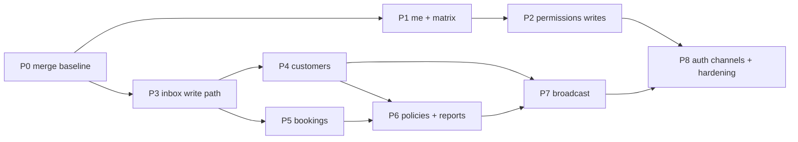

# มั่งมี Flow A — BE Integration Implementation Plan

## Linked Spec

- Spec: `docs/specs/mangmee-flow-a-be-integration-spec.md` (decisions D1–D14 referenced throughout)
- Design bundle: `/design_handoff_mangmee` (contract: `api.ts`; RBAC: `permissions.ts`; routes: `routes.md`; visual truth: `มั่งมี Flow A.dc.html`)
- Related plans: `docs/plans/crm-sales-mvp-plan.md`, `docs/plans/employee-access-role-management-plan.md`
- Thai summary: `Doc/mangmee-flow-a-be-integration-summary-th.md`

## Purpose

Implement the backend for the มั่งมี Flow A screens by extending WatchDog-BMS in place: reuse the 15A CRM-inbox foundation and Employee Access v2, add the missing write paths (reply/assign/status/slip), and the net-new modules (bookings, campaigns, CRM reports, PO tiers, discount policy, matrix projection). Frontend recreation of the screens is a parallel workstream that consumes each phase's endpoints; this plan only carries thin FE wiring tasks where a phase is unusable without them.

## Current Repository Context

- **Baseline branch problem (D1)**: everything 15A/มั่งมี lives on `feat/employee-access-v2-phase1-smart-roles`; the working branch `migrete-ui-with-be` is `develop` and lacks it. Phase 0 fixes this first.
- Patterns to reuse: NestJS module layout (`domain/application/infrastructure/presentation`), `@RequirePermissions` + deny-by-default, `{items,total,page,pageSize}` envelope, contracts package DTOs, Prisma migrations per item, audit-in-transaction, BullMQ workers app, ai-gateway internal endpoints with `x-internal-secret`.
- Known dependencies: LINE Messaging API (push/multicast), AES-GCM channel credentials (15A), `AuthMailerPort` (console/disabled), SMS provider (undecided → OTP deferred), SMTP (undecided → email-credentials ships with disabled adapter).
- Open implementation risks: see Risks table.

## Implementation Rules

- Follow `docs/plans/master-implementation-checklist.md`.
- Keep route/controller files thin; business rules in use cases/domain logic.
- Reuse common helpers/components before adding new ones.
- Do not implement outside the phase scope.
- Do not move final business mutations into LINE/AI unless the spec explicitly allows it (AI stays draft-only).
- Every mutation: DTO validation (class-validator), permission key, audit row, test.

## Scope

### In Scope
- Phases 0–8 below (backend + contracts + minimal FE wiring).

### Out of Scope
- Recreating all Flow A screens pixel-perfect (separate FE workstream).
- OTP SMS integration (blocked on provider), AI image models, FB/IG channels, LIFF customer pages, accounting placeholder menus.

## Role Gates

- OWNER/ADMIN: matrix edit, role manage, overrides, policies (PO/discount), campaign send.
- MANAGER: inbox manage (assign/status), bookings edit, reports read, campaign create.
- SALES/STAFF (Inbox Agent pack): inbox read+reply, bookings create, customers read/edit.
- MARKETING (Campaign Manager pack): campaigns read/create/send, customers read.
- ACCOUNTANT/AUDITOR: read-only where mapped by the menu registry.

## Phases

### Phase 0 — Branch consolidation & baseline verification (prereq, small)
1. Merge `feat/employee-access-v2-phase1-smart-roles` → `migrete-ui-with-be` (it is a strict superset; expect trivial conflicts only in lockfiles/env examples).
2. `prisma generate` + `prisma migrate deploy` on local Postgres (item15a + auth-self-service migrations land here; the stale generated client with CrmConversation becomes real).
3. Run full verification: API tests (858 expected), web tests (158), typecheck, production build; smoke the cookie BFF login.
4. Record agent-memory note; re-point the two orphaned Thai summaries' broken links at the new spec/plan.
- **Acceptance**: all suites green on the merged branch; `GET /v1/companies/{id}/crm/conversations` serves 15A data locally.

### Phase 1 — Session & matrix foundation (D3, D6) (medium)
Backend:
1. `packages/contracts`: add `MenuId`, `ActionId`, `MENU_REGISTRY` (16 menus → route, group, per-action permission keys — transcribe from handoff `permissions.ts` + map to real keys), `PermissionMatrix` type.
2. `access-control`: matrix projection service (role grants → matrix rows; owner row locked) + `GET /v1/companies/{id}/settings/access/matrix` (`access.role.read`).
3. `auth`: enrich `GET /v1/auth/me` (additive): `user` profile block, `matrix`, `menus` (server-evaluated), `branches` (scope-filtered via existing `resolveBranchIds`), `activeBranchScope`.
4. Branch list reuse: confirm `GET .../branches` filters by caller scope; add filter if not.
FE wiring: session provider consumes enriched me(); sidebar renders server `menus`.
- **Acceptance**: matrix for seed roles matches `ROLE_GRANTS` projection snapshot test; a STAFF user's `menus` hides settings; owner sees all 16.

### Phase 2 — Permissions screen write paths (D3, D4, D5, D12) (large)
1. `PUT .../settings/access/matrix/{roleId}/{menuId}` → translate actions→keys→existing `UpdateRoleUseCase` (partial: replace only that menu's keys); block OWNER/SYSTEM_ADMIN rows.
2. Roles: `copyFromRoleId` + `color` on create; map UI delete → disable (guard: not while assigned — exists).
3. Employees list: `q` (name/username/email/phone), `roleId`, `branchId`, `page/pageSize` on `ListEmployeesUseCase`.
4. Single-role validation flag `EMPLOYEE_SINGLE_ROLE` (D5).
5. `MembershipMenuOverride` table + `PUT .../employees/{id}/menu-override` + resolver hook (view-level only) + matrix/me() reflect effective visibility.
6. Wizard fields (additive on `EmployeeAccessProfile`): email, firstName/lastName, dob, address, postalCode, secondary identity (encrypted) + DTO validation (10-digit phone, 13-digit Thai ID) — reuse existing identity hash/mask logic.
7. `POST .../employees/{id}/email-credentials` → `AuthMailerPort.sendCredentialHandoff` (new method, console+disabled adapters), audited.
- **Acceptance**: matrix edit round-trips; override DENY hides menu for that user only (me().menus + guard on view routes via projection); wizard 4-step payload persists; email-credentials returns honest 503-style "mailer disabled" until SMTP configured.

### Phase 3 — Inbox write path = 15A Phase 2 (D7) (large)
Order matters (15A note): media first, then send.
1. **Media download**: on image/file webhook events, fetch LINE content within retention window → attachment storage; message rows link `attachmentId`.
2. `CrmConversationReadState` + derived `waitMin/unread/overdue` in list/detail responses; list filters `branchId`, `q` (customer name/last message), `status`, `customerId`; `overdue` virtual filter for the "เกิน 30 นาที" chip counts endpoint (`GET .../conversations/status-counts`).
3. **Send message**: `POST .../conversations/{id}/messages {text, visibility}` — `crm.inbox.reply`; outbound via LINE push with channel token (15A credentials); delivery status persisted; INTERNAL_NOTE never enters the send adapter (structural guard + test).
4. **Assign / manual status**: `PUT .../assign`, `PUT .../status` (`crm.inbox.manage`), legal-transition validation, audit.
5. **Auto-advance rules** in use cases: reply→WAITING_CUSTOMER; book→RESOLVED; verify-slip→OPEN.
6. **Slip verification**: `POST .../messages/{msgId}/verify-slip` (`crm.inbox.verify_slip`) → marks slip verified + emits finance-queue notification (reuse notification module), auto-advance.
7. **Auto-workflow toggles**: `PUT .../customers/{id}/auto-workflow` (fields from D10); discount % in the response read from discount policy (Phase 6 dependency: until then return policy defaults).
8. AI panel: reuse existing draft-only `ai.suggestion` path for suggested reply/summary/intent (wire prompts for inbox context in ai-gateway; no new send capability).
- **Acceptance**: local smoke — signed webhook in → staff reply out (mock LINE API) → status auto-advances; unread counts drop on read; internal note never calls the LINE adapter (test proves); SLA chip counts correct at the 30-min boundary.

### Phase 4 — Customers extensions (D10) (medium)
1. Prisma additive fields + `CrmCustomerCourse(+Session)` + `CrmCustomerPurchase`; migration + backfill defaults.
2. List: `tier`, `branchId` filters + KPI counts endpoint (`GET .../customers/kpis`); sort by LTV.
3. Detail payload: score/ltv/lastVisit/course progress/purchases/next appointment (join bookings once Phase 5 lands; null-safe before).
4. "เปิดแชท": conversations list already supports `customerId` (Phase 3.2).
- **Acceptance**: tier filter + LTV sort correct; profile modal payload complete for a seeded Room45-style customer.

### Phase 5 — Bookings module (D8) (medium)
1. `crm-bookings` module + `CrmBooking` model; `GET ?branchId&weekStart`, `POST`, `PATCH`, `DELETE/cancel`; required same-company active `customerId` FK with customer-name snapshot; customer search/select or explicit quick-create in web; independent source channel; validation: hours window, 0.5h steps 1–3h, staff overlap, no past-start; permissions `crm.booking.*` plus existing customer read/create permissions for the picker/quick-create.
2. `POST .../conversations/{id}/book` delegates here + auto-advance (completes Phase 3.5).
3. Dashboard/customer joins: today's bookings count; customer's next appointment.
FE wiring: week-grid mapper (`startAt` ↔ day/weekOffset/time) in contracts or web lib.
- **Acceptance**: overlap rejected (409), past slot rejected, booking-from-chat resolves the conversation; week query returns exactly the ISO week rows.

### Phase 6 — Settings policies (D13) + reports/dashboard (D14) (medium)
1. `PoApprovalPolicy/Tier` + `GET|PUT .../settings/po-approval` + enforcement in `ApprovePurchaseOrderUseCase` (tier lookup by amount; approver role must match; snapshot into `thresholdSnapshotJson`); permissions-page read-only ceiling comes from here.
2. `CompanyDiscountPolicy` + `GET|PUT .../settings/discount-policy`; inbox Auto-AI card reads it; clamp helper exported for future discount mutations.
3. ✅ **DONE 2026-07-09** (see [[plans/mvp1-crm-reports-ltv-plan]] + [[agent-memory/mvp1-crm-reports-ltv]]): `GET .../crm/reports/summary?branchId`: totals, resolvedRate, avgResponseMin (first-staff-reply minus inbound timestamps), overdue, statusBreakdown, per-staff (assigned/resolved/rate), top-5 LTV customers. LTV derived from real `AccountingPayment` (RECEIVED/RECORDED) via the counterparty bridge (spec §12), auto-linked at the quotation seam; `/crm-reports` web page wired + browser-verified.
4. Dashboard KPI providers: sales/bills (accounting documents), bookings (Phase 5), pending (open PO+expense+reimbursement approvals), branch-scoped.
- **Acceptance**: approving a PO above the caller's tier ceiling → 403 with tier info; report numbers reproduce a hand-computed fixture; dashboard KPIs change when `branchId` changes.

### Phase 7 — Broadcast (D9) (large, externally risky — last of the CRM suite on purpose)
1. Models `CrmCampaign(+Recipient)`; permissions `crm.campaign.*`; capability pack `Campaign Manager`.
2. Segment resolution service (tier + consent + follow state) + counts endpoint.
3. Send pipeline: create campaign (DRAFT) → enqueue → worker multicast batches (rate-limited, idempotent per recipient, resumable) → status/reach updates; quota check before send; audit as sensitive action.
4. `POST .../campaigns/generate` → ai-gateway `marketing-draft` agent (3 × {headline, body}, tone presets; draft-only) + poster template render (SVG→PNG, 5 color presets) stored as attachment; manual mode = upload attachment.
- **Acceptance**: consent-revoked customer never receives (test at send time, not preview); worker resume after kill re-sends zero duplicates; generate returns 3 options without any send side-effect.

### Phase 8 — Auth channels & hardening (D11) (medium)
1. LINE QR login behind `AUTH_LINE_QR_LOGIN`: `AuthQrLoginSession` (60s TTL, single-use), QR rendered in-process, poll endpoint, confirm via linked LINE identity on phone; rate limits + audit.
2. OTP endpoints scaffolded against `SmsSenderPort` with `disabled-sms.adapter` (410/feature-off response until provider chosen).
3. Hardening sweep: permission-key coverage test over all new routes, tenancy fuzz (cross-company 404), e2e happy path per screen, load-check conversation list derived fields.
4. Docs: update `permission-matrix.md`, agent-memory entry, refresh Thai summaries.
- **Acceptance**: QR flow e2e with two simulated devices; expired session → new QR; all suites green; security review checklist passes.

## Phase dependencies

## Risks

| Risk | Mitigation |
|---|---|
| Merge conflicts P0 (two long-lived branches) | feat is a strict superset (verified: zero commits unique to current branch); merge early, verify with full suites |
| LINE media retention expires before download | Phase 3 does media download first (15A guidance); webhook handler enqueues fetch immediately |
| Matrix projection can't represent every permission key | Registry maps only menu-relevant keys; advanced keys stay on the existing roles UI (matrix is additive, not a replacement) |
| Broadcast = external blast radius | Last CRM phase; consent+quota+idempotency tests; sensitive permission + audit |
| SMS/SMTP providers undecided | Ports + disabled adapters ship; UI states honestly; decisions tracked in spec §11 |
| `waitMin/unread` N+1 on list | Aggregate via read-state join + last-inbound timestamp column maintained on write |
| Timezone bugs in week grid | Store UTC, convert at Asia/Bangkok boundary in one mapper, boundary tests (Sun/Mon week start, DST-free TH) |

## Verification

- Per phase: unit + e2e as listed, typecheck all packages, full API/web suites.
- Cross-cutting: every new route has `@RequirePermissions` (meta test), every mutation audited (audit assertion helper), cross-tenant access fuzz per controller.
- Final: smoke against real LINE channel via tunnel (15A leftover), Owner demo of all 10 screens.
