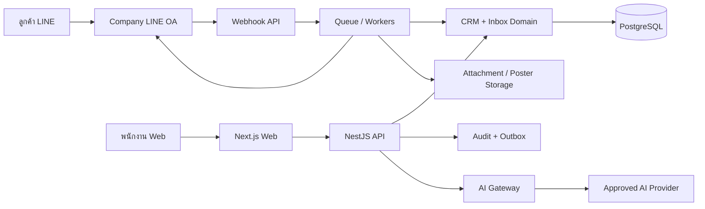
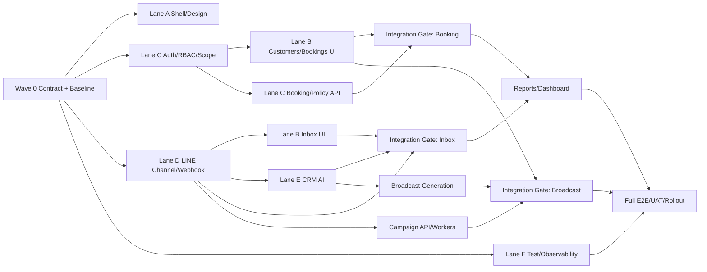

# แผนพัฒนาระบบมั่งมี Web + LINE OA ระดับ Production

สถานะ: Draft พร้อมใช้วางแผน Sprint และ Technical Review  
วันที่จัดทำ: 2026-07-12  
Design source of truth: `Web และ Line OA design (1).zip`  
ระบบเป้าหมาย: Next.js 16 + React 19, NestJS, PostgreSQL/Prisma, Workers, AI Gateway และ LINE Messaging API

## 1. เป้าหมาย

พัฒนาหน้าจอทุกส่วนใน design ให้เป็นระบบ multi-company และ multi-branch ที่ใช้งานจริง โดยไม่มี mock data หรือ fake-success และรักษาความเหมือนของ UI ตาม design handoff ให้สูงที่สุด ภายใต้ข้อกำหนดสำคัญต่อไปนี้

- Web UI ภาษาไทย ใช้คำว่า “มั่งมี” เท่านั้นในหน้าจอ
- ทุกข้อมูลอ่านจาก API และฐานข้อมูลจริง
- ทุก mutation ตรวจ permission, tenant/company, branch, validation และ audit ที่ server
- LINE OA ของลูกค้าแต่ละบริษัทแยกจาก WatchDog Shared LINE OA อย่างเด็ดขาด
- งานส่ง LINE, broadcast, reminder และงาน retry ต้องผ่าน worker/queue ไม่ผูกกับ HTTP request
- AI สร้างคำแนะนำหรือ candidate ก่อนเสมอ ส่วนการส่งและการจองต้องผ่าน deterministic guardrails
- ทุก module ต้องมี loading, empty, error, forbidden, retry และ responsive state
- schema change เป็น additive migration และต้อง rollback/forward-compatible ในช่วง deploy

## 2. นิยามคำว่าเสร็จ

แต่ละ module จะถือว่าเสร็จเมื่อผ่านครบทุกข้อ:

1. UI เทียบ design ที่ desktop, tablet และ mobile
2. ไม่มี import หรือ runtime dependency จาก mock/prototype dataset
3. API contract อยู่ใน `packages/contracts` และ FE/BE ใช้ shape เดียวกัน
4. API บังคับ authentication, permission, company scope และ branch scope
5. mutation มี validation, confirmation UX, audit และ idempotency ตามความเสี่ยง
6. DB migration ผ่าน `prisma validate`, deploy และ smoke query
7. focused unit/integration tests ผ่าน รวมกรณี forbidden และ cross-company
8. browser smoke ผ่านกับข้อมูลจริงที่สร้างผ่าน API
9. observability มี structured log, correlation id และ metric ที่จำเป็น
10. ไม่มี console error, TypeScript error หรือ fake-success

## 3. สถาปัตยกรรมเป้าหมาย

หลักแบ่งความรับผิดชอบ:

- `apps/web`: presentation, interaction state และ BFF/session integration เท่านั้น
- `apps/api`: business rules, authorization, transaction และ source of truth
- `apps/workers`: asynchronous delivery, retry, schedule, quota scan และ maintenance jobs
- `apps/ai-gateway`: prompt/provider boundary และ structured AI results ไม่มี direct DB access
- PostgreSQL: durable state, uniqueness, referential integrity และ transactional outbox
- Object storage: รูป, slip, poster และ attachment; DB เก็บ metadata/reference

## 4. กลยุทธ์ส่งมอบแบบ Parallel

โครงการนี้ให้ทำงานหลายสายพร้อมกันเป็นค่าเริ่มต้น แต่ห้าม parallel ในส่วนที่แก้ source of truth เดียวกันโดยไม่มี contract freeze เช่น Prisma schema, permission registry, shared contracts และ route ownership

### 4.1 Parallel lanes

| Lane | เจ้าของหลัก | ขอบเขต |
|---|---|---|
| A — Web/Design | FE Team A | App shell, responsive, shared UI, visual fidelity, route/page integration |
| B — CRM Web | FE Team B | Inbox, Customers, Bookings, Reports, Broadcast UI |
| C — Core API/DB | BE Team A | Auth/session, RBAC, customer, booking, reports, policy และ Prisma migrations |
| D — LINE/Campaign | BE Team B | LINE channel, webhook, delivery, campaign API, quota และ workers |
| E — AI Gateway | AI/BE | CRM assist, broadcast copy/poster candidate, provider failure handling |
| F — QA/Security/Platform | QA + DevOps | test harness, visual baseline, observability, security, CI/CD และ environments |

### 4.2 กติกาการทำงานพร้อมกัน

- ก่อนเริ่ม feature ให้ freeze contract ของ slice นั้น: DTO, endpoint, permission key, DB owner และ error codes
- `packages/contracts` มี merge owner คนเดียวต่อ wave; ทีมอื่นพัฒนาเทียบ frozen contract/fixture
- Prisma migration มี migration lane คนเดียวในแต่ละช่วงเวลา; module อื่นทำ repository/use-case บน schema branch ที่ประกาศแล้ว
- route/component ownership แบ่งต่อหน้า ห้ามสองทีมแก้ page entry เดียวกันพร้อมกัน
- shared UI/token เปลี่ยนผ่าน lane A; feature team consume แต่ไม่แก้ global token พร้อมกัน
- integration merge อย่างน้อยวันละครั้ง; branch ที่ค้างเกิน 2 วันต้อง rebase/merge baseline ก่อนทำต่อ
- QA สร้าง test cases และ automation พร้อม development ไม่รอท้าย sprint
- external dependency เช่น LINE sandbox, OTP, storage และ AI provider ให้ DevOps เตรียมพร้อมตั้งแต่ Wave 0

### 4.3 Dependency graph

### 4.4 งานที่ทำพร้อมกันได้ทันทีหลัง Wave 0

- Lane A: design tokens, app shell, responsive primitives และ visual baselines
- Lane C: auth/session/branch/RBAC audit และ frozen effective-access contract
- Lane D: LINE OA onboarding reliability, webhook replay tests และ queue observability
- Lane E: AI contract/provider tests โดยใช้ bounded fixtures ไม่แตะ DB
- Lane F: test database, LINE adapter mock server, screenshot matrix, CI gates และ monitoring dashboard

### 4.5 งานที่ต้องรอ dependency

- Inbox production integration รอ channel/webhook contract และ conversation API freeze
- Booking UI mutation รอ booking concurrency/state contract
- Reports รอ write paths ของ Inbox/Booking เพื่อให้ metric definition และ test data ถูกต้อง
- Broadcast send รอ consent identity, quota snapshot, channel delivery และ campaign schema
- Employee approval ceiling รอ PO policy contract
- Inbox auto-discount card รอ Discount Policy resolver contract
- Production rollout รอ cross-company, retry/DLQ, backup/restore และ allowlist campaign E2E

### 4.6 Integration gates

| Gate | ต้องผ่านก่อน merge ข้าม lane |
|---|---|
| Contract Gate | contracts build, API examples, permission keys, error codes และ version note |
| DB Gate | prisma validate, migration deploy บน clean DB, indexes/constraints และ rollback note |
| API Gate | focused tests, tenancy/forbidden tests, idempotency และ audit evidence |
| FE Gate | typecheck, loading/error/empty/forbidden, responsive และ no mock import |
| LINE Gate | signature, dedupe, 429/timeout retry, disabled channel และ secret-redaction |
| Integration Gate | real API browser journey, correlation trace และ no console/server error |

## 5. ลำดับ Wave และ Critical Path

| Wave | เนื้อหา | Parallel execution |
|---|---|---|
| 0 | Baseline, contracts, ownership, environments | ทุก lane ร่วมกัน freeze boundary |
| 1 | Shell/Auth/RBAC + LINE foundation + test harness | A, C, D, E, F ทำพร้อมกัน |
| 2 | Inbox FE/API integration + Customers API/UI | B-Inbox, B-Customer และ D ทำพร้อมกัน |
| 3 | Booking + Payment proof + AI assist | B, C, D, E ทำพร้อมกันตาม frozen contracts |
| 4 | CRM Reports/Dashboard + PO/Discount policies | report lane และ policy lane ทำพร้อมกัน |
| 5 | Broadcast FE + Campaign API/DB + Workers + AI generation | B, C/D, E และ F ทำพร้อมกัน แล้วรวมที่ Broadcast Gate |
| 6 | Permissions/Employee hardening + full visual pass | A/B และ C ทำพร้อมกัน |
| 7 | Full E2E, performance, security, DR, UAT และ rollout | F นำ; ทุก lane แก้ defect ตาม ownership |

Critical path คือ `contract freeze → LINE ingestion/delivery → Inbox integration → consent/quota foundation → Campaign delivery → full E2E`. งาน visual, policy, AI candidate generation และ test automation ไม่ควรรอ critical path หาก contract ของตน freeze แล้ว

## 6. Module 0 — Design System และ App Shell

### FE

- ใช้ Noto Sans Thai, token สี/spacing/radius/shadow จาก handoff ผ่าน `packages/design-tokens`
- Sidebar desktop 290px ย่อเป็น 84px, tablet เป็น icon rail, mobile เป็น off-canvas drawer
- Header แสดง company, branch, user/role, notification และ profile menu
- Branch switcher เก็บ scope ใน shared workspace context และ refresh server state ทุกหน้า
- ทำ shared components: page header, KPI card, filter chip, status badge, confirm dialog, toast, skeleton, empty/error/forbidden state
- ห้าม copy prototype HTML เข้ามาตรง ๆ; port เฉพาะ visual behavior เข้าสู่ component patterns ปัจจุบัน

### BE/DB

- ใช้ Company, Branch และ membership model เดิมเป็น source of truth
- endpoint session ต้องคืน effective permissions และ branch scope ที่ผู้ใช้เข้าถึงได้
- ไม่สร้าง menu/role truth ซ้ำใน frontend

### Tests/Gate

- visual regression ที่ 1440x900, 1024x768, 390x844
- keyboard navigation, focus state, contrast และ reduced motion
- branch switch ต้องไม่ค้างข้อมูลของ branch เดิม

## 7. Module 1 — Authentication

### FE

- Login split layout ตาม design: brand panel ซ้ายและ form ขวา
- Email/password เป็นช่องทางหลัก
- Phone OTP: request, ref code, input 6 หลัก, timer 60 วินาที, resend หลังหมดเวลา, inline error
- LINE QR login เก็บ implementation หลัง feature flag; QR refresh ทุก 60 วินาทีและยกเลิก polling เมื่อปิด modal
- session ใช้ HttpOnly cookie; ห้ามเก็บ access token ใน localStorage
- login redirect ต้อง validate `next` ป้องกัน open redirect

### BE

- password login: rate limit, generic error, account lock/throttle และ force-change temporary password
- OTP: hashed code, expiry, max attempts, resend cooldown, provider abstraction และ audit เฉพาะ metadata
- LINE login: state/nonce/PKCE, one-time login transaction และ explicit user-account link
- logout revoke/expire session server-side

### DB

- reuse session/user models; เพิ่ม OTP challenge หรือ LINE login transaction เฉพาะเมื่อของเดิมไม่ครอบคลุม
- index expiry และ scheduled cleanup
- ห้ามเก็บ OTP plaintext, QR secret หรือ token ใน log

### Gate

- wrong password/OTP ไม่เปิดเผยว่ามี user หรือไม่
- expired/replayed OTP และ QR ใช้ซ้ำไม่ได้
- tenant/company session ถูกกำหนดหลัง auth และเปลี่ยนได้เฉพาะ membership ที่มีจริง

## 8. Module 2 — Dashboard

### FE

- greeting, role/branch label, KPI ยอดขาย/บิล/การจอง/ค้างอนุมัติ
- quick-menu tiles แสดงตาม permission และใช้ route จริง
- CRM daily brief แสดง unread, SLA breach, booking วันนี้ และ payment proof ที่รอตรวจ
- ทุก KPI มี period label และ last-updated state

### BE

- aggregate endpoint เดียวต่อหน้า ลด N+1 และใช้ permission-aware sections
- define timezone `Asia/Bangkok`, day/week boundary และ currency rounding ให้ชัด
- dashboard snapshot ใช้ cache/summary table เมื่อ query volume สูง แต่ invalidation ต้องอิง outbox event

### DB

- เริ่มจาก query/index จริง; เพิ่ม snapshot table เฉพาะเมื่อ performance test แสดงความจำเป็น
- index companyId + branchId + event date ใน source tables

### Gate

- ตัวเลข reconcile กับ source transaction
- user ที่ไม่มี permission ไม่ได้รับข้อมูล section นั้นจาก API แม้เรียกตรง

## 9. Module 3 — Company LINE OA Integration

### FE

- wizard เชื่อม LINE OA: Channel ID, Channel Secret, Access Token, webhook URL และ verify checklist
- mask credentials, reveal ต้อง re-auth/confirm และมี audit
- test connection, rotate credential, disable channel และ status card
- แสดง quota snapshot, auto-reply toggle, daily cap และ booking defaults
- empty state ใน Inbox ชี้ไปหน้าเชื่อม OA

### BE

- แยก company OA endpoint/path จาก shared OA
- validate token ด้วย LINE bot info และตรวจ channel binding แบบ best effort ตาม capability ของ LINE
- encrypt secret/token ด้วย envelope encryption; decrypt เฉพาะ delivery boundary
- webhook verify `x-line-signature` ด้วย raw body ก่อน parse
- resolve company จาก channel record เท่านั้น ห้ามเชื่อ companyId จาก payload
- dedupe webhook event ด้วย provider event/message id และตอบ 200 เร็วหลัง enqueue

### DB

- `CompanyMessagingChannel`: provider, company, encrypted credentials, webhook key, status, quota snapshot, settings
- unique provider channel id และ webhook key
- credential rotation metadata และ `disabledAt`
- `CrmChannelIdentity`: provider user id, customer link, consent/link verification

### LINE OA/Operations

- LINE Developers: Messaging API channel, webhook HTTPS, long-lived token policy, webhook enabled, group behavior policy
- secret rotation runbook และ test channel ก่อน cutover
- quota polling และ alert ที่ 70/85/95%
- webhook replay test, LINE outage simulation และ dead-letter queue

### Gate

- OA A ส่งเข้า company A เท่านั้น; cross-company fuzz ต้องผ่าน
- invalid signature, duplicate event และ disabled channel ไม่สร้างข้อมูลซ้ำ
- secret ไม่ปรากฏใน response/log/error trace

## 10. Module 4 — CRM Inbox

### FE

- desktop 3 panes, tablet 2 panes, mobile single-pane list/thread
- list pagination 10/page, search debounced, branch/status/assignee filters และ live counts
- SLA breach แสดง badge และ red border จาก server timestamps ไม่คำนวณจาก mock `waitMin`
- thread รองรับ text/media/internal note, delivery status, AI marker และ message pagination
- actions: reply, note, assign, priority, tags, status, mark-read, quick reply
- server-driven state transitions: reply → waiting customer, booking → resolved, verify slip → open
- optimistic UI ใช้เฉพาะ action ที่ rollback ได้; send message แสดง pending/delivered/failed ตาม durable delivery

### BE

- list/detail endpoints มี company + branch + assignment ABAC
- append-only message model; internal note ห้ามเข้า LINE delivery path
- send command สร้าง message/outbox ใน transaction แล้ว worker ส่ง LINE
- idempotency key ต่อ logical outbound message และ reuse เป็น LINE retry key
- assignment/status/tag/priority mutation ตรวจ stale version หรือ updatedAt เพื่อป้องกัน lost update
- SLA due/breach scanner และ notification event

### DB

- channel, identity, conversation, message, delivery attempt, template, SLA policy
- indexes: company/status/lastMessageAt, conversation/createdAt, assignee/status
- unique provider event id และ outbound idempotency key
- media metadata แยกจาก binary storage

### LINE OA

- reply token เมื่อยัง valid; push fallback ตาม policy/quota
- retry 429/5xx ด้วย exponential backoff + jitter; 4xx ถาวรเข้ failed state
- จำกัด message length/types ตาม LINE API และ sanitize user-visible error

### Gate

- ส่งซ้ำจาก retry ไม่สร้างข้อความซ้ำ
- note ภายในไม่เคยออก LINE
- customer ที่ revoke consent ถูก block ใน automated outbound path

## 11. Module 5 — AI Assist และ Auto Workflow

### FE

- panel: summary, suggested reply, intent, sentiment, next step และ regenerate/feedback
- insert draft เข้า composer แต่ไม่ส่งอัตโนมัติใน staff-assist mode
- per-conversation auto-reply toggle และสถานะ channel/global kill switch
- discount % เป็น read-only จาก Discount Policy
- แสดงเหตุผลที่ระบบไม่ auto เช่น consent, cap, low confidence, conversation disabled

### BE/AI Gateway

- bounded context window, permission-checked data และ PII minimization
- dedicated CRM agent family แยกจาก employee/shared-OA agents
- structured output validation; provider error คืน unavailable/uncertain ไม่ fake answer
- deterministic final guard ก่อน send/booking: global flag, channel, conversation, consent, cap, confidence และ availability
- re-read guard หลัง AI evaluation ทันทีก่อน mutation
- prompt injection: conversation content เป็น data ไม่ใช่ instruction

### DB

- cached summary, advisory score/insight, feedback, autonomy job, audit reason และ model metadata
- ห้าม persist profiling สำหรับ consent `REVOKED` ตาม policy

### Gate

- provider down แล้ว staff ยังตอบเองได้
- toggle off ระหว่าง AI ประมวลผลต้องหยุดก่อน final send
- AI ไม่สามารถเรียก money/tax/permission mutation

## 12. Module 6 — Customers / Customer 360

### FE

- KPI total/VIP/ประจำ/ใหม่จาก API
- search name/phone/LINE, tier filter, branch scope และ sort LTV
- table pagination server-side; row เปิด profile modal ตาม design
- modal แสดง profile, LTV, last visit, next appointment, course progress, purchase history และ tasks จาก source จริง
- “เปิดแชท” deep-link conversation ที่ match customer
- field ที่ backend ยังไม่มีต้องเป็น empty state ไม่เติมข้อมูลจำลอง

### BE

- customer list/summary360/timeline endpoints แยก permission-sensitive blocks
- duplicate detection ด้วย normalized phone/email/LINE identity
- merge/archive/erase ตาม PDPA; ห้าม hard delete ที่ทำลาย audit chain
- tier และ LTV update จาก deterministic source transactions

### DB

- reuse `CrmCustomer`; index company, branch, tier, normalized identifiers, LTV
- customer-channel identity link ต้อง unique ภายใน provider/channel
- timeline อ่านจาก activity/message/booking/document references ไม่ทำสำเนา truth โดยไม่จำเป็น

### Gate

- cross-company customer id คืน not-found/forbidden โดยไม่ leak
- LTV และ KPI reconcile กับ transaction source

## 13. Module 7 — Bookings

### FE

- desktop/tablet week grid 09:00–20:00; mobile day view
- week navigation, today, current/next/previous label และ branch filter
- free slot เปิด create modal: customer, service, duration 1–3 ชม., staff
- past slot disabled; booking block แสดงเวลา ลูกค้า บริการ พนักงาน ระยะเวลา
- edit/cancel ต้อง confirm; conflict แสดง slot ใหม่ที่เลือกได้
- create booking จาก Inbox ใช้ widget เดียวกับ booking page

### BE

- list week range ด้วย Bangkok timezone
- create/update/cancel ตรวจ permission, branch, staff membership และ service duration
- overlap-check + insert ใน transaction พร้อม per-staff advisory lock
- reminder job, status transitions และ conversation auto-advance
- idempotency สำหรับ AI-created booking และ source conversation

### DB

- booking status, startAt/endAt, branch, customer, staff, service, source conversation, createdBy type
- indexes company/branch/startAt, staff/startAt/status, customer/startAt
- future hardening: PostgreSQL exclusion constraint เมื่อผ่าน compatibility review

### LINE OA

- confirmation/reminder ส่งผ่าน durable queue
- cancel/reschedule message ต้องอ้าง booking version ล่าสุด

### Gate

- concurrent create ใน slot เดียวสำเร็จได้เพียงหนึ่งรายการ
- timezone/DST assumptions test แม้ไทยไม่มี DST เพื่อป้องกัน server UTC bug

## 14. Module 8 — Payment Slip Verification

### FE

- preview attachment, amount candidate, confidence และ source metadata
- staff approve/reject/correct; ห้าม AI auto-confirm เงิน
- deep-link กลับ conversation และแสดง final audit status

### BE/DB

- media fetched ตอน ingestion ตาม retention ของ LINE และเก็บ object reference
- OCR/AI สร้าง candidate เท่านั้น
- reviewer mutation ตรวจ permission, version และ audit before/after
- link proof กับ conversation/customer/document/payment เมื่อยืนยันแล้ว

### Gate

- duplicate slip detection และ amount mismatch warning
- binary size/type limit, malware/content scanning ตาม storage policy

## 15. Module 9 — CRM Reports

### FE

- KPI: chats, resolved rate, average response, SLA overdue
- status breakdown, top 5 LTV และ staff performance
- branch selector, date range และ empty/error/forbidden states
- export เฉพาะเมื่อ contract มีจริง; ห้ามสร้าง CSV จาก incomplete client data

### BE/DB

- aggregate จาก conversation/message/customer facts โดยกำหนด denominator ชัด
- response time ใช้ first human response ตาม business definition
- branch scoping และ user visibility เหมือน Inbox
- index/summary strategy หลัง explain-analyze; ห้าม premature materialization

### Gate

- report total ตรงกับ filtered source list
- zero denominator ไม่คืน NaN/Infinity

## 16. Module 10 — Broadcast Campaigns

### FE

- route `/broadcast` ต้อง render production page ไม่ใช่ Planned Module
- composer AI/manual ตาม design, content tone 5 แบบ และ poster color 5 แบบ
- AI generate คืน 3 candidate; user ต้องเลือกหรือแก้ไขก่อนส่ง
- image upload ใช้ signed upload/object storage ไม่ส่ง Data URL เข้า DB
- recipient segment count จาก API แบบ snapshot-aware: all/VIP/ประจำ/ใหม่
- LINE-style preview, quota/consent warnings, confirm send และ campaign history/results
- send/schedule button disabled หากไม่มี OA, quota ไม่พอ, recipient เป็นศูนย์ หรือ permission ไม่ครบ

### BE

- contracts: generate candidates, count segment, create draft, schedule/send, cancel, list/detail/results
- campaign state machine: DRAFT → READY → SCHEDULED/QUEUED → SENDING → COMPLETED/PARTIAL/FAILED/CANCELLED
- recipient snapshot สร้างตอน confirm เพื่อให้ผลส่งตรวจสอบย้อนหลังได้
- exclude revoked consent, blocked/unreachable identity และ duplicate identity
- quota preflight + reserved estimate; actual result อัปเดตจาก delivery attempts
- enqueue batch chunks; HTTP ไม่ loop ส่ง LINE โดยตรง
- idempotent create/send และ state transition compare-and-set
- AI Gateway สร้าง copy/poster brief; image provider output ต้องผ่าน moderation และ storage ingest

### DB

- `CrmCampaign`, `CrmCampaignRecipient`, `CrmCampaignContent`, `CrmCampaignDelivery`
- เก็บ segment definition + recipient snapshot + consent snapshot + final content hash
- unique campaign/customer-channel identity และ delivery retry key
- indexes campaign/status/scheduledAt, recipient/status และ company/createdAt

### Workers/LINE OA

- chunking, rate limiting ต่อ channel, exponential backoff, DLQ และ resume checkpoint
- quota API snapshot ก่อนส่งและ periodic refresh
- ห้ามใช้ multicast หากต้องรักษา per-recipient audit/consent โดยไม่มี mapping ผลลัพธ์ที่เพียงพอ
- unsubscribe/consent revoke ก่อน worker ส่งต้อง re-check ที่ final boundary

### Metrics/Gate

- reach = accepted/delivered ตามนิยามที่ระบุ; open rate ห้ามแสดงถ้า LINE ไม่มี signal ที่เชื่อถือได้
- metrics: queued, sent, failed, retry, consent-excluded, quota-blocked, duration
- test campaign ส่งไป allowlist/test OA ก่อน production segment

## 17. Module 11 — Roles, Permissions และ Employees

### FE

- tabs: ตำแหน่ง, รายบุคคล, เพิ่มพนักงาน
- matrix แสดง capability จริงจาก server ไม่ map CRUD แบบหลวม ๆ จน permission ผิดความหมาย
- owner/super-admin locked; one effective role ต่อ user; per-user allow/deny override ชัด
- active toggle, role change, delete/ลาออก และ branch assignment ต้อง confirm
- wizard 4 ขั้นรักษา draft state และ validate ทีละขั้น
- generated credential แสดงครั้งเดียว; email credential เป็น explicit action

### BE

- reuse Access v2/capability packs และ effective-access endpoint
- mutation ป้องกัน self-lockout, last-owner removal, privilege escalation และ branch outside actor scope
- temp password random, hashed, expires/force reset; email delivery asynchronous
- LINE connect QR เป็น one-time signed transaction

### DB

- reuse role/capability/user assignment models
- ID card/passport เป็น sensitive data: encrypt/mask, strict access และ retention
- unique normalized phone/email/id-card ตาม tenant policy

### Gate

- server permission tests สำคัญกว่า matrix UI tests
- user override deny ต้องชนะ role allow ตาม policy ที่กำหนด

## 18. Module 12 — PO Approval Settings

### FE

- tier editor ≥3 steps, amount ceiling เรียงลำดับ, top tier catch-all
- approver flow แก้ไขได้และ preview path ตามยอด
- unsaved changes, validation และ confirm before save
- approval ceiling ในหน้า employee เป็น read-only จาก policy เดียวกัน

### BE/DB

- versioned approval policy; validate increasing non-overlap ceilings และ catch-all เดียว
- snapshot policy ลง transaction ตอน submit เพื่อไม่ให้ policy change ย้อนหลัง
- permission/audit และ optimistic concurrency

### Gate

- boundary amount เช่น 9,999.99/10,000 เลือก tier ถูกต้อง
- policy edit ไม่เปลี่ยน approval chain ของเอกสารที่ submit แล้ว

## 19. Module 13 — Discount Policy

### FE

- master auto toggle, default %, max ceiling, per-tier %, override role
- validate 0–100 และ default/per-tier ไม่เกิน ceiling ยกเว้น explicit override rule
- Inbox อ่านค่า effective discount แบบ read-only

### BE/DB

- company-scoped versioned policy
- deterministic resolver: customer tier → percent → actor override → ceiling
- AI ได้เฉพาะ effective allowed value และไม่เขียน policy
- save มี audit diff และ concurrency version

### Gate

- toggle off block auto discount ทุก path
- client เปลี่ยน % เองเกิน ceiling แล้ว API ต้อง reject

## 20. Module 14 — Notifications

แม้ design ระบุเป็น placeholder แต่ระบบจริงที่เกี่ยวข้องต้องเชื่อมอย่างซื่อสัตย์:

- notification preferences/rules ใช้หน้าจอและ API จริงที่มีอยู่
- event sources: SLA breach, booking reminder, campaign result, approval และ failed LINE delivery
- dedupe notification, user preference, quiet hours และ retry
- route ที่ยังไม่พร้อมให้ใช้ honest planned state ไม่ทำ fake mutation

## 21. API Contract และ Error Standard

- contracts อยู่ใน `packages/contracts`; ห้ามใช้ `any` ใน public route ใหม่
- list response มาตรฐาน: `items`, `page`, `pageSize`, `total`, optional counts
- error envelope มี code ที่เสถียร, message ภาษา user ผ่าน FE dictionary และ correlation id
- request validation strip unknown fields และ limit payload/search/pageSize
- mutation สำคัญรับ `Idempotency-Key`; update รับ version/updatedAt เมื่อมี lost-update risk
- web ใช้ authenticated fetch helper เดียวและไม่สร้าง auth transport ใหม่

## 22. Security และ PDPA

- deny-by-default guards; permission registry และ capability pack อัปเดตพร้อม endpoint
- companyId จาก authenticated request context; path param ต้อง match context
- branch scope ตรวจ membership ทุก read/write
- encrypt LINE credentials และ sensitive identity fields; mask ใน response
- consent states มี semantics ชัด: REVOKED block automated customer send ทุกชนิด
- data export/erase มี approval/audit และไม่ทำลาย legal/accounting records
- CSP, CSRF สำหรับ cookie auth, secure headers, upload validation และ rate limits
- audit ต้องไม่เก็บ token, secret, OTP, raw ID card หรือ message bodyเกิน policy

## 23. Observability และ Reliability

- correlation id เดียวจาก web/API → outbox → worker → LINE/AI provider
- structured logs ระบุ company/channel/campaign/message id แบบไม่เก็บ secret
- metrics: webhook latency/error/dedupe, queue lag, delivery rate, retry/DLQ, AI latency/error, booking conflict, SLA breach, campaign quota
- alerts: webhook failure, invalid credential spike, DLQ > 0, queue lag, quota threshold, migration failure
- health checks แยก liveness/readiness และ dependency degradation
- backup/restore drill, migration rollback strategy และ documented RPO/RTO

## 24. Test Strategy

### Unit

- business rules: permission, consent, quota, state machines, booking overlap, approval tiers, discount resolver

### Integration

- Prisma repository + transaction + unique constraints
- API controller/use-case/repository with real PostgreSQL test database
- LINE adapter mocked at HTTP boundary: 200, 400, 401, 429, 500, timeout

### Contract

- FE mapper/contract compile และ response fixtures ที่สร้างจาก schema เดียวกัน

### E2E

- login → connect test OA → receive webhook → reply → customer profile → booking
- role permission denied/allowed และ cross-company isolation
- broadcast allowlist → queue → delivery result
- policy changes และ confirmation dialogs

### Visual/Responsive

- screenshot baseline ทุก design route ที่ 3 breakpoints
- compare typography, spacing, color, overflow, sticky panes และ drawer

### Non-functional

- webhook burst, inbox list, report aggregate และ campaign batch load tests
- chaos: LINE timeout/429, AI unavailable, worker restart, duplicate webhook, DB failover

## 25. Production Rollout

1. deploy additive migrations
2. deploy API/worker ที่อ่าน schema เก่าและใหม่ได้
3. deploy web หลัง API contract พร้อม
4. เปิด feature flags เฉพาะ test company
5. connect LINE OA sandbox/test channel และใช้ allowlist recipients
6. shadow/observe webhook และ delivery metrics
7. UAT ตาม acceptance checklist ทุก module
8. เปิด production เป็น company cohort เล็กก่อน
9. monitor 24–48 ชั่วโมง แล้วเพิ่ม cohort
10. remove mock/prototype code หลัง production paths ผ่านและไม่มี route อ้างถึง

Rollback ใช้ feature flag/route fallback ที่ honest และหยุด workers safely; ไม่ rollback migration แบบ destructive ในเหตุการณ์ปกติ

## 26. Sprint Breakdown ที่แนะนำ

ประมาณการใช้ทีม FE 2, BE 2, QA 1, DevOps/AI shared; ต้อง re-estimate หลัง baseline audit

| Sprint | Deliverable |
|---|---|
| 0 | contract inventory, gap matrix, design baseline, migration/queue readiness |
| 1 | shell/auth/session/branch/RBAC hardening |
| 2 | LINE OA onboarding + webhook reliability |
| 3 | Inbox list/thread/reply/notes/assignment + delivery states |
| 4 | AI panel + customer 360 + payment proof |
| 5 | Bookings web/API/DB + reminders + concurrency |
| 6 | Dashboard + CRM Reports reconciliation |
| 7 | Broadcast DB/API/workers + consent/quota |
| 8 | Broadcast AI/poster UI + campaign results |
| 9 | Employees/permissions + PO/discount policy hardening |
| 10 | full E2E, visual fidelity, performance/security, UAT fixes |
| 11 | pilot rollout, observability tuning และ production handoff |

## 27. Required Artifacts ต่อ Module

- spec/decision log และ acceptance criteria
- contract types + endpoint table
- DB migration + data/backfill note
- threat/permission matrix
- test cases + evidence
- browser screenshots 3 breakpoints
- operational runbook และ rollback
- agent-memory update ระบุ files, commands, results และ remaining risks

## 28. Product/Operational Decisions

### 28.1 เลื่อนไปเฟสหน้าและซ่อนเมนูไว้ก่อน

เจ้าของผลิตภัณฑ์ตัดสินใจเมื่อ 2026-07-12 ให้ defer และซ่อนความสามารถต่อไปนี้จาก production navigation จนกว่าจะเปิด scope ใหม่:

1. Broadcast poster image provider, moderation และ cost-per-image
2. Broadcast scheduling — release ที่กลับมาเปิดใหม่ให้เริ่มจาก send-now ก่อน; scheduling เป็น scope ถัดไป
3. Phone OTP provider และ sender identity

กติกา: route/API ที่มี code อยู่ต้อง deny/hide ผ่าน feature entitlement ฝั่ง server และ menu projection ฝั่ง web ไม่ใช้ CSS hide อย่างเดียว และห้ามแสดง control ที่กดแล้ว fake success

### 28.2 Campaign metrics ที่รองรับจริง

นิยามมาตรฐานที่แนะนำ:

| Metric | นิยาม | Source of truth | หมายเหตุ |
|---|---|---|---|
| Targeted | recipient snapshot หลังตัด duplicate | Mangmee DB | จำนวนที่ผู้ใช้กดยืนยันส่ง |
| Eligible | targeted ที่ผ่าน consent/reachability/quota preflight | Mangmee DB | แสดง exclusions แยกเหตุผล |
| Accepted | LINE API รับคำขอสำเร็จ | delivery attempt/request result | ไม่เท่ากับได้รับถึงเครื่อง |
| Delivered | LINE insight `overview.delivered` หรือ narrowcast success count | LINE Insights | ถ้าใช้ per-user push ให้แสดง `accepted` แทนจนไม่มี delivery insight ต่อคน |
| Open | `uniqueImpression / delivered` | LINE message-event insight | อาจเป็น `null` เมื่อ privacy threshold ไม่ถึง; ห้ามแปลงเป็น 0 |
| Click | `uniqueClick / delivered` | LINE message-event insight | ใช้ได้เมื่อข้อความมี tracked URL |
| Reply | inbound conversation event ภายใน attribution window หลัง campaign | Mangmee webhook DB | LINE ไม่มี campaign-reply metric โดยตรง ต้องเป็น first-party inference |
| Conversion | booking/order/deal ที่มี explicit campaign ref หรือ deterministic window | Mangmee business DB | แยก direct-click attribution จาก time-window assisted attribution |

ข้อกำหนด:

- เก็บ LINE request ID ต่อ campaign/message เพื่อดึง insight
- poll insight หลังส่ง เช่น +1h, +24h, +72h และ final +14d เพราะ LINE อัปเดตสถิติ 14 วัน
- privacy-suppressed `null` ต้องคงเป็น `null/ข้อมูลไม่เพียงพอ`
- ห้ามใช้คำว่า “open rate” หากส่งด้วย per-user push แล้วไม่มี insight ที่ผูก campaign ได้
- attribution default: direct tracked-link 7 วัน; reply-assisted 72 ชั่วโมง; booking/order assisted 7 วัน และระบุว่าเป็น inference
- dashboard แสดง numerator/denominator และเวลาที่ sync ล่าสุดเสมอ

### 28.3 Object storage, CDN และ retention

คำแนะนำเริ่มต้น:

- ใช้ S3-compatible private object storage; production แนะนำ AWS S3 ใน region ที่องค์กรอนุมัติ เช่น Singapore พร้อม KMS encryption, versioning และ lifecycle
- ห้าม public bucket; download ผ่าน short-lived signed URL 5–15 นาที และตรวจ company/permission ก่อนออก URL
- CDN ใช้เฉพาะ asset ที่ต้องส่งให้ LINE หรือ customer-facing media โดยใช้ signed URL/URL token; admin-only slip ไม่ผ่าน public CDN
- upload ใช้ presigned intent → size/MIME/magic-byte validation → malware scan → mark complete
- DB เก็บ object key, hash, MIME, size, owner company, source, retention class, scan status และ timestamps ไม่เก็บ Data URL/blob

Retention baseline ที่แนะนำและต้องให้ Legal/ธุรกิจอนุมัติก่อน production:

| Class | Default | เหตุผล |
|---|---:|---|
| Chat media ทั่วไป | 180 วันหลังรับ | ลด PII/storage; ขยายได้ตาม documented case need |
| Broadcast poster/final creative | อายุ campaign + 2 ปี | audit การสื่อสารและ reuse creative |
| AI candidate ที่ไม่ถูกเลือก | 30 วัน | troubleshooting โดยไม่เก็บเกินจำเป็น |
| Payment slip ที่ยังไม่ review | 90 วัน | queue/reconciliation window |
| Payment slip ที่ยืนยันและผูกเอกสารแล้ว | ตาม retention เอกสารบัญชีที่ Legal/Finance กำหนด; แนะนำ policy class 7–10 ปี ไม่ hard-code | เป็นหลักฐานทางการเงิน ต้องแยกจาก chat retention |
| Rejected/duplicate slip | 90 วันหลังปิด review | dispute window แล้ว purge |
| Deleted/expired object tombstone metadata | 1 ปี | audit โดยไม่เก็บ binary |

ใช้ legal hold override, purge job, deletion evidence และ storage inventory reconciliation รายวัน

### 28.4 Consent, legal basis และ unsubscribe

คำแนะนำเชิงผลิตภัณฑ์ (ต้องให้ DPO/ที่ปรึกษากฎหมายไทยอนุมัติก่อนเปิดจริง):

- แยก `service/transactional` กับ `marketing` purpose; การเป็นเพื่อน LINE OA ไม่ควรถูกตีความเป็น consent marketing แบบครอบจักรวาล
- Marketing broadcast ใช้ explicit, granular, recorded consent เป็นค่าเริ่มต้นที่ปลอดภัยที่สุด; เก็บ notice version, purpose, channel, source, timestamp และ withdrawal timestamp
- Transactional message เช่น booking confirmation/reminder อาจอาศัย contract/legitimate basis ตามคำแนะนำ Legal แต่ต้องไม่แทรก promotion
- consent revoke ต้อง block ที่ final delivery boundary แม้อยู่ใน snapshot/queue แล้ว
- unsubscribe ต้องง่ายเท่ากับการสมัคร, ไม่มีค่าใช้จ่าย และมีผลทันทีต่อ campaign ใหม่

ข้อความแนะนำ:

> ไม่ต้องการรับข่าวสารและโปรโมชันจากร้าน พิมพ์ “ยกเลิกข่าวสาร” ได้ทุกเมื่อ การยกเลิกจะไม่กระทบข้อความเกี่ยวกับการจองหรือบริการที่คุณใช้

รองรับคำไทย/อังกฤษที่ชัดเจน เช่น `ยกเลิกข่าวสาร`, `หยุดโปร`, `STOP`; ตอบยืนยันหนึ่งครั้งแล้วตั้ง `marketingConsent=REVOKED` ทันที ห้ามส่ง promotion เพิ่ม รวมทั้งต้องมี staff action และ customer preference page เป็นทางเลือกสำรอง

### 28.5 RPO/RTO และ Capacity Baseline

ค่าตั้งต้นที่แนะนำสำหรับ SME production tier:

| Item | Target |
|---|---:|
| PostgreSQL RPO | ≤ 5 นาที ด้วย PITR/WAL; เป้าหมายสูงสุด 0 เมื่อใช้ synchronous multi-AZ ตามงบ |
| Object storage RPO | ≤ 15 นาที; object/version replicated ตาม provider |
| Core API/Inbox RTO | ≤ 60 นาที |
| LINE webhook ingestion RTO | ≤ 30 นาที |
| Broadcast/AI non-core RTO | ≤ 4 ชั่วโมง |
| Backup restore drill | รายไตรมาส; PITR verification รายเดือน |

Capacity assumption สำหรับออกแบบรอบแรก:

- steady webhook 10 events/sec ต่อ deployment
- burst 100 events/sec นาน 60 วินาที โดย webhook ตอบ 200 หลัง durable enqueue
- initial campaign 10,000 recipients ต่อ company; platform concurrent total 50,000
- chunk/claim 50–200 recipients ต่อ worker batch และ rate limit ต่อ channel
- backlog drain target ≤ 15 นาทีสำหรับ 10,000 recipients ภายใต้ quota/provider limit
- load test อย่างน้อย 2 เท่าของ expected peak: 200 webhook events/sec และ campaign 20,000 recipients

ก่อน go-live ต้องเก็บข้อมูล pilot 2–4 สัปดาห์แล้วปรับค่า p95/p99, worker concurrency และ DB indexes จาก metric จริง ไม่ใช้ assumption เป็น SLA ถาวร

## 29. Definition of Ready สำหรับเริ่มแต่ละ Wave

- product rule ไม่มีข้อขัดแย้งกับ spec ปัจจุบัน
- contract owner และ source-of-truth table ระบุแล้ว
- permission keys และ actor matrix ระบุแล้ว
- migration/queue ownership ไม่ชนงานอื่น
- test fixtures ใช้ API seed/factory ไม่ใช้ UI mock dataset
- external credentials/test LINE OA พร้อมใน environment ที่ไม่ใช่ production

## 30. Definition of Done ของโครงการ

- ทุก route ใน design แสดง production implementation หรือ honest out-of-scope state ที่อนุมัติแล้ว
- Login, Dashboard, Inbox, Customers, Bookings, CRM Reports, Broadcast, Permissions, PO Approval และ Discount Policy ผ่าน acceptance gate
- LINE OA onboarding, webhook, reply, retry, quota และ campaign allowlist ผ่านกับ LINE channel จริง
- ไม่มี `PrototypeDataNotice`, `mangmee-crm-data` หรือ deterministic fake generator ใน production route
- full API/web/worker/AI Gateway tests และ production builds ผ่าน
- cross-company/security test ผ่าน
- visual review ผ่าน 3 breakpoints
- migration deploy, backup/restore และ rollback drill ผ่าน
- UAT sign-off, runbooks, dashboards และ alerts พร้อมก่อนเปิด production cohort แรก
