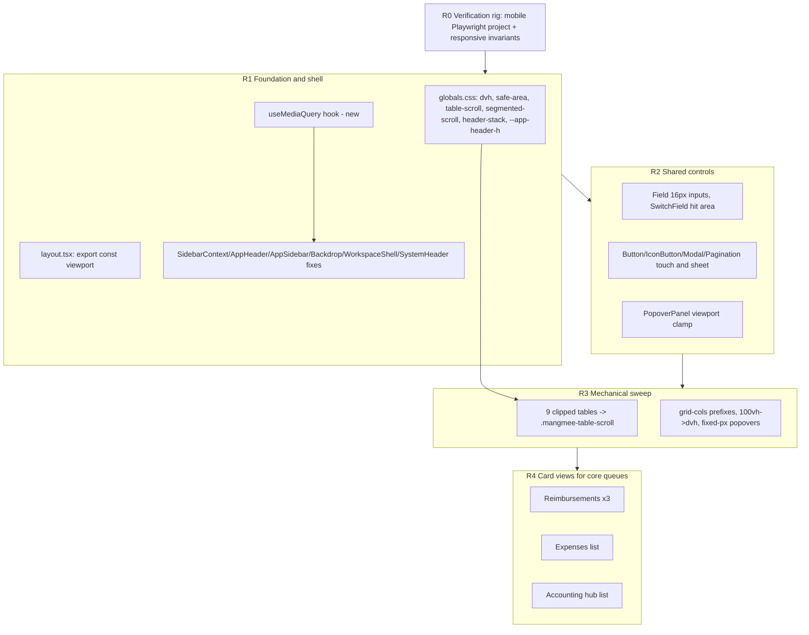

# Mobile Responsive Uplift — Design Plan

Status: Plan-ready 2026-08-04 (audit verified against `feat/expense-extraction-doc-type-default`).
Executor harness: `docs/plans/mobile-responsive-uplift-codex-handoff.md`. Task memory: `docs/agent-memory/mobile-responsive-uplift.md`.
Thai summary: `docs/mobile-responsive-uplift-summary-th.md`.

## Goal

Every workspace screen is usable and smooth on a 375px phone — no clipped data, no dead zones, no iOS zoom-jank — **without changing the desktop rendering by a single pixel** except where a change is an explicit, listed fix (e.g. touch-target bumps that only apply below `sm`).

## Ground truth (full audit, 2026-08-04)

The app is **not** starting from zero. What exists and what's broken:

### Already good (preserve, use as reference patterns)
- App shell has a real off-canvas drawer + hamburger + backdrop (`AppSidebar.tsx:212-216`, `AppHeader.tsx:65`, `Backdrop.tsx`), switching at `lg`.
- `globals.css:84-105` `.mangmee-content` has a mobile-first padding ladder; `.mangmee-page` sets `min-width: 0` correctly.
- Reference-quality mobile pages: **inbox** master-detail toggle (`InboxPage.tsx:160,482,610`), **dashboard** (`DashboardPages.tsx:116`), **settings main** (`settings/page.tsx:40`), **employees wizard** (`AddEmployeePrototypePage.tsx:622-632`), **expense detail** two-pane collapse (`ExpenseReviewPage.tsx:640,644` — already uses `100dvh`), **bookings** dedicated mobile day view (`BookingsPrototypePage.tsx:530`), **crm** scrolling tabs/kanban (`CrmPages.tsx:77,323`), **login** (`LoginPage.tsx:35,219`).
- `Modal.tsx` width model is already fluid (`max-w-*` + `w-full` + `p-4` + `max-h-[calc(100dvh-2rem)]`).

### Broken — severity order

**S1. Silent data loss: 9 unwrapped tables clipped by `overflow-x: clip`** (`globals.css:92`). The clip on `.mangmee-content` is deliberate (stops page-level sideways scroll) but converts any unwrapped wide table into permanently unreachable content. Sites:
`LedgerReportsPage.tsx:181,199` (trial balance + GL — the headline financial statements), `AccountingPages.tsx:154,438` (hits both `/accounting` and `/sales-documents`), `TaxWorkspacePage.tsx:311`, `InventoryPages.tsx:129,466,537,700`.

**S2. Shell defects** (drawer works, details wrong):
- JS/CSS breakpoint disagreement: `SidebarContext.tsx:36` uses 768, `AppHeader.tsx:42` and every CSS rule use 1024 → dead zone at 768–1023.
- Header 68px vs drawer offset `mt-16` (64px) → 4px misalignment, drawer footer clipped (`AppHeader.tsx:60` vs `AppSidebar.tsx:213`).
- No body scroll lock while drawer open; backdrop `z-40` sits *under* header `z-[99999]`.
- Drawer is 289px of a 375px viewport (77%) — only 86px of tappable backdrop.
- Hover-expand handlers fire on touch (`AppSidebar.tsx:217`); no Escape-to-close; no focus containment while off-canvas.
- `SystemHeader.tsx:28-49` has zero mobile treatment (4 Thai links wrap to a ~140px sticky header).
- `100vh` (not `dvh`) at `globals.css:73,79,110` → URL-bar overscroll on every page.

**S3. iOS input auto-zoom, app-wide**: `Field.tsx:31` and `.mangmee-input` (`globals.css:371-379`) use 14px font on inputs → iOS Safari zooms on every focus. Affects every TextField/SelectField plus `ThemedSelect` (29 consumers) and `ThemedDate` (9).

**S4. The "scroll tax" on core work queues**: honestly-wrapped tables 2–2.6× the viewport, with the action column dead last (primary CTA off-screen on every row):
`ReimbursementsPages.tsx:713,1080,1238` (`min-w-[980px]` ×3 queues), `ExpensesPages.tsx:1061,1230` (CSS-grid pseudo-table, `min-w-[760px]`), `ExpensesWorkspacePanels.tsx:641` (9-col), `PermissionMatrixPrototypePage.tsx:356` (820px), `EmployeeAccessPages.tsx:1157`, `AccountingTaxSetupPage.tsx:96`.

**S5. Touch targets below 44px** throughout shared controls: `Button` sm=32/md=40 (`Button.tsx:25-27`), `IconButton` 32/40, `Modal` close 36 (`Modal.tsx:103`), sidebar logout/collapse 32 (`AppSidebar.tsx:234,382`), `SwitchField` checkbox 16 (`Field.tsx:160`), `ThemedDate` arrows 32 / day cells 36.

**S6. Popover edge overflow**: `PopoverPanel.tsx:50-58` (engine under every select/date/tooltip) does no right-edge clamping; only `ThemedDate` self-protects (`max-w-[90vw]`). Fixed-px panels: `BookingsPrototypePage.tsx:563,717` (`w-[480px]`), `NotificationBell.tsx:84` (360px), `WorkspaceScope.tsx:124,188` (`w-64`/`w-72` dropdowns).

**S7. Assorted mechanical**: unprefixed `grid-cols-N` N≥3 (`AccountingPages.tsx:598`, `AccountsPayablePages.tsx:535`, Broadcast pages, `InboxPrototypePage.tsx:1323`); `100vh` panes in both inbox implementations (`InboxPrototypePage.tsx:562`, `InboxPage.tsx:480`); `.mangmee-segmented` doesn't scroll (patched ad hoc at `ReimbursementsPages.tsx:324`); `.mangmee-page-header`/`-actions` never stack (used by 18 pages via `MangmeePage`); no `export const viewport` in `app/layout.tsx`; no safe-area handling.

**S8. Missing infrastructure**: no `useMediaQuery`/`matchMedia` hook anywhere; shared `DataTable`/`ListPageLayout`/`PageHeader`/`ActionToolbar` are dead code (0 consumers) while 54 hand-rolled `<table>`s exist; no bottom-sheet primitive; three different table mechanisms in the expenses feature alone.

## Design decisions

### D1 — Breakpoint contract: one boundary, stock scale
Stock Tailwind v4 breakpoints (sm 640 / md 768 / lg 1024). The **single JS boundary is 1024 (`lg`)** for shell behavior, exposed via a new SSR-safe `useMediaQuery` hook (`src/common/hooks/use-media-query.ts`, `matchMedia`-based). Table↔card switching uses **CSS only** (`md:` visibility), never JS, so SSR/first paint can't flash the wrong variant. Minimum supported width: **375px** (checked at 375/390/412; nothing may hard-break down to 360).

### D2 — Desktop pixel parity is a hard rule
Every mobile fix is expressed as *base-breakpoint styles with the current desktop values restored at the existing breakpoint* (`h-11 sm:h-10`, stacking that returns to row at `sm:`), or as `@media (max-width: …)` additions that can't reach desktop. The only desktop-visible changes permitted are the shell bug fixes (4px drawer alignment, z-index order, inert `xl:flex` removal) — each listed explicitly in the handoff. The existing desktop e2e suite green + before/after desktop screenshots of 6 key pages are the enforcement mechanism.

### D3 — Tables: two tiers, not one big rewrite
- **Tier 1 (mechanical, every table):** nothing is ever clipped. New `.mangmee-table-scroll` class in `globals.css` = `overflow-x-auto` + `-webkit-overflow-scrolling: touch` + `overscroll-behavior-x: contain`; `.mangmee-table` gets `min-width: max-content` so scroll actually engages instead of column-squeeze. Wrap all 9 S1 sites (and any other bare table found while sweeping). This is a low-risk sweep that makes *every* screen survivable.
- **Tier 2 (UX, core queues only):** the five highest-traffic work queues get a **mobile card list** (`md:hidden` cards + `hidden md:block` existing table — desktop DOM untouched): reimbursements ×3 queues, expenses list, accounting hub document list. Card anatomy: line 1 = identity (doc no. + vendor/requester), line 2 = status badge + date, line 3 = amount (right, prominent), primary action as a full-width row tap or trailing button — **the action that is off-screen today becomes the most reachable element**. Card field selection = the columns each queue's users act on (status, amount, counterparty, age); long-tail columns live in the existing detail view — cards link into it.
- Everything else (settings matrices, GL, movements) stays a scrolling table — correct for reference/reading surfaces.

### D4 — Forms and overlays feel native on touch
- Inputs: base font-size 16px, desktop restored via `sm:text-sm` (kills iOS auto-zoom) — one change in `Field.tsx:31` + one in `.mangmee-input`.
- `Modal` gains a mobile bottom-sheet presentation: `items-end sm:items-center`, `rounded-t-2xl sm:rounded-lg`, full-width at base, `overscroll-contain` on the body, body scroll-lock while open. Desktop rendering identical.
- `PopoverPanel` clamps to `[8px, 100vw−8px]`, caps width at `calc(100vw-16px)`, listens to `visualViewport` resize (soft keyboard).
- Touch targets ≥44px at base via padding/hit-area (visual size may stay smaller where density matters — e.g. keep the 32px glyph but pad the hit area), desktop sizes restored at `sm:`.

### D5 — Fix the shell once, centrally
Header height becomes `--app-header-h: 68px` consumed by both header and drawer; JS breakpoint unified at 1024 through the new hook; scroll-lock + z-order (backdrop above header, below drawer) + `w-[min(289px,85vw)]` + Escape-close + hover-expand gated to `(hover: hover)`; `SystemHeader` nav becomes an `overflow-x-auto no-scrollbar` scroller below `md`; `100vh→100dvh` ×3 in globals; explicit `export const viewport` with `viewportFit: 'cover'` + safe-area padding on `.mangmee-content` and the sidebar footer.

### D6 — Don't resurrect dead abstractions
`DataTable`/`ListPageLayout`/`PageHeader`/`ActionToolbar` (0 consumers) are **not** the vehicle — migrating 54 hand-rolled tables onto `DataTable` is a rewrite this plan explicitly rejects (ponytail). We fix the CSS classes every table already uses (`.mangmee-table`, `.mangmee-segmented`, `.mangmee-page-header`), and build the card views as small per-feature components. Deleting the dead components is out of scope (separate cleanup).

## Architecture of the change

## Verification model (harness-engineer)

Built **before** any fix (phase R0), so every later phase lands against a red/green signal:

1. **New Playwright project `mobile-chromium`** (Pixel 7 viewport 412×915, `isMobile`, `hasTouch`) alongside the existing `chromium` desktop project.
2. **New `e2e/responsive.spec.ts`** running invariants on a route catalog (every workspace route in the sidebar):
   - *No page-level horizontal overflow*: `document.scrollingElement.scrollWidth <= window.innerWidth + 1`.
   - *No clipped table*: every `<table>` (and the expenses pseudo-table) has a scrollable (`overflow-x: auto|scroll`) ancestor whose `scrollWidth` is reachable.
   - *No dead controls*: drawer opens/closes at mobile width; backdrop tap and Escape close it; body doesn't scroll behind it.
   - `expectNoClientError(page)` after every navigation (existing harness invariant).
3. **Desktop-parity guard**: full existing desktop suite must stay green after every phase; 6 desktop screenshots (dashboard, expenses, reimbursements, accounting, journal, settings) captured at R0 and compared after R4.
4. Tap-target and card-view assertions added per phase (R2/R4) — details in the handoff.

## Phase summary (detail lives in the Codex handoff)

| Phase | Scope | Risk | Exit signal | Status |
|---|---|---|---|---|
| R0 | Verification rig only (no product code) | none | responsive spec runs, fails where expected, desktop suite green | ✅ PASS 2026-08-04, `f6901b0c` |
| R1 | globals.css + layout.tsx + shell (8 files) | low | drawer invariants green on mobile project; desktop suite green | ✅ PASS (2 gate fixes), `ab1cb8af` |
| R2 | Shared controls (6 files) | medium (touches 29+ consumers via ThemedSelect) | no-zoom/no-overflow checks green; desktop suite green | ✅ PASS (1 gate fix), `6a6ec567` |
| R3 | Mechanical sweep (~15 feature files) | low | zero clipped-table findings on all routes | ✅ PASS (mobile 50/50 green), `feba17ab` |
| R4 | Card views for 5 queues (3 feature files) | medium | card-view specs green; desktop DOM unchanged on those pages | ✅ PASS (reimb. screenshot byte-identical), `a6de43c5` |
| R5 | Full-matrix run + RESULTS + docs close-out | — | P0 invariants green at 375/412 + desktop; report written | see `e2e/RESPONSIVE-RESULTS.md` |

Non-goals: PWA/native wrappers, redesigning desktop layouts, migrating to `DataTable`, new dependencies (there is no UI library today and none is added), dark mode.
