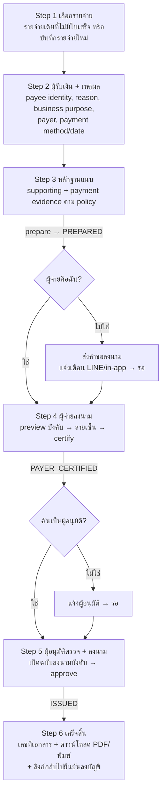
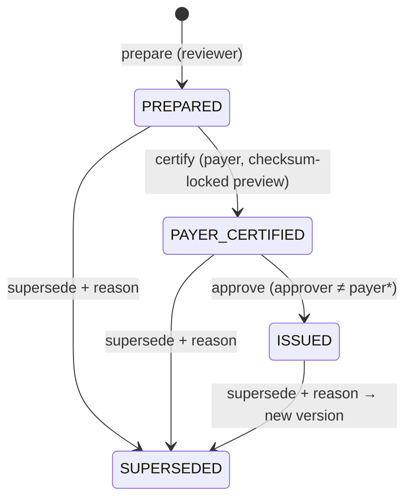

# Substitute Receipt — Standalone Menu & End-to-End Flow Redesign

Status: Phases 1–4 implemented 2026-08-06. Phases 1–3 are committed; Phase 4 is working-tree only.
The approval-mode migration remains unapplied outside the local development database described in task memory.
Task state: [[substitute-receipt-standalone-menu]] (docs/agent-memory).
Date: 2026-08-05 (design), 2026-08-06 (owner revisions + implementation)
Related: [[substitute-receipt-company-policy-plan]], [[substitute-receipt-evidence-hardening-plan]], [[expense-no-invoice-substitute-routing-plan]]

## 1. Problem

The ใบรับรองแทนใบเสร็จรับเงิน (substitute receipt certification) flow is fully built on the backend
(`substitute-receipt.use-case.ts`: prepare → payer certify → approver issue → supersede/history, HIGH-risk audit,
checksum-locked previews) but the UX makes it nearly unusable. The owner tested it and reported it as confusing.
Concrete findings from the code:

1. **Buried entry point.** The entire flow lives in a collapsible block inside `DocumentReviewSection`, inside
   step "หลักฐาน" of the expense-detail stepper (`ExpenseReviewPage`). There is no dedicated page, no list of
   issued certificates, no cross-expense view.
2. **The sidebar submenu lies.** `feature-entitlements.ts` maps submenu `expenses.substitute_receipt`
   ("ใบรับรองแทนใบเสร็จ") to `/expenses/signatures` — the company *signature asset* manager, a different feature
   the substitute flow doesn't even use. Users clicking the menu land on the wrong screen.
3. **Policy settings are unreachable.** `/settings/substitute-receipt` has no menu entry
   (`settings-menu.logic.ts`). Until approvers are configured the prepare button is disabled, and the only fix
   path is a small red inline link inside the buried form.
4. **No download.** The issued artifact is an SVG viewable only in a modal with `hideOpenNewTab: true` — no
   download, no print, no PDF. Accountants cannot receive the document.
5. **Invisible handoff.** After prepare, the payer sees nothing unless they stumble onto the same expense;
   the UI just says "รอผู้จ่ายเงินจริงเข้าสู่ระบบเพื่อลงนามรับรองด้วยตนเอง". Same for the approver. No task inbox,
   no notification.
6. **Silent mutations.** Guided entry rewrites `sourceDocumentType`/`taxEvidenceStatus`, clears tax codes, forces
   `inputVatClaimStatus = NON_CLAIMABLE`, and the form persists `businessPurpose` into `ExpenseRecord.note` —
   all without confirmation.
7. **Solo-owner dead end.** The payer≠approver rule has no escape hatch; a one-person company can never finish.
8. **Missing payee identity fields.** Revenue Department practice for non-receipt expenses expects payee
   name/address and (for ใบสำคัญรับเงิน-style substantiation) citizen ID / tax ID. Today only vendor snapshots
   from the expense exist; the form never surfaces or completes them.

## 2. Goals

- A **standalone menu** "ใบรับรองแทนใบเสร็จ" separated from receipt upload, owning the whole lifecycle:
  create → sign → approve → issue → **download** — without ever needing to understand the expense-detail stepper.
- A guided wizard that an SME owner can finish alone (solo mode) or hand off cleanly (task inbox).
- Output that satisfies Revenue Department substantiation guidance (payee identity, reason, amount in Thai text,
  dual signatures, payment evidence policy) and can be downloaded as PDF for the accountant.
- Reuse the existing backend (use-cases, statuses, checksums, audit) — this is a routing/UX/document-delivery
  redesign, not a domain rewrite.

## 3. Information architecture

### 3.1 Menu & routes

| Item | Route | Notes |
|---|---|---|
| Sidebar submenu ค่าใช้จ่าย → **ใบรับรองแทนใบเสร็จ** | `/companies/[companyId]/expenses/substitute-receipts` | Fix `feature-entitlements.ts` + `menu-entitlements.ts` mapping (currently → `/expenses/signatures`) |
| Hub (list + tasks) | `/expenses/substitute-receipts` | New page, new tab in `EXPENSES_TABS` or standalone feature page |
| Wizard — new | `/expenses/substitute-receipts/new` | Steps 1–3 (create/prepare) |
| Wizard — continue | `/expenses/substitute-receipts/[evidenceId]` | Steps 4–6 resume by status; deep-link target for tasks/notifications |
| Settings | `/settings/substitute-receipt` | **Add entry** to `settings-menu.logic.ts` ("ตั้งค่าใบรับรองแทนใบเสร็จ", `company.setup.manage`) |

Existing entry points keep working but re-point: the ⚠ no-receipt banner on the expense detail and the upload-tab
"ไม่มีไฟล์ใบเสร็จ" link now deep-link into `/substitute-receipts/new?expenseId=…` (intent preserved — fixes the
lost-context hop through `/expenses/manual`).

Permissions: hub visible with any of `expense.review | expense.read_own | expense.confirm`; actions gate per
existing endpoint permissions (unchanged).

### 3.2 Hub page

- **งานของฉัน** strip (role-aware, top of page): "รอฉันลงนาม (n)" for the current user as payer of
  `PREPARED` evidences; "รอฉันอนุมัติ (n)" for configured approvers with `PAYER_CERTIFIED` evidences.
  Each card deep-links into the wizard at the right step.
- KPI row: ออกแล้วเดือนนี้ / รอลงนาม / รออนุมัติ / ยกเลิก (reuse `StatCard`).
- Table: เลขที่ (`SRC-…-Vn`), วันที่จ่าย, ผู้รับเงิน, จำนวนเงิน, ผู้จ่าย, สถานะ badge, actions
  (ดาวน์โหลด PDF for `ISSUED`, ทำต่อ otherwise). Filters: status, month, payer.
- First-run: works out of the box — the default approval mode (`OWNER_SELF`, §6) needs no configuration.
  A setup banner appears only when the company has switched to designated-approver mode but has not yet
  assigned approvers (1-click path to settings; for OWNER an inline quick-setup without leaving the page).
- Needs one new list endpoint: `GET /v1/companies/:companyId/substitute-receipts?status=&month=&payerUserId=`
  (company-wide query over `ExpenseSubstituteReceiptEvidence` joined to expense; today history is per-expense only).

### 3.3 Wizard (end-to-end, 6 steps)

Step-by-step behaviour:

1. **เลือกรายจ่าย** — two tabs: (a) pick from candidate list (expenses where
   `expenseNeedsReceiptOrSubstitute`), (b) "บันทึกรายจ่ายใหม่" mini-form (date, description, amount, category)
   that calls the existing manual-draft endpoint. The current silent mutations become an **explicit consent
   panel**: "ระบบจะตั้งประเภทเอกสารเป็น 'บันทึกรายจ่าย (ไม่มีใบเสร็จ)' และ VAT ซื้อจะขอคืนไม่ได้" with a checkbox
   before proceeding.
2. **ผู้รับเงิน + เหตุผล** — payee block prefills from vendor snapshot, editable: ชื่อผู้รับเงิน (required),
   ที่อยู่, เลขบัตรประชาชน/เลขผู้เสียภาษี (optional but nudged: "กรอกเพื่อให้หลักฐานหนักแน่นขึ้นตามแนวสรรพากร").
   Reason code select + free text, **business purpose gets its own column** (`ExpenseRecord.businessPurpose` or a
   field on the evidence row) — stop overwriting `note`. Payer select, payment method + date. Inline WHT hint when
   category is a service and amount ≥ 1,000 THB ("อย่าลืมหัก ณ ที่จ่าย และแนบ 50 ทวิ ถ้ามี").
3. **หลักฐานแนบ** — two labelled dropzones driven by runtime policy: หลักฐานประกอบรายการ (photo of goods,
   handwritten bill, chat order…) and หลักฐานการจ่ายเงิน (transfer slip; for CASH follow
   `cashEvidencePolicy`, suggest ใบสำคัญรับเงิน + สำเนาบัตร ปชช. and offer a printable ใบสำคัญรับเงิน template).
   Completing this step calls prepare (`POST /substitute-receipt`).
4. **ผู้จ่ายลงนาม** — full-page document preview (server SVG, mandatory open, existing checksum lock), position
   field, signature capture: **draw-on-screen pad** (new, mobile-friendly) or photo upload with existing
   background removal. Certify. If payer ≠ current user, show a sent-state with the deep link + LINE notify
   (reuse LINE OA infra) instead of a dead-end sentence.
5. **ผู้อนุมัติตรวจและออกเอกสาร** — same pattern: mandatory open of the certified artifact, position, signature,
   approve → `ISSUED`.
6. **เสร็จสิ้น** — document number, status `ออกแล้ว`, buttons: **ดาวน์โหลด PDF**, พิมพ์, เปิดดู; secondary link
   "ไปยืนยันรายจ่ายเพื่อลงบัญชี" back to the expense detail. Supersede/version-history controls move to a
   separate "ประวัติ/แก้ไข" accordion on the done screen and hub row — out of the signing path.

\* unless solo-owner mode (below).

## 4. Compliance checklist (baked into the wizard)

The rendered document already covers: Thai date, amount + `thaiBahtText`, reason, dual signatures with
self-declared positions, immutable snapshot + checksum, versioned supersede. Additions to fully match Revenue
Department substantiation practice for expenses without a receipt (มาตรา 65 ตรี — provable payee):

- Payee name/address/ID fields on the document (step 2) — rendered into the SVG block.
- Payment evidence policy already enforced (`ExpenseCashEvidencePolicy`) — keep, surface as checklist UI.
- Printable **ใบสำคัญรับเงิน** companion template (optional button in step 3) for cash payees to sign on paper.
- A visible checklist chip row on the done screen: ✓ ผู้รับเงินระบุตัวตน ✓ หลักฐานการจ่าย ✓ ลงนามครบ —
  with amber chips when optional items are missing (soft warning, not a blocker).

## 5. Download (PDF)

Keep the SVG renderer as the source of truth (checksums unchanged). Phase 4 adds:

- `GET /v1/companies/:companyId/expenses/:expenseId/substitute-receipt/:evidenceId/artifact.pdf`
  — permission `expense.read_own`, with the existing expense read/owner/branch checks.
- Server-side `sharp` SVG → PNG rasterisation at 200 dpi, embedded into one A4 page via `pdf-lib` with a
  36 pt margin. The runner installs Noto Sans Thai and runs a Thai-ink smoke check after sharp is available.
- The PDF is generated on demand and is not cached as another attachment. The immutable, checksummed SVG stays
  authoritative; a 0.2% dark-pixel guard refuses an implausibly blank rendering.
- Remove `hideOpenNewTab` for issued artifacts; add ดาวน์โหลด buttons on hub rows, done screen, and the expense
  detail evidence card.

## 6. Approval mode (configurable; defaults to solo owner)

Replace the implicit hard two-person rule with an explicit policy field on `ExpenseSubstituteReceiptPolicy`:

`approvalMode: 'OWNER_SELF' | 'DESIGNATED_APPROVERS'` — **default `OWNER_SELF`** (product decision 2026-08-06:
a solo SME owner must be able to finish the whole flow alone, with zero prior setup).

- **`OWNER_SELF` (default)** — a signer holding the OWNER role may act as both payer and approver; the
  distinct-user check in `ApproveSubstituteReceiptUseCase` is relaxed for that case only. The rendered document
  adds the footnote "ลงนามโดยเจ้าของกิจการในฐานะผู้จ่ายเงินและผู้อนุมัติ" and the audit log records
  `selfApproved: true`. When the payer is a non-owner employee, an approver (any OWNER, or configured
  `approverUserIds` if set) is still required — self-approval never extends beyond the owner.
  (Superseded: the 2026-08-10 exemption covers owner/admin/manager, and since 2026-10-03 the footnote names
  the owner only when the approver holds OWNER, anyone else by name; see `docs/specs/expense-receipt-upload-spec.md`.)
- **`DESIGNATED_APPROVERS`** — current behaviour: approver must be in `approverUserIds`, ≠ payer,
  branch-eligible. Companies with segregation-of-duties needs opt into this in settings.

The settings page exposes the mode switch plus the approver list; because the default mode needs no
configuration, the old "prepare button disabled until an admin finds the hidden settings page" dead end
disappears entirely.

## 7. Implementation phases

**Phase 1 — routing, hub, wizard shell, download (highest UX payoff, backend mostly reused)**
1. Fix submenu route in `feature-entitlements.ts` / `menu-entitlements.ts`; add settings menu entry.
2. New hub page + company-wide list endpoint; งานของฉัน strip from existing history/status data.
3. Wizard pages wrapping the existing prepare/certify/approve endpoints; consent panel replaces silent mutations
   (client-side only — same API calls, now explicit).
4. PDF download endpoint + buttons; un-hide open-in-new-tab for issued artifacts.
5. `approvalMode` policy field (default `OWNER_SELF`): migration + relaxed distinct-user check + document
   footnote — in Phase 1 because the default out-of-box experience depends on it.

**Phase 2 — form correctness & handoff**
6. Payee identity fields (evidence snapshot + SVG render + prisma migration on the evidence table).
7. `businessPurpose` decoupled from `note` (migration + dual-write window).
8. Draw-signature pad; LINE/in-app notify for payer & approver handoffs.
9. Printable ใบสำคัญรับเงิน template; WHT hint rule.

Out of scope: changing the certify/approve checksum protocol, statuses, or audit semantics.

## 8. UI copy tone

Owner directive (2026-08-06): all screen text must be **formal-professional Thai that a layperson still
understands** — no casual particles or slangy phrasing, official document vocabulary where it exists
(เลขประจำตัวประชาชน not เลขบัตร ปชช., ลงลายมือชื่อ not เซ็น on document-facing text), but sentences kept short and
concrete. Consent/attestation strings use first-person formal ("ข้าพเจ้ารับทราบและยืนยันการดำเนินการ"). Buttons
are verb-first and unambiguous (ดำเนินการต่อ, ตรวจสอบเอกสาร, ดาวน์โหลด PDF). All new strings go through the `t()`
dictionary — the current sub-flow's hard-coded Thai is part of what gets replaced.

Further owner directives (2026-08-06):
- **Icons**: table/row actions are icon buttons with Thai tooltips — eye = view-only, pencil = edit/continue,
  green download arrow = PDF. Reuse the existing `IconBtn` component.
- **Dates**: one display format site-wide — `5 ส.ค. 2569` (day, abbreviated Thai month, Buddhist-era year) in
  every list, input display, and summary; a shared formatter util, no per-page variants. Sole exception: the
  rendered official document body uses the full month (`5 สิงหาคม 2569`) per Thai official-document convention.

## 9. Risks / notes

- The company-wide list endpoint must scope by branch eligibility the same way payer/approver listing does.
- PDF fonts: keep Noto Sans Thai in the API runner image and retain the build-time Thai-ink smoke check.
- Keep the old in-detail panel as a read-only status card that links to the wizard, so existing deep links and
  the `ยืนยันและลงบัญชี` unlock logic (`expenseSubstituteReceiptReady`) are untouched.
- E2E: extend `e2e/expenses.spec.ts` with a solo-mode happy path and a two-person handoff path.
