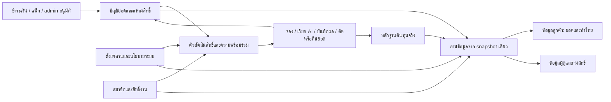

# Audit: แยกยอดแชต/รูปจากเพดานระบบ และใช้แหล่งข้อมูลเดียวกันตลอด flow

วันที่: 2026-09-29
สถานะ: **ตรวจ local source/dependencies และปรับข้อกำหนดแล้ว; ยังไม่แก้ application หรือรัน runtime E2E**

ตามคำขอ Owner ให้รวมการแก้ส่วนปรับเครดิตเดิมเข้ากับ add-on และตรวจ field/value/ข้อความทุก flow. อ้างอิง [spec §18](../specs/chat-credit-and-receipt-addons-spec-th.md), [plan §15](../plans/chat-credit-and-receipt-addons-plan-th.md), [audit F01–F12/E01–E27](chat-credit-and-receipt-addons-e2e-impact-audit-2026-09-28-th.md) และ [audit U01–U10/E28–E42](chat-credit-and-receipt-addons-customer-balance-consistency-audit-2026-09-29-th.md). ตรวจ working tree ต่อจาก HEAD `4a5817b4` ซึ่งมีงานอื่นแก้ค้าง; ไม่ใช่หลักฐาน deployed source. ไม่แตะ cloud/payment/provider และไม่ใช้ test เก่ารับรอง feature ใหม่

## 1. ข้อสรุปและขอบเขตคำว่า source เดียว

ต้องปรับพร้อมกันทั้ง admin grant, operational settings, paid/package/deal writers, usage admission/settlement, read projections และ UI. ระบบเดิมมีการ reuse resolver/locks/error map อยู่แล้ว ให้ต่อยอดของเดิม ไม่สร้าง wallet service ใหม่หรือให้ Gateway อ่าน DB

ความจริงแต่ละชนิดมีเจ้าของเดียว: ยอดลูกค้าจาก grants/funding entries, ต้นทุนจาก usage evidence, เพดานจาก configuration/policy resolver, สมาชิกจาก paid membership source, เงินจาก invoice/payment/refund evidence. ใช้ API ประกอบผลภายใต้ snapshot/context เดียวแล้วค่อยแยก customer/operator DTO; ไม่ทำให้ข้อมูลคนละหน่วยกลายเป็น field เดียว. ดู ownership และ field dictionary ใน spec §18

## 2. Findings และแนวทางแก้ร่วมกัน

C01–C12 เป็น source-confirmed behavior และ integration risks ต่อกติกาใหม่ ไม่ใช่ 12 Production incidents. F04 เดิมยังพบ source inconsistency; จุดอื่นไม่อ้างว่า reproduce runtime แล้ว

| ID | หลักฐาน / trigger / ผลกระทบ | แนวทางและ dependency |
| --- | --- | --- |
| C01 — P1: เพดานเดิมไม่ใช่ยอดแถม | [SHARED resolver](../../apps/api/src/modules/line-ai/application/company-ai-budget-policy.ts#L146) ใช้ explicit TOTAL override เป็น CHAT cap ด้วย; [writer](../../apps/api/src/modules/system-partner-management/application/use-cases/set-partner-ai-model.use-case.ts#L81) ตั้งค่ารายเดือนแบบ absolute. ใช้เพิ่มเครดิตจะเปลี่ยนวงเงิน OCR ตาม และไม่ได้ lot 12 เดือน | แยกคำสั่งเพิ่มยอดจากตั้งเพดาน. หลัง commercial cutover included allowance เป็น source ของ cycle; ห้ามใช้ default/deal CHAT allowance เดิมเป็นด่านซ้ำจนซื้อเพิ่มแล้วใช้ไม่ได้. รักษา explicit operational caps และ legacy provenance; cohort ที่จำแนก source ไม่ได้ยังไม่ย้าย |
| C02 — P1: เงื่อนไข SPLIT ติดมาผิดงาน | [flag/model/sum/time/spent guards](../../apps/api/src/modules/system-partner-management/application/use-cases/set-partner-ai-model.use-case.ts#L94) ใช้กับการตั้งนโยบาย ไม่ใช่ grant. ถ้า reuse writer นี้ admin เพิ่มเครดิตอาจเจอให้รอเดือนหน้า หรือให้เพิ่ม TOTAL | คำสั่ง grant ไม่ตรวจ C+O<=T ไม่เปลี่ยน model/โหมด/เพดาน. Usage ยังตรวจ operational policy ตามจริง; readiness ของ commercial reservation ต้องรองรับ SHARED โดยไม่เปิด SPLIT ให้ทุกบริษัทอัตโนมัติ |
| C03 — P1: รูปแถมมีอายุผูกกับสมาชิก | [blocked/maxExpiry](../../apps/api/src/modules/billing/application/billing-receipt-adjustments.service.ts#L62) และ [preview](../../apps/api/src/modules/billing/application/billing-receipt-adjustments.service.ts#L130) จำกัด expiry ไม่เกิน term/paid-through; ไม่ตรง D8 | New grant คำนวณ 12 เดือนจาก appliedAt โดย server; ฟอร์มไม่ให้เลือกวันขัด policy. Membership/use eligibility แยกจาก validity; legacy grants ไม่ยืดอายุย้อนหลัง. สถานะ/สิทธิ์สร้างรายการยังตรวจตาม scope เดิม ไม่เปิด admin ให้ข้าม security |
| C04 — P1: pending checkout บล็อก admin grant ทั้งหมด | [blocked](../../apps/api/src/modules/billing/application/billing-receipt-adjustments.service.ts#L68) และ source hash ผูก activeAttempt/collection ทั้งบัญชี; admin กับ paid ที่แค่เพิ่มยอดเฉพาะสินค้าอาจถูกกันโดยไม่เกี่ยวกัน | แยก serialization ของ balance จาก exclusivity ของ checkout. Grant ไม่ครอบครอง/clear activeAttemptId; ตรวจ source ที่มีผลจริงและ revalidate under lock. ความขัดแย้งทางสิทธิ์/สมาชิก/เงินที่ยังไม่ทราบต้องมีเหตุผลและกลับรายการเดิมได้ ไม่ตัด guard ทิ้ง |
| C05 — P1: FEFO เดิมไม่มีลำดับ package→gift→paid | [paidReceiptBalance](../../apps/api/src/modules/billing/application/billing-receipt-grants.ts#L8) เรียง expiry รวมทุก grant และใช้ admissions count. เพิ่ม ADD_ON ลงตารางเดิมเฉย ๆ อาจตัดซื้อก่อนแพ็ก และนับ held เป็น used | Reader/admission/settle ใช้ allocation เดียวตาม source class ก่อน FEFO ภายในกลุ่ม; logical receipt effects แยกจาก admission/provider events ตาม F07. Operator/customer ใช้ net ตัวเดียว แต่เปิดเผยรายละเอียดต่างกัน |
| C06 — P1: lifecycle writers อาจแตะ lot ผิดประเภทถ้า reuse kind | [REPEAT carry](../../apps/api/src/modules/billing/application/billing-receipt-grants.ts#L48), [แถมวัน](../../apps/api/src/modules/billing/application/billing-free-days.ts#L183), [grace extend](../../apps/api/src/modules/billing/application/billing-reconciler.service.ts#L1210), [grace restore](../../apps/api/src/modules/billing/application/billing-reconciler.service.ts#L1335) ปัจจุบัน whitelist package kinds ถูกต้อง | รักษา whitelist เดิม; new paid/admin product lots ต้องมี source/product discrimination ที่ไม่ถูกต่ออายุ/ตัดอายุ/reset ตามแพ็ก. ไม่ reuse INITIAL/REPEAT เพื่อหลบ validator; recurring/package flow ไม่เรียก ADD_ON apply |
| C07 — P1: writers นอกหน้าผู้ดูแลเปลี่ยนเครดิตได้ | [deal apply](../../apps/api/src/modules/billing/application/billing-package-request.ts#L86), [deal return](../../apps/api/src/modules/billing/application/billing-reconciler.service.ts#L1332), [platform default](../../apps/api/src/modules/system-partner-management/application/use-cases/set-platform-ai-budget.use-case.ts#L67) เปลี่ยน config/allowance. ถ้าใหม่อ่านแต่ ledger แล้ว writer เก่ายังลง config สิทธิ์จะไม่ตรงกัน | ทำ writer ownership matrix: package/deal เปลี่ยน allowance policy ตามรอบที่อนุมัติ; operational settings เปลี่ยนเฉพาะ cap; gift/paid เปลี่ยน lot. ทุก writer refresh source/version เดียว ไม่สร้าง grant ฟรีกลางรอบ ลบยอดซื้อ หรือเปลี่ยน invoice snapshot |
| C08 — P1: consumer มากกว่าแชต LINE/อัปโหลดรูป | [CRM](../../apps/api/src/modules/crm-inbox/infrastructure/crm-ai-gateway.client.ts#L84), [draft](../../apps/api/src/modules/ai-draft/application/use-cases/generate-suggestion.use-case.ts#L148), [capture](../../apps/api/src/modules/expenses/infrastructure/expense-capture-read.client.ts#L151), [statement](../../apps/api/src/modules/banking/infrastructure/statement-ai-extract.client.ts#L54) ใช้ common meter; [capture job](../../apps/api/src/modules/expenses/application/services/expense-capture-read-runner.service.ts#L430) นับหนึ่งครั้งต่อ job | ทำ route→cost bucket→commercial product matrix จาก trusted source/content. CHAT เดิมที่เข้า scope ใช้ allocation ร่วม ไม่หักซ้ำผ่าน caller และ meter. OCR bucket ไม่ได้แปลว่า receipt product เสมอ; statement/PDF/multipage ไม่ใช้ IMAGE add-on. Preserve existing rights; deterministic no-provider ไม่ถูก debit |
| C09 — P1: shared resolver ยังไม่เท่ากับ shared snapshot | [AI usage read](../../apps/api/src/modules/system-partner-management/application/use-cases/get-partner-ai-usage.use-case.ts#L280) มี RepeatableRead อยู่แล้ว แต่ [receipt list](../../apps/api/src/modules/billing/application/billing-receipt-adjustments.service.ts#L109) และ [timeline](../../apps/api/src/modules/system-partner-management/application/use-cases/get-partner-timeline.use-case.ts#L171) อ่านหลายชุด; [readiness](../../apps/api/src/modules/line-ai/application/company-ai-budget-readiness.ts#L97) ตอบ OK โดยไม่มี request bound ได้ | Reuse consistent transaction/context ของ AI read ให้ projection ที่มีหลาย source; pin company/asOf/cycle/month/revisions. AVAILABLE ไม่รับประกันทุกคำถาม/ไฟล์; admission ต้องประเมิน request จริงอีกครั้ง. ห้ามคำนวณ wallet จาก cap-used หรือ readiness OK |
| C10 — P1: เดือนต้นทุนและรอบสิทธิ์เป็นคนละแกน | [parent step](../../apps/api/src/modules/line-ai/presentation/http/internal-ai-budget.controller.ts#L95) ยังไม่ select parent.monthKey แต่ใช้ body.monthKey; ต่อเข้ารอบสมาชิกจะเสี่ยง fund จากผิดรอบ/เดือน | ปิด F04 พร้อมงานนี้: parent DB เป็น authority ของ company/month/cycle/funding/policy/pricing; body ไม่เปลี่ยน authority. Preserve calendar cost/pending caps แยกจาก anniversary allowance และ per-lot expiry; ไม่ reuse UTC calculator |
| C11 — P1: คืนหน่วย/แก้ต้นทุน/ปล่อย hold ต่างเหตุการณ์ | [operator holds](../../apps/api/src/modules/system-partner-management/application/use-cases/partner-ai-credit-holds.use-case.ts#L85) อ่านเพียงสองเดือน; [usage adjustment](../../apps/api/src/modules/line-ai/application/company-ai-usage-meter.ts#L842) แก้ aggregates เดิม. ถ้าแก้ cost แล้วแปลเป็น refund ทุกครั้งอาจคืนเงิน/หน่วยผิด หรือของเก่ากู้ไม่ได้ | เงินต้นทุนและหน่วยบริการมี effect แยกผูก operation เดียว. New/old-month funding holds ต้องค้นกู้จากต้นทางได้; refund/revoke/settle/correction ใช้ source/version locks ครบ ไม่ mint grant ชดเชยซ้ำ ไม่หยิบยอดใหม่จ่าย late evidence แทน |
| C12 — P1: form/errors/recovery อาจขัด source ใหม่ | [contract null/undefined](../../packages/contracts/src/partner-management.ts#L190), [admin form](../../apps/web/src/features/billing-admin/BillingReceiptAdjustmentsPage.tsx#L15), [Thai budget errors](../../apps/web/src/common/api/api-error-message.ts#L41) เป็น semantics เดิม; [signup alert](../../apps/api/src/modules/external-signup/application/signup-ops-alert.service.ts#L231) และ timeline สรุป operational cap เป็นเครดิต | UI แยก “เพิ่มยอดให้ลูกค้า” กับ “ตั้งเพดานต้นทุน AI”; คงแปล known errors เดิมเฉพาะงานเดิม. Public cause/action อ่าน canonical decision ไม่เดาจาก code รวม. Invalid input/permission/stale/source/payment unknown มีคำไทยและ action เฉพาะขั้น; ป้องกัน raw errors ตาม U08 และ queued LINE ตาม U07 |

## 3. Dependency inventory ที่ต้องปิดพร้อมกัน

| เส้นทาง | Modules ที่ต้องตรวจ/เปลี่ยน | Invariant |
| --- | --- | --- |
| Admin เพิ่ม/ยกเลิกยอด | billing-receipt-adjustments, billing-approval/configuration/admin access, billing-admin UI, partner AI page, contracts | shared grant ไม่ตั้ง cap; source/approval/idempotency คงอยู่; grant success != usage success |
| ตั้งเพดาน/ค่าเริ่มต้น | set-partner-ai-model, set-partner-ocr-config, set-platform-ai-budget, company-ai-budget-policy, PlatformAiBudgetPage | ไม่ mint/revoke หน่วย; active/pending config และ null semantics ถูก; default ไม่เท่ากับ live flag |
| ซื้อ/ต่ออายุ/ดีล/แถมวัน/หมดสมาชิก | billing service/reconciler/package-request/free-days/trial-carryover/receipt-grants, plan-term sweep/lifecycle/AuthGuard | package-only expiry mutations; anniversary D9; additional lots 12 เดือน; security disable ไม่ถูกชุบจาก grant |
| Provider entry points | LINE ai-gateway client, receipt-ocr client, expense-capture client/runner, statement client, CRM client, draft generation | route/product ตรง; one logical consumption; no provider/no charge; authorization ทุกช่องทาง |
| Parent/child/settlement | API budget controller, meter/reservation, Gateway envelope/step/settle/runtime, operator hold repair | ไม่มี direct DB ใน Gateway; source-pinned funding; unknown outcome ไม่ปล่อยฟรี; cost/unit แยก |
| Read/operations | billing status/usage/receiptQuotaSnapshot, AI usage/readiness, timeline, billing plan/receipt previews, signup ops alerts | reuse resolver และ atomic snapshot; ยอด/เหตุผลไม่ต่างกันตามหน้าที่เปิด |
| UI/คำตอบ/เอกสาร | BillingPage, partner/admin pages, expense/banking/CRM/draft UI, shared error helper, LINE immediate/drain, notifications/history/export | ไทย/หน่วย/วันที่ตรง; hidden holds; no fake paid invoice; prior template queue ไม่ค้าง |
| คืน/ยกเลิก/กระทบยอด | refunds, billing-financial/provider observers, paid apply, admin revoke, OCR compensation, usage correction | no duplicate effect; original source/price; expired lots ไม่ฟื้น; retained history ไม่พึ่ง raw LINE retention |

## 4. Error/guard ที่ต้องย้ายให้ตรงงาน

| เงื่อนไขเดิม | เมื่อเพิ่มยอดแชต/รูปใหม่ | เมื่อปรับ operational settings / เริ่มใช้ |
| --- | --- | --- |
| SPLIT flag/model/C+O<=TOTAL/เริ่มเดือนหน้า | ไม่ใช้เป็น validator ของจำนวน grant | รักษากติกาของ config; usage ตรวจ model/bound และ policy readiness จริง |
| expiry<=term/paidThrough | New lot 12 เดือนจาก source time; legacy ไม่แก้ย้อนหลัง | สมาชิกหมดพักใช้ยอด valid; ไม่ขยายสมาชิกเพื่อให้ grant ผ่าน |
| active checkout/collection | ไม่ blanket block รายการ gift ที่ไม่แก้ package/payment; serialize/recheck เฉพาะ source เกี่ยวข้อง | customer checkout ยัง reuse single active attempt; conflict จริงไปตรวจรายการเดิม |
| spent+held floor / OCR monthly cap | ไม่แปลงยอด grant เป็น cap และไม่ reset used count | เป็น internal constraints; ชี้เหตุจริงและไม่ชวนซื้อเมื่อซื้อแก้ไม่ได้ |
| 403 / stale / expired preview / key conflict | รักษาไว้พร้อมคำไทย; ไม่ถือเป็น bug ที่ต้อง bypass | อ่านข้อมูลใหม่/ตรวจสิทธิ์/กลับคำขอเดิม ไม่ส่งซ้ำด้วย key ใหม่อัตโนมัติ |
| ระบบ/ข้อมูลอ่านไม่ได้ | ไม่คืน 0/null/unlimited ปลอม และไม่กล่าวว่าไม่มีการเพิ่มยอดก่อนตรวจผล | unavailable พร้อมทางลองอ่าน/ตรวจรายการเดิม; ไม่เปิดใช้แบบไม่ตรวจสิทธิ์ |

คำว่า “ห้ามมี block” ใช้เป็นเกณฑ์ว่า **flow ที่มีสิทธิ์และข้อมูลถูกต้องต้องไม่ถูกปฏิเสธจากเงื่อนไขคนละงานหรือข้อมูลคนละรุ่น**. การกันใช้เกิน สิทธิ์ไม่พอ และผลเงินไม่ทราบยังต้องอยู่ พร้อมข้อความ/ทางไปต่อที่ตรงข้อเท็จจริง

## 5. Acceptance เพิ่ม E43–E60 — ทั้งหมดยังไม่รัน

| ID | Scenario | ผลที่ต้องตรวจ | Spec |
| --- | --- | --- | --- |
| E43 | Admin เพิ่ม CHAT ขณะ SHARED/SPLIT flag ปิด/มี pending cap | lot ถูกชนิดครั้งเดียว; cap/model/policy/month ไม่เปลี่ยน; read แสดงยอดใหม่และ usage state จริง | A25/A26 |
| E44 | เพิ่ม IMAGE ขณะสมาชิกเหลือ 10 วัน → lapse → renew | new grant อายุ 12 เดือนจาก apply; หยุดใช้เมื่อ lapse แต่ยอดคงอยู่; legacy expiry ไม่เปลี่ยน | A26/A29 |
| E45 | Paid apply กับ admin grant พร้อมกัน และมี checkout/collection เดิม | รวมยอดทั้งสองถูก ไม่มี false account-wide block/activeAttempt ถูก clear ผิด; conflict จริง revalidate | A26/A30 |
| E46 | ตั้ง SPLIT ไม่พร้อม/ผลรวมเกิน/ลด cap ต่ำกว่า spent+held/เปลี่ยนกลางเดือน | error ไทยตรงงาน config; grant ไม่ต้องกรอก cap; ไม่มี provider/unit mutation จาก config error | A25/A31 |
| E47 | Package/gift/paid หลาย expiry โดย paid หมดก่อน package | ตัด package→gift→paid แล้ว FEFO ภายในกลุ่ม; wallet/operator/receipt history ตรงกัน | A27/A28 |
| E48 | Repeat/upgrade/renew/free-days/grace start+restore รอบมี additional lots | package behavior เดิม; ไม่มี extend/shorten/reset additional หรือเพิ่มแชตกลางรอบโดยผลข้างเคียง | A29 |
| E49 | Deal apply/return/expiry และ platform default เปลี่ยน | allowance provenance/cycle ถูก; no duplicate grant/no paid balance loss; current/pending policy ไม่ขัดกัน | A25/A29 |
| E50 | Config null/omitted/0/pending reaches month, concurrent admin/platform writes | field semantics เดิมคงอยู่; effective source/version ตรงทั้ง admission/read/preview; no lock inversion | A25/A27/A30 |
| E51 | LINE text/image, Web receipt, statement, CRM, draft, deterministic no-provider | route/cost bucket/commercial product ตรง; non-receipt OCR ไม่กิน IMAGE; no double CHAT debit; entitlement เดิมครบ | A28 |
| E52 | Capture one-page image แตกหลาย chunks, PDF/multipage, resume/re-read/partial | IMAGE หนึ่งครั้งเมื่อ durable usable result ตาม D4; excluded files คงสิทธิ์แพ็ก; resume ไม่กินซ้ำ; ต้นทุนจริงยังครบ | A28/A30 |
| E53 | อ่าน customer/operator/timeline/preview ระหว่าง grant/use/refund | snapshot/version/company เดียวในหนึ่ง response; public/operator totals เท่ากัน; pending/error ไม่แสดง 0 ปลอม | A27 |
| E54 | Child invocation ข้ามต้นเดือน/anniversary; body ส่งเดือนต่าง parent | DB parent เป็น authority; reject mismatch; cost month/cycle/lot ไม่สลับ; ไม่มี provider ซ้ำ | A28/A30 |
| E55 | Hold เก่ากว่าสองเดือน, late settle/correction หลัง expiry/cutover | operator ค้นกู้ได้; ไม่ชุบ lot/ดึง lot ใหม่ผิด source/ปล่อย unknown ฟรี; public ไม่เห็น held fields | A30 |
| E56 | Admin revoke, money refund, OCR unit return และ usage correction ชนกัน | effect คนละชนิดทำครั้งเดียว; source money vs units ไม่ปน; no fake receipt for gift | A26/A30 |
| E57 | CHAT 0.01/50; IMAGE 1/20; ราคา299/349; invalid decimal/overflow/null | 1/5000 CHAT units, 1/20 IMAGE units, 29900/34900 satang; invalid ไม่มี mutation; null ของ config ไม่เป็น wallet unlimited | A25/A31 |
| E58 | UI/API รุ่นเก่า, company switch, out-of-order response, plain Error, missing summary | ไม่มี field reinterpretation/stale overwrite/raw error; unavailable เฉพาะ feature ที่ไม่พร้อม ไม่ปิด legacy ที่ยังใช้ได้ | A27/A31/A32 |
| E59 | ทุก guard cause ผ่าน Web/LINE/queued LINE/CRM/draft/admin; valid retry | ข้อความและ action ตรง; ไม่ชวนเพิ่มยอดเพื่อแก้ cap; deterministic ไม่โดน provider-budget gate ที่ไม่เกี่ยว; queued integrity/idempotency คงเดิม | A28/A31 |
| E60 | Cohort migration, single product gate on/off, old readers/rollback compatibility | activate เมื่อ dual-read reconciliation/consumers พร้อม; sales closed ไม่ลบ paid/admin rights; ไม่ force SPLIT หรือ backfill gift จาก TOTAL | A29/A32 |

รวม E01–E60 = **60 acceptance scenarios ที่ยังไม่รัน**. การเพิ่มรายการไม่แปลว่า coverage พิสูจน์แล้ว; P6 ต้องแนบผลจริง/ข้อจำกัดตาม route, company cohort, payment mode และ error branch

## 6. Verification ที่มีอยู่และข้อจำกัด

อ่าน test/source inventory เพื่อวางแผน reuse: set-partner-ai-model/use-case specs, set-platform-ai-budget specs, ai-budget.logic specs, billing-receipts/grace/trial-carryover PG checks และ admin adjustment smoke scripts. Browser paths ที่มี: [customer billing](../../e2e/customer-billing-ux.spec.ts), [admin billing](../../e2e/billing-admin-menu-ux.spec.ts), [readiness](../../e2e/plan-term-billing-readiness.spec.ts), [capture](../../e2e/expense-capture-intake.spec.ts), [banking](../../e2e/banking.spec.ts), [LINE recovery](../../e2e/line-recovery.spec.ts). ไม่ execute scripts เหล่านี้ในงานเอกสาร และไม่อนุมานว่าแต่ละไฟล์ครอบคลุม flow ใหม่อยู่แล้ว

ตรวจได้รอบนี้: link/source-line bounds, decision/acceptance IDs, field semantics, ราคา/หน่วย/ตัวอย่างยอด, contradiction scan และ source producer/consumer inventory. ยังไม่พิสูจน์ DB race, provider bounds ทุกโมเดล, live payment/refund, browser rendering หรือ Production readiness. ผล runtime ต้องบันทึกภายหลังพร้อม source/schema/policy/template versions; คงงานอื่นใน working tree

ผลตรวจเอกสาร: **PASS** 9 docs, 132 local links, 84 source-line bounds; D1–D12/A01–A32/E01–E60/C01–C12 ครบไม่ซ้ำ, reference ถูก, ราคาหกชุด/หน่วย/อายุไม่เปลี่ยน, JSON allowlist/ยอด/วันตรง, D9 ยืนยันครบ และ whitespace ผ่าน. `git diff --check` ของ legacy spec/ADR notes ผ่าน. ไม่มี application test หรือ runtime E2E ในผลนี้
