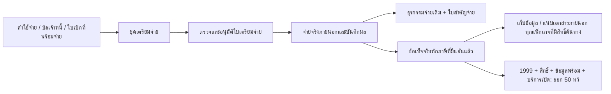

> **เลิกใช้ 11 ต.ค. 2569:** ฉบับ v1.1 นี้เขียนเทียบโค้ดชุดเก่า (ฐาน 22 ก.ย.) และถูกแทนด้วย [v2.0](../specs/expense-payment-preparation-voucher-spec-th.md) เก็บไว้เพื่อให้เลขหัวข้อที่ [ผลตรวจรอบสอง](expense-payment-preparation-voucher-spec-review-2026-10-11-th.md) และ [ผลตรวจอิสระ](expense-payment-preparation-voucher-independent-review-2026-10-11-th.md) อ้างถึงยังเปิดดูได้ ห้ามใช้เป็นข้อกำหนด

# Spec: เตรียมจ่าย ใบเตรียมจ่าย ใบสำคัญจ่าย และเมนูรายจ่ายตามแพ็กเกจ

วันที่: 2026-10-11 · Version: 1.1 — ตรวจเทียบ source รอบสองและแก้ integration gaps

สถานะ: **SPEC ONLY — จัดทำข้อกำหนดเพื่อทบทวน; ยังไม่ implement, migrate, เปลี่ยนสวิตช์ หรือเปิดบริการ**

Owner: thawatchai · ขอบเขต: รายจ่าย → เตรียมจ่าย/อนุมัติ → บันทึกการจ่าย → ใบสำคัญจ่าย → ข้อมูลพร้อมออก 50 ทวิ โดยใช้ expense/AP/reimbursement/WHT เดิม

เอกสารฐาน: [ผลตรวจโค้ดจริง](../research/expense-submenus-code-audit-2026-10-10-th.md), [แพ็กเกจ](mangmee-package-entitlements-spec-th.md), [feature decoupling](feature-entitlement-decoupling-spec.md), [50 ทวิ](wht-certificate-system-issuance-spec.md), [แผน 50 ทวิและมติลายเซ็น](../plans/wht-certificate-system-issuance-plan.md), [บัญชีรับเงินคืน](reimbursement-recipient-bank-account-spec-th.md), [สวิตช์ manual web entry](manual-expense-web-entry-flag-spec-th.md), [P28](mangmee-purchase-to-pay-mvp-spec-th.md)

ผลตรวจรอบสอง: [gap register พร้อมหลักฐานโค้ด](../research/expense-payment-preparation-voucher-spec-review-2026-10-11-th.md). ข้อกำหนดใหม่ด้าน switch/session, WHT source authorization, snapshot, transaction และเอกสารยังเป็นงานที่ต้อง implement ไม่ใช่สิ่งที่ระบบปัจจุบันรับรองแล้ว

## 1. มติผู้ใช้และเป้าหมาย

ข้อกำหนดที่ผู้ใช้ยืนยันในงานนี้:

1. เป็นเมนูย่อยฝั่ง **รายจ่าย** เชื่อมของเดิมและเพิ่มส่วนที่ขาด ไม่สร้างระบบรายจ่ายชุดที่สอง
2. **ใบเตรียมจ่ายและใบสำคัญจ่ายใช้ได้ตั้งแต่ STARTER_249** รวม BASIC_499, PRO_999 และ ENTERPRISE_1999
3. มีสวิตช์เปิด–ปิดแยกแต่ละฟีเจอร์ ใช้แนวทางเดียวกับฟีเจอร์เดิม/บันทึกด้วยมือ เปิดกลับแล้วใช้ข้อมูลเดิมต่อได้
4. แพ็กเกจ 249 เก็บข้อมูลที่จำเป็นต่อ 50 ทวิได้ แต่ไม่แสดงเมนูออก 50 ทวิ และออก SYSTEM certificate ไม่ได้ เมื่ออัปเกรดเป็น 1999 ให้เห็นเมนูและใช้ข้อมูลเดิมกดออกได้เมื่อข้อมูล/สิทธิ์/บริการพร้อม
5. รอบนี้ทำ **spec เท่านั้น** ไม่มีการอนุญาต implement หรือเปลี่ยนข้อมูลลูกค้า

รายละเอียดการรวมใบ สถานะ เอกสาร สวิตช์ และ contract ด้านล่างเป็นแบบออกแบบที่เสนอใน spec นี้ ไม่ใช่การอ้างว่าผู้ใช้ตัดสินใจรายละเอียดทุกข้อแล้ว ต้องมีแผน implementation ก่อนเริ่มโค้ดตาม AGENTS.md

ผลที่ต้องได้: ผู้ใช้กรอกข้อเท็จจริงครั้งเดียว เห็นว่าเป็นเงินที่กำลังจะจ่ายหรือจ่ายแล้ว ย้อนจากทุกเอกสารกลับถึงแหล่งยอดเดียวกันได้ เปลี่ยนแพ็กเกจหรือซ่อนเมนูแล้วข้อมูลไม่หาย ไม่หักภาษีซ้ำ ไม่ลงบัญชีซ้ำ และไม่ต้องสร้างบิลเดิมใหม่เพื่อออกหนังสือรับรอง

## 2. แต่ละใบทำหน้าที่อะไร

| รายการ | ภาษาคนทั่วไป | เกิดเมื่อไร | ผลต่อเงิน/บัญชี |
|---|---|---|---|
| บันทึกค่าใช้จ่าย/บิลเจ้าหนี้ | บริษัทซื้ออะไร จากใคร เป็นเงินเท่าไร | รับหลักฐานและยืนยันตาม workflow เดิม | เป็นต้นทางค่าใช้จ่าย/หนี้ตามระบบเดิม; ยังไม่ยืนยันว่าจ่ายจริง |
| ใบเบิกคืน | มีคนสำรองเงินไปแล้ว ขอให้บริษัทคืน | ผู้ยื่นส่งและผ่านขั้นตรวจ/อนุมัติเดิม | หนี้ต่อผู้รับเงินคืน; ต้องไม่บันทึกต้นทุนเดิมซ้ำ |
| เตรียมจ่าย | เลือกหนี้ที่จะจ่าย กำหนดยอด วัน ผู้รับ บัญชีและผู้ตรวจ | ก่อนจ่ายจริง | จองยอดสำหรับชุดนี้ได้ แต่ยังไม่ลดหนี้หรือเงินในธนาคาร |
| ใบเตรียมจ่าย | กระดาษสรุปคำขอจ่ายและผลอนุมัติของชุดนั้น | พิมพ์ร่างได้; ฉบับส่งอนุมัติมีเลข/รุ่นชัดเจน | ไม่ใช่หลักฐานว่าจ่ายเงินแล้ว |
| ใบสำคัญจ่าย | เอกสารภายในบริษัทสรุปว่าได้จ่ายเงินครั้งนี้เพื่อชำระอะไร | หลังบันทึกว่าจ่ายจริงสำเร็จ | อ้างธุรกรรมจ่ายเดิม; การออก/พิมพ์ใบไม่ตัดเงินหรือสร้างค่าใช้จ่ายเพิ่ม |
| ใบสำคัญรับเงินที่มีอยู่ | เอกสารฝั่งผู้รับเงินใน flow ใบแทน | ตาม flow ใบรับรองแทนใบเสร็จเดิม | คงเอกสารเดิม ไม่เปลี่ยนชื่อเป็นใบสำคัญจ่าย |
| 50 ทวิ | หนังสือรับรองภาษีที่หักไว้จากผู้รับเงินได้ | จากข้อเท็จจริงการหักที่ยืนยันแล้ว | ไม่ใช่คำสั่งจ่าย ไม่ใช่ใบเสร็จนำส่งภาษี และไม่ลดเงิน/หนี้รอบสอง |

ตัวอย่างสาธิตจำนวนเงิน ไม่ใช่คำแนะนำเลือกอัตราภาษี: ค่าบริการ 10,000 + VAT 700 = 10,700 กำหนดหัก 300 → โอนผู้ขาย 10,400 และเก็บภาระภาษีหักไว้ 300 ใบเตรียมจ่ายแสดงแผนนี้; บันทึกจ่ายแล้วจึงมีใบสำคัญจ่าย; 50 ทวิอ้างฐานเงินได้และยอดหักเดียวกัน การนำส่งภาษีเป็นงานภาษีอีกขั้นหนึ่ง



## 3. ฐานโค้ดจริงและงานที่ต้องต่อ

ฐานตรวจ: local working tree บน `codex/sales-deal-card-auto-conversion-20260922`, HEAD `4a5817b42` มีงานอื่นที่ยังไม่ commit; ไม่ใช่หลักฐานสิ่งที่ deploy

| จุด | มีแล้ว | ช่องว่างในขอบเขตนี้ |
|---|---|---|
| Expenses | draft/review/confirm, OCR, หมวด, จ่ายบางส่วน, ใบแทน, หลักฐาน/export | เตรียมจ่ายร่วม, บัญชีปลายทาง/สลิปต่อ payment, ข้อมูล WHT ครบและ linkage |
| AP | vendor bill/approval, payment allocations หลายบิล, WHT, aging | เมนูถูก sidebar allowlist ตัด; web เลือกได้บิลเดียว; create+release actor เดียวแล้ว RECORDED ทันที |
| Reimbursement | ใบเบิก/อนุมัติ/finance/payment/void/พิมพ์ | เชื่อมเตรียมจ่ายโดยคงเต็มยอดหนึ่งใบ; recipient snapshot ใช้ spec ที่มีอยู่และยังไม่ implement |
| 50 ทวิ | endpoint/use case, WhtCertificate, handoff, numbering, external linking | เว็บยังไม่เรียกออก SYSTEM; renderer เป็น generic tax summary; ต้องต่อแบบจริงและ issuance journey |
| ใบสำคัญจ่าย | มี payment records และ infra PDF/attachments/numbering | ยังไม่มีทะเบียน/แบบพิมพ์/immutable snapshot ของเอกสารชนิดนี้ |
| Billing/feature | tier presets, overrides, setVersion, freeze-on-OFF, permission resolver | เพิ่ม keys ใหม่ให้ครบวงจร; package success ต้องรอ effective entitlement พร้อม |

หลักฐานหลัก: [expense payment](../../apps/api/src/modules/expenses/infrastructure/prisma-expense.repository.ts), [supplier payment](../../apps/api/src/modules/procurement/application/use-cases/supplier-payment.use-case.ts), [tax sync](../../apps/api/src/modules/tax/application/use-cases/sync-tax-events.use-case.ts), [schema](../../apps/api/prisma/schema.prisma), [menu presets](../../packages/contracts/src/menu-entitlements.ts), [feature catalog](../../packages/contracts/src/feature-entitlements.ts), [navigation builder](../../apps/web/src/features/web-core-workspace/web-core-workspace.logic.ts), [workspace shell](../../apps/web/src/features/web-core-workspace/WorkspaceLayout.tsx)

ข้อควรแก้ด้าน consistency ที่โค้ดตรวจพบ:

- `ExpensePayment.amount` เป็นเงินจ่ายเทียบ `netPayableAmount`; ห้ามนำยอด gross ของ AP มาใส่ตรง ๆ
- ExpenseLine legacy เก็บ WHT fraction แต่ `ExpenseRecord.whtInputJson` **มีแล้ว** และ RATE.value เป็นเปอร์เซ็นต์ ส่วน AMOUNT.value เป็นจำนวนเงิน; SupplierPayment.whtRate ก็เป็นเปอร์เซ็นต์ ต้องไม่แปลง input เปอร์เซ็นต์ซ้ำหรือสร้าง rate อีกชุดขัดกัน
- AP สร้าง handoff อัตโนมัติเฉพาะกรณี gate ออก SYSTEM ปิด; เป้าหมายใหม่ต้องเก็บข้อเท็จจริงเสมอ แม้ gate เปิดหรือ tier ยังออกไม่ได้
- Tax sync ปัจจุบันอ่าน WHT จาก **confirmed expense และ expenseDate** กับ **supplier payment และ paymentDate** คนละเส้นทาง ต้องทำ source identity/recognition mapping ก่อนเพิ่ม payment-based WHT ไม่เปิดสองทางนับยอดเดียวกัน
- `WhtCertificate` ปัจจุบันมีหมวด/อัตราหนึ่งชุด และ `WhtCertificateHandoff.certificateId` หนึ่งค่า; ถ้าข้อมูลจริงหลายหมวด/อัตรา ต้องต่อ `WhtCertificateLine[]` ตาม decoupling spec ไม่ flatten เป็นอัตราเฉลี่ย
- `SupplierPayment` replay อ่านจาก idempotency key แล้วคืนรายการเดิม ต้องเพิ่มการเทียบ fingerprint ให้คำสั่งใหม่และทางเดิมที่เข้าสู่ orchestration ไม่ยอมรับ key เดิมกับยอด/ผู้รับใหม่
- `payment-voucher.pdf` เดิมพิมพ์ **ใบสำคัญรับเงิน** ต้องใช้ชนิด/route ใหม่ที่ไม่ชนกัน

## 4. ขอบเขตรุ่นแรก

### 4.1 รายการที่เลือกเตรียมจ่ายได้

| Source | เงื่อนไข | รวมในหนึ่งใบเตรียมจ่าย | จ่ายบางส่วน |
|---|---|---|---|
| Expense | CONFIRMED, มียอดค้าง, ผ่าน funding/evidence exclusion เดิม: ไม่เป็น claim projection, ไม่มี live claim ผูก expense หรือไฟล์หลักฐานร่วม, ไม่ใช่ PERSONAL_ADVANCE, ไม่ถูก void/จองที่อื่น | หลาย expense ของผู้รับตามกฎหมายเดียวกัน/สาขาเดียวกัน/ปลายทางเดียวกัน | ได้ ตามจำนวนที่เลือกและ snapshot ภาษีต่อส่วน |
| VendorBill | APPROVED หรือ PARTIALLY_PAID และผ่าน policy ต้นทาง | หลายบิลของ supplier เดียวกันตาม AP allocation เดิม | ได้ ตาม AP เดิม |
| ReimbursementRequest | ผ่าน approval/finance ที่ policy กำหนดและพร้อมจ่าย | **หนึ่งใบเบิกต่อชุด** ใน v1 | ไม่ได้; เต็มยอดคงเหลือเท่านั้นตามโค้ดและ recipient spec |

หนึ่งชุดมีบริษัทเดียว สาขาต้นทางเดียว สกุลเงินเดียว source family เดียว ผู้รับเงินและสาขาภาษีผู้รับเดียวกัน วิธีจ่ายเดียว บัญชีต้นทางหนึ่งบัญชีและปลายทางหนึ่งบัญชีเมื่อใช้การโอน ไม่รวม expense+AP+ใบเบิกปนกันในชุดเดียว ไม่จับคู่ผู้รับจากชื่อเหมือนกันหรือเลขบัญชีเหมือนกัน ต้องมี identity/link ที่ผู้ใช้ยืนยัน

หนึ่งชุดบันทึกการจ่ายจริงสำเร็จได้ครั้งเดียวตามยอดที่อนุมัติ หากต้องจ่ายน้อยกว่าที่เตรียมให้แก้/ส่งตรวจยอดใหม่ **ก่อน** เริ่มจ่าย; การจ่ายบางส่วนหมายถึงเลือกส่วนหนึ่งของหนี้มาเตรียม ไม่ใช่ปล่อยหลาย payout จากใบเตรียมเดียว ยอดหนี้ที่เหลือเตรียมใบถัดไปได้

### 4.2 งานที่รวม

- ทะเบียนและรายละเอียดใบเตรียมจ่าย, ส่งตรวจ/อนุมัติ/ตีกลับ/ยกเลิก, ใบพิมพ์พร้อม version
- บันทึกผลจ่ายผ่าน payment domain เดิม รวม source references และหลักฐานต่อการจ่าย
- ทะเบียน/รายละเอียด/ดาวน์โหลดใบสำคัญจ่าย และสร้างให้การจ่ายตรงจากหน้าเดิมด้วย
- ข้อมูล/คิว WHT จากทุก source ที่รองรับ ปิด gap ในการออก 50 ทวิเดิมสำหรับข้อมูลที่ตรวจครบ
- จัดเมนูรายจ่าย, คืนทางเข้า AP, เติมลายเซ็นส่วนบุคคล และเชื่อมเบิกคืน/หลักฐาน/ภาษีเดิม
- feature/entry switches, package matrix, upgrade/downgrade และข้อมูลย้อนหลัง

### 4.3 ไม่รวม

การสั่งโอนเงินจริง/ไฟล์โอนธนาคารอัตโนมัติ, payroll, เงินทดรองและเคลียร์เงิน, รายจ่ายประจำ, ใบเพิ่มหนี้/ลดหนี้ฝั่งซื้อใหม่, รวมหลายใบเบิกเป็น payout เดียว, แบ่งใบเบิกหลายครั้ง, FX ใหม่, ZIP หลักฐาน, การยื่นภาษี/นำส่งภาษีอัตโนมัติ, SYSTEM correction/replacement ของ 50 ทวิ และตราประทับบริษัท

v1 ออกเอกสารใหม่สำหรับ THB; ธุรกรรมสกุลอื่นหรือกรณีภาษีที่ไม่รองรับยังคงใช้ flow เดิมตามสิทธิ์และแสดงเหตุผลในคิว ห้ามแปลงค่าเงินหรือเดาภาษีให้เอง

## 5. เมนูและการเชื่อมหน้าปัจจุบัน

ชื่อกลุ่ม sidebar เป้าหมาย **รายจ่าย** ใช้กลุ่ม UI เดิมของ expenses โดยเป็น container ของลูกที่ผู้ใช้เข้าได้ ไม่ให้ permission `expense.read` เป็นเงื่อนไขบังคับสำหรับลูก AP/ใบเบิกทั้งหมด

| ลำดับ/ชื่อเมนู | ปลายทาง | การเปลี่ยนแปลง |
|---|---|---|
| รายการค่าใช้จ่าย | `/expenses` | ใช้เดิม |
| อัปโหลดใบเสร็จ | `/expenses/upload` | ใช้เดิม |
| บันทึกด้วยมือ | `/expenses/manual` | ใช้เดิม + เคารพ spec `expenses.manual.web_entry` |
| เบิกคืนค่าใช้จ่าย | canonical route `/reimbursements` | ย้ายทางเข้าเข้ากลุ่มนี้; ไม่ย้าย domain/สร้าง claim ซ้ำ |
| เจ้าหนี้การค้า | canonical route `/accounts-payable` | คืนทางเข้า hub เดิมตามสิทธิ์ procurement; มี tabs บิล/จ่าย/WHT/aging เดิม |
| เตรียมจ่าย | `/expenses/payment-preparations` **ใหม่** | ทะเบียน + new/detail; เข้าจาก source ที่พร้อมจ่ายได้ |
| ใบสำคัญจ่าย | `/expenses/payment-vouchers` **ใหม่** | ทะเบียนเอกสารจาก payment ที่บันทึกแล้ว |
| หัก ณ ที่จ่าย (50 ทวิ) | `/expenses/wht-certificates` **ใหม่** | หน้ารวมที่ใช้ tax/handoff service เดิม; ซ่อนเมื่อไม่มี thai_tax |
| ใบรับรองแทนใบเสร็จ | `/expenses/substitute-receipts` | คง wizard และใบสำคัญรับเงิน |
| หลักฐานทางบัญชี | `/expenses/evidence` | เพิ่มความสัมพันธ์ prep/voucher/payment/certificate; export เดิมยังเป็น manifest |
| หมวดหมู่ | `/expenses/categories` | ใช้เดิม |
| ลายเซ็นของฉัน | `/expenses/signatures` | เติมเมนูที่ route มีแล้ว ตาม self signature permission |
| ตั้งค่าใบรับรองแทนใบเสร็จ | route settings เดิมจาก MODULELESS_SUBITEM_HREFS | คงทางเข้าและ permission เดิม |

ทุก route ในตารางเติม prefix `/companies/:companyId` ไม่ hardcode บริษัทในลิงก์

- Sidebar แสดงแต่ลูกที่ผ่าน entitlement+permission+entry predicate; ถ้าไม่มีลูกให้ซ่อนกลุ่ม ถ้ามีเลือก landing ลูกแรกที่เข้าถึงได้
- ไม่แสดง reimbursement/AP ซ้ำเป็นเมนูหลักอีกชุดหลังจัดกลุ่ม แต่ URL/bookmark/LINE link เดิมยังทำงานตามสิทธิ์; Tax workspace ยังอยู่สำหรับงานภาษีอื่น
- หน้า source มีสถานะ “อยู่ในใบเตรียมจ่าย …”, “จ่ายแล้ว …”, ลิงก์ใบสำคัญจ่าย และข้อขาด WHT; ไม่สร้างฟอร์มแก้ยอดคู่ขนาน
- ผู้มีเพียงสิทธิ์ดูใบเบิกของตนเห็นข้อมูลเฉพาะของตน ไม่เห็นยอดรวม/ชื่อผู้รับในชุดของคนอื่น; จำนวนบน badges ใช้ scope เดียวกับรายการ
- WHT card ภายใน payment/source สำหรับเก็บข้อมูลหรือแนบภายนอกยังอยู่ในแพ็กเกจต่ำกว่า 1999; **ไม่ใช่เมนูออก SYSTEM 50 ทวิ** และไม่มีปุ่มออก SYSTEM แอบอยู่ใน card
- รองรับมือถือ 390px, keyboard และ label ชัด; action หลักใช้ภาษา “ส่งตรวจ”, “อนุมัติเตรียมจ่าย”, “บันทึกว่าจ่ายแล้ว”, “ดาวน์โหลดใบสำคัญจ่าย” ไม่แสดงชื่อ enum แก่ผู้ใช้

## 6. แพ็กเกจ สิทธิ์ และสวิตช์

### 6.1 Matrix เป้าหมาย

เป็นสิทธิ์ตาม catalog ปกติ ไม่ยกเลิก Admin override, custom deal, branch scope, role, source state หรือสถานะบริษัท

| ความสามารถ | ทดลอง 15 ใบ | 249 | 499 | 999 | 1999 |
|---|---|---|---|---|---|
| ค่าใช้จ่าย/ใบแทน/เบิกคืน/หลักฐานพื้นฐาน | ตาม trial เดิม | มี | มี | มี | มี |
| เตรียมจ่ายและใบเตรียมจ่าย | เสนอให้ตาม starter ขณะ trial active | มี | มี | มี | มี |
| ใบสำคัญจ่าย | เสนอให้ตาม starter ขณะ trial active | มี | มี | มี | มี |
| เก็บ/ตรวจข้อมูล WHT ใน source และแนบหนังสือรับรองภายนอก | ตามสิทธิ์ source | มี | มี | มี | มี |
| เมนู 50 ทวิและกดออก SYSTEM | ไม่มี | ไม่มี | ไม่มี | ไม่มี | มีเมื่อ permission/data/launch พร้อม |
| เจ้าหนี้/AP และ source VendorBill | ไม่มีตาม preset | ไม่มีตาม preset | ไม่มีตาม preset | ไม่มีตาม preset | มีตาม procurement |
| ภาษี/บัญชีแยกประเภท/รายงานขั้นสูง | ไม่เพิ่ม | ไม่เพิ่ม | ไม่เพิ่ม | ไม่เพิ่ม | ตาม entitlement เดิม |

มติผู้ใช้ครอบคลุม paid tiers; trial แถวใหม่เป็นข้อเสนอคงความเหมือน starter เพื่อไม่สร้างเงื่อนไขราคาใน UI ไม่เปลี่ยนวัน/โควตาทดลอง ไม่มี SKU หรือค่าธรรมเนียมออกเอกสารใหม่ และไม่หักโควตา OCR จากการพิมพ์เอกสารที่อ่านมาแล้ว

### 6.2 แยก “เปิดใช้ฟีเจอร์” กับ “แสดงทางเข้าเว็บ”

ใช้ catalog, `CompanyFeatureEntitlement`, commands, CAS/setVersion, audit และ Admin/Partner controls เดิม ไม่เพิ่มระบบ flag หรือ storage แยก

| Key ที่เสนอ | หน้าที่ | Default สำหรับชุด starter/full ใหม่ |
|---|---|---|
| `expenses.payment_preparations` | ให้ความสามารถสร้าง/แก้/อนุมัติ/ดำเนินชุดเตรียมจ่ายตาม permission | ON |
| `expenses.payment_preparations.web_entry` | แสดงทางเข้าหน้าเตรียมจ่ายบนเว็บ; `permissionKeys: []` | ON เมื่อไม่มี prior choice |
| `expenses.payment_vouchers` | ให้ความสามารถเรียกดู/ออกเอกสารใบสำคัญจ่ายจาก payment ตาม permission | ON |
| `expenses.payment_vouchers.web_entry` | แสดงทางเข้าหน้า/ปุ่มใบสำคัญจ่ายบนเว็บ; `permissionKeys: []` | ON เมื่อไม่มี prior choice |

ทางเข้า WHT ใช้ entitlement `thai_tax` และ permission เฉพาะ WHT ตาม §6.4 ไม่เพิ่มสิทธิ์ออกให้ feature `expenses` และไม่ให้สวิตช์เตรียมจ่ายเปิด thai_tax ทางอ้อม

- การปิด **entry เท่านั้น** ซ่อน sidebar, CTA, deep-link admission ใหม่/alias ที่พาไปหน้าฟีเจอร์นั้น; ไม่แก้ backend permissions, source facts, ยอด, LINE/OCR หรืองานที่ผ่าน admission แล้ว แบบเดียวกับ manual entry spec
- หน้าที่เปิดรับงานไว้ก่อน entry OFF ไม่ถูก unmount/ล้างฟอร์ม/เปลี่ยน commandId เพราะ entry อย่างเดียว ยังบันทึกตามสิทธิ์ธุรกิจจริงได้จนออกหน้านั้น; reload/company switch ต้องขอ admission ใหม่
- การปิด **feature ใหม่สองตัวนี้** หยุดคำสั่งของฟีเจอร์จริงและเก็บงานค้างแบบ frozen ไม่ใช่เพียงซ่อน UI; การมีงานค้างไม่ขัดขวางคำสั่ง OFF. **ไม่แก้ข้อยกเว้น reimbursement เดิม** ที่ RETAINED_REIMBURSEMENT_PERMISSIONS ให้ read/approve/finance/payment/void ของใบค้างต่อได้เมื่อ reimbursement OFF ตามมติ 2026-08-10; แยกจากการปิด preparation ใหม่
- การปิด preparation ไม่ปิดการบันทึกจ่ายตรงบน expense/AP/reimbursement ที่ได้รับอนุญาตอยู่แล้ว; อย่างไรก็ดี reservation/ข้อจำกัดของชุดที่ค้างยังต้องถูกตรวจ ไม่ใช้ทางตรงหลบยอดจอง
- การปิด voucher ไม่หยุดบันทึก payment หรือเก็บข้อมูลสำหรับเอกสาร; ไม่ออกเลข/PDF ใบสำคัญใหม่ระหว่าง feature OFF เปิดกลับแล้วสร้างจาก payment เดิมได้ครั้งเดียว เอกสารที่ออกแล้วคงเดิมและอ่านผ่าน source evidence ได้เฉพาะสิทธิ์เดิมที่ยังเปิด ไม่เปิด registry ที่ feature OFF
- parent OFF ทำให้ effective child OFF แต่เก็บค่า entry preference เดิม; เปิดกลับไม่ reset explicit false/true
- Billing renewal, tier upgrade/downgrade, apply preset และ toggle-all ต้อง preserve explicit Admin override และ pending entry preference เช่น manual spec; UI ไม่สร้าง menu node ซ้ำเพราะมี catalog leaf `.web_entry`
- Catalog ปัจจุบันเป็น parent + flat submenus และ `parentFeatureKey()` คืน segment แรก ต้องตรวจ parent/feature/entry ครบด้วย predicate เฉพาะ ไม่อ้างว่ามี recursive inheritance อยู่แล้ว
- ปิด entry ไม่ใช่ security switch ป้าย Admin ต้องอธิบายว่า “ซ่อนทางเข้าเว็บ ข้อมูลและสิทธิ์หลังบ้านคงเดิม”; ปิด feature ใช้ป้ายต่างกัน พร้อม preview งานค้างที่ได้รับผล

### 6.3 การคำนวณ availability เดียวกันทุกหน้า

```text
canEnterPreparation = activeCompany AND feature(expenses) AND feature(expenses.payment_preparations)
                      AND entry(expenses.payment_preparations.web_entry) AND permittedPreparationRead
canEnterVoucher     = activeCompany AND feature(expenses) AND feature(expenses.payment_vouchers)
                      AND entry(expenses.payment_vouchers.web_entry) AND permittedVoucherRead
canSeeWhtMenu       = activeCompany AND feature(thai_tax) AND permission(wht.certificate.read)
canIssueWht         = activeCompany AND feature(thai_tax) AND permission(wht.certificate.issue)
                      AND authorizedSourceOrRetainedRoot AND exactLaunchRouteOpen AND issueReadinessReady
```

สูตร feature ใช้ **effective entitlement จาก server** ไม่เทียบ `price >= 1999` หรือ role string ในเว็บ ไม่รับ tier/amount/snapshot ของ client เป็น authority สิทธิ์ read ไม่ให้ issue/approve/pay และการซื้อ Enterprise ไม่มอบ role เพิ่มแก่พนักงานทุกคน

ใช้ error contracts เดิมแยก `feature_not_enabled`, `feature_temporarily_unavailable`, permission denied, source changed และข้อมูลไม่ครบ; ไม่มี entitlement กับมี entitlement แต่บริการยังไม่เปิดเป็นคนละข้อความ ระบบต้องไม่บอกให้ซื้อซ้ำเพื่อแก้ gate ที่ปิด

### 6.4 Permission/ABAC ที่เสนอ

| งาน | Permission ใหม่หรือเดิม | เงื่อนไขเพิ่มเติม |
|---|---|---|
| เตรียม/ส่งตรวจ | เสนอ `payment.preparation.read`, `.create`, `.update`, `.submit` | feature เตรียมจ่าย + สิทธิ์อ่าน/ทำงาน source + tenant/branch; ไม่มีอำนาจจ่ายเพียงเพราะสร้างได้ |
| อนุมัติ/ตีกลับ | เสนอ `payment.preparation.approve` | route ผู้อนุมัติและ policy snapshot; ไม่แทน approval ของบิล/ใบเบิก |
| ยกเลิกก่อนจ่าย | เสนอ `payment.preparation.cancel` | ยังไม่จ่าย/ไม่มีผลจ่ายไม่แน่ชัด; reason + release reservation |
| บันทึกจ่ายจากชุด | เสนอ `payment.preparation.pay` | รวมกับ permission จ่ายของ source เดิม เช่น expense.payment.record / AP create+release / reimbursement.payment.record |
| ใบสำคัญจ่าย | เสนอ `payment.voucher.read`, `.issue` | source payment ที่มีสิทธิ์และ RECORDED; ไม่มีสิทธิ์แก้ยอด payment จากเอกสาร |
| WHT capture/read/external | source permissions + `wht.certificate.read`, `wht.external_certificate.link` เดิม | pack เดิมที่ไม่ผูก thai_tax; การเติม facts ใช้ narrow prepare permission ตาม decoupling spec ไม่เปิด tax.config.read |
| SYSTEM 50 ทวิ | `wht.certificate.issue` ตาม spec เดิม | pack แยกผูก thai_tax; endpoint เก่า tax.certificate.issue ต้องผ่าน final guard เดียวกัน |
| ลายเซ็นบริษัทบน 50 ทวิ | `company.tax_signature.manage` ตามแผนเดิม | OWNER เท่านั้น; ผู้มีสิทธิ์ออกใบไม่ได้สิทธิ์แก้ลายเซ็นอัตโนมัติ |

ชื่อใหม่เป็น proposed contract ต้องตรวจชนกับ registry ในแผนก่อน implement; ใช้ capability packs แคบแยก prepare/approve/pay/document ไม่เอา permission จ่ายทุก source ใส่ pack ใหม่รวมกัน

Preset ที่เสนอ: OWNER ได้งานใหม่ภายใต้ scope เดิม; FINANCE เตรียม/ตรวจ/จ่าย/เอกสารเมื่อมี source permission; ACCOUNTANT ดู/ตรวจ/เอกสารและออก WHT ตามสิทธิ์แต่ไม่เพิ่มอำนาจบันทึกจ่าย; ADMIN/MANAGER คง source grants เดิมแล้วรับงานเตรียม/อนุมัติตาม policy; STAFF/custom ไม่ได้สิทธิ์การเงินใหม่เพียงเพราะอัปเกรดบริษัท สามารถสร้างผ่าน delegated pack ตาม scope ได้

### 6.5 งานเชื่อมสวิตช์ที่ยังไม่มีใน runtime

1. `WebSession`, `MyContext` และ `accessContextFingerprint` ปัจจุบันมี role/permission/scope แต่ไม่มี entry flags หรือ entitlement setVersion; เพิ่ม contract ตาม manual-entry spec ให้ `/auth/me` → server session parser → web session/context → navigation/page gate → refresh fingerprint ส่งข้อมูล version เดียวกัน มิฉะนั้น entry OFF จะไม่เปลี่ยนเมนูแม้ poll ทุก 60 วินาที เพราะ permission เท่าเดิม
2. ส่ง effective feature/entry values ที่จำเป็นพร้อม version อย่างชัดเจน แยก legacy/unavailable จาก false ไม่ให้ client เดา flags จาก tier; loading/error ไม่รับ admission ใหม่จากค่า ON ที่ไม่พิสูจน์ แต่อย่าล้าง mounted draft ที่รับแล้วเพราะ network error
3. `toggleSubmenu` เดิมเปิด parent อัตโนมัติ และ `applyPreset` เดิมไม่อ่าน state ที่ส่งเข้า: `.web_entry` ใหม่ต้องมีการปฏิบัติแบบ preference ตาม manual spec ไม่เปิด parent/feature เมื่อเลือก entry ON และ preserve pending/saved preferences เมื่อ preset/group/toggle-all; สวิตช์ capability ยังคง semantics เดิมของมัน
4. permission filter ใช้ submenu rule ตัวแรกที่ครอบ permission, prefix rules และ gated/ungated pack จึงต้องลง `payment.preparation.*` และ `payment.voucher.*` ภายใต้ capability ใหม่อย่างชัดเจน **ไม่** ใส่ `expense.payment.record`, AP payment หรือ reimbursement.payment.record ลง catalog ลูกใหม่ มิฉะนั้น OFF ของเมนูใหม่จะปิดงานเดิมโดยไม่ตั้งใจ. `.web_entry` ไม่มี permission owner หรือ backend financial guard
5. `wht.certificate.issue` ต้องอยู่ใน gated pack แยกจาก ungated `pack.wht.certificate.manage`; ห้ามรวมไว้ใน pack เก่าหรือใช้ prefix `wht.* → thai_tax` เพราะจะปิด capture/external ของ 249. `wht.certificate.prepare` ยังไม่มีใน registry runtime ต้องเพิ่ม narrow permission/pack/role migration ก่อนใช้ ไม่อ้างว่ามีแล้ว
6. registry/preset ไม่ใช่ persisted role grants ที่พร้อมทันที: จัดแผน reconcile เฉพาะ default-role ownership ที่มีสิทธิ์เดิม โดย preserve custom roles/explicit deny และ normalize ก่อนเปิดเมนูใหม่; ซื้อแพ็กเกจไม่เติม permission ให้ทุก role ต้องทดสอบบริษัทและ role ที่สร้างก่อนเพิ่ม keys ด้วย
7. `FEATURE_DEPENDENCIES` เดิมไม่ได้บังคับ `reimbursement ⇒ expenses` หรือ `thai_tax ⇒ double_entry_ledger`. อย่าเพิ่ม dependency เหล่านี้เพราะจัด sidebar ร่วมกัน; source เดิมที่มีสิทธิ์ยังเข้าทางเดิมได้แม้ preparation/voucher ถูกปิด
8. default starter/full, onboarding, legacy materialization, Partner preview และ billing CANONICAL rows ต้องรองรับ keys ใหม่พร้อมกัน; ตรวจ schema/catalog version ของ quote และ normalization ในแผน rollout. Quote ยังไม่จ่ายที่เก่าเกินให้ refresh; เงินที่รับยืนยันแล้วห้ามทิ้ง/เรียกเก็บซ้ำเพราะ catalog เปลี่ยน ให้ durable paid+review และ reconcile สิทธิ์ด้วย operation เดิมที่ตรวจซ้ำได้
9. Enterprise ในตารางเป็น **catalog tier ปกติ**; Admin grant/deny และ custom deal ยังใช้ effective entitlements เดิม รวม `standard` preset ที่มี thai_tax. ไม่ hardcode tier เป็น guard ใหม่หรือเปลี่ยนดีลเดิมเพื่อให้ตรงตารางราคา

## 7. Journey และ state ของเตรียมจ่าย

### 7.1 ขั้นตอนปกติ

1. เริ่มจากเมนูเตรียมจ่ายหรือ source ที่พร้อมจ่าย เลือก source family แล้วเลือกเอกสาร; server คืนยอดค้างที่จ่ายได้ หักยอดจองอื่น และเหตุผลที่เลือกไม่ได้
2. กำหนดส่วนที่จะจ่าย วันกำหนดจ่าย วิธี/ผู้รับ/บัญชีต้นทางและปลายทาง เหตุผล และข้อมูล WHT; ฟอร์มเติมจากต้นทางไม่สร้างผู้ขายใหม่เพียงเพื่อออกใบ
3. บันทึกร่างได้แม้ข้อมูลยังไม่ครบ แสดงรายการข้อขาดเป็นราย field/source
4. “ส่งตรวจ” re-read ต้นทางและ snapshot รุ่นปัจจุบัน จองยอดทั้งชุดใน transaction เดียว จัดเลขใบเตรียมจ่ายและ revision; พิมพ์ได้พร้อมข้อความ “ยังไม่ได้จ่ายเงิน”
5. ผู้อนุมัติเห็นยอด ผู้รับ บัญชีและเอกสารอ้างอิงครบ กดอนุมัติ snapshot hash นี้หรือตีกลับพร้อมเหตุผล
6. ผู้จ่ายเปิดชุดที่อนุมัติ ตรวจปลายทาง เริ่มขั้นจ่ายตาม manual execution control แล้วดำเนินการจ่ายภายนอก ระบุวันที่จ่ายจริง reference และสลิป/หลักฐาน
7. “บันทึกว่าจ่ายแล้ว” เขียน payment(s) ใน domain เดิม + source balances + references + voucher snapshot + WHT facts + audit/outbox อย่างสอดคล้อง ได้ receipt ของคำสั่งเดิมหาก retry
8. แสดงจ่ายแล้ว/ใบสำคัญจ่าย/สถานะ 50 ทวิเป็นคนละสถานะ หาก PDF ยังสร้างไม่สำเร็จให้ retry เอกสาร ไม่สั่งจ่ายหรือหักยอดใหม่

การตีกลับ/ส่งใหม่ของใบเดิมใช้เลขใบเตรียมจ่ายเดิมและเพิ่ม revision เก็บฉบับเก่า/approval เก่า; หากยกเลิกแล้วเริ่มใบใหม่จึงได้เลขใหม่ การดาวน์โหลดไม่ consume sequence และไม่สร้าง approval event

### 7.2 สถานะ

| State | ทำอะไรได้ | Reservation/ผลทางบัญชี |
|---|---|---|
| DRAFT | แก้/ลบ draft ตามสิทธิ์ ส่งตรวจ | ไม่จองยอด; การเปิด draft ไม่กันคนอื่นจ่าย |
| PENDING_APPROVAL | อ่าน/พิมพ์/อนุมัติ/ตีกลับ/ยกเลิกตามสิทธิ์ | จองยอด; ยังไม่ลด outstanding |
| RETURNED | แก้แล้วส่งใหม่ เก็บเหตุผล/รุ่นเดิม | คืนยอดจอง; ส่งใหม่ตรวจและจองอีกครั้ง |
| APPROVED | เริ่มจ่าย หรือถอนกลับไปแก้ตามสิทธิ์ | คงยอดจอง; approval ใช้ได้กับ hash ที่รับรองเท่านั้น |
| PAID | ดู/ดาวน์โหลด/งานแก้ไขผ่าน source payment เดิม | consume reservation และปรับยอดครั้งเดียว |
| CANCELLED | อ่านประวัติเท่านั้น | คืนยอดจอง; ไม่ลบเลขหรือหลักฐานเก่า |

`STALE` เป็น readiness reason เมื่อ source/destination/policy ที่รับรองเปลี่ยน ไม่แสร้งว่า approved รุ่นใหม่; เปลี่ยนยอด ผู้รับ ธนาคาร หมวด/ฐาน/ยอด WHT, source revisions หรือรายละเอียดสำคัญต้องถอนการอนุมัติและส่งตรวจใหม่ กำหนดวันจ่ายเป็นแผน ส่วนวันที่จ่ายจริงถูกยืนยันตอน payment; ถ้าการเปลี่ยนวันทำให้ tax policy/period validation ต่างไปให้ revalidate ก่อน commit

### 7.3 Approval policy

ค่าออกแบบรุ่นแรก: มีขั้นอนุมัติเตรียมจ่ายแยกจากบันทึกจ่ายเสมอ แต่ไม่บังคับสองคนในร้านที่ policy อนุญาตเจ้าของทำเอง การอนุมัติบิล/ใบเบิกก่อนหน้านี้ยังบังคับครบ ไม่ใช้การอนุมัติชุดแทน

- ใช้ pattern self-approval ของ repo (OWNER/ADMIN/MANAGER exemption และ audit) โดยต้องมี permission ใหม่ด้วย; solo custom-role recovery ใช้หลักพิสูจน์ผู้อนุมัติที่มีอยู่จริงแบบ reimbursement ไม่ปลดเพราะบริษัทซื้อ 249 หรือมีผู้ใช้น้อย
- snapshot ระบุ preparer, approver, source approval refs, destination review, policy version และเหตุผล self/solo; ถ้าต้นทางต้องผู้ตรวจสองคนห้ามลดจำนวนด้วย exemption ของชุด
- v1 ไม่สร้าง workflow engine/threshold ตั้งค่าใหม่ทั่วไป การเพิ่มเงื่อนไขอนุมัติหลายชั้นของชุดนอกเหนือ source เดิมเป็นงานถัดไป
- ถ้าไม่พบผู้อนุมัติที่ใช้ได้และไม่เข้า exception ให้แสดงวิธีตั้งสิทธิ์/ผู้รับผิดชอบ ไม่อนุมัติอัตโนมัติ

### 7.4 การกันจ่ายซ้ำและผลจ่ายไม่แน่ชัด

- หนึ่ง source ห้ามถูกจองเกินยอดค้าง รวมหลายชุดและหลายแท็บ; ใช้ lock/CAS และ idempotency เดิม การกดจ่ายตรงจากหน้าเก่าตรวจ reservation เดียวกันด้วย
- เมื่อเริ่มขั้นจ่าย เก็บ execution attempt ที่ตรึง approved hash/destination และผู้ดำเนินการ ใช้แนวทาง [recipient spec](reimbursement-recipient-bank-account-spec-th.md); source reimbursement reuse attempt เดิม ไม่ซ้อน lock สองระบบ
- attempt ACTIVE/OUTCOME_UNKNOWN ห้ามเริ่มการจ่ายอีกคน/เปลี่ยนบัญชี/ยกเลิกปล่อยยอดจองอัตโนมัติ ต้องให้ผู้มีสิทธิ์ตรวจหลักฐานแล้ว resolve ว่าจ่ายแล้วหรือยังไม่ได้จ่าย พร้อมเหตุผล
- response หายหลังบันทึกสำเร็จให้ค้นคำสั่ง/attempt และ retry key เดิม; ถ้าโอนแล้วแต่บันทึกล้มเหลวให้ “บันทึกผลการจ่ายเดิม” ไม่ชวนโอนซ้ำ
- v1 ไม่มีธนาคารตอบกลับอัตโนมัติ; สลิปหรือชื่อบัญชีที่กรอกไม่ได้ทำให้ระบบอ้างว่าได้รับการยืนยันจากธนาคาร

### 7.5 ต้องครอบคลุมทุกทางที่แก้สถานะจ่ายเดิม

| ทางเข้าจริง | สิ่งที่ต้องเชื่อมกับ flow ใหม่ |
|---|---|
| RecordExpensePaymentUseCase → recordPaymentAtomic | ใช้ reservation/funding checks และ settlement/voucher/WHT facts ใน transaction เดียว; response เดิมคืน ExpenseRecord ต้องรักษา shape และเพิ่มลิงก์/lookup โดยไม่ให้ client สร้าง payment ซ้ำเพราะยังไม่เห็น voucher |
| อนุมัติใบรับรองแทนใบเสร็จ funding=COMPANY | repository สร้าง ExpensePayment ได้เองเมื่อยังไม่เคยจ่าย; hook ต้องครอบทางนี้ด้วย หากมี payment อยู่แล้วผูกอันเดิม ไม่สร้างใบสำคัญจ่ายสองใบ |
| ใบแทน funding=PERSONAL_ADVANCE | ไม่สร้าง company payment; ยังเป็นงานเงินสำรองจ่าย ต้องคืนผ่าน claim ที่ตรวจแล้ว ไม่ย้ายไปเตรียมจ่ายผู้ขายจากค่า outstanding เพียงอย่างเดียว |
| คืนเงินใบเบิก | ReimbursementPayment ตัวเดียวเป็นเงินออก; expense projections ที่กลายเป็น PAID เป็นเงาสถานะ ไม่สร้าง ExpensePayment/voucher/WHT ซ้ำให้แต่ละ projection |
| CreateSupplierPaymentUseCase + repository race recovery | fingerprint ต้องตรวจทั้ง preflight replay และ catch ที่คืน payment เดิม; reservation/hook อยู่ใน commit ของ AP ไม่อาศัยเรียกต่อหลัง HTTP สำเร็จ |
| ยกเลิก expense/AP/ใบเบิก และแก้ใบแทน/เอกสารต้นทาง | ตรวจชุด/attempt/coverage/เอกสารที่อ้างถึงก่อนเปลี่ยนสถานะ; กระทบทุก voucher ที่ผูก ไม่ใช่เฉพาะหน้าที่ผู้ใช้เปิดอยู่ |

ใช้ `lockFundingEvidence`/`assertFundingMutation` และลำดับ lock เดิมเป็นฐานรวมกับ locks ของ preparation ไม่ตรวจแค่ sourceReimbursementRequestId. ขั้น candidate, submit และ final commit ต้องให้ผลตรงกันเมื่อมี claim ที่อ้างผ่าน linkedExpenseId หรือไฟล์ร่วม หากยังไม่พร้อมให้เหตุผลพร้อมลิงก์ claim ที่ผู้ใช้มีสิทธิ์

ข้อจำกัดต้องทำสองทิศทาง: claim submit/materialization และการเตรียม/อนุมัติใบแทนที่ใช้ expense/attachment เดียวกันต้องตรวจ preparation reservation ด้วย ไม่ใช่ตรวจเฉพาะตอน prep/pay. ถ้า draft claim กับ draft preparation ใช้หลักฐานเดียวกัน คำสั่ง submit ที่ชนะล็อกเป็นผู้จอง อีกทางต้อง re-read และบอกเหตุผลก่อนยืนยัน

เมื่อจ่ายจากหน้า source เดิมและมี reservation ของชุดที่อนุมัติแล้ว ให้เปิด/ดำเนิน **ชุดเดิม** พร้อม command identity เดียวกันเมื่อ actor มีทั้ง source-pay และ preparation-pay; หากไม่มีสิทธิ์ให้แสดงผู้รับผิดชอบ/เหตุผล ไม่สร้าง direct payment แข่งกับชุด หรือทำให้ผู้ใช้หลบได้ด้วย URL เก่า

## 8. ใบสำคัญจ่ายและหลักฐาน

- ใบสำคัญจ่ายหนึ่งใบต่อ **เหตุการณ์จ่ายจริงหนึ่งครั้ง** แม้ประกอบด้วย ExpensePayment หลาย row หรือ AP allocations หลายบิล การจ่ายตรงหนึ่ง payment จากหน้าเดิมใช้ logical settlement เดียวกัน ไม่ออกซ้ำเมื่อเปิดผ่านทะเบียน
- payment commit เก็บ **snapshot intent** เสมอ; การทำเป็นเอกสารทางการ/จองเลข/เผยแพร่ PDF ต้องมี voucher feature และ issuance authority ปัจจุบัน ถ้า actor จ่ายได้แต่ไม่มี payment.voucher.issue ให้จ่ายสำเร็จและค้างเอกสารรอผู้มีสิทธิ์ ไม่ยกระดับสิทธิ์ actor อัตโนมัติ. Worker ใช้ authorization ที่ผูกคำสั่งและตรวจใหม่ก่อนออก; ไม่อ่านสิทธิ์ใน payload มาเชื่อเอง
- เกิดหลัง commit การบันทึกจ่าย ไม่จำเป็นต้องมีใบเตรียมจ่ายมาก่อน; แสดง “บันทึกจ่ายโดยตรง” และ approval ต้นทางที่มีจริง ไม่แต่งชื่อผู้อนุมัติเตรียมจ่ายย้อนหลัง
- เก็บเลขชนิดเอกสารใหม่แยกใบเตรียมจ่าย/ใบสำคัญรับเงิน/50 ทวิ ผ่าน numbering infrastructure เดิม; draft preview ไม่มีเลขทางการ/ไม่ consume sequence ฉบับ issued ไม่ใช้เลขซ้ำแม้ void
- snapshot ประกอบด้วยบริษัท/สาขา ผู้รับตามกฎหมาย ผู้ถือบัญชี รายการ source/เลขบิล ยอดชำระหนี้ ยอด WHT เงินจ่ายจริง วันที่จริง วิธีและบัญชีต้นทาง/ปลายทาง ผู้อนุมัติ/ผู้จ่าย references และรายการหลักฐาน
- สำเนา PDF ใช้ snapshot ตอนออก ไม่ดึงที่อยู่/ชื่อ/บัญชี master ปัจจุบันมาพิมพ์แทนฉบับเก่า เก็บ artifact hash/template version/issuedAt/actor และ original payment dates แยกกัน
- ช่องลายเซ็นมีผู้จัดทำ/ผู้อนุมัติ/ผู้จ่ายตามเหตุการณ์จริง ช่องผู้รับเงินเว้นว่างถ้าไม่มีหลักฐานการรับรองของผู้นั้น ห้ามนำลายเซ็นผู้เบิกมาอ้างเป็นลายเซ็นผู้รับภายนอก
- แนบสลิปกับ payment/settlement โดยตรงผ่าน AttachmentObject/AttachmentLink เดิม ตรวจ upload complete/scan/MIME/size/tenant และสิทธิ์ดาวน์โหลด ไม่แค่ใส่ URL สาธารณะ; รายการโอนต้องมี reference และหลักฐานหรือคำอธิบายไม่มีสลิปที่ตรวจรับแล้ว
- การเพิ่มหลักฐานภายหลังเป็น event/link ใหม่ ไม่ rewrite PDF ที่ issued; รายละเอียดแสดงหลักฐานเพิ่มเติม และดาวน์โหลดสำเนาเดิมได้
- ถ้า PDF ล้มเหลว payment ยังคงจ่ายแล้ว เอกสารเป็น PENDING_ARTIFACT/FAILED_RETRYABLE และ retry number/snapshot เดิม ห้าม reset payment หรือสร้างเลขใหม่ทุก retry
- VOID/REVERSAL มาจาก source payment domain พร้อมเหตุผล ไม่ให้ void PDF แล้วถือว่ารับเงินคืนแล้ว ไม่ลบประวัติ/ไฟล์เดิม การยกเลิกทั้ง logical settlement ที่มีหลาย payment ต้องผ่านทุก source guard และทำอย่าง atomic; หากมี certificate/งวดล็อกให้ส่งงานแก้ไขที่อนุญาตแทน force void
- ปัจจุบัน expense void กลับทั้ง ExpenseRecord และ payments ที่เกี่ยวข้อง ไม่ได้มี endpoint ยกเลิก ExpensePayment ทีละรายการแบบ AP/reimbursement; v1 ไม่สร้าง per-payment void ใหม่โดยนัย การขอยกเลิกต้องแสดงผลกระทบทุกชุด/voucher/payment ของ expense นั้น และรักษา linked WHT/งวดทั้งหมดก่อนใช้ source reversal เดิม

## 9. ข้อมูลกลางและ invariants

### 9.1 Ownership และโครงสร้างที่เสนอ

| ส่วน | Source of truth | ข้อมูลเพิ่มที่จำเป็น |
|---|---|---|
| หนี้/ยอดค้าง/เงินที่จ่าย | ExpenseRecord+ExpensePayment / VendorBill+SupplierPayment / ReimbursementRequest+Payment เดิม | adapter ชัดเจน ไม่ให้เอกสารใหม่เขียนยอดแทน source domain |
| ชุดก่อนจ่าย | PaymentPreparation ใหม่ | company/branch/source family/currency/state/version, planned date, creator, approval/policy/destination snapshots, totals/hash |
| รายการในชุด | PaymentPreparationLine ใหม่ | source type+ID+revision, selected source-settlement amount, gross/cash/WHT/base breakdown, reservation version |
| เหตุการณ์จ่ายรวม | settlement reference ใหม่หรือ extension ที่เชื่อม native payments | preparationId nullable, unique command/fingerprint, immutable approved+actual facts, native payment refs, execution attempt |
| เอกสารจ่าย | PaymentVoucher ใหม่ ผ่าน infra เอกสารเดิม | unique settlement identity, number/status/revision, immutable snapshot, file/hash, issued/void refs |
| ข้อเท็จจริง WHT | source snapshot → WhtCertificateHandoff เดิม → certificate เดิม | recognition identity/version และ WhtCertificateLine ต่อหมวด/อัตรา พร้อม source coverage; ห้ามเก็บเพียงยอดรวมไร้ที่มา |
| สิทธิ์/สวิตช์ | CompanyFeatureEntitlement/capability packs เดิม | catalog leaves, effective snapshot/setVersion; ไม่มี copy tier ไว้บนธุรกรรมเพื่อใช้ตัดสิทธิ์ตลอดกาล |

เอกสารใหม่เป็น orchestration และ projection ของ source เดิม ไม่เพิ่ม ledger engine หรือระบบบัญชีคู่ขนาน ใช้ shared document/attachment/audit/numbering infrastructure; AI Gateway หากมีทางเข้าในอนาคตเรียก permission-checked API เท่านั้น

### 9.2 จำนวนเงินและภาษี

ทุกจำนวนใช้ decimal string และ Decimal/rounding policy เดิม ไม่ใช้ float คำนวณเงิน; แสดง THB สองตำแหน่ง เก็บ precision ตามสัญญาของ source และตรึง rounding version

```text
grossSettled = cashPaid + withheldThisSettlement
withheldThisSettlement = taxRecognitionAmount + alreadyTaxRecognizedAmountAllocated
sum(line.cashPaid) = settlement.cashPaid
sum(line.withheldThisSettlement) = settlement.withheldThisSettlement
availableToPrepare = source.outstanding - otherActiveReservations (ในหน่วย settlement ของ source)
```

| Source | ความหมายของยอดที่ส่งเข้า engine เดิม | สิ่งที่ต้องแยกไว้บน snapshot |
|---|---|---|
| Expense | amount = เงินสด/เงินโอนที่ชำระ net payable | cash paid, ส่วน WHT ที่ยืนยันต่อการจ่าย, gross settled; ห้ามหัก WHT ซ้ำจาก net |
| AP บิลไม่ได้หักที่ source | allocation = ยอดชำระก่อนหัก WHT ตาม contract AP; netPaid = gross − WHT | income base ไม่ใช่ VAT-inclusive gross; allocation WHT รวมตรง header |
| AP บิลหักไว้ที่ source แล้ว | รักษา settlement basis เดิม; payment WHT ใหม่ต้องไม่ซ้ำส่วน source | source-withheld reference แยกจาก newly-withheld amount; ไม่ทำให้อัตราสุทธิกลายเป็นการหักสองครั้ง |
| คืนเงินใบเบิก | amount = ยอดคืนเต็มที่ต้นทางยอมรับ | ผู้รับเงินคืนต่างจาก payee เงินได้เดิม; ไม่สร้าง WHT ใหม่จากการคืนเงินเพียงอย่างเดียว |

- ภาษี/VAT/WHT ของบิลและการแบ่งส่วนใช้ facts/รหัสภาษีที่ผ่านตรวจแล้วจากต้นทาง ไม่ให้ออกเอกสารเลือกรหัสใหม่แล้วแก้หนี้เงียบ ๆ
- บันทึก `sourceSettlementBasis` และ `whtRecognitionBasis` เป็นค่าที่แปลความหมายได้แน่นอน ไม่ใช้ชื่อ field `amount` เดียวสำหรับยอด gross/net ทุก source
- `withheldThisSettlement` เป็นยอดหักที่เกี่ยวข้องกับส่วนหนี้นี้; `taxRecognitionAmount` คือส่วนที่ยังไม่มี canonical TaxEvent ของข้อเท็จจริงการหักนั้น ส่วน `alreadyTaxRecognizedAmountAllocated` ต้องมี reference ยืนยันว่าเคยนับในภาษีแล้ว ไม่ใช่แค่มี whtAmount บน draft/ledger. ทั้งสองส่วนรวมกันเท่ายอดที่แสดง ไม่สร้าง TaxEvent ซ้ำ
- **แยกการรับรู้ในบัญชีแยกประเภทจากการรับรู้ในรายงานภาษี:** โค้ดปัจจุบัน expense.confirmed/expense.claim.confirmed มี WHT payable ใน entry ต้นทางแล้ว ส่วน expense.payment เป็น cash settlement และไม่ส่ง whtTotal; AP payment ที่เพิ่งหักส่ง WHT ไป posting ของการจ่าย. เก็บ ledger-recognition references แยกจาก tax-recognition references ห้ามเอา taxRecognitionAmount ใหม่ใส่ GL payment ซ้ำโดยอัตโนมัติ และไม่เปลี่ยน posting timing ของต้นทุน/หนี้เดิมในงานนี้
- สำหรับ partial: จัดสรรฐานและยอดหักตาม source lines/ส่วนที่ยืนยันจ่าย ใช้ยอดสะสมที่ปัดเศษแล้วลบยอดครั้งก่อน ส่วนสุดท้ายรับเศษที่เหลือ รวมทุกครั้งต้องเท่าต้นทาง ห้ามหักเต็มใบทุกครั้งหรือเดาฐานจาก WHT÷rate เมื่อมีข้อมูลฐานจริง
- มาตรฐาน shared contract ใหม่ใช้อัตราเป็นเปอร์เซ็นต์ เช่น `3.0000`; แปลงเฉพาะ ExpenseLine legacy fraction `0.03` ไม่แปลง ExpenseWhtInput RATE.value=`3` ซ้ำ. Reuse `expenseWhtLineRate`/`applyExpenseWhtInput` สำหรับ accepted source facts; รักษา excluded/rounding/additional-charge lines และ largest-remainder allocation เดิม ไม่กระจาย WHT ใหม่ทุกครั้งที่พิมพ์
- `ExpenseRecord.whtInputJson` มี inputType/value/baseAmount/origin อยู่แล้ว: RATE คือเปอร์เซ็นต์, AMOUNT คือเงินบาทและไม่ได้ยืนยัน rate. ข้อมูล AMOUNT ต้องเก็บตรงที่กรอก ห้ามอนุมาน rate เพื่อกรอก certificate ให้ผ่าน; rate/category/form ที่ต้องใช้แต่ขาดให้ review จากหลักฐาน. `taxCategory` ที่ adapter ส่งเป็น incomeCategoryCode วันนี้ยังไม่ใช่หลักฐานว่าเป็นรหัส WhtIncomeCategory ที่ active/ถูกต้อง ต้อง validate/mapping และเก็บ reviewed category snapshot แยกโดยไม่ทำ source intent หาย
- อัตรา/header fields ที่เพิ่มตามแผน WHT เก่าไม่เป็น source of truth อีกชุด: ต่อ contract จาก whtInputJson/accepted line facts พร้อม category snapshot และ version; รองรับ clientเก่าที่ validator ยังไม่รับ field เพิ่มด้วย expand-first contract ไม่ส่ง origin/server-owned field ผ่าน public input
- fee ธนาคารเป็นรายการค่าใช้จ่ายแยกตามระบบเดิม ไม่หักจากเงินถึงผู้รับแล้วบอกว่าตัดหนี้เต็มโดยไม่อธิบาย
- engine เดิมบังคับจำนวนจ่ายเป็นบวก กรณี net cash เป็นศูนย์/หักเต็มยอดหรือชำระด้วยเครดิตล้วนให้คงข้อเท็จจริงและแสดง unsupported-settlement/review ก่อนเริ่มชุดใน v1 ห้ามสร้างเงินจ่าย 0.01 เพื่อให้ผ่าน; ต้องออกแบบ non-cash settlement แยกก่อนรองรับ
- รายจ่ายและ VAT ลงตาม source recognition เดิม; เตรียมจ่าย/ใบพิมพ์ไม่สร้าง journal การบันทึกเงินและ WHT ใช้ posting source เดิมกับ mapping ที่ตรวจครบก่อนเปิด ห้ามออก voucher แล้ว emit expense/payment posting รอบสอง

### 9.3 บุคคล บัญชี สาขา วันที่ และเวอร์ชัน

- แยก payer company/tax branch, payee ผู้รับเงินได้ตามกฎหมาย, beneficiary ผู้มีสิทธิ์รับคืน, requester ผู้ยื่น, account holder เจ้าของบัญชี และ paying bank account ของบริษัทเป็นคนละความหมาย
- AP ใช้ supplier identity/master เดิม; expense ใช้ counterparty linkage ที่ตรวจแล้วและเก็บ historical vendor snapshot ไม่บังคับซื้อ procurement เพื่อกรอกผู้ขาย/ปลายทาง; ถ้าไม่มี master ให้ยืนยัน identity/destination ระดับรายการ ไม่สร้าง supplier ปลอม
- Reimbursement reuse recipient spec ทั้งบัญชีตน/บุคคลอื่น/คนนอก การยอมรับ third-party และ request-specific beneficiary ref; ห้ามใช้เลขบัญชีเหมือนกันรวมคนละ claim เป็นผู้รับคนเดียว
- `ReimbursementPayment.bankAccountId` คือบัญชีบริษัทที่ใช้จ่าย ไม่ใช่ recipientAccountId; เลขบัญชีปลายทาง encrypted/masked และเปิดเลขเต็มเฉพาะผู้ตรวจ/ผู้จ่ายตามสิทธิ์ ห้าม plaintext ใน audit/log/analytics/localStorage
- แพ็กเกจ 249 ต้องระบุแหล่งเงินและบัญชีผู้รับได้โดยไม่ซื้อ banking/procurement: ใช้ narrow source-context read/capture และ snapshot/reference ที่ engine เดิมรับได้ ถ้าไม่มี bank master ให้บันทึกข้อมูลอ้างอิงบัญชีที่ตรวจด้วยคนระดับรายการ ไม่บังคับสร้าง BankAccount ผ่านเมนูที่ไม่มีสิทธิ์ และไม่ให้เห็นยอดธนาคาร/สมุดบัญชีจากสิทธิ์ capture นี้
- master ถูกแก้หลังอนุมัติไม่ rewrite snapshot; ถ้าจะใช้ข้อมูลใหม่ต้อง reselect/review/approve รุ่นใหม่ บัญชีถูกปิด/ระงับต้อง block เริ่มจ่ายและให้ตรวจใหม่
- สาขาที่ทำรายการ (`sourceBranchId`) ไม่ใช่เลขสาขาภาษีของผู้จ่ายหรือผู้รับ (`taxBranchCode`); ต้อง snapshot ทั้งสองฝ่าย ไม่ hardcode null หรือใช้รหัสสาขาภายในพิมพ์แทนเลขสาขาภาษี
- แยก documentDate, plannedPayDate, actualPaidDate, withholdingDate, certificateIssuedAt และ createdAt; ใช้ civil date/timezone contract เดิม การอัปเกรดไม่เปลี่ยนวันที่ภาษีเป็นวันที่ซื้อแพ็กเกจ
- การแก้ข้อเท็จจริงย้อนหลังต้องเป็น audited supplemental/correction record มีหลักฐานและ reviewer ไม่แก้ immutable prefill hash เดิมหรือเอา master วันนี้ไปยืนยันว่าถูกต้องในอดีต

ตัวอย่าง reconciliation ที่ต้องใช้ใน fixture: expense gross10,700/WHT300/net10,400 ที่ GL ต้นทางรับรู้ WHT300 แล้ว จ่ายครึ่ง net5,200 จึงมีเงินออก5,200 และ attributable WHT150; tax recognition ใหม่เป็น150ได้เฉพาะยังไม่มี legacy TaxEvent ครอบส่วนนี้ แต่ GL การจ่ายยังไม่ credit WHT อีก150. ถ้ามี legacy tax event300 ครอบเต็มใบ ให้เข้ากฎ mapping/review เดิม ไม่เพิ่ม150ซ้ำและไม่ย้ายงวดเงียบ ๆ

## 10. 50 ทวิ: เตรียมได้ก่อนซื้อ Enterprise

### 10.1 Capture และ readiness เป็นคนละแกนกับ package

ขณะกรอก expense/AP ให้มีชื่อ/ประเภทผู้รับเงินได้ เลขภาษี ที่อยู่/สาขา ประเภทเงินได้ ฐาน อัตรา ยอดหัก วิธีรับภาระภาษี และหลักฐาน แหล่งอ่านรายการหมวดภาษีใช้ endpoint ของ source + permission ที่มีอยู่ ไม่บังคับ tax.config.read หรือ procurement entitlement สำหรับผู้ใช้ expense 249

Draft เก็บข้อมูลไม่ครบได้; ก่อนยืนยันใหม่ต้องมี facts ที่จำเป็นต่อความถูกต้องของยอด/ตัวผู้รับและการหัก ส่วนข้อมูลที่ขาดเฉพาะการพิมพ์ให้ระบุ review issue ไม่แต่งค่า ไม่ทิ้งข้อเท็จจริงการจ่ายที่เกิดขึ้นจริงเพราะพิมพ์หนังสือรับรองยังไม่ได้

| แกน | ค่า/ความหมาย |
|---|---|
| source readiness | PLANNED ก่อนจ่าย, VERIFIED_WITHHOLDING เมื่อมีข้อเท็จจริงการหักที่พิสูจน์ได้, NEEDS_REVIEW/VOIDED |
| data readiness | COMPLETE หรือรายการ missing/ambiguous fields พร้อม source evidence refs |
| artifact state | REQUIRED / EXTERNAL_LINKED / SYSTEM_ISSUED / CANCELLED ตาม handoff เดิม; certificate หนึ่งใบต้องครอบคลุม lines ของ identity นั้นครบ |
| issuance availability | package/permission/source/launch/period/record constraints ณ เวลากด |

249 + facts ครบ + จ่ายแล้ว = **ข้อมูลครบแต่ไม่มีสิทธิ์ออกในระบบ** ไม่ใช่ข้อมูลขาด; 1999 + facts ขาด = **มีสิทธิ์แต่ต้องตรวจข้อมูล** ไม่ใช่ต้องซื้อเพิ่ม

ทุก positive-WHT settlement ต้องมี durable handoff/facts โดยไม่ขึ้นกับ thai_tax, entry switch หรือ launch OPEN/CLOSED การจ่ายที่ไม่มี WHT ไม่สร้าง handoff เปล่า; ร่างเตรียมจ่ายมีเพียง preview ไม่จองเลข SYSTEM และไม่สร้าง TaxEvent ของยอดที่ยังไม่ยืนยัน

### 10.2 หน้ารวมและการออก

- หน้า 50 ทวิกรอง “ข้อมูลไม่ครบ”, “พร้อมออก”, “ออกในระบบแล้ว”, “แนบจากภายนอกแล้ว”, “ยกเลิก/ต้องแก้ไข” พร้อมวันที่จ่าย ผู้รับ source และยอด
- ผู้ใช้อัปเกรดแล้วเห็นรายการเก่าที่ตนมีสิทธิ์ทันทีจาก handoff เดิม ไม่มีคำสั่ง copy-import ใหม่และไม่ require กด tax sync ทั้งบริษัทก่อนจึงพบรายการ
- ออกครั้งแรกใช้ WhtCertificate/numbering/artifact pipeline เดิมต่อยอด กำหนด TaxPeriod แบบ idempotent จาก facts จริงตามข้อกำหนดที่มีอยู่ ไม่พึ่งสร้างภาระภาษีซ้ำเพื่อให้ FK ครบ
- แยก TaxEvent projection สำหรับ report ออกจากสิทธิ์ capture; sync ภายหลังใช้ canonical recognition refs เดียวกัน ไม่เพิ่มแถวเพราะเปลี่ยน tier หรือกดพิมพ์
- ต่อ `WhtCertificateLine[]` ตาม decoupling spec: certificate หนึ่งใบต่อ canonical native source-payment/payee identity มีหลายบรรทัดแยกหมวด/อัตราได้ แต่ละบรรทัดมีฐาน ยอดหัก และ immutable source coverage; ไม่ใช้ rate เฉลี่ย ไม่สร้าง handoff ปลอมโดยเปลี่ยน sourcePaymentId ชุดเตรียมจ่ายที่มีหลาย native payments จึงอ้างหนังสือรับรองได้หลายใบโดยไม่รวม identity ทิ้ง
- source-payment handoff unique และ `certificateId` เดิมคงอยู่ เพิ่ม unique active coverage ต่อ recognition line/amount/version ป้องกันออกซ้ำข้าม Tax workspace, AP, Expenses และทะเบียนใหม่; SYSTEM_ISSUED หมายถึงออก certificate ที่มีทุก line ของ identity นั้นแล้ว
- schema/DTO ของ certificate ต้องมี version สำหรับ multi-line: scalar category/rate เดิมใช้สำหรับ legacy/single-line เท่านั้น ไม่ใส่ค่าบรรทัดแรกให้ดูเสมือนยอดรวมหลายอัตรา แผนต้องกำหนดการ widen nullable header fields, backfill single-line และปรับ readers/export/render/AI tools ก่อนเปิด multi-line; client เก่าที่อ่านไม่ได้ต้องได้ unsupported-version แทนข้อมูลผิด ไม่อ้างว่าแค่เพิ่ม table แล้วเข้ากันได้ทุกจุด
- external link และ SYSTEM issue ของ coverage เดียวกันแข่งกันได้ผู้ชนะเดียว อีกคำสั่งคืน current result/conflict; เอกสารภายนอกที่ผูกแล้วห้ามออก SYSTEM ซ้ำเพียงเพราะเพิ่งอัปเกรด
- เลขเอกสารภายนอกเก็บพร้อม origin/issuer/evidence และตรวจ collision ตาม registry policy เดิม; การผูกไฟล์ไม่ consume SYSTEM sequence หรือเปลี่ยนเลขที่พิมพ์บนไฟล์ภายนอก ความเป็นเอกสารเดียวกันตัดสินจาก canonical source/coverage ไม่ใช่เทียบข้อความเลขเพียงอย่างเดียว หากเลขชน/coverage พิสูจน์ไม่ได้ให้ review ไม่ออกใหม่ทับ
- PDF เป็นแบบ 50 ทวิจริง อ่านไทยได้ พิมพ์ payer/payee/ฐาน/อัตรา/ยอด/วัน/เลขครบ; มี readiness review โดยผู้เชี่ยวชาญตาม gate เดิม การจ่ายสำเร็จไม่ถูก rollback เพราะ issuance/render ล้มเหลว
- v1 ลายเซ็น `BLANK` default หรือ `AUTO_STAMP` **เฉพาะลายเซ็น** ตามมติหลังสุด 2026-09-22 ไม่มีตราประทับ; setting OWNER-only และตรวจ asset scope ไม่ reuse รูปลายเซ็นส่วนบุคคลของคนอื่น

ข้อมูลแบบและแนวทางออกหนังสือรับรองอ้างอิง [แบบภาษีหัก ณ ที่จ่ายของกรมสรรพากร](https://www.rd.go.th/62294.html) และ [แนวทางการออกหนังสือรับรอง](https://www.rd.go.th/fileadmin/images/image_law/images/guide100248.pdf) ตรวจแหล่งเมื่อ 2026-10-11 สเปกนี้ไม่ได้อนุญาตเลื่อนภาระออกหนังสือรับรองไปจนซื้อแพ็กเกจ: ผู้ใช้แพ็กเกจต่ำยังต้องมีทางเก็บข้อมูล/แนบฉบับภายนอกตามหน้าที่ของตน ไม่โฆษณาว่าแพ็กเกจทำให้หน้าที่ภาษีเปลี่ยน

### 10.3 ปิดช่องว่าง recognition กับข้อมูลเดิม

สำหรับ flow เตรียมจ่ายใหม่ ข้อมูลก่อนจ่ายเป็นแผน ส่วน WHT ที่พร้อมออกต้องอ้างการหักที่ยืนยันจริง ห้ามใช้ CONFIRMED ของ expense อย่างเดียวเป็นหลักฐานว่าหัก/จ่ายแล้ว

ต้องเพิ่ม versioned recognition mapping ระหว่าง source expense/bill, payment/ส่วนจ่าย, existing TaxEvent, handoff และ certificate ก่อนเปิด flow ใหม่:

1. เลือก canonical recognition identity เดียวต่อ source line/ส่วนที่จ่าย เก็บ `recognitionBasis` ที่บอกว่ามาจาก payment จริงหรือ legacy source ที่ตรวจยืนยันแล้ว
2. flow ใหม่ sync จาก identity นี้เท่านั้น ส่วน expense-date/full-document loop เดิมต้องไม่สร้าง WHT ซ้ำให้ record ที่มี mapping ใหม่ ไม่เปลี่ยน VAT input path โดยไม่เกี่ยวข้อง
3. AP ที่ source หักไว้แล้วใช้ source-withheld recognition เดิมเชื่อมการชำระ ไม่กรอก allocation WHT ใหม่เพื่อให้มี handoff
4. expense ที่เกิดจากใบเบิกใช้ข้อเท็จจริงผู้ขาย/การสำรองจ่ายต้นทาง ไม่ออก certificate ให้พนักงานเพราะบริษัทคืนเงินเขา และไม่สร้าง expense payment ทางลัด
5. record เก่าที่ sync/ออก certificate/ยื่นงวดแล้ว ห้ามย้ายงวดหรือ supersede อัตโนมัติ ต้อง reconcile และรักษา references; ไม่เปิด create ใหม่เมื่อพิสูจน์ coverage เดิมไม่ได้
6. payee type/category/rate ไม่ทราบให้ NEEDS_REVIEW ห้าม fallback PND53 หรืออนุมานบุคคล/นิติบุคคลจากเลขภาษีเพียงอย่างเดียวใน issuance ใหม่

ส่วนนี้เป็น prerequisite ด้าน consistency ที่ขยายจากแผน WHT เดิม ต้องมี accounting fixtures และตรวจ source/period locking ก่อนเขียน migration ไม่ใช่คำสั่งเปลี่ยนข้อมูลภาษีย้อนหลังในงาน spec นี้

### 10.4 สิ่งที่ต้องแก้ใน service เดิมก่อนรับรองว่า “ออกจากข้อมูลเดิมได้”

1. **Source authorization:** handoff list/get/link/address ปัจจุบันตรวจ company แต่ list branchId เป็น filter และไม่ได้ใช้ ctx.scopes/own/related source authority. เพิ่ม shared scoped source resolver ทุก entry รวม issue/download/export/counters; ตรวจ route company = context company. ไม่ถือสิทธิ์ wht.certificate.read ตัวเดียวว่าอ่านได้ทุกสาขา/ทุกพนักงาน และไม่ใช้ nullable legacy source identity เป็นทางผ่าน ให้งาน legacy ที่พิสูจน์ไม่ได้อยู่ในคิว reconciliation จำกัดผู้มีสิทธิ์
2. **Discovery ครบ:** list เดิม take200 ไม่ได้มี pagination สำหรับทะเบียนทั้งหมด; เพิ่ม cursor/filter/sort/count ที่ scope ตรงกัน ไม่ทำให้รายการพร้อมออกก่อนอัปเกรดหายไปเมื่อเกิน200 และไม่ scan ข้ามสิทธิ์แล้วค่อยกรองใน browser
3. **Facts ต้องผูกกับ source:** endpoint tax/wht-certificates เดิมรับ payeeSnapshot/category/rate/paymentDate จาก DTO และเทียบยอดรวม events เป็นหลัก. รุ่นใหม่ derive ทุก field จาก reviewed immutable coverage; ตรวจ event type/form/payee/branch/currency/withholding date และจำนวนเงินอยู่ใน identity เดียวกัน ไม่ยอมรวม events ของคนละผู้รับเพียงเพราะยอดเท่ากัน การกรอกแก้ต้องผ่าน prepare/review ไม่ override ตอน issue
4. **Snapshot เดียวกันจริง:** SupplierPaymentSourceAdapter ปัจจุบันอ่านชื่อ/เลขภาษี/สาขา/ที่อยู่จาก supplier/counterparty ปัจจุบัน และ derive base จาก WHT/rate ขณะที่ handoff มี snapshot ของวันจ่าย. ExpenseSourceAdapter มี current registry address fallback ด้วย; ปรับ path ใหม่ให้ tax event/handoff/certificate/PDF อ่าน reviewed snapshot เดียวกัน พร้อม source hash ที่ครอบ field ทั้งหมดที่พิมพ์. Legacy fallback เป็นข้อมูลเสนอให้ตรวจ ไม่ใช่ historical fact ที่ยืนยันแล้ว
5. **Identity/replay:** use case เดิมใช้ period+sorted eventIds สำหรับเลข และสร้าง certificate แยกจาก commit-number; ยังไม่ครอบคลุมชุด eventIds ที่ซ้อนกัน/เปลี่ยนชุด/source payment เดียวกัน. ใช้ canonical coverage fence และ command fingerprint ใน transaction; mixed payload/overlapping coverage conflict, response loss คืนใบและไฟล์เดิม ไม่ insert certificate ซ้ำหรือสร้าง handoffอีกชุดตอน gate ปิด
6. **Durable PDF:** โค้ดปัจจุบัน render bytes แล้วคืน pdfArtifact; ไม่บันทึก pdfAttachmentId ใน create path จึงยังไม่ใช่ทะเบียน PDF ที่เปิดย้อนหลังได้. รุ่นใหม่ต้องจัดเก็บผ่าน attachment service มี hash/immutable snapshot/authorized download; DRAFT/issuance job อาจมีเลขจองแต่ห้ามสถานะ ISSUED หรือ handoff SYSTEM_ISSUED ก่อน artifact พร้อมและ commit number+certificate+coverage+audit สำเร็จ หาก storage/commit fail ให้ recovery command เดิม ไม่ค้าง issued ที่ไม่มีไฟล์
7. **Final guard:** route gate ปัจจุบันอ่านต้น execute; revalidate entitlement, source/coverage revision, launch route และ period policy ก่อน final issue/publish ทั้ง API เก่าและใหม่ เก็บสถานะพักงานเมื่อสิทธิ์ถูกปิด ไม่เผยแพร่ไฟล์เพราะเริ่ม render ก่อน OFF. ไม่ auto-open period หรือแก้ filing status เพื่อออกย้อนหลัง
8. **External evidence:** externalEvidenceRef เดิมเป็นหลักฐานอ้างอิง ไม่ใช่การยืนยันว่ามี uploaded PDF ที่ระบบเก็บแล้ว; แสดงชนิด reference/link/file ตามจริง หากผู้ใช้แนบไฟล์ให้มี scoped AttachmentLink. คง prefillSnapshotHash และ supplemental payeeAddress แยกไว้ ไม่ rewrite snapshot ตอนเติมที่อยู่; SYSTEM issue/external link/address preparation ต้อง share source/version fence ไม่เขียนทับฉบับที่เพิ่งออก
9. **Void parity:** AP มี guard เมื่อ handoff EXTERNAL_LINKED/SYSTEM_ISSUED และ WHT period ล็อก แต่ expense void ยังไม่มี guard เทียบเท่าต่อ handoff/certificate ใหม่. เพิ่ม guard/coverage invalidation ให้ expense/substitute/reimbursement-source correction โดยไม่ต้องมี posted GL จึงจะตรวจภาษี; linked statutory artifact หรือ filed/closed period ต้องเข้า correction review, ไม่สร้าง SYSTEM correction ที่อยู่นอก v1

## 11. Upgrade, downgrade และเปิดกลับ

### 11.1 249 → 1999

1. ก่อนอัปเกรดเก็บ source/preparation/payment/voucher/WHT facts ปกติภายใต้สิทธิ์เดิม; ไม่มี SYSTEM number/PDF 50 ทวิ
2. ใช้ billing flow เดิม ยืนยันผลซื้อจาก server ไม่จาก return URL/สลิป/ข้อความ LINE
3. ตรวจ entitlement apply/plan-menu move เป็น APPLIED และ effective setVersion ใหม่ ถ้าจ่ายแล้วแต่ move เป็น QUEUED/BLOCKED ให้แสดง “ชำระแพ็กเกจแล้ว กำลังปรับสิทธิ์” พร้อม retry/reconcile เดิม ไม่เรียกเก็บใหม่หรือบอกว่าทุกเมนูพร้อมแล้ว
4. invalidate/refetch access context หลัง billing success; shell ปัจจุบัน poll 60 วินาทีและ refresh เมื่อ fingerprint เปลี่ยน ใช้เป็น fallback ทดสอบ focus/back/company switch; ไม่ต้อง logout/login หรือสร้างเอกสารใหม่
5. แสดงเมนู 50 ทวิเมื่อผู้ใช้มี read permission; พร้อมกดออกเฉพาะรายการ COMPLETE + VERIFIED_WITHHOLDING + issue permission + launch/period guards ผ่าน ตรวจ guard ซ้ำก่อน final issue
6. upgrade ไม่สร้าง payment/ภาษี/ledger entry, ไม่เลือกบัญชีใหม่, ไม่ย้ายงวด, ไม่ออก certificate อัตโนมัติ และไม่ reset Admin OFF ของเมนู/feature

### 11.2 1999 → 249 / feature OFF

- ใช้วันมีผลจริงจาก billing lifecycle เดิม ช่วง paid-through ที่ยังมีสิทธิ์ใช้ต่อได้ ไม่ปิดทันทีจากแค่ส่งคำขอ downgrade
- เมื่อ thai_tax OFF ซ่อนเมนูออกและห้ามออก SYSTEM ใหม่ แต่เก็บ handoff/certificate/PDF/เลขเดิม ค้นหลักฐานเก่าผ่าน source/evidence หรือ retained route ที่มีสิทธิ์ได้
- AP ที่ไม่มี entitlement หยุดงานตาม freeze-on-OFF เดิม ไม่เปิด ordinary runoff ให้จ่ายต่อและไม่ย้ายหนี้ AP ไปเป็น expense เพื่อหลบ package; retained WHT evidence เป็น narrow authority ที่แยกอยู่แล้ว ไม่ใช่อำนาจทำ AP payment
- reimbursement OFF เป็นข้อยกเว้นของ source เดิม: อ่าน/อนุมัติ/ตรวจการเงิน/จ่าย/void ใบค้างได้ตาม retained permissions และ source-state guards เดิม ห้ามถอดสิทธิ์เหล่านี้จากการจัดเมนูใหม่. ไม่สร้างใบเตรียมจ่ายใหม่จาก source ที่ปิด; ชุดเดิมที่อนุมัติแล้วดำเนินได้เมื่อ preparation ยัง ON และ retained source action ยอมรับ ส่วน preparation OFF เองยัง freeze ตามกฎของ feature ใหม่ ไม่ใช้ retained reimbursement เป็นทางลัดข้าม reservation
- preparation feature OFF เก็บ DRAFT/PENDING_APPROVAL/APPROVED และ reservation/execution attempt ไว้โดยไม่เปลี่ยนยอดหรืออนุมัติ/จ่ายต่อ งานค้างไม่ทำให้ปิด switch ไม่ได้ แต่ยอดที่จองยังห้ามถูกจ่ายซ้ำผ่านหน้าอื่น; แสดงเหตุผลจาก source ว่าต้องเปิด feature กลับเพื่อจัดการชุดเดิม ไม่ปล่อย reservation เพียงเพราะ feature OFF หรือ attempt หมดเวลา
- voucher feature OFF เก็บเอกสารเดิมและ links ไว้ หลักฐานอ่านผ่าน source ที่ยังเปิดและ permission/attachment guard เดิมได้; payment ใหม่จาก source ที่ยังเปิดเก็บ facts รอ issue เมื่อเปิดกลับ ไม่ให้ read/issue ของ registry ใหม่ข้าม feature OFF
- เปิดกลับคืน visibility/capability ตามข้อมูลปัจจุบัน ไม่ replay payment, อนุมัติ หรือออก PDF ใหม่อัตโนมัติ; ตรวจ outstanding/destination/policy ใหม่ก่อนทำงานค้าง
- บริษัทหมดอายุ/ถูกระงับใช้ locked-workspace และ billing/recovery เดิม ไม่เปิดธุรกรรมเพราะ retained document read

## 12. API และ transaction boundaries ที่ต้องมีในแผน

ใช้ response envelopes, requestId, validation และ error shape ของ repo; routes ด้านล่างเป็น **proposed contract ยังไม่มี implementation**

| กลุ่ม | Contract ที่ต้องรองรับ |
|---|---|
| Candidates | อ่าน eligible sources ตาม family/scope พร้อม revision, available amount, reservations, blocker codes; ไม่คืน source ที่อ่านไม่ได้แม้รู้ ID |
| Preparations | list/get/create/update + submit/approve/return/cancel; ทุก mutation รับ commandId และ expectedVersion; ใช้ source revisions/approved hash ที่ server คำนวณ |
| Execution | begin/read/resolve attempt และ record-payment; actual date/method/reference/proof + expected approved/destination hash; status read สำหรับ response loss |
| Vouchers | list/get/preview/issue-from-existing-settlement/download/retry-artifact; unique settlement fence; ไม่มี endpoint อิสระกรอกยอดเพื่อตัดเงิน |
| WHT | read/prepare/readiness/issue/external-link บน handoff เดิม; include coverage lines และ source refs; ทุก issuance entry ใช้ final authority guard เดียวกัน |
| Access | current effective features/entry prefs/actions/reason codes/setVersion; ไม่ส่งเลขบัญชีเต็มใน list หรือ cache ที่แชร์ข้ามบริษัท |

ข้อกำหนด transaction:

1. การ submit จองทุก line แบบ all-or-nothing ตรวจ company/branch/source state/outstanding/version ใน lock เดียวกันตามลำดับคงที่
2. การ record รวมหลาย ExpensePayment ต้องมี transaction-aware repository seam; ห้ามเรียก HTTP payment ทีละใบแล้วถ้าใบท้าย fail ทิ้งชุดครึ่งสำเร็จ AP/reimbursement ใช้ transaction เดิมกับ withinTx/outbox pattern ที่เหมาะสม
3. commit native payments+balances+consumed reservations+settlement refs+WHT facts+voucher snapshot intent+audit/outbox เป็นหน่วยเดียว; ไม่รอ external storage/PDF render ใน DB transaction
4. scope/permission/entitlement/source hash ต้องถูกตรวจใหม่ก่อน final mutation; client snapshot/approval เก่าใช้ข้าม revoke/downgrade ไม่ได้
5. unique company+commandId และ fingerprint ที่ครอบยอด/ผู้รับ/source/วันที่/วิธี/บัญชี; same command/same payload replay ผลเดิม, ต่าง payload conflict ไม่คืน success ของรายการคนละแบบ
6. mutation ซ้ำ/worker retry ไม่ปล่อยเลข/จ่าย/TaxEvent/outbox action ซ้ำ; PDF publication ตรวจ bound snapshot/authorization ตาม artifact policy
7. list/detail/print/download ใช้ tenant+scope เดียวกัน signed URL อายุสั้นจาก attachment service ไม่ใช้การซ่อนเมนูแทน object authorization
8. สำเร็จด้านเงินแต่เอกสารล้มเหลวต้องแสดงผลแยก ผู้ใช้ตรวจ payment ที่มีอยู่แล้วได้; ไม่มี generic error ที่ชวนกดจ่ายอีกครั้ง

### 12.1 Transaction seams และ source identity ที่ต้องต่อจริง

- `recordPaymentAtomic` ของ expense รับ withinTx callback แต่เปิด transaction ของตัวเอง; ไม่ใช่ API รับ transaction ที่ครอบหลาย expense ได้แล้ว. เพิ่ม seam แบบใช้ transaction ร่วม/atomic batch ตาม pattern repo โดยรักษา external contract เดิม ไม่ซ้อน transactions แล้วเรียกว่า atomic ทั้งชุด
- AP repository เปิด Serializable transaction เอง; reimbursement repository ก็มี atomic payment ของตน แต่ออกเลขก่อน บันทึก audit/append outbox/commit number หลัง repository return บางส่วนเป็น fire-and-forget. งานใหม่ต้องมี durable payment+intent/outbox/command result ใน commit เดียว หรือ recovery ที่มีหลักฐานของผล commit ก่อน retry ห้ามบอกว่าทั้ง chain เดิม atomic อยู่แล้ว
- command orchestration แปลงเป็น **native idempotency keys ที่ stable ต่อ line**; Expense HTTP input รับ8–64ตัวและ repoเติม client:/request:, APใช้128ตัว, reimbursementhash company/request/clientKey. ห้ามส่ง UUIDยาวพร้อม prefix เดียวกันทุกsourceโดยไม่ตรวจ contract หรือสร้าง key ใหม่เมื่อ retry; เก็บ mapping+payloadFingerprint/version และตรวจ AP catch-and-replay ด้วย
- settlement/voucher เป็นเอกสารรวม ไม่เพิ่ม cash source ใหม่ให้ ledger/bank reconciliation. ใช้ native `expense.payment`, `procurement.supplier_payment`, `reimbursement.payment` IDs เดิม; reimbursement projections และแถวเอกสารไม่เป็น payment เพิ่ม ส่วนการโอนเดียวหลาย ExpensePayment ต้องมี explicit allocation/group references ให้ matcher ไม่เสนอ cash amount ซ้ำ
- การเปลี่ยน source รายการใดในชุด invalidates approval snapshot ของชุด แต่การคืน response replay ต้องอ่าน current payment/document state ไม่คืน PAID เก่าหลัง source ถูก void; read/replay ตาม authority เดิมไม่กลายเป็นคำสั่ง recreate

## 13. ข้อมูลย้อนหลังและความเข้ากันได้

- เพิ่มโครงสร้างแบบ additive; ไม่ rename route ใบสำคัญรับเงิน ไม่แก้ field ความหมายเดิม และไม่ลบข้อมูลเพื่อ normalize แพ็กเกจ
- backfill เป็นงาน read/dry-run inventory ก่อน แยกมี native payment+facts ครบ, payment ครบแต่ facts ขาด, legacy aggregate/no payment row, มี external/SYSTEM certificate แล้ว และงวดล็อก/มี tax event เดิม
- legacy ที่พิสูจน์การจ่ายได้ให้ออก voucher วันนี้โดยระบุวันที่จ่ายเดิม/วันที่ออกวันนี้และที่มาข้อมูล ไม่แต่ง approval/เลขใบเตรียมจ่ายย้อนหลัง
- legacy aggregate ที่ไม่มี payment identity ชัด ห้ามสร้างเงินจ่ายใหม่จากแค่ paidAmount; เข้าคิวตรวจ reconciliation ก่อนผูกเอกสาร
- backfill WHT สร้าง handoff/coverage ที่ขาดแบบ idempotent โดยไม่ mint certificate/number, ไม่สร้าง journal/TaxEvent ซ้ำ ไม่ย้ายวันที่งวด; missing facts ขอเติมจากหลักฐานจริง
- explicit Admin OFF/ON และ custom-deal snapshots คงอยู่; บริษัท legacy ไม่มี entitlement rows ปัจจุบัน evaluator คืน null การเพิ่มฟีเจอร์จ่าย/ออกเอกสารใหม่ต้องมี normalization/readiness ที่พิสูจน์สิทธิ์ก่อน ไม่ถือ null เป็นสิทธิ์ออก 50 ทวิ ไม่เปลี่ยน null semantics ทั้งระบบใน patch แคบนี้
- catalog เพิ่ม key กระทบ CANONICAL row count/planHash ของ billing quotes เก่า ต้องกำหนด normalization และ stale quote handling ให้ตรง billing เดิม ไม่ยอมจ่ายแล้วสิทธิ์ค้างเพราะถือ canonical เก่าเท่ากับใหม่
- source payment ทางเก่ายังทำงาน แต่ต้องใช้ common reservation/settlement/WHT/voucher hooks เดียวกัน เพื่อให้เปิดทะเบียนใหม่แล้วรายการไม่หายไปครึ่งหนึ่ง

## 14. เกณฑ์ยอมรับ

ทุกข้อเป็น acceptance ที่ต้องทำเมื่อ implementation ยังไม่ใช่ผลทดสอบผ่านของ feature ใหม่นี้

| ID | Scenario | ผลที่ต้องได้ |
|---|---|---|
| P01 | 249/499/999 เตรียมและจ่าย expense | ใบเตรียมจ่าย+ใบสำคัญจ่ายครบ ไม่มี dependency thai_tax/procurement/ledger |
| P02 | 249 เก็บ positive WHT ข้อมูลครบ | มี facts/handoff, ไม่เห็นเมนูหรือปุ่มออก SYSTEM ทุก entry; direct API denied |
| P03 | P02 อัปเกรด 1999 | context ใหม่เห็นรายการเดิม พร้อมออกตาม permission/gate; IDs/ยอด/วันที่ไม่เปลี่ยน |
| P04 | จ่ายแพ็กเกจแล้ว menu move ค้าง | แสดงกำลังปรับสิทธิ์/recovery ไม่เรียกเก็บซ้ำ ไม่รับรองเมนูพร้อมก่อน APPLIED |
| P05 | Enterprise แต่ไม่มี issue permission / launch ปิด | แยกเหตุผล ไม่ออกเลข/PDF; payment/capture/external ยังได้ตามสิทธิ์ |
| P06 | Admin OFF ก่อน upgrade/renew | override และ entry preference ไม่ถูกเปิดกลับจาก preset |
| P07 | downgrade ถึง effective date | ซ่อน SYSTEM issue เก็บเอกสารเดิม งาน AP/preparation ที่ถูกปิด frozen ไม่มี ordinary runoff payment |
| P08 | ซื้อ 1999 แต่ source data ขาด | เห็นข้อขาดพร้อม field ไม่เดา tax ID/category/branch/date |
| S01 | entry OFF→ON แต่ feature ON | permissions เท่าเดิม ข้อมูล/ฟอร์มที่รับแล้วอยู่ เมนู/URL admission ใหม่เปลี่ยนตาม flag |
| S02 | feature OFF→ON | server ปิด/เปิดคำสั่งจริง งานเก่ายังคง ไม่ replay อนุมัติ/จ่าย/พิมพ์ |
| S03 | ปิด voucher แล้วมี payment ใหม่ | payment สำเร็จ facts อยู่ เปิดกลับออกได้หนึ่งใบ ไม่มี payment ใหม่ |
| S04 | parent OFF, child/entry ON, legacy/missing/explicit rows | effective predicate ถูกต้อง ไม่เปิด parent ทางอ้อม ไม่ reset explicit preference |
| S05 | Back/Forward, stale tab, หลายบริษัท, loading/error | ไม่รับ admission ใหม่จาก cache เก่า ไม่แสดงข้อมูลหรือ permission ข้ามบริษัท |
| N01 | ผู้ใช้ AP-only หรือ reimbursement-only | เห็นลูกที่มีสิทธิ์ในกลุ่มรายจ่าย ไม่ถูก expense.read บังทั้งหมด |
| N02 | เมนู/CTA/URL/LINE link/Tax workspace | ใช้ guard เดียวกัน ไม่มี duplicate sidebar หรือ route bypass |
| F01 | submit เตรียมจ่าย | จองยอด ไม่ลดหนี้/เงิน ไม่ลงบัญชี ไม่เกิด WHT จริงจากแผน |
| F02 | สองชุดเลือกหนี้รวมเกินค้าง / direct payment แข่ง | หนึ่งคำสั่งชนะ อีกคำสั่งแจ้งยอดเปลี่ยน ไม่จ่ายเกิน |
| F03 | source/destination เปลี่ยนหลัง approve | approval เก่าใช้จ่ายไม่ได้ ต้องตรวจและอนุมัติ revision ใหม่ |
| F04 | maker-checker / OWNER / solo custom / dual source policy | ใช้ exception ที่มีหลักฐานและ audit ไม่ลด source approval floor |
| F05 | หลาย expense ในชุด ใบสุดท้ายตรวจไม่ผ่าน | ไม่มี native payment ครึ่งชุดและไม่มี reservation ค้างผิดสถานะ |
| F06 | Expense จ่าย net 5,200 จากตัวอย่าง 10,700/WHT300 | mapping เป็นส่วน gross5,350/WHT150 ตาม facts ที่ยืนยัน; outstanding net5,200 ไม่หัก300ซ้ำ |
| F07 | AP หักที่ payment เทียบกับ source หักมาแล้ว | ยอด cash/source settlement ถูกทั้งสองแบบ ไม่ชน guard ด้วยการหักซ้ำ |
| F08 | จ่ายหลายครั้ง/เศษสตางค์/หลายบรรทัด | cumulative base/WHT/cash เท่าต้นทาง ส่วนสุดท้ายปิดเศษตาม policy |
| F09 | Expense 0.03 → shared/AP3.0000 | อัตราเท่ากัน ไม่มีความผิดพลาด 100 เท่า |
| F10 | ใบเบิกหลาย source/third-party/คนนอก | จ่ายเต็มหนึ่งใบ ปลายทางจาก requester+review เดิม ไม่ออก WHT ให้คนรับคืนผิดคน |
| F11 | attempt ยังไม่ทราบผล / response หาย / โอนแล้วบันทึกล้มเหลว | ตรวจผล/ใช้ key เดิม ไม่เริ่มจ่ายซ้ำหรือปล่อย reservation อัตโนมัติ |
| F12 | same command คนละยอด/บัญชี/วัน | conflict ทุก entry รวม AP legacy ไม่คืนรายการเก่าเสมือนตรง payload |
| D01 | จ่ายจากหน้าเก่าโดยไม่มี prep | มี document intent อ้าง payment จริง; เมื่อ feature/issue authority ผ่านได้ voucher หนึ่งใบ ไม่มี approval ที่แต่งขึ้น |
| D02 | PDF ล้มเหลวแล้ว retry/พิมพ์หลายครั้ง | payment/เลขเดิมเพียงชุดเดียว ไม่ emit ledger/WHT ใหม่ |
| D03 | แก้ master หลังจ่าย/แนบสลิปทีหลัง | PDF เดิม immutable; supplemental evidence trace ได้ |
| D04 | ใบสำคัญรับเงิน/ใบเตรียม/ใบสำคัญจ่าย | ชื่อ route/type/เลขและข้อความหน้าที่ไม่ปะปน |
| D05 | void/reverse มี certificate หรือ period locked | source guard ทำงาน ไม่ลบเอกสารและไม่อ้างว่าคืนเงินจริงแล้ว |
| T01 | gate OPEN ขณะจ่าย แต่บริษัท249 | handoff/facts ยังถูกสร้าง ครบเท่ากรณี gate CLOSED |
| T02 | expense confirmed ยังไม่จ่าย | ใหม่เป็น planned WHT; sync ไม่บันทึก full+partial ซ้ำ |
| T03 | หลาย WHT buckets | ฐาน/อัตราแยกถูก coverage ครบก่อน SYSTEM_ISSUED ไม่มีเลขปลอม/อัตราเฉลี่ย |
| T04 | SYSTEM issue แข่ง external link/Tax endpoint อีกแท็บ | coverage หนึ่งชุดมีผลหนึ่งครั้ง ไม่ออกเอกสารซ้ำ |
| T05 | upgrade หลัง external linked | ไม่สร้าง SYSTEM ซ้ำ; ดาวน์โหลดหลักฐานเดิมได้ตามสิทธิ์ |
| T06 | payer/payee ต่างสาขา/วันที่เปลี่ยนเดือน | snapshot และ period ตรง facts จริง ไม่ใช้วันที่อัปเกรด |
| T07 | 50 ทวิ actual renderer BLANK/AUTO_STAMP | ฟิลด์/ไทย/เลข/ยอดครบ ลายเซ็นตาม mode ไม่มีตรา v1 |
| T08 | legacy event/paid aggregate/งวดล็อก | review/mapping ก่อนออก ไม่ย้ายงวดหรือ supersede แบบอัตโนมัติ |
| A01 | เดา ID ข้ามบริษัท/สาขา/own scope | list/detail/approve/pay/PDF/proof/WHT ปฏิเสธตรงกัน ไม่รั่วผ่าน badge/export |
| A02 | role/feature revoke ก่อน final commit | guard ใหม่มีผล ไม่มี stale grant; payment ที่ commit ไปแล้ว replay เป็นผลเดิมตาม read authority |
| A03 | หลักฐานส่วนตัว/ลายเซ็น/เลขบัญชี | masked list, authorized download, ไม่มี plaintext secret ใน log/cache |
| R01 | totals/reports/ledger หลังสร้าง prep/voucher/issue/reprint/upgrade | ต่างเฉพาะ native payment ที่เกิดจริง ไม่มีต้นทุน/เงินจ่าย/WHT ซ้ำ |
| S06 | entry เปลี่ยนแต่ permission/role/scope เท่าเดิม | `/auth/me`, session, context และ fingerprint เห็น version/flags ใหม่; fresh route ปิดจริง |
| S07 | entry ON ขณะ parent OFF / applyPreset มี pending entry OFF | ไม่เปิด parent/permission และไม่ทิ้ง pending preference |
| S08 | เพิ่ม catalog keys ขณะมี normalized companies และ quote ก่อนเพิ่ม | normalize อย่างมีแผน; unpaid stale quote refresh, paid transition durable/reconcile ไม่หายหรือเก็บเงินซ้ำ |
| P09 | standard/custom deal/Admin grant หรือ deny ต่างจาก catalog tier | effective entitlement+role ตัดสิน ไม่ hardcode ราคาและไม่ reset override |
| P10 | reimbursement OFF กับใบค้าง / preparation OFF ต่างกัน | source retained read/approve/payment/void เดิมยังได้; ไม่เริ่ม prep ใหม่และไม่หลบ reservation ของ prep ที่ OFF |
| F13 | live claim ผ่านไฟล์ร่วม/PERSONAL_ADVANCE และ submit แข่ง prep | funding guards สองทิศทางทำงาน ไม่เตรียมจ่ายผู้ขายซ้ำกับเงินคืน |
| F14 | อนุมัติใบแทน COMPANY ทั้งกรณีมี/ยังไม่มี payment | reuse หรือสร้าง native payment หนึ่งครั้ง; voucher/WHT hook ไม่ตกหล่น |
| F15 | source payment page พบ approved reservation | เปิดชุดเดิม/ตรวจสองสิทธิ์ ไม่สร้างทางจ่ายขนาน |
| F16 | fault ก่อน/หลัง native commit, audit/outbox/number และ replay | ไม่มี half-paid batch; durable status บอกการจ่ายจริงและ recovery ไม่จ่ายซ้ำ |
| T09 | ExpenseWhtInput RATE=3 / AMOUNT=300 / mixed legacy fractions | หน่วยและ origin ถูก; ไม่เดา rate จาก AMOUNT และไม่ถือว่า taxCategory ผ่านการตรวจแล้วเสมอ |
| T10 | caller เปลี่ยน payee/date/rate หรือใช้ events คนละผู้รับแต่ยอดตรง | derive จาก coverage และปฏิเสธ payload ที่ไม่ตรงก่อนจองเลข |
| T11 | เปลี่ยน supplier/counterparty master หลังจ่ายก่อน sync/issue | event/handoff/certificate ใช้ snapshot เดียวกัน ไม่พิมพ์ข้อมูลปัจจุบันทับอดีต |
| T12 | issuance ล้มเหลวตอน store PDF/commit number และ event sets ซ้อนกัน | ไม่มี ISSUED ไร้ไฟล์หรือออกซ้ำ; retry คืน artifact เดียวและ coverage ไม่ซ้อน |
| D06 | void expense ที่มีหลาย payments/vouchers และ WHT แม้ไม่มี posted GL | preview ทุกผลกระทบและตรวจ WHT locks; ไม่ยกเลิก payment ใบเดียวด้วย whole-expense void โดยไม่แจ้ง |
| D07 | ผู้จ่ายไม่มี voucher.issue หรือ feature ปิดก่อน worker ออกเอกสาร | payment สำเร็จแต่ document intent รอสิทธิ์ ไม่มี auto grant หรือเผยแพร่ข้าม OFF |
| A04 | handoff ต่างสาขา/own-related/route-company ผิด และรายการเกิน 200 | read/list/link/address/issue/download/count/pagination ใช้ scope เดียวกัน |
| R02 | GL บันทึก WHT จาก expense แล้ว แต่ tax recognition เกิดตอน partial payment | TaxEvent ของส่วนที่จ่ายเกิดครั้งเดียว; GL payment ไม่ credit WHT ซ้ำ ไม่มี cash source จาก voucher/projection |

ต้องมี unit/contract + PostgreSQL transaction/concurrency + browser E2E ด้วย isolated fixtures สำหรับเส้นทางสำคัญ และ render/visual review ของ PDF จริง ไม่ใช้ mocked renderer เป็นหลักฐานแบบพิมพ์ผ่าน

## 15. Dependency และเงื่อนไขส่งต่อ

1. implementation plan ต้อง map catalog/permission/menu/i18n/routes/session/API/DB/native payments/attachments/PDF/tax sync/ledger/export/tests ให้ครบ ไม่เริ่มแค่เพิ่มเมนู
2. recipient spec เป็น prerequisite ของการโอนคืนใบเบิก ไม่สร้าง master หรือ attempt อีกชุด; supplier bank UI และ expense destination ต้องทำพร้อม source adapter ที่เกี่ยวข้อง
3. เพิ่ม WHT recognition/coverage mapping และปรับ old sync ก่อนเปิด issuance กับ partial/multi-line flows เป็นเงื่อนไขสำคัญในการไม่รายงานซ้ำ
4. WHT specialist launch readiness เป็นเงื่อนไขบริการแยกจาก package; การมี spec หรือผลทดสอบเดิมไม่เปิด gate การเปิดจริงต้องผ่าน protocol เดิมเมื่อผู้ใช้สั่งงานนั้น
5. สามารถส่งมอบ preparation/voucher ก่อน SYSTEM 50 ทวิได้เมื่อ capture/handoff/data-readiness ครบ และแสดงข้อจำกัด issuance ตามจริง; ห้ามแสดงว่ากดออกพร้อมทั้งที่ renderer/guard ยังไม่ผ่าน
6. ต้องทบทวนรายละเอียดที่เป็นข้อเสนอ (trial default และ preparation approval policy) ในการอนุมัติ implementation plan; ไม่ใช้ข้อเสนอเหล่านี้เปลี่ยน policy ลูกค้าอัตโนมัติ

### 15.1 การอ่านเอกสารที่เคยกำหนดต่างกัน

| เอกสารเดิม/ประเด็น | ข้อกำหนดปัจจุบันสำหรับขอบเขตนี้ |
|---|---|
| Package spec / decoupling row เคยเขียน SYSTEM issue ไม่ต้อง thai_tax | แก้เป็น thai_tax + narrow issue permission + launch readiness; capture/external ไม่ผูก thai_tax |
| WHT spec เดิมลายเซ็น+ตรา / แผนหลังสุด signature-only | ใช้มติหลังสุด signature-only v1 และ OWNER-only setting; ปรับ WHT spec ให้ตรงแล้ว |
| WHT แผน single-line/ออกจาก expense confirm | ก่อนใช้กับ flow ใหม่ต้องปรับ verified recognition, multi-line DTO/readers และ final guard ทุก endpoint ตาม §10; ไม่ใช้ expense confirmed เป็นหลักฐานจ่ายลำพัง |
| Decoupling target external/SYSTEM shared number namespace | ใน v1 ไม่ย้าย external numbers เข้า SYSTEM sequence อัตโนมัติ; ใช้ origin+identity/coverage collision review ตาม §10 และคงประวัติ registry เดิม การรวม namespace เต็มรูปแบบต้องมีแผน migration เฉพาะ |
| P28 two-step release เป็นคำถามค้าง | spec นี้ออกแบบเตรียม/อนุมัติ/บันทึกจ่ายแยก แต่ไม่อนุมัติงาน CN/ใบเพิ่มหนี้ และไม่บังคับสองคนเมื่อ policy ยกเว้น |
| การปิด feature เดิมมี runoff design ในเนื้อหาเก่า | feature preparation/voucher ใหม่ freeze; คง retained reimbursement exception 2026-08-10 ตามโค้ดและ tests ไม่เอากฎ 2026-08-04 ไปถอนสิทธิ์ของ source นี้ |
| Manual-entry spec / recipient-account spec | เป็น dependency ที่ยังไม่ implement ไม่อ้างว่ามี runtime แล้ว; ใช้ entry semantics และ destination/execution ownership เดิม |

การตรวจรุ่น 1.1: ตรวจ source/contracts/schema และรัน focused suites เดิม 14 ไฟล์ รวม 186 tests ผ่าน (API 121, web 51, posting 14) พร้อมตรวจลิงก์/โครงสร้างเอกสาร ดู [หลักฐานรอบสอง](../evidence/expense-payment-preparation-voucher-review-2026-10-11/verification.json). ทั้ง 61 acceptance scenarios ในตารางยังเป็นข้อกำหนดสำหรับ implementation; ไม่ได้ผ่าน browser/DB/PDF จริงของฟีเจอร์ใหม่ ผล 841 tests จาก auditก่อนหน้าเป็น baseline แยก ไม่บวกรวมเพื่ออ้าง coverage ใหม่
