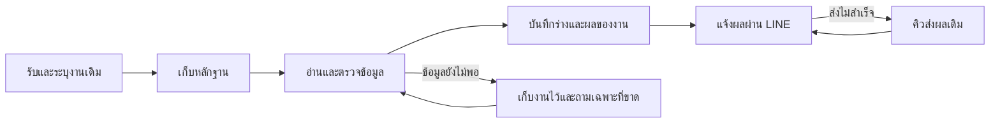

# วิเคราะห์การรับบิลผ่าน LINE: ความน่าเชื่อถือและการใช้งานของผู้ประกอบการ

วันที่ 7 กันยายน 2026 — ข้อเสนอจากมุม UX, System Analyst, Business Analyst และ AI engineer

สถานะ: วิเคราะห์และเสนอแนวทางเท่านั้น ยังไม่แก้โค้ด ตั้งค่า ฐานข้อมูล หรือ deploy และไม่ได้ส่งข้อความ LINE ทดสอบจริง

**เป้าหมายที่เสนอ**

เจ้าของร้านส่งบิลครั้งเดียว เห็นว่าบิลอยู่ที่ไหน ยอดเท่าไร ต้องทำอะไรต่อ และพักไปขายของแล้วกลับมาต่อได้ ระบบรับผิดชอบการลองใหม่เมื่อเป็นปัญหาของระบบเอง ข้อมูลที่ยังไม่แน่ใจต้องมองเห็นและแก้ได้ โดยไม่กลายเป็นรายการบัญชีที่ยืนยันแล้วโดยอัตโนมัติ

ข้อเสนอด้านความชอบของผู้ใช้เป็นสมมุติฐานผลิตภัณฑ์ที่ต้องทดสอบกับผู้ประกอบการจริง ยังไม่ได้สัมภาษณ์หรือทดสอบผู้ใช้ในงานนี้ ผู้สูงอายุมีความคุ้นเคยกับเทคโนโลยีแตกต่างกัน จึงควรทดสอบทั้งคนที่ใช้ LINE คล่องและคนที่ต้องการความช่วยเหลือ

**1. หลักฐานและขอบเขตที่ตรวจ**

- ตรวจโค้ดที่ตรงกับ application SHA `604ac785479ced5b9858d0b46d89f8d11cf2b9f6` ใน checkout `mangmeeplus-prod-email-fix-20260907` และอ่าน specs ที่เกี่ยวข้องใน checkout นี้
- ใช้ผลตรวจ log จริงวันที่ 7 ก.ย. ช่วง 12:00–13:04 ไทย จากการวิเคราะห์ก่อนหน้า: 12:49:30 บันทึกแถวบิลไม่ได้เพราะ `unitPrice=NaN`; 12:57:55 บันทึกผ่านแล้วแต่ส่ง LINE เกิด `fetch failed`; 13:03:28 เหตุการณ์ของบริษัทเดียวกันจบ `completed` / `delivered` ตามความหมายของระบบ
- รูปในแชตใช้เวลาเกาหลี ซึ่งเร็วกว่าไทย 2 ชั่วโมง ผู้ใช้รายงานว่าเป็นบิลเดิมสามครั้ง แต่ยังไม่ได้เทียบ hash ของภาพหรืออ่าน OCR fields ที่เก็บในฐานข้อมูลของแต่ละรอบ
- ทดสอบราคา 0 ด้วย service จริงและ Prisma จำลองในหน่วยความจำไว้แล้ว: 0.00 ทำให้ insert payload มี NaN; ตัวควบคุม 0.01 ได้ราคาที่ถูกต้อง
- เพิ่มการจำลองจาก prototype จริงของ `ProcessLineWebhookUseCase`: สมมุติงานบันทึกบิลผ่านแล้ว ให้ LINE ส่งครั้งแรกไม่ผ่านและส่งข้อความ fallback ครั้งที่สองผ่าน เมื่อเปิด outcome replay พบว่าข้อความ fallback เขียนทับสรุปบิลเดิมและถูกทำเครื่องหมายส่งแล้ว ขณะที่ event ยัง `delivery_pending` การทดสอบนี้ไม่มีฐานข้อมูลหรือ network writes
- อ่าน ECS Express active configuration จริงทั้ง prod/UAT: source SHA เดียวกัน; ไม่มี `LINE_AI_TERMINAL_OUTCOME_REPLAY_ENABLED` และ `LINE_EXPENSE_DRAFT_CONVERSATION_ENABLED` ทั้งใน environment และชื่อ secrets; schema ของ release นี้กำหนดทั้งสองค่าเริ่มต้น false ส่วน `LINE_AI_DRAFT_EDIT_ENABLED=true` ทั้งคู่ เป็นคนละความสามารถกัน
- ดังนั้นปัญหา outcome ถูกเขียนทับเป็นข้อบกพร่องที่ยืนยันในเส้นทางเปิด replay ไม่ใช่ข้อกล่าวอ้างว่าเกิดใน prod ตอน 12:57 ซึ่งการตั้งค่าที่ตรวจยังใช้ replay ค่าเริ่มต้นปิด ห้ามแก้ด้วยการเปิด flag อย่างเดียว
- ยังไม่ได้ทำการทดสอบอุปกรณ์จริงกับผู้สูงอายุ ตรวจ WCAG ทั้งระบบ อ่าน audit ของการเปลี่ยนข้อมูลร้าน หรืออ่านสถานะคงเหลือของบิลในฐานข้อมูล production

**2. ปัญหาที่พบและแนวทางแก้**

| ลำดับ | หลักฐาน | ปัญหา / ผลต่อเจ้าของร้าน | วิธีแก้ที่เสนอ | เกณฑ์รับงาน |
|---|---|---|---|---|
| P0-1 | ยืนยันจาก log และการทำซ้ำ | รายการแถมหรือส่วนประกอบราคา 0 ทำให้บิลทั้งใบล้ม | ใช้กติกาเงินไม่ติดลบให้ตรงกันตั้งแต่ตรวจ OCR ถึงคำนวณ; ตรวจราคาทุกแถวก่อนเขียน; ค่าที่อ่านไม่ได้ต้องเป็นไม่ทราบ ไม่แทนด้วย 0 | บิลผสมแถวจ่ายเงิน/แถว 0 ผ่านทั้ง LINE และเว็บ; invalid/NaN/Infinity ไม่ถึง Prisma |
| P0-2 | ยืนยันจาก log และ catch ในโค้ด | บันทึกแล้วแต่ข้อความบอกให้ส่งใหม่ ทำให้ผู้ใช้กลัวบิลหายและส่งซ้ำ | แยกผลบันทึกกับผลส่งข้อความ; หลังบันทึกผ่านให้ลองส่งผลเดิม ไม่อ่าน/สร้างบิลใหม่ | จำลองบันทึกผ่านแล้ว LINE ล่ม: บิลเดิม 1 ใบ สถานะยังบันทึกแล้ว และไม่มีคำสั่งส่งรูปใหม่ |
| P0-3 | ยืนยันการตั้งค่าปัจจุบันและการจำลองเงื่อนไขเปิด flag | recovery มีอยู่แต่ปิด; เปิดทันทีจะเจอ fallback เขียนทับผลเดิม | แก้ขอบเขต catch และ outcome ก่อน ใช้ `LineTurnOutcome`/worker เดิม; ผลบันทึกและ payload ของผลสำเร็จไม่ถูกข้อความสถานะชั่วคราวเขียนทับ | สรุปเดิมอยู่ครบหลัง failed send, restart และ retry; สถานะ event/outcome ไม่ขัดกัน; เปิดผ่าน UAT fault tests ก่อน |
| P1-1 | ยืนยันลำดับในโค้ด; ผลเสียจริงต่อบิลนี้ยังไม่ได้อ่าน DB | สร้าง draft/ผูกไฟล์ก่อน OCR apply แต่เติม LINE message identity หลัง apply จึงมีช่วงที่ draft เกิดแล้วแต่ retry หาไม่พบ | ผูก tenant + provider input identity กับงาน/ร่างตั้งแต่ transaction แรก ใช้ unique constraint ที่มีอยู่ และมีสถานะต้องตรวจที่กลับมาทำต่อได้ | crash ทุกจุดแล้วรับ event เดิมไม่สร้างร่างเพิ่ม; ยังหาเอกสารเดิมและภาพได้ |
| P1-2 | ระบบตรวจซ้ำมีอยู่แล้ว; การสร้างซ้ำในเหตุการณ์นี้ยังไม่ตรวจ DB | ส่งรูปเดิมด้วย message ID ใหม่ยังเข้าการอ่านใหม่และสร้าง candidate หลังอัปโหลด | แยก transport retry กับผู้ใช้ส่งซ้ำ; งานเดิมให้ resume, ภาพที่น่าจะซ้ำให้เสนอเปิดบิลเดิม ใช้ checksum/perceptual hash/OCR matching เดิมภายในสิทธิ์บริษัท | event เดิมไม่ซ้ำ; รูปเดิมใหม่ไม่สร้างสำเนาเงียบ ๆ; บิลคนละใบที่ยอดเท่ากันไม่ถูกควบรวม |
| P1-3 | ยืนยันกติกา quota ในโค้ด/spec; ยังไม่ตรวจ usage ของร้านจริง | ส่งรูปใหม่เพราะระบบผิดพลาดอาจเสียสิทธิ์อ่านเพิ่ม: admission ใช้ message ID และการพลาดหลัง OCR ไม่คืน admission | แยกต้นทุน provider ที่เกิดจริงจากสิทธิ์ที่แสดงต่อลูกค้า; งานเดิมและ system retry ไม่หักสิทธิ์ลูกค้าเพิ่ม เสนอ compensating credit ที่ตรวจย้อนหลังได้ | ระบบลองใหม่ไม่ลดสิทธิ์ผู้ใช้เพิ่ม; ยอด provider usage ยังจริง; ไม่มี refund ซ้ำหรือใช้ quota แข่งกันเกิน |
| P1-4 | ยืนยัน adapter ไม่มี push retry key | timeout อาจเกิดหลัง LINE รับข้อความแล้ว การส่ง push ซ้ำอาจซ้ำถึงผู้ใช้ | สำหรับ push ใช้ retry key เดิมตั้งแต่ครั้งแรกพร้อม payload/recipient เดิม; แยก retryable/permanent/acceptance-unknown; จำกัดเวลาและ backoff | accepted-but-response-lost ไม่สร้าง push ใหม่ซ้ำ; 409 ของ retry key ถือว่าเคยรับแล้ว; ไม่ใส่ retry key ให้ reply API |
| P1-5 | ยืนยันข้อมูล observability ที่ตรวจ | รู้ว่า fetch failed แต่ไม่รู้ underlying cause; Prisma error message มีข้อมูลแถวบิลปนอยู่ | เก็บ stage, operation/event/expense reference, error class/cause code และ provider request ID อย่างจำกัด; ใช้ข้อมูล OCR ที่มีสิทธิ์เข้าถึงแยกจาก operational log | ไล่ทุกขั้นของบิลได้โดยไม่ dump token/รูป/ข้อมูลลูกค้าลง log; วัดสาเหตุและเวลารายขั้นได้ |
| P1-6 | ช่องว่าง coverage ยืนยันสำหรับ zero row | test ตัวกรองผ่าน แต่ไม่ทดสอบถึงการบันทึกและข้อความที่ลูกค้าเห็น | เพิ่ม regression ของทั้ง use case + DB integration เฉพาะจุดสำคัญ และ fault injection | ไม่ใช่แค่ฟังก์ชันผ่าน: บิล/ยอด/ข้อความ/จำนวนร่าง/จำนวนสิทธิ์ตรงกัน |
| P2-1 | เจ้าของผลิตภัณฑ์กำหนดให้ถามครบในครั้งเดียว; dedicated conversation ยัง default off | ข้อความยาวและรหัสคำถามทำให้ใช้งานยาก แต่การทยอยถามทีละอย่างสร้างความรำคาญเช่นกัน | แสดงข้อมูลที่ยังต้องการจากผู้ใช้ทั้งหมดเป็นรายการสั้นในคำตอบเดียว แยกตามบิล/รายการ รับคำตอบหลายข้อหรือบางข้อได้ และมีทางบันทึกไว้ก่อน/แก้ในเว็บ | ไม่ถามสิ่งที่ทราบแล้ว ไม่ซ่อนคำถามไว้ถามรอบถัดไป ไม่บังคับจำรหัส; แสดงเฉพาะข้อที่ยังขาดหลังรับคำตอบ |

ความเท่ากันของ UAT/prod ไม่ยืนยันว่าความสามารถที่ต้องการเปิดครบ: ทั้งสองฝั่งอาจปิดเหมือนกัน ต้องเพิ่มตาราง capability → flag/default → owner expectation → หลักฐานทดสอบพฤติกรรม โดยไม่เปิดฟีเจอร์ที่ยังไม่ผ่าน acceptance เพียงเพราะมีโค้ดอยู่

**3. UX: ผู้ประกอบการควรเห็นอะไร**

เสนอให้หน้าหลักของงานบิลตอบเพียง 5 เรื่อง: อยู่ร้าน/สาขาไหน, เก็บไว้แล้วหรือยัง, ยอดเท่าไร, ขาดเรื่องอะไรที่ต้องให้คนตอบ, และเปิดดูหรือแก้ตรงไหน ส่วนข้อมูลหมวดบัญชี/ภาษีละเอียดเป็นข้อมูลชั้นถัดไปสำหรับผู้มีหน้าที่ตรวจ

| สถานการณ์ | ข้อความตัวอย่างที่เสนอ | การกระทำหลัก |
|---|---|---|
| ภาพถูกเก็บสำเร็จแล้ว | “เก็บรูปบิลไว้แล้วค่ะ กำลังอ่านข้อมูล” | ผู้ใช้ไปทำงานต่อได้; ไม่ต้องส่งซ้ำ |
| บันทึกร่างครบตามข้อมูลที่อ่านได้ | “เก็บร่างบิลร้าน A ไว้แล้วค่ะ ยอด 1,280 บาท ยังรอตรวจสอบ” พร้อมร้าน/สาขาและวันที่ชัดเจน | ดูบิล / แก้ข้อมูล / เก็บไว้ก่อน |
| อ่านข้อมูลไม่ครบ แต่ภาพอยู่แล้ว | ตัวอย่างเมื่อขาดทั้งสามค่า: “เก็บรูปและร่างไว้แล้วค่ะ ยังต้องการ 1. ยอดรวม 2. วันที่ในบิล 3. ชื่อร้าน ตอบรวมกันได้ หรือบอก ‘บันทึกไว้ก่อน’ แล้วเปิดเว็บเติมภายหลังได้ค่ะ” | ถามเฉพาะค่าที่ขาดจริงให้ครบในครั้งเดียว ถ้าขาดยอดอย่างเดียวก็ถามยอดอย่างเดียว; ไม่เริ่มงานใหม่ |
| บันทึกสำเร็จ แต่ช่องทางแจ้งผลสะดุด | เมื่อช่องทางส่งได้หรือบนหน้าสถานะ: “บิลเก็บไว้แล้วค่ะ กำลังส่งสรุปให้อีกครั้ง ไม่ต้องส่งรูปซ้ำนะคะ” | ระบบส่งผลเดิม; ข้อความนี้ห้ามอ้างว่าจะส่งได้ทันทีขณะ LINE ยังล่ม |
| พบงานเดิมที่ยังไม่เสร็จ | “พบรูปนี้ในงานที่กำลังอ่านอยู่ค่ะ” | เปิดสถานะงานเดิม |
| พบภาพคล้ายบิลเดิม แต่ยังไม่พิสูจน์ว่าใบเดียวกัน | แสดงรูปย่อ ร้าน วันที่ ยอด และถาม “เป็นบิลใบเดิมหรือคนละใบคะ” | เปิดบิลเดิม / เป็นคนละใบ |
| ต้องเลือกสาขาจริง ๆ | “บิลนี้เป็นของสาขาไหนคะ” พร้อมเฉพาะสาขาที่ใช้ได้ | แตะชื่อสาขา; เก็บคำตอบและทำต่อโดยไม่ส่งภาพใหม่ |
| อ่านอัตโนมัติไม่สำเร็จหลังลองอย่างจำกัด | “เก็บรูปไว้แล้วค่ะ ยังอ่านรายละเอียดไม่ได้” ตามด้วยรายการข้อมูลที่ต้องการจากผู้ใช้ทั้งหมด และทางเลือกเติมบนเว็บหรือขอคนช่วย | ตอบรวมใน LINE / เปิดเว็บแก้ไข / ขอคนช่วย / เก็บไว้ก่อน |

ข้อความ “เก็บแล้ว” ต้องมีหลักฐานการเก็บไฟล์หรือการ commit ร่างตามที่ข้อความกล่าวถึง การรับ webhook อย่างเดียวไม่พอ และ “เก็บร่าง” ต้องไม่สื่อว่าอนุมัติ ลงบัญชี หรือจ่ายเงินแล้ว

เสนอรายการ “บิลของฉัน” ที่ใช้ข้อมูลเดิม แสดง กำลังอ่าน / ต้องตอบเพิ่ม / รอตรวจ / เสร็จตามขั้นตอน พร้อมทางกลับจาก LINE และเว็บ งานเก่าที่ตอบช้าต้องมีรูปย่อหรือเลขอ้างอิงอ่านง่ายเพื่อไม่ให้สับสนกับใบใหม่ การมี status page ไม่ทดแทนการพยายามแจ้งผลที่ระบบยังค้างอยู่

**กติกาที่เจ้าของผลิตภัณฑ์ยืนยันเพิ่มเติม: ถามครบครั้งเดียวและแก้ต่อบนเว็บได้**

- ผู้ใช้ไม่ต้องตอบครบหรือพูดว่าบันทึกก่อนจึงจะเก็บงาน: หลังผ่านสิทธิ์และขอบเขตการรับเอกสาร ระบบต้องเก็บภาพและข้อมูลร่างที่มี พร้อมช่องที่ยังไม่ทราบ การเก็บสำเร็จต้องมีหลักฐานก่อนแจ้งผู้ใช้
- บอกข้อมูลที่ต้องการทั้งหมดในคำตอบเดียวด้วยชื่อช่องที่เข้าใจง่าย ไม่บังคับรหัสคำถาม ไม่ถามค่าที่อ่านได้หรือผู้ใช้ตอบแล้ว ถ้าข้อมูลใหม่เปลี่ยนชนิดเอกสาร/กติกาจนต้องขอข้อมูลเพิ่มจริง ให้บอกเหตุผลของข้อที่เพิ่ม
- ถ้าผู้ใช้ตอบบางข้อ ให้เก็บคำตอบที่ถูกต้องและสรุปเฉพาะข้อที่ยังขาดทั้งหมดในครั้งนั้น ไม่ย้อนถามข้อมูลเดิม
- ถ้าผู้ใช้เงียบ ไม่ลบ ไม่สรุปว่าเสร็จ ไม่ทวงเอง และไม่ต้องเกิด state transition จากการไม่มีข้อความ
- ถ้าผู้ใช้ไปทำเรื่องอื่น ให้ตอบเรื่องใหม่ เก็บร่างเดิมไว้ ไม่ตีความข้อความใหม่เป็นคำตอบบิล และไม่ติดคำถามบิลเก่าท้ายทุกคำตอบ กลับมาทำต่อเมื่อผู้ใช้อ้างถึงงานเดิมชัดเจน
- “บันทึกไปก่อน”, “บันทึกไว้ก่อน”, “เดี๋ยวไปแก้ในเว็บ” ในบริบทบิลไม่ครบหมายถึงเก็บร่างและหยุดถามในแชต ไม่ใช่ยืนยัน/อนุมัติ/ลงบัญชี คำตอบควรเป็น “เก็บเป็นร่างไว้แล้วค่ะ ยังขาด… เปิดเว็บเติมภายหลังได้ค่ะ” พร้อมลิงก์เปิดร่างใบเดิมโดยตรง
- เว็บต้องเห็นภาพ ข้อมูลที่อ่านได้ รายการที่ยังไม่ครบ และรายการช่องที่ขาดทั้งหมด ผู้ใช้เติมด้วยมือและบันทึกต่อได้โดยไม่สร้างบิลใหม่ ค่าที่ไม่ทราบแสดงว่ายังไม่ระบุ ไม่ปลอมเป็นศูนย์
- หลังแก้ในเว็บแล้ว LINE ต้องอ่าน revision ล่าสุด ไม่ทับข้อมูลที่คนแก้ และไม่ถามข้อที่เติมเสร็จแล้ว

ช่องว่างที่ต้องทำให้ครบก่อนอ้างว่าปัจจุบันรองรับ flow นี้: บันทึก implementation เดิมระบุว่าเว็บแสดงข้อมูลที่ materialize แล้วและ missing badges แต่ incomplete staged items ยังอยู่ใน metadata/LINE; การแสดงรายการไม่ครบเหล่านั้นบนเว็บยังเป็นงานเพิ่ม อีกทั้งคำสั่งตรงใน `lineExpenseDraftControl` ยังไม่รวมวลี “บันทึกไปก่อน/บันทึกไว้ก่อน” และ dedicated conversation ยัง default off ตาม readback ที่ตรวจ การยืนยันข้างต้นเป็นกติกาที่ต้องการ ไม่ใช่หลักฐานว่า production ทำครบแล้ว

**4. การใช้งานสำหรับคนอายุเยอะ**

- ใช้ภาษาร้านค้า เช่น “ยอดรวม”, “ซื้อจากร้านไหน”, “เก็บไว้ก่อน” ก่อนศัพท์ OCR, reconciliation, draft revision หรือรหัส I01-QTY ไม่บังคับจำคำสั่งเฉพาะ
- ในหน้าที่ควบคุมเอง เช่น เว็บ/LIFF เสนอขนาดพื้นที่กดอย่างน้อย 44 × 44 CSS pixels พร้อมช่องว่างและตัวหนังสือขยายได้ เป็นเป้าหมายผลิตภัณฑ์ที่สอดคล้องกับ WCAG ระดับ enhanced; WCAG 2.2 AA ขั้นต่ำทั่วไปคือ 24 × 24 พร้อมข้อยกเว้น ไม่ควรสลับอ้างสองเกณฑ์นี้ ใน LINE ต้องตรวจผลจริงบน iOS/Android และขนาดตัวอักษรใหญ่ด้วย เพราะไม่ได้ควบคุม UI ทั้งแอป [W3C target minimum](https://www.w3.org/WAI/WCAG22/Understanding/target-size-minimum.html), [enhanced](https://www.w3.org/WAI/WCAG22/Understanding/target-size-enhanced.html)
- ไม่ใช้สีหรือไอคอนอย่างเดียวบอกผิด/สำเร็จ ใช้ข้อความประกอบ ปุ่มหลัก 1 อย่างในแต่ละช่วงและตัวเลือกรองเท่าที่จำเป็น ไม่ใส่เมนูแนวนอนยาวจนต้องไล่เลื่อน
- ไม่ให้ทวนข้อมูลที่เคยตอบแล้ว ปิดหน้าหรือคุยเรื่องอื่นแล้วกลับมาต่อได้ ข้อมูลต้องอยู่กับงาน ไม่ผูกกับความจำระยะสั้นของ AI แนวทาง W3C แนะนำลดการจำรหัส/ขั้นตอน มีทางกลับและแก้ข้อผิดพลาดโดยไม่เริ่มใหม่ [W3C cognitive pattern](https://www.w3.org/WAI/WCAG2/supplemental/patterns/o6p05-low-cognition/)
- ถามข้อมูลที่ยังต้องการจากผู้ใช้ให้ครบในครั้งเดียว จัดกลุ่มด้วยคำง่าย ๆ และเว้นบรรทัดให้อ่านสะดวก แยกคำถามสำหรับเจ้าของร้านออกจากงานตรวจของฝ่ายบัญชี เปิดรายละเอียดเพิ่มได้โดยไม่ซ่อนคำถามที่จำเป็น ไม่บังคับตอบทุกข้อเพื่อเพียงเก็บภาพ รักษาสถานะ “ยังไม่ทราบ” จนผู้มีหน้าที่ตอบ
- มีปุ่มหรือคำว่า “ให้คนช่วย” ในตำแหน่งคงที่ ส่งต่อพร้อมบริบทและบิลเมื่อผู้ใช้ขอ ไม่ให้เล่าซ้ำ ไม่สร้างช่องทางติดต่อใหม่ซ้ำกับ support request เดิม
- ใช้ข้อความ/ปุ่มเป็นฐาน การพิมพ์ด้วยเสียงของโทรศัพท์เป็นตัวเลือกได้ การเพิ่มระบบเสียงใหม่ไม่ใช่เงื่อนไขของการแก้รอบนี้ ถ้ารับเสียง ต้องทวนยอด/วันที่/ร้านก่อนเปลี่ยนข้อมูลสำคัญ
- ทดสอบการขยายข้อความ focus และ screen reader บนเว็บ/LIFF; สถานะต้องประกาศได้โดยไม่ดึง focus ไปมา [W3C status messages](https://www.w3.org/WAI/WCAG22/Understanding/status-messages.html)

สิ่งเหล่านี้ตอบทั้งความสามารถในการมองเห็น การกด การจดจำ และการกลับมาทำต่อ ไม่ควรเหมารวมว่าอายุเป็นตัวแทนความสามารถใช้ระบบทั้งหมด [W3C older users](https://www.w3.org/WAI/older-users/)

**5. SA: ทำให้แต่ละขั้นกลับมาทำต่อได้**

แผนภาพเป็นแนวทางที่เสนอ ไม่ใช่คำอ้างว่าปัจจุบันทุกขั้นทำงานแบบนี้ จุดสำคัญคือการส่งข้อความซ้ำไม่ย้อนกลับไปสร้างบิลหรืออ่านรูปใหม่

1. แยกสถานะงาน/เอกสารออกจากสถานะแจ้งผล เช่น `saved + notification_pending` ไม่ใช้คำว่า failed รวมทั้งหมด แยก `LINE_ACCEPTED` จาก “ผู้ใช้เห็น/อ่านแล้ว”; HTTP 200 ไม่พิสูจน์ว่าหน้าจอผู้ใช้แสดงข้อความจริง
2. ใช้ `LineWebhookEventLog`, `LineTurnOutcome`, unique `(companyId,lineMessageId)`, fingerprint และ worker ที่มีอยู่ก่อน ไม่เพิ่ม queue หรือ orchestration framework อีกชุด เริ่มจาก contract และ transaction boundaries ที่ขาด
3. งานใหม่ต้องมี stable identity และ commit association กับ draft ตั้งแต่ต้น มีขั้นคืนงานที่ค้างหลัง crash และกรณีไฟล์เก็บแล้วแต่ DB ยังไม่ commit เพราะ S3/DB/LINE ไม่ใช่ transaction เดียวกัน
4. แยก OCR result, validated draft fields, outcome ของงาน และ delivery attempt การสร้างผลตอบกลับล้มหลัง DB commit ต้องประกอบคำตอบใหม่จาก draft ที่เก็บแล้ว ไม่จำเป็นต้องอ่านรูปใหม่
5. ใช้ payload เดิมสำหรับ retry ของ logical notification เดิม เปลี่ยน revision หรือผู้รับต้องเป็น operation ใหม่ ตรวจสิทธิ์ ผู้รับ และสถานะเอกสารก่อนเผยแพร่ข้อมูลที่ล่าช้า ถ้าสิทธิ์ถูกเพิกถอนให้หยุดส่งข้อมูลเก่าและมีหลักฐานให้ support แก้ต่อ ไม่ดึงสิทธิ์จากข้อความในรูป
6. LINE push retry ใช้ key เดิมตั้งแต่ครั้งแรก ภายในช่วงอายุที่ provider รองรับ หยุดเมื่อรับแล้ว/เคยรับแล้ว; reply API ไม่รองรับ header นี้ การเปลี่ยนจาก reply ที่ผลไม่ชัดไป push ไม่ได้มี exactly-once guarantee ข้ามสอง API ต้องกำหนดนโยบาย acceptance-unknown และอ้างอิงงานเดิม ไม่อ้างว่าไม่มีทางส่งซ้ำ [LINE retry guide](https://developers.line.biz/en/docs/messaging-api/retrying-api-request/)
7. อย่ารอ LINE redelivery มาแก้ความผิดพลาดหลังรับ webhook ตอบ 2xx แล้ว; provider redelivery ใช้กับการรับ webhook ที่ไม่สำเร็จและ event อาจซ้ำ/มาไม่เรียง ใช้ event identity กับเวลาเพื่อควบคุมลำดับ [LINE receiving messages](https://developers.line.biz/en/docs/messaging-api/receiving-messages/)
8. มีเวลาลองใหม่และจำนวนครั้งจำกัดตามประเภทเหตุขัดข้อง เมื่อเกินให้เป็นงานที่ support เห็นได้ ไม่วนตลอด ไม่ใช้การอัปเกรดแพ็กเกจเป็นคำตอบเมื่อระบบเองผิดพลาด

**6. BA: กติกาธุรกิจที่เสนอ**

| ประเด็น | กติกาที่เสนอ | สิ่งที่ต้องคงไว้ |
|---|---|---|
| ความหมายของสำเร็จ | แสดงชัดว่าเก็บภาพ เก็บร่าง รอตรวจ หรือจบขั้นอนุมัติใด | การรับภาพไม่ใช่อนุมัติ/จ่าย/ลงบัญชี |
| ข้อมูลร้านไม่ครบ | เก็บหลักฐาน/ร่างได้เท่าที่สิทธิ์และนโยบายเดิมอนุญาต ถามเฉพาะข้อมูลที่ขวางขั้นถัดไป | legal acceptance, tenant, membership, สาขา และสิทธิ์ยังบังคับ; ไม่เดาสถานะ VAT |
| ภาพเดิม | event เดิมเป็นการทำต่อ; ภาพซ้ำที่ยืนยันในงานเดียวกันเสนอเปิดของเดิม; ภาพคล้ายเป็นคำถามให้ผู้ใช้ตัดสิน | ไม่ลบ/รวมบิลอัตโนมัติด้วยยอดและวันที่อย่างเดียว |
| ระบบล้มและ quota | เสนอไม่คิดสิทธิ์ลูกค้าเพิ่มจากการกู้คืนงานเดิม แม้ต้นทุนโมเดลเกิดจริง | ต้องแก้ spec quota/commercial rule พร้อมหลักฐาน credit; ห้ามลบประวัติต้นทุนเพื่อทำให้ตัวเลขดูดี |
| คำตอบไม่ครบ/บันทึกไว้ก่อน | เก็บภาพและข้อมูลที่มี ถามข้อที่ขาดทั้งหมดในครั้งเดียว; ผู้ใช้เงียบหรือไปเรื่องใหม่ได้; เมื่อขอบันทึกไว้ก่อนให้หยุดถามและเปิดร่างเดิมบนเว็บแก้ได้ครบ | ไม่สร้างตัวเลขบัญชีปลอมเพื่อให้ฟอร์มผ่าน และไม่ยืนยันรายการอัตโนมัติ |
| เจ้าของร้านกับฝ่ายบัญชี | เจ้าของร้านส่งหลักฐาน/ยืนยันข้อมูลที่รู้; ฝ่ายบัญชีตรวจเรื่องภาษีและบัญชีตามสิทธิ์ | ไม่เปิด mutation สุดท้ายผ่านแชตโดยปริยาย |
| ยอดในรายงาน | บอกว่ารวมร่างหรือรวมเฉพาะรายการผ่านขั้นตอนแล้ว | หลีกเลี่ยงให้ร่างซ้ำ/ยอดที่ยังไม่ตรวจกลายเป็นค่าใช้จ่ายจริงเงียบ ๆ |

ยึดคำยืนยันล่าสุดของเจ้าของผลิตภัณฑ์ให้ถามข้อมูลที่ขาดทั้งหมดในครั้งเดียว สอดคล้องกับ `line-ai-expense-draft-conversation-spec.md` §8.4 ส่วนการนำเสนอปรับให้อ่านง่ายโดยไม่ทยอยซ่อนคำถาม ข้อกำหนดที่ต้องเสริมคือ “บันทึกไว้ก่อน → หยุดถาม → แก้ข้อมูลไม่ครบทั้งหมดในเว็บ” และไม่รบกวนเมื่อไปทำเรื่องอื่น ส่วน quota ที่นับเมื่อ admission เป็นกติกาปัจจุบันตาม `company-ocr-governance-spec-th.md` §3.1 ข้อเสนอ customer credit ยังคงเป็นการตัดสินเชิงผลิตภัณฑ์เพิ่มเติม ไม่ใช่แก้ตัวนับเงียบ ๆ

**7. AI engineer: เพิ่มความสม่ำเสมอและความถูกต้อง**

- แก้ deterministic validation ก่อนปรับ prompt หรือเปลี่ยนโมเดล ราคา 0 ต้องมีความหมายคงที่ไม่ว่าโมเดลส่งออกแบบใด ค่าหาย/ว่าง/อ่านไม่ได้ไม่เท่ากับ 0; quantity ต้องมากกว่า 0; amount/unit price/VAT/ส่วนลดใช้กติกาและ precision ที่ระบบกำหนด
- แยกตัวเลขที่พิมพ์บนบิล ข้อเสนอของโมเดล และสิ่งที่ระบบคำนวณขึ้น พร้อม source evidence/version ให้ตรวจได้ ส่วนลดแถวติดลบ คืนสินค้า และรายการแถมต้องแยกชนิด ไม่ใช้กติกา “ทุกแถวติดลบคือบิลเสีย” หรือเปลี่ยนทุกค่าผิดเป็น 0
- ถ้าบางแถวไม่พร้อม ยังเก็บภาพและข้อมูลที่พิสูจน์ได้ในร่าง/ข้อมูลรอทบทวนได้ ไม่เขียน invalid financial rows ไม่ทิ้งรายการเงียบ ๆ ถ้าสรุปยอดแทนรายละเอียด ต้องบอกว่ารายละเอียดรายการยังต้องตรวจ และไม่อ้างว่าตรวจครบแล้ว
- ผล OCR ที่สำเร็จสำหรับงานเดิมควรถูกนำกลับมาใช้สำหรับ retry เดิม การอ่านใหม่เป็นคนละการกระทำกับการส่งคำตอบใหม่ เก็บ model/prompt/schema version และ revision ของข้อมูลผู้ใช้เพื่อไม่ให้การอ่านใหม่ทับสิ่งที่คนแก้แล้ว
- บิลใหม่จากรูปคล้ายเดิมยังต้องประเมินหลักฐานและสิทธิ์ ไม่ cache ด้วยชื่อร้าน/ยอดอย่างเดียว ถ้ามี cache ภาพที่เก็บอยู่ ใช้ tenant + content identity + pipeline version และแยกผลการอ่านออกจากหมวดบัญชีที่อาจเปลี่ยน
- confidence ของโมเดลเป็นเพียงสัญญาณหนึ่ง ความครบของ source และการกระทบยอดตามกติกาสำคัญกว่า ไม่ตั้งผ่านอัตโนมัติจากคะแนน 0.95 อย่างเดียว
- การขอโมเดลอ่านใหม่อย่างจำกัดควรมีเหตุชัด เช่น ยอดสำคัญอ่านไม่ได้ และใช้เกณฑ์ตรวจเดิม ไม่วนเรียกโมเดลจนได้คำตอบที่ระบบชอบ ลด temperature อย่างเดียวไม่แก้ NaN หรือ transaction ที่ล้ม
- ทำ evaluation ด้วยบิลที่มีสิทธิ์ใช้และชุดสังเคราะห์ที่ครอบคลุมขอบเขตเงินจริง: แถว 0, ชุดอาหาร/แถม, ส่วนลด, service charge, VAT รวม/แยก/ไม่ระบุ, เงินทอน/เงินรับที่ไม่ใช่ยอดบิล, ใบเสนอราคา/ใบเสร็จ, เงินโอนเข้า/ออก, เอกสารยาว, ภาพเบลอ/เอียง, หลายบิลในภาพ, ภาษาต่างประเทศ/สกุลเงิน, พ.ศ./ค.ศ. และคำสั่งแฝงในรูป
- ชุดทดสอบภาพเดิมหลายครั้งดู semantic fields และผลธุรกิจ ไม่เทียบตัวหนังสือเหมือนกันทุกอักษร ความสำเร็จคือไม่สร้างยอดปลอม ไม่บันทึกซ้ำ และไม่ให้ความผันผวนของโมเดลทำให้ crash
- ผลจากรูปเป็นข้อมูลที่ไม่น่าเชื่อถือสำหรับการสั่งงาน AI Gateway เสนอข้อมูลผ่าน API ที่ตรวจสิทธิ์เท่านั้น ไม่แก้ DB หรือข้าม tenant/approval จากข้อความที่อ่านได้

**8. สถานการณ์อื่นที่ต้องตรวจเพิ่มก่อนรับงาน**

ตารางนี้เป็นความเสี่ยง/acceptance scenarios ไม่ใช่ข้อกล่าวอ้างว่า prod มีบั๊กทั้งหมด ระบบมี guard หลายส่วนอยู่แล้ว เช่น duplicate candidates, source date review, VAT reconciliation, permission checks และ optimistic concurrency

| สถานการณ์ | สิ่งที่ผู้ใช้คาดหวัง / ผลที่ต้องตรวจ |
|---|---|
| ส่งภาพเดิมติดกันหรือ LINE ส่ง webhook ซ้ำ | งานเดิมไม่ถูกหักสิทธิ์/สร้างร่าง/ลงบัญชีซ้ำ |
| คนละใบแต่ร้าน/วัน/ยอดเท่ากัน | ใช้ต่อได้ ไม่ถูกลบหรือรวมเอง |
| บันทึกสำเร็จแล้ว process ตายก่อนส่งคำตอบ | เปิดบิลเดิมได้ และกู้คืนผลโดยไม่อ่านหรือสร้างใหม่ |
| LINE รับ push แล้ว response หาย | ไม่ส่ง push ใหม่ด้วย key ใหม่; ยอมรับข้อจำกัดการพิสูจน์ผู้ใช้เห็นจริง |
| พิมพ์แก้ยอดระหว่าง OCR ทำงาน | เก็บการแก้ของคน ไม่ถูกผลเก่าทับ; แสดง conflict ถ้าต้องตัดสิน |
| ผู้ใช้มีสองร้าน เปลี่ยนร้านระหว่างรอ | งานผูกกับร้านที่รับไว้ แสดงชื่อร้าน และไม่ส่งข้อมูลผิดร้าน/ผู้รับ |
| สิทธิ์หมด/ถูกยกเลิกระหว่างรอผล | การส่งข้อมูลล่าช้าต้องตรวจสิทธิ์ใหม่ ไม่เผยผลเก่าข้ามขอบเขต |
| ใบเสร็จอ่านผิดเงินทอนเป็นยอดรวม | ไม่เชื่อเพียงเลขที่ใหญ่ที่สุด; ตรวจชนิดตัวเลขและหลักฐาน |
| VAT ไม่ระบุ หรือข้อมูลร้านยังไม่ตอบ | ไม่สมมุติเป็น 0%/ไม่จด VAT; เก็บ unknown และถามเมื่อจำเป็น |
| บิลยาวหรือข้อความเกินข้อจำกัด LINE | สรุปสั้นและเข้าถึงรายละเอียดครบ ไม่ตัดข้อมูลสำคัญเงียบ ๆ |
| วันในบิลไม่ตรงวันอัปโหลด/ผู้ใช้เดินทางต่างเขตเวลา | แสดงวันที่จากเอกสารและสถานะการตรวจ ไม่เอาเวลามือถือแทนวันที่บัญชี |
| quota เต็มหลังระบบผิดพลาดหลายครั้ง | ผู้ใช้มีทางเปิดงานเดิม/กรอกต่อ/ขอช่วย; ตรวจ credit ก่อนชวนซื้อเพิ่ม |
| ผู้ใช้กด “เก็บไว้ก่อน” แล้วกลับมาวันถัดไป | ไม่ต้องส่งภาพใหม่หรือเล่าทั้งหมดซ้ำ |
| อ่านยอด/วันที่/ชื่อร้านไม่ได้พร้อมกัน | แจ้งทั้งสามค่าในคำตอบเดียว รับคำตอบรวมและคำตอบบางส่วนได้ ไม่ถามต่อแบบเปิดทีละช่อง |
| ถามข้อมูลแล้วผู้ใช้เงียบหรือไปเรื่องใหม่ | ภาพและร่างเดิมยังอยู่ ไม่ทวง ไม่ลบ และไม่ดึงข้อความเรื่องใหม่มาแก้บิล |
| ผู้ใช้ตอบ “บันทึกไปก่อน” แล้วเปิดเว็บ | หยุดถามใน LINE; เปิดร่างเดิมได้ เห็น incomplete staged items และช่องขาดครบ เติมเองได้ ไม่มีการสร้างใบใหม่ |
| ผู้ใช้เติมข้อมูลในเว็บแล้วกลับมาคุยบิลใน LINE | ใช้ข้อมูลล่าสุด ไม่ถามช่องที่เติมแล้ว ไม่ถูก OCR/คำตอบเก่าทับ |
| ผู้ใช้บล็อก OA หรือ token/link หมดอายุ | งานยังอยู่และเข้าถึงผ่านช่องทางที่มีสิทธิ์; ไม่อ้างว่าอ่านแล้วและไม่เผยข้อมูลด้วยลิงก์เก่าที่ไม่ปลอดภัย |

**9. ลำดับทำงานที่เสนอและวิธีรับรองผล**

รอบแรก: แก้ P0-1/2/3 เป็นชุดความน่าเชื่อถือขั้นต่ำ เพิ่ม regression ราคา 0 ถึง DB และ delivery failure หลัง commit รักษาผลเดิมและใช้ recovery เดิมให้ถูกต้อง แล้วจึงพิจารณาเปิดความสามารถที่ทดสอบผ่าน ห้ามนำการเปิด flag ไปแทนการแก้บั๊ก

รอบถัดไป: ผูก input identity ตั้งแต่เริ่มงาน, กู้คืน partial draft, นโยบายส่งซ้ำและสิทธิ์อ่าน, push retry identity และการติดตามงานค้าง โดยทำบน storage/worker เดิม กรณีต้องเพิ่ม schema ให้เพิ่มเฉพาะข้อมูลที่จำเป็นต่อ transaction boundary ที่พิสูจน์แล้ว

หลังความถูกต้องนิ่ง: ปรับการ์ดสั้น/ข้อมูลค่อย ๆ เปิด/คำถามที่ตอบง่าย/กลับมาทำต่อ และประเมิน dedicated draft conversation ตาม acceptance ของมันเอง การเปิด `LINE_AI_DRAFT_EDIT_ENABLED` ไม่ได้ยืนยันว่า conversation workflow อีกชุดพร้อมใช้

UAT ต้องทดสอบ journey และ failure จริงแบบควบคุม ไม่ใช่เพียง health endpoint: ให้ภาพเดิม 3 ครั้ง, ตัด LINE หลังบันทึก, restart ระหว่างขั้น, แก้ยอดชนกับ OCR, สลับร้าน และตรวจว่าเว็บ/LINE แสดงข้อมูลเดียวกัน ใช้ฐานข้อมูลและ OA ทดสอบที่กำหนด ไม่ replay business mutation บน production เพื่อพิสูจน์

เกณฑ์ความถูกต้องในชุด acceptance: 0 invalid monetary rows, 0 duplicate financial effects จาก retry, 0 ข้อความยืนยันบันทึกที่ไม่มี commit รองรับ, 0 ผลคนแก้ถูก OCR เก่าทับ, และ retry ของ notification ไม่เพิ่ม OCR usage ของงานเดิม การทดสอบผ่านเป็นหลักฐานเฉพาะชุดทดสอบ ไม่ใช่คำรับประกันไม่มีเหตุขัดข้องในอนาคต

เสนอ usability pilot 6–8 ผู้ประกอบการ รวมผู้สูงอายุอย่างน้อย 3–4 คนที่มีความคุ้นเคยต่างกัน ใช้การทำงานจริง 5 อย่าง: ส่งบิล, แก้ยอด, แยกภาพซ้ำ, พัก/กลับมาต่อ, ขอคนช่วย วัด completion โดยไม่ต้องมีคนบอก, เวลาที่ผู้ใช้ต้องลงมือ, จำนวนครั้งส่งรูปซ้ำเพราะสับสน, และคำตอบของผู้ใช้ว่า “บิลอยู่ไหม/ต้องทำอะไรต่อ” จำนวนนี้เป็นรอบค้นหาปัญหาเชิงคุณภาพ ไม่ใช่ตัวแทนสถิติของผู้สูงอายุทั้งหมด

ตัวชี้วัดหลัง rollout: อัตรางานที่จบโดยส่งครั้งเดียว, saved-but-not-notified และอายุงานค้าง, จำนวน retry ต่อบิล, quota credit จากเหตุระบบ, อัตราแก้ critical fields, เวลารอ P50/P95 แยกรายขั้น และการเปิด/แก้บิลสำเร็จ ไม่ใช้ HTTP 200, model ok หรือ config parity เป็นตัวชี้วัดความสำเร็จของลูกค้าเพียงอย่างเดียว ตั้งเป้าเวลาหลังเก็บ baseline ไม่สัญญา “ไม่เกินหนึ่งนาที” จากการคาดเดา

**10. จุดอ้างอิงในโค้ดและเอกสาร**

ลิงก์โค้ดต่อไปนี้เป็น checkout ที่ตรงกับ release ที่ตรวจ:

- [zero validation และ amount mapper](../../apps/api/src/modules/expenses/application/services/receipt-ocr-apply.service.ts#L678)
- [catch รวมการประมวลผลและการส่งคำตอบ](../../apps/api/src/modules/line-ai/application/use-cases/process-line-webhook.use-case.ts#L4790)
- [upsert outcome เดิม](../../apps/api/src/modules/line-ai/application/use-cases/process-line-webhook.use-case.ts#L2651)
- [recovery ที่ขึ้นกับ flag และ outcome](../../apps/api/src/modules/line-ai/application/use-cases/recover-orphan-line-events.use-case.ts#L87)
- [LINE adapter](../../apps/api/src/modules/line-ai/infrastructure/line-reply.adapter.ts#L87)
- [schema defaults ของสอง capability](../../packages/config/src/index.ts#L314)
- [quota admission ของ LINE](../../apps/api/src/modules/line-ai/infrastructure/ai-gateway.client.ts#L236)
- [duplicate detection ที่ใช้ซ้ำได้](../../apps/api/src/modules/expenses/application/services/expense-duplicate-detection.ts#L9)
- [renderer ที่แสดงทุกคำถาม](../../apps/api/src/modules/expenses/domain/logic/line-expense-draft-conversation.logic.ts#L669)
- [spec conversation ปัจจุบัน](../../docs/specs/line-ai-expense-draft-conversation-spec.md#L232)
- [spec reliability](../../docs/specs/line-ai-conversation-reliability-spec.md)
- [บันทึกหลักฐานเหตุการณ์และข้อจำกัด](../../docs/agent-memory/line-receipt-zero-price-diagnosis-2026-09-07.md)

สิ่งที่ยังไม่ทำ: ไม่มี code/config fixes, ไม่มีเปิด flag, ไม่มี commit/push/merge/deploy, ไม่มีแก้บิลหรือ quota ของลูกค้า และยังไม่มีการทดสอบผู้ใช้จริง

**11. Impact / bug / gap รอบข้าง — ตรวจเพิ่มตามคำสั่งเจ้าของผลิตภัณฑ์**

ตรวจตั้งแต่รับผล OCR → เติมร่างใน LINE → พัก → แก้บนเว็บ → กลับมา LINE รวมถึงสิทธิ์และร่างหลายใบ โดยใช้ application source เดิม ตรวจย้ำว่า checkout HEAD `3720db9a` มี application code ใน `apps/` และ `packages/` เหมือน `604ac785` ด้วย `git diff --name-only 604ac785 HEAD -- apps packages` ซึ่งไม่พบความต่าง

ต้องแยกการใช้งานจริงออกจากข้อบกพร่องก่อนเปิดความสามารถ: จุดที่ระบุ **conversation** ด้านล่างต้องเข้าสู่ `LINE_EXPENSE_DRAFT_CONVERSATION_ENABLED` ใน personal chat ซึ่งยัง default off ตาม runtime readback ที่บันทึกไว้ การเปิด `LINE_AI_DRAFT_EDIT_ENABLED` เป็นอีกเส้นทางหนึ่ง จึงไม่ใช่หลักฐานว่าข้อบกพร่อง conversation เหล่านี้เกิดกับบิล production แล้ว ส่วนข้อจำกัดฟอร์มเว็บเป็นพฤติกรรมของหน้าเว็บปัจจุบัน

| ID / ความสำคัญที่เสนอ | สิ่งที่พบและหลักฐาน | ผลกระทบ | วิธีแก้ที่ยั่งยืนที่เสนอ |
|---|---|---|---|
| A1 / P1 ต้องผ่านก่อนเปิด conversation | **ตอบแค่ข้อมูลหัวบิล แต่เขียนรายการเงินทั้งชุดใหม่**: `execute` เลือก materialize เมื่อเป็นคำตอบธรรมดา แม้ไม่รับข้อมูลใหม่เลย; state จาก OCR ไม่เก็บ charge/discount ครบ; mapper ส่งแถวสินค้าเท่านั้นและ `chargeKind:null` จริง; API รับ `lines` เป็น full replacement | ส่วนลด ค่าบริการ และรายละเอียดการเงินเดิมอาจหาย ยอดร่างเปลี่ยนทั้งที่ผู้ใช้ไม่ได้สั่งเปลี่ยนเงิน เป็นความผิดพลาดในการบันทึก ไม่ใช่การเดายอดของโมเดลอย่างเดียว | แก้เฉพาะช่องที่ผู้ใช้ตอบรับจริง; คำตอบหัวบิล/คำสั่งพัก/ข้อความที่ไม่รับข้อมูลใหม่ห้ามสร้างชุดรายการเงินทดแทน เก็บ charges, discount และ tax meaning เดิม ตรวจข้าม use case ว่าแก้วัตถุประสงค์แล้ว monetary rows/totals ไม่เปลี่ยน |
| A2 / P1 ต้องผ่านก่อนเปิด conversation | **OCR รองรับ 40 รายการ แต่ initial conversation ตัดเหลือ 20 แบบเงียบ ๆ**; หลังตอบธรรมดา API แทนรายการด้วยชุด 20 แถว | บิลซื้อของเข้าร้าน/บิลยาวอาจสูญรายการท้ายและยอดลดลง; ผู้ใช้ไม่รู้ว่าข้อมูลถูกตัด | ขอบเขตการแสดงข้อความต้องไม่ตัดข้อมูลที่เก็บ รายการเกินขอบเขตสนทนาต้องยังอยู่ครบและเปิดเว็บได้ หากตอบบางรายการต้องไม่แตะรายการนอกชุดนั้น |
| A3 / P1 ต้องผ่านก่อนเปิด conversation | **แก้บนเว็บแล้ว “ต่อ” วน STALE**: web update ไม่ sync continuation; resume ใช้ `targetRevision` เดิมจาก metadata แม้โหลด expense ใหม่แล้ว; catch บอกให้พิมพ์ “ต่อ” อีก | ป้องกันข้อมูลเก่าทับใหม่ได้ แต่ลูกค้ากลับมาทำต่อไม่ได้ และคำแนะนำของระบบพากลับเข้าปัญหาเดิม | เมื่อ resume ให้โหลด facts/revision ล่าสุดและคำนวณคำถามใหม่ เก็บคำตอบค้างที่ยังใช้ได้; ถ้ามีข้อขัดแย้งจริงให้ถามเฉพาะข้อขัดแย้ง ห้ามแก้ด้วยการเปลี่ยน revision อย่างเดียวแล้วเขียนค่าจาก snapshot เก่าทับเว็บ |
| A4 / P1 ช่องว่างเว็บปัจจุบันและ web parity | **แก้ได้บางส่วนแต่เก็บการแก้นั้นไม่ได้หากฟอร์มยังไม่ครบ**: save ปฏิเสธเมื่อ validator มี error เช่นราคาเปล่า; Next ถูกปิด; incomplete staged items ยังอยู่ใน metadata และไม่มี renderer ในหน้าเว็บ | “เดี๋ยวไปแก้ในเว็บ” ยังไม่เป็นทางต่อที่ครบ ผู้ใช้อาจต้องกรอกให้ครบในครั้งเดียว หรือมองไม่เห็นแถวที่ยังอ่านไม่ครบเลย | แยกเก็บร่างกับส่งตรวจ/ยืนยัน อนุญาตเก็บ facts ที่ทราบและ staged rows ที่ยังไม่ครบโดยไม่ใส่ 0 แทน unknown; แสดงรูปต้นฉบับ รายการที่ขาด และเวลาบันทึกล่าสุดในร่างเดิม เก็บ validation เข้มไว้ที่การส่งตรวจ/ยืนยันตามกติกาที่เกี่ยวข้อง |
| A5 / P1 ช่องว่าง contract เมื่อใช้ conversation ร่วมเว็บ | **ชื่อช่องขาดและการเคลียร์สถานะไม่ตรงกัน**: conversation ใช้ `businessPurpose/items/description/quantity/price/expenseCategoryId`; helper เว็บไม่ติดตามชื่อเหล่านี้ ส่วน API เคลียร์หมวดด้วยชื่อ `category` และไม่เคลียร์ collection fields หลายตัว | หน้าเว็บอาจไม่ชี้ว่าขาดช่องไหน หรือยังมีคำเตือนหลังกรอกแล้ว; LINE ยังถามจาก snapshot เดิม ความหมายว่า “ครบ” ไม่ตรงกันระหว่างช่องทาง | ใช้ contract ของ missing fields ที่มี field + item identity + reason เดียวกันทั้งการแสดงผล/แก้/เคลียร์; derive จากค่าปัจจุบันและกติกา ไม่ถือว่าอ่าน array คนละชุดแล้วครบเหมือนกัน ทั้งนี้ยังไม่ได้พิสูจน์การหลุดผ่าน final confirmation จากช่องว่างนี้ |
| A6 / P1 ช่องว่างการส่งต่อสิทธิ์ | **สิทธิ์รับบิล/เติมร่าง LINE ไม่เท่ากับสิทธิ์แก้บนเว็บ**: own LINE collection อนุญาต upload capability; web update ต้อง `expense.review` หรือ `expense.update` และเป็นเจ้าของ | สมาชิกที่ส่งบิลได้อาจกดแก้ในเว็บแล้วแก้ไม่ได้ ไม่ได้หมายความว่า owner ทุกคนขาดสิทธิ์ | ตรวจ capability ปลายทางก่อนเสนอ action หากผลิตภัณฑ์ต้องให้ผู้ส่งเติม facts ของตนเองบนเว็บ ให้กำหนดสิทธิ์ที่จำกัดเฉพาะร่าง/เจ้าของ/บริษัท/สาขาเดียวกัน หรือส่งต่อผู้ตรวจที่มีสิทธิ์ ห้ามแก้โดยแจกสิทธิ์บัญชีกว้าง ๆ |
| A7 / P1 ก่อนรับ UX “เก็บไว้ก่อน” | **ยังไม่มี control สำหรับถ้อยคำที่เจ้าของผลิตภัณฑ์ระบุ**: ทั้ง “บันทึกไปก่อน”, “บันทึกไว้ก่อน”, “เดี๋ยวไปแก้ในเว็บ” ได้ `null`; มี “พักไว้ก่อน” อยู่แล้ว หากข้อความแรกถูก route เข้า use case นี้จะเข้าทางคำตอบธรรมดา | ไม่หยุดถามตามความตั้งใจ และใน fixture A1 แม้ acceptedFields ว่างก็เปลี่ยนรายการเงินได้; ยังไม่อ้างว่าทุกข้อความผ่าน LLM router จะถูกส่งเข้าเส้นทางนี้ | รองรับ intent เก็บร่างจากภาษาธรรมดาและปุ่มที่ผูกกับ draft เดิม; ยืนยันเก็บร่างแล้ว หยุดถาม และให้ลิงก์ที่ผู้ใช้มีสิทธิ์ อย่าแปลเป็นยืนยัน/อนุมัติ/ลงบัญชี |
| A8 / P2 การค้นหาร่างเก่าใน conversation | **ค้นเฉพาะ 5 ร่างล่าสุด แม้มี targetExpenseId ของร่างที่เก่ากว่านั้น**: select หา ID ในรายการที่ถูก limit แล้ว ไม่มี direct scoped lookup | ผู้ที่ถ่ายบิลกองไว้แล้วกลับมาทีละใบ อาจกลับมาทำร่างที่ 6 ผ่านเส้นทางนี้ไม่ได้ ทั้งที่ข้อมูลไม่ได้ถูกลบ | แยก discovery 5 รายการจากการ resolve explicit target; lookup ร่างที่ระบุภายใต้ tenant/user/chat/branch/สถานะเดิม และให้เปิดรายการค้างทั้งหมดบนเว็บ |

ผลการทำซ้ำเพิ่มเติมเป็นการเรียก use case/validator จริง โดย repository, audit, transaction-tax boundary และ clock/revision data ที่เกี่ยวข้องเป็น fixture ในหน่วยความจำ ไม่มีการอ่านหรือเขียนฐานข้อมูลลูกค้า และไม่ได้ทดสอบ signed webhook / LLM routing / LINE network / browser journey ครบวงจร:

| การจำลองที่รันด้วย `pnpm exec tsx --eval` | ผลที่ assert ผ่าน |
|---|---|
| Compose `LineExpenseDraftConversationUseCase` กับ `UpdateExpenseDraftUseCase` จริง; เริ่มจาก financial rows จำลอง: สินค้า 100 ส่วนลด 20 ค่าบริการ 10 รวม 90; initial collection ยังรักษา 2 แถวเดิม แล้วตอบ `D-PURPOSE ใช้ในสำนักงาน` | รับเฉพาะ `D-PURPOSE` แต่บันทึกเหลือสินค้า 1 แถว ส่วนลด 0 ค่าบริการ 0 ยอดเป็น 100 ผ่าน validation และถึง simulated repository commit |
| Fixture เดียวกัน ตอบ `บันทึกไปก่อน` เมื่อส่งตรงเข้า conversation use case | acceptedFields = `[]` แต่ยอดเปลี่ยนจาก 90 เป็น 100 เช่นเดียวกัน เป็นผลเมื่อ routed เข้า use case นี้ ไม่ใช่ผลทดสอบ natural-language router |
| OCR hints 21 รายการ รายการละ 10; financial rows เริ่ม 21 ยอด 210; ตอบวัตถุประสงค์ | continuation เก็บ 20; แถวเงินหลังตอบเหลือ 20 ยอดเป็น 200 |
| Persisted continuation revision เก่า แต่ expense ถูกแก้บนเว็บแล้ว; clone ทุก read ให้เหมือน DB boundary; พิมพ์ `ต่อ` สองครั้ง | `STALE`, `STALE`; expected revision เท่าเดิมทั้งสองครั้ง; ไม่มี commit พิสูจน์ว่าไม่ใช่เพียง conflict ครั้งแรกแล้วรอบถัดไปฟื้นได้ |
| ฟอร์มเว็บที่ข้อมูลอื่นครบ แต่ unitPrice ว่าง | validator คืน blocking error `lines.0.unitPrice`; source save/Next ใช้ error นี้ปิดการบันทึก/ไปต่อ ส่วน valid control ไม่มี error |
| ส่ง missing fields 6 ชื่อของ conversation เข้า helper เว็บ | tracked fields ของทั้ง data/evidence เป็น `[]` จึงไม่อาจใช้ helper นี้เป็นหลักฐานว่าข้อมูล conversation ครบ |
| ผู้ส่งมีเพียง `expense.receipt.line_upload`; เรียก update use case ด้วย internal LINE authority เทียบกับ web ไม่มี authority นี้ | own LINE fact update ผ่าน simulated commit; own web update ถูก `ForbiddenException`; ไม่มีการข้ามสิทธิ์หรือแก้สิทธิ์จริง |
| มี 6 ร่างพักไว้ แต่ discovery จำกัด 5; ระบุ targetExpenseId ของใบที่ 6 | `TARGET_REQUIRED`, take = 5, ไม่มี direct detail lookup |

ทุกชุดข้างต้น exit 0 และ assertions ผ่าน เป็นการพิสูจน์ข้อบกพร่องของพฤติกรรมปัจจุบัน ไม่ใช่ผลว่าระบบได้รับการแก้แล้ว ตัวอย่าง 90 → 100 เป็นข้อมูลทดสอบสมมุติ ไม่ใช่ยอดในใบเสร็จของผู้ใช้ ไม่มีการทดสอบ OCR service ต่อครบทั้ง chain ใน monetary fixture ใหม่นี้ และไม่มีข้ออ้างว่าร่างที่ยอดเปลี่ยนจะผ่านการยืนยัน/ลงบัญชี: final guards และ OCR total mismatch อาจยังขวางได้

ช่องว่างการทดสอบเดิมที่พบ: test stale ตรวจเพียงการคืนข้อความครั้งแรก; financial collection fixtures ใช้แถวธรรมดาและไม่ตรวจว่าข้อมูลเงินที่ไม่ได้ตอบต้องคงเดิม การผ่าน test เฉพาะโมดูลจึงยังไม่ครอบคลุมการต่อ OCR → collection → update → web → resume

**12. ขอบเขตแก้และ acceptance ที่ต้องเพิ่มจาก impact รอบนี้**

ลำดับที่เสนอคือแก้เหตุ production ที่ยืนยันแล้วใน §2 ก่อน แล้วใช้ A1–A8 เป็นข้อกำหนดก่อนเปิด journey เก็บไว้ก่อน/แก้บนเว็บ/กลับมาต่อครบชุด แก้ A1/A2/A3 ก่อน enable conversation; งาน A4–A7 เป็นส่วนของการส่งมอบ journey เดียวกัน ไม่ควรรับงานเพียงเพราะแต่ละหน้ามีปุ่มอยู่

- **ความถูกต้องของเงิน:** ตอบชื่อร้าน/วันที่/วัตถุประสงค์/พัก/เรื่องที่ไม่เกี่ยวข้องแล้ว ต้องไม่เปลี่ยน monetary rows, charges, discount, tax treatment หรือยอด; ทดสอบบิลมี 0 บาท ส่วนลด ค่าบริการ VAT ต่างกันรายแถว และ 20/21/40 รายการ การแก้เงินจริงต้องจำกัดตามคำตอบและแสดงผลต่างให้ตรวจได้
- **ความต่อเนื่อง:** เก็บภาพและร่างเดิม กรอกบางส่วนได้ ถามข้อมูลที่ยังต้องการจากผู้ใช้ทั้งหมดร่วมกัน รับคำตอบบางส่วนได้ เงียบหรือไปเรื่องอื่นต้องไม่มี implicit finalize/delete หรือเอาเรื่องอื่นมาเป็นคำตอบบิล และไม่ทวงซ้ำเอง
- **ข้ามช่องทาง:** แก้บางช่องบนเว็บแล้วเปิดใหม่ต้องเห็นที่บันทึก; กลับ LINE โหลดค่าล่าสุดและถามเฉพาะที่ยังขาดทั้งหมด; ทดสอบ web/LINE ตอบชนกันทั้งสองลำดับ โดยห้ามเขียนทับค่าคนจาก snapshot เก่า
- **สิทธิ์และการหาเอกสาร:** ผู้ส่งแต่ละ role มีเส้นทางต่อที่ทำได้จริง; ทดสอบหลายร้าน/สาขา ผู้ใช้ถูกถอนสิทธิ์ ลิงก์หมดอายุ ร่างเกิน 5 ใบ และการเปลี่ยนสถานะออกจาก DRAFT ต้องไม่เสนอแก้รายการที่ไม่อนุญาต
- **การรับรู้ของผู้ประกอบการ:** แสดง “เก็บเป็นร่างแล้ว ยังไม่ยืนยันรายการ” กับสิ่งที่ขาดและปุ่มเปิดร่างเดิม ใช้คำที่ผู้ใช้พูดจริง ไม่บังคับจำรหัสคำถาม ไม่ต้องส่งภาพใหม่ ผู้สูงอายุควรทดสอบว่าอธิบายได้เองว่าบิลอยู่ที่ไหนและต้องทำอะไรต่อ
- **AI:** ให้โมเดลเสนอ intent/ค่าที่อ่านได้ แต่ business mutation ต้องตรวจ target, revision, permission และขอบเขต accepted changes ฝั่ง API การเพิ่ม prompt หรือเปลี่ยนโมเดลอย่างเดียวแก้ A1/A2/A3/A5 ไม่ได้

จุดอ้างอิงเพิ่มใน deployed application source:

- [initial OCR → conversation และการเลือก target](../../apps/api/src/modules/expenses/application/use-cases/line-expense-draft-conversation.use-case.ts#L145)
- [materialize ทุก ordinary answer และ stale reply](../../apps/api/src/modules/expenses/application/use-cases/line-expense-draft-conversation.use-case.ts#L251)
- [persist collection facts / missing fields / replacement lines](../../apps/api/src/modules/expenses/application/use-cases/line-expense-draft-conversation.use-case.ts#L331)
- [ขอบเขต 20 รายการ](../../apps/api/src/modules/expenses/domain/logic/line-expense-draft-conversation.logic.ts#L246)
- [control phrases](../../apps/api/src/modules/expenses/domain/logic/line-expense-draft-conversation.logic.ts#L321)
- [mapper ที่ materialize แถวสินค้า](../../apps/api/src/modules/expenses/domain/logic/line-expense-draft-conversation.logic.ts#L585)
- [UpdateDraft permission boundary](../../apps/api/src/modules/expenses/application/use-cases/expense-draft.use-case.ts#L253)
- [full replacement / money recalculation](../../apps/api/src/modules/expenses/application/use-cases/expense-draft.use-case.ts#L314)
- [missing-fields clear map](../../apps/api/src/modules/expenses/application/use-cases/expense-draft.use-case.ts#L464)
- [repository ลบแถวที่ไม่อยู่ใน replacement](../../apps/api/src/modules/expenses/infrastructure/prisma-expense.repository.ts#L2335)
- [ฟอร์มเว็บปฏิเสธ save เมื่อยังมี blocking error](../../apps/web/src/features/expenses/ExpensesPages.tsx#L1440)
- [helper missing fields ของเว็บ](../../apps/web/src/features/expenses/expenses.model.ts#L1157)
- [implementation memory ที่ระบุว่า incomplete staged web items ยัง deferred](../../docs/agent-memory/line-ai-expense-draft-conversation.md#L36)

ขอบเขตที่ยังต้องตรวจในการรับงานจริง: ยอด/แถว/usage ของบิลลูกค้าใน DB, signed webhook และ router ทั้งเส้นทาง, real DB transaction/race, actual browser บนมือถือ และ usability กับผู้ประกอบการ งานวิเคราะห์รอบนี้ยังไม่ทำหรือรับรองส่วนเหล่านั้น

**13. ตารางติดตามตั้งแต่เหตุแรก: หลักฐาน → แนวทางแก้ → การพิสูจน์หลังแก้**

จัดทำตามคำถามเจ้าของผลิตภัณฑ์ว่าทุกประเด็นมีหลักฐานและแนวทางแก้รองรับหรือไม่ รวม 18 รายการติดตามจาก §2 และ §11 รายการเหล่านี้มีบางส่วนสัมพันธ์หรือซ้อนกัน ไม่ใช่ข้ออ้างว่ามี 18 root causes อิสระ

ระดับหลักฐาน: **L** = log/config ที่อ่านจริงในช่วงสอบสวน, **C** = ตรวจ application source, **R** = เรียกโค้ดจริงกับ boundary/data จำลองแล้ว assert ผล, **U** = ข้อกำหนดเจ้าของผลิตภัณฑ์ ส่วน R ไม่เท่ากับ production/browser/DB end-to-end และผล assert ก่อนแก้หมายถึงทำซ้ำบั๊กได้ ไม่ได้หมายความว่าบั๊กหายแล้ว

| รายการ / กรณีรับงานหลังแก้ | หลักฐานก่อนแก้ที่มี | แนวทางแก้ที่ผูกกับสาเหตุ | สิ่งที่ต้องพิสูจน์หลังแก้ — ยังไม่ได้รัน |
|---|---|---|---|
| P0-1 / T01 ราคา 0 | L: 12:49:30 `unitPrice=NaN`; C + R actual OCR apply ส่งแถว 0 เป็น NaN แต่ 0.01 ผ่าน | กติกาเงินไม่ติดลบตรงกันทั้ง validation/map/persistence; unknown ไม่เป็น 0 | LINE และ web เก็บบิลผสมราคา 0 ได้จริง ยอด/แถวตรงกัน และค่า invalid ไม่ถึง insert |
| P0-2 / T02 บันทึกแล้วแต่บอกล้ม | L: 12:57:55 commit ก่อน `fetch failed`; C: catch รวมงานกับ delivery | แยกผลบันทึกจากการส่งคำตอบ ส่งผลบิลเดิมใหม่ | จำลองส่ง LINE ล่มหลัง commit: บิลเดียว ผลยังบันทึกแล้ว ไม่มีข้อความให้ส่งรูปใหม่ และไม่เรียก OCR ซ้ำ |
| P0-3 / T03 recovery/outcome | L: flag ปิด; C + R เปิด replay ใน fixture แล้ว fallback ทับ summary และ event ค้าง | รักษาผลสำเร็จเดิม ปรับ catch/outcome และใช้ worker เดิมให้ครบก่อน enable | payload เดิมไม่ถูกทับ; retry/restart จบได้ สถานะ event/outcome สอดคล้อง ไม่เพิ่ม business mutation |
| P1-1 / T04 identity ผูกช้า | C: สร้างร่าง/ไฟล์ก่อน apply แต่ message identity ผูกหลัง apply | ผูก input identity กับงาน/ร่างตั้งแต่ durable boundary แรก | crash ตามจุดสำคัญแล้วรับ event เดิมไม่สร้างร่างเพิ่ม ภาพและงานเดิมค้นพบเสมอ |
| P1-2 / T05 ส่งรูปซ้ำ | C: reuse ตาม message ID และมี image/OCR duplicate detection อยู่แล้ว; ยังไม่อ่าน hash/ร่างจริงของเคสนี้ | แยก retry เดิมจากรูปที่ผู้ใช้ส่งใหม่ ใช้ duplicate infrastructure เดิม | รูปเดิมเปิดงานเดิม/เสนอเทียบได้ รูปคล้ายแต่คนละบิลไม่ถูกควบรวมเอง |
| P1-3 / T06 สิทธิ์อ่าน | C + spec: admission ตาม message ID; ยังไม่อ่าน usage ของลูกค้า | แยก provider cost กับสิทธิ์ลูกค้า เสนอเครดิตจาก system failure ที่ตรวจย้อนหลังได้ | system retry ไม่หักสิทธิ์เพิ่ม เครดิตไม่ซ้ำ concurrent requests ไม่หลุด quota และ provider usage ยังจริง |
| P1-4 / T07 push retry | C: adapter ไม่มี retry key; primary LINE documentation ระบุ semantics | ใช้ retry identity เดิมสำหรับ push ที่รองรับ แยก permanent/retryable/unknown | LINE รับแล้วแต่ response หายไม่ส่งสำเนาซ้ำ; reply API ใช้กติกาที่ถูกต้อง; API accepted ไม่ถูกเรียกว่า user read |
| P1-5 / T08 log ติดตามงาน | L + C: มีเพียง fetch error message และ Prisma error มีข้อมูลแถวปน | เก็บ stage/error cause/reference ที่พอไล่เหตุ โดยจำกัดข้อมูลลูกค้า | trace งานผ่านแต่ละขั้นได้และบอกสาเหตุระดับที่เก็บจริง ไม่มี token/รูป/raw receipt หลุดลง operational log |
| P1-6 / T09 coverage | C: zero-row test ตรวจตัวกรอง ไม่ถึง insert/delivery; R เพิ่มพบ defect | เพิ่ม regression ของ use case และ integration boundary สำคัญ | มี automated test ที่เคย fail บนต้นฉบับและผ่านหลังแก้ พร้อม DB/delivery fault coverage ตาม T01–T04 |
| P2-1 / T10 ถามครบแต่ใช้ง่าย | U: ต้องถามทุกค่าที่ขาดร่วมกัน; C: renderer/spec เดิมถามครบแต่ใช้รหัส | รวมคำถามเฉพาะค่าที่ขาดจริง รับหลายข้อ/บางข้อ ใช้ภาษาง่ายและมีทางพัก | ไม่ทยอยเปิดคำถามทีละช่อง ไม่ถามค่าที่ทราบแล้ว ไม่ต้องจำรหัส; ทดสอบผู้ประกอบการ/ผู้สูงอายุจริง |
| A1 / T11 ตอบหัวบิลเปลี่ยนเงิน | C + R compose conversation/update: 90 → 100 ส่วนลด/charge หาย | อัปเดตเฉพาะ accepted changes และรักษาข้อมูลเงินที่ไม่ได้แก้ | ตอบหัวบิล/ไม่มี accepted field ไม่เปลี่ยนจำนวนแถว ยอด ส่วนลด charge และ tax meaning |
| A2 / T12 รายการเกิน 20 | C + R: 21 แถว/210 → 20 แถว/200 หลังตอบ | ไม่ใช้ขอบเขตแสดงผลมาตัด financial data | 20/21/40 รายการอยู่ครบทุกขั้น แก้บางรายการไม่ทำให้แถวอื่นหาย |
| A3 / T13 web → LINE stale | C + R: `ต่อ` สองครั้งได้ STALE ทั้งคู่ revision เดิม ไม่มี commit | โหลด facts/revision ล่าสุด สร้างคำถามใหม่และรักษา CAS | พิมพ์ต่อหลัง web edit แล้วทำงานได้ ไม่ถามค่าที่ตอบแล้ว ไม่เขียน snapshot เก่าทับเว็บ; ตรวจ race สองลำดับ |
| A4 / T14 partial web save | C + R validator: ราคาเปล่าปิด save; C + memory: staged rows ยังไม่ render | แยกเก็บร่างจากยืนยัน แสดงและเก็บ incomplete source facts/rows ได้ | เติมบางส่วนบนเว็บ เก็บ ปิด เปิดใหม่เห็นครบกับภาพเดิม; unknown ไม่กลายเป็น 0; ยังยืนยันไม่ได้เมื่อขาดสิ่งที่กติกาบังคับ |
| A5 / T15 missing-field contract | C + R helper: 6 collection field names ไม่ถูกติดตามบนเว็บ; C: clear map ไม่ sync | ใช้ความหมายของ missing fields/รายการเดียวกันทั้ง API/web/LINE | เติมค่าหนึ่งช่องแล้วคำเตือน/คำถามช่องนั้นหายทุกช่องทาง ช่องอื่นยังคงอยู่ ไม่มี silent skip |
| A6 / T16 สิทธิ์ปลายทาง | C + R: upload-only role เติม own LINE draft ผ่าน แต่ web edit Forbidden | กำหนด own-source-fact capability หรือส่งผู้ตรวจตามสิทธิ์จริง | แต่ละ role มีทางต่อที่ทำได้; ไม่ขยายสิทธิ์เกินร่าง/บริษัท/สาขา และถอนสิทธิ์แล้วปฏิเสธอย่างถูกต้อง |
| A7 / T17 เก็บไว้ก่อน/เปลี่ยนเรื่อง | U + C + R: 3 คำพูดไม่มี control; direct use-case call ไม่มี accepted field แต่เปลี่ยนเงินได้ | รองรับ intent เก็บร่างกับ stable target หยุด collection ไม่แปลเป็น finalize | ทดสอบ router + API + คำตอบจริง: ทั้ง 3 คำพูดเก็บร่างเดิม/หยุดถาม ผู้ใช้เงียบหรือคุยเรื่องอื่นไม่แก้บิล ไม่ทวง ไม่ยืนยันเอง |
| A8 / T18 ร่างเก่า | C + R: explicit target ใบที่ 6 ไม่ถูก lookup หลัง limit 5 | แยก recent discovery กับ scoped explicit target lookup | เปิดร่างเก่าที่ระบุได้แม้มีมากกว่า 5 ใบ และไม่เข้าถึงร่างนอกสิทธิ์ |

สถานะเมื่อจบการวิเคราะห์ก่อนอนุมัติ coding: **มีแนวทางและเกณฑ์รับงาน แต่ยังไม่ implement และยังไม่มีผลตรวจหลังแก้** เอกสารนี้เป็น analysis/acceptance inventory ไม่ใช่ implementation plan ที่ผ่าน review แล้วหรือ regression test files ที่ commit แล้ว ก่อนลงมือแก้หลายโมดูลต้องใช้รายการนี้ผูกกับ spec/plan ที่เกี่ยวข้อง และเมื่อแก้จริงให้เพิ่ม commit/PR, คำสั่งทดสอบ, actual result, artifact และ UAT run ของแต่ละกลุ่ม ห้ามปิดรายการด้วยแค่แก้โค้ดหรือเปิด flag

ข้อสรุปที่ตอบไปก่อนหน้าและข้อจำกัดของหลักฐาน:

| คำถามเจ้าของผลิตภัณฑ์ | สิ่งที่ตอบได้จากหลักฐาน | สิ่งที่ยังตอบยืนยันไม่ได้ |
|---|---|---|
| ทำไมครั้งแรกไม่สำเร็จ | log 12:49:30 และ actual-service reproduction สอดคล้องกันที่ zero amount → NaN → Prisma ปฏิเสธแถว | ยังไม่อ่าน raw OCR fields/สถานะร่างและไฟล์ของบิลจริงจาก DB |
| ทำไมรอบสองขึ้นเหมือนกัน | 12:57:55 มีหลักฐานบันทึก OCR ผ่านแล้ว แต่ LINE delivery ล้มและ catch ใช้ข้อความทั่วไป | สาเหตุเครือข่ายลึกกว่า `fetch failed` ยังไม่มีหลักฐานพอ |
| ทำไมรอบสามอ่านได้ | event ของบริษัทเดียวกันจบ completed / delivered ตามระบบ 13:03:28; model calls ทั้งสาม ok และ output ต่างกัน | ยังบอกไม่ได้ว่า OCR แถวใดถูกละ/อ่านต่าง/เข้าทาง fallback และยังไม่ได้เทียบ hash ว่าภาพ byte-identical; delivered ในระบบไม่ใช่หลักฐานว่าอุปกรณ์ผู้ใช้แสดงหรือผู้ใช้อ่านแล้ว |
| เกี่ยวกับกรอกตั้งค่าไหม | settings ไม่ได้แก้ zero parser; รอบสองบันทึกผ่านก่อน request ตั้งค่าที่พบ จึงไม่รองรับข้อสรุปว่าต้องกรอกตั้งค่าเพื่อหลบ NaN | ไม่ได้พิสูจน์ว่า settings ไม่มีผลกับระบบทุกเรื่อง เพราะ VAT/capture policy ใช้ settings; request log ไม่มีบริษัท/ค่าเก่าใหม่พอระบุว่าเป็นการตั้งค่าของร้านนี้ |

หลักฐาน log ถูกบันทึกเป็นสรุปที่ลดข้อมูลลูกค้า พร้อมเวลา UTC/Bangkok, log group และ event IDs ใน [บันทึกเหตุการณ์แรก](../../docs/agent-memory/line-receipt-zero-price-diagnosis-2026-09-07.md) ไม่ได้ export raw customer logs ลง repository ผลคำสั่งจำลองอยู่ใน tool history และสรุปใน memory/§11; ยังไม่มีไฟล์ regression ถาวรจากงานวิเคราะห์นี้

หลังผู้ใช้อนุมัติให้ลงมือทำ: ติดตาม spec/plan และผลตรวจหลังแก้ T01–T18 ที่ [implementation verification](receipt-reliability-remediation-verification-2026-09-07.md) ซึ่งแยกหลักฐาน local/CI ออกจากการรับงานบน UAT/production จริง
