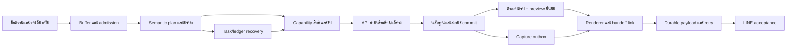

# Dependency audit: ความเข้าใจ ข้อความยาว และการสร้าง/แก้เอกสารธุรกิจ

วันที่: 2026-09-27\
สถานะ: Source audit + isolated probes; เป็นข้อเสนอแก้ไข ยังไม่ได้ implement หรือรับรอง Production\
ฐาน: `origin/main f932b57766f5dd22c0d28aedd4bc06f210e374ef` ตรวจ fetch แล้วในรอบนี้\
ต่อจาก: [CI01–CI16](mangmee-ai-consistency-impact-audit-2026-09-26-th.md), [ข้อความยาว](mangmee-long-text-truncation-audit-2026-09-27-th.md), [spec](../specs/mangmee-ai-understanding-and-advisor-reliability-spec-th.md), [plan](../plans/mangmee-ai-understanding-and-advisor-reliability-plan-2026-09-26.md)

## 1. ข้อสรุปและขอบเขตหลักฐาน

การแก้ prompt หรือเพิ่ม output tokens อย่างเดียวไม่พอ: ข้อความและหลักฐานอาจหายก่อนเข้าโมเดล, prompt อาจไม่ผ่าน budget, คำตอบอาจถูกตัดตอน render, และคำตอบที่แบ่งหลายชุดยังไม่มี state/recovery รองรับครบ การเพิ่มความฉลาดจึงต้องซ่อมเส้นทางข้อมูลและธุรกรรมพร้อมกัน

รอบก่อนยังตรวจไม่ถึง reverse callers, live เทียบ recovery, shared provider consumers และการ์ดยืนยันทุกชนิด รอบนี้ตรวจจุดเหล่านี้เพิ่ม รวมทั้ง **สร้าง/แก้รายการรายจ่าย ใบทดแทน และใบเบิก** ตามคำชี้แจงสุดท้ายของผู้ใช้ คำว่า ticket ในงานนี้ไม่ใช่ support case หรือ GitHub issue; ไม่มีคำสั่งให้สร้างเอกสารการเงินจริง และไม่ได้สร้าง issue ภายนอก

ทุกเลขบรรทัดด้านล่างอ้างอิง source ที่ SHA ข้างต้น ไม่ใช่ working tree ซึ่งมีงานแก้ค้างจากงานอื่น ตรวจ actual code/contracts/schema/config/tests ด้วย `git show/git grep`; การมี test อยู่ไม่ถือว่ารันผ่านแล้ว ไม่มี DB, provider, LINE หรือ cloud calls ในรอบนี้ จึงไม่ทราบอัตราเกิดใน Production หรือค่า p95 ใหม่

ประเภทหลักฐาน:

- **ยืนยันจาก probe:** เรียกฟังก์ชันจริงจาก pinned source ที่ transpile ในหน่วยความจำ ใช้ข้อมูลสังเคราะห์และ stub เฉพาะ dependency ที่ระบุ ไม่ใช่ end-to-end
- **ยืนยันจาก source:** control flow/contract ชัด แต่ไม่ได้จำลอง DB race หรือ restart จริง
- **เงื่อนไข/ความเสี่ยง:** เกิดเฉพาะ flag/lane หรือเมื่อปรับระบบตามแผน ต้องมี acceptance ก่อนเปิด ไม่เหมารวมว่า live เปิดอยู่

## 2. จุดเชื่อมที่ต้องแก้ร่วมกัน

ต้องแยก **งานธุรกิจ commit แล้ว**, **เนื้อหาคำตอบครบ**, **LINE รับ payload แล้ว** ออกจากกัน งาน capture/write ที่ commit แล้วต้อง consume clarification ตาม transaction เดิมเพื่อไม่ทำซ้ำ แม้ส่งคำตอบล้มเหลว; งานอ่านที่ยังไม่ส่งครบต้องไม่ถูกนับว่า complete เพียงเพราะ batch แรก accepted

## 3. Findings และผลกระทบ

| ID / ลำดับ | สิ่งที่พบจริง | ผลกระทบ / งานแก้ขั้นต่ำ |
|---|---|---|
| DI01 P1 — input admission | Buffer รับ 3,900 + 5,000 ตัวก่อน flush เป็น 8,901 ตัว แต่ runtime default รับไม่เกิน 8,000; busy pending 3,900 + 200 รับส่วนใหม่ไม่ได้และแจ้ง rate limit | กำหนด whole-turn admission ก่อน paid intake; แยก oversize จาก flood และ preserve ข้อความครบ ไม่เพิ่ม runtime limit จุดเดียว เกิดเมื่อเปิด buffer และ route ไป runtime |
| DI02 P1 — original text | Semantic input ใช้ค่าที่ lowercase และ collapse whitespace แล้ว; preview history เก็บ prefix 240 | แยก original text/provenance จาก matching view; เก็บ accepted constraints แบบ scoped ไม่ใช้ preview เป็น task memory ชื่อ/รหัส/บรรทัดที่หายไปไม่กลับมาด้วยโมเดลใหญ่ขึ้น |
| DI03 P1 — grounding | Gateway และ API ตัด grounding เหลือ 1,000 ซ้ำกัน; valid note ท้ายข้อความถูกปฏิเสธ อีกทั้ง amount candidates cap 20 ทำยอดแก้ 999 ที่เป็น candidate ที่ 21 หายแม้ข้อความแค่ 227 ตัว | แก้ sender + receiver + value normalizer + preview guards พร้อมกัน; full admitted evidence หรือ verified source spans; overflow ต้อง explicit ห้ามคลาย grounding guard |
| DI04 P1 — recovery context | Live turn มี history/clarifications/prepared plan แต่ queued ledger replay สร้าง request จาก text/value/intake โดยไม่มีบริบทชุดเดียวกัน | Durable bounded semantic/task reference + revalidation; ทดสอบ crash ก่อนบันทึก answer มี flag `LINE_AI_LEDGER_ENABLED` เป็นเงื่อนไข ไม่อ้างว่า live ใช้ทุก turn |
| DI05 P1 — provider completeness | OpenAI tools adapter แปลง invalid JSON args เป็น `{}` และให้ tool-use ชนะ incomplete; Bedrock text adapter อ่านเฉพาะ content block แรก | ส่ง completeness/usage แยกกัน; ห้าม execute partial arguments; รวม visible text blocks ให้ถูก ไม่ reject ทุก max_tokens เหมารวมจน capture salvage เสีย |
| DI06 P1 — prompt กับ budget | Actual fused text-intake prompt 40,779 ตาม estimator เกิน budget 20,000 แม้ input “ยอดขายวันนี้”; advisor+fused 45,734 | ภายใต้ SPLIT เส้นทางนี้ถูก budget guard ปฏิเสธก่อน provider; ลด catalog/prompt ตาม capability จริง หรือ version/reprice bounds ก่อนเปิด รักษา guard และ test actual rendered prompt |
| DI07 P1 — rendering/fallback | Live business, ledger และ saved-receipt fallback ยังใช้ single card body 1,200; structured card ไม่มี canonicalText; generic canonical เกิน 5,000 ถูก validator ปฏิเสธ | ใช้ canonical answer/logical items แยกจาก display preview; ส่งครบในทุก caller; fallback ไม่ใช้ altText 400 แทนคำตอบ ต้องปรับ durable validation ด้วย |
| DI08 P1 — confirmation | Header diff ที่รองรับจริง 4 ช่องสร้าง confirm-card altText 500 แต่ validator รับ 400; 5 text parts + confirm = 6 objects ถูกปฏิเสธ | Bound notification preview และ reserve action slots ก่อนแบ่งข้อความ; ทดสอบ card จริงผ่าน adapter validator โดยคง previewId/revision และ diff ที่ผู้ใช้ตรวจได้ |
| DI09 P1 — multipart/replay | Current outcome และ ledger เก็บหนึ่ง array/หนึ่งสถานะ ไม่ใช่ลำดับ batches; repeated deliver loop ไม่ทำให้ส่วนถัดไปเป็น durable outcome แยก | เป็น dependency gap ของแผน: versioned delivery plan/checkpoints/typed authorization ก่อนเปิด >5 messages; UNKNOWN replay exact payload เดิม ไม่ regenerate/remint แล้วใช้ key ใหม่ |
| DI10 P1 — async result | Notifier แปลง send failure เป็น skipped แล้ว execute markPublished จึงหยุด retry แม้ push ล้มเหลว | แยก terminal skip, retryable failure, unknown acceptance และ accepted; retry เฉพาะ delivery ไม่ rerun OCR/expense mutation/auto handoff |
| DI11 P1 — budget/price compatibility | เพิ่ม line-turn output ceiling เพิ่ม hold ทุก call; settlement ใช้ราคาปัจจุบันแม้ reservation มีราคาเดิม | เป็น rollout risk: workload-specific bounds/admission และ settle pinned tariff; mixed-version + in-flight hold/reconcile tests ก่อนเปลี่ยน model/pricing |
| DI12 P1 — business field limits | Draft patch parser รับ vendor 201 เป็น 200 และ document number 61 เป็น 60 โดยไม่แจ้ง overflow; note 501 กลับ reject ชัดเจน | แยก field validation จาก presentation truncation; เงิน/รหัส/ชื่อ/วัตถุประสงค์ห้ามเปลี่ยนเงียบ ๆ แสดงข้อจำกัดและให้แก้เฉพาะช่อง หรือขยาย contract ทั้งเส้นทางอย่างมีขอบเขต |
| DI13 P1 — ใบทดแทน | Normalize รวมบรรทัดแล้ว parser ทิ้งทั้งบรรทัดที่มีคำถาม; ข้อมูลวัตถุประสงค์พร้อมคำถามแทรกหาย; ค่ายาวเกิน 200/500 ถูกละไว้โดยไม่บอกเหตุ | Semantic field proposals พร้อม source spans ต้องถึง workflow เดิม; แยก task data กับคำถามและแสดง field overflow ไม่ถามช่องเดิมวน |
| DI14 P1 — ใบเบิก | Text route มีแต่ clarify/handoff; media route ที่เข้าใจ REIMBURSEMENT กลับจบ unsupported; approval queue permission ของ LINE แคบกว่า domain | ซ่อม text/image/file และ read parity; การเพิ่ม create/update เป็นงานใหม่ ต้องมี claim-line contract, idempotency, revision-bound preview และ domain write gate |

### หลักฐาน DI01–DI04: ข้อมูลเข้าถึง execution

- Buffer: `apps/api/src/modules/line-ai/domain/logic/line-message-buffer.logic.ts:56,320`; service `line-message-buffer.service.ts:447,472,568–581`; runtime `apps/ai-gateway/src/agentcore/runtime.ts:42,249`. Probe 3,900+5,000 รวม newline = 8,901; single 5,000 ไม่ถูกตัด; runtime 8,000 ผ่าน/8,001 ไม่ผ่าน จึงไม่เรียกทุกกรณีว่า silent truncation
- Original text: `line-ai-classifier.logic.ts:67–68`; webhook `process-line-webhook.use-case.ts:4126,4749,5484`; history `5645,5935,5941,6116–6151`. Raw replay payload ถูกล้างที่ `9081–9089` จึงใช้ event log เป็น long-term context ไม่ได้
- Grounding: `orchestrator.agent.ts:1048`, `internal-tools.controller.ts:428`, `erp-draft-update-tools.use-case.ts:100`, `line-draft-update.use-case.ts:177–178`. DTO ไม่ได้มี MaxLength แล้ว; comment เรื่อง DTO400 ใน sender เป็นข้อมูลเก่า ไม่ใช่สาเหตุปัจจุบัน
- Candidate cap: `packages/contracts/src/line-ai-value-normalizer.ts:420–421,642`; grounding `line-draft-update.logic.ts:209`. Probe full 1,220-char evidence ผ่าน noteAppend แต่ prefix 1,000 ไม่ผ่าน; อีก probe 20 amounts แล้วแก้เป็น 999 ไม่มี 999 ใน candidates และถูกปฏิเสธ
- Ledger: webhook `5484–5507,5551–5558`; `line-ai-ledger.service.ts:235–257`; `drain-line-ledger.use-case.ts:232–246`; config default flag false `packages/config/src/index.ts:334`. ยังไม่รัน DB crash integration

เพิ่มเติมที่ต้องคง: runtime context whitelist/preview limit `runtime.ts:89–127`, clarification proof 16 KiB ที่ webhook `3470`/ledger `286`, Redis stream TTL ต่ออายุทั้ง stream ทุก append (`line-ai-ledger.service.ts:514`) ไม่ใช่ลบทุก entry เมื่ออายุ 24 ชั่วโมง ต้องแยก task TTL, retention, raw evidence และ replay proof ให้ถูก

### หลักฐาน DI05–DI06/DI11: shared provider ไม่ได้มีเฉพาะแชต

- `apps/ai-gateway/src/modules/line-ai/infrastructure/provider/openai.provider.ts:165–177`: invalid tool JSON → `{}`; tool calls ชนะ incomplete stop reason ใน probe ได้ `ok:true, stopReason:tool_use, input:{}` ไม่ใช่หลักฐานว่า downstream tool เขียน DB ไปแล้ว เพราะยังมี validator ของแต่ละ tool
- `apps/ai-gateway/src/modules/line-ai/infrastructure/provider/bedrock.provider.ts:72–76`: reasoning block ก่อน text ทำให้ text ว่างใน probe แม้มี visible answer ใน block ถัดไป
- Actual rendered intake + `providerInputTokenUpperBound`: plain 14,239; advisor 19,194; fused 40,779; fused+advisor 45,734 เทียบ text-intake 20,000. ตัวเลขเป็น estimator units ตามโค้ดที่อิง UTF-8 bytes ไม่ใช่จำนวน tokenizer tokens ของ provider หรือ benchmark live
- `packages/contracts/src/ai-budget-bounds.ts:78,85,185–193`; `ai-budget-provider.ts:123–145,167,172`: maxTokens 1,024 ผ่าน แต่ 4,096 ภายใต้ envelope เดิมไม่ผ่าน เป็น guard ที่ต้องคง
- Probe Sonnet hold ที่ FX33: line-turn bound 1,024 → 4,096 ทำ hold 546 → 698 สตางค์ต่อ provider invocation (+152) แม้ selector/casual ขอ output น้อยกว่า ceiling จึงกระทบ credit availability ไม่ใช่แค่คำตอบยาว
- Reservation เก็บ price snapshot (`ai-model-pricing.ts:112–114`) แต่ settle อ่าน pinned FX แล้วใช้ current pricing (`company-ai-budget-reservation.ts:788–816,844`) ต้องตรึง tariff ระหว่าง deploy/reconciliation

Consumer policies ต้องแยก: composer/polish (`response-composer.agent.ts:583,628`), router (`intent-router.agent.ts:502`), native (`orchestrator.agent.ts:1855`) และ tool calls ต้องตรวจ completeness; receipt extraction เดิม reject max_tokens ที่ `line-ai-internal.controller.ts:727,917`; capture-read เดิมเก็บ complete pages และระบุ partial page ได้ที่ `813`; bank extraction `962`, CRM `crm-customer-reply.agent.ts:46` และ `ai-draft/generate-draft.use-case.ts:59` ต้องเติม explicit policy ห้ามเปลี่ยน provider ให้ทุก incomplete เป็น usage=0 หรือทำให้หน้าที่อ่านครบแล้วหาย OpenAI usage log `openai.provider.ts:194–201` ตั้ง counters เป็นศูนย์เมื่อ errorCode มีค่า จึงต้องแยก paid usage จาก semantic success

เวลาเป็น dependency เพิ่ม: provider port ยังไม่มี deadline/cancel field; default shared timeout 10s ไม่ใช่ whole-turn budget และ SPLIT await settlement ผ่าน seam retry ได้ประมาณ 20.2s เมื่อ API ไม่ตอบที่ default timeout (`common/usage/ai-budget-seam.ts:137`). Receipt transport 195s, bank 105s และ capture job 15min/40calls เป็นคนละ budget กับ chat ห้ามใช้กฎ repair/deadline ของ chat ทับทุก consumer

### หลักฐาน DI07–DI10/DI12: คำตอบและงานเขียน

- Card body/canonical: `line-business-card.logic.ts:75,603,609–613`; live webhook `5651–5671`; ledger drain `284–287`; saved-receipt catch `6225–6226`. Probe 1,300 Thai chars + “ไม่รวมรายการยกเลิก” หางหายจาก body แต่ outcome validator ยังรับ; internal canonical ไม่ส่งบน LINE wire
- Fallback: webhook `1051–1056`, orphan recovery `257–264`; structured card fallback เหลือ altText 400 ส่วน generic canonical 5,001 ถูก `line-reply.adapter.ts:57–60` ปฏิเสธ
- Confirm: `line-draft-update-card.logic.ts:107`; supported header fields `line-draft-update.logic.ts:316–320`; ตัวอย่าง date + vendor before/after 60 + document before/after 32 + note 60 ทำ altText 500 ปัญหานี้มีใน source ที่รวม PR819 แล้ว ไม่ใช่ข้ออ้างว่าปุ่มยังไม่ merge
- Unicode: expense splitter `line-expense-draft-conversation.logic.ts:720–732` แบ่ง 4,799 ก + 😀 เป็น high/low surrogate คนละข้อความ; ต้องรักษา grapheme/URL/amount+unit/source ref และเคารพ UTF-16 limit
- Durable schema: `apps/api/prisma/schema.prisma:1691–1709,1794–1809`; webhook first outcome wins `3191–3195,3627–3635`; ledger save `line-ledger-delivery.service.ts:43–50`. ห้ามเพิ่ม loop รอบ deliverMessages แล้วถือว่ารองรับหลายชุด
- Authorization/replay: webhook live maps `3324–3357`; durable read proof ถูกละเว้นบาง source classes `3607–3625`; `line-read-evidence.service.ts:367–375` รองรับเฉพาะ read/expense-criterion proof การ restart ที่ fail closed เป็น guard ที่ต้องคงจนมี typed durable proof สำหรับ draft/receipt/substitute
- Handoff rewrite `line-handoff-link.service.ts:60–68,77–85`; retry hash `line-reply.adapter.ts:88–93` รวม canonicalText ด้วย Root probe เปลี่ยน canonical อย่างเดียว: wire เท่าเดิมแต่ retry key เปลี่ยน จึงต้อง freeze representation หลังการส่งที่ผลยัง UNKNOWN; ตรวจ payload สุดท้ายหลัง rewrite ไม่อ้างว่าลิงก์จริงขยายทุกกรณี
- Notifier `line-capture-result-notifier.use-case.ts:79–91,221–224`: send non-ok → skipped → markPublished. Root control-flow probe skipped=1/published=1/failed=0; ยังไม่ทดสอบ actual outbox scheduling หรือ live failure
- Business patch: `line-draft-update.logic.ts:60–64,103–109,118`; root probe vendor/doc ถูกตัดแต่ accepted, note overflow ถูก reject เป็น negative control ข้อนี้เป็นข้อมูลที่จะเขียนใน DB ไม่ใช่ notification preview

## 4. Reverse-caller checklist ก่อนเปลี่ยน helper

| สิ่งที่จะเปลี่ยน | Callers ที่ตรวจแล้ว / ผลกระทบ |
|---|---|
| Canonical business renderer | Live webhook, ledger drain, saved-receipt fallback, structured presentation และ tests ที่ปัจจุบันคาดหวังตัด body/card; ต้องเปลี่ยน assertion เป็น coverage ไม่ใช่เพิ่ม limit อย่างเดียว |
| Text builder / splitter | Expense capture, draft continuation, async capture notifier, recovery และ buffer status notices; status สั้นไม่ต้องกลายเป็น long-answer job หรือเพิ่ม push |
| LINE delivery result / fallback | Reply, push-only ledger, orphan, capture notifier; reply แยก failed_flex แต่ push 400 เป็น permanent ต้องออกแบบ rejected-body fallback กับ UNKNOWN แยกกัน |
| Preview card | Edit tool results, card-bound confirm/cancel, preview Redis TTL, APPLIED proof, web revision, duplicate reconciliation และ vendor auto-save หลัง commit |
| Input/context contract | Controller → buffer → intake → Gateway → runtime → ERP grounding รวม queue replay และ parser whitelist; TypeScript type ใหม่อย่างเดียวไม่พอ |
| Value candidates | Capture/correction/draft amount/date grounding และ API/Gateway/runtime membership guards; source span/digest ต้องมาจาก admitted original input |
| Shared provider/price bounds | LINE router/selector/composer, CRM, generic AI drafts, bank extraction, receipt/capture-read, usage log และ budget reconciliation; partial-page salvage ต้องคงอยู่ |
| Multiple batches | Outcome DB + Redis ledger + outbox + retention + quota/cost + recipient proof + source version + quick reply/confirm slots + logical-item references + all-batch delivery completion |

## 5. การสร้าง/แก้เอกสารธุรกิจ

ผู้ใช้ยืนยันว่าหมายถึงรายจ่าย ใบทดแทน และใบเบิก ต้อง inventory เป็น **operation × document type × current state × actor** ไม่ใช้คำว่า “สร้าง/update ticket ได้” ครอบทั้งหมด

### รายการรายจ่ายที่มีอยู่จริง

- Text create: `expense-document.use-case.ts:54–209` ตรวจ permission, same-message duplicate, company/creator/branch/chat, grounded hints และ incomplete/conflicting fields ก่อนสร้างร่าง; source metadata/clarification consumption ที่ `245–303`. `expense-draft.use-case.ts:140–187` มี idempotency key + payload fingerprint และ transactional audit อยู่แล้ว ห้ามสร้าง create endpoint อีกชุดเพราะต้องการให้ AI ฉลาด
- Continue collection: webhook `5033–5064` → `LineExpenseDraftConversationUseCase`; เป็นการเติมข้อมูลต้นทางตาม flag/ownership ไม่เท่ากับบัญชียืนยันแล้ว
- Edit preview: `line-draft-update.use-case.ts:143–237` ต้อง expense.update, target ที่ server resolve, editable status, grounding และ dry-run จริง; apply `295–383` ใช้ previewId, current owner/scope/revision, claim และ transaction. `appliedResult:278–292` อ่านผลเดิมเพื่อ retry โดยไม่ execute ซ้ำ
- Side effect: vendor counterparty auto-save หลัง commit `418–469`; ถ้าการบันทึกคู่ค้าหรือลิงก์ล้มเหลว รายจ่ายอาจแก้สำเร็จแล้ว ต้องตอบแยกสถานะ และ retry ส่งผลเดิม ไม่ย้อน apply รายจ่ายใหม่
- ช่องที่ยังผิด/ต้องระวัง: DI03 grounding/candidate, DI08 confirm preview, DI12 field truncation; quantity/category/other reviewer fields ต้อง inventory ตาม operation schema จริง ไม่ตีความว่าทุก PATCH บน web เปิดให้ LINE อัตโนมัติ

### ใบทดแทน: workflow มีแล้ว แต่การเข้าใจข้อมูลยังไม่ครบ

`SUBSTITUTE_RECEIPT_CONTINUATION` อยู่ใน contracts `line-ai.ts:581,604`; webhook `4807–4878` ต่อเข้า `line-substitute-receipt-continuation.use-case.ts` จริง มีเลือก expense, เก็บเหตุผล/วัตถุประสงค์/ผู้จ่าย/ผู้รับ/การจ่าย/หมวด/หลักฐาน และพัก/ยกเลิก/กลับมาทำต่อ มี permission/scope/revision/proof และ bound confirmation สำหรับ semantic new start (`1504–1531,1628–1651,1690–1695`)

- **Reproduced:** `วัตถุประสงค์: ไปพบลูกค้า\nใบนี้ใช้ลดภาษีได้ไหม` → raw `nonQuestionLines` ยังเก็บวัตถุประสงค์ แต่เมื่อผ่าน actual normalize แล้วเหลือว่าง (`continuation:318–321`, webhook `4870`). Routing เข้า workflow ถูกก็ยังเสียข้อมูล
- `extractValues:394–473` ใช้ labels/regex/pending-field fallback; `bounded:273–275` และ limits `24,307,460–471` ทำ purpose ไม่มี label 201 ตัว หรือ labeled 501 ตัวไม่ถูกยอมรับโดยไม่มี typed overflow outcome นี่เป็น parser/contract gap ไม่ใช่หลักฐานว่าโมเดลอ่านไม่ออก
- รับ `amount/itemDescription` เป็น continuation values ที่ `427–432,1725–1730,1762–1803` แต่ไม่ใช่การแก้ยอดรายจ่าย; เส้นทางนี้แก้ expense category ได้ ส่วนยอดยังมาจาก expense จริงและ reply บอกว่ายังไม่แก้รายการ (`1143–1148`). คำขอแก้ยอดต้องเข้า expense preview/apply แล้ว refresh substitute revision/eligibility ก่อนทำต่อ
- ISSUE/FORM `2138–2205` เตรียม/จองเลขเอกสารด้วย workflow idempotency; คำตอบ `2223–2233` ระบุยังไม่รับรอง/อนุมัติ/ออกสมบูรณ์ Web certification/approval ใน `substitute-receipt.use-case.ts:1020–1072,1134–1245` มี authority แยก **การส่งเว็บในขั้นตอนนี้เป็น boundary ที่ตั้งใจไว้** ไม่ใช่ false handoff ทุกกรณี
- Evidence ที่มีอยู่แล้วตอบ existing-document card (`1592–1596`); signed material มี lock/correction version (`prisma-expense.repository.ts:1029–1040,1133–1154`). “แก้ใบนี้” ต้องแยก collection, expense facts, prepared evidence และ signed correction ไม่ overwrite ด้วย API เดียว
- Source proof ครอบ expense/evidence/attachment/category/signature/policy (`1201–1220`). Delivery retry ใช้ผลเดิม; ไม่ prepare/จองเลข/ลงชื่อ/อนุมัติซ้ำเพื่อส่งคำตอบ ระบุ acknowledgment ตามผลของแต่ละ operation และรักษา commit consumption เดิม

### ใบเบิก: backend มี แต่ LINE writer ยังไม่มี

| Operation | LINE ที่ f932 | ของเดิมที่ reuse / สิ่งต้องเพิ่ม |
|---|---|---|
| อ่าน summary/detail/approval queue | มี 3 read tools | แก้ permission parity ของ frozen assignment; คง branch/own-scope |
| สร้าง DRAFT | clarify_only/handoff เท่านั้น | ต่อ domain create ด้วย grounded claim lines, business action idempotency และ exact result recovery |
| แก้ DRAFT | ไม่มี mutation dispatcher/preview | ต่อ domain update ด้วย previewId + expected source revision ที่ผู้ใช้เห็น, owner/finance scope และ confirmation |
| ส่งอนุมัติ/อนุมัติ/จ่าย | ไม่ใช่ create/update capability | คง web/domain transition เดิม; หากเพิ่ม LINE ต้องมี action spec/permission/confirmation แยก |

หลักฐาน: webhook `4938–5030`, config `packages/config/src/index.ts:262–274`; reimbursement module providers/exports `reimbursements.module.ts:56–81`, LINE module read tools `180–182`. Handoff card `line-business-card.logic.ts:319–330` ส่ง `/reimbursements/new` ไม่มี draft ID/prefill/reference แม้ intake มี hints จึงให้กรอกใหม่จริง ไม่อ้างว่าได้สร้างร่างแล้ว

**บัคที่ต้องซ่อมแม้ยังไม่เปิด writer:**

- Image route `REIMBURSEMENT_REQUEST_START` ไปถึง media decision แล้วได้ unsupported (`webhook:811,6695,6892`); pure decision probe ยืนยัน ขณะที่ file fast path `6467–6475` เข้า capture ก่อน semantic เป็นคนละเงื่อนไข ต้องทดสอบทั้งคู่ ไม่กล่าวว่ารูป reimbursement นี้สร้าง expense ผิด เพราะ image decision ไม่อนุญาต
- LINE registry `ai-tools.ts:956` และ `erp-reimbursement-tools.use-case.ts:29` ต้อง reimbursement.approve แต่ web queue controller `107`/domain `reimbursement-approval.use-case.ts:151–198` รองรับ approve/reject หรือ frozen assignment ที่ actionable. ให้ domain ตัดสิน assignment ตามสิทธิ์ปัจจุบัน ไม่เปิดคิวทั้งบริษัทเพื่อแก้ false block; ยังไม่รัน DB fixture

**Dependency ก่อนเพิ่ม writer:**

- Reuse `reimbursement-request.use-case.ts:117–166,178–220`; source expense/evidence/branch/requester ต้องตรวจใหม่; total/date/category จาก lines ฝั่ง server ไม่ใช้ scalar hints เป็น claim ทั้งใบ
- DTO รองรับสูงสุด 50 lines, description/purpose500, reason1000 (`reimbursement.dtos.ts:30–62`) แต่ router hints ถูกตัด200 (`intent-router.agent.ts:919`) และไม่มี full lines/category grounding contract. ต้องแก้ทั้ง source span/candidate cap/attachment mapping ไม่ต่อ hints เข้า write ตรง ๆ
- Repository create `352–387` ไม่มี business create idempotency lookup/input. Submit numbering `reimb-submit:${id}` เป็นคนละ operation ไม่กัน create ซ้ำจาก response หาย ต้องมี recover-by-action-ID ก่อน retry
- Update repository `400–419` มี lock/CAS แต่ version มาจาก read ตอน update ไม่ใช่ preview ที่ผู้ใช้เห็น; ต้องเพิ่ม expected revision จาก preview และไม่แทน lines ทั้งชุดจาก context เก่า
- Line update ล้าง claim signatures; submit freeze policy/source snapshot และตรวจ duplicate claim/evidence ที่ use case `431–472,546–595`; ห้ามสร้างรายจ่ายปลายทางซ้ำหรือแก้ source expense โดยนัย
- Write quiesce อยู่ที่ HTTP guard (`reimbursement-write-quiesce.guard.ts:25–38`); internal adapter ต้อง enforce domain write gate เช่นกัน ไม่ข้ามด้วยการเรียก use case ตรง Entitlement off ปิด new claims แต่ retained in-flight work ยังมี policy ให้ทำต่อ (`ai-tools.ts:116–120`)

ทั้งหมดเป็น capability extension ที่ต้อง implement/evaluate เพิ่ม แยกจากการซ่อม semantic route และไม่ถือว่า draft creation ให้ authority submit/approve/pay

## 6. ลำดับแก้และการตรวจรับ

1. **แก้บัคที่เกิดในขอบเขตเดิม:** bounded confirm altText + actual adapter validation; original text/grounding/candidate completeness; incomplete tool-call guard; notifier disposition; field overflow ที่ไม่เปลี่ยนค่าข้อมูลเงียบ ๆ
2. **ทำเส้นทางที่ส่งได้ในหนึ่ง LINE request ให้ครบ:** canonical answer + reserved action slots + Unicode-safe rendering/fallback ครบ live/ledger/receipt/orphan/notifier โดยคง commit/confirmation boundaries
3. **ทำ contracts/recovery ก่อนเพิ่มขนาด:** task context parity, prompt/budget admission, pinned tariffs, versioned batch checkpoints, per-type durable source proof และ old-payload reader compatibility ก่อนเพิ่ม output/หลายชุด
4. **ทดสอบเอกสารจริงเป็น chain:** สร้าง → ถามข้อมูลขาด → คุยแทรก → กลับมาแก้ใบเดิม → preview ปัจจุบัน → confirm → duplicate webhook → ส่งผลล้มเหลว → retry; ตรวจ record ID/จำนวนรายการ/ยอด/สถานะ/source revision/side effects คู่กับสิ่งที่ผู้ใช้เห็น
5. **ค่อยรับความเร็ว:** candidate เพิ่มความฉลาดก่อน/หลัง optimization เดียวกันตาม spec §20.1; ไม่ถือ false refusal, truncated answer, lost message หรือ failed document creation เป็น fast success

เกณฑ์สำคัญ: permission/tenant/branch/source denial ต้องยังปฏิเสธ, confirmed/approved/paid/posted state ต้องไม่ถูก draft edit ข้าม, old preview ใช้ไม่ได้, UNKNOWN delivery ห้ามสร้างหรือแก้เอกสารซ้ำ, schema/price/bounds mixed versions ต้อง fail อย่างมีเหตุผลและเก็บงานที่ commit แล้วได้ ไม่มี blanket เปลี่ยนทุก ack ให้รอส่งครบ เพราะ mutating clarification ต้อง consume ที่ commit ตาม flow เดิม

## 7. Evidence และสิ่งที่ยังไม่ได้พิสูจน์

- [Root delivery/notifier probes](../evidence/mangmee-ai-readiness-2026-09-26/dependency-root-probes-2026-09-27.json): 4 groups ผ่าน รวม same-wire/different-retry-key และ skipped publication
- [Business patch probes](../evidence/mangmee-ai-readiness-2026-09-26/business-document-probes-2026-09-27.json): 2 groups ผ่าน รวม negative control note overflow
- [Long-output probes เดิม](../evidence/mangmee-ai-readiness-2026-09-26/long-text-probes-2026-09-27.json): composer/polish รับบาง max_tokens answer ได้จริง มี negative control ที่ guard ปฏิเสธด้วย
- [Parallel probe packet](../evidence/mangmee-ai-readiness-2026-09-26/dependency-parallel-probes-2026-09-27.json) ใช้ exact Git source แยกจาก working tree: input/grounding/buffer/runtime 11 assertions; renderer/confirm/Unicode, shared-provider/budget และ substitute/reimbursement media probes เป็นผลจาก delegated auditors ที่บันทึกใน session ไม่ใช่ executable harness หรือจำนวน end-to-end cases ที่ผ่าน
- ยังไม่ได้รัน provider-backed corpus, PostgreSQL/Redis crash/race integration, browser/LINE acceptance, live feature flags รอบใหม่ หรือ deploy ไม่รับรองว่า dependency ครบทุก module ที่ไม่แตะ path นี้ และไม่รับรองว่าปัญหาถูกแก้แล้วจากเอกสาร
