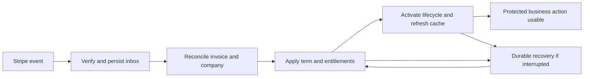

# Stripe developer reference สำหรับ Mangmee

> **Package amendment 2026-09-11:** [สิทธิ์/รายปี/Enterprise lock](../specs/mangmee-package-entitlements-spec-th.md) และ [PE01–PE36](../plans/mangmee-package-entitlements-plan-th.md) ขยาย monthly-only เดิม. ตรวจ amount/currency/interval/count/account/mode ทุก mapping; annualใช้ service period จริง ไม่บวก365วัน; quotaเดือนBangkokแยกจากproviderclock. สมัครtrialไม่ผูกบัตร และ genericpaidapplyไม่เปิดcap.wht50bis.

ตรวจเอกสาร official: **2026-09-10**. เอกสารนี้รวบรวม API references, ข้อเท็จจริงจาก Stripe และวิธีนำมาใช้กับ Mangmee สำหรับ developer; **ยังไม่มี Stripe runtime / sandbox payment / Stripe E2E ที่ผ่าน**. ไม่ได้เข้าบัญชี Stripe หรือเปลี่ยน configuration.

อ่านร่วมกับ [P26 billing spec](../specs/mangmee-billing-subscription-spec-th.md), [แผน S0–S5 / นโยบาย B01–B10 / tests T01–T42](../plans/mangmee-stripe-billing-implementation-and-test-plan-th.md) และ [สเปกเว็บไซต์](../../../mangmee_web/docs/specs/stripe-billing-alignment-spec-th.md). P26 เป็น source of truth ของ product; Stripe docs เป็น source ของ provider API. ส่วนที่ระบุว่า “Mangmee” ด้านล่างคือ integration requirements ของเรา ไม่ใช่ default ที่ Stripe ทำให้ทั้งหมด.

## 1. API ที่ developer จะใช้

ตารางนี้เป็น **Stripe API paths** ไม่ใช่ route ใหม่ใน Mangmee. เลือก route/DTO ของแอปจาก architecture เดิมตอน implementation; ทุก customer/session/subscription/invoice ID ต้อง resolve จาก mapping ของบริษัทและ environment ฝั่ง backend.

| งาน | Stripe API / official reference | การใช้ใน Mangmee |
|---|---|---|
| ตรวจ recurring Price | `GET /v1/prices/{id}` — [Retrieve Price](https://docs.stripe.com/api/prices/retrieve) | เทียบ offer/version, THB, ยอดสตางค์, recurring month/year + interval_count=1 และสถานะขายกับ catalog; ไม่ใช้ราคา/Price ID จาก browser เป็น authority |
| สร้าง hosted Checkout | `POST /v1/checkout/sessions` — [Create Session](https://docs.stripe.com/api/checkout/sessions/create) | `mode=subscription`, recurring Price ที่ backend เลือก, quantity 1 ต่อบริษัท; ใช้ durable attempt และ idempotency key |
| ตรวจผล / recover timeout | `GET /v1/checkout/sessions/{id}` — [Retrieve Session](https://docs.stripe.com/api/checkout/sessions/retrieve) | อ่าน status/customer/subscription จาก Stripe แล้ว reconcile กับ local attempt; return URL ไม่ใช่หลักฐานให้สิทธิ์ |
| ปิด attempt ที่ยังเปิดอยู่ | `POST /v1/checkout/sessions/{id}/expire` — [Expire Session](https://docs.stripe.com/api/checkout/sessions/expire) | ใช้กับ session `open`; ถ้า expire ไม่ได้เพราะจ่ายแล้วให้ reconcile ห้ามสร้างรายการใหม่ทันที |
| เปิด Customer Portal | `POST /v1/billing_portal/sessions` — [Create Portal Session](https://docs.stripe.com/api/customer_portal/sessions/create) | OWNER ของบริษัทที่เลือกเท่านั้น; backend ส่ง customer, configuration และ allowlisted return URL; redirect ไป URL ชั่วคราวที่ได้ |
| ตรวจสมาชิกปัจจุบัน | `GET /v1/subscriptions/{id}` — [Retrieve Subscription](https://docs.stripe.com/api/subscriptions/retrieve) | ตรวจสถานะ/Price/paid period ที่เกี่ยวข้องและเหตุยกเลิก; ไม่แปล `active` เป็นหลักฐานว่าทุก invoice จ่ายแล้ว |
| ตรวจ invoice ก่อน apply | `GET /v1/invoices/{id}` — [Retrieve Invoice](https://docs.stripe.com/api/invoices/retrieve) | ตรวจ company/customer/subscription, ยอด/สกุลเงิน/รายการ/สถานะ/period และ invoice ที่เคย apply |
| ชำระ invoice เดิมที่ยัง payable | `POST /v1/invoices/{id}/pay` — [Pay Invoice](https://docs.stripe.com/api/invoices/pay) | ใช้เฉพาะ recovery ที่ policy/permission อนุญาต; ตรวจ current state ก่อน ไม่ทำ retry loop ซ้อนกับ Stripe หรือใช้ `paid_out_of_band` แทน card charge |
| คืนเงินตามคำสั่ง support | `POST /v1/refunds` — [Create Refund](https://docs.stripe.com/api/refunds/create) | B07 ต้องกำหนดสิทธิ์และผลต่อ access; ผูก charge/payment และ dedupe refund แยกจาก invoice apply; refund ไม่ยกเลิก subscription ให้โดยอัตโนมัติ |

Guide ประกอบ: [Checkout subscriptions](https://docs.stripe.com/payments/checkout/build-subscriptions), [Customer Portal](https://docs.stripe.com/customer-management), [cancel subscriptions](https://docs.stripe.com/billing/subscriptions/cancel). หน้า Checkout guide ที่ fetch รอบนี้คืน variant index; detailed hosted variant fetch ไม่สำเร็จ จึงตรวจ request parameters จาก API reference โดยตรง ไม่ถือว่าอ่าน variant body ครบ.

## 2. Version และ request contract ที่ต้องกำหนดก่อนเขียนโค้ด

หน้า [Stripe API versioning](https://docs.stripe.com/api/versioning) ที่ตรวจระบุ current version `2026-08-26.dahlia`; **ยังไม่ใช่ version ที่ Mangmee เลือก/pin**. ต้องบันทึก exact stable `stripe-node` version, request API version และ webhook destination version พร้อมกันใน S0. Node SDK รุ่นใหม่ผูก types กับ API version ที่ SDK ใช้; override version อาจทำให้ TypeScript types ไม่ตรง response. การเปลี่ยน request version ไม่ได้เปลี่ยน schema ของ event เก่าที่สร้างไว้แล้ว.

| ข้อมูล | ข้อกำหนดของ Mangmee |
|---|---|
| Company / payer / permission | เช็ก OWNER + company/billing gate; payer ไม่ได้สิทธิ์ OWNER เพราะจ่าย. Customer mapping เป็นต่อบริษัทและ environment ไม่ใช้ email เทียบแทน ownership |
| Customer / base subscription | resolve หรือสร้าง mapping แบบ idempotent ก่อน Checkout; หนึ่งบริษัทมี base subscription ที่มีผลได้หนึ่งรายการ รวมช่วง trialing/past_due/pending ที่ต้อง reconcile |
| Offer / amount | freeze offer/version และ Price mapping ของ attempt; paid card month/year ตาม package amendment 2026-09-11; Enterpriseทั้งสองintervalsยังlocked; ภาษี/ส่วนลด/trial conversion ตาม B01/B06/B09 ที่อนุมัติ |
| Hosted UI | API reference มีทั้ง one-time/embedded/examples; อย่าคัด `mode=payment`, USD หรือ quantity ตัวอย่างมาใช้. เลือก hosted mode และ card restriction ที่รองรับใน version ที่ pin; ไม่เปิด payment method จาก Dashboard โดยไม่ทดสอบ |
| Return / cancel / locale | backend เป็นผู้กำหนด allowlisted app URL; session ID ใช้ค้นผลภายใต้ OWNER check เท่านั้น. `locale=th` ใช้ได้ตาม Create Session reference; ตรวจข้อความจริงใน T41 |
| Metadata | เก็บ opaque company/attempt/offer references เท่าที่ต้องใช้; ไม่เก็บบัตร/CVC/secret/เอกสารลูกค้า. ส่ง metadata ของ Session กับ `subscription_data.metadata` แยกตามวัตถุประสงค์ |
| Idempotency | logical operation เดิมใช้ key และ parameters เดิม; เปลี่ยน intent ต้องผ่านการตัดสิน current provider/local state ก่อนสร้าง key ใหม่ |

ข้อเท็จจริง: metadata โดยทั่วไปไม่ copy ข้าม object อัตโนมัติ; `subscription_data.metadata` ของ Checkout ใช้ตั้งบน Subscription และ Invoice เก็บ subscription metadata เป็น snapshot ในตำแหน่งที่ขึ้นกับ API version. ดังนั้น Mangmee ต้องมี durable mapping ไม่อาศัย session metadata ปรากฏในทุก invoice เอง. [Stripe metadata](https://docs.stripe.com/metadata)

Stripe idempotency เก็บผลแรกที่เริ่ม execute รวมถึงบางผล `500`; key อาจถูกล้างหลังมีอายุอย่างน้อย 24 ชั่วโมง. Mangmee จึงต้องเก็บ attempt/provider IDs และ reconcile เมื่อผลไม่แน่นอน ไม่เปลี่ยน key เพื่อหนี error หรือถือว่าป้องกันซ้ำได้ตลอดไป. [Idempotent requests](https://docs.stripe.com/api/idempotent_requests)

## 3. อ่าน object และ service period ให้ถูก

| สิ่งที่ต้องอ่าน | ข้อเท็จจริงจาก official reference | การประยุกต์ใช้ |
|---|---|---|
| Invoice → Subscription | ตั้งแต่ `2025-03-31.basil` ใช้ `parent.type=subscription_details` และ `parent.subscription_details.subscription`; รุ่นก่อนมี `subscription` ที่ top level — [subscription webhooks / refund mapping](https://docs.stripe.com/billing/subscriptions/webhooks) | เขียน parser ให้ตรง version ที่เลือก; ไม่ใช้ field จาก blog เก่าหรือ type cast เพื่อปิด error |
| Subscription period | ตัวอย่าง object ปัจจุบันมี `items.data[].current_period_start/end` — [Subscription object](https://docs.stripe.com/api/subscriptions/object) | เลือก item ที่ตรง base Price; ห้ามสมมติเป็น top-level field หรือใช้ item แรกโดยไม่ตรวจ mapping |
| Invoice service period | `Invoice.period_end` ไม่ใช่ service period ของทุก Price; ต้องดู period ของ line — [Invoice object](https://docs.stripe.com/api/invoices/object), [Invoice Line Item](https://docs.stripe.com/api/invoice-line-item/object) | เลือก subscription line/Price ที่จ่ายจริง อ่าน `period.start/end`, แยก proration/one-time/credit และอ่าน pagination ให้ครบ |
| Payment / Invoice / Subscription | เป็นคนละ object และสถานะ; paid invoice อาจเกิดจากยอดศูนย์/credit/out-of-band ไม่ใช่ successful card charge ทุกครั้ง — [Invoice object](https://docs.stripe.com/api/invoices/object), [Pay Invoice](https://docs.stripe.com/api/invoices/pay) | เก็บ provenance และกติกา authorized adjustment; ห้าม `active` หรือยอด 0 ให้ paid rights โดยอัตโนมัติ |

Mangmee ต้องใช้ **service period ของ invoice ที่ยืนยันแล้ว** เป็นหลักฐานสิทธิ์ ไม่ใช้วันรับ webhook ไม่บวก 30 วันตายตัว และไม่เอารอบล่าสุดของ Subscription ไปให้สิทธิ์เมื่อ event ที่กำลัง replay เป็น invoice เก่า. Quota ยังคงเดือนปฏิทิน Bangkok ตาม P26/B02; ไม่ reset เมื่อจ่าย.

## 4. Event handling ที่ต้องส่งมอบ

ชื่อและชนิด payload ตรวจจาก [Types of events](https://docs.stripe.com/api/events/types); lifecycle/collection ตรวจจาก [Subscription webhooks](https://docs.stripe.com/billing/subscriptions/webhooks). ตารางนี้กำหนดการตอบสนองของ Mangmee; ยังไม่ได้สร้าง endpoint/subscription จริง.

| Event | Mangmee ต้องทำ | ผูกกับ acceptance |
|---|---|---|
| `checkout.session.completed` | บันทึก session/customer/subscription mapping แล้ว reconcile invoice; ไม่เปิด paid จาก event นี้อย่างเดียว | T02–T05, T17–T20 |
| `checkout.session.expired` | ปิด attempt ตามจริงและแสดงทางเริ่มใหม่; ตรวจ race กับ completion ก่อน | T16–T19 |
| `invoice.paid` | ยืนยัน binding/amount/currency/service period/provenance → durable apply → เปิดสิทธิ์บริษัทเมื่อครบ; invoice เดิม apply ครั้งเดียว | T02–T08, T20–T29 |
| `invoice.payment_failed` | แยก initial/renewal, เก็บเหตุที่แสดงลูกค้าได้, เตือน/แก้บัตร/retry/grace ตาม B03 | T09, T11–T14 |
| `invoice.payment_action_required` | แจ้งให้ลูกค้ายืนยันผ่าน Stripe; ยังไม่ถือว่า paid | T10, T13 |
| `invoice.finalization_failed` | งาน billing มีปัญหาก่อนเก็บเงิน; ตรวจ error และแจ้ง ops/customer ตามเหตุ ไม่เหมารวมเป็นบัตรถูกปฏิเสธ | T15 |
| `customer.subscription.created`, `customer.subscription.updated`, `customer.subscription.deleted` | reconcile lifecycle/plan/cancellation; ตรวจ current state และ admin hold; ไม่ต่อสิทธิ์จาก status อย่างเดียว | T21, T24, T33–T36, T39 |
| `customer.subscription.trial_will_end`, `invoice.upcoming` | ใช้เมื่อมี Stripe trial/renewal notices ตาม policy; trial เดิมของแอปยังไม่พึ่ง Stripe | T05, T12, T25 |
| `refund.created`, `refund.updated`, `refund.failed`, `charge.refunded` | reconcile refund ID/charge/invoice, full/partial/failure และ audit; ผลต่อ access ตาม B07 | T37 |
| `charge.dispute.created`, `charge.dispute.updated`, `charge.dispute.closed` | เปิดงาน support/evidence และ reconcile ผล dispute; ไม่ให้ old paid event ปลด hold | T38 |

Config ของ endpoint ต้องใช้ชื่อเต็มตามตารางและเลือกเฉพาะ events ที่ handler รองรับ.

ถ้าเพิ่ม `invoice.created` ต้องตอบรับได้อย่างทนทาน: Stripe ระบุว่า delivery failure อาจหน่วง automatic invoice finalization ได้ถึง 72 ชั่วโมง. ไม่ subscribe ทุก event โดยไม่มี consumer. `payment_intent.succeeded` ใช้ช่วย trace/reconcile ได้ แต่ไม่สร้างเส้น apply package อีกชุดที่ชนกับ `invoice.paid`. [Invoice webhook behavior](https://docs.stripe.com/billing/subscriptions/webhooks)

## 5. Webhook → เปิดสิทธิ์ และ recovery

ข้อเท็จจริงจาก [Stripe webhooks](https://docs.stripe.com/webhooks): ต้องตรวจ signature จาก raw body, events อาจซ้ำ/สลับลำดับ, event `created` มีความละเอียดเป็นวินาทีและไม่ใช่ลำดับที่เชื่อถือได้. Live delivery retry ได้ถึง 3 วัน; sandbox retry มีช่วงสั้นกว่า. การ resend ไม่ได้หยุด automatic retries โดยตัวมันเอง.

กระบวนการ Mangmee:

1. ตรวจ raw body/signature/timestamp ตาม SDK และ secret ของ endpoint ที่ถูกต้อง; ตรวจ mode/account และ object mapping. Webhook ไม่พึ่ง user session แต่ยังต้องมี provider authentication; ยกเว้น auth/CSRF เฉพาะ route นี้ตาม pattern ของ repo.
2. บันทึก event ลง durable inbox พร้อม dedupe แล้วตอบ `2xx` โดยเร็ว; เก็บไม่ได้ให้ retry ได้. Signature ไม่ถูกต้องต้องไม่เข้าสู่ paid apply. Event ที่เก็บแล้วแต่ยังผูกบริษัทไม่ได้ต้องมี recovery/ops state.
3. Worker อ่าน invoice/subscription ตาม version ที่ pin ตรวจ source facts และใช้ invoice-level idempotency. Event ซ้ำคนละ ID ต้องไม่ grant ซ้ำ; event timestamp ไม่ใช่ version fence ของธุรกิจ.
4. ใช้คำสั่ง paid apply เดียวสำหรับ webhook, return-page reconciliation และ scheduled repair. Term + entitlement + lifecycle ต้อง atomic หรือมี durable continuation; refresh session/cache/epoch และรักษา admin/security holds.
5. บอกสำเร็จเมื่อใช้ protected business action ได้จริง. ถ้า paid แต่ apply ค้าง ให้แสดงสถานะรอ/reference และ retry งานเดิม; notification/tax-document delivery ไม่ทำให้ตัดเงินหรือ grant ซ้ำ.

สำหรับ direct SaaS account ของ Mangmee ให้ยืนยัน account จาก endpoint/secret/API-client configuration และ provider mapping ที่ผูกไว้; ไม่บังคับว่าทุก event ต้องมี `event.account` เพราะ field นี้ใช้ระบุ connected account และ nullable. [Event object](https://docs.stripe.com/api/events/object)

S-pre ของกลไกเดิมผ่านแล้วตาม [repair report](../evidence/stripe-repair-2026-09-11/README.md): browser 20/20, real PG 15/15, R01/R02/R03/R05/R06 และ R07 notification persistence ปิดใน scope manual renewal. [แผนปิดช่องว่าง](../plans/mangmee-stripe-billing-implementation-and-test-plan-th.md#stripe-closure-plan) ยังแยก S1–S3/RG06: Stripe invoice/service-period apply ไม่ใช่ manual days renewal และยังไม่ implement.

## 6. Portal, failure และการเปลี่ยนสมาชิก

| เอกสาร official | สิ่งที่ developer ต้องนำไปใช้ |
|---|---|
| [Portal limitations](https://docs.stripe.com/customer-management#limitations) | เปลี่ยน plan ช่วง trial อาจจบ trial/เก็บเงินทันทีตาม default; ตั้งให้ตรง B01. Scheduled update จำกัดการแก้/ยกเลิกบางกรณี ต้องมีทางยกเลิกตาม B04. ไม่ฝัง Portal ใน iframe |
| [Portal configuration API](https://docs.stripe.com/api/customer_portal/configurations/create) | ตั้ง features/catalog/trial behavior/cancel/proration ตาม policy; ตรวจ schema ของ version ที่ pin และ configuration จริงในแต่ละ environment ก่อนทดสอบ |
| [Smart Retries](https://docs.stripe.com/billing/revenue-recovery/smart-retries) | แยก hard decline/ต้องยืนยันออกจาก transient failure; ตรวจ default payment method ที่ subscription ใช้จริง. Stripe ทำ collection/retry; Mangmee ทำ access/notice/reconciliation |
| [Cancel subscriptions](https://docs.stripe.com/billing/subscriptions/cancel) | จังหวะ cancel/proration/หนี้เก่าตาม B04/B05/B08; refund เป็นคนละ action. Auto-cancel delay จาก dispute ไม่รองรับ Test Clocks |
| [PromptPay](https://docs.stripe.com/payments/promptpay) | deferred: ไม่รองรับ Checkout subscription mode และไม่เป็น card auto-renew fallback; หากเพิ่มต้องออกแบบ `send_invoice` แยกตาม P26 |

เก็บ portal URL เป็นข้อมูลชั่วคราวที่มีสิทธิ์เข้าถึง ไม่ใส่ใน analytics/log/public page; สร้างใหม่เมื่อ OWNER ตั้งใจเข้าใช้งาน. Web sales kill switch ไม่หยุด subscription ที่ Stripe ยังตัดอยู่ และต้องไม่ตัด recovery/cancellation ของลูกค้าที่จ่ายไปแล้ว.

## 7. Developer setup และ test handoff

| สิ่งที่ต้องเตรียม | ขอบเขต / หลักฐานที่ต้องบันทึก |
|---|---|
| Environment | แยก sandbox account/mode, API key, webhook signing secret, customer/Price/portal mapping จาก live; secret อยู่ backend secret mechanism เดิม ไม่ใส่ repo/รายงาน |
| Version/config record | exact SDK/API/webhook versions, selected snapshot event names, offer/Price mapping, collection/retry/final action, portal configuration และ policy revision |
| Local webhook | หลังมี route จริง ใช้ Stripe CLI `stripe listen --forward-to <LOCAL_WEBHOOK_URL>` ใน terminal; ค่าในวงเล็บเป็น placeholder. Signing secret ของ CLI listener ต่างจาก Dashboard endpoint — [local listener](https://docs.stripe.com/webhooks#local-listener) |
| Test payments | บัตรสำเร็จ/เงินไม่พอ/3DS/attach-then-fail และ test PaymentMethods จาก [Stripe testing](https://docs.stripe.com/testing); ค่าที่คัดไว้และขั้นตอนอยู่แผน §4B |
| Renewal simulation | [Billing testing](https://docs.stripe.com/billing/testing), [Test Clocks](https://docs.stripe.com/billing/testing/test-clocks): เลื่อน Stripe time แล้วรอ ready/processing; app clock ต้องควบคุมใน harness เอง; simulation แยกจาก browser Checkout E2E |
| E2E evidence | ใช้ Playwright/harness เดิมตามแผน §4D, ยืนยัน provider + DB + protected API + UI + tenant isolation; fake webhook/`stripe trigger` อย่างเดียวไม่ถือว่า checkout/renewal E2E ผ่าน |

Developer เริ่มจาก P26 → reference นี้ → S-pre ของกลไกเดิม + ปิด B01–B10 ที่เกี่ยวข้อง → S0–S5 → T01–T42. ช่อง policy ที่ยังไม่ตัดสินใจห้ามเติมจาก sample defaults. ยังไม่ระบุ live account ID, exact SDK version, actual Mangmee billing routes หรือผล sandbox เพราะยังไม่ได้สร้าง/ตรวจสิ่งเหล่านั้น. การรวบรวม docs นี้ไม่เปลี่ยนสถานะ paid offers ที่ disabled.

## 8. Follow-up ตรวจ lifecycle/recovery — 2026-09-11

ตรวจ official [webhooks](https://docs.stripe.com/webhooks), [idempotent requests](https://docs.stripe.com/api/idempotent_requests) และ [subscription lifecycle](https://docs.stripe.com/billing/subscriptions/overview) เพิ่มเพื่อปิดแผนหลัง simulation; ไม่มี provider account operation.

- Initial automatic-collection invoice อาจอยู่ในช่วง `incomplete` ได้ 23 ชั่วโมงก่อนเป็น `incomplete_expired`/invoice void; terminal state ต้องสร้าง subscription ใหม่เมื่อจะกลับมาซื้อ โดย reconcile intent เดิมก่อน. Checkout ที่ subscription ยัง incomplete มีข้อจำกัดการแก้ invoice/subscription จึงใช้ recovery ของ Session/current objects ให้ถูก ไม่สั่ง pay invoice เดิมทุกกรณี. Session expiry และหน้าต่าง invoice เป็นคนละสถานะ/timer.
- Mangmee design: persist attempt และ invoice completion ใน DB ของแอป; Stripe key เก่าอาจถูกล้างหลังอย่างน้อย 24 ชั่วโมง และ webhook มาไม่เรียงลำดับ. การตอบรับ event ไม่ใช่ completion ของ paid apply; mapping ยังไม่พร้อมต้องเก็บรอ reconcile และงานค้างหลัง ack ต้องมี local recovery.
- เพิ่ม RG01–RG06 ในแผน §9D รวม duplicate payload conflict, hold races, durable notifications, tenant/auth/error UI และ terminal checkout. ทั้งหมดเป็น acceptance ที่ต้องเขียน/รัน ไม่ใช่ผลทดสอบของ Stripe ที่ผ่านแล้ว.

## Customer Invoice/Receipt — Owner clarification 2026-09-11

Ownerยืนยันให้ **Stripeสร้างและส่งInvoice/Receiptให้ลูกค้าที่ซื้อแพ็กเกจมั่งมี**. Postmarkใช้ส่งapp transactional mailและมีReceiptค่าอีเมลสำหรับบริษัทเรา; ไม่สร้างcustom billingPDF/เลขใหม่หรือส่งreceiptซ้ำจากPostmark. Spec/test mapping อยู่ [Postmark spec §7](../specs/mangmee-transactional-email-provider-spec-th.md) / [M3, EM10/11/17](../plans/mangmee-transactional-email-provider-plan-th.md).

- Subscriptionมีinvoiceอัตโนมัติ; successful payment/refundมีreceipt. ตั้งCustomer emailsให้ส่งsuccessful-payment/refundและinvoice notificationsที่ต้องใช้. One-time Checkoutต้องดูinvoice_creationแยก; ไม่copyตัวอย่างmode=paymentมาใช้กับsubscription. [Receipts](https://docs.stripe.com/receipts)
- ใช้Invoice.hosted_invoice_url / invoice_pdfและCharge.receipt_urlจากpaymentที่ผูกกับinvoice/customer/companyในStripe versionที่pin. อาจเป็นnullหรือยังไม่finalize; invoice zero/credit/out-of-bandไม่ได้รับรองว่ามีcardReceipt. ตรวจpermissionก่อนให้URLและไม่log/analyticsproviderlinks. [Invoice object](https://docs.stripe.com/api/invoices/object), [Charge object](https://docs.stripe.com/api/charges/object)
- Stripeเป็นผู้ส่งcustomerbillingemail; ไม่เปลี่ยนcollection methodเป็นsend_invoiceเพื่อส่งสำเนา. หลายbillingrecipientsตั้งผ่านDashboardตามdocs ไม่inventCC API field. Test receiptใช้manualsendที่providerรองรับ; ไม่อ้างว่าtestautoemailเท่ากับlive. [Customer emails](https://docs.stripe.com/invoicing/send-email)
- Providerdocument/email readinessแยกจากsignedpayment/accessapply. Lostemail/expiredlinkใช้app/Portal/providerrecoveryหรือoperatorresend ไม่chargeหรือcreateinvoiceใหม่. B06tax/issuer/withholdingยังOPEN; customThai tax/e-Taxไม่ใช่scopeของPostmarkintegration.

เอกสารนี้เพิ่มAPIresearchเท่านั้น; Stripe receipt/invoice downloadและemail acceptanceยังNOT RUNในระบบมั่งมี.

## Annual implementation delta — ตรวจ official docs 2026-09-11

[Create Price](https://docs.stripe.com/api/prices/create) ใช้ recurring Price แยกต่อรอบ; Mangmeeกำหนด month/year และ count1 โดยserver mappingตามapprovedcatalog. [Change subscription price](https://docs.stripe.com/billing/subscriptions/change-price) ต้องระบุsubscription itemเดิมเพื่อแทนราคา; ละitemอาจเพิ่มราคาอีกitem และการเปลี่ยนintervalอาจย้ายbillinganchor/คิดเงินทันที. B05ยังไม่อนุมัติเวลา/credit/prorationจึงปิดintervalchangeทั้งapp/API/Portalก่อน ไม่ให้providerdefaultเลือกpolicyแทน. [Test Clocks](https://docs.stripe.com/billing/testing/test-clocks) ใช้sandboxrenewal; นาฬิกาquotaในแอปต้องจำลองแยกตามPE20/PE21 ไม่ย้ายhostclockหรือเปิดtestclockendpointในLIVE.
