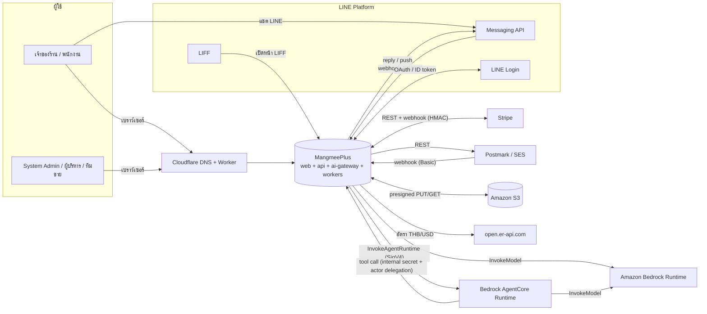
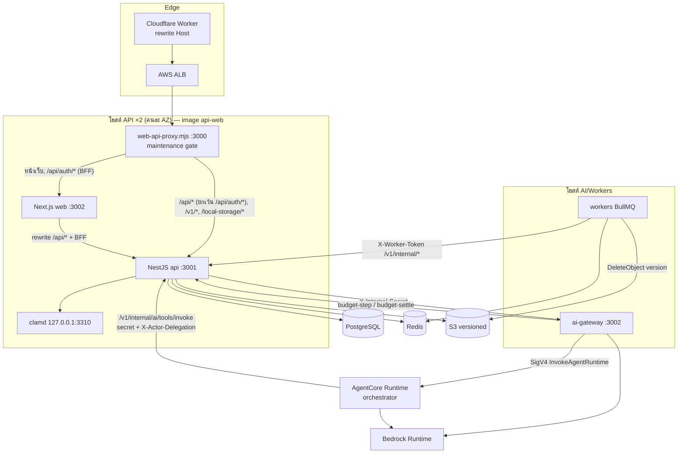
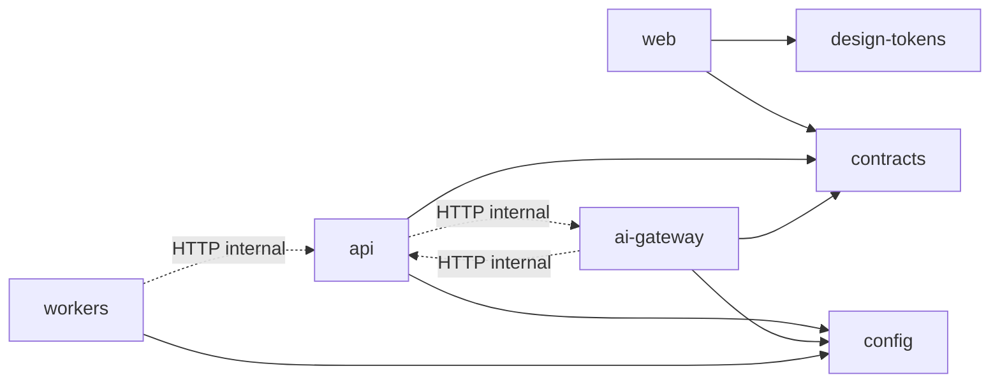
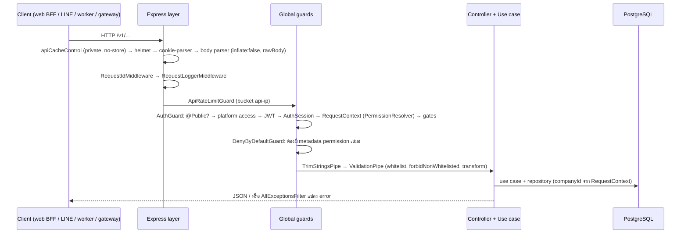
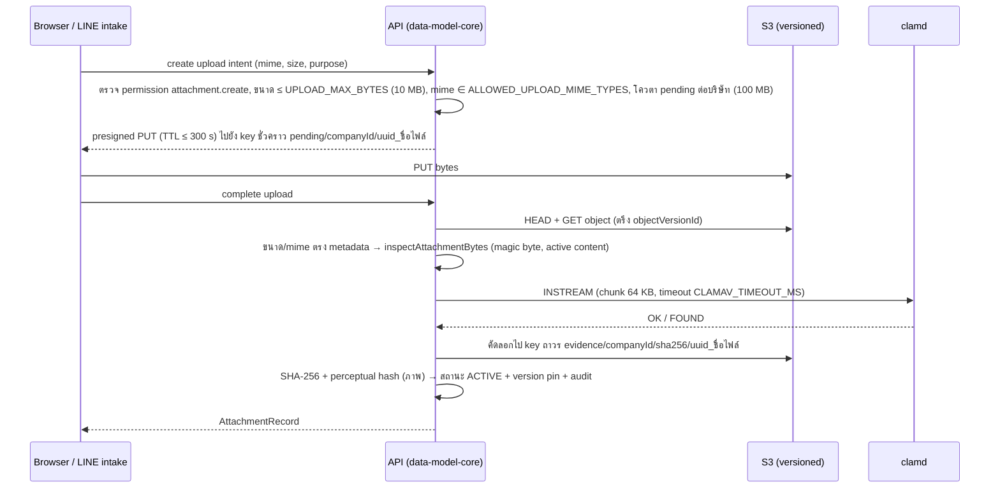
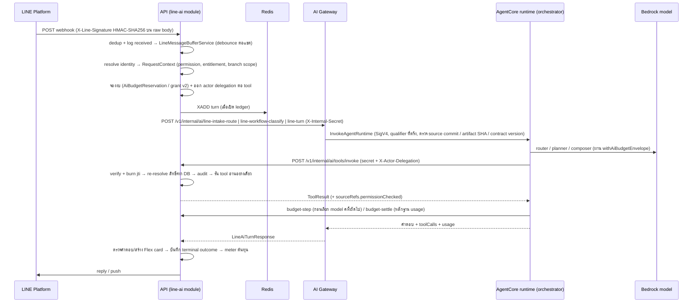
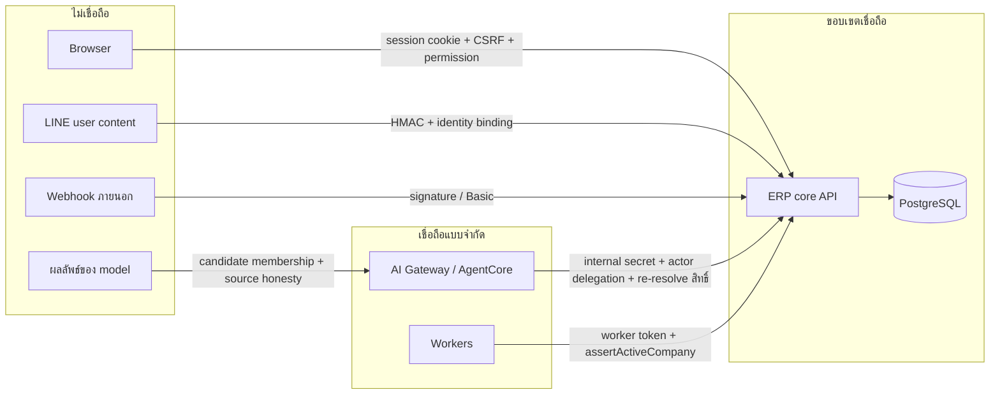

# 03 — Software Architecture & Design Document และ Non-Functional Requirements (MangmeePlus / WatchDog-BMS)

**วัตถุประสงค์:** เอกสารนี้เป็นบันทึกถาวรด้านสถาปัตยกรรมและการออกแบบของระบบ MangmeePlus (ชื่อภายในของ repo คือ WatchDog-BMS) ณ วันปิดโครงการ 2026-11-16 ครอบคลุมมุมมองบริบทระบบและ container, โครงสร้าง monorepo และการ build, การแบ่งชั้นภายใน `apps/api`, กลไกการออกแบบหลักตามที่ implement จริง, สถาปัตยกรรม AI, สถาปัตยกรรมความปลอดภัยพร้อมประวัติการประเมินและแก้ไข, สรุป ADR ทุกฉบับ, ข้อกำหนดที่ไม่ใช่ฟังก์ชัน (`NFR-<nnn>`) พร้อมวิธีที่โค้ดตอบแต่ละข้อ, technology stack พร้อมเวอร์ชันจริง และข้อจำกัด/หนี้ทางเทคนิคที่บันทึกไว้ ทีมในอนาคตต้องสามารถเข้าใจ สร้างใหม่ และดูแลระบบได้จากเอกสารชุดนี้ร่วมกับโค้ดที่เก็บถาวร

**ที่มา:** checkout `closeout-docs-main` = `origin/main` commit `08850deaf` (2026-11-10) — **โค้ดคือความจริง**; `docs/` ใช้เป็นเจตนา/เหตุผล/ประวัติเท่านั้น ทุกพฤติกรรมในเอกสารนี้ตรวจกับโค้ดแล้ว จุดที่มีใน spec แต่ไม่พบในโค้ดระบุไว้ชัดเจนว่า "มีใน spec แต่ไม่พบในโค้ด"

**ข้อตกลงการอ้างอิง:** path เป็น repo-relative; ชื่อ identifier, route, env key, enum คงเป็นภาษาอังกฤษตามโค้ด; เอกสารนี้ไม่พิมพ์ค่า secret, token, รหัสผ่าน, ข้อมูลส่วนบุคคลลูกค้า หรือเลขบัญชีจริง (รวมถึงเลขบัญชี AWS/Stripe ที่ปรากฏในไฟล์ config ของ repo)

## สารบัญ

1. [บริบทระบบ (System Context)](#1-บริบทระบบ-system-context)
2. [มุมมอง Container และการ deploy](#2-มุมมอง-container-และการ-deploy)
3. [โครงสร้าง Monorepo และการ Build](#3-โครงสร้าง-monorepo-และการ-build)
4. [การแบ่งชั้นภายใน `apps/api` และกฎการพึ่งพา](#4-การแบ่งชั้นภายใน-appsapi-และกฎการพึ่งพา)
5. [กลไกการออกแบบหลัก (ตามที่ implement)](#5-กลไกการออกแบบหลัก-ตามที่-implement)
6. [สถาปัตยกรรม AI](#6-สถาปัตยกรรม-ai)
7. [สถาปัตยกรรมความปลอดภัย](#7-สถาปัตยกรรมความปลอดภัย)
8. [Architecture Decision Records](#8-architecture-decision-records)
9. [Non-Functional Requirements](#9-non-functional-requirements)
10. [Technology Stack และเวอร์ชัน](#10-technology-stack-และเวอร์ชัน)
11. [ข้อจำกัดที่ทราบและหนี้ทางเทคนิค](#11-ข้อจำกัดที่ทราบและหนี้ทางเทคนิค)
12. [นอกขอบเขตแพ็ก 1,999 (มีโค้ดแต่ไม่ได้ขาย)](#12-นอกขอบเขตแพ็ก-1999-มีโค้ดแต่ไม่ได้ขาย)
13. [สิ่งที่ตรวจสอบไม่ได้ และสิ่งที่พบในเอกสารแต่ไม่พบในโค้ด](#13-สิ่งที่ตรวจสอบไม่ได้-และสิ่งที่พบในเอกสารแต่ไม่พบในโค้ด)

---

## 1. บริบทระบบ (System Context)

MangmeePlus เป็นระบบบริหารธุรกิจสำหรับ SME ไทยแบบ multi-tenant (หนึ่ง `Company` = หนึ่งร้าน/ผู้เช่า) ประกอบด้วยเว็บแอป (พื้นที่ทำงานเต็มรูปแบบ), ผู้ช่วย AI ทาง LINE Official Account (ถ่ายใบเสร็จ ถามตอบ เบิกจ่าย แจ้งเตือน), ระบบขายแพ็กเกจ/เก็บเงินผ่าน Stripe และคอนโซลผู้ดูแลแพลตฟอร์ม/ทีมขาย

### 1.1 ผู้ใช้และระบบภายนอก

| ผู้เกี่ยวข้อง / ระบบ | บทบาทต่อระบบ | จุดเชื่อมต่อในโค้ด |
|---|---|---|
| เจ้าของร้าน / พนักงานร้าน (บทบาท `OWNER`, `ADMIN`, `MANAGER`, `HR`, `FINANCE`, `ACCOUNTANT`, `STAFF`, `AUDITOR_READONLY` ฯลฯ) | ใช้เว็บและ LINE | `apps/web`, LINE webhook |
| ผู้ดูแลแพลตฟอร์ม (`SYSTEM_ADMIN`), ผู้บริหารมั่งมี (`MANGMEE_EXECUTIVE*`), ทีมขาย (`MANGMEE_SALES`, `MANGMEE_SALES_LEAD`) | คอนโซล `/system/*`, `/sales/*` | `apps/api/src/modules/system-*`, `sales-console`, `executive-business` |
| **LINE Messaging API** | รับ webhook ข้อความ/รูป/postback, ส่ง reply/push/loading animation, ดึง content | `apps/api/src/modules/auth/presentation/line-webhook.controller.ts`, `line-official-webhook.controller.ts`, `apps/api/src/modules/line-ai/infrastructure/line-reply.adapter.ts` (`https://api.line.me`, `https://api-data.line.me`) |
| **LINE Login** (OAuth 2.1 Authorization Code + PKCE, ID token verify) | เข้าสู่ระบบเว็บด้วย LINE, ผูกบัญชี, QR login บนเดสก์ท็อป | `apps/api/src/modules/auth/infrastructure/line-login-verifier.adapter.ts` (`https://api.line.me/oauth2/v2.1/verify`), `line-login-token.client.ts`, use-cases `line-login-callback`, `line-link-oauth`, `*-line-web-login-transaction` |
| **LIFF** (`https://liff.line.me/<liffId>/...`) | หน้าเริ่มต้น/สมัคร/ผูกบัญชี/handoff ภายใน LINE | `apps/api/src/common/security/liff-page.security.ts`, `exchange-liff-session.use-case.ts`, `exchange-line-handoff-token.use-case.ts` |
| **Stripe** (REST ตรงผ่าน `fetch`, ไม่ใช้ SDK) | Checkout, Billing Portal, invoice, refund, webhook `POST /v1/public/stripe-events` | `apps/api/src/modules/billing/infrastructure/stripe.client.ts`, `application/billing-reconciler.service.ts` |
| **Postmark** (ผู้ให้บริการอีเมลหลักตั้งแต่ 2026-09-11) | อีเมล transactional (OTP, ยืนยันอีเมล, รีเซ็ตรหัสผ่าน, แจ้งเตือนบัญชี), webhook `POST /v1/public/postmark-events` (HTTP Basic) | `apps/api/src/modules/auth/infrastructure/postmark.client.ts`, `postmark-auth-mailer.adapter.ts`, `application/postmark-events.service.ts` |
| **AWS SES** (adapter เดิม ยังอยู่ในโค้ด) | ทางเลือก `EMAIL_PROVIDER=ses`; รับ event ผ่าน SNS ที่ `POST /v1/public/ses-events` | `apps/api/src/modules/auth/infrastructure/ses-auth-mailer.adapter.ts`, `external-signup/presentation/http/public-ses-events.controller.ts` |
| **Amazon Bedrock (Runtime)** | เรียก model (Claude ผ่าน inference profile) สำหรับ chat, router, OCR/vision | `apps/ai-gateway/src/modules/line-ai/infrastructure/provider/bedrock.provider.ts` |
| **Amazon Bedrock AgentCore Runtime** | รัน orchestrator ของ LINE AI turn (CodeZip, `NODE_22`) | `apps/ai-gateway/agentcore.json`, `src/agentcore/runtime.ts`, `infrastructure/runtime/agentcore-runtime.client.ts` |
| **OpenAI API** (ทางเลือก ไม่ใช่ค่า production) | `MODEL_PROVIDER=openai` | `provider/openai.provider.ts` |
| **Anthropic API** (local เท่านั้น) | ใช้ทำ eval บนเครื่องนักพัฒนา; schema ปฏิเสธถ้า `APP_ENV != local` | `provider/anthropic-api.provider.ts`, `packages/config/src/index.ts` (superRefine ของ `aiGatewayConfigSchema`) |
| **OCR provider** | ณ commit นี้ **OCR = vision model ผ่าน AI Gateway** (`POST /v1/internal/ai/receipt-ocr`, `capture-read`, `capture-extract`, `bank-statement-extract`) ใช้ `DOCUMENT_AI_MODEL_ID`; ผู้ให้บริการ OCR เฉพาะทาง (Typhoon) เคยใช้และถูกถอดออกแล้ว เหลือเพียง comment ใน `line-ai-internal.controller.ts` | `apps/api/src/modules/expenses/infrastructure/receipt-ocr.client.ts`, `expense-capture-read.client.ts` |
| **Cloudflare** (DNS proxied + Worker) | Worker rewrite `Host` ไป origin และแปลง `Location` กลับ; API ใช้รายการ IP ของ Cloudflare ในการหา client IP จริง | `infra/cloudflare/mangmee-host-proxy.worker.js`, `mangmee-uat-host-proxy.worker.js`, `apps/api/src/common/security/trusted-client-ip.ts` |
| **Amazon S3** (local: MinIO) | เก็บไฟล์แนบ/หลักฐาน/ผล export แบบ versioned, presigned URL | `apps/api/src/modules/data-model-core/infrastructure/storage/s3-storage.adapter.ts`, `local-storage.adapter.ts` |
| **ClamAV** (`clamd` ผ่าน TCP `INSTREAM`) | สแกนมัลแวร์ไฟล์ที่อัปโหลด | `apps/api/src/modules/data-model-core/infrastructure/attachment-malware-scanner.ts` |
| **แหล่งอัตราแลกเปลี่ยน** `open.er-api.com` (keyless) | อัตรา THB/USD สำหรับคิดต้นทุน AI | `apps/api/src/modules/line-ai/application/ai-fx-rate.ts` |
| **AWS Secrets Manager / SSM / CloudWatch / ECR / KMS** | secret, log, alarm, registry, ลายเซ็นหลักฐาน release | `infra/kamal/*`, `infra/monitoring/runtime-alarms.sh`, `infra/security/*` |
| **Webhook ปลายทางของลูกค้า** (โมดูล workflow — นอกขอบเขตขาย) | outbound webhook พร้อม allowlist + กัน SSRF | `apps/api/src/modules/workflow/domain/logic/workflow-webhook-security.logic.ts` |

### 1.2 แผนภาพบริบท



---

## 2. มุมมอง Container และการ deploy

### 2.1 Container เชิงตรรกะ (4 แอป + 3 data store + scanner)

| Container | เทคโนโลยี | หน้าที่ | พอร์ตเริ่มต้น | หลักฐาน |
|---|---|---|---|---|
| `apps/web` | Next.js 16 (App Router, `output: 'standalone'`), React 19, Tailwind CSS 4 | UI ทั้งหมด + BFF (`app/api/auth/*` ออก/หมุน cookie session), `proxy.ts` (CSP nonce, CSRF, route guard), rewrite `/api/:path*` → API | 3000 | `apps/web/next.config.mjs`, `apps/web/proxy.ts`, `apps/web/app/api/*` |
| `apps/api` | NestJS 11 บน Express 5, Prisma 7 (`@prisma/adapter-pg`) | ERP core: source of truth ของข้อมูล สิทธิ์ audit, LINE webhook, billing, internal routes สำหรับ worker และ AI Gateway | 3001 | `apps/api/src/main.ts`, `apps/api/src/app.module.ts` |
| `apps/ai-gateway` | NestJS 11 (stateless, ไม่มี DB/Redis client) | เรียก model provider, orchestrator/agents ของ LINE AI, OCR/vision, เรียก AgentCore; ทุก route เป็น `/v1/internal/ai/*` ป้องกันด้วย `X-Internal-Secret` | 3002 | `apps/ai-gateway/src/main.ts`, `src/common/http/gateway-http.middleware.ts` |
| AgentCore runtime artifact | Node 22, HTTP server เปล่า (ไม่มี Nest DI) | entrypoint `dist/agentcore/runtime.js` ให้ `GET /ping`, `POST /invocations`; รัน orchestrator ตัวเดียวกับ gateway ภายใน Bedrock AgentCore | 8080 | `apps/ai-gateway/src/agentcore/runtime.ts`, `agentcore.json`, `tsconfig.agentcore.json`, `infra/ai-gateway/build-agentcore-artifact.sh` |
| `apps/workers` | Node 22 ESM + BullMQ 5 | ตัวตั้งเวลา/คิว: **ตัดสินใจแค่ "เมื่อไร"** แล้ว POST ไป internal route ของ API ด้วย `X-Worker-Token`; ไม่ต่อฐานข้อมูลเอง (dependency มีเพียง `bullmq`, `ioredis`, `@aws-sdk/client-s3`) | 3000 (health เท่านั้น) | `apps/workers/src/main.ts`, `src/common/internal-api.ts`, `src/common/scan-worker.ts` |
| PostgreSQL | local: `postgres:16-alpine`; production ตาม runbook: RDS PostgreSQL 18.3 Multi-AZ | ฐานข้อมูลหลัก (281 model, 291 enum, 314 migration) | 5432 | `apps/api/prisma/schema.prisma`, `infra/docker/compose.local.yml:3`, `docs/runbooks/cloud-environment-operations.md` |
| Redis | local: `redis:7-alpine`; production: ElastiCache Redis 7.1 (TLS + auth) | BullMQ, rate limit/lease, LINE AI turn ledger (Streams), replay guard ของ actor delegation, preview store ของการแก้ร่างทาง LINE | 6379 | `apps/api/src/common/security/redis-rate-limit.service.ts`, `modules/line-ai/application/line-ai-ledger.service.ts`, `infrastructure/actor-delegation.service.ts`, `modules/expenses/application/services/line-draft-preview.store.ts` |
| Object storage | S3 (versioning เปิด), local: MinIO `RELEASE.2025-09-07T16-13-09Z` | ไฟล์แนบ, PDF ที่ออก, ผล export | — | `infra/object-storage-lifecycle.json`, `infra/docker/compose.local.yml:31` |
| ClamAV | `clamd` 1.5.4 ฝังใน image `api-web` ฟังที่ `127.0.0.1:3310` | สแกนไฟล์อัปโหลดแบบ fail-closed | 3310 | `infra/api-web/Dockerfile.api-web:68-76`, `infra/api-web/start-api-web-runtime.sh` |



ข้อสังเกตสำคัญของ topology:

- **AI Gateway ไม่มีทางเข้าถึง PostgreSQL/Redis/S3 โดยตรง** — `apps/ai-gateway/package.json` ไม่มี `pg`, `@prisma/*`, `ioredis`, `@aws-sdk/client-s3`; ข้อมูลธุรกิจทุกชิ้นต้องผ่าน `POST /v1/internal/ai/tools/invoke` ของ API (ดูข้อ 6)
- **Workers ไม่มี repository ของตัวเอง** — schema บังคับ `DATABASE_URL` (`workersConfigSchema`) แต่โค้ด worker ไม่เปิด connection ฐานข้อมูล; state ทั้งหมดอยู่หลัง internal API ที่ idempotent
- การ deploy จริง **รวม web กับ api ไว้ใน image เดียว (`api-web`)** โดยมี `infra/api-web/web-api-proxy.mjs` เป็น reverse proxy ชั้นใน และ `start-api-web-runtime.sh` เป็นตัว supervise (`clamd` → `freshclam` → API → web); สคริปต์ `unset AI_ACTOR_DELEGATION_SIGNING_KEY` หลัง fork API เพื่อให้เฉพาะ process API ถือ signing key (M-01)

### 2.2 สภาพแวดล้อมและเครื่องมือ deploy (สรุป)

| เรื่อง | สถานะ ณ ปิดโครงการ | หลักฐาน |
|---|---|---|
| Region | `ap-southeast-1` ทั้งหมด | `packages/config/src/index.ts` (`S3_REGION`, `APPROVED_AI_REGIONS` default), `docs/adr/0005-*.md` |
| สภาพแวดล้อม | `local` (Docker Compose), `uat`, `production`; `APP_ENV ∈ {local, production}` กำหนดโหมดความปลอดภัย, `DEPLOY_ENVIRONMENT ∈ {local, uat, production}` กำหนดตัวตนการ deploy | `packages/config/src/index.ts:45-58`, `resolveDeploymentIdentity` |
| เครื่องมือ release | Kamal บน EC2 (3 บทบาท: `api-web`, `ai-gateway`, `workers`) ผ่าน wrapper `infra/kamal/deploy-uat`, `deploy-prod`, `deploy-prod-hotfix`, `promote-prod`; promotion ใช้ image digest เดิมจาก UAT ที่ลงนามแล้ว ไม่ build ใหม่ | `infra/kamal/README.md`, `infra/kamal/release.py`, `infra/kamal/config.json` |
| ยุคก่อนหน้า | App Runner → ECS Express Mode (สคริปต์ยังอยู่ใน `infra/prod-ecs-express/`, `infra/uat/`) → ย้ายเป็น Kamal (กันยายน–ตุลาคม 2026) | `infra/prod-ecs-express/README.md`, `infra/kamal/README.md` ("First ECS-to-Kamal migration") |
| GitHub Actions | มี 17 workflow ใน `.github/workflows/` (CI, deploy, A5, readiness) แต่บันทึกปฏิบัติการช่วงท้ายระบุ `Workflow IDs NOT_DISPATCHED` — release ช่วงท้ายทำจากเครื่อง controller ด้วย Kamal | `.github/workflows/*.yml`, `docs/runbooks/cloud-environment-operations.md` (รายการ 2026-11-09/10) |
| Maintenance mode | `PRODUCTION_SERVING_MODE ∈ {live, maintenance_only}` ต้องตรงกับ `GLOBAL_MAINTENANCE_MODE`; ใน maintenance proxy เปิดเฉพาะ health และ path auth ที่จำเป็น และ workers ต้อง `QUEUE_ENABLED=false` | `infra/api-web/web-api-proxy.mjs`, `packages/config/src/index.ts` (`validateProductionConfig` ส่วน workers), `apps/ai-gateway/src/common/http/production-maintenance.middleware.ts` |
| สวิตช์เปิด-ปิดลูกค้าทั้งแพลตฟอร์ม | `PlatformAccessControl` (แถวเดียว id `platform`) — production ที่อ่านสถานะไม่ได้หรือไม่ `live` ให้ผลเป็น `CLOSED` เสมอ | `apps/api/prisma/schema.prisma:1086-1095`, `apps/api/src/modules/auth/application/platform-access.service.ts`, `auth.guard.ts` (`CLOSED_PUBLIC_PATHS`) |

รายละเอียดขั้นตอน deploy/rollback อยู่นอกขอบเขตเอกสารฉบับนี้ (ดู `docs/runbooks/uat-production-v2-deployment.md` และ `docs/runbooks/cloud-environment-operations.md`)

---

## 3. โครงสร้าง Monorepo และการ Build

### 3.1 Workspace

`pnpm-workspace.yaml` ประกาศ `apps/*` และ `packages/*`; `packageManager` = `pnpm@9.15.0` (root `package.json`); `onlyBuiltDependencies` จำกัด post-install script ไว้ที่ `@prisma/engines`, `esbuild`, `msgpackr-extract`, `prisma`, `sharp`

| Package | ชื่อ | ชนิด module | หน้าที่ | Build |
|---|---|---|---|---|
| `apps/api` | `@watchdog-bms/api` | CommonJS | ERP core API | `swc src -d dist/apps/api/src` (ค่าเริ่มต้น), `build:tsc` สำรอง; typecheck แยก `tsc --noEmit` (heap 8 GB) |
| `apps/web` | `@watchdog-bms/web` | ESM (Next) | เว็บ + BFF | `next build --webpack` (production), `next dev` ใช้ Turbopack |
| `apps/ai-gateway` | `@watchdog-bms/ai-gateway` | CommonJS | AI Gateway + AgentCore artifact | `tsc -p tsconfig.json`, `build:agentcore` = `tsc -p tsconfig.agentcore.json` |
| `apps/workers` | `@watchdog-bms/workers` | ESM (`"type": "module"`, NodeNext) | BullMQ workers | `tsc -p tsconfig.json` |
| `packages/contracts` | `@watchdog-bms/contracts` | ESM, ไม่มี runtime dependency | type/ค่าคงที่/ตรรกะบริสุทธิ์ที่ใช้ร่วม: package catalog, entitlement, permission-bound menu, civil date, AI budget bounds, LINE AI contract | `tsc` → `dist/` |
| `packages/config` | `@watchdog-bms/config` | CommonJS | Zod schema ของ env ทุก service, `validateProductionConfig`, `resolveDeploymentIdentity`, `redactLogValue` | `tsc` → `dist/` |
| `packages/design-tokens` | `@watchdog-bms/design-tokens` | ESM | `tokens.json` → `generated/web/theme.css` (export `./theme.css`) | `node scripts/build-tokens.mjs` (`--check` ใช้เป็น lint) |
| `packages/typescript-native` | `@watchdog-bms/typescript-native` | — | ตรึง TypeScript `7.0.2` ไว้เฉพาะ CI typecheck ของ api/web (`tsconfig.typecheck.json`) โดยไม่ให้ Dockerfile ใดติดตั้ง | ไม่มี |

โฟลเดอร์ระดับ root อื่น: `e2e/` (Playwright 90 spec + `journeys/`), `infra/` (Docker, Kamal, security, monitoring, Cloudflare), `scripts/` (corpus/eval ของ LINE AI, k6 smoke, local proof), `patches/` (`pdfjs-dist@6.2.108.patch`), `docs/`, `release-evidence/`

### 3.2 Turborepo

`turbo.json` กำหนด task: `build` (`dependsOn: ["^build"]`, outputs `dist/**`, `generated/**`, `.next/**` ยกเว้น cache, env `INTERNAL_API_URL`, `NEXT_PUBLIC_API_BASE_URL`, `NEXT_PUBLIC_API_URL`, `NEXT_PUBLIC_AI_GATEWAY_BASE_URL`), `dev` (ไม่ cache, persistent), `lint`/`test`/`typecheck` (ขึ้นกับ `^build`) — Dockerfile ทุกตัวเรียก `pnpm exec turbo run build --filter=<package>`; script ระดับ root (`build`, `lint`, `test`, `typecheck`) ใช้ `pnpm -r --if-present`

### 3.3 tsconfig และ bundler

| ไฟล์ | สาระ |
|---|---|
| `tsconfig.base.json` | `target ES2022`, `module/moduleResolution NodeNext`, `strict`, `declaration`, `sourceMap`, path alias `@watchdog-bms/contracts` และ `@watchdog-bms/config` ชี้ไป `src/index.ts` |
| `apps/api/tsconfig.json` | override เป็น `CommonJS` + `moduleResolution Node`, `experimentalDecorators`, `emitDecoratorMetadata` (ต้องใช้กับ Nest DI) |
| `apps/api/.swcrc` | parser TypeScript + decorators, `legacyDecorator` + `decoratorMetadata`, target `es2022`, `keepClassNames` |
| `apps/ai-gateway/tsconfig.agentcore.json` | เหมือน gateway แต่ path ของ contracts/config ชี้ไป `dist/` และ exclude `*.spec.ts` |
| `apps/web/tsconfig.json` | `module ESNext`, `moduleResolution Bundler`, `jsx preserve`, alias `@/*` → `src/*`; `@watchdog-bms/contracts` ชี้ไป **`packages/contracts/dist/index.js`** (จึงต้อง build contracts ก่อน) |
| `apps/web/next.config.mjs` | `output: 'standalone'`, `poweredByHeader: false`, `typescript.ignoreBuildErrors: true` (ตรวจ type ผ่าน script แยก), `experimental.proxyTimeout: 180_000`, กฎ SVGR ลงทะเบียน **ทั้ง Turbopack และ webpack** (dev ใช้ Turbopack, build ใช้ webpack — ลงทะเบียนฝั่งเดียวทำให้ไอคอนพังในอีกฝั่ง) |

### 3.4 การแชร์ type ผ่าน `packages/contracts`

- `apps/api` (`workspace:^`), `apps/web` (`workspace:*`), `apps/ai-gateway` (`workspace:*`) พึ่ง `@watchdog-bms/contracts`; `apps/workers` **ไม่** พึ่ง contracts (พึ่งเฉพาะ `@watchdog-bms/config`)
- `packages/contracts/src/index.ts` (311 บรรทัด) re-export จากไฟล์รายโดเมน 60+ ไฟล์ เช่น `plan-term.ts` (`PlanTierKey`, `PLAN_TIER_PRESETS`, `planTermState`), `feature-entitlements.ts` (`FEATURE_CATALOG`, `PLATFORM_INVARIANT_FEATURE_KEYS`), `menu-entitlements.ts` (`MENU_ENTITLEMENT_BINDINGS`, `TIER_FEATURE_PRESETS`), `billing.ts`, `civil-date.ts`, `ai-budget-bounds.ts`, `ai-timeouts.ts`, `ai-tools.ts`, `line-ai*.ts`, `expenses.ts`, `reimbursements.ts`, `tax.ts`
- มี spec ป้องกัน drift ระหว่าง contracts กับ Prisma enum: `packages/contracts/src/prisma-enum-parity.spec.ts`
- ตรรกะที่ต้องเหมือนกันทั้งสองฝั่ง (เช่น ตัวแปลงค่าจากข้อความ LINE `line-ai-value-normalizer.ts`, ตัวประมาณ token งบ AI) อยู่ใน contracts เพื่อให้ API และ AI Gateway/AgentCore ใช้ implementation เดียว

### 3.5 กฎการพึ่งพาระหว่าง package



- ไม่มี package ใด import ซอร์สของแอปอื่นข้าม boundary; การสื่อสารระหว่างแอปเป็น HTTP เท่านั้น
- โค้ดเล็ก ๆ ที่ต้องมีทั้งใน api และ ai-gateway (เพราะ bundle แยกกัน) ถูก **ทำสำเนาโดยตั้งใจและมี test บังคับให้ byte-identical**: `secret-compare.ts` ↔ `internal-secret.ts` (L-07), `security-event.ts` (L-14), `NestPinoLoggerBridge`

### 3.6 Container image

ทุก Dockerfile เป็น multi-stage บน `node:22.23.4-trixie-slim` ตรึงด้วย digest (`@sha256:8eb619e4…`): `system` → `build-base` (corepack) → `manifests` → `deps` / `prod-deps` (`pnpm install --frozen-lockfile --prod --no-optional --filter <pkg>...`) → `build` → `runtime-artifacts` (ลบ `*.map`, `*.d.ts`, `*.spec.js`, `*-smoke.js`, `*.md`) → `runner` (purge `util-linux`, `perl-base` ฯลฯ, `USER node`)

| Image | ไฟล์ | หมายเหตุ |
|---|---|---|
| api | `apps/api/Dockerfile` | ติดตั้ง `fonts-noto-core` และตรวจว่ามี Noto Sans Thai (ใช้ render PDF), เพิ่ม RDS global CA bundle (ตรึง checksum), target เสริม `local` (รัน `start-production.sh`), `migration-tool`, `release-task`; smoke test ใน image ด้วย `infra/docker/api-runtime-smoke.cjs` |
| web | `apps/web/Dockerfile`, `apps/web/Dockerfile.lambda` (AWS Lambda Web Adapter 0.9.1 — เส้นทางทดลอง) | copy `.next/standalone` + `.next/static` + `public` |
| ai-gateway | `apps/ai-gateway/Dockerfile` | ฝัง native `sharp-linux-x64@0.35.5` + `sharp-libvips-linux-x64@1.3.4` และทดสอบการหมุนภาพใน build |
| workers | `apps/workers/Dockerfile` | — |
| **api-web (ที่ใช้ deploy จริง)** | `infra/api-web/Dockerfile.api-web` | รวม api + web + ClamAV 1.5.4 (ตรึง checksum ของ `.deb`), `NEXT_PUBLIC_API_BASE_URL=/api` |
| tools | `infra/dev-kamal/Dockerfile.tools` | image สำหรับ migration/sync ระหว่าง release |

---

## 4. การแบ่งชั้นภายใน `apps/api` และกฎการพึ่งพา

### 4.1 โครงสร้างระดับบน

```
apps/api/src/
  main.ts                 bootstrap: helmet, cookie-parser, body parsers, CORS, global pipes/guards/filters
  app.module.ts           รวม 36 Nest module; ติด RequestIdMiddleware + RequestLoggerMiddleware ทุก route
  common/                 โค้ดที่ใช้ ≥ 2 โมดูล (config, database, security, logger, middleware, pipes, filters, export, observability)
  modules/<bounded-context>/
    presentation/[http/]  controller + DTO (class-validator) + decorator
    application/          use-cases/, services/, dto/
    domain/               models/, logic/ (ฟังก์ชันบริสุทธิ์), ports/ (interface + DI token)
    infrastructure/       repositories/ (Prisma), storage/, client ภายนอก, adapter
    <name>.module.ts
  generated/prisma/       Prisma client ที่ generate (ไม่อยู่ใน git)
  scripts/                smoke/ops script
```

โมดูลทั้งหมดใน `apps/api/src/modules` (32 โฟลเดอร์): `access-control`, `accounting-documents`, `ai-draft`, `audit`, `auth`, `banking`, `billing`, `crm`, `crm-inbox`, `dashboard-notifications`, `data-model-core`, `data-rights`, `employee-access`, `executive-business`, `expenses`, `external-signup`, `feature-launch`, `health`, `inventory`, `ledger`, `line-ai`, `procurement`, `public-home-theme`, `reimbursements`, `reports`, `sales-console`, `sales-demo`, `system-identity-reconciliation`, `system-onboarding`, `system-partner-management`, `tax`, `workflow`

### 4.2 ทิศทางการพึ่งพา (hexagonal / ports and adapters)

กฎตาม `docs/guidelines/backend-hexagonal-code-style.md` และ ADR 0006:

```
presentation -> application -> domain
infrastructure -> application/domain ports
```

ตัวอย่างที่ตรงตามแบบในโค้ด:

| Port (domain) | Adapter (infrastructure) | การผูก DI |
|---|---|---|
| `IPermissionResolverPort` + `PERMISSION_RESOLVER_TOKEN` (`access-control/domain/ports/permission-resolver.port.ts`) | `PrismaPermissionResolverRepository` | `access-control.module.ts` (`useClass`) |
| `IPolicyEvaluatorPort` + `POLICY_EVALUATOR_TOKEN` | `CompositePolicyEvaluator([OwnRecordPolicy, TenantBoundaryPolicy])` | `access-control.module.ts` (`useFactory`) |
| `AttachmentStoragePort` + `ATTACHMENT_STORAGE` | `S3StorageAdapter` / `LocalStorageAdapter` | `data-model-core.module.ts` |
| `IAuditRepository` + `AUDIT_REPOSITORY_TOKEN` | `PrismaAuditRepository` | `audit.module.ts` |
| `IJwtVerifier` | `WatchdogJwtVerifierAdapter`, `DevJwtVerifierAdapter`, `LineLoginVerifierAdapter` | `auth.module.ts` |
| `AuthMailer` port (`auth/domain/ports/auth-mailer.port.ts`) | `PostmarkAuthMailerAdapter`, `SesAuthMailerAdapter`, `LocalConsoleAuthMailerAdapter`, `DisabledAuthMailerAdapter` (เลือกตาม `EMAIL_PROVIDER`) | `auth.module.ts` |
| `IModelProvider` (ai-gateway `provider.port.ts`) | `BedrockProvider`, `OpenAiProvider`, `AnthropicApiProvider`, `DisabledProvider` | `provider.factory.ts` |
| `IErpReadTool` (`line-ai/domain/ports/erp-read-tool.port.ts`) | use-case `erp-*-tools.use-case.ts` | `line-ai.module.ts` + `InternalToolsController.toolMap` |

**การเบี่ยงเบนจากแบบที่พบจริง (ต้องรู้ก่อนแก้โค้ด):**

- หลายโมดูลใช้ `PrismaService` ตรงใน application/use-case หรือแม้แต่ guard (`auth.guard.ts` query `authSession`, `companyPlanTerm`, `userCredential` เอง) — repository port ไม่ได้ครอบทุกการเข้าถึงข้อมูล
- โมดูลขนาดเล็ก/ใหม่บางตัวเป็นไฟล์แบน ไม่แบ่งชั้น: `data-rights/` (`data-rights.service.ts` + controller), `public-home-theme/`
- use-case ขนาดใหญ่มาก: `line-ai/application/use-cases/process-line-webhook.use-case.ts` 15,534 บรรทัด
- `common/security/abac/*.policy.ts` เป็น placeholder (comment `ponytail: placeholder`) — ตัวประเมินนโยบายที่ใช้จริงคือ `access-control/infrastructure/policies/*`

### 4.3 Cross-cutting ใน `common/`

| โฟลเดอร์ | เนื้อหา |
|---|---|
| `common/config` | `AppConfigService` (ห่อ `apiConfigSchema` + `validateProductionConfig`), `LineMessagingCredentialsService` |
| `common/database` | `PrismaService` (composition กับ `PrismaPg` adapter), `serializableTransaction` (retry `P2034` สูงสุด 5 รอบ), `prisma-error.ts` (`uniqueConstraintFields`, `isSerializationFailure`), `line-identity-lock.ts`, `pg-spec-guard.ts` |
| `common/security` | `ApiRateLimitGuard`, `RedisRateLimitService`, `DenyByDefaultGuard`, `@Public()`, `@RequirePermissions()`, `@RequireAnyPermission()`, `assertWorkerToken`, `assertInternalSecret`/`timingSafeStringEqual`, `trustedClientIp`, `canonicalFingerprint`, `assertActiveCompany`, `liff-page.security.ts` |
| `common/middleware` | `RequestIdMiddleware`, `RequestLoggerMiddleware`, `apiCacheControl`, `providerEventsJson` |
| `common/logger` | pino logger + redaction, `NestPinoLoggerBridge`, `emitSecurityEvent`/`SECURITY_EVENT` |
| `common/filters` | `AllExceptionsFilter` |
| `common/pipes` | `TrimStringsPipe`, `GLOBAL_VALIDATION_PIPE_OPTIONS`, `decimal-string.patterns.ts`, spec `body-validation-coverage.spec.ts` |
| `common/export` | `csv.logic.ts` (กัน formula injection), `xlsx.logic.ts`, `thai-date.logic.ts` |
| `common/observability` | `customer-journey-signal.catalog.ts`, `customer-journey-failure-matrix.catalog.ts`, `customer-journey-audit.ts` |

### 4.4 ลำดับการประมวลผลหนึ่ง request ของ API



ลำดับ guard ถูกกำหนดใน `main.ts` (`useGlobalGuards(ApiRateLimitGuard)`) และ `common/security/security.module.ts` (`APP_GUARD` สองตัวเรียงกัน: `AuthGuard` แล้ว `DenyByDefaultGuard`)

---

## 5. กลไกการออกแบบหลัก (ตามที่ implement)

### 5.1 Multi-tenancy และการจำกัดขอบเขต Company / Branch

**รูปแบบ:** ฐานข้อมูลเดียว schema เดียว แยกผู้เช่าด้วยคอลัมน์ `companyId` (229 จาก 281 model มี `companyId`) — **ไม่มี** PostgreSQL Row-Level Security และ **ไม่มี** Prisma extension ที่ฉีด `companyId` อัตโนมัติ การแยกผู้เช่าบังคับที่ชั้นแอปพลิเคชัน 4 จุด:

1. **การเลือกผู้เช่า** — `AuthGuard` (`apps/api/src/modules/auth/presentation/auth.guard.ts`) อ่าน `X-Company-Id` (ชื่อ header กำหนดได้ด้วย `COMPANY_CONTEXT_HEADER`) หรือ route param `:companyId`; ถ้ามีทั้งคู่และไม่ตรงกัน → `403 Route company does not match request context.` (บังคับที่ศูนย์กลาง แม้ controller ลืมเรียก `assertRouteCompany`)
2. **การยืนยันสมาชิกภาพ** — `PrismaPermissionResolverRepository.resolveForUser` ต้องพบ `CompanyMembership` สถานะ `ACTIVE` ของผู้ใช้ในบริษัทนั้น และ `Company.status = ACTIVE` (ยกเว้นเส้นทางกู้คืนเมื่อหมดอายุแพ็ก และโหมด free-expense-drafts); ถ้าไม่ระบุบริษัท จะเลือกสมาชิกภาพ `SYSTEM_ADMIN` ก่อน แล้วจึงสมาชิกภาพ active ที่เก่าที่สุด
3. **การ query** — repository/use-case ทุกตัวรับ `companyId` จาก `RequestContext` (ไม่รับจาก body) และใส่ใน `where`; controller ที่มี `:companyId` เรียก `assertRouteCompany(ctx, routeCompanyId)` (`data-model-core/presentation/http/assert-route-company.ts`, 173 จุดเรียก)
4. **Internal route** — route ของ worker ที่รับ `companyId` จากผู้เรียกต้องผ่าน `assertWorkerToken` แล้ว `assertActiveCompany` (`common/security/active-company.ts`, H-14) ส่วน route ของ AI tool ต้อง re-resolve สิทธิ์จากฐานข้อมูลเสมอ (ข้อ 6)

ความสมบูรณ์เชิงผู้เช่าระดับฐานข้อมูล: unique/foreign key แบบ composite ที่ขึ้นต้นด้วย `companyId` (เช่น `@@unique([companyId, documentType, documentNumber])`) และ migration ของ M-11 ที่เพิ่ม composite tenant FK (ดูข้อ 7.9)

**Branch scope (ABAC ระดับสาขา):** `CompanyMembership.branchScopeMode ∈ {ALL_BRANCHES, SELECTED_BRANCHES, DEFAULT_BRANCH_ONLY}` + `branchScopes` + `defaultBranchId` ถูกแปลงโดย `resolveBranchIds` (`data-model-core/domain/logic/branch.logic.ts`) เป็น `RequestContext.scopes.branchIds`:

- `undefined` = ไม่จำกัด; array = จำกัดเฉพาะสาขาที่ `ACTIVE` ในรายการ (สาขา default ถูกเรียงไว้ตัวแรกเพื่อให้ create path ติดป้าย `branchIds[0]` ได้แน่นอน)
- `SELECTED_BRANCHES` ที่ไม่มีสาขา active เหลือ → `403 No active branch scope assigned.`
- ตัวช่วยบังคับ: `isBranchInScope(scopes, branchId)` และ `branchScopeWhere(scopes)` — แถวที่ `branchId = null` ถือเป็นข้อมูลกลางบริษัท มองเห็นได้ทุกคน; ใช้ใน 113 ไฟล์ของ `apps/api/src/modules`
- กฎโครงสร้าง: บริษัทต้องมีสาขา `ACTIVE` อย่างน้อยหนึ่งแห่งและ `HEAD_OFFICE` ที่ active อย่างน้อยหนึ่งแห่ง (`canLeaveActiveBranch`)

**Tenant พิเศษ:** บริษัทแพลตฟอร์ม (id `seed-watchdog-system-company`) ถือสมาชิกภาพ `SYSTEM_ADMIN`; บริษัทสาธิตมี `Company.reportClassification = 'DEMO'` และ session แบบ `provider: 'demo'` ที่ผูก `demoCompanyId` ไว้ใน JWT (`auth.guard.ts`, `sales-demo/application/demo-company-access.ts`)

### 5.2 Authentication และการออกแบบ Session

| องค์ประกอบ | การ implement | หลักฐาน |
|---|---|---|
| ช่องทางเข้าสู่ระบบ | (1) username/อีเมล + รหัสผ่าน, (2) LINE Login บนเว็บ (OAuth code + PKCE + nonce), (3) LIFF session exchange, (4) QR login เดสก์ท็อปที่อนุมัติจากมือถือ, (5) LINE→เว็บ handoff token (`/l/<token>`), (6) อีเมล OTP (ช่องทางสำรอง), (7) demo link, (8) dev JWT (เฉพาะ `APP_ENV=local`) | `apps/api/src/modules/auth/application/use-cases/*`, `domain/logic/login-channel.logic.ts` |
| รหัสผ่าน | `scrypt` (salt 16 ไบต์, hash 64 ไบต์) เก็บรูป `scrypt$<salt>$<hash>`, เปรียบเทียบด้วย `timingSafeEqual` | `auth/domain/logic/password-credential.logic.ts` |
| Token | JWT `HS256` (ตรึง algorithm, `iss`, `aud` ทั้งฝั่ง sign และ verify — L-04); access 15 นาที (`ACCESS_EXPIRES_IN = 900`) ฝัง `sub`, `sid`, `provider`, `permissions`; refresh 7 วัน มี `type: 'refresh'` และ `fid` (family) | `issue-token.use-case.ts`, `jwt-claims.logic.ts`, `watchdog-jwt-verifier.adapter.ts` |
| Session ฝั่ง server | ตาราง `AuthSession` (`tokenId`, `previousTokenId`, `familyId`, `status`, `expiresAt`, `passwordCredentialVersion`, `emailReauthenticatedAt`) — **ทุก request ตรวจแถว session** (`status = ACTIVE`, ยังไม่หมดอายุ, `userId` ตรง `sub`); token ที่ไม่มี `sid` ถูกปฏิเสธ (L-05) จึง logout/revoke มีผลทันทีแม้ access token ยังไม่หมดอายุ | `auth.guard.ts:230-240` |
| Refresh rotation | หมุน `tokenId` ด้วย compare-and-swap; การนำ refresh token เก่ามาใช้ซ้ำนอก grace window (`SESSION_REFRESH_REUSE_GRACE_SECONDS` default 30 วินาที สำหรับหลายแท็บ) ถือเป็น reuse → เพิกถอน session ของ family นั้นและ emit `auth.session.refresh_reuse_detected` ระดับ `CRITICAL` (L-01); จำกัดอัตรา `SESSION_REFRESH_MAX_PER_SESSION` 30/60 วินาที | `refresh-session.use-case.ts` |
| การเพิกถอน | `revokeActiveSessions` (logout, revoke-others, เปลี่ยน/รีเซ็ตรหัสผ่าน); login ด้วยรหัสผ่านล็อกแถว `UserCredential` (`SELECT … FOR UPDATE`) ระหว่างสร้าง session เพื่อกัน race กับการเปลี่ยนรหัสผ่าน | `session-revocation.logic.ts`, `issue-token.use-case.ts` |
| Cookie (เว็บ) | BFF ของ Next (`app/api/auth/*`) เป็นผู้ตั้ง cookie: `watchdog_token` (httpOnly, `sameSite=lax`, `secure` ใน production, path `/`, แบ่ง chunk `watchdog_token.0..5` ขนาด 3,500 ไบต์เพราะ JWT ที่ฝัง permission ของ `OWNER` ~9.4 KB), `watchdog_refresh` + `watchdog_persist` (httpOnly, path `/api/auth` เท่านั้น), `watchdog_csrf` (อ่านได้จาก JS สำหรับ double-submit), `watchdog_home` | `apps/web/src/common/auth/auth-cookies.constants.ts`, `auth-cookies.server.ts` |
| CSRF | `apps/web/proxy.ts`: การ mutate ผ่าน `/api/*` ต้อง same-origin (`Origin`/`Sec-Fetch-Site`) และถ้ามี cookie session ต้องมี header `x-csrf-token` ตรงกับ cookie (เปรียบเทียบ constant-time); 403 พร้อม `code: csrf_token_invalid` ให้ client refresh แล้วลองใหม่ได้หนึ่งครั้ง | `apps/web/src/common/auth/middleware.logic.ts` |
| Bearer | API รับ `Authorization: Bearer` เป็นหลัก และ fallback เป็น cookie (`accessTokenFromCookies`) | `auth/presentation/auth-cookie.constants.ts` |
| ประตูหลัง authenticate | เรียงใน `AuthGuard`: platform access `CLOSED` (ยกเว้น `SYSTEM_ADMIN`) → `mustChangePassword` (ยกเว้น `/v1/auth/*` และ session จาก LINE) → หมดอายุแพ็ก (`CompanyPlanTerm.termEndsAt <= now` → `company_term_expired`, ตรวจ ณ เวลาเข้าถึง ไม่รอ sweep) → การยอมรับเอกสารกฎหมาย (`legal_acceptance_required`) → โหมด `FREE_EXPENSE_DRAFTS_ONLY` → ข้อจำกัดของบริษัทสาธิต | `auth.guard.ts` |
| Rate limit ของ auth | bucket แยกตาม identifier และ IP (login 5 ครั้ง/identifier, 20/IP ต่อ 900 วินาที; reset, OTP, QR, handoff มี bucket ของตัวเอง) — fail-closed เมื่อ Redis ล่ม | `auth/application/auth-rate-limit.service.ts`, `packages/config/src/index.ts` (`PASSWORD_LOGIN_*`, `PASSWORD_RESET_*`, `LINE_QR_*`, `LINE_HANDOFF_*`) |

### 5.3 Authorization: RBAC + ABAC + Permission Resolver

- **Permission registry** (`apps/api/src/modules/auth/permission-registry.ts`): รายการ `PERMISSIONS` ประมาณ 390 key (375 key ที่ประกาศตรงในไฟล์ + 15 key ของ `BILLING_PERMISSIONS` ที่ spread มาจาก `packages/contracts/src/billing.ts`; นับจากซอร์ส ไม่ได้รันโค้ด) รูป `domain.resource.action` พร้อม `riskLevel`, บทบาทระบบ 19 บทบาท (`SYSTEM_ROLES`) และ `ROLE_GRANTS`; sync เข้าฐานข้อมูลด้วย `apps/api/prisma/sync-permissions.ts` ระหว่าง release; บริษัทสร้างบทบาทเองได้ (`Role.scopeKey` = company) ภายใต้กฎ `roleGrantViolation`/`ownerGatedGrantViolation` (H-01: ผู้ให้สิทธิ์ให้ได้ไม่เกินสิทธิ์ของตน, บทบาท `OWNER`/แพลตฟอร์มมอบผ่านการสร้างพนักงานไม่ได้)
- **Deny by default** (`common/security/deny-by-default.guard.ts`): ทุก handler ที่ไม่ใช่ `@Public()` ต้องมี `@RequirePermissions(...)` (ต้องมีครบ) หรือ `@RequireAnyPermission(...)`; ไม่มี metadata → `403 Permission metadata is required.` — 131 controller, 908 decorator สิทธิ์, 72 จุด `@Public()` (webhook, health, internal route ที่ตรวจ token เอง, หน้า public)
- **Permission resolver** (`access-control/infrastructure/prisma-permission-resolver.repository.ts`) คือ chokepoint เดียวที่คำนวณ `RequestContext`: เฉพาะบทบาท `status = ACTIVE` → รวม permission → **ตัดด้วย entitlement** (`filterPermissionsByEntitlement`) → คำนวณ `entitlementDeniedPermissions` (permission → featureKey ที่ทำให้ถูกตัด) → branch scope → flag `isDemo`, `freeExpenseDrafts`; เรียกทุก request (ไม่ cache ฝั่ง server) จึงสะท้อนการเปลี่ยนบทบาท/แพ็กทันที
- **Permission ใน JWT เป็นสำเนาเพื่อ AI Gateway เท่านั้น** — API ไม่เชื่อ claim `permissions` ใน token; คำนวณใหม่จากฐานข้อมูลเสมอ
- **ABAC:** (1) branch scope ตามข้อ 5.1, (2) `CompositePolicyEvaluator` (`TenantBoundaryPolicy` + `OwnRecordPolicy`: deny ชนะ, allow ตัวแรก, ไม่มีผล = `not_applicable`), (3) กฎ own-record/maker-checker เฉพาะโดเมนใน use-case (เช่น เบิกจ่าย, อนุมัติ vendor bill — H-07)
- **ข้อความปฏิเสธ:** ถ้า permission ที่ขาด **ทุกตัว** ถูกตัดเพราะ entitlement → `403 { code: 'feature_not_enabled', featureKey }`; กรณีอื่น → `403 Insufficient permissions.` (ไม่เปิดเผย configuration ของ feature ให้ผู้ที่ไม่มีบทบาท)

### 5.4 การบังคับ Entitlement (สิทธิ์ตามแพ็กเกจ)

| ชั้น | กลไก | หลักฐาน |
|---|---|---|
| ข้อมูล | `CompanyFeatureEntitlement(companyId, featureKey, enabled)`; แคตตาล็อก `FEATURE_CATALOG` + submenu; `PLATFORM_INVARIANT_FEATURE_KEYS = ['employee_access', 'company_settings']` เปิดเสมอ | `packages/contracts/src/feature-entitlements.ts` |
| ตัวประเมินเดียว | `evaluateEntitledFeatureKeys(rows)` — ไม่มีแถวเลย = `null` = บริษัท legacy **fail-open**; submenu เปิดตาม parent เว้นแต่ระบุ `false`; รองรับ `LEGACY_FEATURE_INHERITANCE` | `employee-access/application/entitlement.helper.ts` |
| การตัด permission | แมป permission → feature จาก capability-pack registry + `PREFIX_FEATURE_RULES`; ตัดที่ resolver จึงมีผลพร้อมกันทั้ง API guard, เมนูเว็บ และ tool ของ LINE AI | `employee-access/domain/logic/feature-gate.logic.ts` |
| แพ็ก → feature | `TIER_FEATURE_PRESETS`: `STARTER_249`, `BASIC_499`, `PRO_999` = starter preset; `ENTERPRISE_1999` = starter + `wht_pnd53` + `wht_50bis`; การซื้อผ่าน billing เขียน entitlement ตาม preset | `packages/contracts/src/menu-entitlements.ts:496-501`, `billing/application/billing-feature-entitlements.ts` |
| ความจุตามแพ็ก | `CompanyPlanTerm.branchLimit/employeeLimit/monthlySlipLimit` (ค่า preset ใน `PLAN_TIER_PRESETS`); ตรวจตอนสร้างด้วย `assertBranchLimit`/`assertEmployeeLimit` → `422 plan_branch_limit_exceeded`/`plan_employee_limit_exceeded`; ไม่มีแถว term = ไม่จำกัด (grandfathered); ไม่ลบของเดิมเมื่อ limit ลดลง | `system-partner-management/application/plan-term-limit.ts` |
| โควตาใบเสร็จ/OCR | `company-ocr-governance.ts` (admission ต่อบริษัท-เดือน) + `CompanyAiConfiguration.receiptQuotaEnforced` | `line-ai/application/company-ocr-governance.ts` |
| อายุแพ็ก | บังคับ ณ เวลาเข้าถึงใน `AuthGuard` (ถึงชั่วโมง) + sweep ทุก 5 นาที (`/internal/plan-term/sweep`) สำหรับเปลี่ยนสถานะและแจ้งเตือน 7/3/1 วัน | `auth.guard.ts`, `apps/workers/src/modules/plan-term-sweep/` |
| Launch gate (แยกจาก entitlement) | `FeatureLaunchGate(gateKey, routeKey, state ∈ {CLOSED, OPEN}, generation)` — เปิดได้เฉพาะเมื่อมี attestation ของ environment + build ปัจจุบัน; ปิดอยู่ → `403 feature_temporarily_unavailable` (ต่างจาก "ไม่ได้ซื้อ"); boot ล้มถ้า route ชนิด `SPECIALIST_LEGAL` ถูกเปิด | `feature-launch/application/launch-gate.guard.ts`, `apps/api/prisma/sync-feature-launch-gates.ts --verify-specialist-closed` |

### 5.5 Idempotency

ไม่มี middleware idempotency กลาง — ใช้ **unique constraint ระดับฐานข้อมูลต่อ aggregate** เป็นรั้ว และให้ผู้เรียกส่ง key:

| รูปแบบ | ตัวอย่าง model / constraint | หมายเหตุ |
|---|---|---|
| `idempotencyKey` ต่อบริษัท | `DocumentNumber @@unique([companyId, documentType, idempotencyKey])`, แถว expense/reimbursement/payment/billing หลายตาราง (`@@unique([companyId, idempotencyKey])` ~20 จุดใน `schema.prisma`) | ส่ง key เดิมด้วยพารามิเตอร์ต่างกัน → `409` |
| Command journal | `commandId` unique + fingerprint: `DataRightsCaseActionRecord.commandId`, แผน/แพ็ก (`PlanTermAdjustmentBody.commandId + expectedVersion`), `FeatureLaunchGateTransition @@unique([gateKey, routeKey, commandId])`, entitlement command | fingerprint คำนวณฝั่ง server ด้วย `canonicalFingerprint` (`common/security/canonical-fingerprint.ts`: เรียง key, `null` ชัดเจน, ห้าม `Date`/NaN) — key เดิม + fingerprint เดิม = replay ผลเดิม |
| Webhook ภายนอก | Stripe event เก็บลง ledger แล้ว drain; LINE webhook dedup ด้วย `LineWebhookEventLog` (+ unique ต่อ LINE message สำหรับ media intake — RECEIPT-02) | `billing-reconciler.service.ts`, `line-message-buffer.service.ts` |
| Request id | `RequestIdMiddleware` รับ `X-Request-Id` (≤ 256 ไบต์; ยาวกว่านั้น hash เป็น `sha256:<hex>` แบบ deterministic) และใช้เป็น key ของ OCR admission/การจองงบ AI | `common/middleware/request-id.middleware.ts` |
| Actor delegation | `jti` ถูกเผาใน Redis ด้วย `SET NX EX` — token ใช้ได้ครั้งเดียว | `line-ai/infrastructure/actor-delegation.service.ts` |
| งานเบื้องหลัง | endpoint sweep/drain ทุกตัว idempotent (claim ด้วย row-level CAS / lease / claim token) จึงทน tick ซ้ำหรือ tick หาย | `apps/workers/src/common/internal-api.ts` (comment), use-case drain ต่าง ๆ |
| Transaction | `serializableTransaction` (isolation `Serializable`, retry เมื่อ `P2034` สูงสุด 5 ครั้ง, ห้ามมี side effect ภายนอกใน callback); advisory lock (`pg_advisory_xact_lock`) สำหรับ namespace เลขเอกสารและ lock ต่อบริษัท-เดือนของงบ AI | `common/database/serializable-transaction.ts` |

### 5.6 Audit Trail

- ตาราง `AuditLog` (`companyId?`, `actorType`, `actorUserId?`, `actorRefId?`, `action`, `targetType`, `targetId?`, `requestId`, `result`, `riskLevel`, `metadataJson`, index ตาม `companyId+createdAt`, actor, target, `requestId`) — `apps/api/prisma/schema.prisma:1062-1084`; รายการ action อยู่ใน `audit/domain/models/audit-action.ts`
- `AuditService` มี 3 โหมดส่ง (L-10) — `apps/api/src/modules/audit/application/audit.service.ts`:
  - `log(entry)` หลัง commit: **ไม่ throw**; insert 1 ครั้ง + retry 1 ครั้ง แล้ว emit `audit.persist.failed` (`riskLevel: CRITICAL`) เพื่อให้ alarm จับ
  - `log(entry, tx)` ใน transaction: **throw** เพื่อ rollback การ mutate พร้อม audit
  - `logOrThrow(entry)` ก่อนเกิดผล: fail-closed (ใช้ที่ขอบเขต AI tool — ถ้าบันทึกการใช้ delegation ไม่ได้ จะไม่รัน tool)
- Metadata ถูก sanitize: key ที่เข้าข่าย (`password|token|secret|cookie|credential|api_key|raw…|body|content`) → `[REDACTED]`, string ยาวเกิน 512 ตัด, array เกิน 50 ตัด
- Audit เก็บ PII ที่จำเป็นต่อการสืบสวนไว้จนกว่าจะมีคำขอลบ (L-11) ส่วน **log pipeline** redaction ทุกอย่างตาม `SENSITIVE_LOG_KEY_PATTERN`
- อ่าน audit: `GET` ผ่าน `audit/presentation/audit.controller.ts` (กรองตาม actor/target/category/ช่วงเวลา, แบ่งหน้า); `AUDIT_ENABLED` ต้องเป็น `true` ใน production (`validateProductionConfig`)
- สถานะปฏิบัติการของ LINE AI ledger บน Redis ถูก mirror ลง audit (`ai.line.ledger.*`) ตาม ADR 0010

### 5.7 Background jobs, คิว และ scheduler (`apps/workers`)

**หลักการ:** worker เป็น "นาฬิกา" — คิว BullMQ + repeatable job/`upsertJobScheduler` ที่ POST ไป `INTERNAL_API_URL` พร้อม `X-Worker-Token`; ตรรกะและ state อยู่ใน API ทั้งหมด

กลไกร่วม (`apps/workers/src/common/`):

- `queue.ts` — `createQueue` ทุกคิวใช้ retention เดียว (`removeOnComplete: 48`, `removeOnFail: 100`; ที่มา: UAT Redis เต็มจาก job record 270k); retry ตาม `QUEUE_RETRY_ATTEMPTS` (3) / `QUEUE_RETRY_BACKOFF_MS` (1000, exponential); `attachDeadLetterQueue` คัดลอก job ที่ล้มครั้งสุดท้ายไป `<queue>-dlq` (เก็บ 500, ไม่มี consumer — เป็นหลักฐาน)
- `scan-worker.ts` — แม่แบบ "หนึ่งคิว หนึ่ง scheduler หนึ่ง endpoint" (`concurrency: 1`)
- `internal-api.ts` — `postInternal`: 404 = endpoint ยังไม่ deploy → ข้าม tick และ backoff 5 นาทีต่อ path (กัน canary rollback จาก 4xx ระหว่าง rolling deploy)
- `main.ts` — health HTTP server, heartbeat ทุก 30 วินาที, graceful shutdown (`Worker.close()` ทุกตัวภายใน `WORKER_SHUTDOWN_TIMEOUT_MS` 15 วินาที), `QUEUE_ENABLED=false` ใน maintenance

ตารางงานทั้งหมด (จาก `apps/workers/src/modules/*`):

| คิว | job / scheduler id | ช่วงเวลา | Internal route ของ API | ขอบเขตขาย |
|---|---|---|---|---|
| `billing-events` | `billing-events-drain` | 10 วินาที | `POST /v1/internal/billing/drain` | ใน |
| `billing-scan` | `billing-scan` | 30 วินาที | `/internal/billing/scan` | ใน |
| `billing-discovery` | `billing-discovery` | 10 วินาที | `/internal/billing/provider-scans/drain` | ใน |
| `billing-notifications` | `billing-notifications-drain` | 10 วินาที | `/internal/billing/notifications/drain` | ใน |
| `notifications` | `notifications-delivery-sweep` | 30 วินาที | `/internal/notifications/delivery-sweep` | ใน |
| `notifications` | `notifications-snapshot-sweep` | 15 นาที | `/internal/notifications/snapshot-sweep` | ใน |
| `notifications` | `notifications-stock-low-sweep` | 60 นาที | `/internal/notifications/stock-low-sweep` | นอก (inventory) |
| `notifications` | `notifications-daily-owner-summary-sweep` | cron `0 7 * * *` `Asia/Bangkok` (5 attempts) | `/internal/notifications/daily-owner-summary-sweep` | ใน |
| `plan-term-sweep` | `plan-term-sweep-scan` | 5 นาที | `/internal/plan-term/sweep` | ใน |
| `sales-sweep` | `sales-expire-sweep`, `sales-renewal-sweep` | 15 นาที | `/internal/sales/deals/expire-sweep`, `/internal/sales/deals/renewal-sweep` | ใน |
| `sales-sweep` | `sales-daily-digest` | cron `0 7 * * *` `Asia/Bangkok` (5 attempts) | `/internal/sales/daily-digest` | ใน |
| `executive-rebuild` | `executive-rebuild` | 60 นาที | `/internal/executive/rebuild` | ใน |
| `signup-claim-email` | drain | 30 วินาที | `/internal/signup-claim-email/drain` | ใน |
| `signup-claim-reminder` | sweep | 15 นาที | `/internal/signup-claim-email/reminder-sweep` | ใน |
| `line-ai-ledger` | `line-ai-ledger-drain` | `LINE_AI_LEDGER_RECLAIM_INTERVAL_MS` (60 วินาที) | `/internal/ai/line-ledger/sweep-orphan-events`, `/internal/ai/line-ledger/drain`, `/internal/ai/line-capture-results/drain` (สามงานอิสระใน tick เดียว) | ใน |
| `expense-capture-read` | `expense-capture-read-scan` | 30 วินาที | `/internal/expenses/capture-read/drain` | ใน |
| `reimbursement-reconcile` | scan | 120 วินาที | `/internal/reimbursements/reconcile` | ใน |
| `workflow` | `object-version-cleanup-drain` | 30 วินาที | `/internal/storage-cleanup/object-versions/claim` แล้ว worker ลบ S3 version เอง | ใน (ไฟล์แนบ) |
| `workflow` | `workflow-outbox-drain` | 30 วินาที | `/internal/workflow/outbox/drain` | outbox ใช้ร่วม |
| `workflow` | `workflow-scan-threshold`, `-sla`, `-schedule` | 15 นาที | `/internal/workflow/scan` | นอก |
| `workflow` | `workflow-action-retry` | 60 วินาที | `/internal/workflow/action-runs/retry` | นอก |
| `expense-auto-post` | scan | 60 วินาที | `/internal/ledger/expense-auto-post/drain` | นอก (`expense_auto_post` ไม่อยู่ใน preset ใด) |
| `ai-draft` | `ai-draft-drain` | 15 วินาที | `/internal/ai/draft-requests/drain` | นอก |
| `crm-inbox` | `sla`, `newconv`, `retry`, `autonomy`, `reminder`, `proposal` scan | 60 วินาที | `/internal/crm/*-scan`, `booking-proposal-sweep` | นอก |
| `crm-pdpa` | `crm-pdpa-purge` / `crm-pdpa-erasure` | 24 ชั่วโมง / 5 นาที | `/internal/crm/pdpa-purge`, `/internal/crm/pdpa-erasure-process` | นอก (ข้อมูล CRM) |
| `crm-trust` | scan | 60 นาที | `/internal/crm/trust-score-scan` | นอก |
| `crm-campaign-delivery` | scan | 15 วินาที | `/internal/crm/campaign-delivery-scan` | นอก |

งานในกระบวนการ API เอง (ไม่ผ่าน BullMQ): LINE message buffer (debounce ในหน่วยความจำ + drain ตอน SIGTERM), ตัวอ่านเอกสาร capture (`EXPENSE_CAPTURE_READ_CONCURRENCY` 1–4, default 2), `line-document-qa.worker.ts`

**Outbox:** `OutboxEvent` (`apps/api/prisma/schema.prisma:1097`) เขียนใน transaction เดียวกับธุรกรรมผ่าน `data-model-core/application/services/outbox-append.service.ts`, claim/publish โดย `prisma-outbox.repository.ts` เมื่อ worker เรียก `/internal/workflow/outbox/drain`

### 5.8 File upload pipeline และการสแกนไวรัส



- Use-case: `create-upload-intent`, `complete-attachment-upload`, `link-attachment`, `create-download-url`, `delete-attachment` (`apps/api/src/modules/data-model-core/application/use-cases/`)
- เฉพาะผู้อัปโหลดเองและอยู่ใน branch scope จึง complete ได้; ไฟล์ที่ไม่ผ่าน → `rejectUpload` พร้อมรหัส `CONTENT_REJECTED`/`CONTENT_UNINSPECTABLE` และ security event `attachment.upload.rejected`
- **ClamAV fail-closed:** production ที่ไม่มี `CLAMAV_HOST` → `CLAMAV_NOT_CONFIGURED` (และ `validateProductionConfig` บังคับ key นี้); `clamd` รันด้วย `--fail-if-cvd-older-than=7` — ฐาน signature เก่าเกิน 7 วันถือว่าไม่พร้อม; `StreamMaxLength 30M`
- Immutability (H-11): key ถาวรรูป `evidence/<companyId>/<sha256>/<uuid>_<ชื่อไฟล์ที่ sanitize>` (`generateImmutableObjectKey`) ไม่ถูกเขียนทับ และอ้างด้วย `objectVersionId`; version ที่ไม่ใช้แล้วถูกเก็บกวาดผ่าน `ObjectVersionCleanupService` + worker (`OBJECT_VERSION_CLEANUP_SOURCES`: `ATTACHMENT_FINALIZATION`, `REPORT_EXPORT`, `SUBSTITUTE_RECEIPT_CERTIFIED`, `SUBSTITUTE_RECEIPT_ISSUED`)
- Lifecycle ของ bucket: `pending/` หมดอายุ 1 วัน, `report-export/` 7 วัน (`infra/object-storage-lifecycle.json`)
- ดาวน์โหลด: presigned GET (TTL ≤ `SIGNED_URL_TTL_SECONDS` สูงสุด 300) หลังตรวจ tenant/purpose/permission ของ target (M-10)
- ฝั่งเว็บ: แปลง HEIC ด้วย `heic-to`, รวมภาพเป็น PDF/ย่อภาพก่อนส่ง (`apps/web/src/common/files/`)
- เส้นทางพิเศษ: body JSON base64 ของการอ่าน statement ธนาคารได้ limit `UPLOAD_MAX_BYTES × 1.5` เฉพาะ route นั้น (`main.ts`)

### 5.9 การสร้าง PDF

| เอกสาร | ไฟล์ | วิธี |
|---|---|---|
| หนังสือรับรองหัก ณ ที่จ่าย (50 ทวิ) | `tax/domain/logic/wht-certificate-pdf.logic.ts` | เปิดแบบฟอร์มต้นฉบับกรมสรรพากร (`tax/assets/rd-wht50bis.pdf`) ด้วย `pdf-lib` แล้ววางข้อความ/ลายเซ็นเป็นภาพ overlay ที่ render จาก SVG ด้วย `sharp` (ฟอนต์ Noto Sans Thai ใน image) |
| ภ.ง.ด.53 (แบบทางการ) | `tax/domain/logic/pnd53-official-form.logic.ts` | แนวเดียวกัน |
| ใบรับรองแทนใบเสร็จ | `expenses/domain/logic/substitute-receipt-pdf.logic.ts` | `pdf-lib` + `sharp` |
| ใบบันทึกรายจ่าย/ใบสำคัญจ่าย | `expenses/domain/logic/expense-record-pdf.logic.ts` | `pdf-lib` |
| แบบฟอร์มเบิกเงิน | `reimbursements/application/use-cases/reimbursement-claim-form.use-case.ts` | `pdf-lib` |
| การอ่าน PDF ขาเข้า | `expenses/domain/logic/expense-capture-preprocess.logic.ts`, `line-ai/application/line-document-qa.service.ts` | `pdfjs-dist@6.2.108` (patched) + `@napi-rs/canvas` rasterize เป็นภาพก่อนส่ง vision model; จำกัด `EXPENSE_CAPTURE_PDF_MAX_PAGES` (60) และ `EXPENSE_CAPTURE_DERIVATIVE_MAX_BYTES` (64 MiB) |

ไม่มี headless browser ในระบบ; QR code ใช้ `qrcode-generator`; การยืนยันฟอนต์ไทยทำตอน build image (`fc-match 'Noto Sans Thai'`) และ smoke `infra/docker/api-runtime-smoke.cjs`

### 5.10 การออกเลขเอกสาร (Numbering)

- Model `DocumentSequence` (`companyId`, `branchScopeKey` = id สาขาหรือ `GLOBAL`, `documentType`, `periodKey`, `prefixTemplate`, `nextNumber`, `padding` default 5, `resetPolicy`) unique ที่ `[companyId, branchScopeKey, documentType, periodKey]`; `DocumentNumber` (สถานะ `RESERVED` → `COMMITTED` / `CANCELLED` / `VOIDED`) unique ที่ `[companyId, documentType, documentNumber]` และ `[companyId, documentType, idempotencyKey]`
- วงจร: `ReserveDocumentNumberUseCase` (หรือ `executeInTransaction(tx, …)` เพื่อให้เลข commit/rollback พร้อมเอกสาร) → `CommitDocumentNumberUseCase` → `Cancel…`/`Void…` — `apps/api/src/modules/data-model-core/application/use-cases/`
- กันการชนกัน: `pg_advisory_xact_lock(hashtext('<companyId>:expense-number'))` สำหรับ `expense.record`; สำหรับ `tax.wht_certificate` ใช้ period รายปีและ lock `'<companyId>:wht-number:<year>'`; ตรวจ idempotency ก่อนจัดสรร (key เดิม + พารามิเตอร์ต่าง → `409`)
- รูปแบบเลข: `formatDocumentNumber`, `buildPeriodKey`, `getDefaultDocumentSequenceConfig`, `templateNumbersAreBranchDistinct` (`data-model-core/domain/logic/document-sequence.logic.ts`)

### 5.11 วันที่ เวลา และเขตเวลา (Asia/Bangkok)

- **Timestamp** เก็บเป็น UTC (`DateTime`); **วันปฏิทิน (civil date)** เดินทางบนสายเป็น `YYYY-MM-DD`, เก็บใน `@db.Date` เป็น UTC midnight และ "วันนี้/เดือนนี้" คำนวณในเขตเวลาบริษัท — `packages/contracts/src/civil-date.ts` (`DEFAULT_COMPANY_TIME_ZONE = 'Asia/Bangkok'`, `isCivilDate`, `civilPeriodRange`, `InvalidCivilDateError` → `400 invalid_date`)
- เหตุผลที่ต้องมีโมดูลนี้ (บันทึกในไฟล์): `new Date(2026, 7, 4)` บนเครื่องเขตไทยเก็บเป็นวันก่อนหน้า และ `toISOString()` ช่วง 00:00–07:00 น. ให้วันของเมื่อวาน
- ปีพุทธศักราช: แสดงผลเป็น พ.ศ. (`apps/web/src/common/i18n/thai-date.ts`, `apps/api/src/common/export/thai-date.logic.ts`); ข้อมูลบนสาย/ฐานข้อมูลเป็น ค.ศ. ISO เสมอ; การตีความวันที่จากข้อความ LINE/ใบเสร็จเป็นไปตาม ADR 0011 (วัน/เดือน/ปี พ.ศ., ตัวแปลง BE↔CE จุดเดียว, สถานะ `ExpenseDocumentDateStatus`)
- Scheduler ที่ผูกเวลา: cron `0 7 * * *` ระบุ `tz: 'Asia/Bangkok'` ชัดเจน; งบ AI รายเดือนใช้ "เดือนตามเวลากรุงเทพ" เป็น key; ชั่วโมงทำการของคิวสมัคร (`LINE_SIGNUP_BUSINESS_DAYS`/`HOURS`) วัดในเขตเวลาไทย

### 5.12 การแทนค่าเงิน

ระบบใช้ **สองรูปแบบ** ตามบริบท (ต้องไม่ปนกัน):

| บริบท | รูปแบบ | หลักฐาน |
|---|---|---|
| บัญชี/เอกสารธุรกิจ (รายจ่าย, เบิกจ่าย, ภาษี, เอกสารขาย, สินค้าคงคลัง) | `Decimal` ของ PostgreSQL — `@db.Decimal(18, 4)` 170 คอลัมน์ (หน่วยบาท), อัตรา/สัดส่วนเป็น `Decimal(6,4)`/`(8,4)`; คำนวณด้วย `decimal.js`; บนสายเป็น **string** ตรวจด้วย pattern ใน `common/pipes/decimal-string.patterns.ts` + ตรรกะ `accounting-money-validation.logic.ts` (H-05) | `apps/api/prisma/schema.prisma`, `apps/api/package.json` (`decimal.js`) |
| เงินของแพลตฟอร์ม (billing/Stripe, ต้นทุนและงบ AI, เครดิตแชต, ส่วนลดงานขาย, รายงานผู้บริหาร) | **สตางค์เป็นจำนวนเต็ม** `Int` — เช่น `BillingInvoice.totalSatang/paidSatang/refundedSatang/taxSatang`, `AiUsageEvent.costSatang`, `AiBudgetReservation.upperBoundSatang/settledCostSatang`, `CompanyAiConfiguration.monthlyBudgetSatang`, `SalesAttribution.amountSatang` (34 ฟิลด์) | `schema.prisma` |
| ต้นทุน AI | `computeCostSatang` = token × ราคา USD/ล้าน token × อัตรา THB/USD × 100 ปัดครึ่งขึ้น คำนวณครั้งเดียวตอนบันทึก พร้อมประทับอัตราที่ใช้ในแถว | `line-ai/application/ai-model-pricing.ts`, `ai-fx-rate.ts` |

### 5.13 Error model

- รูปแบบตอบกลับ = มาตรฐาน Nest (`{ statusCode, message, error }`) และสำหรับข้อผิดพลาดทางธุรกิจมี **`code` คงที่** ให้ client แยกกรณี เช่น `feature_not_enabled`, `feature_temporarily_unavailable`, `company_term_expired`, `legal_acceptance_required`, `platform_access_closed` (503), `company_membership_disabled`, `plan_branch_limit_exceeded` (422), `invalid_date`, `csrf_token_invalid`, `demo_link_expired` (410), `FREE_EXPENSE_DRAFTS_ONLY`
- `AllExceptionsFilter` (`common/filters/all-exceptions.filter.ts`): แปลง Prisma error ที่เกิดจาก input ให้เป็น 4xx ด้วย **ข้อความคงที่** (ไม่ส่งข้อความ Prisma ออก เพราะมีค่าจาก request): `PrismaClientValidationError` → 400, `P2002` → 409 (+ ชื่อคอลัมน์ถ้ามี), `P2025` → 404, `P2003` → 409; รหัสอื่น (schema drift, pool, serialization) คง 500 พร้อม log `unhandled exception` ที่มี `requestId`/method/path/stack
- `uniqueConstraintFields()` อ่านทั้ง `meta.target` และรูปแบบของ driver adapter (`meta.driverAdapterError.cause.constraint.fields`) เพราะ Prisma 7 + `@prisma/adapter-pg` ไม่เติม `meta.target`
- AI tool ตอบ `ToolResult.status ∈ {ok, forbidden, unsupported_module, unavailable, error}` + `errorCode`; ผลที่ไม่ `ok` ไม่พาข้อมูลธุรกิจข้ามขอบเขต (`enforceSourceHonesty`)
- ฝั่งเว็บ: `apps/web/src/common/api/api-error.logic.ts`, `api-error-message.ts` แปลง `code` เป็นข้อความไทย; spec `no-raw-api-error-display.spec.ts` ห้ามแสดง error ดิบ

### 5.14 Caching

| ชั้น | นโยบาย | หลักฐาน |
|---|---|---|
| API response | `Cache-Control: private, no-store, max-age=0` ทุก response โดย default และปิด ETag ของ Express (ADR 0012) | `common/middleware/api-cache-control.middleware.ts`, `main.ts` (`disable('etag')`) |
| หน้าเว็บ | root layout เรียก `await connection()` ให้ render ต่อ request (จำเป็นต่อ CSP nonce); asset ที่มี hash ของ Next cache แบบ immutable; `/legal/releases/*` `public, max-age=31536000, immutable` | `apps/web/app/layout.tsx`, `next.config.mjs` |
| Server-side | **ไม่มี** cache ข้อมูลธุรกิจ/สิทธิ์ (permission resolver query ทุก request); cache ในหน่วยความจำมีเฉพาะค่าปฏิบัติการ: อัตรา FX (TTL 6 ชั่วโมง → fallback แถว `AiFxRate` → `AI_THB_PER_USD`), `Intl.DateTimeFormat` ต่อ timezone, gate "endpoint หาย" ของ worker | `ai-fx-rate.ts`, `civil-date.ts`, `apps/workers/src/common/internal-api.ts` |
| Model provider | Prompt caching ของ Bedrock (cache read/write token ถูกคิดราคาแยก) | `ai-model-pricing.ts`, `docs/specs/ai-prompt-caching-usage-logging-spec.md` |
| Redis | ไม่ใช้เป็น cache ข้อมูล — ใช้เป็นคิว, ตัวนับ, lease, stream ledger, replay guard | ข้อ 2.1 |

### 5.15 Rate limiting

- **Bucket รวมต่อ IP** (`api-ip`): `ApiRateLimitGuard` global, default 120 request / 60 วินาที (`RATE_LIMIT_MAX_REQUESTS`, `RATE_LIMIT_WINDOW_SECONDS`), ยกเว้น `/health`; ตอบ `429` + `Retry-After`; production บังคับ `RATE_LIMIT_ENABLED=true`
- **Client IP ที่เชื่อถือได้** (`trustedClientIp`): เชื่อ `X-Forwarded-For` เฉพาะเมื่อ peer เป็น private/loopback แล้วเดินจากขวาไปซ้ายข้าม hop ของ tier ตัวเองและช่วง IP ของ Cloudflare (ฝังรายการไว้ในโค้ด)
- **Store:** Redis ผ่าน Lua (`INCR` + `EXPIRE`, แบบ consume-once, lease) — `RedisRateLimitService`; นโยบายเมื่อ Redis ล่ม: `fail-closed` (ค่าเริ่มต้น; ทุก bucket ที่คุมเงินหรือ credential) หรือ `degrade-to-local` (เฉพาะ `api-ip` — นับต่อ process แทน และ emit `api.rate_limit.store_degraded` แบบ edge-triggered) — การตัดสินใจ M-12 (2026-07-28)
- **Bucket เฉพาะทาง:** auth (ข้อ 5.2), AI ต่อบริษัท (`ai-llm-company` 60/60 วินาที, `ai-ocr-company` 20/60 วินาที), public signup/SES events ต่อ IP, billing (`billing-rate-limit-window.ts`)
- AI Gateway จำกัด concurrency ของ AgentCore (`AGENTCORE_MAX_CONCURRENT_INVOCATIONS` 16) และขนาด body (ข้อ 7.5)

### 5.16 นโยบาย feature ("no feature switches")

สิ่งที่โค้ดทำจริงมี 3 ชั้นที่ต้องแยกให้ออก:

1. **สิทธิ์เชิงพาณิชย์ = entitlement ต่อบริษัท** (ข้อ 5.4) — นี่คือกลไกเดียวที่กำหนดว่าลูกค้า "ได้ใช้อะไร"
2. **Launch gate ระดับแพลตฟอร์ม** (`FeatureLaunchGate`) — เปิด/ปิด route ต่อ environment+build โดยผู้ดูแล release; ไม่มี cohort ต่อผู้เช่า ไม่มี percentage rollout (`docs/runbooks/feature-launch-control.md` §0)
3. **ตัวแปร environment แบบ boolean/enum** ใน `packages/config/src/index.ts` — ยังมีอยู่จำนวนมาก (เช่น `LINE_WEB_LOGIN_ENABLED`, `LINE_SIGNUP_ENABLED`, `EXTERNAL_SIGNUP_ENABLED`, `LINE_AI_LEDGER_ENABLED`, `BILLING_MODE`, โหมด `LINE_AI_*_MODE`) ทำหน้าที่เป็น **สวิตช์ปฏิบัติการ/ความปลอดภัยต่อ environment** ไม่ใช่สวิตช์เชิงพาณิชย์

**คำสั่งเจ้าของ 2026-09-29 ("no more switches; always on")** ที่ปรากฏในโค้ด: ความสามารถของ LINE AI turn (native tool loop, coverage critic, prepared simple read, draft edit, reimbursement draft, approved knowledge, ตระกูลคำตอบ deterministic ที่อนุมัติ) **ไม่มี getter ใน `AiGatewayConfigService`** จึงไม่มีค่า env ใด — รวมถึงสำเนา env ที่ค้างใน AgentCore — ปิดได้ (`apps/ai-gateway/src/common/config/ai-gateway-config.service.ts:65-68`, `src/agentcore/runtime.ts:679`, spec `runtime-minimal-env.spec.ts`) schema ยังคง parse key เดิม (`LINE_AI_TOOLUSE_LOOP_ENABLED`, `LINE_AI_COVERAGE_CRITIC_ENABLED`, `LINE_AI_DRAFT_EDIT_ENABLED` ฯลฯ) เพื่อให้ contract ของ env คงที่ แต่ค่าไม่ถูกอ่านฝั่ง gateway

ข้อยกเว้นที่ production ห้ามเปิด: `AI_FINAL_MUTATION_ENABLED` (ต้อง `false`), `SWAGGER_ENABLED`, `DEV_AUTH_ENABLED`, `AI_PROMPT_LOGGING_ENABLED`; flag ที่ประกาศว่า "RESERVED / INERT" (ไม่มี consumer): `LINE_AI_PROVIDER_CLIENT_REUSE_ENABLED`, `LINE_AI_AGENTCORE_SESSION_AFFINITY_ENABLED`, `LINE_AI_SMALL_ROUTER_SHADOW_ENABLED`, `LINE_AI_ADVISOR_DIRECT_ANSWER_ENABLED`, โหมด `shadow` ของ `LINE_AI_SUBSTITUTE_SEMANTIC_ROUTING_MODE`/`LINE_AI_REIMBURSEMENT_SEMANTIC_MODE`

ค่าที่ deploy จริงต่างจาก default ถูกตรึงใน `infra/kamal/config.json` (เช่น `LINE_AI_BUFFER_DEBOUNCE_MS=500`, `EXPENSE_CAPTURE_GROUP_INTAKE_ENABLED=true`, `BILLING_MODE=live` สำหรับ production)

### 5.17 Configuration และการตรวจตอน boot

- ทุก service parse env ด้วย Zod schema ของตน (`apiConfigSchema`, `aiGatewayConfigSchema`, `webConfigSchema`, `workersConfigSchema`) — ค่าที่ไม่รู้จักของ enum **ทำให้ boot ล้ม** ไม่ degrade เป็นโหมดที่ผ่อนกว่า
- `validateProductionConfig` (เมื่อ `APP_ENV=production`) รวมข้อผิดพลาดทั้งหมดแล้ว throw: secret ต้องยาว/entropy พอและไม่ตรง denylist (L-03), `CORS_ALLOWED_ORIGINS` ไม่ว่าง/ไม่ wildcard, `LOG_FORMAT=json`, `LOG_LEVEL != debug`, ห้าม `S3_ENDPOINT`/localhost URL, ห้าม `AUTH_PROVIDER=dev`/`SEED_SYSTEM_ADMIN_PASSWORD`, บังคับ key ของ LINE/AI/เข้ารหัส/`CLAMAV_HOST`/`WORKFLOW_WEBHOOK_ALLOWED_HOSTS`, key สามตัว (`CREDENTIAL_ENCRYPTION_KEY`, `PDPA_PSEUDONYMIZATION_KEY`, `AI_ACTOR_DELEGATION_SIGNING_KEY`) ต้องเป็นอิสระต่อกัน, model/provider/region ต้องอยู่ใน allowlist, ห้าม inference profile `global.` เว้นแต่มี `AI_GLOBAL_INFERENCE_PROFILE_APPROVED=true` พร้อม `AI_GLOBAL_INFERENCE_PROFILE_APPROVAL_REF`
- ตัวตนการ deploy: production ต้องมี `DEPLOY_ENVIRONMENT ∈ {uat, production}` และ `GIT_SHA` 40 hex หรือ `IMAGE_DIGEST` `sha256:<64 hex>` — placeholder `<…>` หรือ SHA สั้นถูกปฏิเสธ (`resolveDeploymentIdentity`)
- เครื่องมือ: `pnpm config:validate` (`scripts/validate-prod-config.ts`), `infra/production/compare-env-keys.sh`

### 5.18 Observability ในโค้ด (สรุป; รายละเอียด NFR ข้อ 9)

- Log JSON ด้วย pino ทุก service (`service` เป็น base field), request log หนึ่งบรรทัดต่อ request (`requestId`, `method`, `path` เป็น route template, `status`, `durationMs`; ระดับ error/warn/info ตาม status)
- `X-Request-Id` ผูกข้าม web → API → AI Gateway → AgentCore → tool call → audit
- Security event ชื่อคงที่ + `riskLevel` ระดับ root (ข้อ 7.8), `customer-journey-signal.catalog.ts` สำหรับสัญญาณ journey ลูกค้า
- Health: `GET /v1/health` (public, ตื้น), `GET /v1/internal/health/readiness` (ต้องมี worker token, ตรวจฐานข้อมูล — L-13)

---

## 6. สถาปัตยกรรม AI

### 6.1 หลักการแยก AI Gateway ออกจาก ERP core

กฎของ repo (`AGENTS.md`: "Keep AI Gateway separate from ERP core. AI Gateway must call permission-checked APIs/tools, not direct database repositories.") ถูกทำให้เป็นข้อเท็จจริงเชิงโครงสร้าง:

| ขอบเขต | การบังคับ | หลักฐาน |
|---|---|---|
| ไม่มีทางเข้าฐานข้อมูล | `apps/ai-gateway/package.json` ไม่มี driver ฐานข้อมูล/Redis/S3; image ไม่มี Prisma client | `apps/ai-gateway/Dockerfile`, comment หัวไฟล์ `infrastructure/erp-tool.client.ts` |
| Stateless | gateway ไม่เก็บ state ของ turn; ledger/บริบทสนทนา/งบ อยู่ที่ API (ADR 0010) | `apps/api/src/modules/line-ai/application/line-ai-ledger.service.ts`, `line-conversation-context.service.ts` |
| ทางเข้าเดียว | ทุก route เป็น `/v1/internal/ai/*`; middleware ตรวจ `X-Internal-Secret` แบบ constant-time **ก่อน helmet และก่อน body parser ทุกตัว** (ปิดการ parse ก่อน authenticate — แก้ 2026-10-21) ตอบ 401 พร้อม `Connection: close` | `apps/ai-gateway/src/common/http/gateway-http.middleware.ts` |
| ไม่ถือ key ผู้ใช้ | ฝั่ง AI ไม่จำเป็นต้องมี JWT secret ใน production (`validateProductionConfig`: `(isApiConfig \|\| !isAiConfig) && missing('WATCHDOG_JWT_SECRET_ARN')`) และ `start-api-web-runtime.sh` ไม่ส่ง `AI_ACTOR_DELEGATION_SIGNING_KEY` ให้ process อื่นนอกจาก API | `packages/config/src/index.ts`, `infra/api-web/start-api-web-runtime.sh` |
| ผู้ใช้ปลายทางเรียก gateway ตรงไม่ได้ | LINE และเว็บไม่เรียก gateway/AgentCore โดยตรง — API เป็นผู้เรียกฝั่ง server เท่านั้น | comment หัวไฟล์ `apps/ai-gateway/src/agentcore/runtime.ts` |
| Model ที่อนุญาต | `assertApproved` ตรวจ provider/model/region กับ allowlist ทุกครั้งที่สร้าง provider; grant ที่ลงนามตรึง provider+model+region | `provider/provider.factory.ts` |

### 6.2 ลำดับการทำงานของหนึ่ง LINE AI turn



ส่วนประกอบฝั่ง gateway/AgentCore (`apps/ai-gateway/src/modules/line-ai/agents/`): `line-intake-compact-decision.ts` และ `intent-router.agent.ts` (จัดเส้นทาง), `workflow-classifier.agent.ts`, `orchestrator.agent.ts` (planner + native tool loop, เพดาน `AI_MAX_TOOL_CALLS` ≤ 8), `coverage-critic.agent.ts`, `response-composer.agent.ts` (ตรวจว่าตัวเลขในคำตอบมาจากข้อมูล tool หรือคำถาม), `prepared-simple-read-formatter.ts` (เส้นทางคำตอบ deterministic จาก tool เดียว), `accounting-summary.agent.ts`, `inventory.agent.ts`, `approved-knowledge.ts`/`approved-product-help.ts`, `mangmee-persona.ts`, นโยบายขอบเขต `domain/logic/line-ai-scope-policy.logic.ts`

Route ของ gateway ทั้งหมด (`/v1/internal/ai/…`): `line-turn`, `line-intake-route`, `line-workflow-classify`, `line/public-general`, `line-draft-edit-capability`, `line-reliability-capabilities`, `line-document-qa`, `receipt-ocr`, `capture-read`, `capture-extract`, `bank-statement-extract`, `agents` (GET), `draft-generate`, และกลุ่ม `crm-*` (นอกขอบเขตขาย) — `apps/ai-gateway/src/modules/*/…controller.ts`

Runtime ที่เลือกได้: `LINE_AI_AGENT_RUNTIME ∈ {disabled, strands-local, agentcore}`; production ใช้ `agentcore` ซึ่งบังคับ `AGENTCORE_RUNTIME_ARN`, `AGENTCORE_RUNTIME_QUALIFIER`, `AGENTCORE_EXPECTED_SOURCE_COMMIT`, `AGENTCORE_EXPECTED_ARTIFACT_SHA256`, `AGENTCORE_EXPECTED_CONTRACT_VERSION` (`LINE_AI_RUNTIME_CONTRACT_VERSION = 1`)

### 6.3 Tool call ผ่าน API ที่ตรวจสิทธิ์ (ขอบเขตความเชื่อถือ)

`POST /v1/internal/ai/tools/invoke` — `apps/api/src/modules/line-ai/presentation/http/internal-tools.controller.ts:359-`:

1. `assertInternalSecret` (constant-time)
2. `ActorDelegationService.consume` ตรวจลายเซ็น/อายุ/บริบท และเผา `jti`; ล้ม → 401 + security event `ai.tool.invoke.denied` (ไม่เขียน audit เพราะยังไม่มีตัวตนที่ยืนยัน)
3. **ไม่เชื่อ authorization ที่ผู้เรียกส่งมา**: เรียก `PermissionResolverService.resolveAccess(userId, companyId)` จากสถานะฐานข้อมูลปัจจุบัน — `permissions`/`branchIds`/`roles` ใน body ถูกเพิกเฉย (SEC-02/SEC-03)
4. ถ้า company/membership ที่ resolve ได้ไม่ตรงกับ claim ของ delegation → 401 + audit `STALE_ACTOR_DELEGATION`
5. `audit.logOrThrow(AI_ACTOR_DELEGATION_CONSUME)` — fail-closed
6. ต้องมี permission `ai.tool.invoke` และ permission เฉพาะของ tool; entitlement ถูกตัดไปแล้วที่ resolver
7. รัน tool จาก `toolMap` (use-case `erp-*-tools.use-case.ts`: expense, reimbursement, tax, report, dashboard, package, team, substitute receipt, draft update preview ฯลฯ) แล้ว audit ผลต่อ tool (M-02)

ฝั่ง gateway (`erp-tool.client.ts`): `ToolPolicyEnforcerService.assertToolCanExecute` (ต้องเปิด policy + audit, tool ต้องประกาศ `requiresErpPermissionCheck`, tool ชนิด `final_mutation`/`approval_request` ถูกปฏิเสธเมื่อ `AI_FINAL_MUTATION_ENABLED=false`) และ `enforceSourceHonesty` ทำให้ผลที่ไม่มี `sourceRefs` หรือ `permissionChecked !== true` กลายเป็น error

**ช่อง AI เป็นแบบอ่านอย่างเดียว/ร่างเท่านั้น:** tool กลุ่ม `draft_update` ทำได้แค่ **preview**; การเขียนจริงเกิดเมื่อผู้ใช้กดยืนยัน (LINE postback ที่ลงนาม) ซึ่งวิ่งเข้า API โดยตรง ไม่ผ่าน gateway; API ตรวจซ้ำว่า tool เป็น mutation หรือไม่ (L-08) และ production ห้ามเปิด `AI_FINAL_MUTATION_ENABLED`

### 6.4 Actor delegation (การลงนามแทนผู้กระทำ)

`apps/api/src/modules/line-ai/infrastructure/actor-delegation.service.ts`:

- รูปแบบ token: `v1.<base64url(JSON claims)>.<base64url(HMAC-SHA256)>`; key = `AI_ACTOR_DELEGATION_SIGNING_KEY` (64 hex, ต้องต่างจาก internal secret และ key เข้ารหัส/PDPA)
- Claims: `v`, `iss='watchdog-api'`, `aud='watchdog-erp-core:internal-ai-tools'`, `workload='ai-gateway'`, `sub` (userId), `companyId`, `membershipId`, `requestId`, `toolName`, `jti`, `iat`, `exp`
- อายุสูงสุด 120 วินาที (`AI_ACTOR_DELEGATION_TTL_SECONDS`), clock skew 5 วินาที, ความยาว token ≤ 4096
- ผูกกับ **tool เดียว + request เดียว + ผู้ใช้/บริษัท/สมาชิกภาพเดียว**; API ออกล่วงหน้าได้สูงสุด `LINE_AI_ACTOR_DELEGATIONS_PER_TOOL = 8` ใบต่อ tool ต่อ turn (`packages/contracts/src/line-ai.ts:226`)
- ใช้ครั้งเดียว: replay store = Redis `SET key value EX ttl NX`
- ผลคือ gateway ที่ถูกยึดได้ (หรือ internal secret ที่รั่ว) **ไม่สามารถ** อ่านข้อมูลผู้เช่าใดก็ได้ — ต้องมี delegation ที่ API ออกให้สำหรับ turn จริงของผู้ใช้จริง (M-01, AC-03)

### 6.5 งบประมาณและการวัดการใช้ (Budget & Metering)

| กลไก | รายละเอียด | หลักฐาน |
|---|---|---|
| Rate limit ต่อบริษัท | `ai-llm-company` 60/60 วินาที, `ai-ocr-company` 20/60 วินาที (fail-closed) | `receipt-ocr.client.ts`, `expense-capture-read.client.ts` |
| งบรายเดือนต่อบริษัท | default แพลตฟอร์ม `AI_MONTHLY_BUDGET_SATANG = 200000` (฿2,000), เพดาน override `AI_MONTHLY_BUDGET_SATANG_CEILING = 1000000`; override ต่อบริษัทใน `CompanyAiConfiguration.monthlyBudgetSatang` และ `PlatformAiBudgetConfig`; ร้านทดลองใช้ `LINE_FREE_AI_BUDGET_SATANG = 8000` (฿80) | `packages/config/src/index.ts`, `line-ai/application/company-ai-budget-policy.ts` |
| Admission + meter | `runWithCompanyAiBudgetAdmission` / `recordCompanyAiUsage` → `AiUsageEvent` (token แยก input/output/cache read/cache write, `costSatang`, อัตรา FX ที่ใช้) + aggregate `CompanyAiMonthlyUsage`, `CompanyAiMonthlyBucketUsage`; แจ้งเตือนเมื่อข้าม 80% (`ai.company_budget.threshold`) และเมื่อเกิน (`ai.company_budget.exceeded`) | `line-ai/application/company-ai-usage-meter.ts` |
| การจองต่อ step (ADR 0013) | ก่อนเรียก provider ทุกครั้ง API สร้าง `AiBudgetReservation` (ภายใต้ advisory lock ต่อบริษัท-เดือน) ด้วย `upperBoundSatang` จาก `AI_BUDGET_STEP_BOUNDS`; gateway ขอ step ถัดไปผ่าน `POST /v1/internal/ai/budget-step` และส่งหลักฐาน usage ผ่าน `budget-settle` (settle ครั้งเดียว; `duplicate` ปลอดภัย); ภายใต้ envelope SDK ถูกตรึง `maxAttempts = 1` | `company-ai-budget-reservation.ts`, `presentation/http/internal-ai-budget.controller.ts`, `apps/ai-gateway/src/common/usage/ai-budget-provider.ts`, `ai-budget-seam.ts` |
| Grant v2 | `LineAiBudgetAuthorityService` ออก grant ที่ลงนาม ตรึง model/region/tariff/profile ที่อนุญาต/ordinal ceiling; ตารางโปรไฟล์ตรึงด้วย digest (`AI_BUDGET_PROFILE_TABLE_DIGEST_V2`) ซึ่ง AgentCore ตรวจตรงกัน | `line-ai-budget-authority.service.ts`, `packages/contracts/src/ai-budget-bounds.ts` |
| นโยบาย SHARED / SPLIT | default `SHARED` (เพดานรวม); `SPLIT` แยกเพดาน `CHAT`/`OCR` — ตาม ADR 0013 ถูก implement แบบ "dark" (เปิดไม่ได้จนกว่า readiness gate ผ่าน) | `company-ai-budget-readiness.ts`, `docs/adr/0013-ai-budget-split-reservations.md` |
| กฎเงินของเจ้าของ (2026-10-15) | การเรียกที่ล้ม/ไม่มีผลลัพธ์ที่ทราบแน่ชัด **บริษัทผู้ให้บริการรับภาระ** (`COMPANY_ABSORBED`): ปล่อย hold เป็น `CANCELLED` ไม่หักเครดิตลูกค้า | หัว ADR 0013, `cancelAiBudgetStep*` ใน `company-ai-budget-reservation.ts` |
| เครดิตแชต/add-on | ledger เครดิต AI ต่อรอบ (`ai-credit-ledger.ts`, `ai-credit-cycles.ts`), add-on รูปใบเสร็จ (`billing-receipt-grants.ts`, `billing-addon-grants.ts`) | `line-ai/application/`, `billing/application/` |
| ราคา | ตาราง USD/ล้าน token ใน `AI_MODEL_PRICES` (จับคู่ด้วย substring: `sonnet` 3/15/0.3/3.75, `claude-haiku-5-5` 0.10/0.50/0.01/0.125, `haiku` 0.25/1.25/0.03/0.3); model ที่ไม่รู้จักคิดราคาสูงสุดและเตือน (ไม่มี model ฟรีโดยเงียบ) | `ai-model-pricing.ts` |
| อัตราแลกเปลี่ยน | สด (cache 6 ชม.) → แถว `AiFxRate` → `AI_THB_PER_USD` (33); ปฏิเสธค่าที่อยู่นอก 20–60 | `ai-fx-rate.ts` |
| Graceful shutdown | gateway เปิด shutdown hook: `AiBudgetShutdownService` รอ provider call ที่กำลังทำงานและส่ง settle evidence ภายใน `AI_GATEWAY_SHUTDOWN_DRAIN_MS` (20 วินาที) | `apps/ai-gateway/src/common/usage/ai-budget-shutdown.service.ts` |
| Timeout | `AI_TOOL_TIMEOUT_MS` 10 วินาที, `AGENTCORE_INVOKE_TIMEOUT_MS` 20 วินาที, OCR 45 วินาที/ครั้ง × ไม่เกิน 8 ครั้ง + margin 15 วินาที (ฝั่ง API ต้องรอนานกว่า gateway เสมอ เพื่อไม่ให้ usage หาย) | `packages/contracts/src/ai-timeouts.ts` |

### 6.6 ธรรมาภิบาลข้อมูลของ AI

- Model allowlist default เป็น inference profile ภูมิภาค APAC เท่านั้น (`DEFAULT_APPROVED_AI_MODEL_IDS`); profile `global.` ต้องมีการอนุมัติด้านคุ้มครองข้อมูลพร้อมเลขอ้างอิง (M-05) — ตาราง capacity ที่ review แล้วอยู่ใน `reviewed-line-model-capacity.ts` (รวม `global.anthropic.claude-sonnet-4-6`, `global.anthropic.claude-haiku-5-5`)
- `AI_PROMPT_LOGGING_ENABLED` ต้อง `false` ใน production; key `prompt` ถูก redaction ใน log
- การเก็บรักษา: `AI_DATA_RETENTION_DAYS` (90), `EXPENSE_CAPTURE_RETENTION_DAYS` (90; ไฟล์ที่เอกสารการเงินอ้างถึงไม่ถูกกวาด)
- ผู้ใช้ปิดผู้ช่วย AI ของตนได้ (`set-ai-assistant-preference.use-case.ts`); ประกาศ PDPA/opt-out ตาม `docs/specs/pdpa-notice-and-ai-opt-out-spec.md`
- ขนาดคำขอ AgentCore: body ≤ 1 MiB (ตัดระหว่าง stream), ข้อความ ≤ 8,000 ตัวอักษร, ไฟล์แนบ ≤ 10 (L-12)
- ข้อมูลจาก ledger/ผล tool ถือเป็น **DATA ไม่ใช่คำสั่ง** (ADR 0010); ค่าตัวเลข/วันที่ที่ model เลือกต้องเป็นสมาชิกของ candidate ที่ตัวแปลง deterministic สกัดไว้ (ADR 0011)

---

## 7. สถาปัตยกรรมความปลอดภัย

### 7.1 CSP / nonce และ security headers

| ชั้น | การ implement | หลักฐาน |
|---|---|---|
| เว็บ (ทุก response) | `proxy.ts` สร้าง nonce 16 ไบต์ต่อ request, ตั้ง `Content-Security-Policy` และส่ง `x-nonce` ให้ Next ประทับบน script ของตัวเอง | `apps/web/proxy.ts`, `apps/web/src/common/security/security-headers.logic.ts` |
| CSP production | `default-src 'self'`; `script-src 'self' 'nonce-<n>' 'strict-dynamic'`; `style-src 'self' 'unsafe-inline'`; `img-src 'self' data: blob: https: <origin ที่อนุญาต>`; `font-src 'self' data:`; `connect-src 'self' <API, AI gateway, S3 upload origin>`; `object-src 'none'`; `base-uri 'self'`; `form-action 'self'`; `frame-src 'self' blob:`; `frame-ancestors 'none'`; `worker-src 'self' blob:`; `upgrade-insecure-requests` — dev เพิ่ม `'unsafe-eval'` และ `http:` | `buildContentSecurityPolicy` |
| ผลข้างเคียงที่ต้องรู้ | หน้าใดที่ prerender ตอน build จะได้ script ที่ไม่มี nonce และถูก CSP บล็อก → root layout จึงเรียก `await connection()` บังคับ render ต่อ request | `apps/web/app/layout.tsx` |
| Header พื้นฐาน | `Strict-Transport-Security: max-age=63072000; includeSubDomains; preload`, `X-Content-Type-Options: nosniff`, `X-Frame-Options: DENY`, `Referrer-Policy: no-referrer`, `Permissions-Policy: camera=(), microphone=(), geolocation=(), payment=(), usb=()` — ตั้งทั้งใน `next.config.mjs` (`headers()`) และ `proxy.ts` (M-15) | `BASE_SECURITY_HEADERS` |
| หน้าอ่อนไหว | `/reset-password`, `/unsupported-browser`: `Cache-Control: private, no-store`, `X-Robots-Tag: noindex, nofollow` | `proxy.ts` |
| API / gateway | `helmet()` (CSP ของ helmet เปิดใน production), ปิด `x-powered-by` ชัดเจน (L-13), ปิด ETag, `Cache-Control: private, no-store` | `apps/api/src/main.ts`, `apps/ai-gateway/src/main.ts` |
| CORS | allowlist จาก `CORS_ALLOWED_ORIGINS` (production: ต้องไม่ว่าง/ไม่มี `*`), `credentials: true`, header ที่อนุญาต `Authorization, Content-Type, X-Company-Id, X-Request-Id`; local อนุญาต `*.trycloudflare.com` | `main.ts` (`isAllowedCorsOrigin`) |
| หน้า LIFF ที่ API render | escape/allowlist พารามิเตอร์ (แก้ reflected XSS — H-08) | `apps/api/src/common/security/liff-page.security.ts`, `e2e/liff-xss.spec.ts` |
| Swagger | เปิดเมื่อ `SWAGGER_ENABLED=true` เท่านั้นในทุก environment; production ปฏิเสธ | `main.ts`, `validateProductionConfig` |

### 7.2 การจัดการ secret

- Secret ทั้งหมดมาจาก environment ที่ระบบ deploy ฉีดจาก AWS Secrets Manager/SSM (ชื่อ key เช่น `WATCHDOG_JWT_SECRET_ARN` **บรรจุค่า secret ที่ถูก resolve แล้ว** ไม่ใช่ ARN ที่แอปไปดึงเอง — `AppConfigService.authJwtSecret`); gateway มี `@aws-sdk/client-secrets-manager` เป็น dependency
- ตรวจคุณภาพตอน boot (L-03): ระดับ `repo` (≥ 32 ตัวอักษร + entropy + denylist) สำหรับ `WORKER_INTERNAL_TOKEN`, `AI_GATEWAY_INTERNAL_SECRET`, JWT secret; ระดับ `hex` สำหรับ key 64 hex; ระดับ `third-party` (≥ 16 + denylist) สำหรับ secret ของ LINE/OpenAI/S3
- Secret ภายในระหว่าง service เปรียบเทียบแบบ constant-time: `assertWorkerToken`, `assertInternalSecret`, `timingSafeStringEqual` (L-07)
- Log redaction ร่วมสามบริการ: `redactLogValue` + `SENSITIVE_LOG_KEY_PATTERN` (substring ของชื่อ key: authorization, password, token, secret, cookie, key, credential, signature, jwt, otp, nonce, prompt, phone, email, lineuserid, nationalid, taxid, address, displayname …) ลึก ≤ 6 ชั้น กัน cycle และขูด credential ใน URL; `RequestLoggerMiddleware` log เฉพาะ route template และ mask segment ที่มีรูปร่างเหมือน secret (≥ 32 ตัวอักษร) (L-09)
- Token ครั้งเดียว (reset, verify email, LINE link, handoff, claim) เก็บเฉพาะ **SHA-256 hash** (`hashToken`); raw token 32 ไบต์ base64url (`generateRawToken`)
- Container: `USER node`, ถอด `util-linux`/`perl-base`/`openssl` CLI ออกจาก runner, และตาม runbook 2026-10-21 รันด้วย `cap-drop ALL` + `no-new-privileges`
- การเข้าถึง AWS เพื่อ deploy ต้องมี MFA (trust policy ของ deploy role; session 8 ชม. production / 1 ชม. UAT) — `docs/agent-memory/security-fix-plan-2026-10-21.md`
- หลักฐาน release ลงนามด้วย KMS (`infra/security/signed-evidence.sh`)

### 7.3 การเข้ารหัส credential และข้อมูลอ่อนไหวระดับแถว

`encryptCredential`/`decryptCredential` — AES-256-GCM, IV 12 ไบต์สุ่มต่อครั้ง, auth tag 16 ไบต์, เก็บเป็น JSON `{v:1, iv, tag, ct}` (base64url); key = `CREDENTIAL_ENCRYPTION_KEY` (32 ไบต์) — `apps/api/src/modules/system-partner-management/domain/logic/credential-cipher.logic.ts`

ข้อมูลที่เข้ารหัสด้วยกลไกนี้ (จากจุดเรียก `encryptCredential`):

| ข้อมูล | คอลัมน์ / จุดเรียก |
|---|---|
| Credential ช่อง LINE ของร้าน/ช่องกลาง (channel secret, access token) | `encryptedSecretJson` — `set-partner-line-credential.use-case.ts`, `set-shared-line-credential.use-case.ts` |
| รหัสผ่านชั่วคราวที่ต้องแสดงซ้ำให้ผู้ดูแล | `tempPasswordEncrypted` — `regenerate-employee-credential.use-case.ts`, `partner-member-password-reset.use-case.ts`, `sales-agents.service.ts` |
| เลขบัตรประชาชน/เลขประจำตัวของพนักงาน | `identityEncryptedRef` — `create-employee.use-case.ts`, `update-employee.use-case.ts` |
| เลขบัญชีรับเงินของการเบิกจ่าย | `accountNumberEncrypted` — `reimbursements/domain/logic/payout-destination.logic.ts` |
| เลขบัญชีผู้รับในใบสำคัญจ่าย (เก็บ 4 ตัวท้ายแยก) | `payeeAccountCiphertext` + `payeeAccountLast4` — `disbursement-voucher.use-case.ts` |
| ข้อมูลตัวแทนขาย (เลขบัตร, เลขบัญชี, เลขผู้เสียภาษี) | `nationalIdEncrypted`, `bankAccountEncrypted`, `taxIdEncrypted` — `sales-agents.service.ts` |
| Secret ของ workflow webhook | `workflow-webhook.use-case.ts` |

การเข้ารหัสระดับโครงสร้างพื้นฐาน (ตาม runbook, ไม่ใช่โค้ดแอป): RDS encrypted + TLS `verify-full` (CA bundle ฝังใน image), Redis TLS + auth + encryption at rest, S3 SSE-S3 + versioning + public access block — `docs/runbooks/cloud-environment-operations.md`, `docs/runbooks/p1-production-security-operations.md`

### 7.4 PDPA pseudonymization

- Key ราก `PDPA_PSEUDONYMIZATION_KEY` (32 ไบต์, ต้องอิสระจาก key เข้ารหัส) + key ring สำหรับหมุน key (`PDPA_PSEUDONYMIZATION_PREVIOUS_KEYS`, `AppConfigService.pdpaPseudonymizationKeyRing`)
- Data-rights: `HMAC-SHA256(HMAC-SHA256(rootKey, context), valueContext)` — derive key ตามบริบท (`'watchdog-bms\0data-rights\0requester-contact\0pseudonymization-key\0v1'`) แล้ว HMAC ค่าติดต่อของผู้ร้อง เพื่อให้จับคู่/ค้นซ้ำได้โดยไม่เก็บค่าจริง — `apps/api/src/modules/data-rights/data-rights.service.ts:1123-1129`
- CRM: `pseudonymizePdpaLineIdentifier(kind, scope, raw, key)` และ `pdpaLineIdentifierLookupCandidates` (ลองทุก key ใน ring) — `crm-inbox/domain/logic/crm-inbox.logic.ts`
- LINE AI: ใช้ `chatKeyHash` แทน LINE user id ในบริบทที่ส่งข้ามไป gateway; debounce cohort ใช้ HMAC ที่ไม่ log (`LINE_AI_DEBOUNCE_EXPERIMENT_SECRET`)
- กระบวนการสิทธิ์เจ้าของข้อมูล: `DataRightsCase` + `DataRightsCaseActionRecord` (command journal append-only, `commandId` unique) + evidence; tombstone สำหรับ re-erasure หลัง restore (L-15) และ `infra/security/post-restore-re-erasure.sh`
- ทะเบียน/หลักฐานกำกับดูแล: `docs/security-evidence/ropa-register-v1.md`, `processor-cross-border-register.md`, `p1-ai-processor-lawful-basis-register.md`, `data-retention-deletion-register-v1.md`, `dpo-necessity-assessment.md`, `operator-identity-contact-register.md`

### 7.5 การตรวจลายเซ็น webhook

| แหล่ง | การตรวจ | หลักฐาน |
|---|---|---|
| LINE Messaging (ช่องร้านและ Official OA) | `X-Line-Signature` = base64(HMAC-SHA256(channel secret, **raw body**)) เปรียบเทียบด้วย `timingSafeEqual`; raw body เก็บโดย `verify` callback ของ body parser; ล้ม → security event `line.webhook.signature_invalid` | `auth/infrastructure/line-webhook-verifier.ts`, `line-webhook.controller.ts`, `line-official-webhook.controller.ts`, `main.ts` (`saveRawBody`) |
| Stripe | `Stripe-Signature`: ต้องมี `t` ตัวเดียว, เวลาเบี่ยง ≤ 300 วินาที, `v1` = HMAC-SHA256(secret, `"<t>."+raw`) hex 64 ตัว, constant-time; body ≤ 256 KB (`providerEventsJson`), header ≤ 4096 | `billing/infrastructure/stripe.client.ts:30-39`, `common/middleware/provider-events-body.middleware.ts` |
| Postmark | HTTP Basic (`POSTMARK_WEBHOOK_USERNAME/PASSWORD`) เปรียบเทียบ digest แบบ constant-time | `auth/application/postmark-events.service.ts:48-50` |
| SES ผ่าน SNS | parser เฉพาะ path รับทุก content-type จำกัด 256 KB + rate limit ต่อ IP (`ses-events-ip`) | `main.ts`, `external-signup/presentation/http/public-ses-events.controller.ts`, `auth-rate-limit.service.ts` |
| URL ที่ Stripe ส่งกลับ | ยอมเฉพาะ `https` ที่ host อยู่ใน allowlist (`checkout.stripe.com`, `billing.stripe.com`, `invoice.stripe.com`, `pay.stripe.com`, `payments.stripe.com`) | `stripe.client.ts` |
| Worker → API | `X-Worker-Token` (`assertWorkerToken`) | `common/security/worker-token.ts` |
| Gateway ↔ API | `X-Internal-Secret` + (สำหรับ tool) `X-Actor-Delegation` | ข้อ 6 |

Webhook ของ Stripe และ Postmark ยังรับได้แม้แพลตฟอร์มอยู่ในสถานะ `CLOSED` (หลักฐานการชำระเงิน/การส่งต้องไม่หาย) — `auth.guard.ts`

### 7.6 Input validation

- Global: `TrimStringsPipe` → `ValidationPipe({ whitelist: true, forbidNonWhitelisted: true, transform: true })` (`common/pipes/validation-pipe.options.ts`); DTO เป็น class + `class-validator`; spec `body-validation-coverage.spec.ts` บังคับให้ body ของ controller เป็น DTO class ที่ตรวจได้
- Body: JSON/urlencoded จำกัด `HTTP_BODY_LIMIT` (1 MB) และ **`inflate: false`** — ปฏิเสธ `Content-Encoding` (br/gzip → 415) ก่อน decoder ทำงาน (แก้ CVE Brotli ของ Node, 2026-10-22)
- เงิน: string + pattern + ตรรกะทางธุรกิจ (H-05); วันที่: `CIVIL_DATE_PATTERN`/`isCivilDate`; enum: `common/pipes/enum-values.ts`
- Mass assignment: DTO whitelist + use-case ไม่รับ field อำนาจจาก body (H-02, D-13)
- CSV export กัน formula injection (M-13): `common/export/csv.logic.ts`
- SSRF ของ workflow webhook (M-09): allowlist host (`WORKFLOW_WEBHOOK_ALLOWED_HOSTS`, sentinel `none` = ปฏิเสธทั้งหมด), resolve DNS ทุกคำตอบแล้วปฏิเสธถ้ามี address ที่ไม่ใช่ public และส่งไปยัง address ที่ตรวจแล้ว (กัน DNS rebinding), payload ≤ 64 KiB — `workflow/domain/logic/workflow-webhook-security.logic.ts` (`resolveWebhookDestination`, `postJsonWebhook`)
- Redirect หลัง login: `sanitizeNextPath` รับเฉพาะ path ภายในแอป ปฏิเสธ backslash/อักขระควบคุม
- ไฟล์: ตรวจ magic byte กับ MIME ที่ประกาศ, ตัวตรวจ PDF (active content, embedded file, object limit), ไม่รับ SVG จากผู้ใช้ (`attachment.logic.ts`)

### 7.7 สรุป trust boundary



### 7.8 Security events และการเฝ้าระวัง

`emitSecurityEvent` (สำเนา byte-identical ใน api และ ai-gateway) ออก log ที่ `msg` = ชื่อ event และ `riskLevel` ระดับ root ซึ่ง metric filter ของ CloudWatch จับ `HIGH`/`CRITICAL` ได้โดยไม่ต้องแก้ infra: `auth.login.denied`, `auth.rate_limit.exceeded`, `auth.password_reset.denied`, `auth.session.refresh_reuse_detected`, `api.rate_limit.store_degraded`, `line.webhook.signature_invalid`, `workflow.webhook.blocked`, `attachment.upload.rejected`, `ai.tool.invoke.denied`, `auth.line_handoff.denied`, `ai.company_budget.exceeded`, `ai.company_budget.threshold`, และ `audit.persist.failed` (จาก `AuditService`) — alarm ประกาศใน `infra/monitoring/runtime-alarms.sh` และ `infra/production/security-alert-rules.md`

### 7.9 ประวัติการประเมินความปลอดภัยและการแก้ไข

**รอบที่ 1 — 2026-07-17 (baseline commit `d5b2f546`)**: red-team (`docs/security-assessment-redteam-2026-07-17.md`) + การตรวจสอบอิสระ (`docs/security-assessment-independent-verification-2026-07-17.md`) รวมเป็น checklist (`docs/security-remediation-checklist-merged-2026-07-17.md`) สถานะขณะนั้น "Stop-ship / Very High risk"

เกณฑ์ในตาราง: **"แก้ในโค้ด"** = ตรวจพบการแก้ในโค้ด ณ commit `08850deaf`; เครื่องหมายใน checklist คัดจากเอกสาร — หลายข้อยัง `[ ]` เพราะ Definition of Done ต้องมีหลักฐาน live ซึ่งไม่ใช่เรื่องของโค้ด

| ID | Finding | Checklist | สถานะตามโค้ด และหลักฐาน |
|---|---|---|---|
| H-01 | Employee role-grant / self-escalation | [x] | แก้ในโค้ด — `roleGrantViolation`, `ownerGatedGrantViolation`, `NON_ASSIGNABLE_ROLE_KEYS` (`employee-access/domain/logic/employee-access.logic.ts`) |
| H-02 | Global chart-of-account poisoning (mass assignment) | [x] | แก้ในโค้ด — บันทึก `docs/agent-memory/h-02-chart-of-account-mass-assignment.md` (โมดูล ledger อยู่นอกขอบเขตขาย) |
| H-03 | Tenant/branch/provenance invariant ของ manual journal | [x] | แก้ในโค้ด — `ledger/application/use-cases/manual-journal-invariants.use-case.spec.ts`, script `test:h03` |
| H-04 | Void ของ payment/document ต้องเป็น reversal จริง | [x] | แก้ในโค้ด — `docs/agent-memory/h-04-*.md` |
| H-05 | Validation ของ money input | [x] | แก้ในโค้ด — `accounting-documents/domain/logic/accounting-money-validation.logic.ts`, `common/pipes/decimal-string.patterns.ts` |
| H-06 | Reimbursement payment atomic + idempotent | [x] | แก้ในโค้ด — idempotency key + transaction ใน `reimbursements/infrastructure/prisma-reimbursement.repository.ts` |
| H-07 | Maker-checker ของ vendor bill / payment release | [x] | แก้ในโค้ด — `docs/agent-memory/h-07-vendor-bill-maker-checker.md` |
| H-08 | Reflected LIFF XSS | [x] | แก้ในโค้ด — `common/security/liff-page.security.ts`, `e2e/liff-xss.spec.ts` |
| H-09 | LINE-link bearer token ไป third party + claim race | [x] | แก้ในโค้ด — QR สร้างฝั่งเราไม่ส่ง token ไปบริการรูปภาพภายนอก, base URL ไม่มาจาก host ที่ผู้โจมตีคุม (`common/http/public-api-base.ts`, `employee-access/domain/logic/employee-access.logic.ts:165-190`), บันทึก `docs/agent-memory/h-09-line-link-qr-claim-race.md` |
| **H-10** | **รหัสผ่านพนักงานจากวันเกิด** | [ ] | **ยังไม่ปิด** — `employeePasswordFromDateOfBirth` ยังคืน `DDMMYYYY` และถูกใช้ใน `create-employee.use-case.ts:132`; บรรเทาบางส่วน: credential ใหม่ตั้ง `mustChangePassword: true` (บังคับเปลี่ยนก่อนเข้าโมดูลธุรกิจ) แต่ `expiresAt: null` (ไม่หมดอายุ) |
| H-11 | Uploaded evidence ต้อง immutable + ตรวจ bytes ฝั่ง server | [x] | แก้ในโค้ด — ข้อ 5.8 |
| H-12 | Bootstrap reset ของ `SYSTEM_ADMIN` ตอน startup | [ ] | บรรเทาในโค้ด — production config ปฏิเสธ `SEED_SYSTEM_ADMIN_PASSWORD` (`validateProductionConfig`); image `runner` รัน `node dist/.../main.js` ตรง ไม่ผ่าน `start-production.sh` (ซึ่งยังมีบรรทัด reset แบบมีเงื่อนไข สำหรับ target `local`); มี `prisma/system-admin-cutover.ts` |
| H-13 | Production image แบบ dist-only | [x] | แก้ในโค้ด — ข้อ 3.6 |
| H-14 | Internal service ต้อง private / ห้ามสังเคราะห์ `OWNER` จาก path | [ ] | โค้ดแก้แล้ว (`assertWorkerToken`, `assertActiveCompany`, re-resolve สิทธิ์); ฝั่งเครือข่าย: production จำกัด ingress ของ ai-origin ด้วย source IP เมื่อ 2026-10-21 (`docs/agent-memory/security-fix-plan-2026-10-21.md`); UAT ยังเปิด (บันทึกไว้) |
| H-15 | AI trust boundary แยกจาก secret/DB/cache | [x] | แก้ในโค้ด — ข้อ 6.1; JWT key ถูกถอดจากฝั่ง AI ใน release 2026-10-21 |
| M-01 | Actor delegation ของ internal AI call | [ ] | แก้ในโค้ด — ข้อ 6.4 (`infra/ai-gateway/m01-actor-delegation.spec.sh`) |
| M-02 | AI/API logging + per-tool audit | [x] | แก้ในโค้ด — `NestPinoLoggerBridge`, `auditToolOutcome`, `logOrThrow` |
| M-03 | Deterministic outbound policy ของ LINE OA อัตโนมัติ | [x] | แก้ในโค้ด (โมดูล CRM — นอกขอบเขตขาย) |
| M-04 | Semantic grounding ของ employee AI | [ ] | แก้ในโค้ด — `response-composer.agent.ts`, `enforceSourceHonesty`, candidate membership (ADR 0011) |
| M-05 | Model/provider/region lineage | [ ] | แก้ในโค้ด — allowlist + กฎ `global.` (ข้อ 5.17); หมายเหตุ: บันทึก `docs/agent-memory/mangmee-ai-expense-advisor-2026-09-27.md` ระบุว่า AI env ของ production ใช้ profile `global.` (ซึ่งโค้ดอนุญาตได้เฉพาะผ่าน exception ที่มีเลขอนุมัติ) — ค่าจริงของ env production ไม่อยู่ใน repo |
| M-06 | Customer erasure เป็น durable case | [ ] | แก้ในโค้ด — `DataRightsCase*`, `CrmDataSubjectRequest`, worker `crm-pdpa` |
| M-07 | PDPA export ไม่ truncate เงียบ | [ ] | แก้ในโค้ดตาม `docs/agent-memory/p1-security-remediation-m04-m18.md` |
| M-08 | Retention/erasure ของข้อมูลสนทนา AI | [ ] | แก้ในโค้ด — `AI_DATA_RETENTION_DAYS`, `/internal/crm/pdpa-purge` |
| M-09 | Blind SSRF ของ workflow webhook | [ ] | แก้ในโค้ด — ข้อ 7.6 |
| M-10 | Attachment target tenant/purpose/permission | [ ] | แก้ในโค้ด — migration `20260728160000_p1_attachment_link_tenant_fk`, `link-attachment.use-case.ts`, `create-download-url.use-case.ts` |
| M-11 | Branch ABAC + composite tenant integrity | [ ] | แก้ในโค้ด — migration `20260728170000_p1_branch_tenant_integrity`, `branchScopeWhere` |
| M-12 | Distributed abuse control / trusted proxy / refresh | [ ] | แก้ในโค้ด — ข้อ 5.15 |
| M-13 | CSV formula injection | [ ] | แก้ในโค้ด — `common/export/csv.logic.ts` |
| M-14 | Magic byte / malware / quarantine / active content | [ ] | แก้ในโค้ด + หลักฐาน UAT (`docs/security-evidence/m14-uat-live-upload-evidence.md`, `m14-upload-scanner-isolated-corpus.md`, `scripts/m14-scanner-evidence.ts`) |
| M-15 | Security headers ของ production web | [ ] | แก้ในโค้ด — ข้อ 7.1 |
| M-16 | Log retention / security alerts / owner | [ ] | declarative ใน repo (`infra/monitoring/runtime-alarms.sh`); การ apply เป็นงานปฏิบัติการ |
| M-17 | Redis/RDS recovery + secret rotation | [ ] | guard/runbook ใน repo (`infra/security/verify-production-security-baseline.sh`, `infra/uat/redis-blue-green.sh`); JWT secret ถูก rotate จริง 2026-10-22 ตามบันทึก |
| M-18 | Supply-chain policy | [ ] | แก้ใน repo — base image ตรึง digest, `--frozen-lockfile`, `infra/docker/generate-image-sbom.sh`, `verify-ecr-scan.sh`, `ecr-scan-blocking-findings.jq`, `pnpm security:audit` |
| L-01 | Refresh token family reuse detection | [x] | แก้ในโค้ด — ข้อ 5.2 |
| L-03 | Secret entropy / denylist | [x] | แก้ในโค้ด — ข้อ 7.2 |
| L-04 | Pin JWT alg/iss/aud | [x] | แก้ในโค้ด — `jwt-claims.logic.ts`, `watchdog-context-verifier.ts` |
| L-05 | Token ไม่มี `sid` | [x] | แก้ในโค้ด — `auth.guard.ts`, verifier |
| L-06 | Forgot-password enumeration/timing | [x] | แก้ในโค้ด — `PASSWORD_RESET_RESPONSE_MIN_MS` (300 ms) |
| L-07 | Constant-time compare ของ secret ภายใน | [x] | แก้ในโค้ด |
| L-08 | ตรวจ AI mutation classification ซ้ำใน ERP | [x] | แก้ในโค้ด — API อ่าน `AI_FINAL_MUTATION_ENABLED` เอง |
| L-09 | Deep redaction + pin log level | [x] | แก้ในโค้ด |
| L-10 | Guarantee financial/auth audit | [x] | แก้ในโค้ด — ข้อ 5.6 |
| L-11 | Redact PII โดยไม่ทำลาย forensic audit | [x] | แก้ในโค้ด |
| L-12 | จำกัด AgentCore invocation body | [x] | แก้ในโค้ด — `AGENTCORE_MAX_*` |
| L-13 | ลด health/framework disclosure | [x] | แก้ในโค้ด — readiness หลัง worker token, ปิด `x-powered-by`, Swagger ต้องเปิดชัดเจน |
| L-14 | Bot/anomaly detection | [ ] | ส่วนโค้ด (emitter) เสร็จ; live alarm delivery ยังเป็นงานปฏิบัติการ |
| L-15 | Backup tombstone / re-erasure หลัง restore | [ ] | ส่วนโค้ดเสร็จ (FK `RESTRICT`, `replayAfterRestore`, สคริปต์); restore drill จริงไม่มีหลักฐานใน repo |
| G-01..G-05 | Governance (ROPA, DPA, DSAR evidence, SOC2/ISO, ownership) | [ ] | เอกสารทะเบียนอยู่ใน `docs/security-evidence/`; ไม่ใช่เรื่องของโค้ด |
| U-01..U-10, AC-01..AC-14 | Unknown ที่ต้องเก็บหลักฐาน live / attack-chain regression | [ ] | ไม่มีหลักฐานปิดใน repo (บางข้อถูกอ่านค่า live ในรอบ 2026-10-21) |

**รอบที่ 2 — dependency audit 2026-07-25:** ล้าง 9 high advisory (`next`, `postcss`, `sharp`/libvips, `fast-uri`) ด้วย override แบบ floor range — `docs/agent-memory/security-audit-high-2026-07-25.md`; ปัจจุบัน root `package.json` มี `pnpm.overrides` 21 รายการ และ script `security:audit` (`pnpm audit --audit-level=high`)

**รอบที่ 3 — security review 2026-10-21** (รายงานเต็มไม่อยู่ใน git; สรุปใน `docs/agent-memory/security-review-2026-10-21.md` และ `security-fix-plan-2026-10-21.md`):

| ID | Finding | ผล |
|---|---|---|
| SEC-01 / NEW-A | AI origin เปิดสาธารณะ และ gateway parse body ก่อนตรวจ secret; JWT key ของผู้ใช้อยู่ในฝั่ง AI | แก้ในโค้ด (`gateway-http.middleware.ts` ตรวจ secret ก่อน parser; ฝั่ง AI ไม่ต้องใช้ JWT key) + production จำกัด source IP + rotate JWT secret (2026-10-22) |
| SEC-02 | Dependency advisories (sharp/libvips, Next, multer, axios) | แก้ — `pnpm audit --prod` = 0 ตามบันทึก; pin native sharp 0.35.5 / libvips 1.3.4 ใน Dockerfile |
| SEC-03 | Container hardening | ขั้นที่ 1 (`cap-drop ALL`, `no-new-privileges`) เสร็จ; ขั้นที่ 2 (read-only root FS) **ยังไม่ทำ** |
| SEC-04 | 403 เปิดเผยชื่อบริษัท | แก้ในโค้ด — `auth.guard.ts` คืน `companyName` เฉพาะเมื่อผู้ใช้เป็นสมาชิกของบริษัทนั้น |
| SEC-05 | Log group ใช้ key เริ่มต้น | ยังไม่ตัดสินใจ (ข้อเสนอ: ยอมรับ default) |
| NEW-B | Deploy role ไม่มีเงื่อนไข MFA | แก้ที่ AWS (นอกโค้ด) |

**รอบที่ 4 — Node.js security release 2026-10-22:** base image ทุกตัวขยับเป็น `node:22.23.4-trixie-slim` (digest ตรึง) และ API body parser ตั้ง `inflate: false` — `docs/agent-memory/security-fix-plan-2026-10-21.md` (ส่วน "Node.js report")

**รอบที่ 5 — Halloween security remediation 2026-10-28:** อัปเดต dependency (Next 16.4.3, Zod 4.6.7, body-parser 2.4.0, multer 2.5.0, SWC CLI 0.8.1 ฯลฯ); full/prod audit = 0 — `docs/plans/halloween-security-remediation-plan.md`, `docs/evidence/halloween-security-remediation-2026-10-28/README.md`

รายการที่บันทึกว่ายังค้างเมื่อปิดโครงการ: H-10, SEC-03 ขั้น 2, SEC-05, account-level S3 public-access block + bucket policy HTTPS-only, WAF (ไม่มี WebACL บน ALB), ingress ของ UAT ai-origin, การ promote index username เป็น UNIQUE (`docs/runbooks/username-case-uniqueness-followup.md`), หลักฐาน live ของ U-/AC-/G- ทั้งชุด

---

## 8. Architecture Decision Records

ADR ทั้งหมดใน `docs/adr/` (12 ฉบับ; **ไม่มีไฟล์หมายเลข 0007** — เลขถูกข้ามและไม่พบประวัติไฟล์ใน git) คอลัมน์ "สอดคล้องกับโค้ด" คือผลการตรวจกับ commit `08850deaf`

| # | ชื่อ / การตัดสินใจ | สถานะ | ผลที่ตามมา (สรุป) | สอดคล้องกับโค้ด ณ ปิดโครงการ |
|---|---|---|---|---|
| 0001 | **Docs as source of truth** — ใช้ `docs/` (เปิดเป็น Obsidian vault) เป็นแหล่งความจริงของ product/spec/plan/ADR/research/prompt; ไม่ implement feature ใหญ่โดยไม่มี spec/plan | Accepted | เอกสารอยู่กับ repo และ trace ได้; ต้องมีวินัยดูแล | ใช้จริง — `docs/specs` 280 ไฟล์, `docs/plans`, `docs/agent-memory`; กฎเดียวกันอยู่ใน `AGENTS.md` (หมายเหตุ: ชุดเอกสารปิดโครงการนี้ถือ **โค้ด** เป็นความจริงเหนือ docs) |
| 0002 | **Inventory negative stock policy** — บล็อกสต๊อกติดลบโดย default; ตรวจยอดใน service/transaction เดียวกับที่สร้าง movement | Accepted | ยอดสต๊อกน่าเชื่อถือ; ธุรกิจที่ต้องการ backorder ต้องรอ policy ที่ตั้งค่าได้ | มีโมดูล `inventory` (`create-movement.use-case.ts`, `transfer-stock.use-case.ts`) — **นอกขอบเขตขาย** ไม่ได้ตรวจลึก |
| 0003 | **Stock balance source of truth** — ยอดคงเหลือคำนวณจาก `StockMovement`; ห้ามแก้ยอดตรง; cache เป็นได้แค่ projection ที่สร้างใหม่ได้ | Accepted | audit ได้; query อาจช้าเมื่อปริมาณมาก | เช่นเดียวกับ 0002 (นอกขอบเขตขาย) |
| 0004 | **Stock movement immutability** — ห้ามแก้/ลบ movement; แก้ไขด้วย adjustment/reversal ใหม่พร้อมเหตุผล | Accepted | ประวัติคงที่; รายการมากขึ้น ต้องมี UI แก้ไขที่ชัด | เช่นเดียวกับ 0002 (นอกขอบเขตขาย) |
| 0005 | **AWS-first hosting** — AWS เป็นเป้าหมายหลัก, region `ap-southeast-1`, ECS Fargate สำหรับ web/api/ai-gateway/workers, RDS, ElastiCache, S3, Secrets Manager, CloudWatch, ECR; ข้าม staging ช่วงแรก; ไม่ใช้ App Runner สำหรับงานใหม่ | Accepted | ได้ managed service ครบในคลาวด์เดียว; ซับซ้อนและต้องคุมต้นทุน | **เบี่ยงเบนบางส่วน:** บริการข้อมูลตรงตาม ADR; compute ผ่าน App Runner → ECS Express Mode → **Kamal บน EC2** (ไม่ใช่ Fargate) เมื่อปิดโครงการ; มี UAT เป็น staging จริง — `infra/kamal/README.md`, `infra/prod-ecs-express/` |
| 0006 | **Phase 1 platform stack defaults** — pnpm workspace + Turborepo, Next.js, NestJS (ERP core และ AI Gateway), worker Node/TS, REST + shared TS contracts + OpenAPI, Prisma, LINE Login + first-party JWT, สิทธิ์ในฐานข้อมูลแอป (RBAC + ABAC), Redis + BullMQ, Docker Compose local, hexagonal backend, design tokens, IaC ด้วย AWS CDK | Accepted, amended by ADR 0008 | เริ่มงานได้ด้วยแบบแผนชัด; Prisma อาจต้อง raw SQL, BullMQ ต้องออกแบบ idempotency | ตรงเกือบทั้งหมด (ข้อ 3–5) **ยกเว้น:** (ก) ADR ปฏิเสธ custom username/password สำหรับ Phase 1 แต่โค้ดมี password login เต็มรูปแบบ (`password-login.use-case.ts`, scrypt, reset, OTP) ซึ่งถูกเพิ่มภายหลังตาม ADR 0009 และ spec ของ auth; (ข) **ไม่พบ AWS CDK ใน repo** — โครงสร้างพื้นฐานจัดการด้วย shell script, template JSON ของ IAM และ CloudFormation change set ที่อยู่นอก repo |
| 0008 | **LINE AI access and auth** — LINE OA เป็นช่องผู้ช่วย AI/แจ้งเตือน/ผูกบัญชี, LIFF สำหรับผูกบัญชีและ handoff, LINE Login เป็นทาง login หลัก, backend ออก session/JWT เอง, WatchDog-BMS เป็น source of truth ของ membership/RBAC/ABAC/audit, ไม่ทำ native app | Accepted | adoption ง่าย; ผูกกับแพลตฟอร์ม LINE และข้อจำกัด LIFF | ตรง — ข้อ 5.2, 6; `ExternalIdentity`, webhook signature, deep link re-check สิทธิ์ |
| 0009 | **Auth-security email delivery via AWS SES** — เพิ่ม SES หลัง provider port สำหรับอีเมล auth-security เท่านั้น; `EMAIL_PROVIDER=disabled\|local-console\|ses` default `disabled`; **addendum 2026-09-11: เจ้าของเลือก Postmark** สำหรับอีเมล transactional ของแอป (Stripe ส่ง invoice/receipt เอง) | Accepted (+ addendum) | อีเมลกลายเป็นช่องทาง outbound ชั้นหนึ่ง; ขอบเขตแคบโดยตั้งใจ | ตรงตาม addendum — `EMAIL_PROVIDER` enum = `disabled\|local-console\|ses\|postmark`; adapter ทั้ง 4 ตัวอยู่ใน `auth/infrastructure/`; webhook Postmark ใช้ Basic auth |
| 0010 | **LINE AI turn ledger on Redis Streams** — stream ต่อแชต `lineai:ledger:{companyId}:{chatKey}`, consumer group `lineai-turn`, XADD ก่อนเรียก gateway, XACK เมื่อผลยืนยัน, reclaim ด้วย BullMQ repeatable job → drain endpoint, `MAXLEN ~200`, TTL 24 ชม., mirror ทุก transition ลง audit, fail-open เมื่อ Redis ล่ม | Accepted (owner decision 2026-07-07) | ลำดับต่อแชตเคร่งครัด, ทน crash/deploy; API มี Redis client ตรงเป็นครั้งแรก; at-least-once อาจ push ซ้ำ | ตรง — `line-ai-ledger.service.ts`, worker `line-ai-ledger`, env `LINE_AI_LEDGER_*` (`LINE_AI_LEDGER_ENABLED` default `false` ใน schema; ค่าที่ deploy จริงไม่อยู่ใน `infra/kamal/config.json`) |
| 0011 | **LINE AI value normalization and Thai date canon** — ตัวแปลง deterministic สกัด candidate ของจำนวนเงิน/วันที่ (เลขไทย, คำอ่าน, สกุลเงิน); model **เลือก** จาก candidate ห้ามแปลงเอง; canon วัน/เดือน/ปี พ.ศ.; wire/storage คง ISO ค.ศ.; ambiguity → ถามครั้งเดียว; amendment 2026-09-05: `documentContext: 'receipt' \| 'chat'` และ `ExpenseDocumentDateStatus` | Accepted (owner decision 2026-07-07, amended) | ลด hallucination ของตัวเลข/ปฏิทิน; เพิ่มขั้น clarify | ตรงในสาระ — แต่ **path ต่างจาก ADR**: ADR ระบุ `apps/api/src/modules/line-ai/domain/logic/thai-value-normalizer.logic.ts` ซึ่งไม่มีในโค้ด; implementation จริงอยู่ที่ `packages/contracts/src/line-ai-value-normalizer.ts` (ใช้ร่วม API/gateway/AgentCore) |
| 0012 | **Private no-store by default for ERP API** — `Cache-Control: private, no-store, max-age=0` ทุก response, ปิด ETag ของ API, route public ต้อง override ชัดเจน; asset ของ Next แยกนโยบาย | Accepted (2026-08-20) | route ใหม่ปลอดภัยโดย default; GET ซ้ำส่ง body เต็ม | ตรง — ข้อ 5.14 |
| 0013 | **Separate CHAT/OCR AI budget caps** — resolver นโยบายเดียว, reservation ถาวรต่อ provider step ภายใต้ advisory lock, settle ครั้งเดียวจากหลักฐาน, gateway ขอ step ผ่าน internal endpoint; `SHARED` คงเป็น default; owner amendment 2026-10-15: การเรียกที่ล้ม/ไม่มีผล บริษัทรับภาระ | Accepted for implementation — **dark** (เปิด `SPLIT` ไม่ได้จนกว่า readiness gate เปิด) | คุมเพดานแยกได้จริงโดยไม่ overshoot; ความซับซ้อนสูง (423 บรรทัด) | โครงสร้างอยู่ครบ — `AiBudgetReservation`, `company-ai-budget-reservation.ts`, `internal-ai-budget.controller.ts`, `ai-budget-provider.ts`; เส้นทาง grant v2 ของ LINE ใช้ reservation ภายใต้ `SHARED` แล้ว; การเปิด `SPLIT` ใน production ไม่มีหลักฐานใน repo |

---

## 9. Non-Functional Requirements

รูปแบบ: `NFR-<nnn>` — ข้อกำหนด, เป้าหมาย/เกณฑ์ (ระบุแหล่งที่มาและระดับความผูกมัด), วิธีที่โค้ดตอบ, หลักฐาน/การทดสอบ, ช่องว่าง ทุกข้อใช้กับทุกแพ็ก (`FREE_TRIAL_15`, `STARTER_249`, `BASIC_499`, `PRO_999`, `ENTERPRISE_1999`) เว้นแต่ระบุไว้

### 9.1 ประสิทธิภาพและเวลาแฝง

**NFR-001 — เวลาตอบของ LINE AI**
- เป้าหมาย (design target ใน `docs/specs/line-ai-latency-and-autonomy-lanes-spec.md` §5 — spec ระบุเองว่า "design targets to validate with hosted telemetry, not claims about current behavior"): loading animation ถูก LINE รับ p95 ≤ 1.0 วินาที; คำสั่ง deterministic p95 ≤ 2.0 วินาที; business read อย่างง่าย p50 ≤ 3.0 / p95 ≤ 8.0 วินาที; งานซับซ้อนแจ้งความคืบหน้า p95 ≤ 6.0 วินาที และจบ p95 ≤ 20.0 วินาที
- วิธีตอบในโค้ด: ack webhook เร็วแล้วประมวลผลหลังบ้าน (`line-message-buffer.service.ts`); debounce `LINE_AI_BUFFER_DEBOUNCE_MS` (default 2000, ค่าที่ deploy 500 ใน `infra/kamal/config.json`) และ `LINE_AI_BUFFER_MAX_WAIT_MS` 8000; loading animation (`LINE_AI_LOADING_ANIMATION_ENABLED`); ขั้นข้อความรอ (`lineWaitStages`); เส้นทาง prepared simple read (model call เดียว) และ `LINE_AI_DETERMINISTIC_RESPONSE_FAMILIES` (ตอบจากผล tool โดยไม่ผ่าน composer); prompt caching; timeout `AI_TOOL_TIMEOUT_MS` 10 วินาที, `AGENTCORE_INVOKE_TIMEOUT_MS` 20 วินาที
- หลักฐาน: corpus `scripts/line-ai-latency-autonomy.corpus.spec.ts` (ใน `pnpm test:harness`), เมตริกต่อ turn `line-ai/application/line-ai-task-metrics.ts`
- ช่องว่าง: ไม่มีรายงาน telemetry แบบ hosted ที่ยืนยันเป้าหมายครบทุกบรรทัดใน repo

**NFR-002 — เวลาตอบของเว็บ/API สำหรับ journey หลัก**
- เป้าหมาย: ไม่มี SLO ที่ตกลงแล้ว; `scripts/load-smoke.k6.js` ประกาศ "trial targets, not an agreed SLO" (สถานะแรก ≤ 1 วินาที, แชตความเสี่ยงต่ำ p95 ≤ 4 วินาที, คำตอบจาก business tool p95 ≤ 8 วินาที, error < 1%) ที่ ≥ 2 เท่าของผู้ใช้ beta สูงสุด
- วิธีตอบ: index ตาม `companyId` + คีย์ค้นหลักใน `schema.prisma`; pagination ทุก list (`page`/`pageSize`); งานหนัก (OCR, อ่าน PDF, สร้างรายงานผู้บริหาร) ย้ายไป drain เบื้องหลัง; proxy timeout ของ Next 180 วินาทีสำหรับ OCR แบบ synchronous; ปิด ETag ลดงาน hash
- ช่องว่าง: `DATABASE_STATEMENT_TIMEOUT_MS` (10000) และ `DATABASE_POOL_MIN/MAX` ประกาศใน schema แต่ **ไม่มีโค้ดอ่าน** (`PrismaService` ส่งเพียง `connectionString`) — ดูข้อ 11

**NFR-003 — ขอบเขตทรัพยากรต่อคำขอ**
- เกณฑ์ในโค้ด: body 1 MB (`HTTP_BODY_LIMIT`), provider events/SNS 256 KB, upload 10 MB (`UPLOAD_MAX_BYTES`), pending ต่อบริษัท 100 MB, PDF อ่านอัตโนมัติ ≤ 60 หน้า (เกินแล้ว **หยุดพัก** ด้วย `page_limit` ไม่ตัดเงียบ), derivative ต่อ job ≤ 64 MiB, AgentCore body ≤ 1 MiB / 8,000 ตัวอักษร / 10 ไฟล์แนบ, tool call ≤ 8 ต่อ turn, gateway media 16 MB / document QA 96 MB
- หลักฐาน: `packages/config/src/index.ts`, `apps/ai-gateway/src/common/http/gateway-http.middleware.ts`

### 9.2 ความพร้อมใช้งานและความทนทาน

**NFR-004 — ความพร้อมใช้งานของบริการ**
- เป้าหมาย: ไม่มีตัวเลข SLA ที่ประกาศในโค้ดหรือ spec; เจตนาใน runbook คือ production Multi-AZ
- วิธีตอบ: โฮสต์ API สองเครื่องต่าง AZ หลัง ALB (`infra/kamal/README.md`: "API hosts must span two AZs"), RDS Multi-AZ, Redis 2 node failover อัตโนมัติ (`docs/runbooks/cloud-environment-operations.md`); rate limiter รวม degrade แทนล่มเมื่อ Redis ล่ม; LINE AI ledger fail-open; audit หลัง commit ไม่ throw; health endpoint ตื้น/ลึกแยกกัน; ClamAV, งบ AI และ auth bucket **fail-closed** โดยเจตนา (ความปลอดภัย/เงินมาก่อน)
- ช่องว่าง: UAT เป็น single-AZ; ไม่มีรายงาน uptime ใน repo

**NFR-005 — Graceful shutdown และ zero-loss ระหว่าง deploy**
- วิธีตอบ: API `enableShutdownHooks()` + drain LINE buffer ตอน SIGTERM; workers ปิด `Worker.close()` ภายใน 15 วินาที; gateway รอ provider call และ settle งบภายใน 20 วินาที; worker ข้าม endpoint ที่ยัง 404 ระหว่าง rolling deploy; งานเบื้องหลังทุกตัว idempotent
- หลักฐาน: `apps/api/src/main.ts`, `apps/workers/src/main.ts`, `apps/ai-gateway/src/common/usage/ai-budget-shutdown.service.ts`, spec `apps/workers/src/common/*.spec.ts`

**NFR-006 — ความถูกต้องภายใต้ concurrency**
- วิธีตอบ: unique constraint + idempotency key (ข้อ 5.5), `serializableTransaction`, advisory lock (เลขเอกสาร, งบ AI), `SELECT … FOR UPDATE` (credential), CAS ของ refresh token
- หลักฐาน: spec ที่ต้องใช้ PostgreSQL จริง 83 ไฟล์ (`*.pg.spec.ts`), spec ชนิด race (`report-entitlement.race.spec.ts`, `execution-attempt.service.race.spec.ts`, `runoff-lifecycle.race.spec.ts`)

### 9.3 ความสามารถในการขยายและความจุต่อแพ็ก

**NFR-007 — ความจุตามแพ็กเกจ** (แหล่งเดียว: `PLAN_TIER_PRESETS` ใน `packages/contracts/src/plan-term.ts:133-141`)

| แพ็ก | สาขา (`branchLimit`) | ผู้ใช้ (`employeeLimit`) | ใบเสร็จ/เดือน (`monthlySlipLimit`) |
|---|---|---|---|
| `FREE_TRIAL_15` | 1 | 2 | 15 |
| `STARTER_249` | 1 | 2 | 30 |
| `BASIC_499` | 2 | 5 | 50 |
| `PRO_999` | 5 | 10 | 100 |
| `ENTERPRISE_1999` | 10 | 30 | 500 |

- วิธีตอบ: ข้อ 5.4 (ตรวจตอนสร้าง; ที่นั่งนับเฉพาะสมาชิก `ACTIVE` ที่ไม่ใช่ `SYSTEM_ADMIN`; override ชั่วคราวผ่าน `capacityOverride`); งบ AI ต่อบริษัท (ข้อ 6.5); add-on เพิ่มเครดิตแชต/รูปใบเสร็จ
- บริษัทที่ไม่มีแถว `CompanyPlanTerm` = ไม่จำกัด (legacy)

**NFR-008 — การขยายแนวนอน**
- วิธีตอบ: API และ gateway ไม่เก็บ session ในหน่วยความจำ (session อยู่ใน PostgreSQL, ตัวนับ/lease ใน Redis); gateway stateless; workers ใช้ BullMQ (หลาย instance แย่งงานได้) และ scheduler id คงที่ (ไม่ซ้ำเมื่อ scale)
- ข้อจำกัดที่บันทึกไว้: LINE message buffer เป็นหน่วยความจำต่อ process ("multi-instance windows degrade to per-event behavior without corruption" — หัวไฟล์ `line-message-buffer.service.ts`); ตัวนับ fallback ของ rate limit เป็นต่อ process; ทดสอบความจุมีเฉพาะฝั่ง UAT (`infra/uat/u5-capacity-approved-workload.tsv`, workflow `a5-capacity-uat.yml`)

### 9.4 ความปลอดภัย

**NFR-009 — การยืนยันตัวตนและ session** — ข้อ 5.2; ทดสอบ: `auth.guard.spec.ts`, `auth-endpoints.spec.ts`, `line-login-callback.spec.ts`, `line-web-qr.spec.ts`, `line-handoff.spec.ts`, `apps/web/src/common/auth/*.spec.ts`, `e2e/login.spec.ts`

**NFR-010 — การอนุญาตแบบ deny-by-default และการแยกผู้เช่า** — ข้อ 5.1, 5.3; ทดสอบ: `access-control/permission-resolver.spec.ts`, `policies.spec.ts`, `auth/permission-registry.spec.ts`, `e2e/branch-scope.spec.ts`, `e2e/_roles-reference.spec.ts`

**NFR-011 — การป้องกันขอบเขตเว็บ** (CSP nonce, HSTS, frame deny, CSRF double-submit, same-origin mutation, CORS allowlist) — ข้อ 7.1; ทดสอบ: `apps/web/src/common/auth/proxy.spec.ts`, `middleware.logic.spec.ts`, `e2e/liff-xss.spec.ts`

**NFR-012 — การป้องกันการใช้ในทางที่ผิด** (rate limit, lockout, ขนาดคำขอ) — ข้อ 5.15, NFR-003; ทดสอบ: `redis-rate-limit.service.spec.ts`, `api-rate-limit.guard.spec.ts`, `trusted-client-ip.spec.ts`

**NFR-013 — ความปลอดภัยของไฟล์อัปโหลด** — ข้อ 5.8; ทดสอบ: `attachment-malware-scanner.spec.ts`, `complete-attachment-upload.use-case.spec.ts`, หลักฐาน `docs/security-evidence/m14-*.md`

**NFR-014 — การจัดการ secret และ fail-fast ของ configuration** — ข้อ 5.17, 7.2; ทดสอบ: `packages/config/src/index.test.ts` (1,761 บรรทัด), `deployment-identity-manifest.test.ts`, `secret-compare.spec.ts`

**NFR-015 — ขอบเขตความเชื่อถือของ AI** (ไม่มีทางเข้าข้อมูลตรง, actor delegation ใช้ครั้งเดียว, re-resolve สิทธิ์, อ่านอย่างเดียว/ร่างเท่านั้น, model allowlist) — ข้อ 6; ทดสอบ: `actor-delegation.service.spec.ts`, `internal-tools.controller.spec.ts`, `tool-policy-enforcer.spec.ts`, `prepared-simple-read-security.spec.ts`, `infra/ai-gateway/h15-trust-boundary.spec.sh`, `m01-actor-delegation.spec.sh`

**NFR-016 — Supply chain** — base image ตรึง digest, `--frozen-lockfile`, ตรึง checksum ของไฟล์ที่ `ADD` (RDS CA, ClamAV .deb), overrides สำหรับ advisory, SBOM + ECR scan gate; หลักฐาน: `infra/docker/*.spec.sh`, `docs/evidence/halloween-security-remediation-2026-10-28/`

### 9.5 ความเป็นส่วนตัว / PDPA

**NFR-017 — การลดและปกป้องข้อมูลส่วนบุคคล**
- วิธีตอบ: เข้ารหัสระดับฟิลด์ (ข้อ 7.3), pseudonymization (ข้อ 7.4), log redaction รวม PII (`phone|email|lineuserid|nationalid|taxid|address|displayname`), token เก็บเป็น hash, presigned URL อายุ ≤ 300 วินาที
- หลักฐาน: `log-redaction.spec.ts` (api, ai-gateway), `credential-cipher` spec

**NFR-018 — สิทธิ์เจ้าของข้อมูลและการเก็บรักษา**
- วิธีตอบ: โมดูล `data-rights` (case workflow, export, erasure, หลักฐาน, command journal), หน้าเว็บ `/data-deletion`, `/privacy`, `/terms`, การยอมรับเอกสารกฎหมายแบบมีเวอร์ชัน (`legal-acceptance.service.ts`, `/legal/releases/*` immutable), retention ของข้อมูล AI 90 วัน, lifecycle ของ object storage, tombstone/re-erasure หลัง restore
- หลักฐาน: `data-rights.service.spec.ts`, `data-rights-single-admin.pg.spec.ts`, `e2e/legal-acceptance.spec.ts`, `docs/runbooks/user-company-data-rights.md`, `infra/security/validate-legal-release-readiness.sh` (`pnpm legal:release-gate`)

**NFR-019 — ถิ่นที่อยู่ของการประมวลผล AI**
- วิธีตอบ: `APPROVED_AI_REGIONS` default `ap-southeast-1`; ห้าม profile `global.` เว้นแต่มีการอนุมัติพร้อมเลขอ้างอิง; OpenAI ต้องระบุ `OPENAI_PROCESSING_REGION`
- ช่องว่าง: การอนุมัติ DPO/vendor และ lineage แบบ live ยัง pending ตาม checklist (M-05, G-02); บันทึกทางกฎหมาย `docs/legal-review/`, `docs/security-evidence/processor-cross-border-register.md`

### 9.6 การตรวจสอบย้อนหลัง

**NFR-020 — Audit trail ที่ไม่สูญหายสำหรับธุรกรรมการเงินและ auth** — ข้อ 5.6; ทุกการปฏิเสธสิทธิ์ที่สำคัญและทุก tool call ของ AI มีแถว audit; ทดสอบ: `audit.service.spec.ts`, `prisma-audit.repository.spec.ts`

**NFR-021 — Traceability ของ release** — production ต้องมี `GIT_SHA`/`IMAGE_DIGEST` รูปแบบเต็ม; control plane บันทึก environment + build; หลักฐาน release ลงนามด้วย KMS; image มี label `org.opencontainers.image.revision`; ทดสอบ: `deployment-identity-manifest.test.ts`, `infra/security/signed-evidence.spec.sh`

### 9.7 Accessibility, Responsive, Browser, Localisation

**NFR-022 — Mobile-first responsive (จอหลัก 390 px) และจอกว้าง**
- เกณฑ์ (`docs/guidelines/thai-ux-standard.md`, `docs/specs/mobile-first-launch-features-spec.md`): อุปกรณ์อ้างอิง iPhone 13 (390×844); ตรวจทุกจอที่ 390, 1280 และหนึ่งจอกว้าง ≥ 1536 พร้อมเมนูข้างเปิด (และ 360/768 เมื่อแน่น); ไม่มี horizontal scroll ของหน้า; ทุกหน้าเติมพื้นที่เนื้อหา
- วิธีตอบ: `viewport` = `device-width`, `viewportFit: 'cover'` (`apps/web/app/layout.tsx`); ใช้ `dvh` ห้าม `vh` บังคับด้วย `apps/web/src/common/styles/viewport-units.spec.ts`; `.mangmee-input` สูง ≥ 44 px ฟอนต์ 16 px (กัน iOS zoom); `use-media-query.ts`, `use-body-scroll-lock.ts`; Tailwind 4 + design tokens
- ทดสอบ: Playwright projects `mobile-chromium` (Pixel 7), `iphone13-webkit`, `journeys-mobile` (375×667) และแถว desktop 1280/1440/1920 (`playwright.config.ts`); `e2e/responsive.spec.ts`, `responsive-baseline.spec.ts`, `e2e/harness/inv11.ts`, ผล `e2e/RESPONSIVE-RESULTS-2026-08.md`
- ช่องว่าง: invariant ฝั่ง desktop "measured, not enforced" (D11)

**NFR-023 — Accessibility**
- เกณฑ์: ปุ่มสูง 44 px บนมือถือ / 40 px ตั้งแต่ 640 px; `aria-busy` ระหว่างทำงานและกดซ้ำไม่ได้; `docs/specs/feature-entitlement-decoupling-spec.md` ระบุเป้า WCAG 2.2 AA สำหรับ journey ของ entitlement
- วิธีตอบ: `use-dialog-focus.ts` (จัด focus ใน dialog), component ร่วม `apps/web/src/common/components/*`, `lang="th"`
- ทดสอบ: `e2e/feature-entitlement-accessibility.spec.ts`, `use-dialog-focus.spec.ts`, `liff-page-contrast.spec.ts`
- ช่องว่าง: **ไม่มี** การตรวจ WCAG อัตโนมัติทั้งระบบ (ไม่พบ axe-core) และไม่มีการรับรอง — spec เองระบุว่าการตรวจเป็นแบบ bounded ไม่ใช่ certification

**NFR-024 — Browser ที่รองรับ**
- เกณฑ์ในโค้ด (`apps/web/src/common/client-support/client-support.logic.ts`): iOS/iPadOS ≥ 16.4, Safari ≥ 16.4, Chrome/Edge/Firefox ≥ 111, Android ≥ 10; ตัวที่ **ระบุได้แน่ชัดว่าเก่า** ถูกส่งไป `/unsupported-browser` (bot/unknown ไม่ถูกบล็อก); หน้า legal, `/api/*`, `/l/*` (handoff token) ได้รับยกเว้น
- รองรับ in-app browser ของ LINE (`line-in-app-browser.logic.ts`, `packages/contracts/src/line-external-browser.ts`)
- ทดสอบ: `client-support.logic.spec.ts`, `e2e/client-support.spec.ts`

**NFR-025 — Localisation (ภาษาไทย)**
- วิธีตอบ: ภาษาเริ่มต้น `th` (`getDefaultLocale`), พจนานุกรม `workspace-dictionary.ts` (fallback เป็น `th`), วันที่ พ.ศ., จำนวนเงินเป็นตัวอักษรไทย (`thaiBahtText`), ฟอนต์ Noto Sans Thai ใน PDF, ข้อความ error แปลจาก `code`, ผู้ช่วย LINE ตอบตามภาษาที่ตรวจพบ (`lineReplyLanguage`, th/en)
- ทดสอบ: `workspace-i18n.spec.ts`, `one-source-words.spec.ts`, `sold-features-wording.spec.ts`, `thai-date.spec.ts`, `expenses-wording.spec.ts`
- หลักการถ้อยคำ: ภาษาง่ายสำหรับผู้ไม่ใช่นักบัญชี; ศัพท์เฉพาะคงไว้ในรายงานสำหรับนักบัญชี/กรมสรรพากร (`docs/guidelines/thai-ux-standard.md`)

### 9.8 การบำรุงรักษา

**NFR-026 — โครงสร้างและมาตรฐานโค้ด** — hexagonal module (ข้อ 4), contracts กลาง, `strict` TypeScript, guideline ใน `docs/guidelines/`; ตัวป้องกัน drift: `prisma-enum-parity.spec.ts`, spec สำเนา byte-identical, `infra/security/sync-production-maintenance-release-pins.mjs`

**NFR-027 — ความครอบคลุมของการทดสอบอัตโนมัติ**
- ปริมาณ ณ commit นี้: `apps/api` 728 spec (83 ต้องใช้ PostgreSQL), `apps/web` 359, `apps/ai-gateway` 73, `apps/workers` 12, `packages/contracts` 28, `e2e` 90 spec + journeys; runner = `node --test` ผ่าน `tsx`
- ตัวบังคับ: `apps/api/src/spec-suite-coverage.spec.ts` ล้มถ้ามี spec ที่ไม่มี script ใดเรียก (ที่มา: เคยมี 52 ไฟล์ที่ไม่ถูกรัน); `scripts/line-ai-whole-chain-acceptance.catalog.mjs` สำหรับ whole-chain
- ช่องว่าง: รายการ `KNOWN_FAILING` 2 ไฟล์ (ข้อ 11)

**NFR-028 — Build ที่ทำซ้ำได้** — `packageManager` ตรึง, lockfile แช่แข็ง, digest ของ base image, `infra/dev-kamal/build-complete.py` (typecheck + DI boot + AgentCore artifact + image ทั้งชุด), `apps/api` script `test:boot`

### 9.9 Observability

**NFR-029 — Structured logging และ correlation** — ข้อ 5.18; production บังคับ `LOG_FORMAT=json`, ห้าม `debug`, บังคับ redaction; ทดสอบ: `logger.spec.ts`, `request-logger.middleware.spec.ts`

**NFR-030 — สัญญาณเตือนและ alarm**
- วิธีตอบ: security event (ข้อ 7.8); alarm โครงสร้างพื้นฐานและบริการใน `infra/monitoring/runtime-alarms.sh` (Redis, RDS, log volume และ 5 สัญญาณบริการจาก metric filter: login failure spike, 5xx, OCR/AI failure, AI queue age, upload failure); `customer-journey-signal.catalog.ts` + `docs/runbooks/customer-journey-signal-triage.md`; DLQ ของ worker; heartbeat ของ worker
- ช่องว่าง: ไม่มี distributed tracing/APM (ไม่พบ OpenTelemetry); การส่ง alarm ถึงผู้รับจริงเป็นงานปฏิบัติการ (L-14, M-16)

**NFR-031 — การวัดการใช้และต้นทุน AI** — `AiUsageEvent` ต่อ invocation, aggregate รายเดือน, หน้า admin ดูการใช้ (`system-partner-management`), รายงานผู้บริหารรวม `aiCostSatang` (`ExecutiveCompanyMonth`)

### 9.10 Backup / Recovery

**NFR-032 — สำรองและกู้คืน**
- เกณฑ์ (ตัวตรวจ `infra/security/verify-production-security-baseline.sh` ตาม `docs/runbooks/p1-production-security-operations.md`): RDS เข้ารหัส + Multi-AZ + deletion protection + backup 35 วัน; Redis เข้ารหัส/auth + failover อัตโนมัติ ≥ 2 node + snapshot 35 วัน; S3 versioning; restore drill รายไตรมาสพร้อมวัด RTO/RPO และ re-erasure
- วิธีตอบในโค้ด: migration ผ่าน Prisma เท่านั้น (314 migration, `prisma migrate deploy`), ตัวตรวจ catalog (`verify-applied-migration-catalog.ts`, `verify-production-ready-migration.ts`), release operation แบบ exclusive (`run-exclusive-release-operation.ts`), outbox/ledger ทำให้ replay ได้
- หลักฐานปฏิบัติ: ทั้ง UAT และ production **ถูกสร้างใหม่จาก offline backup จริง** เมื่อ 2026-10-09 (ตารางและจำนวนแถวตรง, object version ตรวจ hash) — `docs/runbooks/cloud-environment-operations.md`, `docs/agent-memory/uat-offline-restore-2026-10-09.md`
- ช่องว่าง: ไม่มีตัวเลข RTO/RPO เป้าหมายที่ประกาศ; UAT backup 1 วัน/single-AZ; restore drill พร้อม re-erasure (L-15) ไม่มีหลักฐาน

### 9.11 ต้นทุน

**NFR-033 — เพดานต้นทุน AI ต่อบริษัทและต่อ turn**
- เกณฑ์ในโค้ด: งบรายเดือน default ฿2,000 ต่อบริษัท (เพดาน override ฿10,000); ร้านทดลองใช้ ฿80/เดือน; ทุก invocation ถูกจองด้วย upper bound ก่อนเรียก; การเรียกที่ล้มไม่คิดลูกค้า
- ค่าที่วัดได้ (จากเอกสาร ไม่ใช่ค่าคงที่ในโค้ด): ต้นทุนต่อ turn ของ expense advisor min 0.39 / เฉลี่ย 0.63 / max 2.22 บาท (`docs/agent-memory/mangmee-ai-expense-advisor-2026-09-27.md`); การอ่านเจตนาข้อความ ~0.78–1.05 บาท/ครั้ง โดยมีแนวทางลดเป็น ~0.62 (`docs/agent-memory/line-ai-credit-cost-analysis-20261019.md`)
- วิธีตอบ: ข้อ 6.5 + prompt caching + เส้นทาง deterministic/prepared ที่ลดจำนวน model call + classifier ราคาถูก (`workflow-classifier.agent.ts`)
- ช่องว่าง: ไม่มีเพดาน "บาทต่อ turn" เป็นค่าคงที่ที่บังคับ — บังคับผ่าน upper bound ต่อ step และงบรายเดือน

**NFR-034 — ต้นทุนโครงสร้างพื้นฐาน** — เส้นทางปฏิบัติการเพื่อคุมต้นทุนถูกบันทึก (หยุด/เริ่ม UAT เมื่อไม่ใช้ — runbook อ้างคำสั่ง `infra/kamal/power-uat` ซึ่ง **ไม่พบไฟล์ใน repo**, retention ของ BullMQ, lifecycle ของ S3, ลด log) — `docs/runbooks/cloud-environment-operations.md`, `docs/agent-memory/aws-cost-spike-2026-08.md`; ไม่ใช่ข้อบังคับในโค้ด

---

## 10. Technology Stack และเวอร์ชัน

คอลัมน์ "ประกาศ" = ช่วงเวอร์ชันใน `package.json`; "resolve" = เวอร์ชันจริงใน `pnpm-lock.yaml` ณ commit `08850deaf`

### 10.1 Runtime และเครื่องมือ

| รายการ | เวอร์ชัน | แหล่ง |
|---|---|---|
| Node.js (ทุก image) | `22.23.4` (`node:22.23.4-trixie-slim@sha256:8eb619e402ea…`, Debian trixie) | `apps/*/Dockerfile`, `infra/api-web/Dockerfile.api-web` |
| AgentCore runtime | `NODE_22` (CodeZip, protocol HTTP) | `apps/ai-gateway/agentcore.json` |
| pnpm | `9.15.0` | root `package.json` (`packageManager`) |
| Turborepo | ประกาศ `^2.3.0` → resolve `2.9.18` | root `package.json` |
| TypeScript | ประกาศ `^5.7.0` → resolve `5.9.3`; แยก `7.0.2` สำหรับ CI typecheck | root, `packages/typescript-native/package.json` |
| tsx | `^4.19.0` → `4.22.4` | ทุก package |
| Playwright | `^1.61.1` → `1.61.1` | root |
| SWC | `@swc/core ^1.13.5` → `1.15.43`; `@swc/cli ~0.8.1` → `0.8.1` | `apps/api/package.json` |
| AWS Lambda Web Adapter (เส้นทางทดลองของ web) | `0.9.1` | `apps/web/Dockerfile.lambda` |
| ClamAV | `1.5.4` (linux x86_64 .deb, ตรึง sha256) | `infra/api-web/Dockerfile.api-web` |

### 10.2 `apps/api`

| Dependency | ประกาศ | resolve |
|---|---|---|
| `@nestjs/common`, `@nestjs/core`, `@nestjs/platform-express` | `^11.0.0` | `11.1.27` |
| `@nestjs/jwt` | `^11.0.2` | `11.0.2` |
| `@nestjs/passport` / `passport` / `passport-jwt` | `^11.0.5` / `^0.7.0` / `^4.0.1` | — / — / `4.0.1` |
| `@nestjs/swagger` / `swagger-ui-express` | `^11.0.0` / `^5.0.0` | `11.4.4` / — |
| `@prisma/client`, `@prisma/adapter-pg`, `prisma` (dev) | `^7.8.0` | `7.8.0` |
| `pg` | `^8.22.0` | `8.22.0` |
| `express` | `^5.1.0` | `5.2.1` |
| `helmet` | `^8.0.0` | `8.2.0` |
| `cookie-parser` | `^1.4.7` | `1.4.7` |
| `class-validator` / `class-transformer` | `^0.14.1` / `^0.5.1` | `0.14.4` / `0.5.1` |
| `ioredis` | `^5.4.0` | `5.10.1` / `5.11.1` |
| `pino` / `pino-http` | `^10.3.1` / `^11.0.0` | `10.3.1` / `11.0.0` |
| `decimal.js` | `^10.6.0` | `10.6.0` |
| `pdf-lib` | `^1.17.1` | `1.17.1` |
| `pdfjs-dist` | `^6.2.108` (patched: `patches/pdfjs-dist@6.2.108.patch`) | `6.2.108` |
| `@napi-rs/canvas` (ผ่าน pdfjs) | — | `1.0.2` |
| `sharp` | `^0.35.5` | `0.35.5` (libvips binary `@img/sharp-libvips-linux-x64@1.3.4`) |
| `qrcode-generator` | `^2.0.4` | `2.0.4` |
| `@aws-sdk/client-s3`, `@aws-sdk/s3-request-presigner` | `^3` | `3.1083.0` |
| `@aws-sdk/client-ses` | `^3.1083.0` | `3.1118.0` |
| `reflect-metadata` / `rxjs` | `^0.2.2` / `^7.8.0` | `0.2.2` / `7.8.2` |
| `dotenv` (dev) | `^17.4.2` | — |

### 10.3 `apps/web`

| Dependency | ประกาศ | resolve |
|---|---|---|
| `next` | `~16.4.1` | `16.4.3` |
| `react`, `react-dom` | `^19.0.0` | `19.2.7` |
| `tailwindcss`, `@tailwindcss/postcss` (dev) | `^4.3.1` | `4.3.1` |
| `tailwind-merge` | `^3.6.0` | `3.6.0` |
| `heic-to` | `^1.5.2` | `1.5.2` |
| `@svgr/webpack` (dev) | `^8.1.0` | `8.1.0` |
| `postcss` (dev) | `^8.5.18` | ตาม override `^8.5.18` |

### 10.4 `apps/ai-gateway`

| Dependency | ประกาศ | resolve |
|---|---|---|
| NestJS (`common`, `core`, `platform-express`, `swagger`) | `^11.0.0` | `11.1.27` / swagger `11.4.4` |
| `@aws-sdk/client-bedrock-runtime` | `^3` | `3.1075.0` |
| `@aws-sdk/client-secrets-manager` | `3.1075.0` (ตรึง) | `3.1075.0` |
| `jsonwebtoken` | `^9.0.3` | `9.0.3` |
| `express` / `helmet` / `pino` / `sharp` | `^5.1.0` / `^8.0.0` / `^10.3.1` / `^0.35.5` | `5.2.1` / `8.2.0` / `10.3.1` / `0.35.5` |
| `class-validator` / `class-transformer` / `tslib` | `^0.14.1` / `^0.5.1` / `^2.8.1` | `0.14.4` / `0.5.1` / — |

Model ที่โค้ดรู้จัก (`reviewed-line-model-capacity.ts`): `global.anthropic.claude-sonnet-4-6`, `global.anthropic.claude-haiku-5-5`, `apac.anthropic.claude-3-5-sonnet-20241022-v2:0`, `apac.anthropic.claude-3-haiku-20240307-v1:0`, `gpt-4.1-mini`, `gpt-4.1-mini-2025-04-14`; default allowlist = สอง profile `apac.`; default `OPENAI_MODEL` = `gpt-4.1-mini`

### 10.5 `apps/workers` และ packages

| Package | Dependency | ประกาศ | resolve |
|---|---|---|---|
| workers | `bullmq` | `^5.30.0` | `5.79.1` |
| workers | `ioredis` | `^5.4.0` | `5.10.1` / `5.11.1` |
| workers | `@aws-sdk/client-s3` | `^3.750.0` | `3.1083.0` |
| config | `zod` | `~4.6.6` | `4.6.7` |
| contracts | (ไม่มี runtime dependency) | — | — |
| design-tokens | (ไม่มี dependency) | — | — |

### 10.6 Data store และบริการ

| รายการ | Local (`infra/docker/compose.local.yml`) | Production ตาม runbook |
|---|---|---|
| PostgreSQL | `postgres:16-alpine` | RDS PostgreSQL 18.3, `db.t4g.small`, Multi-AZ |
| Redis | `redis:7-alpine` | ElastiCache Redis 7.1, 2 × `cache.t4g.micro`, Multi-AZ |
| Object storage | `coollabsio/minio:RELEASE.2025-10-15T17-29-55Z` (server and bundled `mc`) | Amazon S3 (versioning, SSE-S3) |

หมายเหตุ: Prisma datasource เป็น `postgresql` โดยไม่ตรึง major version; local และ production ใช้ major ต่างกัน (16 กับ 18.3)

### 10.7 `pnpm.overrides` (ระดับ root)

`@hono/node-server ^1.19.15`, `@svgr/plugin-svgo>svgo 3.3.5`, `@swc/cli>minimatch 10.2.5`, `@swc/cli>piscina 4.9.4`, `cacheable-request>http-cache-semantics 4.3.0`, `express>body-parser 2.4.0`, `brace-expansion 5.0.12`, `browserslist ^4.28.7`, `deepmerge-ts >=8.0.0`, `fast-uri ^3.1.8`, `hono ^4.13.11`, `js-yaml 4.3.2`, `multer ^2.5.0`, `mysql2 ^3.22.0`, `nanoid ^3.3.17`, `postcss ^8.5.18`, `proxy-addr ^2.0.8`, `qs ^6.16.0`, `sharp ^0.35.5`, `source-map-js ^1.2.2`, `valibot ^1.4.2`

---

## 11. ข้อจำกัดที่ทราบและหนี้ทางเทคนิค

รายการนี้คัดจากสิ่งที่ **โค้ดหรือเอกสารบันทึกไว้เอง** (ไม่ใช่การประเมินใหม่)

### 11.1 ความปลอดภัยและการกำกับดูแล

| # | รายการ | หลักฐาน |
|---|---|---|
| TD-01 | H-10: รหัสผ่านเริ่มต้นของพนักงานยังมาจากวันเกิด (`DDMMYYYY`); บรรเทาด้วยบังคับเปลี่ยนรหัสผ่าน แต่ไม่หมดอายุ | `employee-access.logic.ts:131-135`, `create-employee.use-case.ts:132` |
| TD-02 | Entitlement เป็น **fail-open สำหรับบริษัทที่ไม่มีแถว entitlement** (comment: "Tighten to deny-by-default once every company is guaranteed to have entitlement rows") และ limit ของแพ็กเป็น fail-open เมื่อไม่มี `CompanyPlanTerm` | `entitlement.helper.ts`, `plan-term-limit.ts` |
| TD-03 | `common/security/abac/*.policy.ts` เป็น placeholder; ABAC ระดับ resource ส่วนใหญ่อยู่กระจายใน use-case | `company-scope.policy.ts`, `own-record.policy.ts` |
| TD-04 | ไม่มี RLS ระดับฐานข้อมูลและไม่มีตัวบังคับ `companyId` อัตโนมัติ — การแยกผู้เช่าขึ้นกับวินัยของทุก query | ข้อ 5.1 |
| TD-05 | Access token ฝังรายการ permission ทั้งหมด (สูงสุด ~9.4 KB) ต้องแบ่ง cookie 6 ชิ้น; ออกแบบไว้เพื่อ AI Gateway ซึ่งปัจจุบันไม่ verify token ผู้ใช้แล้ว | `auth-cookies.constants.ts`, `issue-token.use-case.ts`, `security-fix-plan-2026-10-21.md` (NEW-A) |
| TD-06 | `style-src 'unsafe-inline'` ยังอยู่ใน CSP production | `security-headers.logic.ts` |
| TD-07 | Container ยังไม่ใช้ read-only root filesystem; log group ใช้ key เริ่มต้น; ไม่มี WAF; ไม่มี account-level S3 public-access block | `security-fix-plan-2026-10-21.md` |
| TD-08 | รายการ governance/หลักฐาน live ของ checklist 2026-07-17 (G-01..05, U-01..10, AC-01..14, live closure ของ M-/L-) ไม่ถูกปิดใน repo | `docs/security-remediation-checklist-merged-2026-07-17.md` |
| TD-09 | Index `lower(username)` ยังไม่เป็น UNIQUE (ชื่อผู้ใช้ต่างตัวพิมพ์อาจซ้ำ) | `docs/runbooks/username-case-uniqueness-followup.md` |
| TD-10 | รายการ IP ของ Cloudflare ฝังในโค้ด ต้องอัปเดตเองเมื่อ Cloudflare เปลี่ยน | `trusted-client-ip.ts` (comment) |

### 11.2 สถาปัตยกรรมและโค้ด

| # | รายการ | หลักฐาน |
|---|---|---|
| TD-11 | Config ที่ประกาศแต่ไม่มี consumer: `DATABASE_POOL_MIN`, `DATABASE_POOL_MAX`, `DATABASE_STATEMENT_TIMEOUT_MS` (ไม่มีการตั้ง statement timeout/ขนาด pool จากค่าเหล่านี้), และ flag "RESERVED / INERT" หลายตัว (ข้อ 5.16) | `packages/config/src/index.ts`, `common/database/prisma.service.ts` |
| TD-12 | env flag จำนวนมากค้างจากการ rollout เป็นระยะ ขัดกับนโยบาย "always on"; schema ยัง parse key ที่ gateway ไม่อ่านแล้ว | ข้อ 5.16 |
| TD-13 | `process-line-webhook.use-case.ts` 15,534 บรรทัด และไฟล์ agent ขนาดใหญ่ (`orchestrator.agent.ts` 2,391, `line-ai-internal.controller.ts` 2,152) | `wc -l` |
| TD-14 | LINE message buffer เป็น state ในหน่วยความจำต่อ process (ไม่เหมาะกับ scale-out จริง) | หัวไฟล์ `line-message-buffer.service.ts` |
| TD-15 | Workers ต้องมี `DATABASE_URL` และ `S3_BUCKET` ใน schema ทั้งที่ไม่ต่อฐานข้อมูล | `workersConfigSchema` |
| TD-16 | สำเนาโค้ดข้ามแอปโดยตั้งใจ (`secret-compare`/`internal-secret`, `security-event`, logger bridge) พึ่ง test เฝ้าความเหมือน | ข้อ 3.5 |
| TD-17 | `next.config.mjs` ตั้ง `typescript.ignoreBuildErrors: true` — ความปลอดภัยของ type ขึ้นกับการรัน `typecheck` แยก | `apps/web/next.config.mjs` |
| TD-18 | bundler สองตัวของ web (Turbopack dev / webpack build) ต้องลงทะเบียน loader ทั้งสองฝั่ง | `next.config.mjs` (comment) |
| TD-19 | Spec ที่รู้ว่าล้มและถูกกันออกจาก suite: `common/export/thai-date.logic.spec.ts` (golden SHA-256 ของ CSV ดัชนีนักบัญชี drift) และ `object-version-cleanup-internal.controller.spec.ts` | `spec-suite-coverage.spec.ts` (`KNOWN_FAILING`) |
| TD-20 | Script `test` ของ api/ai-gateway/workers เป็นรายการ path ที่ดูแลด้วยมือ | `apps/*/package.json` |
| TD-21 | Comment `ponytail:` 167 จุด บันทึกทางลัด/ข้อจำกัดที่รู้ตัว ณ จุดนั้น | `grep -rn "ponytail:" apps packages` |
| TD-22 | ชื่อ env `WATCHDOG_JWT_SECRET_ARN` บรรจุค่า secret ไม่ใช่ ARN (ชื่อชวนเข้าใจผิด); ชื่อ package/issuer ยังเป็น `watchdog-bms` ขณะที่แบรนด์คือ MangmeePlus | `app-config.service.ts:194-196` |
| TD-23 | `AGENTS.md` อ้าง path ของ skill ที่ `/Users/spare058/WatchDog-BMS/...` ซึ่งไม่มีอยู่บนเครื่องปัจจุบัน | `AGENTS.md` ("Ponytail Rule") |
| TD-24 | ADR 0007 ไม่มีไฟล์; ADR 0005/0006/0011 มีจุดที่เอกสารไม่ตรงโค้ด (ข้อ 8) | `docs/adr/` |
| TD-25 | PostgreSQL major version ต่างกันระหว่าง local (16) กับ production (18.3) | ข้อ 10.6 |
| TD-26 | โค้ดยุค ECS Express / App Runner (`infra/prod-ecs-express/`, `infra/uat/`, workflow GitHub Actions 17 ไฟล์) ยังอยู่ใน repo แม้เส้นทาง release ช่วงท้ายเป็น Kamal | `infra/`, `.github/workflows/` |
| TD-27 | โมดูลที่ไม่ได้ขายยังถูก load และมี worker รันอยู่ใน process เดียวกัน (CRM, inventory, workflow, ledger auto-post ฯลฯ) เพิ่มพื้นผิวและต้นทุนการดูแล | ข้อ 12 |

### 11.3 การปฏิบัติการ

| # | รายการ | หลักฐาน |
|---|---|---|
| TD-28 | ไม่มี SLA/SLO, RTO/RPO ที่ประกาศ; เป้าหมาย latency เป็น design/trial target | NFR-001, NFR-002, NFR-032 |
| TD-29 | ไม่มี distributed tracing/APM | NFR-030 |
| TD-30 | ไม่มีการตรวจ accessibility อัตโนมัติทั้งระบบ | NFR-023 |
| TD-31 | Cloudflare Worker ฝัง hostname ของ origin ไว้ในซอร์ส ต้องแก้และ deploy ใหม่เมื่อ origin เปลี่ยน | `infra/cloudflare/mangmee-host-proxy.worker.js` |
| TD-32 | สำเนา env ของ AgentCore เคยค้างค่าเก่า (เหตุผลของนโยบาย always-on) — release tool ต้องคัดลอก/ตรวจ env ทุกครั้ง | `apps/ai-gateway/src/agentcore/runtime.spec.ts:593` |

---

## 12. นอกขอบเขตแพ็ก 1,999 (มีโค้ดแต่ไม่ได้ขาย)

เกณฑ์: feature key ที่ไม่อยู่ใน `TIER_FEATURE_PRESETS` ของแพ็กใดเลย (starter preset + `wht_pnd53` + `wht_50bis` คือทั้งหมดที่ขาย — `packages/contracts/src/menu-entitlements.ts:432-501`) ส่วนประกอบเชิงสถาปัตยกรรมต่อไปนี้ยังอยู่ในโค้ดและถูก load แต่ไม่ได้บันทึกเชิงลึกในเอกสารนี้:

- `apps/api/src/modules/crm`, `crm-inbox` + gateway `modules/crm-customer-ai` + workers `crm-sla`, `crm-pdpa`, `crm-trust`, `crm-campaign` — CRM/แชตลูกค้า/การจอง/แคมเปญ (feature `crm*`, `line_oa`)
- `inventory` + sweep `notifications-stock-low-sweep` — สินค้าคงคลัง (ADR 0002–0004)
- `procurement` — จัดซื้อ/vendor bill
- `banking` + gateway route `bank-statement-extract` — กระทบยอดธนาคาร
- `ledger` + worker `expense-auto-post` — บัญชีคู่ (`double_entry_ledger`, `expense_auto_post`)
- `accounting-documents` (ส่วนเอกสารขาย `sales_documents`) และ `product_catalog`
- `tax` ส่วน workspace ภาษีเต็ม (`thai_tax`) — ที่ขายมีเฉพาะ `wht_pnd53` และ `wht_50bis`
- `reports` (รายงาน/BI ตาม feature `reports`)
- `workflow` + worker scan/retry และ outbound webhook
- `ai-draft` + worker `ai-draft` + gateway `draft-generate` — ร่างเอกสารด้วย AI
- `apps/web/Dockerfile.lambda` — เส้นทาง deploy web บน Lambda (ทดลอง)
- Provider `openai` และ runtime `strands-local` ของ AI Gateway (ไม่ใช่ค่า production)
- หน้า/feature สถานะ `planned` ใน `MENU_ENTITLEMENT_BINDINGS` และ prototype (`apps/web/src/features/mangmee-prototype`)

---

## 13. สิ่งที่ตรวจสอบไม่ได้ และสิ่งที่พบในเอกสารแต่ไม่พบในโค้ด

### 13.1 ตรวจสอบไม่ได้จาก checkout นี้

- ค่า environment จริงของ UAT/production (อยู่ใน Secrets Manager/SSM และ `.env.kamal/` ที่ไม่อยู่ใน git): model/region ที่ใช้จริง, สถานะ `LINE_AI_LEDGER_ENABLED`, `RATE_LIMIT_*`, โหมด `LINE_AI_*_MODE`, การเปิด exception `global.`
- สถานะโครงสร้างพื้นฐานจริง (Multi-AZ, backup, alarm, IP allowlist, MFA) — อ้างตาม runbook/agent-memory เท่านั้น และโครงสร้างพื้นฐานทั้งหมดถูกลบแล้ว ณ วันปิดโครงการ
- Commit ที่ production ให้บริการครั้งสุดท้ายตาม runbook คือ `531619870` (2026-11-10 07:36); ตรวจด้วย `git log` แล้วว่า `08850deaf` = `531619870` + commit เอกสาร runbook หนึ่งรายการ (`git log 531619870..HEAD` มีรายการเดียว) จึงถือว่าโค้ดแอปตรงกับที่ให้บริการครั้งสุดท้าย — แต่ไม่สามารถยืนยันจากฝั่ง production ได้เพราะโครงสร้างพื้นฐานถูกลบแล้ว
- ผลการรัน test/build ณ commit นี้ (ไม่ได้รันตามกฎการทำงาน) — จำนวน spec นับจากไฟล์
- รายงาน security review 2026-10-21 และ Node.js review 2026-10-22 ฉบับเต็ม (`docs/research/security-review-2026-10-21-th.md` ฯลฯ) ไม่อยู่ใน git — ใช้สรุปใน `docs/agent-memory/`
- การแก้ H-02, H-04, H-07, M-03, M-07 ตรวจจากบันทึก agent-memory และชื่อไฟล์/spec ไม่ได้อ่านโค้ดทุกบรรทัด (โมดูลส่วนใหญ่อยู่นอกขอบเขตขาย)
- เวอร์ชัน resolve ของ `@nestjs/passport`, `passport`, `swagger-ui-express`, `dotenv`, `tslib`, `postcss` ไม่ได้ดึงจาก lockfile (แสดงเฉพาะช่วงที่ประกาศ)

### 13.2 มีในเอกสารแต่ไม่พบในโค้ด (หรือโค้ดต่างจากเอกสาร)

| เอกสาร | สิ่งที่ระบุ | สิ่งที่โค้ดเป็น |
|---|---|---|
| ADR 0006 | IaC ด้วย AWS CDK | ไม่พบ CDK ใน repo (มีเพียง `"managedBy": "CDK"` ใน `agentcore.json`) |
| ADR 0006 | ไม่ทำ username/password ใน Phase 1 | มี password login เต็มรูปแบบ |
| ADR 0005 | Compute บน ECS Fargate | Kamal บน EC2 (ผ่าน ECS Express ก่อนหน้า) |
| ADR 0011 | ตัวแปลงค่าอยู่ที่ `apps/api/src/modules/line-ai/domain/logic/thai-value-normalizer.logic.ts` | อยู่ที่ `packages/contracts/src/line-ai-value-normalizer.ts` |
| ADR 0009 (ตัวเดิม) | `EMAIL_PROVIDER=disabled\|local-console\|ses` | เพิ่ม `postmark` (ตาม addendum) |
| `docs/adr/` | ลำดับเลขต่อเนื่อง | ไม่มี 0007 |
| `docs/specs/line-ai-latency-and-autonomy-lanes-spec.md` | เป้าหมาย latency p50/p95 | เป็น design target; ไม่มีการบังคับ/วัดผลเทียบเป้าในโค้ด |
| `docs/specs/feature-entitlement-decoupling-spec.md` | WCAG 2.2 AA | ไม่มีการตรวจอัตโนมัติทั้งระบบ (มี e2e เฉพาะ journey) |
| `docs/runbooks/cloud-environment-operations.md` | คำสั่ง `python3 infra/kamal/power-uat start\|status` | ไม่มีไฟล์ `infra/kamal/power-uat` ใน git |
| `packages/config` schema | `DATABASE_POOL_*`, `DATABASE_STATEMENT_TIMEOUT_MS`, flag "RESERVED" | ประกาศแต่ไม่มี consumer |
| `AGENTS.md` | "no feature switches" ไม่ได้เขียนไว้ใน `AGENTS.md`/ADR — นโยบายปรากฏเป็น comment ในโค้ด (Owner 2026-09-29) | env flag ยังมีจำนวนมาก; บังคับ "always on" เฉพาะความสามารถของ LINE AI turn ฝั่ง gateway |
| Brief ของชุดเอกสาร | "money representation (satang)" | สตางค์ใช้เฉพาะเงินของแพลตฟอร์ม (billing/AI/ขาย); บัญชีธุรกิจใช้ `Decimal(18,4)` หน่วยบาท (ข้อ 5.12) |
| Brief ของชุดเอกสาร | "OCR provider" เป็นระบบภายนอกแยก | OCR ทำด้วย vision model ผ่าน AI Gateway; ไม่มี client ของผู้ให้บริการ OCR เฉพาะทางเหลือในโค้ด |

