# 04 — Data Model and Database Design (เอกสารออกแบบฐานข้อมูล)

**วัตถุประสงค์:** เอกสารนี้เป็นบันทึกถาวรของโครงสร้างข้อมูลทั้งหมดของ MangmeePlus / WatchDog-BMS ณ วันปิดโครงการ ครอบคลุมทุก model และทุก enum ใน `apps/api/prisma/schema.prisma` ประวัติ migration ทั้งหมดใน `apps/api/prisma/migrations` กฎความถูกต้องของข้อมูลทั้งที่บังคับในฐานข้อมูล (unique index, CHECK, trigger, raw SQL) และในโค้ด วงจรสถานะของเอกสาร ข้อมูลส่วนบุคคลตาม PDPA การใช้ Redis และโครงสร้าง object storage เพื่อให้ทีมในอนาคตสร้างฐานข้อมูลขึ้นใหม่ เข้าใจความหมายของทุกตาราง และดูแลระบบต่อได้จากเอกสารนี้ร่วมกับซอร์สโค้ดที่เก็บถาวร

**ที่มา:** checkout `closeout-docs-main` ของ `origin/main` commit `08850deaf` (2026-11-10) — ตัวเลขทุกตัวในเอกสารนี้นับจากไฟล์จริงใน commit ดังกล่าว

| รายการ | จำนวน | วิธีตรวจ |
|---|---|---|
| Prisma models | **281** | `grep -c '^model ' apps/api/prisma/schema.prisma` |
| Prisma enums | **291** | `grep -c '^enum ' apps/api/prisma/schema.prisma` |
| Migrations | **313** โฟลเดอร์ (+ `migration_lock.toml`) | `ls apps/api/prisma/migrations` |
| บรรทัดของ schema | 11,137 | `wc -l` |
| `@relation` / `@@index` / `@@unique` / `@unique` | 444 / 574 / 223 / 311 | `grep -c` |

> หมายเหตุการอ่าน: ชื่อ model, field, enum value, path และ key ทั้งหมดคงเป็นภาษาอังกฤษตามโค้ด คำอธิบายเป็นภาษาไทย ตารางในส่วนที่ 2, 3 (โครงตาราง), 4 และภาคผนวก ก สร้างโดยการ parse `schema.prisma` โดยตรง จึงครบทุกรายการ ส่วนคำอธิบายความหมายเขียนจากการอ่าน schema, comment ใน schema, migration และโค้ดใน `apps/api/src/modules`

## สารบัญ

1. [ภาพรวมฐานข้อมูลและข้อตกลงร่วม](#1-ภาพรวมฐานข้อมูลและข้อตกลงร่วม)
2. [แค็ตตาล็อก model ทั้งหมด แยกตามโดเมน](#2-แค็ตตาล็อก-model-ทั้งหมด-แยกตามโดเมน)
3. [ตารางระดับ field ของ model หลัก](#3-ตารางระดับ-field-ของ-model-หลัก)
4. [enum ทั้งหมด](#4-enum-ทั้งหมด)
5. [ER diagram แยกตามโดเมน](#5-er-diagram-แยกตามโดเมน)
6. [field สถานะและวงจรชีวิต](#6-field-สถานะและวงจรชีวิต)
7. [กฎความถูกต้องของข้อมูล](#7-กฎความถูกต้องของข้อมูล)
8. [ประวัติ migration และ seed](#8-ประวัติ-migration-และ-seed)
9. [บัญชีรายการข้อมูลส่วนบุคคล (PDPA)](#9-บัญชีรายการข้อมูลส่วนบุคคล-pdpa)
10. [Redis และ object storage](#10-redis-และ-object-storage)
11. [ข้อกำหนดที่ไม่ใช่ฟังก์ชัน (NFR) ด้านข้อมูล](#11-ข้อกำหนดที่ไม่ใช่ฟังก์ชัน-nfr-ด้านข้อมูล)
12. [นอกขอบเขตแพ็ก 1,999 (มีโค้ดแต่ไม่ได้ขาย)](#12-นอกขอบเขตแพ็ก-1999-มีโค้ดแต่ไม่ได้ขาย)
13. [สิ่งที่ตรวจสอบไม่ได้ และสิ่งที่พบใน schema แต่ไม่พบการใช้งานในโค้ด](#13-สิ่งที่ตรวจสอบไม่ได้-และสิ่งที่พบใน-schema-แต่ไม่พบการใช้งานในโค้ด)
- [ภาคผนวก ก — รายการ migration ทั้ง 313 รายการ](#ภาคผนวก-ก--รายการ-migration-ทั้ง-313-รายการ)

---

## 1. ภาพรวมฐานข้อมูลและข้อตกลงร่วม

### 1.1 เอนจินและการเชื่อมต่อ

| หัวข้อ | รายละเอียด | หลักฐาน |
|---|---|---|
| ฐานข้อมูลหลัก | PostgreSQL ฐานเดียว ทุก tenant อยู่ในฐานเดียวกัน (shared schema, แยกด้วย `companyId`) ไม่มี Row Level Security ใน migration ใดเลย การแยก tenant บังคับในชั้นแอปและด้วย composite foreign key | `datasource db { provider = "postgresql" }` ใน `schema.prisma`; `grep -ri "ROW LEVEL SECURITY" migrations` ไม่พบ |
| ORM | Prisma 7 (`prisma` / `@prisma/client` `^7.8.0`) generator `prisma-client` เขียน client ไปที่ `apps/api/src/generated/prisma` (ไม่ได้ใช้ `node_modules/.prisma`) | `schema.prisma` บรรทัด 1–4, `apps/api/package.json` |
| Driver adapter | `@prisma/adapter-pg` (`PrismaPg`) บน `pg ^8.22` — Prisma 7 ไม่มี query engine แบบ binary แล้ว `PrismaService` จึงสร้าง `new PrismaClient({ adapter: new PrismaPg({ connectionString }) })` แบบ composition (ไม่ extend class) | `apps/api/src/common/database/prisma.service.ts` |
| การตั้งค่า Prisma CLI | `apps/api/prisma.config.ts` กำหนด schema, โฟลเดอร์ migration, คำสั่ง seed (`tsx prisma/seed.ts`) และอ่าน `DATABASE_URL` จาก env (Prisma 7 ไม่อ่าน `url` ในบล็อก datasource แล้ว) | `apps/api/prisma.config.ts` |
| ผู้เข้าถึงฐานข้อมูล | เฉพาะ `apps/api` เท่านั้น `apps/workers` ไม่มี dependency ของ Prisma (ใช้ BullMQ + เรียก internal HTTP ของ API) และ `apps/ai-gateway` ไม่เชื่อมฐานข้อมูลหรือ Redis โดยตรง เรียกผ่าน API ที่ตรวจสิทธิ์แล้ว | `apps/workers/package.json`, `apps/ai-gateway/package.json` |
| Cache / queue | Redis (`ioredis ^5.4`, `bullmq ^5.30` ใน workers) — ดูส่วนที่ 10 | `REDIS_URL` ใน `packages/config/src/index.ts` |
| Object storage | S3 (versioned bucket) ผ่าน `@aws-sdk/client-s3`; local dev ใช้ `LocalStorageAdapter` — ดูส่วนที่ 10 | `apps/api/src/modules/data-model-core/infrastructure/storage/` |

**ผลข้างเคียงของ driver adapter ที่ต้องรู้** (`apps/api/src/common/database/prisma-error.ts`):

- unique violation (`P2002`) ภายใต้ adapter **ไม่มี** `meta.target`; ชื่อคอลัมน์อยู่ที่ `meta.driverAdapterError.cause.constraint.fields` ต้องอ่านผ่าน helper `uniqueConstraintFields()` เท่านั้น
- serialization failure จาก model query เป็น `P2034` แต่จาก raw statement เป็น `P2010` พร้อม SQLSTATE `40001` / `40P01` ใน `driverAdapterError.cause.originalCode` ใช้ `isSerializationFailure()`
- `serializableTransaction()` (`apps/api/src/common/database/serializable-transaction.ts`) รัน `$transaction` ที่ isolation `Serializable` และ retry สูงสุด 5 รอบเฉพาะ `P2034` ห้ามมี side effect ภายนอกใน callback

### 1.2 ข้อตกลงเรื่อง primary key

| รูปแบบ | จำนวน model | รายละเอียด |
|---|---|---|
| `id String @id @default(cuid())` | ค่าเริ่มต้น (243 model) | รูปแบบมาตรฐานของทั้งระบบ |
| `id String @id @default(uuid())` | 16 | กลุ่ม billing (`Billing*`, `ReceiptUnitEntry`), `EmailSendAttempt`, `ReimbursementDraftAction`, `ExpenseInputVatDecision` |
| `id String @id` ไม่มี default (แอปกำหนดเอง) | 11 | singleton หรือ id ที่มีความหมาย: `PlatformAccessControl`, `PublicHomeThemeSetting`, `PlatformAiBudgetConfig`, `AiFxRate`, `BillingSettings`, `EmailHistoryPolicy` (`postmark:<server>:<stream>`), `EmailAccessChallenge`, `LineLedgerDelivery`, `LineDeliveryPlan`, `RemoteReleaseOperation`, `RemoteReleaseMutationIntent` |
| ไม่มี field `id` | 11 | ใช้ key อื่นเป็น `@id`/`@@id`: join table (`RolePermission`, `MembershipRole`, `SalesEventBatchAgent`), 1:1 ตาม parent (`AttachmentBlob`, `LineSupportMessageBlob`, `CompanyVatRegistrationState`, `CompanyTeamNote`), ตารางรายงาน (`ExecutiveReportMonth`, `ExecutiveCompanyMonth`, `ExecutiveCompanyProfile`), `ThaiAddressMaster` (`subdistrictCode`) |
| `autoincrement()` | 1 field | `BillingSubscriptionContract.revision` (sequence `BillingSubscriptionContract_revision_seq`) |

### 1.3 timestamp, soft delete และการ "ลบ"

- `createdAt DateTime @default(now())` มีใน 250 model; `updatedAt DateTime @updatedAt` มีใน 188 model ตาราง append-only (audit, ledger entry, transition, evidence) จงใจไม่มี `updatedAt`
- เวลาเก็บเป็น `timestamp(3)` (UTC) วันที่ทางธุรกิจล้วนใช้ `@db.Date` (27 field เช่น `expenseDate`, `documentDate`, `paidDate`) เขตเวลาธุรกิจคือ `Asia/Bangkok` (default ของ `Company.timezone`, `NotificationPreference.timezone`, `WorkflowRule.timezone`, `CrmFollowUpTask.timezone`)
- **ไม่มี soft delete แบบทั่วไป** — field `deletedAt` มีที่เดียวคือ `AttachmentObject.deletedAt` (คู่กับ `status = DELETED`, tombstone ถาวร) เอกสารธุรกิจไม่ถูกลบ แต่เปลี่ยนสถานะเป็น `VOIDED` / `CANCELLED` / `ARCHIVED` / `REJECTED` / `SUPERSEDED` พร้อม `voidedAt`, `voidReason` ฯลฯ
- การลบจริงเกิดผ่าน FK `onDelete: Cascade` (275 relation ส่วนใหญ่ห้อยจาก `Company` หรือ `User`), `Restrict` 50 relation (หลักฐาน/สมุดบัญชี/data rights), `SetNull` 21 relation

### 1.4 tenant key

- `companyId` มีใน **229 จาก 281 model** เป็นกุญแจแยก tenant; 23 model ในนั้นเป็น nullable (แถวระดับแพลตฟอร์มหรือยังไม่ผูกร้าน เช่น `AuditLog`, `OutboxEvent`, `Role` ระบบ, `ChartOfAccount`/`ExpenseCategory` แม่แบบ, `CompanySignupRequest`, `LineWebhookEventLog`)
- 52 model ไม่มี `companyId`: ตารางระดับผู้ใช้/แพลตฟอร์ม (`User`, `AuthSession`, `Permission`, `PlatformAccessControl`, `FeatureLaunchGate`, `BillingSettings` …) หรือตารางลูกที่สืบ tenant ผ่าน parent (`WhtFilingLine`, `LineSupportMessage`, `DisbursementVoucherRevision` …)
- `branchId` มีใน 29 model (เอกสารธุรกรรมและนโยบายระดับสาขา) สิทธิ์ระดับสาขาของสมาชิกอยู่ที่ `CompanyMembership.branchScopeMode` + `MembershipBranchScope`
- **composite tenant FK:** model หลักมี `@@unique([companyId, id])` (เช่น `ExpenseRecord`, `AccountingDocument`, `Branch`, `AttachmentObject`, `ReimbursementRequest`, `JournalEntry`, `BankAccount`, `CrmCustomer`) เพื่อให้ตารางลูกอ้างด้วย FK `(companyId, parentId)` ฐานข้อมูลจึงปฏิเสธการอ้างข้าม tenant เอง (migration `p1_attachment_link_tenant_fk`, `p1_branch_tenant_integrity`)
- บริบท tenant ของ request มาจาก `RequestContext` ที่ `resolve-request-context.use-case.ts` (module `auth`) repository ทุกตัวต้องใส่ `companyId` ใน where เอง

### 1.5 เงิน อัตรา และปริมาณ

| ชนิด | การเก็บ | ที่ใช้ |
|---|---|---|
| ยอดเงินทางบัญชี (บาท) | `Decimal @db.Decimal(18, 4)` — 170 field | ค่าใช้จ่าย เบิกจ่าย เอกสารขาย จัดซื้อ ภาษี สมุดบัญชี ธนาคาร (`grandTotalAmount`, `vatAmount`, `debitAmount` …) หน่วยเป็น **บาท** ทศนิยม 4 ตำแหน่ง |
| ยอดเงินของ billing / sales / ต้นทุน AI | `Int` หน่วย **สตางค์** — 42 field ที่ลงท้าย `Satang` | `BillingInvoice.totalSatang`, `PackageChangeRequest.amountSatang`, `AiUsageEvent.costSatang`, `CompanyAiConfiguration.monthlyBudgetSatang`, `SalesAttribution.amountSatang`, `Executive*` |
| อัตราภาษี/อัตราอื่น | `Decimal(8,4)`, `Decimal(6,4)`, `Decimal(10,4)` | `vatRate`, `whtRate`, `rate`, `defaultRate` |
| อัตราแลกเปลี่ยน | `Decimal(18,8)` / `Decimal(20,6)` | `exchangeRateSnapshot`, `AiFxRate.rate`, `AiUsageEvent.thbPerUsd` |
| พิกัด | `Decimal(10,7)` | `ThaiAddressMaster.latitude/longitude` |
| สกุลเงิน | `String @default("THB")` (23 field) + `Company.baseCurrency` | ระบบจริงใช้ THB เท่านั้น field สกุลเงินต่างประเทศมีเฉพาะใน snapshot ภาษี |

> ข้อควรระวัง: ระบบมีหน่วยเงิน **สองแบบ** — โมดูล ERP ใช้บาท (`Decimal`) ส่วน billing/sales/AI ใช้สตางค์ (`Int`) จุดแปลงอยู่ในโค้ดของแต่ละโมดูล ไม่มี view หรือ function ในฐานข้อมูลช่วยแปลง

### 1.6 การตั้งชื่อ

- ชื่อตารางและคอลัมน์ในฐานข้อมูล **ตรงกับชื่อ model/field ใน Prisma ทุกตัว** — ทั้ง schema ไม่มี `@@map` หรือ `@map` เลย (ตาราง PascalCase, คอลัมน์ camelCase ต้องใส่ double quote ใน SQL)
- ชื่อ constraint/index ใช้ค่าเริ่มต้นของ Prisma (`<Model>_<fields>_key`, `_idx`, `_fkey`) ยกเว้นที่ระบุ `map:` เอง (พบ `map:` 24 ตำแหน่งใน schema เช่น `AiConversation_full_owner_key`, `WhtFiling_paper_key`) และ constraint ที่เขียนด้วย raw SQL (`<Model>_<ความหมาย>_check`)
- suffix ที่มีความหมายคงที่ทั้ง schema: `...Json` (คอลัมน์ `jsonb`), `...Snapshot`/`...SnapshotJson` (สำเนาค่า ณ เวลาออกเอกสาร ไม่ตามข้อมูลต้นทาง), `...Hash`/`...Sha256`/`...Fingerprint` (ค่าแฮชสำหรับ idempotency หรือพิสูจน์ความไม่เปลี่ยน), `...Encrypted`/`encryptedSecretJson` (ciphertext AES-256-GCM), `...Last4` (ส่วนท้ายสำหรับแสดงผล), `...ByUserId` (ผู้กระทำ — ส่วนใหญ่เป็น `String` ธรรมดา ไม่มี FK ไป `User`), `idempotencyKey`/`commandId`/`payloadFingerprint` (คำสั่งแบบ exactly-once), `version`/`revision`/`epoch`/`generation` (optimistic concurrency / fencing), `leaseOwner`/`leaseToken`/`leaseUntil` (งาน background แบบ lease)
- enum value เป็น `UPPER_SNAKE_CASE` ยกเว้นกลุ่มสถานะการลงบัญชีซึ่งเป็นตัวพิมพ์เล็ก (`not_required`, `pending`, `posted`, `posting_error`, `reversed`) ใน `AccountingPostingStatus`, `ExpensePostingStatus`, `ReimbursementPostingStatus`, `ProcurementTaxSyncStatus`
- โมดูลรุ่นหลัง (billing, sales, LINE delivery, AI budget) เก็บสถานะเป็น `String` + CHECK constraint ที่เขียนด้วย raw SQL แทน Prisma enum (ดู 6.3 และ 7.2) เพราะเพิ่มค่าใหม่ได้โดยไม่ต้อง `ALTER TYPE`

### 1.7 รูปแบบการทำงานร่วมกันที่ใช้ซ้ำ

| รูปแบบ | ตาราง/กลไก | อธิบาย |
|---|---|---|
| Transactional outbox | `OutboxEvent` (`eventKey` unique, `status`, `claimToken`, `lockedAt`) | เหตุการณ์ธุรกิจเขียนใน transaction เดียวกับข้อมูล แล้ว drain ไป worker/notification/workflow ภายหลัง |
| Command idempotency | ตาราง `...Command` (`EntitlementCommand`, `DisbursementVoucherCommand`, `CompanyVatRegistrationCommand`, `AccountingSimpleIncomeCommand`, `AccountingDocumentIssueCommand`) และคู่ field `idempotencyKey` + `payloadFingerprint` | คำสั่งซ้ำด้วย key เดิมคืนผลเดิม; key เดิมแต่ payload ต่างถูกปฏิเสธ |
| Advisory lock | `pg_advisory_xact_lock(hashtextextended(<key>, 0))` — พบ 261 จุดเรียกใน `apps/api/src` (+ shared lock 6 จุด) | ทำให้ลำดับ อ่าน→ตัดสินใจ→เขียน ของทรัพยากรเดียวกันเป็นอนุกรม เช่น `line-identity:<channel>:<lineUserId>` (`line-identity-lock.ts`), `line-support-thread:<requestId>`, `postmark:<server>:<stream>`, `line-signup-auto-cap:<วันไทย>` (`submit-line-signup.use-case.ts:482`), `line-support:<hash ของ LINE userId>` (`process-line-webhook.use-case.ts:3243`) |
| Row lock | `SELECT … FOR UPDATE [SKIP LOCKED]` / `FOR NO KEY UPDATE` ผ่าน `$queryRaw` | คิวงานในตาราง (email history, outbox, read job) และการล็อก membership ก่อนแก้บัญชีรับเงิน |
| Lease / fencing | `leaseOwner`, `leaseToken`, `leaseUntil`/`leaseExpiresAt`, `leaseFence`, `leaseGeneration` | `ExpenseCaptureReadJob`, `LineDocumentQaJob`, `LineLedgerDelivery`, `LineDeliveryPlan`, `BillingProviderEvent`, `BillingOperation`, `ExecutionAttempt`, `RemoteReleaseOperation` |
| Append-only ledger | ตารางที่มีแต่ insert + trigger ห้าม update/delete | `LegalDocumentActionRecord`, `DataRights*Record`, `EntitlementTransition`, `FeatureLaunchGateTransition`, `AiCreditEntry`, `ReceiptUnitEntry`, `WhtCertificateHistory`, `AuditLog` (โดยข้อตกลงของโค้ด) |
| Snapshot ณ เวลาออกเอกสาร | `vendorSnapshotJson`, `counterpartySnapshotJson`, `payeeSnapshotJson`, `tax*Snapshot`, `paidSnapshotJson`+`paidSnapshotHash` | เอกสารที่ออกแล้วไม่เปลี่ยนตาม master data |

## 2. แค็ตตาล็อก model ทั้งหมด แยกตามโดเมน

ทุก model ทั้ง 281 ตัวอยู่ในตารางด้านล่างครบ (สคริปต์ที่สร้างตารางตรวจด้วย assertion ว่าเซตของชื่อในตารางเท่ากับเซตของ `model` ใน schema พอดี ไม่ขาดไม่เกิน)

**วิธีอ่านคอลัมน์**

- **field สำคัญ** — field สเกลาร์ตามลำดับใน schema ตัด `id`, `companyId`, `createdAt`, `updatedAt` และ field `...ByUserId` ออก แสดงสูงสุด 9 ตัว ส่วนที่เหลือระบุเป็น `(+n)`; รายการครบของ model หลักอยู่ในส่วนที่ 3
- **ความสัมพันธ์ (FK)** — เฉพาะฝั่งที่ถือ foreign key รูปแบบ `fk → Model` ต่อท้ายด้วยกฎ `onDelete` (C = Cascade, R = Restrict, N = SetNull, ไม่ระบุ = ค่าเริ่มต้นของ Prisma) FK ไป `Company` ด้วย `companyId` อย่างเดียวย่อเป็น `Company`
- **unique / index** — `@unique` ของ field เดี่ยว, `@@unique` แบบ composite ในวงเล็บ, `PK(...)` คือ primary key ที่ไม่ใช่ `id`, ตามด้วยจำนวน `@@index`; unique แบบ partial ที่เขียนด้วย raw SQL อยู่ในส่วน 7.3
- **โมดูลเจ้าของ** — โมดูลใน `apps/api/src/modules/` ที่อ่าน/เขียนตารางมากที่สุด (นับจากการเรียก `prisma.<model>.*` และ raw SQL ในไฟล์ที่ไม่ใช่ spec)
- **ขอบเขต** — `ในขอบเขต` = อยู่ในฟีเจอร์ที่ขายถึงแพ็ก ENTERPRISE_1999 หรือเป็นพื้นผิวแพลตฟอร์ม/billing/sales/LINE-AI; `นอกขอบเขต` = เป็นของ feature key ที่ไม่อยู่ใน `TIER_FEATURE_PRESETS` ใด (`packages/contracts/src/menu-entitlements.ts` บรรทัด 496–501); `ใช้ร่วม` = ตารางของโมดูลที่ไม่ได้ขายแต่ฟีเจอร์ที่ขายอ่าน/เขียนด้วย

**สรุปจำนวนต่อโดเมน**

| รหัส | โดเมน | จำนวน model | ในขอบเขต | ใช้ร่วม | นอกขอบเขต |
|---|---|---|---|---|---|
| IDN | ตัวตนและสิทธิ์การเข้าถึง (Identity & Access) | 20 | 20 | 0 | 0 |
| COM | ร้าน สาขา และข้อมูลหลัก (Company & Master Data) | 17 | 15 | 2 | 0 |
| EXP | ค่าใช้จ่าย (Expenses) | 22 | 22 | 0 | 0 |
| RMB | การเบิกจ่าย (Reimbursements) | 12 | 12 | 0 | 0 |
| ACD | เอกสารขาย/เอกสารบัญชี (Accounting Documents) | 10 | 0 | 1 | 9 |
| TAX | ภาษี (Tax) | 27 | 12 | 2 | 13 |
| LED | บัญชีแยกประเภท (Ledger) | 6 | 0 | 0 | 6 |
| BNK | ธนาคารและกระทบยอด (Banking) | 8 | 0 | 0 | 8 |
| CRM | CRM และกล่องข้อความ | 22 | 0 | 0 | 22 |
| INV | สินค้าและสต็อก (Inventory) | 5 | 0 | 0 | 5 |
| PRC | จัดซื้อ/เจ้าหนี้ (Procurement) | 16 | 0 | 0 | 16 |
| WFL | ระบบอัตโนมัติ (Workflow) | 9 | 0 | 0 | 9 |
| AID | AI ร่างข้อเสนอแนะ (AI Draft) | 7 | 0 | 0 | 7 |
| LAI | LINE และ AI | 31 | 31 | 0 | 0 |
| BIL | แพ็กเกจ สิทธิ์ใช้ฟีเจอร์ และ Billing | 22 | 22 | 0 | 0 |
| SAL | การสมัคร ฝ่ายขาย และรายงานผู้บริหาร (Signup, Sales, Executive) | 16 | 16 | 0 | 0 |
| AUD | Audit และสิทธิ์เจ้าของข้อมูล (Data Rights) | 5 | 5 | 0 | 0 |
| NTF | แดชบอร์ด การแจ้งเตือน และอีเมลระบบ | 11 | 11 | 0 | 0 |
| SYS | ระบบ/แพลตฟอร์ม (Outbox, Feature Launch, Release) | 11 | 11 | 0 | 0 |
| RPT | รายงาน/BI | 4 | 0 | 0 | 4 |
| | **รวม** | **281** | **177** | **5** | **99** |

### 2.1 ตัวตนและสิทธิ์การเข้าถึง (Identity & Access) — `IDN`

| # | Model | หน้าที่ | field สำคัญ | ความสัมพันธ์ (FK) | unique / index | โมดูลเจ้าของ | ขอบเขต |
|---|---|---|---|---|---|---|---|
| 1 | `User` | บัญชีผู้ใช้หนึ่งคนของทั้งแพลตฟอร์ม (หนึ่งคนเป็นสมาชิกได้หลายร้าน) | `displayName`, `username`, `email`, `emailVerifiedAt`, `emailRevision`, `emailLoginEnabledAt`, `phoneNumber`, `status`, `isSystemProtected` (+1) | — | `username`, `email` | auth | ในขอบเขต |
| 2 | `UserCredential` | รหัสผ่านแบบ hash (scrypt) และสถานะรหัสผ่านชั่วคราว/บังคับเปลี่ยนของผู้ใช้ | `userId`, `passwordHash`, `status`, `mustChangePassword`, `tempPasswordEncrypted`, `expiresAt` | `userId` → `User` C | `userId`; 1 index | auth | ในขอบเขต |
| 3 | `AuthSession` | session ของ refresh token พร้อม family สำหรับตรวจจับการใช้ token ซ้ำ และหลักฐาน re-authentication | `emailReauthenticatedAt`, `emailReauthBindingHash`, `emailReauthNonceHash`, `emailReauthExpiresAt`, `billingReauthenticatedAt`, `billingCredentialVersion`, `passwordCredentialVersion`, `userId`, `tokenId` (+7) | `userId` → `User` C | `tokenId`, `previousTokenId`, `familyId`; 1 index | auth | ในขอบเขต |
| 4 | `EmailVerificationToken` | token/OTP ยืนยันอีเมล (เปลี่ยนอีเมล, อีเมลผู้รับใบเสร็จ billing) | `userId`, `newEmail`, `tokenHash`, `status`, `expiresAt`, `usedAt`, `proofKind`, `failedAttempts`, `emailRevision` (+6) | `userId` → `User` C | `tokenHash`, `(userId,requestKey)`; 3 index | auth | ในขอบเขต |
| 5 | `PasswordResetToken` | token รีเซ็ตรหัสผ่าน (เก็บเฉพาะ hash) | `userId`, `tokenHash`, `status`, `expiresAt`, `usedAt` | `userId` → `User` C | `tokenHash`; 1 index | auth | ในขอบเขต |
| 6 | `ExternalIdentity` | ตัวตนภายนอกที่ผูกกับผู้ใช้ (LINE userId ต่อ channel หรือ DEV) | `userId`, `provider`, `providerUserId`, `providerChannelId`, `status`, `linkedAt`, `lastLoginAt` | `userId` → `User` C | `(provider,providerChannelId,providerUserId)`; 1 index | auth | ในขอบเขต |
| 7 | `AccountMergeTicket` | ตั๋วชั่วคราวสำหรับรวมบัญชีที่เพิ่งสร้างจาก LINE เข้ากับบัญชีเดิม | `tokenHash`, `newUserId`, `existingUserId`, `lineProviderUserId`, `requestId`, `expiresAt`, `consumedAt` | `newUserId` → `User` C `existingUserId` → `User` C | `tokenHash`; 2 index | auth | ในขอบเขต |
| 8 | `LineWebLoginTransaction` | ธุรกรรม LINE Login บนเว็บ (desktop รอ, มือถืออนุมัติ) แบบใช้ครั้งเดียว | `publicCodeHash`, `desktopSecretHash`, `status`, `userId`, `returnTo`, `expiresAt`, `approvedAt`, `consumedAt` | — | `publicCodeHash`, `desktopSecretHash`; 1 index | auth | ในขอบเขต |
| 9 | `LineWebHandoffToken` | token ใช้ครั้งเดียวพาผู้ใช้จากแชต LINE เข้าหน้าเว็บที่กำหนดโดยไม่ต้องล็อกอินซ้ำ | `tokenHash`, `userId`, `lineUserId`, `targetPath`, `surface`, `status`, `expiresAt`, `usedAt` | — | `tokenHash`; 3 index | auth | ในขอบเขต |
| 10 | `EmailAccessChallenge` | challenge เข้าระบบ/สมัครด้วยรหัส OTP ทางอีเมล (passwordless) | `email`, `browserSecretHash`, `requestKey`, `codeHash`, `keyVersion`, `environment`, `userId`, `securityBindingHash`, `status` (+6) | — | `requestKey`; 2 index | auth | ในขอบเขต |
| 11 | `CompanyMembership` | ความเป็นสมาชิกของผู้ใช้ในร้านหนึ่ง พร้อมสถานะและขอบเขตสาขา | `userId`, `status`, `defaultBranchId`, `branchScopeMode` | `userId` → `User` C `Company` C | `(companyId,userId)`; 1 index | auth, employee-access | ในขอบเขต |
| 12 | `Role` | บทบาท (ระบบ scopeKey=system หรือของร้าน) ที่รวมสิทธิ์ | `scopeKey`, `key`, `name`, `description`, `isSystem`, `status` | — | `(scopeKey,key)` | employee-access | ในขอบเขต |
| 13 | `Permission` | ทะเบียน permission key ทั้งหมดและระดับความเสี่ยง | `key`, `description`, `riskLevel` | — | `key` | employee-access (sync จาก packages/contracts) | ในขอบเขต |
| 14 | `RolePermission` | ตารางเชื่อม Role กับ Permission | `roleId`, `permissionId` | `roleId` → `Role` C `permissionId` → `Permission` C | `PK(roleId,permissionId)` | employee-access | ในขอบเขต |
| 15 | `MembershipRole` | ตารางเชื่อมสมาชิกกับบทบาท | `membershipId`, `roleId` | `membershipId` → `CompanyMembership` C `roleId` → `Role` C | `PK(membershipId,roleId)` | employee-access | ในขอบเขต |
| 16 | `MembershipBranchScope` | สาขาที่สมาชิกเข้าถึงได้เมื่อ branchScopeMode = SELECTED_BRANCHES | `membershipId`, `branchId` | `membershipId` → `CompanyMembership` C | `(membershipId,branchId)`; 1 index | employee-access | ในขอบเขต |
| 17 | `EmployeeAccessProfile` | ประวัติพนักงาน (ชื่อ ที่อยู่ เลขบัตรแบบเข้ารหัส เบอร์โทร) คู่กับ membership | `userId`, `membershipId`, `displayName`, `titlePrefix`, `jobTitle`, `legalName`, `firstName`, `lastName`, `nickname` (+13) | `Company` C `userId` → `User` C `membershipId` → `CompanyMembership` C | `membershipId`, `(companyId,identityHash)`, `(companyId,phoneNumber)`; 1 index | employee-access | ในขอบเขต |
| 18 | `EmployeeLineLinkToken` | token ให้พนักงานผูกบัญชี LINE ของตนกับ membership | `membershipId`, `userId`, `tokenHash`, `status`, `expiresAt`, `claimedLineUserId`, `claimedLineChannelId`, `usedAt` | `Company` C | `tokenHash`; 2 index | employee-access | ในขอบเขต |
| 19 | `LegalDocumentActionRecord` | หลักฐานการยอมรับข้อกำหนดการใช้/รับทราบประกาศความเป็นส่วนตัว (append-only) | `batchId`, `documentType`, `action`, `scopeRef`, `documentVersion`, `artifactUrl`, `releaseFingerprintSha256`, `statementVersion`, `statementText` (+12) | — | `(scopeRef,documentType,documentVersion,action)`; 4 index | auth | ในขอบเขต |
| 20 | `PlatformAccessControl` | สวิตช์เปิด/ปิดการเข้าใช้ทั้งแพลตฟอร์ม (customer gate OPEN/CLOSED) แถวเดียว | `state`, `updatedBySystemAdminUserId`, `reason` | — | — | auth | ในขอบเขต |

### 2.2 ร้าน สาขา และข้อมูลหลัก (Company & Master Data) — `COM`

| # | Model | หน้าที่ | field สำคัญ | ความสัมพันธ์ (FK) | unique / index | โมดูลเจ้าของ | ขอบเขต |
|---|---|---|---|---|---|---|---|
| 21 | `Company` | ร้าน/กิจการ (tenant) พร้อมตัวตนทางกฎหมาย สถานะ VAT ผู้แนะนำ และป้ายสำหรับรายงานผู้บริหาร | `name`, `registeredName`, `brandName`, `taxId`, `businessTypeCode`, `businessTypeOther`, `businessTypeVersion`, `vatRegistered`, `phone` (+36) | — | —; 1 index | data-model-core, system-partner-management | ในขอบเขต |
| 22 | `Branch` | สาขา/สถานประกอบการของร้าน รวมรหัสสาขาภาษี | `code`, `name`, `type`, `isVatEstablishment`, `taxBranchCode`, `addressJson`, `phone`, `email`, `status` | `Company` C | `(companyId,code)`, `(companyId,id)`; 2 index | data-model-core | ในขอบเขต |
| 23 | `CompanyBusinessPolicy` | นโยบายธุรกิจระดับร้านแบบ JSON (ส่วนลด อนุมัติ PO การเก็บรักษาข้อมูล ความยินยอม) | `discountPolicyJson`, `poApprovalPolicyJson`, `retentionPolicyJson`, `consentPolicyJson` | `Company` C | `companyId` | employee-access | ใช้ร่วม |
| 24 | `CompanyLegalIdentityRevision` | ประวัติแก้ไขตัวตนทางกฎหมายของร้านแบบมีเวอร์ชัน | `legalIdentityVersion`, `snapshotJson`, `changeKind`, `effectiveFrom`, `correctionReason`, `reconciliationItemId`, `repairCommandId`, `note`, `evidenceRef` (+1) | `Company` C `companyId,reconciliationItemId` → `CompanyIdentityReconciliationItem` | `(companyId,legalIdentityVersion)`, `(companyId,repairCommandId)`; 2 index | data-model-core, system-identity-reconciliation | ในขอบเขต |
| 25 | `CompanyVatRegistrationState` | ตัวนับเวอร์ชันของสถานะจด VAT ต่อร้าน (optimistic lock) | `version` | `Company` C | `PK(companyId)` | data-model-core | ในขอบเขต |
| 26 | `CompanyVatRegistrationCommand` | คำสั่ง idempotent ที่เปลี่ยนสถานะจด VAT | `commandId`, `payloadFingerprint`, `expectedStateVersion`, `resultStateVersion`, `resultFactId`, `resultKind`, `actorUserId` | `Company` C `companyId,resultFactId` → `CompanyVatRegistrationFact` | `(companyId,commandId)`; 1 index | data-model-core | ในขอบเขต |
| 27 | `CompanyVatRegistrationFact` | ข้อเท็จจริงการจด VAT ตามช่วงวันที่มีผล (effective-dated) | `status`, `effectiveFrom`, `effectiveTo`, `source`, `evidenceRef`, `answeredAt`, `actorId`, `supersededAt`, `supersededByCommandId` | `Company` C | `(companyId,id)`; 1 index | data-model-core | ในขอบเขต |
| 28 | `VatRegistrationPrompt` | บันทึกว่าร้านถูกถามเรื่อง VAT ในบริบทใดและตอบแล้วหรือยัง | `context`, `promptVersion`, `promptedAt`, `resolvedAt` | `Company` C | `(companyId,context)`; 1 index | data-model-core | ในขอบเขต |
| 29 | `CompanyIdentityReconciliationItem` | รายการค้างกระทบยอดตัวตนภาษี (เลขผู้เสียภาษี/สาขาซ้ำ/VAT) ที่ผู้ดูแลระบบต้องตัดสิน | `kind`, `discriminator`, `sourceState`, `payloadMaskedJson`, `sourceFingerprint`, `status`, `resolutionCommandId`, `resolutionJson`, `resolvedAt` | `Company` C | `(companyId,id)`; 2 index | system-identity-reconciliation | ในขอบเขต |
| 30 | `DocumentSequence` | ตัวตั้งเลขที่เอกสารต่อร้าน/สาขา/ประเภท/งวด | `branchId`, `branchScopeKey`, `documentType`, `periodKey`, `prefixTemplate`, `nextNumber`, `padding`, `resetPolicy`, `status` | `Company` C | `(companyId,branchScopeKey,documentType,periodKey)`; 1 index | data-model-core | ในขอบเขต |
| 31 | `DocumentNumber` | เลขที่เอกสารที่จอง/ยืนยัน/ยกเลิก (กันเลขซ้ำและรองรับ idempotency) | `branchId`, `sequenceId`, `documentType`, `documentNumber`, `status`, `ownerType`, `ownerId`, `idempotencyKey`, `reservedAt` (+3) | `Company` C `sequenceId` → `DocumentSequence` | `(companyId,documentType,documentNumber)`, `(companyId,documentType,idempotencyKey)`; 2 index | data-model-core | ในขอบเขต |
| 32 | `AttachmentObject` | เมทาดาทาของไฟล์แนบใน object storage (bucket, key, version, checksum, สถานะสแกน) | `branchId`, `storageProvider`, `bucket`, `objectKey`, `objectVersionId`, `originalFileName`, `mimeType`, `byteSize`, `checksumSha256` (+6) | `Company` C | `(companyId,id)`, `(bucket,objectKey)`; 4 index | data-model-core | ในขอบเขต |
| 33 | `AttachmentBlob` | เนื้อไฟล์ที่เก็บในฐานข้อมูลโดยตรง (bytea) สำหรับสื่อขนาดเล็ก | `attachmentId`, `data` | `attachmentId` → `AttachmentObject` C | `PK(attachmentId)`; 1 index | crm-inbox, line-ai | ใช้ร่วม |
| 34 | `AttachmentLink` | การผูกไฟล์แนบกับเอกสารเป้าหมาย (targetType/targetId/purpose) | `attachmentId`, `targetType`, `targetId`, `purpose` | `companyId,attachmentId` → `AttachmentObject` C | `(attachmentId,targetType,targetId,purpose)`; 2 index | data-model-core | ในขอบเขต |
| 35 | `ThaiAddressMaster` | ข้อมูลหลักที่อยู่ไทย ตำบล/อำเภอ/จังหวัด/รหัสไปรษณีย์ | `subdistrictCode`, `postalCode`, `subdistrictTh`, `districtTh`, `provinceTh`, `subdistrictEn`, `districtEn`, `provinceEn`, `districtCode` (+7) | — | `PK(subdistrictCode)`; 3 index | employee-access (ข้อมูลหลัก) | ในขอบเขต |
| 36 | `CompanyTeamNote` | โน้ตภายในทีมงานแพลตฟอร์มต่อร้าน (แถวเดียวต่อร้าน) | `text`, `version` | `Company` C | `PK(companyId)` | system-partner-management | ในขอบเขต |
| 37 | `CompanyWebEntrySetting` | สวิตช์ต่อร้านว่าเปิดการบันทึกค่าใช้จ่ายด้วยมือ/ใบสำคัญจ่ายบนเว็บหรือไม่ | `manualExpenseEntryEnabled`, `disbursementVoucherEntryEnabled`, `version`, `updatedBySystemAdminUserId` | `Company` C | `companyId` | system-partner-management | ในขอบเขต |

### 2.3 ค่าใช้จ่าย (Expenses) — `EXP`

| # | Model | หน้าที่ | field สำคัญ | ความสัมพันธ์ (FK) | unique / index | โมดูลเจ้าของ | ขอบเขต |
|---|---|---|---|---|---|---|---|
| 38 | `ExpenseCategory` | หมวดค่าใช้จ่ายของร้าน (หรือแม่แบบระบบเมื่อ companyId ว่าง) | `name`, `accountHintKey`, `ledgerAccountCode`, `ledgerAccountReviewedAt`, `defaultInputTaxCode`, `status`, `sortOrder` | `Company` C | `(companyId,name)`; 1 index | expenses | ในขอบเขต |
| 39 | `ExpenseCategoryAccountantAccount` | รหัส/ชื่อบัญชีของนักบัญชีที่ร้านกำหนดให้แต่ละหมวด (ใช้ในไฟล์ส่งนักบัญชี) | `expenseCategoryId`, `accountCode`, `accountName` | `Company` C `expenseCategoryId` → `ExpenseCategory` C | `(companyId,expenseCategoryId)`; 1 index | expenses | ในขอบเขต |
| 40 | `ExpenseRecord` | รายการค่าใช้จ่ายหนึ่งรายการ ตั้งแต่ร่าง อ่านใบเสร็จ ตรวจ ยืนยัน จ่าย จนถึงยกเลิก | `branchId`, `expenseNumber`, `draftIdempotencyKey`, `draftPayloadHash`, `sourceReimbursementRequestId`, `sourceReimbursementLineId`, `status`, `captureSource`, `requestedReviewerUserId` (+74) | `Company` C `companyId,sourceReimbursementRequestId` → `ReimbursementRequest` R `companyId,sourceReimbursementRequestId,sourceReimbursementLineId` → `ReimbursementLine` R `expenseCategoryId` → `ExpenseCategory` | `(companyId,expenseNumber)`, `(companyId,draftIdempotencyKey)`, `(companyId,id)`, `(companyId,lineMessageId)`, `(companyId,sourceReimbursementLineId)`, `(companyId,sourceReimbursementRequestId,sourceReimbursementLineId)`, `(companyId,captureGroupId,captureScopeKey)`; 21 index | expenses | ในขอบเขต |
| 41 | `ExpenseLine` | บรรทัดรายการของค่าใช้จ่าย พร้อม snapshot ภาษีต่อบรรทัด | `expenseId`, `lineNumber`, `description`, `chargeKind`, `quantity`, `unitPrice`, `discountAmount`, `taxableAmount`, `vatRate` (+38) | `Company` C `expenseId` → `ExpenseRecord` C `expenseCategoryId` → `ExpenseCategory` `taxCodeDefinitionId` → `TaxCodeDefinition` N | `(expenseId,lineNumber)`; 3 index | expenses | ในขอบเขต |
| 42 | `ExpensePayment` | ประวัติการจ่ายเงินของค่าใช้จ่าย (รองรับจ่ายบางส่วน) | `expenseId`, `idempotencyKey`, `payloadFingerprint`, `amount`, `currency`, `paymentMethod`, `paidAtConfirmed`, `paidAt`, `bankAccountRef` (+5) | `Company` C `companyId,expenseId` → `ExpenseRecord` R | `(companyId,id)`, `(companyId,idempotencyKey)`; 4 index | expenses | ในขอบเขต |
| 43 | `ExpenseDuplicateCandidate` | คู่ค่าใช้จ่ายที่ระบบสงสัยว่าซ้ำ และผลการตัดสิน | `expenseId`, `candidateExpenseId`, `reasonCodesJson`, `score`, `status`, `resolvedAt`, `resolutionReason` | `Company` C `expenseId` → `ExpenseRecord` C `candidateExpenseId` → `ExpenseRecord` C | `(companyId,expenseId,candidateExpenseId)`; 1 index | expenses | ในขอบเขต |
| 44 | `ExpenseInputVatDecision` | บันทึกการตัดสินสิทธิ์ขอคืนภาษีซื้อของค่าใช้จ่าย (จาก→เป็น พร้อมเหตุผล) | `expenseId`, `fromStatus`, `toStatus`, `reason`, `conditionsJson`, `evidenceAttachmentIds`, `decidedAt` | `companyId,expenseId` → `ExpenseRecord` C | —; 1 index | expenses | ในขอบเขต |
| 45 | `ReceiptExtraction` | ผลการอ่านใบเสร็จ (OCR/LLM) ต่อไฟล์แนบของค่าใช้จ่าย | `expenseId`, `attachmentId`, `provider`, `modelId`, `processingRegion`, `processingPurpose`, `status`, `rawTextHash`, `extractedFieldsJson` (+7) | `Company` C `expenseId` → `ExpenseRecord` C | `(companyId,expenseId,attachmentId)`; 1 index | expenses | ในขอบเขต |
| 46 | `ReceiptAiVerification` | ผลการให้ AI ตรวจทานค่าที่อ่านได้ (ตารางรุ่นแรก) | `expenseId`, `attachmentId`, `extractionId`, `provider`, `modelId`, `processingRegion`, `processingPurpose`, `status`, `verifiedFieldsJson` (+12) | `Company` C `expenseId` → `ExpenseRecord` C | —; 1 index | expenses (ไม่พบโค้ดเขียน) | ในขอบเขต |
| 47 | `CompanySignatureAsset` | รูปลายเซ็นของผู้ใช้ในร้านสำหรับลงนามเอกสาร | `label`, `status`, `originalAttachmentId`, `derivedAttachmentId`, `submittedFromChannel`, `lineMessageId`, `approvedAt`, `rejectedAt`, `rejectReason` (+1) | `Company` C | `(companyId,lineMessageId)`; 1 index | expenses | ในขอบเขต |
| 48 | `SignatureFillRecord` | บันทึกว่าลายเซ็นใดถูกวางลงเอกสารใด | `expenseId`, `signatureAssetId`, `appliedAt`, `renderedAttachmentId`, `placeholder` | `Company` C `signatureAssetId` → `CompanySignatureAsset` C | —; 2 index | expenses | ในขอบเขต |
| 49 | `ExpenseSubstituteReceiptEvidence` | ใบรับรองแทนใบเสร็จรับเงิน แบบมีเวอร์ชันและลำดับ เตรียม→ผู้จ่ายรับรอง→ออก | `revisionOfEvidenceId`, `correctionOfEvidenceId`, `correctionReason`, `fundingSource`, `expenseId`, `branchId`, `version`, `status`, `documentNumber` (+41) | `Company` R `expenseId` → `ExpenseRecord` R `certifiedArtifactAttachmentId` → `AttachmentObject` R `artifactAttachmentId` → `AttachmentObject` R | `certifiedArtifactAttachmentId`, `artifactAttachmentId`, `wetSignedScanAttachmentId`, `(companyId,expenseId,version)`, `(companyId,expenseId,idempotencyKey)`; 5 index | expenses | ในขอบเขต |
| 50 | `ExpenseSubstituteReceiptPolicy` | นโยบายของร้านว่าใครอนุมัติใบรับรองแทนใบเสร็จและต้องมีหลักฐานจ่ายเงินสดหรือไม่ | `approverUserIds`, `approvalMode`, `cashEvidencePolicy`, `cashEvidenceInstructions` | `Company` C | `companyId`; 1 index | expenses | ในขอบเขต |
| 51 | `ExpenseCaptureGroup` | กลุ่มไฟล์ที่อัปโหลดมาด้วยกันหนึ่งครั้ง (เว็บหรือ LINE) ก่อนแตกเป็นค่าใช้จ่าย | `branchId`, `intakeChannel`, `status`, `revision`, `businessUse`, `fundingRoute`, `payerUserId`, `taxReviewJson`, `expenseDateSourceJson` (+8) | `Company` C | `handoffBatchKey`, `(companyId,id)`; 2 index | expenses | ในขอบเขต |
| 52 | `ExpenseCaptureFile` | ไฟล์แต่ละไฟล์ในกลุ่ม capture | `groupId`, `attachmentId`, `position`, `uploadState`, `originalFileName`, `mimeType`, `byteSize`, `checksumSha256`, `pageCount` (+4) | `companyId,groupId` → `ExpenseCaptureGroup` R `companyId,attachmentId` → `AttachmentObject` R | `attachmentId`, `(companyId,groupId,attachmentId)`, `(companyId,lineMessageId)`; 1 index | expenses | ในขอบเขต |
| 53 | `ExpenseCaptureReadJob` | งานอ่านเอกสารแบบ lease/checkpoint ต่อไฟล์ | `ownerType`, `groupId`, `expenseId`, `fileId`, `attachmentId`, `attachmentChecksum`, `objectVersionId`, `preprocessVersion`, `contractVersion` (+13) | `Company` C | —; 3 index | expenses | ในขอบเขต |
| 54 | `ExpenseCaptureObservation` | ข้อมูลที่อ่านได้จากไฟล์แบบมีเวอร์ชัน (AI/คน/ข้อเท็จจริงจากค่าใช้จ่าย) | `groupId`, `expenseId`, `fileId`, `jobId`, `version`, `source`, `basedOnVersion`, `payloadJson`, `modelLineageJson` (+1) | `Company` C | `(companyId,fileId,version)`; 1 index | expenses | ในขอบเขต |
| 55 | `ExpenseCaptureAllocation` | ผลการจัดสรรไฟล์ในกลุ่มเป็นค่าใช้จ่าย (preview/accepted) | `groupId`, `groupRevision`, `policyVersion`, `selectionJson`, `inputJson`, `resultJson`, `fundingRoute`, `payerUserId`, `computedAt` (+3) | `Company` C | —; 1 index | expenses | ในขอบเขต |
| 56 | `DisbursementVoucher` | ใบสำคัญจ่าย รวมค่าใช้จ่ายหลายรายการของผู้รับเงินเดียว เตรียม→อนุมัติ→จ่าย | `branchId`, `documentNumber`, `revision`, `status`, `origin`, `replacesVoucherId`, `payeeName`, `payeeTaxId`, `payeeBranchCode` (+36) | `Company` C | `(companyId,id)`, `(companyId,documentNumber)`; 2 index | expenses | ในขอบเขต |
| 57 | `DisbursementVoucherCommand` | คำสั่ง idempotent ของใบสำคัญจ่าย | `commandId`, `voucherId`, `payloadFingerprint`, `resultJson` | `Company` C | `(companyId,commandId)`; 1 index | expenses | ในขอบเขต |
| 58 | `DisbursementVoucherRevision` | snapshot ของใบสำคัญจ่ายแต่ละรอบที่ส่งอนุมัติและผลการตัดสิน | `voucherId`, `revision`, `snapshotJson`, `snapshotHash`, `requestedApproverUserId`, `submittedAt`, `decision`, `decidedAt`, `decisionReason` (+3) | `voucherId` → `DisbursementVoucher` C | `(voucherId,revision)` | expenses | ในขอบเขต |
| 59 | `DisbursementVoucherLine` | บรรทัดของใบสำคัญจ่าย ผูกค่าใช้จ่ายและการจ่ายเงินที่เกิดขึ้น | `voucherId`, `expenseId`, `position`, `amount`, `sourceHashAtSubmit`, `expensePaymentId`, `coversPaymentId` | `companyId,voucherId` → `DisbursementVoucher` C `companyId,expenseId` → `ExpenseRecord` R | `coversPaymentId`; 1 index | expenses | ในขอบเขต |

### 2.4 การเบิกจ่าย (Reimbursements) — `RMB`

| # | Model | หน้าที่ | field สำคัญ | ความสัมพันธ์ (FK) | unique / index | โมดูลเจ้าของ | ขอบเขต |
|---|---|---|---|---|---|---|---|
| 60 | `ReimbursementPolicy` | นโยบายเบิกจ่ายของร้าน/สาขา (ผู้อนุมัติ เกณฑ์ยอด ใบเสร็จ รายการซ้ำ) | `branchId`, `currency`, `approvalThresholdAmount`, `approvalRequiredFromAmount`, `approverMode`, `defaultApproverUserId`, `defaultApproverRole`, `defaultApproverRoles`, `allowSelfApproval` (+6) | `Company` C | `(companyId,branchId)`; 1 index | reimbursements | ในขอบเขต |
| 61 | `ReimbursementRequest` | คำขอเบิกเงินของพนักงาน พร้อมสถานะอนุมัติ ตรวจการเงิน และการจ่าย | `branchId`, `requestNo`, `requesterUserId`, `requesterDisplayNameSnapshot`, `title`, `reason`, `categoryKey`, `categoryLabelSnapshot`, `amount` (+36) | `Company` C `companyId,branchId` → `Branch` R | `(companyId,requestNo)`, `(companyId,id)`; 8 index | reimbursements | ในขอบเขต |
| 62 | `ReimbursementDraftAction` | การสร้าง/แก้คำขอเบิกจากแชต LINE แบบ preview แล้วยืนยัน | `actorUserId`, `membershipId`, `messagingChannelId`, `channel`, `channelKind`, `chatKeyHash`, `ownerEpoch`, `taskId`, `actionOrdinal` (+15) | `Company` C `actorUserId` → `User` R `membershipId` → `CompanyMembership` R `companyId,requestId` → `ReimbursementRequest` R | `(companyId,intentKeyHash)`; 4 index | reimbursements | ในขอบเขต |
| 63 | `ReimbursementInternalNote` | โน้ตภายในของผู้ตรวจบนคำขอเบิก | `reimbursementRequestId`, `authorUserId`, `body` | `companyId,reimbursementRequestId` → `ReimbursementRequest` C | —; 1 index | reimbursements | ในขอบเขต |
| 64 | `ReimbursementLine` | รายการย่อยของคำขอเบิก (ผูกไฟล์แนบและค่าใช้จ่ายที่สร้างขึ้น) | `reimbursementRequestId`, `lineNo`, `incurredDate`, `description`, `purpose`, `categoryKey`, `categoryLabelSnapshot`, `amount`, `attachmentId` (+3) | `Company` C `companyId,reimbursementRequestId` → `ReimbursementRequest` C | `(reimbursementRequestId,lineNo)`, `(companyId,id)`, `(companyId,reimbursementRequestId,id)`; 2 index | reimbursements | ในขอบเขต |
| 65 | `ReimbursementClaimSignature` | ลายเซ็นบนแบบฟอร์มเบิกตามบทบาท (ผู้ขอ/ผู้อนุมัติ/การเงิน/ผู้จ่าย) | `reimbursementRequestId`, `role`, `signatureAttachmentId`, `signedAt` | `Company` C `reimbursementRequestId` → `ReimbursementRequest` C | `(reimbursementRequestId,role)`; 2 index | reimbursements | ในขอบเขต |
| 66 | `ReimbursementApprovalStep` | ขั้นอนุมัติของคำขอเบิกและผลของแต่ละขั้น | `reimbursementRequestId`, `sequenceNo`, `approverUserId`, `approverRoleSnapshot`, `assignedApproverUserIdsJson`, `status`, `assignedAt`, `decidedAt`, `comment` (+4) | `Company` C `reimbursementRequestId` → `ReimbursementRequest` C | —; 3 index | reimbursements | ในขอบเขต |
| 67 | `ReimbursementPayment` | การจ่ายเงินคืนพนักงาน (รองรับหลายงวด สลิป และการยืนยันปลายทาง) | `reimbursementRequestId`, `idempotencyKey`, `paymentNo`, `paidAmount`, `currency`, `paymentMethod`, `paidAt`, `paymentReference`, `bankAccountId` (+10) | `Company` C `reimbursementRequestId` → `ReimbursementRequest` C | `(companyId,idempotencyKey)`; 4 index | reimbursements | ในขอบเขต |
| 68 | `ReimbursementDuplicateCandidate` | รายการที่สงสัยว่าเบิกซ้ำ | `reimbursementRequestId`, `candidateType`, `candidateRequestId`, `candidateExpenseId`, `candidateAttachmentId`, `score`, `status`, `reason`, `resolvedAt` | `Company` C `reimbursementRequestId` → `ReimbursementRequest` C | —; 1 index | reimbursements | ในขอบเขต |
| 69 | `MemberPayoutAccount` | บัญชีรับเงินหลักของสมาชิก (เลขบัญชีเข้ารหัส) | `userId`, `payoutMethod`, `payoutKind`, `bankName`, `accountName`, `accountNumberEncrypted`, `accountLast4`, `fingerprint`, `version` | `companyId,userId` → `CompanyMembership` C | `(companyId,userId)` | reimbursements | ในขอบเขต |
| 70 | `MemberSavedPayoutAccount` | บัญชีรับเงินที่สมาชิกบันทึกไว้หลายบัญชี | `userId`, `label`, `holderType`, `holderNote`, `payoutKind`, `bankName`, `accountName`, `accountNumberEncrypted`, `accountLast4` (+1) | `companyId,userId` → `CompanyMembership` C | `(companyId,userId,fingerprint)` | reimbursements | ในขอบเขต |
| 71 | `ReimbursementPayoutDestination` | ปลายทางรับเงินที่ถูกแช่แข็งต่อคำขอเบิกแต่ละเวอร์ชัน | `reimbursementRequestId`, `version`, `holderType`, `holderNote`, `payoutKind`, `bankName`, `accountName`, `accountNumberEncrypted`, `accountLast4` (+6) | `companyId,reimbursementRequestId` → `ReimbursementRequest` C | `(reimbursementRequestId,version)` | reimbursements | ในขอบเขต |

### 2.5 เอกสารขาย/เอกสารบัญชี (Accounting Documents) — `ACD`

| # | Model | หน้าที่ | field สำคัญ | ความสัมพันธ์ (FK) | unique / index | โมดูลเจ้าของ | ขอบเขต |
|---|---|---|---|---|---|---|---|
| 72 | `AccountingCounterparty` | คู่ค้า (ลูกค้า/ผู้ขาย) พร้อมเลขผู้เสียภาษี สาขา ที่อยู่ | `type`, `displayName`, `legalName`, `taxId`, `branchCode`, `entityKind`, `vatStatus`, `email`, `phone` (+4) | `Company` C | `(companyId,id)`; 2 index | accounting-documents (ใช้โดย expenses เป็น "คู่ค้า") | ใช้ร่วม |
| 73 | `AccountingDocument` | เอกสารขาย: ใบเสนอราคา ใบแจ้งหนี้ ใบวางบิล ใบเสร็จ ใบกำกับภาษี ใบลดหนี้/เพิ่มหนี้ | `branchId`, `documentType`, `documentNumber`, `status`, `documentDate`, `dueDate`, `counterpartyId`, `counterpartySnapshotJson`, `buyerTaxIdentityDraftJson` (+38) | `Company` C `companyId,counterpartyId` → `AccountingCounterparty` `companyId,branchId` → `Branch` `companyId,sellerEstablishmentBranchId` → `Branch` | `(companyId,documentType,documentNumber)`, `(companyId,createIdempotencyKey)`, `(companyId,id)`; 8 index | accounting-documents | **นอกขอบเขต** |
| 74 | `AccountingDocumentLine` | บรรทัดรายการของเอกสารขาย พร้อม snapshot ภาษี | `documentId`, `lineNumber`, `productId`, `skuSnapshot`, `description`, `unitName`, `quantity`, `unitPrice`, `discountAmount` (+34) | `companyId,documentId` → `AccountingDocument` C `Company` C `taxCodeDefinitionId` → `TaxCodeDefinition` N `revenueCategoryId` → `RevenueCategory` N | `(documentId,lineNumber)`; 4 index | accounting-documents | **นอกขอบเขต** |
| 75 | `AccountingPayment` | การรับ/จ่ายเงินที่ผูกกับเอกสารขาย | `idempotencyKey`, `payloadFingerprint`, `branchId`, `paymentNumber`, `direction`, `status`, `counterpartyId`, `counterpartySnapshotJson`, `method` (+13) | `Company` C `companyId,counterpartyId` → `AccountingCounterparty` `companyId,branchId` → `Branch` | `(companyId,paymentNumber)`, `(companyId,idempotencyKey)`, `(companyId,id)`; 4 index | accounting-documents | **นอกขอบเขต** |
| 76 | `AccountingPaymentAllocation` | การตัดยอดชำระกับเอกสารแต่ละใบ | `paymentId`, `documentId`, `amount`, `whtAmount`, `currency`, `allocatedAt` | `companyId,paymentId` → `AccountingPayment` C `companyId,documentId` → `AccountingDocument` C `Company` C | `(paymentId,documentId)`; 1 index | accounting-documents | **นอกขอบเขต** |
| 77 | `AccountingSimpleIncomeCommand` | คำสั่ง "บันทึกรายรับอย่างง่าย" ที่สร้างใบแจ้งหนี้+รับเงิน+ใบเสร็จในครั้งเดียว | `idempotencyKey`, `payloadFingerprint`, `invoiceId`, `paymentId`, `receiptId`, `completedAt` | `Company` C `companyId,invoiceId` → `AccountingDocument` `companyId,paymentId` → `AccountingPayment` `companyId,receiptId` → `AccountingDocument` | `(companyId,idempotencyKey)`, `(companyId,invoiceId)`, `(companyId,paymentId)`, `(companyId,receiptId)`; 1 index | accounting-documents | **นอกขอบเขต** |
| 78 | `RevenueCategory` | หมวดรายได้ของร้าน | `name`, `accountHintKey`, `ledgerAccountCode`, `ledgerAccountReviewedAt`, `defaultOutputTaxCode`, `status`, `sortOrder` | `Company` C | `(companyId,name)`; 1 index | accounting-documents | **นอกขอบเขต** |
| 79 | `AccountingDocumentIssueCommand` | คำสั่ง idempotent สำหรับออกเลขเอกสารขาย พร้อม snapshot ของ entitlement/launch gate | `commandId`, `documentId`, `actorUserId`, `payloadFingerprint`, `resultDocumentNumber`, `entitlementEpochsJson`, `launchEntriesJson`, `availabilityVectorHash`, `preGateCutoff` (+1) | `Company` C `companyId,documentId` → `AccountingDocument` | `(companyId,commandId)`; 1 index | accounting-documents (ไม่พบโค้ดใช้) | **นอกขอบเขต** |
| 80 | `AccountingDocumentBuyerEvidenceRevision` | ประวัติแก้ไขหลักฐานตัวตนผู้ซื้อบนเอกสารภาษี | `documentId`, `revision`, `commandId`, `payloadFingerprint`, `snapshotSchemaVersion`, `buyerSnapshotJson`, `evidenceRef`, `changeKind`, `note` | `Company` C `companyId,documentId` → `AccountingDocument` | `(companyId,documentId,revision)`, `(companyId,documentId,commandId)` | accounting-documents (ไม่พบโค้ดใช้) | **นอกขอบเขต** |
| 81 | `AccountingIssueAuthzObservation` | ตัวนับสังเกตการณ์ว่าบทบาทใดขาด permission ตอนออกเอกสาร (shadow mode) | `roleKey`, `documentType`, `missingPermissionKey`, `hourBucketUtc`, `count` | `Company` C | `(companyId,roleKey,documentType,missingPermissionKey,hourBucketUtc)`; 1 index | accounting-documents (ไม่พบโค้ดใช้) | **นอกขอบเขต** |

### 2.6 ภาษี (Tax) — `TAX`

| # | Model | หน้าที่ | field สำคัญ | ความสัมพันธ์ (FK) | unique / index | โมดูลเจ้าของ | ขอบเขต |
|---|---|---|---|---|---|---|---|
| 82 | `CompanyTaxProfile` | โปรไฟล์ภาษีของร้าน (เลขผู้เสียภาษี วิธีลงนาม การใช้ e-WHT) | `eWhtUsed`, `taxId`, `vatRegistered`, `vatEffectiveDate`, `branchPolicy`, `accountingPeriodMonth`, `taxReviewerRole`, `notes`, `signatureMode` (+1) | `Company` C | `companyId`; 1 index | tax | ในขอบเขต |
| 83 | `CompanyTaxCodeProfile` | ชุดรหัสภาษีของร้านแบบมีเวอร์ชัน (ที่มา WATCHDOG/SAP) | `name`, `sourceSystem`, `sourceProfileKey`, `countryCode`, `sapClient`, `sapCompanyCode`, `isDefault`, `status`, `version` (+8) | `Company` C `sourceAttachmentId` → `AttachmentObject` N | `(companyId,sourceSystem,sourceProfileKey,effectiveFrom,version)`; 3 index | tax | ใช้ร่วม |
| 84 | `TaxCodeDefinition` | นิยามรหัสภาษีแต่ละตัว (ระบอบ ทิศทาง อัตรา การขอคืน) | `profileId`, `externalCode`, `displayName`, `taxRegime`, `direction`, `treatment`, `transactionContextsJson`, `rate`, `calculationMethod` (+10) | `Company` C `profileId` → `CompanyTaxCodeProfile` C `targetTaxCodeDefinitionId` → `TaxCodeDefinition` N | `(profileId,direction,externalCode,effectiveFrom,version)`; 3 index | tax | ใช้ร่วม |
| 85 | `TaxAccountDeterminationRule` | กฎเลือกบัญชีแยกประเภทสำหรับส่วนประกอบภาษี | `taxCodeDefinitionId`, `taxRegime`, `direction`, `treatment`, `transactionContext`, `sourceModule`, `accountRole`, `postingSide`, `accountId` (+8) | `Company` C `taxCodeDefinitionId` → `TaxCodeDefinition` N `accountId` → `ChartOfAccount` R | —; 5 index | tax | **นอกขอบเขต** |
| 86 | `TaxReportMappingRule` | กฎแมปรหัสภาษีไปช่องในแบบ ภ.พ.30/ภ.พ.36 | `taxCodeDefinitionId`, `formType`, `boxKey`, `amountSource`, `signRule`, `includeWhenJson`, `effectiveFrom`, `effectiveTo`, `status` (+2) | `Company` C `taxCodeDefinitionId` → `TaxCodeDefinition` R | `(taxCodeDefinitionId,formType,boxKey,effectiveFrom,version)`; 2 index | tax | **นอกขอบเขต** |
| 87 | `TradeTaxEvidence` | หลักฐานภาษีการค้า/นำเข้า (ใบขน อากร ภาษีสรรพสามิต) | `branchId`, `idempotencyKey`, `transactionContext`, `sourceType`, `sourceId`, `sourceLineId`, `evidenceType`, `referenceNumber`, `evidenceDate` (+12) | `Company` C `branchId` → `Branch` N | `(companyId,idempotencyKey)`; 3 index | tax | **นอกขอบเขต** |
| 88 | `TaxReconciliationRun` | รอบกระทบยอดภาษี: เอกสารต้นทาง ↔ tax event ↔ สมุดบัญชี ↔ รายงาน | `branchId`, `idempotencyKey`, `formType`, `periodKey`, `status`, `checksum`, `blockingIssueCount`, `reviewedAt` | `Company` C `branchId` → `Branch` N | `(companyId,idempotencyKey)`; 2 index | tax | **นอกขอบเขต** |
| 89 | `TaxReconciliationLine` | บรรทัดผลกระทบยอดภาษีและรหัสปัญหา | `runId`, `branchId`, `sourceType`, `sourceId`, `sourceLineId`, `sourceLineKey`, `componentKey`, `taxEventId`, `journalEntryId` (+20) | `Company` C `runId` → `TaxReconciliationRun` C `branchId` → `Branch` N `taxEventId` → `TaxEvent` N `journalEntryId` → `JournalEntry` N `taxCodeDefinitionId` → `TaxCodeDefinition` N `journalTaxAccountId` → `ChartOfAccount` N | `(runId,sourceType,sourceId,sourceLineKey,componentKey)`; 6 index | tax | **นอกขอบเขต** |
| 90 | `TaxRuleSource` | แหล่งอ้างอิงกฎภาษี (URL/วันที่ตรวจ) | `sourceUrl`, `sourceTitle`, `checkedAt`, `checkedBy`, `note` | `Company` C | —; 1 index | tax (ไม่พบโค้ดใช้) | **นอกขอบเขต** |
| 91 | `TaxYearConfig` | การตั้งค่าภาษีรายปี | `year`, `status`, `effectiveFrom`, `effectiveTo`, `sourceRuleId`, `notes` | `Company` C `sourceRuleId` → `TaxRuleSource` | `(companyId,year)`; 1 index | tax (ไม่พบโค้ดใช้) | **นอกขอบเขต** |
| 92 | `TaxRateConfig` | อัตราภาษีตามปีและประเภท | `taxYearConfigId`, `taxType`, `code`, `description`, `rate`, `cap`, `conditionJson`, `status`, `sourceRuleId` | `taxYearConfigId` → `TaxYearConfig` `sourceRuleId` → `TaxRuleSource` | `(taxYearConfigId,taxType,code)`; 1 index | tax (ไม่พบโค้ดใช้) | **นอกขอบเขต** |
| 93 | `WhtIncomeCategory` | แค็ตตาล็อกประเภทเงินได้หัก ณ ที่จ่าย (แบบ ภ.ง.ด. เส้นทางยื่น อัตราเริ่มต้น) ระดับแพลตฟอร์ม | `filingRoute`, `code`, `nameTh`, `nameEn`, `formType`, `defaultRate`, `status`, `conditionNote`, `taxRateConfigId` | `taxRateConfigId` → `TaxRateConfig` | `(code)`; 1 index | tax | ในขอบเขต |
| 94 | `TaxCalendarRule` | กฎกำหนดวันครบกำหนดยื่นแบบ | `taxYearConfigId`, `formType`, `periodType`, `dueRuleJson`, `onlineExtensionJson`, `status`, `sourceRuleId` | `taxYearConfigId` → `TaxYearConfig` `sourceRuleId` → `TaxRuleSource` | `(taxYearConfigId,formType)`; 1 index | tax (ไม่พบโค้ดใช้) | **นอกขอบเขต** |
| 95 | `TaxPeriod` | งวดภาษีต่อแบบฟอร์ม (เช่น ภ.ง.ด.53 เดือน 2026-10) และสถานะการยื่น | `taxType`, `formType`, `periodKey`, `status`, `dueDate`, `filedAt`, `paidAt`, `reviewNote`, `closedAt` | `Company` C | `(companyId,formType,periodKey)`; 2 index | tax | ในขอบเขต |
| 96 | `TaxEvent` | เหตุการณ์ภาษีหนึ่งรายการที่เกิดจากเอกสารต้นทาง (VAT ซื้อ/ขาย, หัก ณ ที่จ่าย) | `branchId`, `taxPeriodId`, `idempotencyKey`, `eventType`, `status`, `sourceType`, `sourceId`, `sourceLineId`, `sourceLineKey` (+43) | `Company` C `branchId` → `Branch` N `taxPeriodId` → `TaxPeriod` `taxCodeDefinitionId` → `TaxCodeDefinition` N | `(idempotencyKey)`; 5 index | tax | ในขอบเขต |
| 97 | `TaxReviewIssue` | ประเด็นที่ต้องตรวจในงวดภาษี | `taxPeriodId`, `taxEventId`, `severity`, `status`, `issueCode`, `description`, `sourceType`, `sourceId`, `resolvedAt` (+1) | `Company` C `taxPeriodId` → `TaxPeriod` `taxEventId` → `TaxEvent` | —; 2 index | tax | ในขอบเขต |
| 98 | `TaxReportSnapshot` | สำเนารายงานภาษี ณ เวลาที่สรุป | `taxPeriodId`, `formType`, `periodKey`, `reportJson`, `checksum`, `snapshotAt` | `Company` C `taxPeriodId` → `TaxPeriod` | —; 2 index | tax | **นอกขอบเขต** |
| 99 | `WhtFiling` | ชุดยื่น ภ.ง.ด.3/53 ต่อสถานประกอบการต่องวด (แช่แข็งแถว) | `taxPeriodId`, `formType`, `periodKey`, `establishmentCode`, `establishmentBranchId`, `sequence`, `status`, `preparedBy`, `payerSnapshotJson` (+6) | `taxPeriodId` → `TaxPeriod` R `filingPackageId` → `TaxFilingPackage` R | `filingPackageId`, `(companyId,formType,periodKey,establishmentCode,sequence)`; 1 index | tax | ในขอบเขต |
| 100 | `WhtFilingLine` | แถวผู้รับเงินในชุดยื่น ภ.ง.ด. | `whtFilingId`, `rowNumber`, `taxEventId`, `sourceType`, `sourceId`, `lineJson` | `whtFilingId` → `WhtFiling` R | `(whtFilingId,rowNumber)`; 2 index | tax | ในขอบเขต |
| 101 | `TaxFilingPackage` | ไฟล์ชุดยื่นภาษีที่สร้างและดาวน์โหลด | `taxPeriodId`, `formType`, `periodKey`, `exportNumber`, `whtFilingId`, `status`, `exportFormat`, `attachmentId`, `checksum` (+5) | `Company` C `taxPeriodId` → `TaxPeriod` `whtFilingId` → `WhtFiling` R | —; 3 index | tax | ในขอบเขต |
| 102 | `WhtCertificate` | หนังสือรับรองการหักภาษี ณ ที่จ่าย (50 ทวิ) ที่ระบบออก | `certificateNumber`, `status`, `taxPeriodId`, `periodKey`, `payeeSnapshotJson`, `payerSnapshotJson`, `incomeCategoryCode`, `incomeCategoryName`, `whtRate` (+13) | `Company` C `taxPeriodId` → `TaxPeriod` | `supersededByCertificateId`, `supersedesCertificateId`, `(companyId,certificateNumber)`; 1 index | tax | ในขอบเขต |
| 103 | `WhtCertificateHandoff` | ภาระ "ต้องมี 50 ทวิ" ของการจ่ายเงินแต่ละครั้ง และการผูกกับใบที่ออกในระบบหรือออกภายนอก | `status`, `sourcePaymentType`, `sourcePaymentId`, `payeeId`, `branchCode`, `sourceBranchId`, `sourceFeatureKey`, `taxPeriodId`, `taxEventIdsJson` (+16) | `Company` C | `(companyId,creationCommandId)`, `(companyId,linkCommandId)`, `(companyId,sourcePaymentType,sourcePaymentId,payeeId)`; 3 index | tax | ในขอบเขต |
| 104 | `WhtCertificateHistory` | ประวัติเหตุการณ์ของ 50 ทวิ ต่อค่าใช้จ่าย (append-only) | `expenseId`, `handoffId`, `eventType`, `certificateId`, `certificateNumber`, `isExternal`, `certificateDate`, `relatedCertificateId`, `relatedCertificateNumber` (+5) | `Company` C | —; 2 index | tax | ในขอบเขต |
| 105 | `CitLedgerSummary` | สรุปรายได้/ค่าใช้จ่ายจากสมุดบัญชีสำหรับภาษีเงินได้นิติบุคคล | `taxPeriodId`, `accountingPeriodId`, `revenueTotal`, `expenseTotal`, `profitLoss`, `taxExpenseTotal`, `ledgerReportRef`, `sourceRefsJson`, `checksum` (+2) | `Company` C `taxPeriodId` → `TaxPeriod` | `(companyId,taxPeriodId)`; 1 index | tax | **นอกขอบเขต** |
| 106 | `TaxAdjustment` | รายการปรับปรุงภาษีในงวด | `taxPeriodId`, `adjustmentType`, `reason`, `metadataJson`, `adjustedAt` | `Company` C `taxPeriodId` → `TaxPeriod` | —; 1 index | tax, procurement | **นอกขอบเขต** |
| 107 | `TaxVerificationChecklist` | รายการตรวจสอบความถูกต้องของการตั้งค่าภาษีรายปี | `taxYearConfigId`, `item`, `status`, `reviewer`, `reviewedAt`, `note` | `Company` C `taxYearConfigId` → `TaxYearConfig` | —; 1 index | tax (ไม่พบโค้ดใช้) | **นอกขอบเขต** |
| 108 | `WhtPayerModeFact` | ข้อเท็จจริงว่าร้านหลายสาขายื่น ภ.ง.ด. แบบสำนักงานใหญ่จ่ายทั้งหมดหรือแยกสาขา ตามเดือนที่มีผล | `mode`, `effectiveFromPeriodKey`, `answeredAt`, `supersededAt` | `Company` C | —; 1 index | tax | ในขอบเขต |

### 2.7 บัญชีแยกประเภท (Ledger) — `LED`

| # | Model | หน้าที่ | field สำคัญ | ความสัมพันธ์ (FK) | unique / index | โมดูลเจ้าของ | ขอบเขต |
|---|---|---|---|---|---|---|---|
| 109 | `ChartOfAccount` | ผังบัญชีของร้าน (สร้างจากแม่แบบ TH_SME_COA_V1 ตอนเปิดร้าน) | `code`, `nameTh`, `nameEn`, `accountClass`, `reportGroup`, `normalBalance`, `parentAccountId`, `isPosting`, `isSystem` (+6) | `Company` C `parentAccountId` → `ChartOfAccount` | `(companyId,code)`, `(companyId,id)`; 2 index | ledger | **นอกขอบเขต** |
| 110 | `AccountingPeriod` | งวดบัญชีและสถานะปิดงวด | `periodKey`, `startDate`, `endDate`, `status`, `closedAt`, `reopenedAt`, `closeNote` | `Company` C | `(companyId,periodKey)`, `(companyId,id)`; 1 index | ledger | **นอกขอบเขต** |
| 111 | `JournalEntry` | สมุดรายวัน (หัวรายการ) | `periodId`, `entryNumber`, `entryType`, `sourceType`, `sourceId`, `reversalOfJournalEntryId`, `status`, `entryDate`, `postedAt` (+1) | `Company` C `companyId,periodId` → `AccountingPeriod` `reversalOfJournalEntryId` → `JournalEntry` | `(companyId,entryNumber)`, `(companyId,sourceType,sourceId,entryType)`, `(companyId,id)`; 3 index | ledger | **นอกขอบเขต** |
| 112 | `JournalLine` | บรรทัดเดบิต/เครดิตของสมุดรายวัน | `journalEntryId`, `accountId`, `branchId`, `lineNumber`, `description`, `debitAmount`, `creditAmount`, `currency`, `sourceType` (+27) | `Company` C `companyId,journalEntryId` → `JournalEntry` C `accountId` → `ChartOfAccount` `companyId,branchId` → `Branch` `taxCodeDefinitionId` → `TaxCodeDefinition` N | `(journalEntryId,lineNumber)`; 5 index | ledger | **นอกขอบเขต** |
| 113 | `PostingRule` | กฎการลงบัญชีอัตโนมัติตามประเภทเอกสาร | `documentType`, `ruleKey`, `version`, `status`, `debitAccountId`, `creditAccountId`, `conditionJson`, `mappingJson`, `effectiveFrom` (+1) | `Company` C `debitAccountId` → `ChartOfAccount` `creditAccountId` → `ChartOfAccount` | `(companyId,documentType,ruleKey,version)`; 1 index | ledger | **นอกขอบเขต** |
| 114 | `PeriodCloseRun` | รอบการตรวจและปิดงวดบัญชี | `periodId`, `status`, `checksJson`, `completedAt` | `Company` C `periodId` → `AccountingPeriod` | —; 1 index | ledger | **นอกขอบเขต** |

### 2.8 ธนาคารและกระทบยอด (Banking) — `BNK`

| # | Model | หน้าที่ | field สำคัญ | ความสัมพันธ์ (FK) | unique / index | โมดูลเจ้าของ | ขอบเขต |
|---|---|---|---|---|---|---|---|
| 115 | `BankAccount` | บัญชีธนาคาร/เงินสดของร้าน | `branchId`, `displayName`, `bankName`, `bankCode`, `accountType`, `accountNumberMasked`, `accountNumberLast4`, `accountHolderName`, `currency` (+5) | `Company` C `companyId,branchId` → `Branch` R `companyId,ledgerAccountId` → `ChartOfAccount` R | `(companyId,displayName)`, `(companyId,id)`; 2 index | banking | **นอกขอบเขต** |
| 116 | `BankStatementImport` | การนำเข้า statement หนึ่งไฟล์ | `bankAccountId`, `sourceType`, `originalFileName`, `fileHash`, `parserVersion`, `mappingJson`, `statementStartDate`, `statementEndDate`, `status` (+5) | `Company` C `companyId,bankAccountId` → `BankAccount` | `(companyId,id)`; 1 index | banking | **นอกขอบเขต** |
| 117 | `BankStatementLine` | บรรทัดรายการใน statement | `bankAccountId`, `importId`, `sourceType`, `rowNumber`, `lineHash`, `postedDate`, `valueDate`, `description`, `normalizedDescription` (+12) | `Company` C `companyId,bankAccountId` → `BankAccount` `companyId,importId` → `BankStatementImport` | `(companyId,bankAccountId,lineHash)`, `(companyId,id)`; 2 index | banking | **นอกขอบเขต** |
| 118 | `BankReconciliationMatch` | การจับคู่บรรทัด statement กับรายการในระบบ | `bankAccountId`, `statementLineId`, `sourceType`, `sourceId`, `sourceDisplayNumber`, `allocatedAmount`, `currency`, `confidenceScore`, `status` (+6) | `Company` C `companyId,bankAccountId` → `BankAccount` `companyId,statementLineId` → `BankStatementLine` | `(companyId,id)`; 2 index | banking | **นอกขอบเขต** |
| 119 | `BankAdjustment` | รายการปรับปรุงธนาคาร (ค่าธรรมเนียม ดอกเบี้ย ฯลฯ) | `bankAccountId`, `adjustmentNumber`, `category`, `status`, `adjustmentDate`, `description`, `signedAmount`, `currency`, `counterpartyName` (+8) | `Company` C `companyId,bankAccountId` → `BankAccount` | `(companyId,adjustmentNumber)`, `(companyId,id)`; 2 index | banking | **นอกขอบเขต** |
| 120 | `BankReconciliationSession` | รอบกระทบยอดธนาคาร | `bankAccountId`, `sessionNumber`, `periodStartDate`, `periodEndDate`, `openingStatementBalanceAmount`, `closingStatementBalanceAmount`, `calculatedStatementMovementAmount`, `calculatedBookMovementAmount`, `calculatedBookBalanceAmount` (+8) | `Company` C `companyId,bankAccountId` → `BankAccount` | `(companyId,sessionNumber)`, `(companyId,id)`; 2 index | banking | **นอกขอบเขต** |
| 121 | `BankReconciliationSessionLine` | สถานะของบรรทัด statement ณ ตอนปิดรอบกระทบยอด | `sessionId`, `statementLineId`, `statusAtCompletion`, `matchedAmountAtCompletion`, `ignoredReasonAtCompletion` | `Company` C `companyId,sessionId` → `BankReconciliationSession` C `companyId,statementLineId` → `BankStatementLine` | `(companyId,sessionId,statementLineId)` | banking | **นอกขอบเขต** |
| 122 | `BankReconciliationEvidenceExport` | ไฟล์หลักฐานการกระทบยอดที่ส่งออก | `sessionId`, `format`, `exportHash`, `fileAttachmentId`, `generatedAt`, `expiresAt` | `Company` C `companyId,sessionId` → `BankReconciliationSession` | —; 1 index | banking (ไม่พบโค้ดใช้) | **นอกขอบเขต** |

### 2.9 CRM และกล่องข้อความ — `CRM`

| # | Model | หน้าที่ | field สำคัญ | ความสัมพันธ์ (FK) | unique / index | โมดูลเจ้าของ | ขอบเขต |
|---|---|---|---|---|---|---|---|
| 123 | `CrmCustomer` | ลูกค้าใน CRM พร้อมช่องทางติดต่อ ความยินยอม และคะแนน | `marketingRef`, `branchId`, `accountingCounterpartyId`, `code`, `displayName`, `displayNameNormalized`, `legalName`, `customerType`, `status` (+37) | `Company` C | `marketingRef`, `(companyId,code)`, `(companyId,id)`; 9 index | crm | **นอกขอบเขต** |
| 124 | `CrmDataSubjectRequest` | คำขอใช้สิทธิ์เจ้าของข้อมูลของลูกค้า CRM (ลบ/ถอนความยินยอม) | `requestKey`, `customerId`, `requestType`, `status`, `source`, `reasonProvided`, `requestedAt`, `dueAt`, `startedAt` (+6) | `companyId,customerId` → `CrmCustomer` R | `requestKey`; 2 index | crm-inbox | **นอกขอบเขต** |
| 125 | `CrmBooking` | การจองคิว/นัดหมายของลูกค้า | `branchId`, `customerId`, `customerName`, `serviceName`, `staffUserId`, `startAt`, `endAt`, `status`, `source` (+8) | `Company` C `companyId,customerId` → `CrmCustomer` R | —; 5 index | crm | **นอกขอบเขต** |
| 126 | `CrmContactPerson` | ผู้ติดต่อของลูกค้าองค์กร | `customerId`, `name`, `role`, `phone`, `phoneNormalized`, `email`, `emailNormalized`, `lineUserId`, `preferredChannel` (+4) | `Company` C `companyId,customerId` → `CrmCustomer` C | —; 1 index | crm | **นอกขอบเขต** |
| 127 | `CrmLead` | ลูกค้ามุ่งหวัง | `branchId`, `source`, `sourceRefType`, `sourceRefId`, `rawName`, `rawPhone`, `rawPhoneNormalized`, `rawEmail`, `rawEmailNormalized` (+11) | `Company` C `companyId,convertedCustomerId` → `CrmCustomer` R | `(companyId,id)`, `(companyId,convertIdempotencyKey)`; 3 index | crm | **นอกขอบเขต** |
| 128 | `CrmPipelineStage` | ขั้นของไปป์ไลน์การขาย | `name`, `canonicalGroup`, `sortOrder`, `probabilityDefault`, `isTerminalWon`, `isTerminalLost`, `isActive` | `Company` C | `(companyId,name)`; 1 index | crm | **นอกขอบเขต** |
| 129 | `CrmOpportunity` | โอกาสการขาย | `branchId`, `customerId`, `leadId`, `ownerUserId`, `ownerTeamId`, `title`, `stageId`, `canonicalStageGroup`, `status` (+10) | `Company` C `companyId,customerId` → `CrmCustomer` C `companyId,leadId` → `CrmLead` R `stageId` → `CrmPipelineStage` | `(companyId,id)`; 5 index | crm | **นอกขอบเขต** |
| 130 | `CrmActivity` | กิจกรรมกับลูกค้า (โทร แชต นัด โน้ต) | `customerId`, `leadId`, `opportunityId`, `followUpTaskId`, `actorUserId`, `type`, `channel`, `outcome`, `note` (+3) | `Company` C `companyId,customerId` → `CrmCustomer` R `companyId,leadId` → `CrmLead` R `companyId,opportunityId` → `CrmOpportunity` R | —; 3 index | crm | **นอกขอบเขต** |
| 131 | `CrmFollowUpTask` | งานติดตามลูกค้า | `customerId`, `leadId`, `opportunityId`, `ownerUserId`, `ownerTeamId`, `title`, `dueAt`, `timezone`, `priority` (+7) | `Company` C `companyId,customerId` → `CrmCustomer` R `companyId,leadId` → `CrmLead` R `companyId,opportunityId` → `CrmOpportunity` R | —; 4 index | crm | **นอกขอบเขต** |
| 132 | `CrmQuotationLink` | การผูกโอกาสการขายกับใบเสนอราคา | `customerId`, `opportunityId`, `accountingDocumentId`, `requestKey`, `accountingDocumentType`, `accountingDocumentNumber`, `status`, `grandTotalAmount`, `currency` | `Company` C `companyId,customerId` → `CrmCustomer` R `opportunityId` → `CrmOpportunity` C | `(companyId,opportunityId,accountingDocumentId)`, `(companyId,opportunityId,requestKey)`; 3 index | crm | **นอกขอบเขต** |
| 133 | `CompanyMessagingChannel` | ช่อง LINE OA ของร้านเองที่เชื่อมกับกล่องข้อความ | `provider`, `displayName`, `lineChannelId`, `encryptedSecretJson`, `credentialLast4`, `secretVersion`, `webhookKey`, `status`, `lastWebhookAt` (+10) | `Company` C | `webhookKey`, `(companyId,provider,lineChannelId)`, `(companyId,id)`, `(companyId,id,provider)`; 2 index | crm-inbox | **นอกขอบเขต** |
| 134 | `CrmChannelIdentity` | ตัวตนของลูกค้าในช่องข้อความ (LINE userId ต่อช่อง) | `channelId`, `customerId`, `provider`, `providerUserId`, `displayName`, `pictureUrl`, `followedAt`, `unfollowedAt`, `verifiedLinkAt` (+2) | `Company` C `companyId,channelId,provider` → `CompanyMessagingChannel` C `companyId,customerId` → `CrmCustomer` R | `(channelId,providerUserId)`, `(companyId,id)`, `(companyId,channelId,customerId,id)`; 2 index | crm-inbox | **นอกขอบเขต** |
| 135 | `CrmConversation` | บทสนทนากับลูกค้าในกล่องข้อความ | `channelId`, `customerId`, `channelIdentityId`, `status`, `priority`, `assignedToUserId`, `assignedTeamId`, `unreadCount`, `lastMessageAt` (+15) | `Company` C `companyId,channelId` → `CompanyMessagingChannel` C `companyId,customerId` → `CrmCustomer` R `companyId,channelId,customerId,channelIdentityId` → `CrmChannelIdentity` R | `(companyId,id)`; 5 index | crm-inbox | **นอกขอบเขต** |
| 136 | `CrmMessage` | ข้อความเข้า/ออกในบทสนทนา | `conversationId`, `direction`, `visibility`, `authorType`, `authorUserId`, `messageType`, `contentText`, `contentJson`, `attachmentId` (+9) | `Company` C `companyId,conversationId` → `CrmConversation` C | `(companyId,providerMessageId)`, `(companyId,conversationId,id)`; 2 index | crm-inbox | **นอกขอบเขต** |
| 137 | `CrmAutonomyJob` | งานตอบอัตโนมัติด้วย AI ต่อข้อความ | `conversationId`, `messageId`, `replyToken`, `replyTokenAt`, `status`, `attempts`, `nextAttemptAt`, `lastError` | `Company` C `companyId,conversationId` → `CrmConversation` C `companyId,conversationId,messageId` → `CrmMessage` C | `messageId`, `(companyId,conversationId,messageId)`; 2 index | crm-inbox | **นอกขอบเขต** |
| 138 | `CrmAiAssistFeedback` | ความเห็นของพนักงานต่อผลช่วยเหลือของ AI | `conversationId`, `kind`, `rating`, `comment`, `requestId` | `Company` C `companyId,conversationId` → `CrmConversation` C | —; 1 index | crm-inbox | **นอกขอบเขต** |
| 139 | `CrmMessageTemplate` | ข้อความสำเร็จรูป | `title`, `bodyText`, `category`, `variablesJson`, `status`, `version`, `aiApprovedVersion`, `aiApprovedAt` | `Company` C | —; 1 index | crm-inbox | **นอกขอบเขต** |
| 140 | `CrmInboxPolicy` | นโยบาย SLA ตอบครั้งแรกและเวลาทำการ | `firstResponseMinutes`, `businessHoursJson` | `Company` C | `companyId` | crm-inbox | **นอกขอบเขต** |
| 141 | `CrmBookingProposal` | ข้อเสนอเวลาจองที่ AI เสนอในแชต รอการยืนยัน | `conversationId`, `customerId`, `serviceItemId`, `serviceName`, `staffUserId`, `branchId`, `slotStart`, `slotEnd`, `status` (+6) | — | `idempotencyKey`; 4 index | crm | **นอกขอบเขต** |
| 142 | `CrmChannelAutoReplyUsage` | ตัวนับการตอบอัตโนมัติรายวันต่อช่อง | `channelId`, `dayKey`, `count` | — | `(channelId,dayKey)`; 1 index | crm-inbox | **นอกขอบเขต** |
| 143 | `CrmCampaign` | แคมเปญ broadcast ข้อความ | `channelId`, `name`, `messageText`, `imageUrl`, `segmentJson`, `status`, `contentHash`, `sendIdempotencyKey`, `quotaSnapshotJson` (+7) | `Company` C `channelId` → `CompanyMessagingChannel` R | `(companyId,sendIdempotencyKey)`; 2 index | crm-inbox | **นอกขอบเขต** |
| 144 | `CrmCampaignRecipient` | ผู้รับของแคมเปญและสถานะการส่ง | `campaignId`, `customerId`, `channelIdentityId`, `providerUserId`, `consentSnapshot`, `status`, `retryKey`, `attempts`, `providerMessageId` (+3) | `Company` C `campaignId` → `CrmCampaign` C `channelIdentityId` → `CrmChannelIdentity` R | `(retryKey)`, `(campaignId,channelIdentityId)`; 2 index | crm-inbox | **นอกขอบเขต** |

### 2.10 สินค้าและสต็อก (Inventory) — `INV`

| # | Model | หน้าที่ | field สำคัญ | ความสัมพันธ์ (FK) | unique / index | โมดูลเจ้าของ | ขอบเขต |
|---|---|---|---|---|---|---|---|
| 145 | `Product` | สินค้า/บริการ | `sku`, `name`, `description`, `category`, `unit`, `kind`, `reorderPoint`, `salePrice`, `bookingDurationMinutes` (+2) | `Company` C | `(companyId,sku)`; 2 index | inventory | **นอกขอบเขต** |
| 146 | `ProductBarcode` | บาร์โค้ดของสินค้า | `productId`, `type`, `value`, `source`, `status` | `productId` → `Product` C | `(companyId,value)`; 1 index | inventory | **นอกขอบเขต** |
| 147 | `InventoryLocation` | สถานที่จัดเก็บ | `branchId`, `code`, `name`, `type`, `status` | `Company` C | `(companyId,code)`; 2 index | inventory | **นอกขอบเขต** |
| 148 | `InternalQrLabel` | ป้าย QR ภายในของสินค้า/สถานที่ | `entityType`, `entityId`, `payload`, `labelText`, `status`, `printedAt` | `Company` C | `(companyId,payload)`; 1 index | inventory | **นอกขอบเขต** |
| 149 | `StockMovement` | รายการเคลื่อนไหวสต็อก | `movementNumber`, `productId`, `locationId`, `movementType`, `direction`, `quantity`, `reason`, `referenceType`, `referenceId` (+4) | `Company` C `productId` → `Product` `locationId` → `InventoryLocation` | `reversesMovementId`, `(companyId,movementNumber)`; 6 index | inventory | **นอกขอบเขต** |

### 2.11 จัดซื้อ/เจ้าหนี้ (Procurement) — `PRC`

| # | Model | หน้าที่ | field สำคัญ | ความสัมพันธ์ (FK) | unique / index | โมดูลเจ้าของ | ขอบเขต |
|---|---|---|---|---|---|---|---|
| 150 | `SupplierProfile` | โปรไฟล์ผู้จำหน่าย (ต่อยอดจาก AccountingCounterparty) | `counterpartyId`, `supplierCode`, `supplierType`, `displayNameSnapshot`, `legalNameSnapshot`, `taxId`, `branchCode`, `vatRegistered`, `defaultVatMode` (+12) | `Company` C `counterpartyId` → `AccountingCounterparty` | `counterpartyId`, `(companyId,counterpartyId)`, `(companyId,supplierCode)`; 2 index | procurement | **นอกขอบเขต** |
| 151 | `SupplierBankAccount` | บัญชีธนาคารของผู้จำหน่าย | `supplierId`, `bankName`, `bankCode`, `accountName`, `accountNumberLast4`, `branchName`, `isDefault`, `status` | `Company` C `supplierId` → `SupplierProfile` C | —; 1 index | procurement | **นอกขอบเขต** |
| 152 | `PurchaseRequest` | ใบขอซื้อ (PR) | `branchId`, `requestNumber`, `status`, `requesterUserId`, `neededByDate`, `supplierId`, `supplierSnapshotJson`, `reason`, `budgetCode` (+12) | `Company` C `supplierId` → `SupplierProfile` | `(companyId,requestNumber)`; 8 index | procurement | **นอกขอบเขต** |
| 153 | `PurchaseRequestLine` | บรรทัดของใบขอซื้อ | `purchaseRequestId`, `lineNumber`, `lineType`, `productId`, `skuSnapshot`, `description`, `unitName`, `requestedQuantity`, `estimatedUnitPrice` (+30) | `purchaseRequestId` → `PurchaseRequest` C `Company` C `taxCodeDefinitionId` → `TaxCodeDefinition` N | `(purchaseRequestId,lineNumber)`; 3 index | procurement | **นอกขอบเขต** |
| 154 | `PurchaseOrder` | ใบสั่งซื้อ (PO) | `branchId`, `purchaseOrderNumber`, `status`, `supplierId`, `supplierSnapshotJson`, `sourcePurchaseRequestId`, `orderDate`, `expectedDeliveryDate`, `paymentTermsDays` (+21) | `Company` C `supplierId` → `SupplierProfile` | `(companyId,purchaseOrderNumber)`; 12 index | procurement | **นอกขอบเขต** |
| 155 | `PurchaseOrderLine` | บรรทัดของใบสั่งซื้อ | `purchaseOrderId`, `sourcePurchaseRequestLineId`, `lineNumber`, `lineType`, `productId`, `skuSnapshot`, `description`, `unitName`, `orderedQuantity` (+36) | `purchaseOrderId` → `PurchaseOrder` C `Company` C `taxCodeDefinitionId` → `TaxCodeDefinition` N | `(purchaseOrderId,lineNumber)`; 3 index | procurement | **นอกขอบเขต** |
| 156 | `GoodsReceipt` | ใบรับสินค้า (GR) | `branchId`, `goodsReceiptNumber`, `status`, `purchaseOrderId`, `supplierId`, `supplierSnapshotJson`, `receivedAt`, `note`, `inventoryMovementBatchRef` (+3) | `Company` C `purchaseOrderId` → `PurchaseOrder` `supplierId` → `SupplierProfile` | `(companyId,goodsReceiptNumber)`; 7 index | procurement | **นอกขอบเขต** |
| 157 | `GoodsReceiptLine` | บรรทัดของใบรับสินค้า | `goodsReceiptId`, `purchaseOrderLineId`, `lineNumber`, `lineType`, `productId`, `description`, `inventoryLocationId`, `orderedQuantity`, `previouslyReceivedQuantity` (+6) | `goodsReceiptId` → `GoodsReceipt` C `purchaseOrderLineId` → `PurchaseOrderLine` `Company` C | `(goodsReceiptId,lineNumber)`; 2 index | procurement | **นอกขอบเขต** |
| 158 | `VendorBill` | ใบแจ้งหนี้จากผู้จำหน่าย | `branchId`, `vendorBillNumber`, `supplierDocumentNumber`, `status`, `supplierId`, `supplierSnapshotJson`, `purchaseOrderId`, `goodsReceiptId`, `billDate` (+36) | `Company` C `supplierId` → `SupplierProfile` `purchaseOrderId` → `PurchaseOrder` | `(companyId,vendorBillNumber)`, `(companyId,supplierId,supplierDocumentNumber)`; 12 index | procurement | **นอกขอบเขต** |
| 159 | `VendorBillLine` | บรรทัดของใบแจ้งหนี้ผู้จำหน่าย | `vendorBillId`, `purchaseOrderLineId`, `goodsReceiptLineId`, `lineNumber`, `lineType`, `productId`, `skuSnapshot`, `description`, `unitName` (+39) | `vendorBillId` → `VendorBill` C `purchaseOrderLineId` → `PurchaseOrderLine` `Company` C `taxCodeDefinitionId` → `TaxCodeDefinition` N | `(vendorBillId,lineNumber)`; 3 index | procurement | **นอกขอบเขต** |
| 160 | `VendorBillMatch` | ผลจับคู่ 2/3 ทาง PO–GR–Bill | `vendorBillId`, `vendorBillLineId`, `purchaseOrderId`, `purchaseOrderLineId`, `goodsReceiptId`, `goodsReceiptLineId`, `matchStatus`, `quantityVariance`, `amountVariance` (+3) | `vendorBillId` → `VendorBill` C `Company` C | —; 3 index | procurement | **นอกขอบเขต** |
| 161 | `SupplierPayment` | การจ่ายเงินผู้จำหน่าย | `idempotencyKey`, `branchId`, `paymentNumber`, `status`, `supplierId`, `supplierSnapshotJson`, `paymentDate`, `method`, `currency` (+17) | `Company` C `supplierId` → `SupplierProfile` | `(companyId,paymentNumber)`, `(companyId,idempotencyKey)`; 7 index | procurement | **นอกขอบเขต** |
| 162 | `SupplierPaymentAllocation` | การตัดยอดจ่ายกับใบแจ้งหนี้ | `supplierPaymentId`, `vendorBillId`, `amount`, `whtAmount`, `pp36RecognitionJson`, `pp36RecognitionStatus`, `pp36ReversedAt`, `pp36ReversalReason`, `allocatedAt` | `supplierPaymentId` → `SupplierPayment` C `vendorBillId` → `VendorBill` `Company` C | `(supplierPaymentId,vendorBillId)`; 4 index | procurement | **นอกขอบเขต** |
| 163 | `Pp36PaymentEvidenceBinding` | การผูกหลักฐาน ภ.พ.36 กับการจ่ายเงิน | `supplierPaymentId`, `supplierPaymentAllocationId`, `evidenceId` | `Company` C `supplierPaymentId` → `SupplierPayment` C `supplierPaymentAllocationId` → `SupplierPaymentAllocation` C | `evidenceId`, `(supplierPaymentAllocationId,evidenceId)`; 1 index | procurement | **นอกขอบเขต** |
| 164 | `PurchaseApprovalEvent` | ประวัติการอนุมัติงานจัดซื้อ | `sourceType`, `sourceId`, `action`, `actorUserId`, `note`, `thresholdSnapshotJson` | `Company` C | —; 2 index | procurement | **นอกขอบเขต** |
| 165 | `ProcurementApprovalPolicy` | นโยบายอนุมัติงานจัดซื้อของร้าน | `allowSelfApproval`, `dualApprovalThresholdAmount` | `Company` C | `companyId` | procurement | **นอกขอบเขต** |

### 2.12 ระบบอัตโนมัติ (Workflow) — `WFL`

| # | Model | หน้าที่ | field สำคัญ | ความสัมพันธ์ (FK) | unique / index | โมดูลเจ้าของ | ขอบเขต |
|---|---|---|---|---|---|---|---|
| 166 | `WorkflowTemplate` | แม่แบบกฎอัตโนมัติระดับแพลตฟอร์ม | `key`, `name`, `description`, `category`, `sourceModule`, `triggerType`, `defaultConditionJson`, `defaultActionJson`, `requiredPermissions` (+4) | — | `key`; 1 index | workflow | **นอกขอบเขต** |
| 167 | `WorkflowRule` | กฎอัตโนมัติของร้าน | `templateId`, `name`, `description`, `status`, `triggerType`, `triggerConfigJson`, `conditionJson`, `actionJson`, `recipientConfigJson` (+5) | `Company` C `templateId` → `WorkflowTemplate` | —; 2 index | workflow | **นอกขอบเขต** |
| 168 | `WorkflowRuleVersion` | เวอร์ชันของกฎ (snapshot ที่ใช้รันจริง) | `ruleId`, `version`, `status`, `triggerSnapshotJson`, `conditionSnapshotJson`, `actionSnapshotJson`, `recipientSnapshotJson`, `cooldownSeconds` | `ruleId` → `WorkflowRule` C | `(ruleId,version)`; 1 index | workflow | **นอกขอบเขต** |
| 169 | `WorkflowEventInbox` | เหตุการณ์ที่รับเข้ามารอจับคู่กับกฎ | `eventId`, `eventType`, `sourceModule`, `sourceType`, `sourceId`, `sourceVersion`, `payloadJson`, `dedupKey`, `status` (+4) | `Company` C | `(companyId,eventId)`; 1 index | workflow | **นอกขอบเขต** |
| 170 | `WorkflowRun` | การรันกฎหนึ่งครั้ง | `ruleId`, `ruleVersionId`, `triggerType`, `triggerEventId`, `sourceModule`, `sourceType`, `sourceId`, `dedupKey`, `triggerPayloadJson` (+4) | `Company` C `ruleId` → `WorkflowRule` C `ruleVersionId` → `WorkflowRuleVersion` | `(companyId,ruleVersionId,dedupKey)`; 3 index | workflow | **นอกขอบเขต** |
| 171 | `WorkflowActionRun` | การรัน action หนึ่งตัวในการรัน | `workflowRunId`, `actionKey`, `actionType`, `actionConfigSnapshotJson`, `status`, `idempotencyKey`, `targetType`, `targetId`, `attemptCount` (+6) | `Company` C `workflowRunId` → `WorkflowRun` C | `(companyId,actionType,idempotencyKey)`; 2 index | workflow | **นอกขอบเขต** |
| 172 | `WorkflowTask` | งานที่กฎมอบหมายให้คน | `workflowRunId`, `workflowActionRunId`, `sourceModule`, `sourceType`, `sourceId`, `title`, `description`, `assigneeUserId`, `assigneeRole` (+7) | `Company` C `workflowRunId` → `WorkflowRun` | —; 3 index | workflow | **นอกขอบเขต** |
| 173 | `WorkflowDeadLetter` | action ที่ล้มเหลวถาวรรอการจัดการ | `workflowRunId`, `workflowActionRunId`, `errorCode`, `errorMessage`, `errorDetailsJson`, `resolutionStatus`, `resolvedAt`, `resolutionNote` | `Company` C `workflowRunId` → `WorkflowRun` C `workflowActionRunId` → `WorkflowActionRun` C | —; 1 index | workflow | **นอกขอบเขต** |
| 174 | `WorkflowWebhookEndpoint` | ปลายทาง webhook ขาออก | `name`, `url`, `status`, `allowedEventTypes`, `secretRef` | `Company` C | —; 1 index | workflow | **นอกขอบเขต** |

### 2.13 AI ร่างข้อเสนอแนะ (AI Draft) — `AID`

| # | Model | หน้าที่ | field สำคัญ | ความสัมพันธ์ (FK) | unique / index | โมดูลเจ้าของ | ขอบเขต |
|---|---|---|---|---|---|---|---|
| 175 | `AiDraftRequest` | คำขอให้ AI ร่างข้อเสนอแนะ | `requesterUserId`, `origin`, `agent`, `templateKey`, `sourceModule`, `sourceRecordType`, `sourceRecordId`, `sourceRefsJson`, `requestedPromptPreview` (+8) | `Company` C | `(companyId,idempotencyKey)`; 3 index | ai-draft | **นอกขอบเขต** |
| 176 | `AiSuggestion` | ข้อเสนอแนะจาก AI ที่รอคนตรวจ | `draftRequestId`, `templateKey`, `agent`, `domain`, `title`, `summary`, `recommendation`, `riskLevel`, `confidence` (+11) | `Company` C `draftRequestId` → `AiDraftRequest` C | `draftRequestId`; 4 index | ai-draft | **นอกขอบเขต** |
| 177 | `AiSuggestionCitation` | แหล่งข้อมูลอ้างอิงของข้อเสนอแนะ | `suggestionId`, `sourceModule`, `sourceRecordType`, `sourceRecordId`, `sourceField`, `label`, `valuePreview`, `valueHash`, `webDeepLink` (+1) | `Company` C `suggestionId` → `AiSuggestion` C | —; 2 index | ai-draft | **นอกขอบเขต** |
| 178 | `AiDraftArtifact` | เนื้อหาร่างแต่ละเวอร์ชัน | `suggestionId`, `version`, `artifactType`, `language`, `contentPreview`, `contentHash`, `structuredContentJson`, `status`, `modelProvider` (+3) | `Company` C `suggestionId` → `AiSuggestion` C | `(suggestionId,version)`; 1 index | ai-draft | **นอกขอบเขต** |
| 179 | `AiCandidateAction` | การกระทำที่ AI เสนอให้สร้างเป็นร่างในโมดูลต้นทาง | `suggestionId`, `artifactId`, `actionType`, `targetModule`, `targetRecordType`, `targetRecordId`, `draftPayloadJson`, `payloadHash`, `requiredPermissions` (+4) | `Company` C `suggestionId` → `AiSuggestion` C | `(companyId,idempotencyKey)`; 2 index | ai-draft | **นอกขอบเขต** |
| 180 | `AiSuggestionReview` | ผลการตรวจของคนต่อข้อเสนอแนะ | `suggestionId`, `candidateActionId`, `reviewerUserId`, `decision`, `note`, `editedPayloadJson`, `createdSourceModule`, `createdSourceRecordType`, `createdSourceRecordId` (+1) | `Company` C `suggestionId` → `AiSuggestion` C | —; 2 index | ai-draft | **นอกขอบเขต** |
| 181 | `AiToolInvocationLog` | บันทึกการเรียก tool ของ agent ร่างข้อเสนอแนะ | `userId`, `requestId`, `suggestionId`, `agent`, `toolName`, `toolCategory`, `inputPreview`, `inputHash`, `outputPreview` (+5) | `Company` C | —; 2 index | ai-draft | **นอกขอบเขต** |

### 2.14 LINE และ AI — `LAI`

| # | Model | หน้าที่ | field สำคัญ | ความสัมพันธ์ (FK) | unique / index | โมดูลเจ้าของ | ขอบเขต |
|---|---|---|---|---|---|---|---|
| 182 | `LineChannelBinding` | การผูกร้านกับ LINE OA / Messaging channel / LIFF channel | `lineOfficialAccountId`, `messagingChannelId`, `liffChannelId`, `status` | `Company` C | `(companyId,messagingChannelId)`; 1 index | line-ai | ในขอบเขต |
| 183 | `LineCompanyContext` | ร้านที่ผู้ใช้ LINE เลือกใช้อยู่ และเวลาหยุด AI ชั่วคราว | `lineUserId`, `selectedAt`, `aiPausedUntil` | — | `(lineUserId)`; 1 index | line-ai | ในขอบเขต |
| 184 | `PlatformLineCredential` | ข้อมูลลับของ LINE OA กลางของแพลตฟอร์ม (เข้ารหัส) | `credentialKind`, `encryptedSecretJson`, `secretVersion`, `health`, `lastValidatedAt`, `rotatedAt`, `runtimePublishedAt`, `inboundVerifiedAt`, `updatedByAdminUserId` | — | `(credentialKind)` | system-partner-management | ในขอบเขต |
| 185 | `CompanyIntegrationCredential` | ข้อมูลลับการเชื่อมต่อรายร้าน (เข้ารหัส) | `provider`, `credentialKind`, `encryptedSecretJson`, `secretVersion`, `health`, `lastValidatedAt`, `rotatedAt`, `updatedBySystemAdminUserId` | `Company` C | `(companyId,provider,credentialKind)`; 1 index | system-partner-management | ในขอบเขต |
| 186 | `LineWebhookEventLog` | บันทึก webhook event จาก LINE (idempotency, สถานะประมวลผล, อำนาจงบ AI) | `webhookEventId`, `lineMessageId`, `lineUserIdHash`, `eventType`, `status`, `errorCode`, `deliveryOwnerId`, `payloadJson`, `processedAt` (+5) | — | `webhookEventId`; 6 index | line-ai | ในขอบเขต |
| 187 | `LineTurnOutcome` | ผลลัพธ์ข้อความตอบของหนึ่ง turn ที่ต้องส่งให้ผู้ใช้ | `webhookEventId`, `messagesJson`, `authorizationJson`, `presentationKind`, `attempts`, `deliveredAt` | `webhookEventId` → `LineWebhookEventLog` C | `webhookEventId` | line-ai | ในขอบเขต |
| 188 | `LineDeliveryPlan` | แผนการส่งข้อความตอบแบบหลายชุด พร้อม lease และสถานะ | `outcomeId`, `ledgerDeliveryId`, `outboxEventId`, `userId`, `version`, `planJson`, `planHash`, `batchStateJson`, `status` (+8) | `outcomeId` → `LineTurnOutcome` C `ledgerDeliveryId` → `LineLedgerDelivery` C `outboxEventId` → `OutboxEvent` C | `outcomeId`, `ledgerDeliveryId`, `outboxEventId`; 3 index | line-ai | ในขอบเขต |
| 189 | `LineLedgerDelivery` | การส่งผลงานที่ทำต่อเบื้องหลัง (ledger entry) กลับไปยังแชต | `userId`, `webhookEventId`, `entryId`, `entryKind`, `status`, `leaseToken`, `leaseExpiresAt`, `expiresAt`, `messagesJson` (+8) | `Company` C `userId` → `User` C | —; 2 index | line-ai | ในขอบเขต |
| 190 | `LineReadEvidence` | หลักฐานว่าคำตอบอ่านข้อมูลจาก tool ใดด้วย input ใด (กันตอบจากความจำ) | `userId`, `membershipId`, `requestId`, `toolName`, `inputJson`, `resultHash` | `Company` C `userId` → `User` C | —; 2 index | line-ai | ในขอบเขต |
| 191 | `LineAiTaskRun` | สถิติการทำงานหนึ่งงานของผู้ใช้ในแชต (เริ่ม→จบ, ทางตัน, จำนวนกด/พิมพ์) | `membershipId`, `chatKeyHash`, `kind`, `entry`, `status`, `deadEnd`, `eventCount`, `pressCount`, `typedCount` (+8) | `Company` C | —; 3 index | line-ai | ในขอบเขต |
| 192 | `LineIntakeAttempt` | บันทึกความพยายามรับไฟล์จาก LINE แต่ละขั้น (ดาวน์โหลด สแกน เก็บ อ่าน) | `lineUserIdHash`, `chatKeyHash`, `webhookEventId`, `lineMessageId`, `messageType`, `fileNameSanitized`, `declaredFileSize`, `measuredByteSize`, `capabilityJson` (+5) | `Company` C | —; 2 index | line-ai | ในขอบเขต |
| 193 | `LineIntakePendingMedia` | สื่อจาก LINE ที่รอผู้ใช้ตอบว่าเป็นใบเสร็จ/ลายเซ็น/อื่น ๆ | `userId`, `lineMessageId`, `attachmentId`, `caption`, `mimeType`, `status`, `askedQuestionJson`, `expiresAt`, `channelKind` (+7) | — | `(companyId,lineMessageId)`; 1 index | line-ai | ในขอบเขต |
| 194 | `LineIntakeState` | สถานะการเก็บข้อมูลรับเข้าที่ค้างอยู่ต่อแชต | `userId`, `chatKeyHash`, `targetIntent`, `semanticOutcome`, `acceptedHintsJson`, `missingFields`, `conflictingFields`, `provenanceJson`, `sourceEventHash` (+3) | — | —; 2 index | line-ai | ในขอบเขต |
| 195 | `LineDocumentQaJob` | งานอ่านเอกสารเพื่อตอบคำถามในแชต | `userId`, `ownerMembershipId`, `ownerEpoch`, `ownerDigest`, `channelKind`, `messagingChannelId`, `chatKeyHash`, `turnId`, `questionText` (+21) | `Company` C `userId` → `User` C | `(ownerDigest,turnId,inputSetHash,questionDigest,readerVersion)`; 3 index | line-ai | ในขอบเขต |
| 196 | `LineSupportRequest` | เรื่องขอความช่วยเหลือจากผู้ใช้ LINE ถึงทีมงาน | `lineUserId`, `lineUserIdHash`, `signupRequestId`, `referenceKind`, `referenceId`, `requestedAt`, `requestText`, `lastMessageText`, `lastMessageAt` (+20) | — | —; 4 index | external-signup, line-ai | ในขอบเขต |
| 197 | `LineSupportMessage` | ข้อความในเธรดขอความช่วยเหลือ | `requestId`, `direction`, `kind`, `text`, `senderName`, `senderUserId`, `lineMessageId`, `operationId`, `deliveryStatus` (+4) | `requestId` → `LineSupportRequest` C | `(requestId,lineMessageId)`, `(requestId,operationId)`; 1 index | line-ai, external-signup | ในขอบเขต |
| 198 | `LineSupportMessageBlob` | ไฟล์สื่อที่แนบมากับข้อความขอความช่วยเหลือ (bytea) | `messageId`, `data` | `messageId` → `LineSupportMessage` C | `PK(messageId)` | external-signup | ในขอบเขต |
| 199 | `AiConversation` | บทสนทนา AI ต่อผู้ใช้/แชต พร้อมสถานะงานค้างและความชอบ | `userId`, `channel`, `channelKind`, `messagingChannelId`, `chatKeyHash`, `membershipId`, `stateVersion`, `taskStateJson`, `stateExpiresAt` (+5) | `Company` C | `(companyId,userId,membershipId,channel,channelKind,messagingChannelId,chatKeyHash)`; 3 index | line-ai | ในขอบเขต |
| 200 | `AiTurn` | หนึ่ง turn ของการสนทนา AI (intent, ผล, โมเดลที่ใช้, เวลา) | `conversationId`, `userId`, `webhookEventId`, `userMessagePreview`, `messagePreviewHash`, `status`, `intent`, `agent`, `refused` (+11) | `conversationId` → `AiConversation` C `Company` C | —; 2 index | line-ai | ในขอบเขต |
| 201 | `AiToolInvocation` | การเรียก tool ภายใน turn | `turnId`, `userId`, `toolName`, `toolCategory`, `inputHash`, `status`, `sourceRefsJson`, `durationMs`, `errorCode` | `turnId` → `AiTurn` C `Company` C | —; 2 index | line-ai | ในขอบเขต |
| 202 | `CompanyAiConfiguration` | การตั้งค่า AI/OCR และงบรายเดือนต่อร้าน | `modelId`, `monthlyBudgetSatang`, `ocrEnabled`, `ocrMonthlyLimit`, `receiptQuotaEnforced`, `ocrConfigVersion`, `budgetMode`, `chatMonthlyBudgetSatang`, `ocrMonthlyBudgetSatang` (+7) | `Company` C | `companyId` | system-partner-management, billing | ในขอบเขต |
| 203 | `PlatformAiBudgetConfig` | งบ AI รวมของแพลตฟอร์มและเพดาน (แถวเดียว) | `monthlyBudgetSatang`, `ceilingSatang`, `updatedBySystemAdminUserId` | — | — | system-partner-management | ในขอบเขต |
| 204 | `AiUsageEvent` | การใช้โมเดลแต่ละครั้ง: token, ต้นทุนสตางค์, อัตราแลกเปลี่ยน | `monthKey`, `sourceRoute`, `usageTag`, `modelId`, `ok`, `inputTokens`, `outputTokens`, `cacheReadInputTokens`, `cacheWriteInputTokens` (+12) | `Company` C | `correctionKey`, `invocationKey`; 2 index | line-ai | ในขอบเขต |
| 205 | `AiFxRate` | อัตราแลกเปลี่ยน THB/USD ล่าสุดที่ใช้คิดต้นทุน AI | `rate`, `source`, `fetchedAt` | — | — | line-ai | ในขอบเขต |
| 206 | `CompanyAiMonthlyUsage` | ยอดรวมการใช้ AI รายเดือนต่อร้าน | `monthKey`, `costSatang`, `callCount`, `inputTokens`, `outputTokens`, `cacheReadInputTokens`, `cacheWriteInputTokens` | `Company` C | `(companyId,monthKey)` | line-ai | ในขอบเขต |
| 207 | `CompanyAiMonthlyBucketUsage` | ยอดรวมการใช้ AI รายเดือนต่อร้านแยกถัง CHAT/OCR | `monthKey`, `bucket`, `costSatang`, `callCount` | `Company` C | `(companyId,monthKey,bucket)` | line-ai | ในขอบเขต |
| 208 | `AiBudgetReservation` | การจองงบก่อนเรียกโมเดลและการชำระยอดจริงภายหลัง | `monthKey`, `bucket`, `policyRevision`, `sourceRoute`, `stepKind`, `attemptKey`, `invocationKey`, `upperBoundSatang`, `pricingSnapshot` (+10) | `Company` C | `invocationKey`; 2 index | line-ai | ในขอบเขต |
| 209 | `AiCreditGrant` | ล็อตเครดิตแชต AI ที่ร้านได้รับ (จากแพ็ก add-on โปรโมชัน เดโม) | `billingAccountId`, `sourceKind`, `sourceKey`, `sourceHash`, `units`, `availableAt`, `expiresAt`, `cycleKey`, `cycleState` (+5) | `Company` C | `sourceKey`; 1 index | line-ai | ในขอบเขต |
| 210 | `AiCreditEntry` | รายการเดินบัญชีเครดิตแชต AI (จอง ใช้ คืน) ต่อล็อต | `grantId`, `kind`, `units`, `reservationId`, `operationKey` | `grantId` → `AiCreditGrant` C | `operationKey`; 2 index | line-ai | ในขอบเขต |
| 211 | `CompanyOcrUsageEvent` | การใช้สิทธิ์อ่านใบเสร็จแต่ละครั้ง | `monthKey`, `sourceRoute`, `requestId`, `quotaSource`, `succeededAt`, `billingReceiptGrantId`, `receiptUnitGeneration` | `billingReceiptGrantId,companyId` → `BillingReceiptGrant` R `Company` C | `(companyId,sourceRoute,requestId)`; 4 index | line-ai | ในขอบเขต |
| 212 | `CompanyOcrMonthlyUsage` | จำนวนใบเสร็จที่อ่านรายเดือนต่อร้าน | `monthKey`, `usedCount` | `Company` C | `(companyId,monthKey)` | line-ai | ในขอบเขต |

### 2.15 แพ็กเกจ สิทธิ์ใช้ฟีเจอร์ และ Billing — `BIL`

| # | Model | หน้าที่ | field สำคัญ | ความสัมพันธ์ (FK) | unique / index | โมดูลเจ้าของ | ขอบเขต |
|---|---|---|---|---|---|---|---|
| 213 | `CompanyPlanTerm` | แพ็กปัจจุบันของร้าน ขีดจำกัด และวันหมดอายุ (แถวเดียวต่อร้าน) | `tierKey`, `branchLimit`, `employeeLimit`, `monthlySlipLimit`, `capacityOverride`, `billingReceiptAccountId`, `termStartAt`, `termEndsAt`, `warningDays` (+11) | `billingReceiptAccountId,companyId` → `BillingAccount` R `Company` C | `companyId`; 1 index | billing, system-partner-management | ในขอบเขต |
| 214 | `CompanyFeatureEntitlement` | สิทธิ์ใช้ฟีเจอร์รายร้านต่อ feature key | `featureKey`, `enabled`, `updatedBySystemAdminUserId`, `epoch`, `lastSeq`, `grantOrigin` | `Company` C | `(companyId,featureKey)`; 1 index | employee-access, feature-launch | ในขอบเขต |
| 215 | `CompanyEntitlementSet` | เวอร์ชันของชุดสิทธิ์ทั้งร้าน (optimistic lock) | `setVersion`, `lastTransitionAt` | `Company` C | `companyId` | employee-access | ในขอบเขต |
| 216 | `EntitlementCommand` | คำสั่ง idempotent ที่เปลี่ยนชุดสิทธิ์ | `commandId`, `payloadFingerprint`, `expectedSetVersion`, `resultSetVersion`, `resultJson` | `Company` C | `(companyId,commandId)`; 1 index | system-partner-management | ในขอบเขต |
| 217 | `EntitlementTransition` | ประวัติเปิด/ปิดฟีเจอร์รายร้านแบบเรียงลำดับ (append-only) | `featureKey`, `seq`, `epoch`, `commandId`, `action`, `actorUserId`, `reasonJson` | `Company` C | `(companyId,featureKey,seq)`, `(companyId,featureKey,commandId)`; 1 index | employee-access, feature-launch | ในขอบเขต |
| 218 | `RunoffSnapshot` | งานที่ยังค้าง ณ เวลาปิดฟีเจอร์ ซึ่งยอมให้ทำต่อจนจบ | `featureKey`, `disableSeq`, `cutoffAt`, `rootsJson` | `Company` C | `(companyId,featureKey,disableSeq)`; 1 index | feature-launch | ในขอบเขต |
| 219 | `CompanyEntitlementNormalization` | บันทึกการแปลงสิทธิ์รุ่นเก่าเป็นรูปแบบปัจจุบัน | `status`, `snapshotHash`, `runId`, `normalizerVersion`, `cohortKind`, `error`, `startedAt`, `completedAt` | `Company` C | `companyId`; 1 index | employee-access | ในขอบเขต |
| 220 | `PackageChangeRequest` | คำขอเปลี่ยนแพ็ก/ดีลของฝ่ายขาย | `requestedTierKey`, `status`, `note`, `decidedAt`, `amountSatang`, `offerSnapshotJson`, `paymentState`, `paymentRef`, `slipAttachmentId` (+15) | `Company` C | —; 6 index | billing, sales-console | ในขอบเขต |
| 221 | `BillingPolicyRevision` | นโยบายราคา/โปรโมชันแบบมีเวอร์ชันต่อบัญชี Stripe | `stripeAccountId`, `livemode`, `version`, `state`, `policyJson`, `promotionJson`, `approvedAt` | — | `(stripeAccountId,livemode,version)` | billing | ในขอบเขต |
| 222 | `BillingSettings` | การตั้งค่า billing ปัจจุบันและ gate ต่อบัญชี Stripe | `stripeAccountId`, `livemode`, `version`, `policyRevisionId`, `gatesJson` | — | `(stripeAccountId,livemode)` | billing | ในขอบเขต |
| 223 | `BillingOperatorScope` | ขอบเขตสิทธิ์ของผู้ปฏิบัติงาน billing | `version`, `userId`, `stripeAccountId`, `livemode`, `expiresAt`, `revokedAt` | — | `(userId,stripeAccountId,livemode,companyId)` | billing | ในขอบเขต |
| 224 | `BillingAccount` | บัญชี billing ของร้าน (Stripe customer/subscription, สถานะ, ผู้รับใบเสร็จ) | `stripeAccountId`, `livemode`, `customerId`, `baseSubscriptionId`, `activeAttemptId`, `activeAddOnAttemptId`, `activeEmailOperationId`, `activeCollectionOperationId`, `collectionPauseJson` (+20) | — | `activeAddOnAttemptId`, `activeEmailOperationId`, `activeCollectionOperationId`, `pendingPlanChangeId`, `(id,companyId)`, `(companyId,stripeAccountId,livemode)`, `(stripeAccountId,livemode,customerId)`, `(stripeAccountId,livemode,baseSubscriptionId)`; 2 index | billing | ในขอบเขต |
| 225 | `BillingReceiptGrant` | ล็อตสิทธิ์อ่านใบเสร็จที่ร้านได้รับ | `billingAccountId`, `sourceKey`, `sourceHash`, `kind`, `units`, `serviceStart`, `serviceEnd`, `availableAt`, `expiresAt` (+2) | `Company` C `billingAccountId,companyId` → `BillingAccount` R | `(id,companyId)`, `(billingAccountId,sourceKey)`; 1 index | billing | ในขอบเขต |
| 226 | `ReceiptUnitEntry` | รายการเดินบัญชีสิทธิ์อ่านใบเสร็จ | `grantId`, `operationKey`, `generation`, `kind`, `units` | `grantId,companyId` → `BillingReceiptGrant` C | `(companyId,operationKey,generation,kind)`; 1 index | billing, line-ai | ในขอบเขต |
| 227 | `BillingPromotionRedemption` | การใช้สิทธิ์โปรโมชันของร้านต่อแคมเปญ | `promotionEnvironmentId`, `campaignId`, `billingAccountId`, `stripeAccountId`, `livemode`, `state`, `policyRevisionId`, `campaignRevision`, `termsHash` (+18) | — | `attemptId`, `invoiceId`, `(promotionEnvironmentId,campaignId,companyId)`; 2 index | billing | ในขอบเขต |
| 228 | `BillingSubscriptionContract` | ประวัติสัญญา subscription แบบมี revision | `revision`, `billingAccountId`, `sourceAttemptId`, `effectiveAt`, `snapshotJson` | `billingAccountId` → `BillingAccount` R | `revision`, `(billingAccountId,sourceAttemptId)`; 1 index | billing | ในขอบเขต |
| 229 | `BillingQuote` | ใบเสนอราคาที่ล็อกราคาก่อน checkout | `initiatingUserId`, `policyRevisionId`, `snapshotJson`, `expiresAt` | — | —; 1 index | billing | ในขอบเขต |
| 230 | `BillingAttempt` | ความพยายามซื้อ/ชำระเงินหนึ่งครั้ง | `billingAccountId`, `initiatingUserId`, `quoteId`, `channel`, `idempotencyKey`, `requestHash`, `quoteSnapshot`, `productKind`, `policyRevisionId` (+9) | — | `quoteId`, `checkoutSessionId`, `(billingAccountId,idempotencyKey)`; 2 index | billing | ในขอบเขต |
| 231 | `BillingInvoice` | ใบแจ้งหนี้จากผู้ให้บริการชำระเงินและผลการให้สิทธิ์ | `billingAccountId`, `providerInvoiceId`, `sourceAttemptId`, `subscriptionId`, `providerNumber`, `offerSnapshot`, `contractSnapshot`, `productKind`, `policyRevisionId` (+18) | — | `sourceAttemptId`, `(billingAccountId,providerInvoiceId)`; 2 index | billing | ในขอบเขต |
| 232 | `BillingProviderEvent` | webhook event จาก Stripe (dedupe + lease) | `stripeAccountId`, `livemode`, `eventId`, `eventType`, `objectId`, `apiVersion`, `evidenceHash`, `status`, `leaseToken` (+6) | — | `(stripeAccountId,livemode,eventId)`; 1 index | billing | ในขอบเขต |
| 233 | `BillingIssue` | ปัญหา billing ที่ต้องติดตามพร้อม SLA | `stripeAccountId`, `livemode`, `kind`, `referenceId`, `state`, `assigneeUserId`, `backupUserId`, `priority`, `followUpAt` (+8) | — | `(stripeAccountId,livemode,kind,referenceId)`; 3 index | billing | ในขอบเขต |
| 234 | `BillingOperation` | การดำเนินการของผู้ดูแลต่อ billing (คืนเงิน ปรับสิทธิ์ ฯลฯ) แบบ propose→approve→execute | `stripeAccountId`, `livemode`, `type`, `state`, `referenceId`, `proposedJson`, `sourceVersion`, `version`, `reason` (+11) | — | `(stripeAccountId,livemode,idempotencyKey)`; 2 index | billing | ในขอบเขต |

### 2.16 การสมัคร ฝ่ายขาย และรายงานผู้บริหาร (Signup, Sales, Executive) — `SAL`

| # | Model | หน้าที่ | field สำคัญ | ความสัมพันธ์ (FK) | unique / index | โมดูลเจ้าของ | ขอบเขต |
|---|---|---|---|---|---|---|---|
| 235 | `CompanySignupRequest` | คำขอสมัครใช้งาน ตั้งแต่รับเรื่องจนเปิดร้านเสร็จ | `source`, `externalSignupId`, `payloadHash`, `companyName`, `taxId`, `ownerDisplayName`, `ownerFirstName`, `ownerLastName`, `contactEmail` (+50) | `Company` N `ownerUserId` → `User` N | `externalSignupId`, `claimEmailSesMessageId`, `provisioningAttemptId`; 7 index | external-signup | ในขอบเขต |
| 236 | `AccountClaimToken` | token ให้เจ้าของร้านเข้ามาอ้างสิทธิ์บัญชีหลังอนุมัติ | `signupRequestId`, `tokenHash`, `expiresAt`, `usedAt`, `revokedAt` | `signupRequestId` → `CompanySignupRequest` C | `tokenHash`; 2 index | external-signup | ในขอบเขต |
| 237 | `CompanyOnboardingRun` | การเปิดร้านโดยผู้ดูแลระบบหนึ่งครั้ง | `ownerUserId`, `status`, `modulePackage`, `handoffUrl`, `lineAddUrl`, `lineLinkUrl`, `createdBySystemAdminUserId`, `completedAt` | `Company` `ownerUserId` → `User` `createdBySystemAdminUserId` → `User` | —; 2 index | system-onboarding | ในขอบเขต |
| 238 | `SalesAgentProfile` | โปรไฟล์เซลล์ (รหัสขาย ข้อมูลภาษีและบัญชีแบบเข้ารหัส) | `userId`, `teamLeadUserId`, `salesCode`, `legalName`, `nationalIdEncrypted`, `taxIdEncrypted`, `address`, `bankName`, `bankAccountEncrypted` (+4) | — | `userId`, `salesCode`; 1 index | sales-console | ในขอบเขต |
| 239 | `SalesAttribution` | เครดิตยอดขายของเซลล์ต่อการชำระเงินของร้าน | `salesUserId`, `source`, `amountSatang`, `months`, `interval`, `paidAt`, `refundedSatang`, `sourceInvoiceId`, `dealRequestId` (+4) | — | `companyId`; 2 index | sales-console | ในขอบเขต |
| 240 | `SalesAttributionDeduction` | รายการหักเครดิตยอดขาย (คืนเงิน/ข้อพิพาท) | `attributionId`, `kind`, `providerRef`, `amountSatang`, `occurredAt` | `attributionId` → `SalesAttribution` C | `providerRef`; 2 index | sales-console | ในขอบเขต |
| 241 | `SalesEventBatch` | ชุดส่วนลดงานอีเวนต์ | `eventName`, `batchName`, `discountSatang`, `rewardChatCreditUnits`, `rewardReceiptImageUnits`, `issueCap`, `issuedCount`, `claimStartsAt`, `claimEndsAt` (+4) | — | —; 1 index | sales-console | ในขอบเขต |
| 242 | `SalesEventBatchAgent` | เซลล์ที่มีสิทธิ์แจกตั๋วในชุด | `batchId`, `salesUserId`, `active`, `addedAt`, `removedAt` | `batchId` → `SalesEventBatch` C | `PK(batchId,salesUserId)`; 1 index | sales-console | ในขอบเขต |
| 243 | `SalesEventQrToken` | QR token ที่เซลล์ให้ลูกค้าสแกนรับตั๋ว | `tokenHash`, `batchId`, `salesUserId`, `batchRevision`, `expiresAt` | `batchId` → `SalesEventBatch` C | `tokenHash`; 1 index | sales-console | ในขอบเขต |
| 244 | `SalesEventTicket` | ตั๋วส่วนลด/ของแถมที่ลูกค้าถือและใช้ตอนซื้อ | `serial`, `batchId`, `batchRevision`, `salesUserId`, `holderProvider`, `holderChannelId`, `holderProviderUserId`, `discountSatang`, `rewardChatCreditUnits` (+15) | `batchId` → `SalesEventBatch` R | `serial`, `attemptId`, `invoiceId`, `(batchId,holderChannelId,holderProviderUserId)`; 2 index | sales-console, billing | ในขอบเขต |
| 245 | `SalesDemoLink` | ลิงก์ร้านเดโม 3 วันสำหรับเซลล์ | `aiCreditUnits`, `readLimit`, `tokenHash`, `expiresAt`, `openedAt`, `revokedAt` | `createdByUserId` → `User` R `Company` R | `tokenHash`, `companyId` | sales-demo | ในขอบเขต |
| 246 | `DemoChatMessage` | ข้อความในแชต LINE จำลองของร้านเดโม | `chatId`, `direction`, `messagesJson`, `webhookEventId`, `replyToken`, `deliveryKey` | `Company` C | `replyToken`, `deliveryKey`; 2 index | sales-demo | ในขอบเขต |
| 247 | `ExecutiveReportBuild` | รอบสร้างรายงานผู้บริหาร | `kind`, `definitionVersion`, `dimensionVersion`, `asOf`, `startedAt`, `finishedAt`, `firstMonth`, `lastMonth`, `companyCount` (+6) | — | —; 2 index | executive-business | ในขอบเขต |
| 248 | `ExecutiveReportMonth` | สรุปรายเดือนระดับแพลตฟอร์ม | `month`, `definitionVersion`, `buildId`, `asOf`, `billingCoveredThrough`, `untiedCount`, `untiedReceiptsSatang`, `untiedRefundsSatang`, `untiedOtherSatang` (+4) | — | `PK(month,definitionVersion)` | executive-business | ในขอบเขต |
| 249 | `ExecutiveCompanyMonth` | ข้อเท็จจริงรายร้านรายเดือน (รายรับ การใช้งาน ต้นทุน AI) | `month`, `definitionVersion`, `buildId`, `reportClassification`, `receiptsSatang`, `refundsSatang`, `feesSatang`, `taxSatang`, `moneyByPurchaseKind` (+28) | — | `PK(companyId,month,definitionVersion)`; 1 index | executive-business | ในขอบเขต |
| 250 | `ExecutiveCompanyProfile` | โปรไฟล์ล่าสุดของแต่ละร้านสำหรับรายงานผู้บริหาร | `buildId`, `companyCreatedAt`, `companyStatus`, `reportClassification`, `industryGroup`, `industryGroupSource`, `provinceCode`, `discovery`, `signupRail` (+25) | — | `PK(companyId)`; 1 index | executive-business | ในขอบเขต |

### 2.17 Audit และสิทธิ์เจ้าของข้อมูล (Data Rights) — `AUD`

| # | Model | หน้าที่ | field สำคัญ | ความสัมพันธ์ (FK) | unique / index | โมดูลเจ้าของ | ขอบเขต |
|---|---|---|---|---|---|---|---|
| 251 | `AuditLog` | บันทึกการกระทำสำคัญทั้งระบบ | `actorType`, `actorUserId`, `actorRefId`, `action`, `targetType`, `targetId`, `requestId`, `result`, `riskLevel` (+1) | `Company` `actorUserId` → `User` | —; 5 index | audit | ในขอบเขต |
| 252 | `DataRightsCase` | เคสใช้สิทธิ์ตาม PDPA (ลบบัญชี ออกจากร้าน ปิด workspace) | `requestKey`, `caseType`, `status`, `requestSource`, `requesterContactHash`, `targetUserId`, `membershipId`, `receivedAt`, `dueAt` (+15) | — | `requestKey`; 4 index | data-rights | ในขอบเขต |
| 253 | `DataRightsDecisionRecord` | คำตัดสินต่อหมวดข้อมูลในเคส (ลบ/ทำให้นิรนาม/เก็บ) แบบมี revision | `caseId`, `revision`, `category`, `disposition`, `legalBasisCode`, `rationale`, `retentionUntil`, `accessRestriction`, `recordedAt` | `caseId` → `DataRightsCase` R | `(caseId,category,revision)`; 1 index | data-rights | ในขอบเขต |
| 254 | `DataRightsEvidenceRecord` | หลักฐานการดำเนินการของเคส | `caseId`, `evidenceType`, `category`, `reference`, `sha256`, `note`, `recordedAt`, `singleAdmin`, `singleAdminReason` | `caseId` → `DataRightsCase` R | —; 1 index | data-rights | ในขอบเขต |
| 255 | `DataRightsCaseActionRecord` | ประวัติคำสั่งและการเปลี่ยนสถานะของเคส | `caseId`, `commandId`, `action`, `fromStatus`, `toStatus`, `actorUserId`, `requestId`, `metadataJson` | `caseId` → `DataRightsCase` R | `commandId`; 2 index | data-rights | ในขอบเขต |

### 2.18 แดชบอร์ด การแจ้งเตือน และอีเมลระบบ — `NTF`

| # | Model | หน้าที่ | field สำคัญ | ความสัมพันธ์ (FK) | unique / index | โมดูลเจ้าของ | ขอบเขต |
|---|---|---|---|---|---|---|---|
| 256 | `DashboardSnapshot` | ค่าตัวชี้วัดแดชบอร์ดที่คำนวณไว้ต่อขอบเขต/ช่วงเวลา | `scope`, `scopeKey`, `periodKind`, `periodStart`, `periodEnd`, `metricsJson`, `sourceRefsJson`, `freshnessStatus`, `generatedBy` (+1) | `Company` C | —; 2 index | dashboard-notifications | ในขอบเขต |
| 257 | `DashboardWidgetConfig` | การตั้งค่า widget ของร้าน | `widgetKey`, `moduleKey`, `status`, `position`, `configJson` | `Company` C | `(companyId,widgetKey)`; 1 index | dashboard-notifications | ในขอบเขต |
| 258 | `NotificationRule` | กฎการแจ้งเตือนต่อ trigger | `triggerKey`, `name`, `severity`, `conditionJson`, `recipientPolicyJson`, `channelPolicyJson`, `cooldownMinutes`, `digestPolicy`, `status` | `Company` C | `(companyId,triggerKey)`; 1 index | dashboard-notifications | ในขอบเขต |
| 259 | `NotificationEvent` | เหตุการณ์แจ้งเตือนหนึ่งเรื่อง | `ruleId`, `triggerKey`, `sourceModule`, `sourceType`, `sourceId`, `severity`, `title`, `body`, `payloadJson` (+7) | `Company` C `ruleId` → `NotificationRule` | —; 3 index | dashboard-notifications | ในขอบเขต |
| 260 | `NotificationRecipient` | ผู้รับแจ้งเตือนและสถานะอ่าน/ปิด/รอทำ | `eventId`, `userId`, `recipientReason`, `readAt`, `dismissedAt`, `waitingKey`, `supersededAt`, `finishedAt`, `snoozedUntil` | `eventId` → `NotificationEvent` C | `(eventId,userId)`; 2 index | dashboard-notifications | ในขอบเขต |
| 261 | `NotificationDelivery` | การส่งแจ้งเตือนต่อช่องทาง (WEB/LINE) | `recipientId`, `channel`, `status`, `attemptCount`, `nextAttemptAt`, `sentAt`, `errorCode`, `errorMessage`, `providerMessageId` (+1) | `recipientId` → `NotificationRecipient` C | —; 2 index | dashboard-notifications | ในขอบเขต |
| 262 | `NotificationPreference` | ความชอบการรับแจ้งเตือนของผู้ใช้ | `userId`, `enabledChannelsJson`, `enabledTriggerKeysJson`, `quietHoursStart`, `quietHoursEnd`, `timezone`, `digestFrequency` | `Company` C | `(companyId,userId)`; 1 index | dashboard-notifications | ในขอบเขต |
| 263 | `AlertState` | สถานะ cooldown ของการแจ้งเตือนต่อ dedupKey | `dedupKey`, `status`, `occurrenceCount`, `lastTriggeredAt`, `cooldownUntil`, `lastResolvedAt` | `Company` C | `(companyId,dedupKey)`; 1 index | dashboard-notifications | ในขอบเขต |
| 264 | `EmailSendAttempt` | บันทึกการส่งอีเมลธุรกรรมแต่ละครั้งและผลจากผู้ให้บริการ | `intentKey`, `generation`, `purpose`, `signupRequestId`, `provider`, `providerServerId`, `stream`, `recipient`, `providerMessageId` (+10) | — | `(intentKey,generation)`, `(provider,providerServerId,providerMessageId)`; 3 index | auth (system e-mail) | ในขอบเขต |
| 265 | `EmailHistoryPolicy` | นโยบายเก็บรักษาประวัติอีเมลต่อ server/stream | `providerServerId`, `stream`, `retentionDays`, `enabled`, `version`, `lastCleanupAt`, `lastArchivedCount` | — | `(providerServerId,stream)` | auth (system e-mail) | ในขอบเขต |
| 266 | `EmailSuppression` | รายชื่ออีเมลที่ผู้ให้บริการระงับการส่ง | `providerServerId`, `stream`, `recipient`, `reason` | — | `(providerServerId,stream,recipient)` | auth (system e-mail) | ในขอบเขต |

### 2.19 ระบบ/แพลตฟอร์ม (Outbox, Feature Launch, Release) — `SYS`

| # | Model | หน้าที่ | field สำคัญ | ความสัมพันธ์ (FK) | unique / index | โมดูลเจ้าของ | ขอบเขต |
|---|---|---|---|---|---|---|---|
| 267 | `OutboxEvent` | transactional outbox ของเหตุการณ์ธุรกิจ | `eventType`, `aggregateType`, `aggregateId`, `eventKey`, `payloadJson`, `headersJson`, `status`, `priority`, `attempts` (+6) | `Company` | `eventKey`; 3 index | data-model-core (ใช้ทุกโมดูล) | ในขอบเขต |
| 268 | `PublicHomeThemeSetting` | ธีมเทศกาลของหน้าแรกสาธารณะ (แถวเดียว) | `event`, `version`, `updatedBySystemAdminUserId` | — | — | public-home-theme | ในขอบเขต |
| 269 | `FeatureLaunchGate` | ประตูเปิดตัวฟีเจอร์ต่อ route ระดับแพลตฟอร์ม | `gateKey`, `routeKey`, `state`, `generation`, `lastSeq`, `reason` | — | `(gateKey,routeKey)`; 1 index | feature-launch | ในขอบเขต |
| 270 | `FeatureLaunchGateTransition` | ประวัติเปิด/ปิดประตูเปิดตัว | `gateKey`, `routeKey`, `seq`, `generation`, `commandId`, `action`, `actorUserId`, `payloadFingerprint`, `reason` (+9) | — | `(gateKey,routeKey,seq)`, `(gateKey,routeKey,commandId)`; 1 index | feature-launch | ในขอบเขต |
| 271 | `FeatureLaunchCommandResult` | ผลของคำสั่งประตูเปิดตัว (idempotency) | `gateKey`, `routeKey`, `commandId`, `resultKind`, `action`, `state`, `generation`, `lastSeq`, `payloadFingerprint` (+3) | — | `(gateKey,routeKey,commandId)`; 1 index | feature-launch | ในขอบเขต |
| 272 | `FeatureLaunchObservationBucket` | ตัวนับรายชั่วโมงว่าประตูจะบล็อกคำขอกี่ครั้ง (shadow) | `hourStartUtc`, `targetEnvironment`, `buildReleaseId`, `surface`, `gateKey`, `routeKey`, `reason`, `wouldBlock`, `observedCount` | — | `(hourStartUtc,targetEnvironment,buildReleaseId,surface,gateKey,routeKey,reason,wouldBlock)`; 1 index | feature-launch | ในขอบเขต |
| 273 | `ExecutionAttempt` | ความพยายามทำงานภายนอกหนึ่งครั้งพร้อมหลักฐาน entitlement/launch ณ เวลานั้น | `companyScope`, `sourceType`, `sourceId`, `attemptSeq`, `attemptKey`, `identityFingerprint`, `status`, `entitlementEpochsJson`, `launchEntriesJson` (+15) | `Company` C | `attemptKey`, `dispatchToken`, `(companyScope,sourceType,sourceId,attemptSeq)`, `(companyScope,attemptKey)`; 3 index | feature-launch | ในขอบเขต |
| 274 | `BackfillRun` | รอบ backfill ข้อมูลที่ได้รับอนุญาต | `featureKey`, `commandId`, `confirmationSource`, `authorizationFingerprint`, `actorUserId`, `policyVersionsJson`, `authorizedSourceTypesJson`, `cutoffAt`, `itemSetHash` (+7) | `Company` C `parentRunId` → `BackfillRun` R | `(companyId,commandId)`; 2 index | prisma/production-a5 (ไม่พบโค้ดใน src) | ในขอบเขต |
| 275 | `BackfillRunItem` | รายการย่อยของรอบ backfill | `runId`, `sourceType`, `sourceId`, `sourceVersion`, `status`, `resultRef`, `reviewReason` | `Company` C `runId` → `BackfillRun` C | `(runId,sourceType,sourceId)`; 2 index | (ไม่พบโค้ดใช้) | ในขอบเขต |
| 276 | `RemoteReleaseOperation` | การ deploy หนึ่งครั้งต่อ environment แบบ exclusive lease | `targetEnvironment`, `mode`, `releaseDeployTarget`, `buildReleaseId`, `ecsTaskArn`, `ecsServiceArn`, `serviceDeploymentArn`, `targetServiceRevisionArn`, `activeBuildsJson` (+25) | — | —; 3 index | prisma/run-exclusive-release-operation.ts, infra | ในขอบเขต |
| 277 | `RemoteReleaseMutationIntent` | เจตนาแก้ไข service ระหว่าง deploy เพื่อกู้คืนเมื่อขัดจังหวะ | `operationId`, `targetEnvironment`, `buildReleaseId`, `serviceKey`, `mutationKind`, `expectedServiceArn`, `clusterName`, `serviceName`, `ssmParameterName` (+19) | `operationId` → `RemoteReleaseOperation` R | —; 3 index | prisma/run-exclusive-release-operation.ts | ในขอบเขต |

### 2.20 รายงาน/BI — `RPT`

| # | Model | หน้าที่ | field สำคัญ | ความสัมพันธ์ (FK) | unique / index | โมดูลเจ้าของ | ขอบเขต |
|---|---|---|---|---|---|---|---|
| 278 | `ReportView` | มุมมองรายงานที่ผู้ใช้บันทึก | `ownerUserId`, `datasetCode`, `datasetVersion`, `name`, `description`, `visibility`, `sharedRoleIdsJson`, `sharedTeamIdsJson`, `filtersJson` (+9) | `Company` C | —; 3 index | reports | **นอกขอบเขต** |
| 279 | `ReportRun` | การรันรายงานหนึ่งครั้ง | `datasetCode`, `datasetVersion`, `viewId`, `status`, `filtersJson`, `permissionSnapshotJson`, `sourceScopeSnapshotJson`, `rowCount`, `computedAt` (+4) | `Company` C | —; 3 index | reports | **นอกขอบเขต** |
| 280 | `ReportExportRequest` | คำขอส่งออกรายงานเป็นไฟล์ | `datasetCode`, `datasetVersion`, `viewId`, `runId`, `format`, `status`, `filtersJson`, `columnConfigJson`, `permissionSnapshotJson` (+11) | `Company` C | —; 3 index | reports | **นอกขอบเขต** |
| 281 | `ReportDrilldownAccessLog` | บันทึกการเจาะดูข้อมูลต้นทางจากรายงาน | `userId`, `datasetCode`, `sourceModule`, `sourceType`, `sourceId`, `result`, `reason`, `requestId` | `Company` C | —; 3 index | reports | **นอกขอบเขต** |

## 3. ตารางระดับ field ของ model หลัก

ส่วนนี้ลงรายละเอียดทุก field ของ model หลัก 60 ตัว (เลือกจากโดเมนที่อยู่ในขอบเขตการขายและแกนของแพลตฟอร์ม) โครงตาราง — ชื่อ field, ชนิด, nullable, default, unique, FK — มาจาก `schema.prisma` โดยตรง คอลัมน์ความหมายเขียนเป็นไทย; field ที่ไม่มีคำอธิบายเฉพาะจะแสดงความหมายที่อนุมานจากชื่อตามข้อตกลงใน 1.6 (ชื่อเดิมอยู่ใน backtick) และหากใน schema มี comment กำกับ field นั้น จะยกมาต่อท้ายหลังคำว่า schema: (คงภาษาอังกฤษตามต้นฉบับ ตัดที่ 220 อักขระ)

ชนิดข้อมูล: `String` = `text`, `Int` = `integer`, `Boolean`, `DateTime` = `timestamp(3)`, `Decimal(p,s)` = `numeric`, `Json` = `jsonb`, `Bytes` = `bytea`, `String[]` = `text[]`; ชนิดที่เป็นชื่อ enum ดูค่าในส่วนที่ 4

### 3.1 `Company`

| field | ชนิด | null | ความหมาย | กฎ / ค่าเริ่มต้น |
|---|---|---|---|---|
| `id` | String | — | รหัสแถว (primary key) | PK; default `cuid()` |
| `name` | String | — | ชื่อร้านที่แสดงในระบบ | — |
| `registeredName` | String | ใช่ | ชื่อจดทะเบียนตามกฎหมาย | — |
| `brandName` | String | ใช่ | ชื่อแบรนด์/ชื่อการค้า | — |
| `taxId` | String | ใช่ | เลขประจำตัวผู้เสียภาษี 13 หลัก | — |
| `businessTypeCode` | String (VarChar(5)) | ใช่ | ประเภทธุรกิจ (รหัสจากรายการคงที่ บังคับด้วย CHECK `Company_business_type_check`) — schema: “Self-reported DBD TSIC activity, chosen by the shop after onboarding.” | — |
| `businessTypeOther` | String (VarChar(200)) | ใช่ | `business type other` | — |
| `businessTypeVersion` | Int | — | เลขเวอร์ชันของ `business type` | default `0` |
| `vatRegistered` | Boolean | — | ค่าสะท้อนสถานะจด VAT ล่าสุด (แหล่งจริงคือ `CompanyVatRegistrationFact`) | default `false` |
| `phone` | String | ใช่ | เบอร์โทรศัพท์ | — |
| `email` | String | ใช่ | อีเมล | — |
| `addressJson` | Json | ใช่ | ที่อยู่แบบมีโครงสร้าง (JSON) | — |
| `timezone` | String | — | เขตเวลาธุรกิจของร้าน | default `"Asia/Bangkok"` |
| `locale` | String | — | `locale` | default `"th-TH"` |
| `baseCurrency` | String | — | `base currency` | default `"THB"` |
| `bookingBufferMinutes` | Int | — | เวลากันชนระหว่างคิวจอง (ฟีเจอร์ CRM booking — นอกขอบเขต) | default `60` |
| `status` | CompanyStatus | — | สถานะร้าน: ใช้งาน/ระงับ/ปิด/เก็บถาวร | default `ACTIVE` |
| `chartOfAccountsTemplateKey` | String | ใช่ | แม่แบบผังบัญชีที่ใช้ตอนเปิดร้าน (`TH_SME_COA_V1`) | — |
| `chartOfAccountsTemplateVersion` | Int | ใช่ | เลขเวอร์ชันของ `chart of accounts template` | — |
| `chartOfAccountsTemplateChecksum` | String | ใช่ | checksum ของ `chart of accounts template` | — |
| `chartOfAccountsTemplateAppliedAt` | DateTime | ใช่ | เวลาที่เกิด `chart of accounts template applied` | — |
| `legalIdentityVersion` | Int | — | เวอร์ชันของตัวตนทางกฎหมาย คู่กับ `CompanyLegalIdentityRevision` — schema: “Step 0 company tax identity (company-tax-identity-setup-spec §4.1) ── CAS token for every identity write, and the version the revision table keys on.” | default `0` |
| `legalIdentityCaptureCompletedAt` | DateTime | ใช่ | เวลาที่เกิด `legal identity capture completed` — schema: “Set once when the wizard is confirmed (or when the first LEGAL\_CHANGE / first tax document makes the point moot). While NULL the company is still capturing, so INITIAL\_CAPTURE is allowed and no legal-date fence exists ye…” | — |
| `lastLegalChangeEffectiveDate` | DateTime (Date) | ใช่ | วันที่ `last legal change effective` | — |
| `legalIdentityAuthoritativeAt` | DateTime | ใช่ | เวลาที่เกิด `legal identity authoritative` — schema: “Write-once. The first moment real evidence exists that these values are the company's legal identity. Never cleared — not by a tax id change, not by a verification reset, not by a rollback — because the evidence happened…” | — |
| `legalIdentityAuthoritativeReason` | LegalIdentityAuthorityReason | ใช่ | ค่าตาม enum `LegalIdentityAuthorityReason` | — |
| `legalIdentityAuthoritativeRef` | String | ใช่ | ข้อความอ้างอิง `legal identity authoritative` | — |
| `tinExistsStatus` | TinExistenceStatus | ใช่ | สถานะ ตาม enum `TinExistenceStatus` (ดูส่วนที่ 4 และ 6) — schema: “RD TIN existence check: proves the number exists, carries no name or address (§2 item 6).” | — |
| `tinExistsAt` | DateTime | ใช่ | เวลาที่เกิด `tin exists` | — |
| `tinSubjectHmac` | String | ใช่ | HMAC ของเลขผู้เสียภาษีสำหรับตรวจซ้ำข้ามร้านโดยไม่เปิดเผยเลขจริง — schema: “Keyed HMAC of the verified number plus its key version, so rotating the key marks old results "needs re-check" instead of deleting the evidence. The number itself is not stored twice.” | — |
| `tinSubjectHmacKeyVersion` | Int | ใช่ | เลขเวอร์ชันของ `tin subject hmac key` | — |
| `vatDetailStatus` | VatDetailStatus | ใช่ | สถานะ ตาม enum `VatDetailStatus` (ดูส่วนที่ 4 และ 6) — schema: “RD VAT detail check: name and address per establishment, registered companies only.” | — |
| `vatDetailAt` | DateTime | ใช่ | เวลาที่เกิด `vat detail` | — |
| `vatDetailSelectedBranchCode` | String | ใช่ | รหัส `vat detail selected branch` | — |
| `vatDetailSnapshotJson` | Json | ใช่ | สำเนา ณ เวลานั้น (JSON) ของ `vat detail` | — |
| `verificationLastAttemptStatus` | VerificationAttemptStatus | ใช่ | สถานะ ตาม enum `VerificationAttemptStatus` (ดูส่วนที่ 4 และ 6) — schema: “Last ATTEMPT, deliberately separate from the two last-success pairs above: a service outage must not overwrite a real VERIFIED result.” | — |
| `verificationLastAttemptAt` | DateTime | ใช่ | เวลาที่เกิด `verification last attempt` | — |
| `referralSalesUserId` | String | ใช่ | เซลล์ผู้แนะนำร้านนี้ — schema: “D6 sales attribution (spec §17.1). Copied from the signup request at provisioning and repairable by a SYSTEM\_ADMIN within SALES\_REFERRAL\_ADMIN\_WINDOW\_DAYS with a reason. Phase 2 only RECORDS these; counting and anti-gami…” | — |
| `referredAt` | DateTime | ใช่ | เวลาที่เกิด `referred` | — |
| `referralSource` | String | ใช่ | `referral source` — schema: “'SIGNUP\_CODE' \| 'SIGNUP\_LINK' \| 'ADMIN'.” | — |
| `reportClassification` | String | ใช่ | ป้ายจัดกลุ่มร้านสำหรับรายงานผู้บริหาร (เช่น ร้านจริง/ทดสอบ/ภายใน) — schema: “Executive report labels (executive backend spec §12.2, §15). Set by the System Admin on the partner page, never by the shop. Strings validated in the application, not Prisma enums. 'CUSTOMER' \| 'TEST' \| 'INTERNAL' \| 'DEM…” | — |
| `reportClassifiedAt` | DateTime | ใช่ | เวลาที่เกิด `report classified` | — |
| `reportClassifiedByUserId` | String | ใช่ | ผู้ใช้ที่ทำ `report classified` — schema: “Who chose the label; null with a time = the system did (signup provisioning, the one-time data task).” | — |
| `reportIndustryGroup` | String | ใช่ | `report industry group` — schema: “A report industry group key (contracts 'REPORT\_INDUSTRY\_GROUPS'); null = use the mapping of 'businessTypeCode'.” | — |
| `createdAt` | DateTime | — | เวลาสร้างแถว | default `now()` |
| `updatedAt` | DateTime | — | เวลาแก้ไขล่าสุด (Prisma ปรับให้อัตโนมัติ) | @updatedAt |
| `activatedAt` | DateTime | ใช่ | เวลาที่เกิด `activated` | — |
| `disabledAt` | DateTime | ใช่ | เวลาที่เกิด `disabled` | — |
| `archivedAt` | DateTime | ใช่ | เวลาที่เกิด `archived` | — |

**จำนวน `@@index`:** 1

### 3.2 `Branch`

| field | ชนิด | null | ความหมาย | กฎ / ค่าเริ่มต้น |
|---|---|---|---|---|
| `id` | String | — | รหัสแถว (primary key) | PK; default `cuid()` |
| `companyId` | String | — | ร้าน (tenant) เจ้าของแถว | FK → `Company` (onDelete Cascade) |
| `code` | String | — | รหัสย่อ | — |
| `name` | String | — | ชื่อ | — |
| `type` | BranchType | — | ค่าตาม enum `BranchType` | default `BRANCH` |
| `isVatEstablishment` | Boolean | — | ธงจริง/เท็จ: `is vat establishment` — schema: “Whether this location is a ภ.พ.20 establishment. Independent of 'type' in both directions (spec §6.1): a WAREHOUSE can be a registered establishment, and a BRANCH need not be one. Coupled to taxBranchCode instead — true …” | default `false` |
| `taxBranchCode` | String | ใช่ | รหัส `tax branch` | — |
| `addressJson` | Json | ใช่ | ที่อยู่แบบมีโครงสร้าง (JSON) | — |
| `phone` | String | ใช่ | เบอร์โทรศัพท์ | — |
| `email` | String | ใช่ | อีเมล | — |
| `status` | BranchStatus | — | สถานะปัจจุบันของแถว | default `ACTIVE` |
| `createdByUserId` | String | ใช่ | ผู้สร้าง | — |
| `updatedByUserId` | String | ใช่ | ผู้แก้ไขล่าสุด | — |
| `createdAt` | DateTime | — | เวลาสร้างแถว | default `now()` |
| `updatedAt` | DateTime | — | เวลาแก้ไขล่าสุด (Prisma ปรับให้อัตโนมัติ) | @updatedAt |

**composite unique:** `(companyId,code)`, `(companyId,id)` · **จำนวน `@@index`:** 2

### 3.3 `User`

| field | ชนิด | null | ความหมาย | กฎ / ค่าเริ่มต้น |
|---|---|---|---|---|
| `id` | String | — | รหัสแถว (primary key) | PK; default `cuid()` |
| `displayName` | String | — | ชื่อที่แสดง | — |
| `username` | String | ใช่ | ชื่อผู้ใช้สำหรับล็อกอินด้วยรหัสผ่าน (unique และมี index `lower(username)`) | unique |
| `email` | String | ใช่ | อีเมลของบัญชี (unique) | unique |
| `emailVerifiedAt` | DateTime | ใช่ | เวลาที่เกิด `email verified` | — |
| `emailRevision` | Int | — | ตัวนับการเปลี่ยนอีเมล ใช้ผูก token ยืนยันกับอีเมลรุ่นนั้น | default `0` |
| `emailLoginEnabledAt` | DateTime | ใช่ | เวลาที่เกิด `email login enabled` | — |
| `phoneNumber` | String | ใช่ | เบอร์โทรศัพท์ | — |
| `status` | UserStatus | — | สถานะปัจจุบันของแถว | default `ACTIVE` |
| `isSystemProtected` | Boolean | — | บัญชีผู้ดูแลระบบที่ trigger ในฐานข้อมูลห้ามลบ/ลดสถานะ | default `false` |
| `aiAssistantOptOutAt` | DateTime | ใช่ | เวลาที่ผู้ใช้ปฏิเสธการให้ AI ประมวลผลข้อความของตน — schema: “PDPA objection route (M-05 register §3.1): set = this user opted out of the LINE AI assistant; the webhook use-case refuses before any model/gateway involvement.” | — |
| `createdAt` | DateTime | — | เวลาสร้างแถว | default `now()` |
| `updatedAt` | DateTime | — | เวลาแก้ไขล่าสุด (Prisma ปรับให้อัตโนมัติ) | @updatedAt |

**จำนวน `@@index`:** 0

### 3.4 `UserCredential`

| field | ชนิด | null | ความหมาย | กฎ / ค่าเริ่มต้น |
|---|---|---|---|---|
| `id` | String | — | รหัสแถว (primary key) | PK; default `cuid()` |
| `userId` | String | — | ผู้ใช้ที่เกี่ยวข้อง | unique; FK → `User` (onDelete Cascade) |
| `passwordHash` | String | — | รหัสผ่านที่ hash ด้วย scrypt (`password-credential.logic.ts`) | — |
| `status` | CredentialStatus | — | สถานะปัจจุบันของแถว | default `ACTIVE` |
| `mustChangePassword` | Boolean | — | บังคับเปลี่ยนรหัสผ่านเมื่อเข้าระบบครั้งถัดไป | default `false` |
| `tempPasswordEncrypted` | String | ใช่ | รหัสผ่านชั่วคราวแบบเข้ารหัส เพื่อให้ผู้ดูแลเปิดดูส่งให้พนักงานได้ครั้งแรก — schema: “Encrypted copy (AES-256-GCM) of the current system-generated temporary password, revealable by system admins until the user changes the password themselves.” | — |
| `expiresAt` | DateTime | ใช่ | เวลาหมดอายุ | — |
| `createdAt` | DateTime | — | เวลาสร้างแถว | default `now()` |
| `updatedAt` | DateTime | — | เวลาแก้ไขล่าสุด (Prisma ปรับให้อัตโนมัติ) | @updatedAt |

**จำนวน `@@index`:** 1

### 3.5 `AuthSession`

| field | ชนิด | null | ความหมาย | กฎ / ค่าเริ่มต้น |
|---|---|---|---|---|
| `id` | String | — | รหัสแถว (primary key) | PK; default `cuid()` |
| `emailReauthenticatedAt` | DateTime | ใช่ | เวลาที่เกิด `email reauthenticated` | — |
| `emailReauthBindingHash` | String | ใช่ | ค่าแฮชของ `email reauth binding` | — |
| `emailReauthNonceHash` | String | ใช่ | ค่าแฮชของ `email reauth nonce` | — |
| `emailReauthExpiresAt` | DateTime | ใช่ | เวลาที่เกิด `email reauth expires` | — |
| `billingReauthenticatedAt` | DateTime | ใช่ | เวลายืนยันตัวตนซ้ำล่าสุดก่อนทำรายการ billing | — |
| `billingCredentialVersion` | DateTime | ใช่ | เลขเวอร์ชันของ `billing credential` | — |
| `passwordCredentialVersion` | DateTime | ใช่ | เลขเวอร์ชันของ `password credential` — schema: “Snapshot of the credential that a password login just verified. It may complete a forced password change without asking for the same temporary password again.” | — |
| `userId` | String | — | ผู้ใช้ที่เกี่ยวข้อง | FK → `User` (onDelete Cascade) |
| `tokenId` | String | — | รหัส refresh token ปัจจุบันของ session | unique |
| `previousTokenId` | String | ใช่ | รหัส token ก่อนหมุน ใช้ตรวจจับการนำ token เก่ามาใช้ซ้ำ — schema: “L-01: the immediately-previous refresh token id and the instant it was rotated out. Unique so a replayed token can be resolved to its family in one lookup; the pair is what distinguishes a benign concurrent refresh from …” | unique |
| `familyId` | String | ใช่ | ตระกูลของ token ทั้งสายการหมุน หากพบการใช้ซ้ำจะเพิกถอนทั้งตระกูล — schema: “L-01: the token family. Minted with the session, carried unchanged through every rotation, and echoed as the refresh token's 'fid' claim — so a token several generations stale still resolves to its family and is caught a…” | unique |
| `rotatedAt` | DateTime | ใช่ | เวลาที่เกิด `rotated` | — |
| `status` | AuthSessionStatus | — | สถานะปัจจุบันของแถว | default `ACTIVE` |
| `issuedAt` | DateTime | — | เวลาที่ออกเอกสาร | default `now()` |
| `expiresAt` | DateTime | — | เวลาหมดอายุ | — |
| `revokedAt` | DateTime | ใช่ | เวลาที่ถูกเพิกถอน | — |
| `createdAt` | DateTime | — | เวลาสร้างแถว | default `now()` |
| `updatedAt` | DateTime | — | เวลาแก้ไขล่าสุด (Prisma ปรับให้อัตโนมัติ) | @updatedAt |

**จำนวน `@@index`:** 1

### 3.6 `ExternalIdentity`

| field | ชนิด | null | ความหมาย | กฎ / ค่าเริ่มต้น |
|---|---|---|---|---|
| `id` | String | — | รหัสแถว (primary key) | PK; default `cuid()` |
| `userId` | String | — | ผู้ใช้ที่เกี่ยวข้อง | FK → `User` (onDelete Cascade) |
| `provider` | IdentityProvider | — | ค่าตาม enum `IdentityProvider` | — |
| `providerUserId` | String | — | รหัสผู้ใช้ของผู้ให้บริการ (LINE userId) | — |
| `providerChannelId` | String | — | LINE Login channel ที่ออก userId นั้น | — |
| `status` | ExternalIdentityStatus | — | สถานะปัจจุบันของแถว | default `ACTIVE` |
| `linkedAt` | DateTime | — | เวลาที่เกิด `linked` | default `now()` |
| `lastLoginAt` | DateTime | ใช่ | เวลาที่เกิด `last login` | — |
| `createdAt` | DateTime | — | เวลาสร้างแถว | default `now()` |
| `updatedAt` | DateTime | — | เวลาแก้ไขล่าสุด (Prisma ปรับให้อัตโนมัติ) | @updatedAt |

**composite unique:** `(provider,providerChannelId,providerUserId)` · **จำนวน `@@index`:** 1

### 3.7 `CompanyMembership`

| field | ชนิด | null | ความหมาย | กฎ / ค่าเริ่มต้น |
|---|---|---|---|---|
| `id` | String | — | รหัสแถว (primary key) | PK; default `cuid()` |
| `companyId` | String | — | ร้าน (tenant) เจ้าของแถว | FK → `Company` (onDelete Cascade) |
| `userId` | String | — | ผู้ใช้ที่เกี่ยวข้อง | FK → `User` (onDelete Cascade) |
| `status` | MembershipStatus | — | สถานะปัจจุบันของแถว | default `ACTIVE` |
| `defaultBranchId` | String | ใช่ | สาขาเริ่มต้นของสมาชิก | — |
| `branchScopeMode` | MembershipBranchScopeMode | — | ขอบเขตสาขาที่เข้าถึงได้ | default `ALL_BRANCHES` |
| `createdAt` | DateTime | — | เวลาสร้างแถว | default `now()` |
| `updatedAt` | DateTime | — | เวลาแก้ไขล่าสุด (Prisma ปรับให้อัตโนมัติ) | @updatedAt |

**composite unique:** `(companyId,userId)` · **จำนวน `@@index`:** 1

### 3.8 `Role`

| field | ชนิด | null | ความหมาย | กฎ / ค่าเริ่มต้น |
|---|---|---|---|---|
| `id` | String | — | รหัสแถว (primary key) | PK; default `cuid()` |
| `companyId` | String | ใช่ | ร้าน (tenant) เจ้าของแถว | — |
| `scopeKey` | String | — | `system` สำหรับบทบาทระบบ หรือ companyId สำหรับบทบาทที่ร้านสร้าง | — |
| `key` | String | — | คีย์บทบาท เช่น `OWNER`, `MANAGER`, `FINANCE`, `STAFF`, `SYSTEM_ADMIN` | — |
| `name` | String | — | ชื่อ | — |
| `description` | String | ใช่ | คำอธิบาย | — |
| `isSystem` | Boolean | — | บทบาทที่ระบบกำหนด แก้ไขไม่ได้ | default `false` |
| `status` | RoleStatus | — | สถานะปัจจุบันของแถว | default `ACTIVE` |
| `createdAt` | DateTime | — | เวลาสร้างแถว | default `now()` |
| `updatedAt` | DateTime | — | เวลาแก้ไขล่าสุด (Prisma ปรับให้อัตโนมัติ) | @updatedAt |

**composite unique:** `(scopeKey,key)` · **จำนวน `@@index`:** 0

### 3.9 `EmployeeAccessProfile`

| field | ชนิด | null | ความหมาย | กฎ / ค่าเริ่มต้น |
|---|---|---|---|---|
| `id` | String | — | รหัสแถว (primary key) | PK; default `cuid()` |
| `companyId` | String | — | ร้าน (tenant) เจ้าของแถว | FK → `Company` (onDelete Cascade) |
| `userId` | String | — | ผู้ใช้ที่เกี่ยวข้อง | FK → `User` (onDelete Cascade) |
| `membershipId` | String | — | membership ที่เกี่ยวข้อง | unique; FK → `CompanyMembership` (onDelete Cascade) |
| `displayName` | String | — | ชื่อที่แสดง — schema: “The name WITHOUT คำนำหน้า. Rows written before 2026-08-15 still have the title concatenated in; they are not backfilled (no real users yet, owner decision) so 'titlePrefix' is null for them.” | — |
| `titlePrefix` | String | ใช่ | `title prefix` | — |
| `jobTitle` | String | ใช่ | `job title` — schema: “Descriptive company job title only. RBAC remains sourced from MembershipRole.” | — |
| `legalName` | String | ใช่ | ชื่อตามกฎหมาย | — |
| `firstName` | String | ใช่ | ชื่อ `first` — schema: “มั่งมี Flow A wizard fields (additive; email lives on User, not here, since login already keys off User.email)” | — |
| `lastName` | String | ใช่ | ชื่อ `last` | — |
| `nickname` | String | ใช่ | `nickname` | — |
| `dateOfBirth` | DateTime | ใช่ | `date of birth` | — |
| `addressLine` | String | ใช่ | `address line` | — |
| `postalCode` | String | ใช่ | รหัส `postal` | — |
| `province` | String | ใช่ | `province` | — |
| `district` | String | ใช่ | `district` | — |
| `subdistrict` | String | ใช่ | `subdistrict` | — |
| `email` | String | ใช่ | อีเมล — schema: “Per-company employee contact email, distinct from the login email on User.” | — |
| `identityType` | EmployeeIdentityType | — | ค่าตาม enum `EmployeeIdentityType` | — |
| `identityLast4` | String | — | 4 หลักท้ายของเลขบัตรสำหรับแสดงผล | — |
| `identityHash` | String | — | ค่าแฮชของเลขบัตร ใช้ตรวจซ้ำในร้าน | — |
| `identityEncryptedRef` | String | — | เลขบัตรประชาชน/หนังสือเดินทางแบบเข้ารหัส | — |
| `phoneNumber` | String | — | เบอร์โทรศัพท์ | — |
| `status` | MembershipStatus | — | สถานะปัจจุบันของแถว | default `INVITED` |
| `createdByUserId` | String | — | ผู้สร้าง | — |
| `updatedByUserId` | String | ใช่ | ผู้แก้ไขล่าสุด | — |
| `createdAt` | DateTime | — | เวลาสร้างแถว | default `now()` |
| `updatedAt` | DateTime | — | เวลาแก้ไขล่าสุด (Prisma ปรับให้อัตโนมัติ) | @updatedAt |

**composite unique:** `(companyId,identityHash)`, `(companyId,phoneNumber)` · **จำนวน `@@index`:** 1

### 3.10 `LegalDocumentActionRecord`

| field | ชนิด | null | ความหมาย | กฎ / ค่าเริ่มต้น |
|---|---|---|---|---|
| `id` | String | — | รหัสแถว (primary key) | PK; default `cuid()` |
| `batchId` | String | — | รหัสอ้างอิง `batch` | — |
| `documentType` | LegalDocumentType | — | ค่าตาม enum `LegalDocumentType` | — |
| `action` | LegalDocumentAction | — | ค่าตาม enum `LegalDocumentAction` | — |
| `scopeRef` | String | — | ข้อความอ้างอิง `scope` | — |
| `documentVersion` | String | — | เลขเวอร์ชันของ `document` | — |
| `artifactUrl` | String | — | URL ของ `artifact` | — |
| `releaseFingerprintSha256` | String | — | SHA-256 ของ `release fingerprint` | — |
| `statementVersion` | String | — | เลขเวอร์ชันของ `statement` | — |
| `statementText` | String | — | ข้อความ `statement` | — |
| `statementSha256` | String | — | SHA-256 ของ `statement` | — |
| `acceptedByUserId` | String | — | ผู้ใช้ที่ทำ `accepted` | — |
| `companyId` | String | — | ร้าน (tenant) เจ้าของแถว | — |
| `membershipId` | String | — | membership ที่เกี่ยวข้อง | — |
| `actorCapacity` | LegalAcceptanceCapacity | — | ค่าตาม enum `LegalAcceptanceCapacity` | — |
| `rolesJson` | Json | — | ข้อมูลโครงสร้าง (JSON): `roles` | — |
| `authProvider` | String | — | `auth provider` | — |
| `sessionTokenId` | String | ใช่ | รหัสอ้างอิง `session token` — schema: “P10-L: null when the acceptance happened before any session existed — the LIFF signup clickwrap is replayed into this table during provisioning, when nobody has logged in yet.” | — |
| `requestId` | String | — | รหัส request ของ HTTP (ใช้ไล่ log) | — |
| `locale` | String | — | `locale` | — |
| `displayChallenge` | String | — | `display challenge` | — |
| `surface` | LegalAcceptanceSurface | — | ค่าตาม enum `LegalAcceptanceSurface` | — |
| `userAgent` | String | ใช่ | `user agent` | — |
| `acceptedAt` | DateTime | — | เวลาที่เกิด `accepted` | default `now()` |
| `createdAt` | DateTime | — | เวลาสร้างแถว | default `now()` |

**composite unique:** `(scopeRef,documentType,documentVersion,action)` · **จำนวน `@@index`:** 4

### 3.11 `AuditLog`

| field | ชนิด | null | ความหมาย | กฎ / ค่าเริ่มต้น |
|---|---|---|---|---|
| `id` | String | — | รหัสแถว (primary key) | PK; default `cuid()` |
| `companyId` | String | ใช่ | ร้าน (tenant) เจ้าของแถว | FK → `Company` |
| `actorType` | AuditActorType | — | ค่าตาม enum `AuditActorType` | default `USER` |
| `actorUserId` | String | ใช่ | ผู้กระทำ | FK → `User` |
| `actorRefId` | String | ใช่ | รหัสอ้างอิง `actor ref` | — |
| `action` | String | — | ชื่อการกระทำ (ทะเบียนใน `modules/audit/domain/models/audit-action.ts`) | — |
| `targetType` | String | — | ชนิดของสิ่งที่ถูกกระทำ | — |
| `targetId` | String | ใช่ | รหัสของสิ่งที่ถูกกระทำ | — |
| `requestId` | String | — | รหัส request ของ HTTP (ใช้ไล่ log) | — |
| `result` | AuditResult | — | ผล: สำเร็จ/ถูกปฏิเสธ/ล้มเหลว | — |
| `riskLevel` | AuditRiskLevel | — | ค่าตาม enum `AuditRiskLevel` | default `LOW` |
| `metadataJson` | Json | ใช่ | ข้อมูลประกอบเพิ่มเติม (JSON) | — |
| `createdAt` | DateTime | — | เวลาสร้างแถว | default `now()` |

**จำนวน `@@index`:** 5

### 3.12 `OutboxEvent`

| field | ชนิด | null | ความหมาย | กฎ / ค่าเริ่มต้น |
|---|---|---|---|---|
| `id` | String | — | รหัสแถว (primary key) | PK; default `cuid()` |
| `companyId` | String | ใช่ | ร้าน (tenant) เจ้าของแถว | FK → `Company` |
| `eventType` | String | — | ชนิดของ `event` | — |
| `aggregateType` | String | — | ชนิดของ `aggregate` | — |
| `aggregateId` | String | — | รหัสอ้างอิง `aggregate` | — |
| `eventKey` | String | — | คีย์ unique ของเหตุการณ์ กันการเขียนซ้ำ | unique |
| `payloadJson` | Json | — | เนื้อหาเหตุการณ์/คำสั่ง (JSON) | — |
| `headersJson` | Json | ใช่ | ข้อมูลโครงสร้าง (JSON): `headers` | — |
| `status` | OutboxEventStatus | — | สถานะปัจจุบันของแถว | default `PENDING` |
| `priority` | OutboxEventPriority | — | ค่าตาม enum `OutboxEventPriority` | default `NORMAL` |
| `attempts` | Int | — | จำนวนครั้งที่พยายามแล้ว | default `0` |
| `availableAt` | DateTime | — | เวลาที่เริ่มหยิบไปประมวลผลได้ | default `now()` |
| `lockedAt` | DateTime | ใช่ | เวลาที่เกิด `locked` | — |
| `lockedBy` | String | ใช่ | `locked by` | — |
| `claimToken` | String | ใช่ | token ของ worker ที่หยิบงาน — schema: “P0-4 fencing token minted per claimed row; completion CASes on it” | — |
| `publishedAt` | DateTime | ใช่ | เวลาที่เกิด `published` | — |
| `lastError` | String | ใช่ | ข้อผิดพลาดล่าสุด | — |
| `createdAt` | DateTime | — | เวลาสร้างแถว | default `now()` |
| `updatedAt` | DateTime | — | เวลาแก้ไขล่าสุด (Prisma ปรับให้อัตโนมัติ) | @updatedAt |

**จำนวน `@@index`:** 3

### 3.13 `AttachmentObject`

| field | ชนิด | null | ความหมาย | กฎ / ค่าเริ่มต้น |
|---|---|---|---|---|
| `id` | String | — | รหัสแถว (primary key) | PK; default `cuid()` |
| `companyId` | String | — | ร้าน (tenant) เจ้าของแถว | FK → `Company` (onDelete Cascade) |
| `branchId` | String | ใช่ | สาขาที่เกี่ยวข้อง | — |
| `storageProvider` | String | — | `storage provider` | — |
| `bucket` | String | — | `bucket` | — |
| `objectKey` | String | — | key ของไฟล์ใน bucket | — |
| `objectVersionId` | String | ใช่ | S3 VersionId ของไฟล์ (หลักฐานต้องระบุเวอร์ชัน) | — |
| `originalFileName` | String | — | ชื่อ `original file` | — |
| `mimeType` | String | — | ชนิดของ `mime` | — |
| `byteSize` | Int | — | `byte size` | — |
| `checksumSha256` | String | ใช่ | SHA-256 ของเนื้อไฟล์ | — |
| `perceptualHash` | String | ใช่ | perceptual hash ของรูป ใช้ตรวจใบเสร็จซ้ำ | — |
| `visibility` | AttachmentVisibility | — | ระดับการมองเห็นไฟล์ | default `INTERNAL` |
| `status` | AttachmentStatus | — | สถานะปัจจุบันของแถว | default `PENDING_UPLOAD` |
| `uploadedByUserId` | String | — | ผู้ใช้ที่ทำ `uploaded` | — |
| `uploadedAt` | DateTime | ใช่ | เวลาที่เกิด `uploaded` | — |
| `deletedAt` | DateTime | ใช่ | เวลาที่ลบ (soft delete แห่งเดียวของ schema) | — |
| `metadataJson` | Json | ใช่ | ข้อมูลประกอบเพิ่มเติม (JSON) | — |
| `createdAt` | DateTime | — | เวลาสร้างแถว | default `now()` |
| `updatedAt` | DateTime | — | เวลาแก้ไขล่าสุด (Prisma ปรับให้อัตโนมัติ) | @updatedAt |

**composite unique:** `(companyId,id)`, `(bucket,objectKey)` · **จำนวน `@@index`:** 4

### 3.14 `DocumentSequence`

| field | ชนิด | null | ความหมาย | กฎ / ค่าเริ่มต้น |
|---|---|---|---|---|
| `id` | String | — | รหัสแถว (primary key) | PK; default `cuid()` |
| `companyId` | String | — | ร้าน (tenant) เจ้าของแถว | FK → `Company` (onDelete Cascade) |
| `branchId` | String | ใช่ | สาขาที่เกี่ยวข้อง | — |
| `branchScopeKey` | String | — | คีย์ขอบเขตสาขา (ใช้ค่าคงที่แทน NULL เพื่อให้ unique ทำงาน) | — |
| `documentType` | String | — | ชนิดของ `document` | — |
| `periodKey` | String | — | คีย์งวด เช่น `2026-10` | — |
| `prefixTemplate` | String | — | รูปแบบคำนำหน้าเลขเอกสาร | — |
| `nextNumber` | Int | — | เลขถัดไปที่จะออก | default `1` |
| `padding` | Int | — | `padding` | default `5` |
| `resetPolicy` | DocumentResetPolicy | — | ค่าตาม enum `DocumentResetPolicy` | default `NONE` |
| `status` | DocumentSequenceStatus | — | สถานะปัจจุบันของแถว | default `ACTIVE` |
| `createdByUserId` | String | ใช่ | ผู้สร้าง | — |
| `updatedByUserId` | String | ใช่ | ผู้แก้ไขล่าสุด | — |
| `createdAt` | DateTime | — | เวลาสร้างแถว | default `now()` |
| `updatedAt` | DateTime | — | เวลาแก้ไขล่าสุด (Prisma ปรับให้อัตโนมัติ) | @updatedAt |

**composite unique:** `(companyId,branchScopeKey,documentType,periodKey)` · **จำนวน `@@index`:** 1

### 3.15 `DocumentNumber`

| field | ชนิด | null | ความหมาย | กฎ / ค่าเริ่มต้น |
|---|---|---|---|---|
| `id` | String | — | รหัสแถว (primary key) | PK; default `cuid()` |
| `companyId` | String | — | ร้าน (tenant) เจ้าของแถว | FK → `Company` (onDelete Cascade) |
| `branchId` | String | ใช่ | สาขาที่เกี่ยวข้อง | — |
| `sequenceId` | String | — | อ้างถึง `DocumentSequence` | FK → `DocumentSequence` |
| `documentType` | String | — | ชนิดของ `document` | — |
| `documentNumber` | String | — | เลขที่เอกสารที่ออก | — |
| `status` | DocumentNumberStatus | — | สถานะปัจจุบันของแถว | default `RESERVED` |
| `ownerType` | String | ใช่ | ชนิดเอกสารเจ้าของเลข | — |
| `ownerId` | String | ใช่ | รหัสเอกสารเจ้าของเลข | — |
| `idempotencyKey` | String | — | คีย์กันการทำซ้ำของคำสั่งสร้าง | — |
| `reservedByUserId` | String | — | ผู้ใช้ที่ทำ `reserved` | — |
| `reservedAt` | DateTime | — | เวลาที่เกิด `reserved` | default `now()` |
| `committedAt` | DateTime | ใช่ | เวลาที่เกิด `committed` | — |
| `cancelledAt` | DateTime | ใช่ | เวลาที่ยกเลิก | — |
| `voidedAt` | DateTime | ใช่ | เวลาที่ยกเลิกเอกสาร | — |
| `createdAt` | DateTime | — | เวลาสร้างแถว | default `now()` |
| `updatedAt` | DateTime | — | เวลาแก้ไขล่าสุด (Prisma ปรับให้อัตโนมัติ) | @updatedAt |

**composite unique:** `(companyId,documentType,documentNumber)`, `(companyId,documentType,idempotencyKey)` · **จำนวน `@@index`:** 2

### 3.16 `AccountingCounterparty`

| field | ชนิด | null | ความหมาย | กฎ / ค่าเริ่มต้น |
|---|---|---|---|---|
| `id` | String | — | รหัสแถว (primary key) | PK; default `cuid()` |
| `companyId` | String | — | ร้าน (tenant) เจ้าของแถว | FK → `Company` (onDelete Cascade) |
| `type` | AccountingCounterpartyType | — | เป็นลูกค้า ผู้ขาย หรือทั้งสอง | — |
| `displayName` | String | — | ชื่อที่แสดง | — |
| `legalName` | String | ใช่ | ชื่อตามกฎหมาย | — |
| `taxId` | String | ใช่ | เลขประจำตัวผู้เสียภาษี 13 หลัก | — |
| `branchCode` | String | ใช่ | รหัสสาขาตามกรมสรรพากร (00000 = สำนักงานใหญ่) | — |
| `entityKind` | BuyerEntityKind | ใช่ | นิติบุคคลหรือบุคคลธรรมดา — schema: “Step 0 §7.1: the two buyer dimensions a tax invoice needs and the master never carried. Both nullable — an existing counterparty has neither answered, and UNKNOWN is a real stored answer (it blocks issuance) distinct fro…” | — |
| `vatStatus` | BuyerVatStatus | ใช่ | สถานะ ตาม enum `BuyerVatStatus` (ดูส่วนที่ 4 และ 6) | — |
| `email` | String | ใช่ | อีเมล | — |
| `phone` | String | ใช่ | เบอร์โทรศัพท์ | — |
| `billingAddressJson` | Json | ใช่ | ข้อมูลโครงสร้าง (JSON): `billing address` | — |
| `shippingAddressJson` | Json | ใช่ | ข้อมูลโครงสร้าง (JSON): `shipping address` | — |
| `status` | AccountingCounterpartyStatus | — | สถานะปัจจุบันของแถว | default `ACTIVE` |
| `createdByUserId` | String | — | ผู้สร้าง | — |
| `receiptUploaderUserId` | String | ใช่ | สมาชิกที่ผูกกับคู่ค้านี้ในฐานะผู้ส่งใบเสร็จ — schema: “Uploader of the receipt that first auto-created this counterparty.” | — |
| `updatedByUserId` | String | ใช่ | ผู้แก้ไขล่าสุด | — |
| `createdAt` | DateTime | — | เวลาสร้างแถว | default `now()` |
| `updatedAt` | DateTime | — | เวลาแก้ไขล่าสุด (Prisma ปรับให้อัตโนมัติ) | @updatedAt |

**composite unique:** `(companyId,id)` · **จำนวน `@@index`:** 2

### 3.17 `ExpenseCategory`

| field | ชนิด | null | ความหมาย | กฎ / ค่าเริ่มต้น |
|---|---|---|---|---|
| `id` | String | — | รหัสแถว (primary key) | PK; default `cuid()` |
| `companyId` | String | ใช่ | ร้าน (tenant) เจ้าของแถว | FK → `Company` (onDelete Cascade) |
| `name` | String | — | ชื่อ | — |
| `accountHintKey` | String | — | คีย์แนะนำบัญชีสำหรับการลงบัญชี | — |
| `ledgerAccountCode` | String | ใช่ | รหัสบัญชีแยกประเภทที่ผูกกับหมวด — schema: “Reviewed ledger account code this category debits when its expense accrues (audit CR-2, bootstrap spec §9.2). Null means nothing is bound and posting reports 'expense\_account\_unmapped' rather than falling back to a guess…” | — |
| `ledgerAccountReviewedByUserId` | String | ใช่ | ผู้ใช้ที่ทำ `ledger account reviewed` — schema: “Who attested the 'ledgerAccountCode' above. Onboarding seeds the binding from the chart template's mapping and stamps 'EXPENSE\_CATEGORY\_BOOTSTRAP\_ACTOR\_USER\_ID' here, the same attestation seam 'tax-config-bootstrap' uses…” | — |
| `ledgerAccountReviewedAt` | DateTime | ใช่ | เวลาที่เกิด `ledger account reviewed` | — |
| `defaultInputTaxCode` | String | ใช่ | รหัสภาษีซื้อเริ่มต้นของหมวด — schema: “Suggested input Tax Code as its stable external code (e.g. "O7"), never a TaxCodeDefinition id — that row is one dated version and an FK would pin it.” | — |
| `status` | ExpenseCategoryStatus | — | สถานะปัจจุบันของแถว | default `ACTIVE` |
| `sortOrder` | Int | — | `sort order` | default `0` |
| `createdAt` | DateTime | — | เวลาสร้างแถว | default `now()` |
| `updatedAt` | DateTime | — | เวลาแก้ไขล่าสุด (Prisma ปรับให้อัตโนมัติ) | @updatedAt |

**composite unique:** `(companyId,name)` · **จำนวน `@@index`:** 1

### 3.18 `ExpenseRecord`

| field | ชนิด | null | ความหมาย | กฎ / ค่าเริ่มต้น |
|---|---|---|---|---|
| `id` | String | — | รหัสแถว (primary key) | PK; default `cuid()` |
| `companyId` | String | — | ร้าน (tenant) เจ้าของแถว | FK → `Company` (onDelete Cascade) |
| `branchId` | String | ใช่ | สาขาที่เกี่ยวข้อง | — |
| `expenseNumber` | String | ใช่ | เลขที่ค่าใช้จ่าย (ออกเมื่อบันทึก ไม่ซ้ำในร้าน) | — |
| `draftIdempotencyKey` | String | ใช่ | คีย์กันสร้างร่างซ้ำ | — |
| `draftPayloadHash` | String | ใช่ | ค่าแฮชของ `draft payload` | — |
| `sourceReimbursementRequestId` | String | ใช่ | อ้างถึง `ReimbursementLine` — schema: “GAP-02: set when this expense record was materialized from a reimbursement claim; drives the employee-payable (2130-01) accrual path in the posting engine.” | FK → `ReimbursementLine` (onDelete Restrict) |
| `sourceReimbursementLineId` | String | ใช่ | อ้างถึง `ReimbursementLine` — schema: “CC2: exact claim-line identity. The compound unique index is the durable idempotency fence for projection retries and deploy-owned backfill.” | FK → `ReimbursementLine` (onDelete Restrict) |
| `status` | ExpenseStatus | — | สถานะปัจจุบันของแถว | default `DRAFT` |
| `captureSource` | ExpenseCaptureSource | — | ช่องทางที่รายการเข้ามา | default `WEB_MANUAL` |
| `requestedReviewerUserId` | String | ใช่ | ผู้ที่ถูกขอให้ตรวจรายการ | — |
| `submittedByUserId` | String | ใช่ | ผู้ใช้ที่ทำ `submitted` | — |
| `submittedAt` | DateTime | ใช่ | เวลาที่ส่งให้ตรวจ/อนุมัติ | — |
| `vendorCounterpartyId` | String | ใช่ | คู่ค้า (ผู้ขาย) อ้าง `AccountingCounterparty` (ไม่มี FK ใน schema) | — |
| `vendorSnapshotJson` | Json | ใช่ | สำเนาข้อมูลผู้ขาย ณ เวลาบันทึก | — |
| `vendorNameSnapshot` | String | ใช่ | ค่า snapshot ณ เวลาออกเอกสารของ `vendor name` | — |
| `vendorTaxIdSnapshot` | String | ใช่ | ค่า snapshot ณ เวลาออกเอกสารของ `vendor tax id` | — |
| `vendorBranchCodeSnapshot` | String | ใช่ | ค่า snapshot ณ เวลาออกเอกสารของ `vendor branch code` | — |
| `vendorAddressSnapshot` | String (VarChar(500)) | ใช่ | ค่า snapshot ณ เวลาออกเอกสารของ `vendor address` — schema: “The seller address exactly as printed on the document we received (vendor-address spec §6). One free-text block, postcode included — the RD compares it with the paper, so it is never split into fields here. Empty never b…” | — |
| `buyerAsPrintedJson` | Json | ใช่ | ข้อมูลโครงสร้าง (JSON): `buyer as printed` — schema: “Slice 2 (vendor-address spec §5 row 2, §6): the buyer block a full tax invoice printed — our own company as the seller typed it — plus how it compared with the company registry ('ExpenseBuyerAsPrinted'). Warn-only: never…” | — |
| `vendorEntityKindSnapshot` | BuyerEntityKind | ใช่ | ค่าตาม enum `BuyerEntityKind` — schema: “RA-18: the payee's taxpayer class decides ภ.ง.ด.3 (INDIVIDUAL) vs ภ.ง.ด.53 (JURISTIC) when this expense withholds tax. Captured at review; null means not yet classified, never "juristic".” | — |
| `vendorDocumentNumber` | String | ใช่ | เลขที่เอกสารของผู้ขาย (เลขใบเสร็จ/ใบกำกับ) | — |
| `expenseDate` | DateTime | — | วันที่ตามเอกสาร | — |
| `receivedAt` | DateTime | ใช่ | เวลาที่เกิด `received` | — |
| `dueDate` | DateTime | ใช่ | วันที่ `due` | — |
| `currency` | String | — | สกุลเงิน (ISO 4217) ใช้จริงเฉพาะ THB | default `"THB"` |
| `vatMode` | ExpenseVatMode | — | วิธีคิด VAT ของเอกสาร | default `NO_VAT` |
| `inputVatClaimStatus` | InputVatClaimStatus | — | สิทธิ์ขอคืนภาษีซื้อ | default `NON_CLAIMABLE` |
| `subtotalAmount` | Decimal(18,4) | — | ยอดรวมก่อนส่วนลดและภาษี | default `0` |
| `discountAmount` | Decimal(18,4) | — | ส่วนลด | default `0` |
| `taxableAmount` | Decimal(18,4) | — | ฐานภาษี (ยอดที่นำไปคิด VAT) | default `0` |
| `vatAmount` | Decimal(18,4) | — | ภาษีมูลค่าเพิ่ม | default `0` |
| `whtAmount` | Decimal(18,4) | — | ภาษีหัก ณ ที่จ่าย | default `0` |
| `whtRemittance` | WhtRemittance | ใช่ | ผู้จ่ายยื่น ภ.ง.ด. เอง หรือใช้ e-WHT ของธนาคาร | — |
| `whtCategoryCode` | String | ใช่ | รหัสประเภทเงินได้หัก ณ ที่จ่าย อ้าง `WhtIncomeCategory.code` — schema: “The withholding DECISION behind whtAmount, mirroring SupplierPayment.whtCategoryCode/whtRate — without these a 50 ทวิ certificate from Expenses had no income category to print and no rate to report. Rate is a PERCENT ('3…” | — |
| `whtRate` | Decimal(8,4) | ใช่ | อัตราหัก ณ ที่จ่าย (%) | — |
| `grandTotalAmount` | Decimal(18,4) | — | ยอดรวมทั้งสิ้นรวม VAT | default `0` |
| `netPayableAmount` | Decimal(18,4) | — | ยอดที่ต้องจ่ายจริงหลังหัก ณ ที่จ่าย | default `0` |
| `paidAmount` | Decimal(18,4) | — | ยอดที่จ่ายแล้วสะสม | default `0` |
| `outstandingAmount` | Decimal(18,4) | — | ยอดค้างชำระ | default `0` |
| `paymentStatus` | ExpensePaymentStatus | — | สถานะการชำระเงิน (คำนวณจากยอดจ่ายสะสม) | default `UNPAID` |
| `paymentMethod` | ExpensePaymentMethod | ใช่ | วิธีชำระเงิน | — |
| `paidAt` | DateTime | ใช่ | วันเวลาที่จ่ายเงิน | — |
| `bankAccountRef` | String | ใช่ | ข้อความอ้างอิงบัญชีที่ใช้จ่าย (ไม่ใช่ FK) | — |
| `expenseCategoryId` | String | ใช่ | อ้างถึง `ExpenseCategory` | FK → `ExpenseCategory` |
| `accountHintKey` | String | ใช่ | คีย์ `account hint` | — |
| `taxCategory` | String | ใช่ | `tax category` | — |
| `duplicateStatus` | DuplicateStatus | — | ผลตรวจรายการซ้ำ | default `NOT_CHECKED` |
| `duplicateOfExpenseId` | String | ใช่ | รหัสอ้างอิง `duplicate of expense` | — |
| `duplicateOverrideReason` | String | ใช่ | เหตุผลของ `duplicate override` | — |
| `primaryAttachmentId` | String | ใช่ | ไฟล์หลักฐานหลักของรายการ | — |
| `extractionId` | String | ใช่ | รหัสอ้างอิง `extraction` | — |
| `aiVerificationStatus` | AiVerificationStatus | — | สถานะการตรวจทานโดย AI/คน | default `NOT_VERIFIED` |
| `aiVerifiedFieldsJson` | Json | ใช่ | ข้อมูลโครงสร้าง (JSON): `ai verified fields` | — |
| `aiVerificationSummaryJson` | Json | ใช่ | ข้อมูลโครงสร้าง (JSON): `ai verification summary` | — |
| `vatCaptureSnapshotJson` | Json | ใช่ | สำเนา ณ เวลานั้น (JSON) ของ `vat capture` | — |
| `whtInputJson` | Json | ใช่ | ข้อมูลโครงสร้าง (JSON): `wht input` — schema: “Explicit whole-bill WHT input; amount mode never derives a rate. Null preserves legacy line rates.” | — |
| `aiVerificationConfidence` | Float | ใช่ | `ai verification confidence` | — |
| `aiVerifiedAt` | DateTime | ใช่ | เวลาที่เกิด `ai verified` | — |
| `lineMessageId` | String | ใช่ | รหัสข้อความของ LINE | — |
| `lineEventId` | String | ใช่ | รหัสอ้างอิง `line event` | — |
| `lineReplyTokenHash` | String | ใช่ | แฮชของ reply token ของ LINE | — |
| `missingReceiptReason` | String | ใช่ | เหตุผลที่ไม่มีใบเสร็จ | — |
| `sourceDocumentType` | SourceDocumentType | — | ชนิดเอกสารต้นทางที่ได้รับ | default `NEEDS_REVIEW` |
| `sourceDocumentLanguage` | String | ใช่ | `source document language` | — |
| `taxEvidenceStatus` | TaxEvidenceStatus | — | เอกสารใช้เป็นหลักฐานภาษีได้หรือไม่ | default `NEEDS_REVIEW` |
| `taxEvidenceReasonCode` | String | ใช่ | รหัส `tax evidence reason` | — |
| `uploadedAt` | DateTime | — | เวลาที่เกิด `uploaded` | default `now()` |
| `sourceChannelMetadataJson` | Json | ใช่ | ข้อมูลโครงสร้าง (JSON): `source channel metadata` | — |
| `substituteReceiptGeneratedAt` | DateTime | ใช่ | เวลาที่เกิด `substitute receipt generated` | — |
| `substituteReceiptGeneratedByUserId` | String | ใช่ | ผู้ใช้ที่ทำ `substitute receipt generated` | — |
| `postingStatus` | ExpensePostingStatus | — | สถานะการลงบัญชีแยกประเภท | default `not_required` |
| `journalEntryId` | String | ใช่ | สมุดรายวันที่ลงบัญชีแล้ว (ถ้ามี) | — |
| `postingError` | String | ใช่ | ข้อความผิดพลาดของการลงบัญชีครั้งล่าสุด | — |
| `captureGroupId` | String | ใช่ | กลุ่ม capture ที่รายการนี้เกิดจาก — schema: “Capture lineage (appendix §2.3). All four are null on every legacy row and on every ordinary single-receipt expense; null means "not a capture-derived source", never a guess. Deliberately plain columns, not relations: a …” | — |
| `captureAllocationId` | String | ใช่ | รหัสอ้างอิง `capture allocation` | — |
| `reservedByDisbursementVoucherId` | String | ใช่ | ใบสำคัญจ่ายที่จองรายการนี้ไว้ (กันรวมซ้ำสองใบ) — schema: “Plain reservation pointer, like capture lineage above: deliberately no foreign key.” | — |
| `captureScopeKey` | String | ใช่ | คีย์ `capture scope` — schema: “Issuer scope this expense is the derived source OF, inside its group.” | — |
| `payerUserId` | String | ใช่ | ผู้สำรองจ่าย (กรณีพนักงานจ่ายแทน) — schema: “Who actually paid. Server-set only (from the group at handoff, or an 'expense.review' decision) and audited; the reimbursement resolver reads it after the certificate (§5).” | — |
| `note` | String | ใช่ | หมายเหตุ (ผู้ใช้เห็น) | — |
| `internalMemo` | String | ใช่ | บันทึกภายใน (ไม่แสดงบนเอกสาร) | — |
| `createdByUserId` | String | — | ผู้สร้าง | — |
| `updatedByUserId` | String | ใช่ | ผู้แก้ไขล่าสุด | — |
| `reviewedByUserId` | String | ใช่ | ผู้ใช้ที่ทำ `reviewed` | — |
| `reviewedAt` | DateTime | ใช่ | เวลาที่เกิด `reviewed` | — |
| `confirmedByUserId` | String | ใช่ | ผู้ใช้ที่ทำ `confirmed` | — |
| `confirmedAt` | DateTime | ใช่ | เวลาที่ยืนยันรายการ | — |
| `rejectedByUserId` | String | ใช่ | ผู้ปฏิเสธ | — |
| `rejectedAt` | DateTime | ใช่ | เวลาที่ปฏิเสธ | — |
| `rejectReason` | String | ใช่ | เหตุผลของ `reject` | — |
| `voidedByUserId` | String | ใช่ | ผู้ยกเลิก | — |
| `voidedAt` | DateTime | ใช่ | เวลาที่ยกเลิกเอกสาร | — |
| `voidReason` | String | ใช่ | เหตุผลการยกเลิก | — |
| `createdAt` | DateTime | — | เวลาสร้างแถว | default `now()` |
| `updatedAt` | DateTime | — | เวลาแก้ไขล่าสุด (Prisma ปรับให้อัตโนมัติ) | @updatedAt |

**composite unique:** `(companyId,expenseNumber)`, `(companyId,draftIdempotencyKey)`, `(companyId,id)`, `(companyId,lineMessageId)`, `(companyId,sourceReimbursementLineId)`, `(companyId,sourceReimbursementRequestId,sourceReimbursementLineId)`, `(companyId,captureGroupId,captureScopeKey)` · **จำนวน `@@index`:** 21

### 3.19 `ExpenseLine`

| field | ชนิด | null | ความหมาย | กฎ / ค่าเริ่มต้น |
|---|---|---|---|---|
| `id` | String | — | รหัสแถว (primary key) | PK; default `cuid()` |
| `companyId` | String | — | ร้าน (tenant) เจ้าของแถว | FK → `Company` (onDelete Cascade) |
| `expenseId` | String | — | อ้าง `ExpenseRecord` | FK → `ExpenseRecord` (onDelete Cascade) |
| `lineNumber` | Int | — | ลำดับบรรทัดในเอกสาร | — |
| `description` | String | — | คำอธิบาย | — |
| `chargeKind` | ExpenseLineChargeKind | ใช่ | ชนิดค่าบริการเสริมของบรรทัด (ค่าส่ง ทิป ปัดเศษ ฯลฯ) — schema: “Non-null makes this an additional-charge row (service charge, delivery, …) rather than a product row: quantity 1, unitPrice = amount, lineNumber after every product line. It changes what the totals identity counts the ro…” | — |
| `quantity` | Decimal(18,4) | — | `quantity` | — |
| `unitPrice` | Decimal(18,4) | — | `unit price` | — |
| `discountAmount` | Decimal(18,4) | — | ส่วนลด | default `0` |
| `taxableAmount` | Decimal(18,4) | — | ฐานภาษี (ยอดที่นำไปคิด VAT) | default `0` |
| `vatRate` | Decimal(8,4) | ใช่ | อัตรา VAT (%) | — |
| `vatTreatment` | String | ใช่ | `vat treatment` — schema: “ZERO\_RATED / EXEMPT / NON\_VAT; null means no explicit zero-treatment evidence.” | — |
| `vatAmount` | Decimal(18,4) | — | ภาษีมูลค่าเพิ่ม | default `0` |
| `whtCategoryCode` | String | ใช่ | รหัสประเภทเงินได้หัก ณ ที่จ่าย อ้าง `WhtIncomeCategory.code` | — |
| `whtRate` | Decimal(8,4) | ใช่ | อัตราหัก ณ ที่จ่าย (%) | — |
| `whtAmount` | Decimal(18,4) | — | ภาษีหัก ณ ที่จ่าย | default `0` |
| `lineSubtotalAmount` | Decimal(18,4) | — | ยอดเงิน (บาท): `line subtotal` | default `0` |
| `lineTotalAmount` | Decimal(18,4) | — | ยอดเงิน (บาท): `line total` | default `0` |
| `expenseCategoryId` | String | ใช่ | อ้างถึง `ExpenseCategory` | FK → `ExpenseCategory` |
| `accountHintKey` | String | ใช่ | คีย์ `account hint` | — |
| `taxCategory` | String | ใช่ | `tax category` | — |
| `sourceLineText` | String | ใช่ | ข้อความ `source line` | — |
| `aiLineConfidence` | Float | ใช่ | ความมั่นใจของ AI ต่อบรรทัด | — |
| `reviewStatus` | ExpenseLineReviewStatus | — | สถานะตรวจบรรทัดที่ AI เสนอ | default `REVIEWED` |
| `taxCodeDefinitionId` | String | ใช่ | อ้างถึง `TaxCodeDefinition` | FK → `TaxCodeDefinition` (onDelete SetNull) |
| `externalTaxCodeSnapshot` | String | ใช่ | ค่า snapshot ณ เวลาออกเอกสารของ `external tax code` | — |
| `taxProfileKeySnapshot` | String | ใช่ | ค่า snapshot ณ เวลาออกเอกสารของ `tax profile key` | — |
| `taxProfileVersionSnapshot` | Int | ใช่ | ค่า snapshot ณ เวลาออกเอกสารของ `tax profile version` | — |
| `roundingModeSnapshot` | String | ใช่ | ค่า snapshot ณ เวลาออกเอกสารของ `rounding mode` | — |
| `roundingScaleSnapshot` | Int | ใช่ | ค่า snapshot ณ เวลาออกเอกสารของ `rounding scale` | — |
| `taxAmountToleranceSnapshot` | Decimal(20,6) | ใช่ | ค่า snapshot ณ เวลาออกเอกสารของ `tax amount tolerance` | — |
| `taxRegimeSnapshot` | TransactionTaxRegime | ใช่ | ค่าตาม enum `TransactionTaxRegime` | — |
| `taxDirectionSnapshot` | TransactionTaxDirection | ใช่ | ค่าตาม enum `TransactionTaxDirection` | — |
| `taxTreatmentSnapshot` | TransactionTaxTreatment | ใช่ | ค่าตาม enum `TransactionTaxTreatment` | — |
| `taxContextSnapshot` | TransactionTaxContext | ใช่ | ค่าตาม enum `TransactionTaxContext` | — |
| `taxRateSnapshot` | Decimal(8,4) | ใช่ | ค่า snapshot ณ เวลาออกเอกสารของ `tax rate` | — |
| `sourceCurrencySnapshot` | String | ใช่ | ค่า snapshot ณ เวลาออกเอกสารของ `source currency` | — |
| `taxCurrencySnapshot` | String | ใช่ | ค่า snapshot ณ เวลาออกเอกสารของ `tax currency` | — |
| `exchangeRateSnapshot` | Decimal(18,8) | ใช่ | ค่า snapshot ณ เวลาออกเอกสารของ `exchange rate` | — |
| `exchangeRateSourceSnapshot` | String | ใช่ | ค่า snapshot ณ เวลาออกเอกสารของ `exchange rate source` | — |
| `exchangeRateDateSnapshot` | DateTime (Date) | ใช่ | ค่า snapshot ณ เวลาออกเอกสารของ `exchange rate date` | — |
| `taxBaseAmount` | Decimal(18,4) | ใช่ | ยอดเงิน (บาท): `tax base` | — |
| `transactionTaxAmount` | Decimal(18,4) | ใช่ | ยอดเงิน (บาท): `transaction tax` | — |
| `claimabilitySnapshot` | TaxClaimability | ใช่ | ค่าตาม enum `TaxClaimability` | — |
| `accountRuleVersionSnapshot` | Int | ใช่ | ค่า snapshot ณ เวลาออกเอกสารของ `account rule version` | — |
| `reportRuleVersionSnapshot` | Int | ใช่ | ค่า snapshot ณ เวลาออกเอกสารของ `report rule version` | — |
| `taxEvidenceReviewStatus` | TaxEvidenceReviewStatus | ใช่ | สถานะ ตาม enum `TaxEvidenceReviewStatus` (ดูส่วนที่ 4 และ 6) | — |
| `taxComponentsJson` | Json | ใช่ | ข้อมูลโครงสร้าง (JSON): `tax components` | — |
| `accountAssignmentsJson` | Json | ใช่ | ข้อมูลโครงสร้าง (JSON): `account assignments` | — |
| `createdAt` | DateTime | — | เวลาสร้างแถว | default `now()` |
| `updatedAt` | DateTime | — | เวลาแก้ไขล่าสุด (Prisma ปรับให้อัตโนมัติ) | @updatedAt |

**composite unique:** `(expenseId,lineNumber)` · **จำนวน `@@index`:** 3

### 3.20 `ExpensePayment`

| field | ชนิด | null | ความหมาย | กฎ / ค่าเริ่มต้น |
|---|---|---|---|---|
| `id` | String | — | รหัสแถว (primary key) | PK; default `cuid()` |
| `companyId` | String | — | ร้าน (tenant) เจ้าของแถว | FK → `Company` (onDelete Cascade) |
| `expenseId` | String | — | อ้าง `ExpenseRecord` | FK → `ExpenseRecord` (onDelete Restrict) |
| `idempotencyKey` | String | ใช่ | คีย์กันการทำซ้ำของคำสั่งสร้าง | — |
| `payloadFingerprint` | String | ใช่ | แฮชของ payload คำสั่ง ใช้ตรวจว่าคีย์เดิมมากับเนื้อหาเดิม | — |
| `amount` | Decimal(18,4) | — | จำนวนเงิน | — |
| `currency` | String | — | สกุลเงิน (ISO 4217) ใช้จริงเฉพาะ THB | default `"THB"` |
| `paymentMethod` | ExpensePaymentMethod | ใช่ | วิธีชำระเงิน | — |
| `paidAtConfirmed` | Boolean | — | ผู้ใช้ยืนยันวันที่จ่ายเองหรือระบบสันนิษฐาน | default `false` |
| `paidAt` | DateTime | — | วันเวลาที่จ่ายเงิน | — |
| `bankAccountRef` | String | ใช่ | ข้อความอ้างอิงบัญชีที่ใช้จ่าย (ไม่ใช่ FK) | — |
| `status` | ExpensePaymentRecordStatus | — | สถานะปัจจุบันของแถว | default `RECORDED` |
| `postingStatus` | ExpensePostingStatus | — | สถานะการลงบัญชีแยกประเภท | default `pending` |
| `journalEntryId` | String | ใช่ | สมุดรายวันที่ลงบัญชีแล้ว (ถ้ามี) | — |
| `postingError` | String | ใช่ | ข้อความผิดพลาดของการลงบัญชีครั้งล่าสุด | — |
| `createdByUserId` | String | — | ผู้สร้าง | — |
| `voidedByUserId` | String | ใช่ | ผู้ยกเลิก | — |
| `voidedAt` | DateTime | ใช่ | เวลาที่ยกเลิกเอกสาร | — |
| `createdAt` | DateTime | — | เวลาสร้างแถว | default `now()` |
| `updatedAt` | DateTime | — | เวลาแก้ไขล่าสุด (Prisma ปรับให้อัตโนมัติ) | @updatedAt |

**composite unique:** `(companyId,id)`, `(companyId,idempotencyKey)` · **จำนวน `@@index`:** 4

### 3.21 `ExpenseSubstituteReceiptEvidence`

| field | ชนิด | null | ความหมาย | กฎ / ค่าเริ่มต้น |
|---|---|---|---|---|
| `revisionOfEvidenceId` | String | ใช่ | รหัสอ้างอิง `revision of evidence` | — |
| `correctionOfEvidenceId` | String | ใช่ | รหัสอ้างอิง `correction of evidence` | — |
| `correctionReason` | String | ใช่ | เหตุผลของ `correction` | — |
| `fundingSource` | SubstituteReceiptFundingSource | ใช่ | จ่ายด้วยเงินร้านหรือพนักงานสำรองจ่าย | — |
| `id` | String | — | รหัสแถว (primary key) | PK; default `cuid()` |
| `companyId` | String | — | ร้าน (tenant) เจ้าของแถว | FK → `Company` (onDelete Restrict) |
| `expenseId` | String | — | อ้าง `ExpenseRecord` | FK → `ExpenseRecord` (onDelete Restrict) |
| `branchId` | String | ใช่ | สาขาที่เกี่ยวข้อง | — |
| `version` | Int | — | ลำดับเวอร์ชันของใบรับรองต่อค่าใช้จ่าย | — |
| `status` | SubstituteReceiptEvidenceStatus | — | สถานะปัจจุบันของแถว | default `PREPARED` |
| `documentNumber` | String | — | เลขที่ `document` | — |
| `idempotencyKey` | String | — | คีย์กันการทำซ้ำของคำสั่งสร้าง | — |
| `paperFormSnapshotJson` | Json | ใช่ | สำเนา ณ เวลานั้น (JSON) ของ `paper form` | — |
| `paperSubmissionJson` | Json | ใช่ | ข้อมูลโครงสร้าง (JSON): `paper submission` | — |
| `paperReviewedByUserId` | String | ใช่ | ผู้ใช้ที่ทำ `paper reviewed` | — |
| `snapshotJson` | Json | ใช่ | เนื้อหาใบรับรองที่แช่แข็ง | — |
| `snapshotChecksumSha256` | String | ใช่ | SHA-256 ของ `snapshot checksum` | — |
| `originalSourceDocumentType` | SourceDocumentType | — | ค่าตาม enum `SourceDocumentType` | — |
| `reasonCode` | String | — | รหัส `reason` | — |
| `missingReceiptReason` | String | — | เหตุผลของ `missing receipt` | — |
| `businessPurpose` | String | — | `business purpose` | — |
| `paymentEvidenceAttachmentIds` | Json | — | รายการรหัสอ้างอิง `payment evidence attachment` | — |
| `supportingAttachmentIds` | Json | — | รายการรหัสอ้างอิง `supporting attachment` | — |
| `paymentDate` | DateTime | ใช่ | วันที่ `payment` | — |
| `paymentMethod` | ExpensePaymentMethod | ใช่ | วิธีชำระเงิน | — |
| `note` | String | ใช่ | หมายเหตุ (ผู้ใช้เห็น) | — |
| `preparedByUserId` | String | — | ผู้ใช้ที่ทำ `prepared` | — |
| `preparedAt` | DateTime | — | เวลาที่เกิด `prepared` | — |
| `expenseUpdatedAtAtPreparation` | DateTime | — | `expense updated at at preparation` | — |
| `payerUserId` | String | ใช่ | รหัสอ้างอิง `payer user` | — |
| `payerName` | String | — | ชื่อ `payer` | — |
| `payeeName` | String | ใช่ | ชื่อ `payee` | — |
| `payeeAddress` | String | ใช่ | `payee address` | — |
| `payeeTaxId` | String | ใช่ | รหัสอ้างอิง `payee tax` | — |
| `payerPosition` | String | ใช่ | `payer position` | — |
| `payerSignatureAttachmentId` | String | ใช่ | รหัสอ้างอิง `payer signature attachment` | — |
| `payerSignatureChecksumSha256` | String | ใช่ | SHA-256 ของ `payer signature checksum` | — |
| `certifiedArtifactAttachmentId` | String | ใช่ | ไฟล์ฉบับที่ผู้จ่ายรับรองแล้ว | unique; FK → `AttachmentObject` (onDelete Restrict) |
| `certifiedArtifactChecksumSha256` | String | ใช่ | SHA-256 ของ `certified artifact checksum` | — |
| `certifiedAt` | DateTime | ใช่ | เวลาที่เกิด `certified` | — |
| `approverUserId` | String | ใช่ | รหัสอ้างอิง `approver user` | — |
| `approverName` | String | ใช่ | ชื่อ `approver` | — |
| `approverPosition` | String | ใช่ | `approver position` | — |
| `approverSignatureAttachmentId` | String | ใช่ | รหัสอ้างอิง `approver signature attachment` | — |
| `approvedAt` | DateTime | ใช่ | เวลาที่อนุมัติ | — |
| `artifactAttachmentId` | String | ใช่ | ไฟล์ใบรับรองฉบับออกจริง | unique; FK → `AttachmentObject` (onDelete Restrict) |
| `checksumSha256` | String | ใช่ | SHA-256 ของ `checksum` | — |
| `signatureMode` | SubstituteReceiptSignatureMode | — | ลงนามดิจิทัลหรือพิมพ์เซ็นบนกระดาษ | default `DIGITAL` |
| `wetSignedScanAttachmentId` | String | ใช่ | ไฟล์สแกนฉบับเซ็นมือ | unique |
| `wetSignedScanChecksumSha256` | String | ใช่ | SHA-256 ของ `wet signed scan checksum` | — |
| `preparedFromChannel` | SubstituteReceiptPreparedChannel | — | ค่าตาม enum `SubstituteReceiptPreparedChannel` | default `WEB` |
| `supersededAt` | DateTime | ใช่ | เวลาที่เกิด `superseded` | — |
| `supersedeReason` | String | ใช่ | เหตุผลของ `supersede` | — |
| `issuedByUserId` | String | ใช่ | ผู้ใช้ที่ทำ `issued` | — |
| `issuedAt` | DateTime | ใช่ | เวลาที่ออกเอกสาร | — |
| `createdAt` | DateTime | — | เวลาสร้างแถว | default `now()` |
| `updatedAt` | DateTime | — | เวลาแก้ไขล่าสุด (Prisma ปรับให้อัตโนมัติ) | @updatedAt |

**composite unique:** `(companyId,expenseId,version)`, `(companyId,expenseId,idempotencyKey)` · **จำนวน `@@index`:** 5

### 3.22 `ExpenseCaptureGroup`

| field | ชนิด | null | ความหมาย | กฎ / ค่าเริ่มต้น |
|---|---|---|---|---|
| `id` | String | — | รหัสแถว (primary key) | PK; default `cuid()` |
| `companyId` | String | — | ร้าน (tenant) เจ้าของแถว | FK → `Company` (onDelete Cascade) |
| `branchId` | String | ใช่ | สาขาที่เกี่ยวข้อง | — |
| `createdByUserId` | String | — | ผู้สร้าง | — |
| `intakeChannel` | ExpenseCaptureIntakeChannel | — | ค่าตาม enum `ExpenseCaptureIntakeChannel` | — |
| `status` | ExpenseCaptureGroupStatus | — | สถานะปัจจุบันของแถว | default `OPEN` |
| `revision` | Int | — | เลขรอบการแก้ไข — schema: “Bumped by EVERY mutation. Every mutation carries 'expectedRevision', so a second tab loses with 'expense\_capture\_group\_revision\_conflict' instead of overwriting (A10).” | default `1` |
| `businessUse` | ExpenseCaptureBusinessUse | — | ค่าตาม enum `ExpenseCaptureBusinessUse` | default `UNKNOWN` |
| `fundingRoute` | ExpenseCaptureFundingRoute | — | เงินร้านหรือพนักงานสำรองจ่าย | default `UNKNOWN` |
| `payerUserId` | String | ใช่ | รหัสอ้างอิง `payer user` — schema: “Server-set only, from an ACTIVE membership (§5). Never accepted from a public DTO.” | — |
| `taxReviewJson` | Json | ใช่ | ข้อมูลโครงสร้าง (JSON): `tax review` — schema: “Per-scope tax decision by a reviewer: '{ [scopeKey]: { vatMode, inputVatClaimStatus, … } }'.” | — |
| `expenseDateSourceJson` | Json | ใช่ | ข้อมูลโครงสร้าง (JSON): `expense date source` — schema: “Reviewed order/payment/document/upload dates and which one each scope uses.” | — |
| `lineChatKeyHash` | String | ใช่ | ค่าแฮชของ `line chat key` | — |
| `linePushTargetId` | String | ใช่ | ปลายทาง push ของ LINE สำหรับแจ้งผลอ่าน — schema: “The chat the LINE lane may push this group's result INTO ('pushTargetId ?? lineUserId', the same value the ledger uses as 'chatKey'). 'lineChatKeyHash' is a hash, so a group chat could not be addressed from it at all (W0…” | — |
| `acceptedAllocationId` | String | ใช่ | รหัสอ้างอิง `accepted allocation` | — |
| `handoffBatchKey` | String | ใช่ | คีย์ `handoff batch` — schema: “'&lt;groupId&gt;:&lt;allocationRevision&gt;' — the database fence that makes handoff idempotent (§9).” | unique |
| `handoffState` | ExpenseCaptureHandoffState | — | สถานะการส่งต่อกลุ่มไปเป็นค่าใช้จ่าย | default `NONE` |
| `note` | String | ใช่ | หมายเหตุ (ผู้ใช้เห็น) — schema: “Free-text note from the create body (§9). Not part of §2.2's column list.” | — |
| `closedReason` | String | ใช่ | เหตุผลของ `closed` | — |
| `closedAt` | DateTime | ใช่ | เวลาที่ปิด | — |
| `createdAt` | DateTime | — | เวลาสร้างแถว | default `now()` |
| `updatedAt` | DateTime | — | เวลาแก้ไขล่าสุด (Prisma ปรับให้อัตโนมัติ) | @updatedAt |

**composite unique:** `(companyId,id)` · **จำนวน `@@index`:** 2

### 3.23 `ExpenseCaptureReadJob`

| field | ชนิด | null | ความหมาย | กฎ / ค่าเริ่มต้น |
|---|---|---|---|---|
| `id` | String | — | รหัสแถว (primary key) | PK; default `cuid()` |
| `companyId` | String | — | ร้าน (tenant) เจ้าของแถว | FK → `Company` (onDelete Cascade) |
| `ownerType` | ExpenseCaptureReadOwner | — | ค่าตาม enum `ExpenseCaptureReadOwner` | — |
| `groupId` | String | ใช่ | รหัสอ้างอิง `group` | — |
| `expenseId` | String | ใช่ | อ้าง `ExpenseRecord` | — |
| `fileId` | String | ใช่ | รหัสอ้างอิง `file` | — |
| `attachmentId` | String | — | อ้าง `AttachmentObject` | — |
| `attachmentChecksum` | String | — | checksum ของ `attachment` | — |
| `objectVersionId` | String | ใช่ | รหัสอ้างอิง `object version` | — |
| `preprocessVersion` | Int | — | เลขเวอร์ชันของ `preprocess` | default `1` |
| `contractVersion` | Int | — | เลขเวอร์ชันของ `contract` | default `1` |
| `status` | ExpenseCaptureReadStatus | — | สถานะปัจจุบันของแถว | default `QUEUED` |
| `ocrAdmissionRequestId` | String | — | รหัสการขอใช้สิทธิ์อ่านใบเสร็จ (โควตา) — schema: “The OCR count admission fence: one admitted read per file, however many provider chunks.” | — |
| `manifestJson` | Json | — | ข้อมูลโครงสร้าง (JSON): `manifest` | — |
| `checkpointJson` | Json | — | จุดบันทึกความคืบหน้าเพื่ออ่านต่อหลังล้ม | default `"{}"` |
| `attempts` | Int | — | จำนวนครั้งที่พยายามแล้ว | default `0` |
| `leaseOwner` | String | ใช่ | ผู้ถือ lease ของงาน | — |
| `leasedUntil` | DateTime | ใช่ | มีผลถึงเวลา: `leased` | — |
| `pausedReason` | String | ใช่ | เหตุผลของ `paused` | — |
| `lastErrorCode` | String | ใช่ | รหัส `last error` | — |
| `lastErrorAt` | DateTime | ใช่ | เวลาที่เกิด `last error` | — |
| `providerCallCount` | Int | — | จำนวนครั้งที่เรียกผู้ให้บริการโมเดล | default `0` |
| `expectedSourceUpdatedAt` | DateTime | ใช่ | เวลาที่เกิด `expected source updated` — schema: “'ownerType EXPENSE' fence, reused by the existing 'receipt-ocr-apply' guard.” | — |
| `createdAt` | DateTime | — | เวลาสร้างแถว | default `now()` |
| `updatedAt` | DateTime | — | เวลาแก้ไขล่าสุด (Prisma ปรับให้อัตโนมัติ) | @updatedAt |
| `completedAt` | DateTime | ใช่ | เวลาที่เสร็จสิ้น | — |

**จำนวน `@@index`:** 3

### 3.24 `DisbursementVoucher`

| field | ชนิด | null | ความหมาย | กฎ / ค่าเริ่มต้น |
|---|---|---|---|---|
| `id` | String | — | รหัสแถว (primary key) | PK; default `cuid()` |
| `companyId` | String | — | ร้าน (tenant) เจ้าของแถว | FK → `Company` (onDelete Cascade) |
| `branchId` | String | — | สาขาที่เกี่ยวข้อง | — |
| `documentNumber` | String | ใช่ | เลขที่ `document` | — |
| `revision` | Int | — | เลขรอบการแก้ไข | default `0` |
| `status` | DisbursementVoucherStatus | — | สถานะปัจจุบันของแถว | default `DRAFT` |
| `origin` | DisbursementVoucherOrigin | — | ที่มา: เตรียมก่อนจ่าย / บันทึกการจ่ายตรง / ออกใหม่แทนใบเดิม | — |
| `replacesVoucherId` | String | ใช่ | ใบเดิมที่ใบนี้ออกแทน | — |
| `payeeName` | String | — | ชื่อ `payee` | — |
| `payeeTaxId` | String | ใช่ | รหัสอ้างอิง `payee tax` | — |
| `payeeBranchCode` | String | ใช่ | รหัส `payee branch` | — |
| `payeeBasis` | DisbursementVoucherPayeeBasis | — | เกณฑ์ที่ใช้รวมรายการเป็นผู้รับเงินเดียวกัน | — |
| `payeeConfirmedByUserId` | String | ใช่ | ผู้ใช้ที่ทำ `payee confirmed` | — |
| `plannedPayDate` | DateTime (Date) | ใช่ | วันที่ `planned pay` | — |
| `plannedMethod` | ExpensePaymentMethod | ใช่ | ค่าตาม enum `ExpensePaymentMethod` | — |
| `payeeBankName` | String | ใช่ | ชื่อ `payee bank` | — |
| `payeeAccountName` | String | ใช่ | ชื่อ `payee account` | — |
| `payeeAccountLast4` | String | ใช่ | 4 หลักท้ายของ `payee account` | — |
| `payeeAccountCiphertext` | String | ใช่ | เลขบัญชีผู้รับเงินแบบเข้ารหัส | — |
| `note` | String | ใช่ | หมายเหตุ (ผู้ใช้เห็น) | — |
| `totalAmount` | Decimal(18,4) | — | ยอดเงิน (บาท): `total` | — |
| `currency` | String | — | สกุลเงิน (ISO 4217) ใช้จริงเฉพาะ THB | default `"THB"` |
| `preparerSignatureJson` | Json | ใช่ | ข้อมูลโครงสร้าง (JSON): `preparer signature` | — |
| `approverSignatureJson` | Json | ใช่ | ข้อมูลโครงสร้าง (JSON): `approver signature` | — |
| `payerSignatureJson` | Json | ใช่ | ข้อมูลโครงสร้าง (JSON): `payer signature` | — |
| `preparedByUserId` | String | — | ผู้ใช้ที่ทำ `prepared` | — |
| `requestedApproverUserId` | String | ใช่ | รหัสอ้างอิง `requested approver user` | — |
| `lastReminderToUserId` | String | ใช่ | รหัสอ้างอิง `last reminder to user` | — |
| `lastReminderAt` | DateTime | ใช่ | เวลาที่เกิด `last reminder` | — |
| `reminderCount` | Int | — | จำนวน `reminder` | default `0` |
| `submittedAt` | DateTime | ใช่ | เวลาที่ส่งให้ตรวจ/อนุมัติ | — |
| `submittedByUserId` | String | ใช่ | ผู้ใช้ที่ทำ `submitted` | — |
| `approvedAt` | DateTime | ใช่ | เวลาที่อนุมัติ | — |
| `approvedByUserId` | String | ใช่ | ผู้อนุมัติ | — |
| `selfApproved` | Boolean | — | ผู้เตรียมอนุมัติเอง (ร้านที่มีผู้ดูแลคนเดียว) | default `false` |
| `returnedAt` | DateTime | ใช่ | เวลาที่เกิด `returned` | — |
| `returnedByUserId` | String | ใช่ | ผู้ใช้ที่ทำ `returned` | — |
| `returnReason` | String | ใช่ | เหตุผลของ `return` | — |
| `cancelledAt` | DateTime | ใช่ | เวลาที่ยกเลิก | — |
| `cancelledByUserId` | String | ใช่ | ผู้ใช้ที่ทำ `cancelled` | — |
| `cancelReason` | String | ใช่ | เหตุผลของ `cancel` | — |
| `cancelSourceReason` | String | ใช่ | เหตุผลของ `cancel source` | — |
| `cancelledAfterPaid` | Boolean | — | ธงจริง/เท็จ: `cancelled after paid` | default `false` |
| `paidDate` | DateTime (Date) | ใช่ | วันที่ `paid` | — |
| `paidRecordedAt` | DateTime | ใช่ | เวลาที่เกิด `paid recorded` | — |
| `paidByUserId` | String | ใช่ | ผู้ใช้ที่ทำ `paid` | — |
| `paidMethod` | ExpensePaymentMethod | ใช่ | ค่าตาม enum `ExpensePaymentMethod` | — |
| `paidFromRef` | String (VarChar(128)) | ใช่ | ข้อความอ้างอิง `paid from` | — |
| `paidSnapshotJson` | Json | ใช่ | สำเนาข้อมูลการจ่ายที่แช่แข็งพร้อมแฮช | — |
| `paidSnapshotHash` | String | ใช่ | ค่าแฮชของ `paid snapshot` | — |
| `templateVersion` | Int | — | เลขเวอร์ชันของ `template` | default `1` |
| `pdfAttachmentId` | String | ใช่ | รหัสอ้างอิง `pdf attachment` | — |
| `slipAttachmentId` | String | ใช่ | รหัสอ้างอิง `slip attachment` | — |
| `version` | Int | — | เลขเวอร์ชันสำหรับ optimistic concurrency | default `0` |
| `createdAt` | DateTime | — | เวลาสร้างแถว | default `now()` |
| `updatedAt` | DateTime | — | เวลาแก้ไขล่าสุด (Prisma ปรับให้อัตโนมัติ) | @updatedAt |

**composite unique:** `(companyId,id)`, `(companyId,documentNumber)` · **จำนวน `@@index`:** 2

### 3.25 `CompanySignatureAsset`

| field | ชนิด | null | ความหมาย | กฎ / ค่าเริ่มต้น |
|---|---|---|---|---|
| `id` | String | — | รหัสแถว (primary key) | PK; default `cuid()` |
| `companyId` | String | — | ร้าน (tenant) เจ้าของแถว | FK → `Company` (onDelete Cascade) |
| `label` | String | ใช่ | `label` | — |
| `status` | SignatureAssetStatus | — | สถานะปัจจุบันของแถว | default `ACTIVE` |
| `originalAttachmentId` | String | — | รหัสอ้างอิง `original attachment` | — |
| `derivedAttachmentId` | String | ใช่ | รูปลายเซ็นที่ตัดพื้นหลังแล้ว | — |
| `submittedByUserId` | String | — | ผู้ใช้ที่ทำ `submitted` | — |
| `submittedFromChannel` | SignatureSubmitChannel | — | ส่งมาจากเว็บหรือ LINE | default `WEB` |
| `lineMessageId` | String | ใช่ | รหัสข้อความของ LINE | — |
| `approvedByUserId` | String | ใช่ | ผู้อนุมัติ | — |
| `approvedAt` | DateTime | ใช่ | เวลาที่อนุมัติ | — |
| `rejectedByUserId` | String | ใช่ | ผู้ปฏิเสธ | — |
| `rejectedAt` | DateTime | ใช่ | เวลาที่ปฏิเสธ | — |
| `rejectReason` | String | ใช่ | เหตุผลของ `reject` | — |
| `archivedAt` | DateTime | ใช่ | เวลาที่เกิด `archived` | — |
| `createdAt` | DateTime | — | เวลาสร้างแถว | default `now()` |
| `updatedAt` | DateTime | — | เวลาแก้ไขล่าสุด (Prisma ปรับให้อัตโนมัติ) | @updatedAt |

**composite unique:** `(companyId,lineMessageId)` · **จำนวน `@@index`:** 1

### 3.26 `ReimbursementPolicy`

| field | ชนิด | null | ความหมาย | กฎ / ค่าเริ่มต้น |
|---|---|---|---|---|
| `id` | String | — | รหัสแถว (primary key) | PK; default `cuid()` |
| `companyId` | String | — | ร้าน (tenant) เจ้าของแถว | FK → `Company` (onDelete Cascade) |
| `branchId` | String | ใช่ | สาขาที่เกี่ยวข้อง | — |
| `currency` | String | — | สกุลเงิน (ISO 4217) ใช้จริงเฉพาะ THB | default `"THB"` |
| `approvalThresholdAmount` | Decimal(18,4) | — | ยอดเงิน (บาท): `approval threshold` | default `1.00` |
| `approvalRequiredFromAmount` | Decimal(18,4) | — | ยอดเงิน (บาท): `approval required from` | default `1.00` |
| `approverMode` | ReimbursementApproverMode | — | วิธีหาผู้อนุมัติ | default `MANAGER_ROLE` |
| `defaultApproverUserId` | String | ใช่ | รหัสอ้างอิง `default approver user` | — |
| `defaultApproverRole` | String | ใช่ | `default approver role` | default `"MANAGER"` |
| `defaultApproverRoles` | String[] | — | บทบาทที่อนุมัติได้ (คนใดคนหนึ่งในหลายบทบาท) — schema: “Every role whose holders may approve (any one decides). 'defaultApproverRole' keeps the first.” | default `[]` |
| `allowSelfApproval` | Boolean | — | อนุญาตให้ผู้ขออนุมัติเอง | default `false` |
| `requireReceipt` | Boolean | — | ธงจริง/เท็จ: `require receipt` | default `true` |
| `allowMissingReceiptWithReason` | Boolean | — | เหตุผลของ `allow missing receipt with` | default `false` |
| `duplicatePolicy` | ReimbursementDuplicatePolicy | — | นโยบายเมื่อพบรายการซ้ำ | default `BLOCK_PAYMENT` |
| `financeReviewRequired` | Boolean | — | ต้องผ่านการตรวจของการเงินก่อนจ่าย (ค่าเริ่มต้นปิด) | default `false` |
| `slaHours` | Int | ใช่ | `sla hours` | — |
| `status` | ReimbursementPolicyStatus | — | สถานะปัจจุบันของแถว | default `ACTIVE` |
| `createdByUserId` | String | — | ผู้สร้าง | — |
| `updatedByUserId` | String | ใช่ | ผู้แก้ไขล่าสุด | — |
| `createdAt` | DateTime | — | เวลาสร้างแถว | default `now()` |
| `updatedAt` | DateTime | — | เวลาแก้ไขล่าสุด (Prisma ปรับให้อัตโนมัติ) | @updatedAt |

**composite unique:** `(companyId,branchId)` · **จำนวน `@@index`:** 1

### 3.27 `ReimbursementRequest`

| field | ชนิด | null | ความหมาย | กฎ / ค่าเริ่มต้น |
|---|---|---|---|---|
| `id` | String | — | รหัสแถว (primary key) | PK; default `cuid()` |
| `companyId` | String | — | ร้าน (tenant) เจ้าของแถว | FK → `Company` (onDelete Cascade) |
| `branchId` | String | ใช่ | สาขาที่เกี่ยวข้อง | FK → `Branch` (onDelete Restrict) |
| `requestNo` | String | ใช่ | เลขที่คำขอเบิก | — |
| `requesterUserId` | String | — | รหัสอ้างอิง `requester user` | — |
| `requesterDisplayNameSnapshot` | String | — | ค่า snapshot ณ เวลาออกเอกสารของ `requester display name` | — |
| `title` | String | ใช่ | หัวเรื่อง | — |
| `reason` | String | — | เหตุผล | — |
| `categoryKey` | String | — | คีย์ `category` | — |
| `categoryLabelSnapshot` | String | ใช่ | ค่า snapshot ณ เวลาออกเอกสารของ `category label` | — |
| `amount` | Decimal(18,4) | — | จำนวนเงิน | — |
| `currency` | String | — | สกุลเงิน (ISO 4217) ใช้จริงเฉพาะ THB | default `"THB"` |
| `incurredDate` | DateTime | — | วันที่ `incurred` | — |
| `submittedAt` | DateTime | ใช่ | เวลาที่ส่งให้ตรวจ/อนุมัติ | — |
| `submittedByUserId` | String | ใช่ | ผู้ใช้ที่ทำ `submitted` | — |
| `currentApproverUserId` | String | ใช่ | รหัสอ้างอิง `current approver user` | — |
| `currentApprovalStepId` | String | ใช่ | ขั้นอนุมัติที่กำลังรอ | — |
| `approvedAt` | DateTime | ใช่ | เวลาที่อนุมัติ | — |
| `rejectedAt` | DateTime | ใช่ | เวลาที่ปฏิเสธ | — |
| `rejectionReason` | String | ใช่ | เหตุผลของ `rejection` | — |
| `cancelledAt` | DateTime | ใช่ | เวลาที่ยกเลิก | — |
| `cancellationPendingAt` | DateTime | ใช่ | เวลาที่ขอยกเลิกและรอการยืนยัน | — |
| `cancellationPendingByUserId` | String | ใช่ | ผู้ใช้ที่ทำ `cancellation pending` | — |
| `cancellationPendingReason` | String | ใช่ | เหตุผลของ `cancellation pending` | — |
| `cancellationCertificateAttestedAt` | DateTime | ใช่ | เวลาที่เกิด `cancellation certificate attested` | — |
| `financeReviewStatus` | ReimbursementFinanceReviewStatus | — | สถานะ ตาม enum `ReimbursementFinanceReviewStatus` (ดูส่วนที่ 4 และ 6) | default `NOT_REQUIRED` |
| `financeReviewedByUserId` | String | ใช่ | ผู้ใช้ที่ทำ `finance reviewed` | — |
| `financeReviewedAt` | DateTime | ใช่ | เวลาที่เกิด `finance reviewed` | — |
| `financeReviewNote` | String | ใช่ | หมายเหตุของ `finance review` | — |
| `status` | ReimbursementRequestStatus | — | สถานะปัจจุบันของแถว | default `DRAFT` |
| `paymentStatus` | ReimbursementPaymentStatus | — | สถานะการชำระเงิน (คำนวณจากยอดจ่ายสะสม) | default `NOT_PAYABLE` |
| `duplicateStatus` | ReimbursementDuplicateStatus | — | สถานะ ตาม enum `ReimbursementDuplicateStatus` (ดูส่วนที่ 4 และ 6) | default `NOT_CHECKED` |
| `receiptRequirementStatus` | ReimbursementReceiptRequirementStatus | — | สถานะ ตาม enum `ReimbursementReceiptRequirementStatus` (ดูส่วนที่ 4 และ 6) | default `REQUIRED` |
| `postingStatus` | ReimbursementPostingStatus | — | สถานะการลงบัญชีแยกประเภท | default `not_required` |
| `linkedExpenseId` | String | ใช่ | ค่าใช้จ่ายที่สร้างจากคำขอนี้ (รุ่นเดิม ระดับคำขอ) | — |
| `primaryAttachmentId` | String | ใช่ | รหัสอ้างอิง `primary attachment` | — |
| `missingReceiptReason` | String | ใช่ | เหตุผลของ `missing receipt` | — |
| `approvalSnapshotHash` | String | ใช่ | แฮชของเนื้อหาที่ส่งอนุมัติ หากแก้ไขหลังส่ง การอนุมัติเดิมถือเป็นโมฆะ | — |
| `approvalPolicySnapshotJson` | Json | ใช่ | สำเนา ณ เวลานั้น (JSON) ของ `approval policy` | — |
| `payoutMethod` | ReimbursementPaymentMethod | ใช่ | ค่าตาม enum `ReimbursementPaymentMethod` — schema: “How the requester is paid back. NULL on a draft = follow the requester's default payout account until submit; NULL on a submitted claim = a claim sent before this field existed (legacy).” | — |
| `payoutDestinationVersion` | Int | ใช่ | เวอร์ชันปลายทางรับเงินที่ใช้ — schema: “The claim's own account snapshot (ReimbursementPayoutDestination.version); NULL for cash.” | — |
| `payoutFingerprint` | String | ใช่ | ลายนิ้วมือ (แฮช) ของ `payout` | — |
| `payoutCorrectionRequestedAt` | DateTime | ใช่ | เวลาที่ถูกขอให้แก้บัญชีรับเงิน — schema: “A payout account correction round (payout spec §14): a claim sent back from the pay step waits, as PENDING\_APPROVAL, for its requester to give the account and for its approvers to approve it. These five are set while it …” | — |
| `payoutCorrectionRequestedByUserId` | String | ใช่ | ผู้ใช้ที่ทำ `payout correction requested` | — |
| `payoutCorrectionReasonCode` | String | ใช่ | รหัส `payout correction reason` | — |
| `payoutCorrectionNote` | String | ใช่ | หมายเหตุของ `payout correction` | — |
| `payoutCorrectionSubmittedAt` | DateTime | ใช่ | เวลาที่เกิด `payout correction submitted` — schema: “When the account was given again. NULL while the claim still waits for its requester.” | — |
| `payoutCorrectionLogJson` | Json | ใช่ | ข้อมูลโครงสร้าง (JSON): `payout correction log` — schema: “What happened in every correction round of the claim, oldest first (sent back by whom and why, account given, approved again). Kept when the five columns above are cleared.” | — |
| `paymentTotalAmount` | Decimal(18,4) | — | ยอดเงิน (บาท): `payment total` | default `0` |
| `outstandingAmount` | Decimal(18,4) | — | ยอดค้างชำระ | default `0` |
| `idempotencyKey` | String | ใช่ | คีย์กันการทำซ้ำของคำสั่งสร้าง | — |
| `createdByUserId` | String | — | ผู้สร้าง | — |
| `updatedByUserId` | String | ใช่ | ผู้แก้ไขล่าสุด | — |
| `createdAt` | DateTime | — | เวลาสร้างแถว | default `now()` |
| `updatedAt` | DateTime | — | เวลาแก้ไขล่าสุด (Prisma ปรับให้อัตโนมัติ) | @updatedAt |

**composite unique:** `(companyId,requestNo)`, `(companyId,id)` · **จำนวน `@@index`:** 8

### 3.28 `ReimbursementLine`

| field | ชนิด | null | ความหมาย | กฎ / ค่าเริ่มต้น |
|---|---|---|---|---|
| `id` | String | — | รหัสแถว (primary key) | PK; default `cuid()` |
| `companyId` | String | — | ร้าน (tenant) เจ้าของแถว | FK → `Company` (onDelete Cascade) |
| `reimbursementRequestId` | String | — | อ้าง `ReimbursementRequest` | FK → `ReimbursementRequest` (onDelete Cascade) |
| `lineNo` | Int | — | `line no` | — |
| `incurredDate` | DateTime | — | วันที่ `incurred` | — |
| `description` | String | — | คำอธิบาย | — |
| `purpose` | String | ใช่ | `purpose` | — |
| `categoryKey` | String | — | คีย์ `category` | — |
| `categoryLabelSnapshot` | String | ใช่ | ค่า snapshot ณ เวลาออกเอกสารของ `category label` | — |
| `amount` | Decimal(18,4) | — | จำนวนเงิน | — |
| `attachmentId` | String | ใช่ | อ้าง `AttachmentObject` | — |
| `linkedExpenseId` | String | ใช่ | ค่าใช้จ่ายที่สร้างจากบรรทัดนี้ | — |
| `sourceExpenseSnapshotJson` | Json | ใช่ | สำเนา ณ เวลานั้น (JSON) ของ `source expense` | — |
| `attachmentSnapshotJson` | Json | ใช่ | สำเนา ณ เวลานั้น (JSON) ของ `attachment` | — |
| `createdAt` | DateTime | — | เวลาสร้างแถว | default `now()` |
| `updatedAt` | DateTime | — | เวลาแก้ไขล่าสุด (Prisma ปรับให้อัตโนมัติ) | @updatedAt |

**composite unique:** `(reimbursementRequestId,lineNo)`, `(companyId,id)`, `(companyId,reimbursementRequestId,id)` · **จำนวน `@@index`:** 2

### 3.29 `ReimbursementApprovalStep`

| field | ชนิด | null | ความหมาย | กฎ / ค่าเริ่มต้น |
|---|---|---|---|---|
| `id` | String | — | รหัสแถว (primary key) | PK; default `cuid()` |
| `companyId` | String | — | ร้าน (tenant) เจ้าของแถว | FK → `Company` (onDelete Cascade) |
| `reimbursementRequestId` | String | — | อ้าง `ReimbursementRequest` | FK → `ReimbursementRequest` (onDelete Cascade) |
| `sequenceNo` | Int | — | `sequence no` | — |
| `approverUserId` | String | ใช่ | รหัสอ้างอิง `approver user` | — |
| `approverRoleSnapshot` | String | ใช่ | ค่า snapshot ณ เวลาออกเอกสารของ `approver role` | — |
| `assignedApproverUserIdsJson` | Json | ใช่ | รายชื่อผู้มีสิทธิ์อนุมัติขั้นนี้ | — |
| `status` | ReimbursementApprovalStepStatus | — | สถานะปัจจุบันของแถว | default `PENDING` |
| `assignedAt` | DateTime | — | เวลาที่เกิด `assigned` | default `now()` |
| `decidedAt` | DateTime | ใช่ | เวลาที่เกิด `decided` | — |
| `decisionByUserId` | String | ใช่ | ผู้ใช้ที่ทำ `decision` | — |
| `comment` | String | ใช่ | `comment` | — |
| `rejectionReason` | String | ใช่ | เหตุผลของ `rejection` | — |
| `requestSnapshotHash` | String | — | แฮชเนื้อหาคำขอ ณ ตอนมอบหมายขั้นนี้ | — |
| `invalidatedAt` | DateTime | ใช่ | เวลาที่เกิด `invalidated` | — |
| `invalidatedReason` | String | ใช่ | เหตุผลของ `invalidated` | — |
| `createdAt` | DateTime | — | เวลาสร้างแถว | default `now()` |
| `updatedAt` | DateTime | — | เวลาแก้ไขล่าสุด (Prisma ปรับให้อัตโนมัติ) | @updatedAt |

**จำนวน `@@index`:** 3

### 3.30 `ReimbursementPayment`

| field | ชนิด | null | ความหมาย | กฎ / ค่าเริ่มต้น |
|---|---|---|---|---|
| `id` | String | — | รหัสแถว (primary key) | PK; default `cuid()` |
| `companyId` | String | — | ร้าน (tenant) เจ้าของแถว | FK → `Company` (onDelete Cascade) |
| `reimbursementRequestId` | String | — | อ้าง `ReimbursementRequest` | FK → `ReimbursementRequest` (onDelete Cascade) |
| `idempotencyKey` | String | — | คีย์กันการทำซ้ำของคำสั่งสร้าง | — |
| `paymentNo` | String | ใช่ | `payment no` | — |
| `paidAmount` | Decimal(18,4) | — | ยอดที่จ่ายแล้วสะสม | — |
| `currency` | String | — | สกุลเงิน (ISO 4217) ใช้จริงเฉพาะ THB | default `"THB"` |
| `paymentMethod` | ReimbursementPaymentMethod | — | วิธีชำระเงิน | — |
| `paidAt` | DateTime | — | วันเวลาที่จ่ายเงิน | — |
| `paymentReference` | String | ใช่ | `payment reference` | — |
| `bankAccountId` | String | ใช่ | รหัสอ้างอิง `bank account` | — |
| `slipAttachmentId` | String | ใช่ | ไฟล์สลิปโอนเงิน — schema: “The slip this payment was recorded with (an AttachmentObject id) and its checksum then. Every slip, this one included, is an AttachmentLink row on the payment.” | — |
| `slipChecksumSha256` | String | ใช่ | SHA-256 ของ `slip checksum` | — |
| `payoutDestinationVersion` | Int | ใช่ | เลขเวอร์ชันของ `payout destination` — schema: “The account this transfer was confirmed into: a version of the claim's own ReimbursementPayoutDestination rows (on a legacy claim, the copy of the requester's default account made at payment). NULL when no account was co…” | — |
| `payoutConfirmedAt` | DateTime | ใช่ | เวลาที่ผู้จ่ายยืนยันว่าโอนเข้าปลายทางที่แช่แข็งไว้ | — |
| `methodMismatchReason` | String | ใช่ | เหตุผลของ `method mismatch` — schema: “Why the payer paid by another method than the requester asked for; NULL when it was the same.” | — |
| `sourcePaymentRef` | String | — | ข้อความอ้างอิง `source payment` | — |
| `status` | ReimbursementPaymentRecordStatus | — | สถานะปัจจุบันของแถว | default `RECORDED` |
| `voidedAt` | DateTime | ใช่ | เวลาที่ยกเลิกเอกสาร | — |
| `voidReason` | String | ใช่ | เหตุผลการยกเลิก | — |
| `paidByUserId` | String | — | ผู้ใช้ที่ทำ `paid` | — |
| `voidedByUserId` | String | ใช่ | ผู้ยกเลิก | — |
| `postingStatus` | ReimbursementPostingStatus | — | สถานะการลงบัญชีแยกประเภท | default `not_required` |
| `createdAt` | DateTime | — | เวลาสร้างแถว | default `now()` |
| `updatedAt` | DateTime | — | เวลาแก้ไขล่าสุด (Prisma ปรับให้อัตโนมัติ) | @updatedAt |

**composite unique:** `(companyId,idempotencyKey)` · **จำนวน `@@index`:** 4

### 3.31 `ReimbursementPayoutDestination`

| field | ชนิด | null | ความหมาย | กฎ / ค่าเริ่มต้น |
|---|---|---|---|---|
| `id` | String | — | รหัสแถว (primary key) | PK; default `cuid()` |
| `companyId` | String | — | ร้าน (tenant) เจ้าของแถว | — |
| `reimbursementRequestId` | String | — | อ้าง `ReimbursementRequest` | FK → `ReimbursementRequest` (onDelete Cascade) |
| `version` | Int | — | เลขเวอร์ชันสำหรับ optimistic concurrency | — |
| `holderType` | String | — | ชนิดของ `holder` — schema: “SELF for existing rows and older writers; THIRD\_PARTY binds its note into the fingerprint.” | default `"SELF"` |
| `holderNote` | String | ใช่ | หมายเหตุของ `holder` | — |
| `payoutKind` | String | — | ชนิดของ `payout` | — |
| `bankName` | String | ใช่ | ชื่อ `bank` | — |
| `accountName` | String | — | ชื่อ `account` | — |
| `accountNumberEncrypted` | String | — | เลขบัญชีแบบเข้ารหัส | — |
| `accountLast4` | String | — | 4 หลักท้ายของ `account` | — |
| `fingerprint` | String | — | แฮชของปลายทาง ใช้เทียบว่าเปลี่ยนหรือไม่ | — |
| `source` | String | — | `source` — schema: “DEFAULT\_ACCOUNT \| SAVED\_ACCOUNT \| REQUESTER \| PREPARER: where the claim's account came from. LEGACY\_PAYMENT: a copy of the requester's default made when a legacy claim was paid into it (the claim never points at it).” | — |
| `createdByUserId` | String | — | ผู้สร้าง — schema: “Who entered the account: whoever typed it, or — for a copy of the default — whoever last set that default.” | — |
| `frozenAt` | DateTime | ใช่ | เวลาที่แช่แข็ง หลังจากนี้ trigger ห้ามแก้/ลบ | — |
| `verifiedByUserId` | String | ใช่ | ผู้ใช้ที่ทำ `verified` | — |
| `verifiedAt` | DateTime | ใช่ | เวลาที่เกิด `verified` | — |
| `verifiedVia` | String | ใช่ | `verified via` — schema: “APPROVAL, or PAYMENT when the payer was the first person other than the requester to check it.” | — |
| `approvalStepId` | String | ใช่ | รหัสอ้างอิง `approval step` | — |
| `createdAt` | DateTime | — | เวลาสร้างแถว | default `now()` |
| `updatedAt` | DateTime | — | เวลาแก้ไขล่าสุด (Prisma ปรับให้อัตโนมัติ) | @updatedAt |

**composite unique:** `(reimbursementRequestId,version)` · **จำนวน `@@index`:** 0

### 3.32 `MemberPayoutAccount`

| field | ชนิด | null | ความหมาย | กฎ / ค่าเริ่มต้น |
|---|---|---|---|---|
| `id` | String | — | รหัสแถว (primary key) | PK; default `cuid()` |
| `companyId` | String | — | ร้าน (tenant) เจ้าของแถว | — |
| `userId` | String | — | ผู้ใช้ที่เกี่ยวข้อง | FK → `CompanyMembership` (onDelete Cascade) |
| `payoutMethod` | ReimbursementPaymentMethod | — | ค่าตาม enum `ReimbursementPaymentMethod` — schema: “BANK\_TRANSFER or CASH only (CHECK in the migration); a cash default carries no account.” | — |
| `payoutKind` | String | ใช่ | ชนิดของ `payout` — schema: “BANK\_ACCOUNT \| PROMPTPAY\_PHONE, NULL for a cash default.” | — |
| `bankName` | String | ใช่ | ชื่อ `bank` | — |
| `accountName` | String | ใช่ | ชื่อ `account` | — |
| `accountNumberEncrypted` | String | ใช่ | เลขบัญชีแบบเข้ารหัส | — |
| `accountLast4` | String | ใช่ | 4 หลักท้ายของเลขบัญชี | — |
| `fingerprint` | String | ใช่ | `fingerprint` — schema: “HMAC of the destination, stable across re-encryption: tells "changed" from "same account".” | — |
| `version` | Int | — | เลขเวอร์ชันสำหรับ optimistic concurrency | default `1` |
| `updatedByUserId` | String | — | ผู้แก้ไขล่าสุด | — |
| `createdAt` | DateTime | — | เวลาสร้างแถว | default `now()` |
| `updatedAt` | DateTime | — | เวลาแก้ไขล่าสุด (Prisma ปรับให้อัตโนมัติ) | @updatedAt |

**composite unique:** `(companyId,userId)` · **จำนวน `@@index`:** 0

### 3.33 `TaxPeriod`

| field | ชนิด | null | ความหมาย | กฎ / ค่าเริ่มต้น |
|---|---|---|---|---|
| `id` | String | — | รหัสแถว (primary key) | PK; default `cuid()` |
| `companyId` | String | — | ร้าน (tenant) เจ้าของแถว | FK → `Company` (onDelete Cascade) |
| `taxType` | TaxType | — | ค่าตาม enum `TaxType` | — |
| `formType` | TaxFormType | — | แบบฟอร์มภาษีของงวด | — |
| `periodKey` | String | — | คีย์งวด เช่น `2026-10` | — |
| `status` | TaxPeriodStatus | — | สถานะปัจจุบันของแถว | default `OPEN` |
| `dueDate` | DateTime | ใช่ | วันที่ `due` | — |
| `filedAt` | DateTime | ใช่ | เวลาที่เกิด `filed` | — |
| `paidAt` | DateTime | ใช่ | วันเวลาที่จ่ายเงิน | — |
| `reviewNote` | String | ใช่ | หมายเหตุของ `review` | — |
| `closedAt` | DateTime | ใช่ | เวลาที่ปิด | — |
| `createdAt` | DateTime | — | เวลาสร้างแถว | default `now()` |
| `updatedAt` | DateTime | — | เวลาแก้ไขล่าสุด (Prisma ปรับให้อัตโนมัติ) | @updatedAt |

**composite unique:** `(companyId,formType,periodKey)` · **จำนวน `@@index`:** 2

### 3.34 `TaxEvent`

| field | ชนิด | null | ความหมาย | กฎ / ค่าเริ่มต้น |
|---|---|---|---|---|
| `id` | String | — | รหัสแถว (primary key) | PK; default `cuid()` |
| `companyId` | String | — | ร้าน (tenant) เจ้าของแถว | FK → `Company` (onDelete Cascade) |
| `branchId` | String | ใช่ | สาขาที่เกี่ยวข้อง | FK → `Branch` (onDelete SetNull) |
| `taxPeriodId` | String | — | งวดภาษีที่รายการนี้สังกัด | FK → `TaxPeriod` |
| `idempotencyKey` | String | — | คีย์กันการทำซ้ำของคำสั่งสร้าง | — |
| `eventType` | TaxEventType | — | ชนิดเหตุการณ์ภาษี | — |
| `status` | TaxEventStatus | — | สถานะปัจจุบันของแถว | default `ACTIVE` |
| `sourceType` | String | — | ชนิดของเอกสารต้นทาง | — |
| `sourceId` | String | — | รหัสเอกสารต้นทาง (polymorphic ไม่มี FK) | — |
| `sourceLineId` | String | ใช่ | รหัสอ้างอิง `source line` | — |
| `sourceLineKey` | String | — | คีย์ `source line` | default `"__HEADER__"` |
| `sourceEventType` | String | ใช่ | ชนิดของ `source event` | — |
| `sourceHash` | String | ใช่ | แฮชของข้อมูลต้นทาง ใช้ตรวจว่าต้อง supersede หรือไม่ | — |
| `periodKey` | String | — | คีย์งวด เช่น `2026-10` | — |
| `eventDate` | DateTime | — | วันที่ `event` | — |
| `taxableBase` | Decimal(18,4) | — | `taxable base` | — |
| `taxAmount` | Decimal(18,4) | — | ยอดเงิน (บาท): `tax` | — |
| `currency` | String | — | สกุลเงิน (ISO 4217) ใช้จริงเฉพาะ THB | default `"THB"` |
| `vatMode` | String | ใช่ | วิธีคิด VAT ของเอกสาร | — |
| `outputTaxCode` | AccountingOutputTaxCode | ใช่ | ค่าตาม enum `AccountingOutputTaxCode` | — |
| `componentKey` | TaxComponentKey | ใช่ | ค่าตาม enum `TaxComponentKey` | — |
| `taxCodeDefinitionId` | String | ใช่ | อ้างถึง `TaxCodeDefinition` | FK → `TaxCodeDefinition` (onDelete SetNull) |
| `externalTaxCodeSnapshot` | String | ใช่ | ค่า snapshot ณ เวลาออกเอกสารของ `external tax code` | — |
| `taxProfileKeySnapshot` | String | ใช่ | ค่า snapshot ณ เวลาออกเอกสารของ `tax profile key` | — |
| `taxProfileVersionSnapshot` | Int | ใช่ | ค่า snapshot ณ เวลาออกเอกสารของ `tax profile version` | — |
| `roundingModeSnapshot` | String | ใช่ | ค่า snapshot ณ เวลาออกเอกสารของ `rounding mode` | — |
| `roundingScaleSnapshot` | Int | ใช่ | ค่า snapshot ณ เวลาออกเอกสารของ `rounding scale` | — |
| `taxAmountToleranceSnapshot` | Decimal(20,6) | ใช่ | ค่า snapshot ณ เวลาออกเอกสารของ `tax amount tolerance` | — |
| `taxRegimeSnapshot` | TransactionTaxRegime | ใช่ | ค่าตาม enum `TransactionTaxRegime` | — |
| `taxDirectionSnapshot` | TransactionTaxDirection | ใช่ | ค่าตาม enum `TransactionTaxDirection` | — |
| `taxTreatmentSnapshot` | TransactionTaxTreatment | ใช่ | ค่าตาม enum `TransactionTaxTreatment` | — |
| `taxContextSnapshot` | TransactionTaxContext | ใช่ | ค่าตาม enum `TransactionTaxContext` | — |
| `taxRateSnapshot` | Decimal(8,4) | ใช่ | ค่า snapshot ณ เวลาออกเอกสารของ `tax rate` | — |
| `sourceCurrencySnapshot` | String | ใช่ | ค่า snapshot ณ เวลาออกเอกสารของ `source currency` | — |
| `taxCurrencySnapshot` | String | ใช่ | ค่า snapshot ณ เวลาออกเอกสารของ `tax currency` | — |
| `exchangeRateSnapshot` | Decimal(18,8) | ใช่ | ค่า snapshot ณ เวลาออกเอกสารของ `exchange rate` | — |
| `exchangeRateSourceSnapshot` | String | ใช่ | ค่า snapshot ณ เวลาออกเอกสารของ `exchange rate source` | — |
| `exchangeRateDateSnapshot` | DateTime (Date) | ใช่ | ค่า snapshot ณ เวลาออกเอกสารของ `exchange rate date` | — |
| `claimabilitySnapshot` | TaxClaimability | ใช่ | ค่าตาม enum `TaxClaimability` | — |
| `accountRuleVersionSnapshot` | Int | ใช่ | ค่า snapshot ณ เวลาออกเอกสารของ `account rule version` | — |
| `reportRuleVersionSnapshot` | Int | ใช่ | ค่า snapshot ณ เวลาออกเอกสารของ `report rule version` | — |
| `taxEvidenceReviewStatus` | TaxEvidenceReviewStatus | ใช่ | สถานะ ตาม enum `TaxEvidenceReviewStatus` (ดูส่วนที่ 4 และ 6) | — |
| `reportContributionsJson` | Json | ใช่ | ข้อมูลโครงสร้าง (JSON): `report contributions` | — |
| `accountAssignmentsJson` | Json | ใช่ | ข้อมูลโครงสร้าง (JSON): `account assignments` | — |
| `whtFormType` | TaxFormType | ใช่ | ค่าตาม enum `TaxFormType` | — |
| `sellerBranchCode` | String | ใช่ | รหัส `seller branch` — schema: “Step 0 §6.5 (RA-17, sell side). 'payeeSnapshotJson.branchCode' is the BUYER's establishment and stays that way; this is the seller's, read from the document's frozen seller snapshot.” | — |
| `payeeSnapshotJson` | Json | ใช่ | สำเนาข้อมูลผู้รับเงิน | — |
| `incomeCategoryCode` | String | ใช่ | รหัสประเภทเงินได้ | — |
| `whtRate` | Decimal(8,4) | ใช่ | อัตราหัก ณ ที่จ่าย (%) | — |
| `grossAmount` | Decimal(18,4) | ใช่ | ยอดเงินได้ก่อนหัก | — |
| `withheldAmount` | Decimal(18,4) | ใช่ | ภาษีที่หักไว้ | — |
| `netPaidAmount` | Decimal(18,4) | ใช่ | ยอดเงิน (บาท): `net paid` | — |
| `taxInvoiceNumber` | String | ใช่ | เลขที่ `tax invoice` | — |
| `reviewNote` | String | ใช่ | หมายเหตุของ `review` | — |
| `createdAt` | DateTime | — | เวลาสร้างแถว | default `now()` |
| `updatedAt` | DateTime | — | เวลาแก้ไขล่าสุด (Prisma ปรับให้อัตโนมัติ) | @updatedAt |

**composite unique:** `(idempotencyKey)` · **จำนวน `@@index`:** 5

### 3.35 `WhtIncomeCategory`

| field | ชนิด | null | ความหมาย | กฎ / ค่าเริ่มต้น |
|---|---|---|---|---|
| `filingRoute` | String | — | เส้นทางการยื่น: ระบบกรอกให้ / นักบัญชีจัดทำ / แยกยื่น ภ.ง.ด.2 | default `"SYSTEM_FILLS"` |
| `id` | String | — | รหัสแถว (primary key) | PK; default `cuid()` |
| `code` | String | — | รหัสย่อ | — |
| `nameTh` | String | — | `name th` | — |
| `nameEn` | String | ใช่ | `name en` | — |
| `formType` | TaxFormType | — | ค่าตาม enum `TaxFormType` | — |
| `defaultRate` | Decimal(8,4) | — | อัตราหักเริ่มต้น (%) | — |
| `status` | TaxRuleStatus | — | สถานะปัจจุบันของแถว | default `DRAFT` |
| `conditionNote` | String | ใช่ | หมายเหตุของ `condition` | — |
| `taxRateConfigId` | String | ใช่ | อ้างถึง `TaxRateConfig` | FK → `TaxRateConfig` |
| `createdAt` | DateTime | — | เวลาสร้างแถว | default `now()` |
| `updatedAt` | DateTime | — | เวลาแก้ไขล่าสุด (Prisma ปรับให้อัตโนมัติ) | @updatedAt |

**composite unique:** `(code)` · **จำนวน `@@index`:** 1

### 3.36 `WhtFiling`

| field | ชนิด | null | ความหมาย | กฎ / ค่าเริ่มต้น |
|---|---|---|---|---|
| `id` | String | — | รหัสแถว (primary key) | PK; default `cuid()` |
| `companyId` | String | — | ร้าน (tenant) เจ้าของแถว | — |
| `taxPeriodId` | String | — | งวดภาษีที่รายการนี้สังกัด | FK → `TaxPeriod` (onDelete Restrict) |
| `formType` | TaxFormType | — | ค่าตาม enum `TaxFormType` | — |
| `periodKey` | String | — | คีย์งวด เช่น `2026-10` | — |
| `establishmentCode` | String | — | รหัสสาขาผู้จ่ายของชุดยื่น | — |
| `establishmentBranchId` | String | ใช่ | รหัสอ้างอิง `establishment branch` | — |
| `sequence` | Int | — | ลำดับการยื่น (0 = ปกติ, >0 = ยื่นเพิ่มเติม) | default `0` |
| `status` | TaxPeriodStatus | — | สถานะปัจจุบันของแถว | default `OPEN` |
| `preparedBy` | String | — | `prepared by` | — |
| `payerSnapshotJson` | Json | — | สำเนา ณ เวลานั้น (JSON) ของ `payer` | — |
| `rowsChecksum` | String | — | แฮชของแถวทั้งหมด ยืนยันว่าชุดที่ดาวน์โหลดตรงกับที่แช่แข็ง | — |
| `filingPackageId` | String | ใช่ | อ้างถึง `TaxFilingPackage` | unique; FK → `TaxFilingPackage` (onDelete Restrict) |
| `downloadedAt` | DateTime | ใช่ | เวลาที่เกิด `downloaded` | — |
| `filedAt` | DateTime | ใช่ | เวลาที่เกิด `filed` | — |
| `filedByUserId` | String | ใช่ | ผู้ใช้ที่ทำ `filed` | — |
| `filedNote` | String | ใช่ | หมายเหตุของ `filed` | — |
| `rowsCertain` | Boolean | — | ทุกแถวข้อมูลครบแน่นอนหรือไม่ | default `true` |
| `createdAt` | DateTime | — | เวลาสร้างแถว | default `now()` |
| `updatedAt` | DateTime | — | เวลาแก้ไขล่าสุด (Prisma ปรับให้อัตโนมัติ) | @updatedAt |

**composite unique:** `(companyId,formType,periodKey,establishmentCode,sequence)` · **จำนวน `@@index`:** 1

### 3.37 `WhtCertificate`

| field | ชนิด | null | ความหมาย | กฎ / ค่าเริ่มต้น |
|---|---|---|---|---|
| `id` | String | — | รหัสแถว (primary key) | PK; default `cuid()` |
| `companyId` | String | — | ร้าน (tenant) เจ้าของแถว | FK → `Company` (onDelete Cascade) |
| `certificateNumber` | String | — | เลขที่ 50 ทวิ (ลำดับรายปีต่อร้าน) | — |
| `status` | WhtCertificateStatus | — | สถานะปัจจุบันของแถว | default `DRAFT` |
| `taxPeriodId` | String | — | งวดภาษีที่รายการนี้สังกัด | FK → `TaxPeriod` |
| `periodKey` | String | — | คีย์งวด เช่น `2026-10` | — |
| `payeeSnapshotJson` | Json | — | สำเนา ณ เวลานั้น (JSON) ของ `payee` | — |
| `payerSnapshotJson` | Json | — | สำเนา ณ เวลานั้น (JSON) ของ `payer` | — |
| `incomeCategoryCode` | String | — | รหัส `income category` | — |
| `incomeCategoryName` | String | — | ชื่อ `income category` | — |
| `whtRate` | Decimal(8,4) | — | อัตราหัก ณ ที่จ่าย (%) | — |
| `grossAmount` | Decimal(18,4) | — | ยอดเงิน (บาท): `gross` | — |
| `withheldAmount` | Decimal(18,4) | — | ยอดเงิน (บาท): `withheld` | — |
| `paymentDate` | DateTime | — | วันที่ `payment` | — |
| `taxEventIdsJson` | Json | — | ข้อมูลโครงสร้าง (JSON): `tax event ids` | default `"[]"` |
| `pdfAttachmentId` | String | ใช่ | รหัสอ้างอิง `pdf attachment` | — |
| `issuedAt` | DateTime | ใช่ | เวลาที่ออกเอกสาร | — |
| `issuedByUserId` | String | ใช่ | ผู้ใช้ที่ทำ `issued` | — |
| `voidedAt` | DateTime | ใช่ | เวลาที่ยกเลิกเอกสาร | — |
| `voidedByUserId` | String | ใช่ | ผู้ยกเลิก | — |
| `voidReason` | String | ใช่ | เหตุผลการยกเลิก | — |
| `supersededByCertificateId` | String | ใช่ | รหัสอ้างอิง `superseded by certificate` — schema: “Correction & replacement plan §1.1/§5.2 — additive, single-supersede self-relation kept as plain strings (mirrors WhtCertificateHandoff.certificateId), no Prisma '@relation': Prisma does not support two unnamed fields po…” | unique |
| `supersedesCertificateId` | String | ใช่ | ใบเดิมที่ใบนี้ออกแก้ไขแทน | unique |
| `correctionReason` | String | ใช่ | เหตุผลของ `correction` | — |
| `replacementCopyCount` | Int | — | จำนวนครั้งที่ออกใบแทน — schema: “Replacement copy counter — a plain count instead of a per-copy ledger table (§3 non-goal).” | default `0` |
| `lastReplacementCopyAt` | DateTime | ใช่ | เวลาที่เกิด `last replacement copy` | — |
| `lastReplacementCopyByUserId` | String | ใช่ | ผู้ใช้ที่ทำ `last replacement copy` | — |
| `createdAt` | DateTime | — | เวลาสร้างแถว | default `now()` |
| `updatedAt` | DateTime | — | เวลาแก้ไขล่าสุด (Prisma ปรับให้อัตโนมัติ) | @updatedAt |

**composite unique:** `(companyId,certificateNumber)` · **จำนวน `@@index`:** 1

### 3.38 `WhtCertificateHandoff`

| field | ชนิด | null | ความหมาย | กฎ / ค่าเริ่มต้น |
|---|---|---|---|---|
| `id` | String | — | รหัสแถว (primary key) | PK; default `cuid()` |
| `status` | WhtHandoffStatus | — | สถานะปัจจุบันของแถว | default `REQUIRED` |
| `companyId` | String | — | ร้าน (tenant) เจ้าของแถว | FK → `Company` (onDelete Cascade) |
| `sourcePaymentType` | String | ใช่ | ชนิดการจ่ายเงินต้นทาง — schema: “Spec identity (tax-spec:1327-1329). Settlement-created rows populate it; endpoint-seam rows leave it null and rely on the creationCommandId fence instead (coordinator ruling OQ-1).” | — |
| `sourcePaymentId` | String | ใช่ | รหัสอ้างอิง `source payment` | — |
| `payeeId` | String | ใช่ | รหัสอ้างอิง `payee` | — |
| `branchCode` | String | ใช่ | รหัสสาขาตามกรมสรรพากร (00000 = สำนักงานใหญ่) — schema: “The PAYEE's tax branch code (certificate prefill) — distinct from the internal source branch.” | — |
| `sourceBranchId` | String | ใช่ | รหัสอ้างอิง `source branch` — schema: “The internal branch that made the payment. Attribution only: no AP surface enforces a branch authorization boundary today, and H4 does not invent one (see task memory).” | — |
| `sourceFeatureKey` | String | — | คีย์ `source feature` | — |
| `taxPeriodId` | String | ใช่ | งวดภาษีที่รายการนี้สังกัด — schema: “Nullable provenance per spec:204 / tax-spec:1220-1221 — never a prerequisite.” | — |
| `taxEventIdsJson` | Json | — | ข้อมูลโครงสร้าง (JSON): `tax event ids` | default `"[]"` |
| `prefillSnapshotJson` | Json | — | สำเนา ณ เวลานั้น (JSON) ของ `prefill` — schema: “Deliberate addition beyond the spec's field list (coordinator ruling OQ-4): the spec re-derives prefill from a settled-payment row that does not exist yet, and the artifact must stay readable after the source feature is …” | — |
| `prefillSnapshotHash` | String | — | ค่าแฮชของ `prefill snapshot` | — |
| `payeeAddress` | String (VarChar(500)) | ใช่ | `payee address` — schema: “Vendor-address spec §10: the payee address the operator types on the handoff screen when the frozen prefill has none. Columns BESIDE the snapshot, never inside it — 'prefillSnapshotHash' exists so the operator's copy of …” | — |
| `payeeAddressByUserId` | String | ใช่ | ผู้ใช้ที่ทำ `payee address` | — |
| `payeeAddressAt` | DateTime | ใช่ | เวลาที่เกิด `payee address` | — |
| `availabilityVectorJson` | Json | — | ข้อมูลโครงสร้าง (JSON): `availability vector` | — |
| `externalCertificateNumber` | String | ใช่ | เลขที่ 50 ทวิ ที่ออกนอกระบบ — schema: “Legal evidence about the externally issued RD document — real columns, not audit metadata.” | — |
| `externalEvidenceRef` | String | ใช่ | ข้อความอ้างอิง `external evidence` | — |
| `externalIssuedDate` | DateTime | ใช่ | วันที่ `external issued` | — |
| `linkNote` | String | ใช่ | หมายเหตุของ `link` | — |
| `linkedAt` | DateTime | ใช่ | เวลาที่เกิด `linked` | — |
| `linkedByUserId` | String | ใช่ | ผู้ใช้ที่ทำ `linked` | — |
| `creationCommandId` | String | — | รหัสอ้างอิง `creation command` | — |
| `payloadFingerprint` | String | — | แฮชของ payload คำสั่ง ใช้ตรวจว่าคีย์เดิมมากับเนื้อหาเดิม | — |
| `linkCommandId` | String | ใช่ | รหัสอ้างอิง `link command` — schema: “The link command's own identity. Without it a replay had to compare the CREATION command id, which cannot distinguish a retry from a different second link.” | — |
| `linkPayloadFingerprint` | String | ใช่ | ลายนิ้วมือ (แฮช) ของ `link payload` | — |
| `certificateId` | String | ใช่ | 50 ทวิ ที่ระบบออกให้ | — |
| `certificateRound` | Int | — | `certificate round` | default `0` |
| `createdAt` | DateTime | — | เวลาสร้างแถว | default `now()` |
| `updatedAt` | DateTime | — | เวลาแก้ไขล่าสุด (Prisma ปรับให้อัตโนมัติ) | @updatedAt |

**composite unique:** `(companyId,creationCommandId)`, `(companyId,linkCommandId)`, `(companyId,sourcePaymentType,sourcePaymentId,payeeId)` · **จำนวน `@@index`:** 3

### 3.39 `CompanyPlanTerm`

| field | ชนิด | null | ความหมาย | กฎ / ค่าเริ่มต้น |
|---|---|---|---|---|
| `id` | String | — | รหัสแถว (primary key) | PK; default `cuid()` |
| `companyId` | String | — | ร้าน (tenant) เจ้าของแถว | unique; FK → `Company` (onDelete Cascade) |
| `tierKey` | String | — | รหัสแพ็ก (`FREE_TRIAL_15`, `STARTER_249`, `BASIC_499`, `PRO_999`, `ENTERPRISE_1999`) | — |
| `branchLimit` | Int | — | จำนวนสาขาสูงสุดของแพ็ก | — |
| `employeeLimit` | Int | — | จำนวนพนักงานสูงสุดของแพ็ก | — |
| `monthlySlipLimit` | Int | — | จำนวนใบเสร็จที่อ่านได้ต่อเดือน | — |
| `capacityOverride` | Json | ใช่ | `capacity override` — schema: “Current approved temporary capacity only. Expiry derives the latest purchased baseline.” | — |
| `billingReceiptAccountId` | String | ใช่ | อ้างถึง `BillingAccount` — schema: “Null preserves legacy/trial monthly quota. Set only by verified billing apply.” | FK → `BillingAccount` (onDelete Restrict) |
| `termStartAt` | DateTime | — | เวลาที่เกิด `term start` | — |
| `termEndsAt` | DateTime | — | วันสิ้นสุดอายุแพ็ก | — |
| `warningDays` | Int | — | จำนวนวัน: `warning` | default `7` |
| `renewCount` | Int | — | จำนวน `renew` | default `0` |
| `lastRenewedAt` | DateTime | ใช่ | เวลาที่เกิด `last renewed` | — |
| `termDisabledAt` | DateTime | ใช่ | เวลาที่เกิด `term disabled` | — |
| `warn7SentAt` | DateTime | ใช่ | เวลาส่งเตือนก่อนหมดอายุ 7 วัน | — |
| `warn3SentAt` | DateTime | ใช่ | เวลาที่เกิด `warn3 sent` | — |
| `warn1SentAt` | DateTime | ใช่ | เวลาที่เกิด `warn1 sent` | — |
| `expiredNotifiedAt` | DateTime | ใช่ | เวลาที่เกิด `expired notified` | — |
| `warmupUntil` | DateTime | ใช่ | มีผลถึงเวลา: `warmup` — schema: “P10-L §9: a LINE trial shop is capped harder for its first week than its tier allows, until an admin marks it checked or the window passes. The effective cap is min(monthlySlipLimit, warmupSlipLimit when now &lt; warmupUnti…” | — |
| `warmupSlipLimit` | Int | ใช่ | ขีดจำกัด `warmup slip` | — |
| `quotaNoticeSentMonthKey` | String | ใช่ | คีย์ `quota notice sent month` — schema: “'YYYY-MM' (Asia/Bangkok) of the month whose quota notice already went out — exactly-once.” | — |
| `freeQuotaNoticeSentMonthKey` | String | ใช่ | คีย์ `free quota notice sent month` — schema: “Free source notice is separate from paid/trial notices.” | — |
| `createdByUserId` | String | ใช่ | ผู้สร้าง | — |
| `updatedByUserId` | String | ใช่ | ผู้แก้ไขล่าสุด | — |
| `createdAt` | DateTime | — | เวลาสร้างแถว | default `now()` |
| `updatedAt` | DateTime | — | เวลาแก้ไขล่าสุด (Prisma ปรับให้อัตโนมัติ) | @updatedAt |

**จำนวน `@@index`:** 1

### 3.40 `CompanyFeatureEntitlement`

| field | ชนิด | null | ความหมาย | กฎ / ค่าเริ่มต้น |
|---|---|---|---|---|
| `id` | String | — | รหัสแถว (primary key) | PK; default `cuid()` |
| `companyId` | String | — | ร้าน (tenant) เจ้าของแถว | FK → `Company` (onDelete Cascade) |
| `featureKey` | String | — | feature key จาก `FEATURE_CATALOG` | — |
| `enabled` | Boolean | — | เปิดใช้ฟีเจอร์หรือไม่ | default `false` |
| `updatedBySystemAdminUserId` | String | ใช่ | รหัสอ้างอิง `updated by system admin user` | — |
| `epoch` | Int | — | รุ่นของการเปิดใช้ เพิ่มทุกครั้งที่เปิดใหม่ — schema: “Feature-decoupling spec CC1 (spec:51): this canonical entitlement row stores the current epoch / last seq. 'epoch' increments exactly once per real non-ON-&gt;ON transition; 'lastSeq' is the highest EntitlementTransition.se…” | default `0` |
| `lastSeq` | Int | — | `last seq` | default `0` |
| `grantOrigin` | String | ใช่ | ที่มาของสิทธิ์ (แพ็ก/ผู้ดูแล/ดีล) — schema: “CC7 (spec:235-236): durable grandfather-cohort marker, value 'LEGACY', written by the SYSTEM bootstrap command. Null = not a legacy-normalized grant. No expiry.” | — |
| `createdAt` | DateTime | — | เวลาสร้างแถว | default `now()` |
| `updatedAt` | DateTime | — | เวลาแก้ไขล่าสุด (Prisma ปรับให้อัตโนมัติ) | @updatedAt |

**composite unique:** `(companyId,featureKey)` · **จำนวน `@@index`:** 1

### 3.41 `CompanyAiConfiguration`

| field | ชนิด | null | ความหมาย | กฎ / ค่าเริ่มต้น |
|---|---|---|---|---|
| `id` | String | — | รหัสแถว (primary key) | PK; default `cuid()` |
| `companyId` | String | — | ร้าน (tenant) เจ้าของแถว | unique; FK → `Company` (onDelete Cascade) |
| `modelId` | String | ใช่ | รหัสอ้างอิง `model` — schema: “null = inherit the platform default model (metering spec §6.8)” | — |
| `monthlyBudgetSatang` | Int | ใช่ | ยอดเงินหน่วยสตางค์: `monthly budget` — schema: “null = inherit AI\_MONTHLY\_BUDGET\_SATANG (metering spec §7.3)” | — |
| `ocrEnabled` | Boolean | — | ธงจริง/เท็จ: `ocr enabled` | default `true` |
| `ocrMonthlyLimit` | Int | ใช่ | ขีดจำกัด `ocr monthly` — schema: “null = unlimited; Platform Admin only (OCR governance spec §4)” | — |
| `receiptQuotaEnforced` | Boolean | ใช่ | บังคับโควตาอ่านใบเสร็จหรือไม่ — schema: “trial/manual plan override; null inherits startup; paid grants always enforce” | — |
| `ocrConfigVersion` | Int | — | เลขเวอร์ชันของ `ocr config` — schema: “monotonic CAS fence; increment only on real OCR config change” | default `0` |
| `budgetMode` | String | — | `SHARED` งบรวม หรือ `SPLIT` แยกงบแชต/OCR — schema: “Split CHAT/OCR budget policy (remediation spec §12.4, ADR 0013 §3). Every existing company stays SHARED. Old split columns remain informational there; the separate CHAT default is enforced by the admission path. 'budgetC…” | default `"SHARED"` |
| `chatMonthlyBudgetSatang` | Int | ใช่ | ยอดเงินหน่วยสตางค์: `chat monthly budget` — schema: “&gt;= 0; 0 closes the CHAT bucket. null = not set” | — |
| `ocrMonthlyBudgetSatang` | Int | ใช่ | ยอดเงินหน่วยสตางค์: `ocr monthly budget` — schema: “&gt;= 0; 0 closes the OCR bucket. null = not set” | — |
| `salesDealChatCreditSatang` | Int | ใช่ | ยอดเงินหน่วยสตางค์: `sales deal chat credit` — schema: “new sales-deal CHAT override; null = 80-credit default; never replaces admin settings” | — |
| `salesDealChatCreditEndsAt` | DateTime | ใช่ | เวลาที่เกิด `sales deal chat credit ends` — schema: “one-time deal expiry; null for auto-renew deals” | — |
| `budgetConfigVersion` | Int | — | เลขเวอร์ชันของ `budget config` | default `0` |
| `pendingBudgetPolicy` | Json | ใช่ | `pending budget policy` — schema: “'{ mode, chatMonthlyBudgetSatang, ocrMonthlyBudgetSatang, effectiveMonthKey }' for a policy that starts in a FUTURE Bangkok month. It never replaces the active columns until its month arrives — the resolver compares mont…” | — |
| `aiCreditCutoverAt` | DateTime | ใช่ | เวลาที่เกิด `ai credit cutover` — schema: “Add-on spec §11: from this instant the company's AI credit runs on paid package cycles and lots ('AiCreditGrant') instead of the calendar-month CHAT cap. Null = legacy. Written by the cutover tool (plan PR G) only; 'aiCr…” | — |
| `aiCreditCutoverSource` | String | ใช่ | `ai credit cutover source` | — |
| `updatedBySystemAdminUserId` | String | ใช่ | รหัสอ้างอิง `updated by system admin user` | — |
| `createdAt` | DateTime | — | เวลาสร้างแถว | default `now()` |
| `updatedAt` | DateTime | — | เวลาแก้ไขล่าสุด (Prisma ปรับให้อัตโนมัติ) | @updatedAt |

**จำนวน `@@index`:** 0

### 3.42 `AiUsageEvent`

| field | ชนิด | null | ความหมาย | กฎ / ค่าเริ่มต้น |
|---|---|---|---|---|
| `id` | String | — | รหัสแถว (primary key) | PK; default `cuid()` |
| `companyId` | String | — | ร้าน (tenant) เจ้าของแถว | FK → `Company` (onDelete Cascade) |
| `monthKey` | String | — | คีย์เดือน `YYYY-MM` (เวลาไทย) — schema: “'YYYY-MM', Asia/Bangkok” | — |
| `sourceRoute` | String | — | `source route` — schema: “'line-turn' \| 'line-intake-route' \| 'receipt-ocr'” | — |
| `usageTag` | String | — | `usage tag` — schema: “\| 'bank-statement-extract' \| 'crm-&lt;name&gt;' \| 'draft-generate'” | — |
| `modelId` | String | — | รหัสอ้างอิง `model` | — |
| `ok` | Boolean | — | ธงจริง/เท็จ: `ok` | — |
| `inputTokens` | Int | — | จำนวน token: `input` | — |
| `outputTokens` | Int | — | จำนวน token: `output` | — |
| `cacheReadInputTokens` | Int | — | จำนวน token: `cache read input` | — |
| `cacheWriteInputTokens` | Int | — | จำนวน token: `cache write input` | — |
| `costSatang` | Int | — | ต้นทุนของการเรียกครั้งนี้เป็นสตางค์ | — |
| `thbPerUsd` | Decimal(10,4) | — | อัตราแลกเปลี่ยนที่ใช้คิดต้นทุน — schema: “the rate this row was priced at (spec §6.4)” | — |
| `thbPerUsdSource` | String | — | `thb per usd source` — schema: “'live-cache'\|'fetched'\|'stored'\|'env-fallback' (spec §6.4 addendum)” | — |
| `requestId` | String | ใช่ | รหัส request ของ HTTP (ใช้ไล่ log) | — |
| `requestKind` | String | ใช่ | ชนิดของ `request` — schema: “D1 usage metadata (remediation spec §11.2). Plain strings like the columns above; all nullable so legacy rows and an older API writer report UNKNOWN instead of being guessed at. Deliberately NO execution/invocation uniqu…” | — |
| `budgetBucket` | String | ใช่ | `budget bucket` — schema: “'CHAT' \| 'OCR'; null = legacy/unknown” | — |
| `usageBasis` | String | ใช่ | ยอด token จากผู้ให้บริการ หรือประมาณการแบบระวัง — schema: “'PROVIDER\_REPORTED' \| 'CONSERVATIVE\_ESTIMATE' \| 'OPERATOR\_CHARGED\_AT\_BOUND' \| 'COMPANY\_ABSORBED'. COMPANY\_ABSORBED preserves internal cost, excluded from customer month/bucket aggregates. The third is written ONLY by the…” | — |
| `eventKind` | String | — | ชนิดของ `event` — schema: “'MODEL\_CALL' \| 'COST\_ADJUSTMENT'” | default `"MODEL_CALL"` |
| `pricingSnapshot` | Json | ใช่ | ค่า snapshot ณ เวลาออกเอกสารของ `pricing` — schema: “Unit rates/FX this row was priced at plus per-component satang incl. a 'rounding' term, so the components sum EXACTLY to costSatang. Null on legacy rows: component cost is then UNAVAILABLE, never 0. History is never re-p…” | — |
| `adjustsEventId` | String | ใช่ | รหัสอ้างอิง `adjusts event` — schema: “COST\_ADJUSTMENT only: the MODEL\_CALL row whose evidence changed.” | — |
| `correctionKey` | String | ใช่ | คีย์ `correction` — schema: “COST\_ADJUSTMENT only: replay fence, so a re-sent correction cannot double-apply.” | unique |
| `invocationKey` | String | ใช่ | คีย์ unique ของการเรียกโมเดล กันบันทึกซ้ำ — schema: “Phase E1b settlement fence: the provider invocation this row settles. NULL on every legacy and SHARED row, and NULLs never collide, so the unique index costs them nothing.” | unique |
| `createdAt` | DateTime | — | เวลาสร้างแถว | default `now()` |

**จำนวน `@@index`:** 2

### 3.43 `AiBudgetReservation`

| field | ชนิด | null | ความหมาย | กฎ / ค่าเริ่มต้น |
|---|---|---|---|---|
| `id` | String | — | รหัสแถว (primary key) | PK; default `cuid()` |
| `companyId` | String | — | ร้าน (tenant) เจ้าของแถว | FK → `Company` (onDelete Cascade) |
| `monthKey` | String | — | คีย์เดือน `YYYY-MM` (เวลาไทย) — schema: “PINNED at reserve time. A chain that crosses Bangkok midnight still settles into this month.” | — |
| `bucket` | String | — | `bucket` — schema: “'CHAT' \| 'OCR'” | — |
| `policyRevision` | String | — | `policy revision` — schema: “The 'resolveAiBudgetPolicy' revision this hold was admitted under, for reconciliation.” | — |
| `sourceRoute` | String | — | `source route` | — |
| `stepKind` | String | — | ชนิดของ `step` | — |
| `attemptKey` | String | — | คีย์ `attempt` — schema: “Stable per logical user attempt; never a transport request id, never a raw LINE id.” | — |
| `invocationKey` | String | — | คีย์ `invocation` — schema: “'&lt;attemptKey&gt;#&lt;stepKind&gt;#&lt;ordinal&gt;' — the one execution identity money is charged against.” | unique |
| `upperBoundSatang` | Int | — | เพดานต้นทุนที่จองไว้ก่อนเรียก — schema: “Priced from the declared bound, rounded UP to a whole satang for THIS invocation.” | — |
| `pricingSnapshot` | Json | — | ค่า snapshot ณ เวลาออกเอกสารของ `pricing` — schema: “Model id, unit rates, FX + source, token bounds and attempts the bound was priced with.” | — |
| `requestKind` | String | ใช่ | ชนิดของ `request` — schema: “Server-derived D1 metadata pinned at reserve time ('TEXT'\|'IMAGE'\|'OTHER'), so a settlement driven by the gateway — which never classifies a request — is not recorded as UNKNOWN.” | — |
| `status` | String | — | สถานะปัจจุบันของแถว — schema: “RESERVED\|DISPATCHED\|SETTLED\|UNRESOLVED\|CANCELLED” | default `"RESERVED"` |
| `ownerToken` | String | — | `owner token` — schema: “Fencing token: only the holder may cancel, so a stale owner's late compensation is a no-op.” | — |
| `settledCostSatang` | Int | ใช่ | ต้นทุนจริงหลังเรียกเสร็จ | — |
| `usageBasis` | String | ใช่ | `usage basis` — schema: “'PROVIDER\_REPORTED' \| 'CONSERVATIVE\_ESTIMATE'” | — |
| `evidenceJson` | Json | ใช่ | ข้อมูลโครงสร้าง (JSON): `evidence` | — |
| `breach` | Boolean | — | ธงจริง/เท็จ: `breach` — schema: “Actual above hold: historical overrun alert; never an admission lock (owner 2026-10-19).” | default `false` |
| `breachAcknowledgedAt` | DateTime | ใช่ | เวลาที่เกิด `breach acknowledged` — schema: “The operator's acknowledgement of that breach (hold spec §4.2). 'breach' keeps the historical fact; acknowledgement clears the operator alert only, with AuditLog recording who. No FK to User on purpose: nothing about an …” | — |
| `breachAcknowledgedByUserId` | String | ใช่ | ผู้ใช้ที่ทำ `breach acknowledged` | — |
| `createdAt` | DateTime | — | เวลาสร้างแถว | default `now()` |
| `dispatchedAt` | DateTime | ใช่ | เวลาที่เกิด `dispatched` | — |
| `settledAt` | DateTime | ใช่ | เวลาที่เกิด `settled` | — |
| `updatedAt` | DateTime | — | เวลาแก้ไขล่าสุด (Prisma ปรับให้อัตโนมัติ) | @updatedAt |

**จำนวน `@@index`:** 2

### 3.44 `AiCreditGrant`

| field | ชนิด | null | ความหมาย | กฎ / ค่าเริ่มต้น |
|---|---|---|---|---|
| `id` | String | — | รหัสแถว (primary key) | PK; default `cuid()` |
| `companyId` | String | — | ร้าน (tenant) เจ้าของแถว | FK → `Company` (onDelete Cascade) |
| `billingAccountId` | String | ใช่ | บัญชี billing ของร้าน | — |
| `sourceKind` | String | — | ชนิดของ `source` — schema: “INCLUDED\_CYCLE \| ADD\_ON\_PAID \| ADD\_ON\_ADMIN \| SALES\_EVENT (String, not a Prisma enum).” | — |
| `sourceKey` | String | — | คีย์ที่มาของล็อต (unique) — schema: “Idempotency of the source: 'cycle:&lt;cycleKey&gt;', or the seam's key for an added lot.” | unique |
| `sourceHash` | String | — | ค่าแฮชของ `source` | — |
| `units` | Int | — | จำนวนหน่วยเครดิตของล็อต | — |
| `availableAt` | DateTime | — | เวลาที่เกิด `available` | — |
| `expiresAt` | DateTime | — | เวลาหมดอายุ | — |
| `cycleKey` | String | ใช่ | คีย์ `cycle` — schema: “INCLUDED\_CYCLE only: '&lt;billingAccountId&gt;:&lt;cycleStart ISO UTC&gt;' and PAID \| RENEWAL\_PENDING \| CLOSED.” | — |
| `cycleState` | String | ใช่ | `cycle state` | — |
| `allowanceSource` | String | ใช่ | `allowance source` — schema: “INCLUDED\_CYCLE only: where the allowance came from (DEFAULT \| SALES\_DEAL \| TOTAL\_OVERRIDE \| SPLIT\_CHAT\_CAP).” | — |
| `invoiceId` | String | ใช่ | รหัสอ้างอิง `invoice` | — |
| `operationId` | String | ใช่ | รหัสอ้างอิง `operation` | — |
| `revokedAt` | DateTime | ใช่ | เวลาที่ถูกเพิกถอน | — |
| `closedAt` | DateTime | ใช่ | เวลาที่ปิด | — |
| `createdAt` | DateTime | — | เวลาสร้างแถว | default `now()` |
| `updatedAt` | DateTime | — | เวลาแก้ไขล่าสุด (Prisma ปรับให้อัตโนมัติ) | @updatedAt |

**จำนวน `@@index`:** 1

### 3.45 `BillingAccount`

| field | ชนิด | null | ความหมาย | กฎ / ค่าเริ่มต้น |
|---|---|---|---|---|
| `id` | String | — | รหัสแถว (primary key) | PK; default `uuid()` |
| `companyId` | String | — | ร้าน (tenant) เจ้าของแถว | — |
| `stripeAccountId` | String | — | รหัสบัญชี Stripe ของแพลตฟอร์ม | — |
| `livemode` | Boolean | — | จริง = โหมด live ของ Stripe, เท็จ = test | — |
| `customerId` | String | ใช่ | Stripe customer id | — |
| `baseSubscriptionId` | String | ใช่ | Stripe subscription id ของแพ็กหลัก | — |
| `activeAttemptId` | String | ใช่ | รหัสอ้างอิง `active attempt` | — |
| `activeAddOnAttemptId` | String | ใช่ | รหัสอ้างอิง `active add on attempt` — schema: “Add-on checkout slot (add-on spec T-02, §9.1): never read or written together with 'activeAttemptId', so an open add-on payment never blocks a package renewal, grace or command.” | unique |
| `activeEmailOperationId` | String | ใช่ | รหัสอ้างอิง `active email operation` | unique |
| `activeCollectionOperationId` | String | ใช่ | รหัสอ้างอิง `active collection operation` | unique |
| `collectionPauseJson` | Json | ใช่ | ข้อมูลโครงสร้าง (JSON): `collection pause` | — |
| `pendingPlanChangeId` | String | ใช่ | รหัสอ้างอิง `pending plan change` | unique |
| `contractAttemptId` | String | ใช่ | รหัสอ้างอิง `contract attempt` | — |
| `termProjectionHash` | String | ใช่ | ค่าแฮชของ `term projection` | — |
| `nextReconcileAt` | DateTime | — | เวลาที่เกิด `next reconcile` | default `now()` |
| `subscriptionState` | String | — | `subscription state` | default `"NONE"` |
| `renewalMode` | String | — | `renewal mode` | default `"NONE"` |
| `billingAnchorDay` | Int | ใช่ | `billing anchor day` | — |
| `cancelAtPeriodEnd` | Boolean | — | ธงจริง/เท็จ: `cancel at period end` | default `false` |
| `paidThrough` | DateTime | ใช่ | จ่ายครอบคลุมถึงวันใด | — |
| `graceEndsAt` | DateTime | ใช่ | เวลาที่เกิด `grace ends` | — |
| `nextChargeAt` | DateTime | ใช่ | เวลาที่เกิด `next charge` | — |
| `version` | Int | — | เลขเวอร์ชันสำหรับ optimistic concurrency | default `0` |
| `observedAt` | DateTime | ใช่ | เวลาที่เกิด `observed` | — |
| `leaseToken` | String | ใช่ | token ของ lease ปัจจุบัน | — |
| `leaseUntil` | DateTime | ใช่ | lease หมดเวลาเมื่อใด | — |
| `recipientEmail` | String (VarChar(320)) | ใช่ | อีเมลผู้รับใบเสร็จ/แจ้งเตือน billing — schema: “Purchase without setup (spec §18.2 §9, R-A4/R-A7): the company's document recipient is a column this system owns, kept equal to the Stripe Customer email by the UPDATE\_BILLING\_EMAIL operation. Billing values are String, …” | — |
| `recipientSource` | String | ใช่ | `recipient source` | — |
| `recipientBouncedAt` | DateTime | ใช่ | เวลาที่เกิด `recipient bounced` | — |
| `recipientBounceNotifiedAt` | DateTime | ใช่ | เวลาที่เกิด `recipient bounce notified` | — |
| `checkoutAddressJson` | Json | ใช่ | ข้อมูลโครงสร้าง (JSON): `checkout address` — schema: “Address Stripe Checkout collected, kept as a document snapshot. Never written into Company (RV02/DQ5).” | — |
| `createdAt` | DateTime | — | เวลาสร้างแถว | default `now()` |
| `updatedAt` | DateTime | — | เวลาแก้ไขล่าสุด (Prisma ปรับให้อัตโนมัติ) | @updatedAt |

**composite unique:** `(id,companyId)`, `(companyId,stripeAccountId,livemode)`, `(stripeAccountId,livemode,customerId)`, `(stripeAccountId,livemode,baseSubscriptionId)` · **จำนวน `@@index`:** 2

### 3.46 `BillingAttempt`

| field | ชนิด | null | ความหมาย | กฎ / ค่าเริ่มต้น |
|---|---|---|---|---|
| `id` | String | — | รหัสแถว (primary key) | PK; default `uuid()` |
| `billingAccountId` | String | — | บัญชี billing ของร้าน | — |
| `initiatingUserId` | String | — | รหัสอ้างอิง `initiating user` | — |
| `quoteId` | String | — | รหัสอ้างอิง `quote` | unique |
| `channel` | String | — | `channel` | — |
| `idempotencyKey` | String | — | คีย์กันการทำซ้ำของคำสั่งสร้าง | — |
| `requestHash` | String | — | ค่าแฮชของ `request` | — |
| `quoteSnapshot` | Json | — | สำเนาราคาที่ลูกค้าเห็นตอนกดซื้อ | — |
| `productKind` | String | — | ชนิดของ `product` — schema: “PACKAGE \| CHAT\_CREDIT \| RECEIPT\_IMAGE (String, not a Prisma enum); equals the snapshot's kind.” | default `"PACKAGE"` |
| `policyRevisionId` | String | — | อ้าง `BillingPolicyRevision` ที่ใช้ตอนเกิดรายการ | — |
| `consentRevision` | String | — | `consent revision` | — |
| `consentAt` | DateTime | — | เวลาที่เกิด `consent` | — |
| `status` | String | — | สถานะปัจจุบันของแถว | default `"CREATING"` |
| `checkoutSessionId` | String | ใช่ | Stripe Checkout session id | unique |
| `dealRequestId` | String | ใช่ | รหัสอ้างอิง `deal request` — schema: “PackageChangeRequest.id when this Checkout is paying a sales deal (D-P3-9). The nightly EXPIRED sweep skips a deal that still has a live attempt, so a QR paid after the offer window closes still applies (S46). Mirrored f…” | — |
| `collectionJson` | Json | ใช่ | ข้อมูลโครงสร้าง (JSON): `collection` | — |
| `subscriptionId` | String | ใช่ | รหัสอ้างอิง `subscription` | — |
| `errorCode` | String | ใช่ | รหัสข้อผิดพลาดล่าสุด | — |
| `version` | Int | — | เลขเวอร์ชันสำหรับ optimistic concurrency | default `0` |
| `createdAt` | DateTime | — | เวลาสร้างแถว | default `now()` |
| `updatedAt` | DateTime | — | เวลาแก้ไขล่าสุด (Prisma ปรับให้อัตโนมัติ) | @updatedAt |

**composite unique:** `(billingAccountId,idempotencyKey)` · **จำนวน `@@index`:** 2

### 3.47 `BillingInvoice`

| field | ชนิด | null | ความหมาย | กฎ / ค่าเริ่มต้น |
|---|---|---|---|---|
| `id` | String | — | รหัสแถว (primary key) | PK; default `uuid()` |
| `billingAccountId` | String | — | บัญชี billing ของร้าน | — |
| `providerInvoiceId` | String | — | Stripe invoice id | — |
| `sourceAttemptId` | String | ใช่ | รหัสอ้างอิง `source attempt` | unique |
| `subscriptionId` | String | ใช่ | รหัสอ้างอิง `subscription` | — |
| `providerNumber` | String | ใช่ | เลขที่ `provider` | — |
| `offerSnapshot` | Json | — | ค่า snapshot ณ เวลาออกเอกสารของ `offer` | — |
| `contractSnapshot` | Json | ใช่ | ค่า snapshot ณ เวลาออกเอกสารของ `contract` | — |
| `productKind` | String | — | ชนิดของ `product` — schema: “PACKAGE \| CHAT\_CREDIT \| RECEIPT\_IMAGE. Every package reader that orders by 'periodEnd' filters PACKAGE; an add-on invoice also sets periodStart = periodEnd = paidAt (add-on spec §8.2, F-35).” | default `"PACKAGE"` |
| `policyRevisionId` | String | — | อ้าง `BillingPolicyRevision` ที่ใช้ตอนเกิดรายการ | — |
| `currency` | String | — | สกุลเงิน (ISO 4217) ใช้จริงเฉพาะ THB | — |
| `totalSatang` | Int | — | ยอดเงินหน่วยสตางค์: `total` | — |
| `paidSatang` | Int | — | ยอดเงินหน่วยสตางค์: `paid` | — |
| `refundedSatang` | Int | — | ยอดเงินหน่วยสตางค์: `refunded` | default `0` |
| `disputed` | Boolean | — | ธงจริง/เท็จ: `disputed` | default `false` |
| `financialObservedAt` | DateTime | ใช่ | เวลาที่เกิด `financial observed` | — |
| `taxSatang` | Int | — | ยอดเงินหน่วยสตางค์: `tax` | default `0` |
| `feeSatang` | Int | ใช่ | ยอดเงินหน่วยสตางค์: `fee` | — |
| `providerChargeId` | String | ใช่ | รหัสอ้างอิง `provider charge` | — |
| `periodStart` | DateTime | — | `period start` | — |
| `periodEnd` | DateTime | — | `period end` | — |
| `benefitEnd` | DateTime | ใช่ | `benefit end` — schema: “Service end including a promotion's free time; null = 'periodEnd'. Read through 'invoiceServiceEnd()' only (promotion plan R2). The financial period above is never stretched.” | — |
| `providerStatus` | String | — | สถานะของ `provider` | — |
| `evidenceHash` | String | — | ค่าแฮชของ `evidence` | — |
| `applyStatus` | String | — | สถานะการนำใบแจ้งหนี้ไปให้สิทธิ์ | default `"PENDING"` |
| `errorCode` | String | ใช่ | รหัสข้อผิดพลาดล่าสุด | — |
| `appliedAt` | DateTime | ใช่ | เวลาที่เกิด `applied` | — |
| `version` | Int | — | เลขเวอร์ชันสำหรับ optimistic concurrency | default `0` |
| `createdAt` | DateTime | — | เวลาสร้างแถว | default `now()` |
| `updatedAt` | DateTime | — | เวลาแก้ไขล่าสุด (Prisma ปรับให้อัตโนมัติ) | @updatedAt |

**composite unique:** `(billingAccountId,providerInvoiceId)` · **จำนวน `@@index`:** 2

### 3.48 `BillingReceiptGrant`

| field | ชนิด | null | ความหมาย | กฎ / ค่าเริ่มต้น |
|---|---|---|---|---|
| `id` | String | — | รหัสแถว (primary key) | PK; default `uuid()` |
| `companyId` | String | — | ร้าน (tenant) เจ้าของแถว | FK → `Company` (onDelete Cascade) |
| `billingAccountId` | String | ใช่ | บัญชี billing ของร้าน | FK → `BillingAccount` (onDelete Restrict) |
| `sourceKey` | String | — | คีย์ `source` | — |
| `sourceHash` | String | — | ค่าแฮชของ `source` | — |
| `kind` | String | — | ชนิดล็อตสิทธิ์ (แพ็ก add-on ยกยอด ปรับมือ) | — |
| `units` | Int | — | `units` | — |
| `serviceStart` | DateTime | — | `service start` | — |
| `serviceEnd` | DateTime | — | `service end` | — |
| `availableAt` | DateTime | — | เวลาที่เกิด `available` | — |
| `expiresAt` | DateTime | — | เวลาหมดอายุ | — |
| `revokedAt` | DateTime | ใช่ | เวลาที่ถูกเพิกถอน | — |
| `policyRevisionId` | String | — | อ้าง `BillingPolicyRevision` ที่ใช้ตอนเกิดรายการ | — |
| `createdAt` | DateTime | — | เวลาสร้างแถว | default `now()` |

**composite unique:** `(id,companyId)`, `(billingAccountId,sourceKey)` · **จำนวน `@@index`:** 1

### 3.49 `PackageChangeRequest`

| field | ชนิด | null | ความหมาย | กฎ / ค่าเริ่มต้น |
|---|---|---|---|---|
| `id` | String | — | รหัสแถว (primary key) | PK; default `cuid()` |
| `companyId` | String | — | ร้าน (tenant) เจ้าของแถว | FK → `Company` (onDelete Cascade) |
| `requestedByUserId` | String | — | ผู้ใช้ที่ทำ `requested` | — |
| `requestedTierKey` | String | — | คีย์ `requested tier` | — |
| `status` | String | — | สถานะปัจจุบันของแถว | default `"OPEN"` |
| `note` | String | ใช่ | หมายเหตุ (ผู้ใช้เห็น) | — |
| `decidedByUserId` | String | ใช่ | ผู้ใช้ที่ทำ `decided` | — |
| `decidedAt` | DateTime | ใช่ | เวลาที่เกิด `decided` | — |
| `amountSatang` | Int | ใช่ | ยอดเงินหน่วยสตางค์: `amount` | — |
| `offerSnapshotJson` | Json | ใช่ | สำเนาข้อเสนอที่ตกลง (แพ็ก ราคา ฟีเจอร์) | — |
| `paymentState` | String | — | `payment state` | default `"NONE"` |
| `paymentRef` | String | ใช่ | ข้อความอ้างอิง `payment` | — |
| `slipAttachmentId` | String | ใช่ | รหัสอ้างอิง `slip attachment` | — |
| `verifiedAt` | DateTime | ใช่ | เวลาที่เกิด `verified` | — |
| `kind` | String | — | ชนิดคำขอ เช่น คำขอของลูกค้า หรือ `SALES_DEAL` — schema: “'CUSTOMER\_REQUEST' (the shop asking) \| 'SALES\_DEAL' (spec R3) \| 'SPECIAL\_INVOICE'. The default is what every row written before the sales console existed means.” | default `"CUSTOMER_REQUEST"` |
| `salesUserId` | String | ใช่ | ผู้ใช้ที่เป็นเซลล์เจ้าของรายการ — schema: “SALES\_DEAL only: the agent who created it. Reports credit this user (§17.1).” | — |
| `approvedByUserId` | String | ใช่ | ผู้อนุมัติ | — |
| `approvedAt` | DateTime | ใช่ | เวลาที่อนุมัติ | — |
| `offerExpiresAt` | DateTime | ใช่ | เวลาที่เกิด `offer expires` — schema: “approvedAt + SALES\_DEAL\_OFFER\_DAYS. Past it the offer reads EXPIRED even before the sweep.” | — |
| `rejectedReason` | String | ใช่ | เหตุผลของ `rejected` | — |
| `internalReason` | String | ใช่ | เหตุผลของ `internal` — schema: “Team-visible note; never shown to the customer and never carries customer PII (S24).” | — |
| `version` | Int | — | เลขเวอร์ชันสำหรับ optimistic concurrency — schema: “Optimistic concurrency for every deal transition -&gt; SALES\_DEAL\_STATE\_CONFLICT.” | default `1` |
| `selfApproved` | Boolean | — | ธงจริง/เท็จ: `self approved` — schema: “D2: a lead or SYSTEM\_ADMIN approving their OWN deal. Recorded, not refused.” | default `false` |
| `renewalOfRequestId` | String | ใช่ | รหัสอ้างอิง `renewal of request` — schema: “D3/Phase 4: the APPLIED deal this renewal offer was cloned from. A renewal never writes attribution (§17.2 counts first activations only) and is what makes the sweep idempotent.” | — |
| `renewalRemindedAt` | DateTime | ใช่ | เวลาที่เกิด `renewal reminded` — schema: “Phase 4: when the 7-days-left reminder went out, so it goes out exactly once.” | — |
| `stripePriceId` | String | ใช่ | รหัสอ้างอิง `stripe price` — schema: “D-P5-3 (auto-renewing deals only): this shop's own recurring Stripe Price, created at approval and archived when the deal is cancelled, expires or returns to the catalog price.” | — |
| `stripePriceCreatedAt` | DateTime | ใช่ | เวลาที่เกิด `stripe price created` | — |
| `priceState` | String | ใช่ | `price state` — schema: “'PENDING' \| 'READY' \| 'FAILED'. Only READY may be quoted; the sales sweep retries the rest.” | — |
| `returnAt` | DateTime | ใช่ | เวลาที่เกิด `return` — schema: “D-P5-6: when the shop goes back to its base tier's catalog price. Set after the first cycle is applied (N-cycle deals) or when a lead ends an until-revoked deal.” | — |
| `createdAt` | DateTime | — | เวลาสร้างแถว | default `now()` |
| `updatedAt` | DateTime | — | เวลาแก้ไขล่าสุด (Prisma ปรับให้อัตโนมัติ) | @updatedAt |

**จำนวน `@@index`:** 6

### 3.50 `CompanySignupRequest`

| field | ชนิด | null | ความหมาย | กฎ / ค่าเริ่มต้น |
|---|---|---|---|---|
| `id` | String | — | รหัสแถว (primary key) | PK; default `cuid()` |
| `source` | String | — | ช่องทางสมัคร (`official-site`, `line-oa`, `email-otp`) | default `"official-site"` |
| `externalSignupId` | String | — | รหัสอ้างอิง `external signup` | unique |
| `payloadHash` | String | — | ค่าแฮชของ `payload` | — |
| `companyName` | String | — | ชื่อ `company` | — |
| `taxId` | String | ใช่ | เลขประจำตัวผู้เสียภาษี 13 หลัก | — |
| `ownerDisplayName` | String | — | ชื่อ `owner display` | — |
| `ownerFirstName` | String | ใช่ | ชื่อ `owner first` | — |
| `ownerLastName` | String | ใช่ | ชื่อ `owner last` | — |
| `contactEmail` | String | ใช่ | `contact email` — schema: “P10-L: nullable because a 'line-oa' application never asks for an address. Flow B still requires one at its own validator; the DB no longer pretends every source has a mailbox.” | — |
| `intakePolicyVersion` | String | ใช่ | เลขเวอร์ชันของ `intake policy` | — |
| `emailProofVerifiedAt` | DateTime | ใช่ | เวลาที่เกิด `email proof verified` | — |
| `consentVersion` | String | — | เลขเวอร์ชันของ `consent` | — |
| `referralCode` | String | ใช่ | รหัส `referral` | — |
| `discoverySource` | String | ใช่ | `discovery source` — schema: “Optional self-reported discovery; independent of the rail and influencer code.” | — |
| `discoverySourceOther` | String (VarChar(200)) | ใช่ | `discovery source other` | — |
| `referralSalesCode` | String | ใช่ | รหัสเซลล์ผู้แนะนำ — schema: “D6: the sales code the applicant typed, and the ACTIVE agent it resolved to at submit. An unresolvable code is refused at submit, so a stored code always had an owner.” | — |
| `referralSalesUserId` | String | ใช่ | รหัสอ้างอิง `referral sales user` | — |
| `requestedOfferKey` | String | ใช่ | คีย์ `requested offer` | — |
| `state` | CompanySignupState | — | สถานะของคำขอสมัคร | default `RECEIVED` |
| `version` | Int | — | เลขเวอร์ชันสำหรับ optimistic concurrency | default `0` |
| `failureCode` | String | ใช่ | รหัส `failure` | — |
| `businessType` | String | ใช่ | ชนิดของ `business` | — |
| `phoneNumber` | String | ใช่ | เบอร์โทรศัพท์ | — |
| `vatRegistered` | Boolean | ใช่ | ธงจริง/เท็จ: `vat registered` | — |
| `mxValid` | Boolean | ใช่ | ธงจริง/เท็จ: `mx valid` | — |
| `pendingPasswordHash` | String | ใช่ | hash รหัสผ่านที่ตั้งไว้ล่วงหน้า รอสร้างบัญชี | — |
| `attachUserId` | String | ใช่ | รหัสอ้างอิง `attach user` | — |
| `approvedAt` | DateTime | ใช่ | เวลาที่อนุมัติ | — |
| `approvedByUserId` | String | ใช่ | ผู้อนุมัติ | — |
| `claimWindowStartedAt` | DateTime | ใช่ | เวลาที่เกิด `claim window started` — schema: “Review R09: when the CURRENT claim link's 30-day activation window started. Set at approve and RESTARTED by an admin reissue; 'approvedAt' stays the audit fact of when the decision was made, so a reissued old approval is…” | — |
| `claimEmailLastSentAt` | DateTime | ใช่ | เวลาที่เกิด `claim email last sent` | — |
| `latestClaimEmailAttemptId` | String | ใช่ | รหัสอ้างอิง `latest claim email attempt` — schema: “SES MessageId of the last claim email. The only join key an SNS bounce/complaint event carries back to this row (spec §4D); unique because SES never reuses a MessageId.” | — |
| `claimEmailSesMessageId` | String | ใช่ | รหัสอ้างอิง `claim email ses message` | unique |
| `claimReminderSentAt` | DateTime | ใช่ | เวลาที่เกิด `claim reminder sent` | — |
| `provisioningAttemptId` | String | ใช่ | รหัสอ้างอิง `provisioning attempt` | unique |
| `provisioningStartedAt` | DateTime | ใช่ | เวลาที่เกิด `provisioning started` | — |
| `companyId` | String | ใช่ | ร้าน (tenant) เจ้าของแถว | FK → `Company` (onDelete SetNull) |
| `ownerUserId` | String | ใช่ | อ้างถึง `User` | FK → `User` (onDelete SetNull) |
| `lineProviderUserId` | String | ใช่ | รหัสอ้างอิง `line provider user` — schema: “P10-L LINE-first signup (spec §5) ---- Identity of the LINE account that filled the LIFF form, proved by a server-verified ID token. No picture column exists or may be added: DATA-MIN-01 stores the display name and nothi…” | — |
| `lineChannelId` | String | ใช่ | รหัสอ้างอิง `line channel` | — |
| `lineDisplayName` | String | ใช่ | ชื่อ `line display` | — |
| `lineSignupIntent` | String | ใช่ | `line signup intent` — schema: “Recovery/resolution: client intent and review outcome are durable facts. An existing-shop target is deliberately separate from companyId, which only ever means "provisioned here".” | — |
| `contactEmailConflict` | Boolean | ใช่ | ธงจริง/เท็จ: `contact email conflict` | — |
| `reviewResolution` | String | ใช่ | `review resolution` | — |
| `resolutionNote` | String | ใช่ | หมายเหตุของ `resolution` | — |
| `resolvedExistingCompanyId` | String | ใช่ | รหัสอ้างอิง `resolved existing company` | — |
| `resolvedAt` | DateTime | ใช่ | เวลาที่เกิด `resolved` | — |
| `resolvedByUserId` | String | ใช่ | ผู้ใช้ที่ทำ `resolved` | — |
| `repeatTrialGrantedAt` | DateTime | ใช่ | เวลาที่เกิด `repeat trial granted` | — |
| `repeatTrialGrantedByUserId` | String | ใช่ | ผู้ใช้ที่ทำ `repeat trial granted` | — |
| `repeatTrialGrantNote` | String | ใช่ | หมายเหตุของ `repeat trial grant` | — |
| `sharedContactReviewedAt` | DateTime | ใช่ | เวลาที่เกิด `shared contact reviewed` | — |
| `sharedContactReviewedByUserId` | String | ใช่ | ผู้ใช้ที่ทำ `shared contact reviewed` | — |
| `sharedContactReviewNote` | String | ใช่ | หมายเหตุของ `shared contact review` | — |
| `legalDocumentVersion` | String | ใช่ | เลขเวอร์ชันของ `legal document` — schema: “Clickwrap evidence captured on LIFF and replayed into a LegalDocumentActionRecord at provisioning (LEGAL-LIFF-01). Written once at submit; never edited afterwards.” | — |
| `legalStatementSha256` | String | ใช่ | SHA-256 ของ `legal statement` | — |
| `legalReleaseFingerprintSha256` | String | ใช่ | SHA-256 ของ `legal release fingerprint` | — |
| `legalDisplayChallenge` | String | ใช่ | `legal display challenge` | — |
| `legalLocale` | String | ใช่ | `legal locale` | — |
| `legalUserAgent` | String | ใช่ | `legal user agent` | — |
| `legalAcceptedAt` | DateTime | ใช่ | เวลาที่เกิด `legal accepted` | — |
| `autoApproved` | Boolean | — | ธงจริง/เท็จ: `auto approved` — schema: “AUTO\_FREE approved this with no admin in the loop; approvedByUserId stays null.” | default `false` |
| `adminReminderSentAt` | DateTime | ใช่ | เวลาที่เกิด `admin reminder sent` | — |
| `profileGuardNudgedAt` | DateTime | ใช่ | เวลาที่เกิด `profile guard nudged` — schema: “P10-L §3.6: the one "กันหลุด" card is claimed by stamping this, so two sweeps queue one push.” | — |
| `createdAt` | DateTime | — | เวลาสร้างแถว | default `now()` |
| `updatedAt` | DateTime | — | เวลาแก้ไขล่าสุด (Prisma ปรับให้อัตโนมัติ) | @updatedAt |

**จำนวน `@@index`:** 7

### 3.51 `SalesAgentProfile`

| field | ชนิด | null | ความหมาย | กฎ / ค่าเริ่มต้น |
|---|---|---|---|---|
| `id` | String | — | รหัสแถว (primary key) | PK; default `cuid()` |
| `userId` | String | — | ผู้ใช้ที่เกี่ยวข้อง | unique |
| `teamLeadUserId` | String | ใช่ | รหัสอ้างอิง `team lead user` | — |
| `salesCode` | String | — | รหัสเซลล์ (unique) — schema: “3–6 chars [A-Z0-9], what a customer types at signup. Stops resolving when SUSPENDED.” | unique |
| `legalName` | String | ใช่ | ชื่อตามกฎหมาย — schema: “Every payroll column is nullable: a team lead opens the account, the Owner fills the record. NULL means "not captured yet" — 'hasProfile' on the DTO is exactly 'legalName != null'.” | — |
| `nationalIdEncrypted` | String | ใช่ | เลขบัตรประชาชนแบบเข้ารหัส | — |
| `taxIdEncrypted` | String | ใช่ | ค่าเข้ารหัส (AES-256-GCM) ของ `tax id` | — |
| `address` | String | ใช่ | `address` | — |
| `bankName` | String | ใช่ | ชื่อ `bank` | — |
| `bankAccountEncrypted` | String | ใช่ | เลขบัญชีรับค่าคอมแบบเข้ารหัส | — |
| `whtRatePercent` | Int | — | `wht rate percent` | default `3` |
| `status` | String | — | สถานะปัจจุบันของแถว — schema: “'ACTIVE' \| 'SUSPENDED'. Suspending keeps the membership and the agent's deals readable.” | default `"ACTIVE"` |
| `createdByUserId` | String | — | ผู้สร้าง | — |
| `suspendedAt` | DateTime | ใช่ | เวลาที่เกิด `suspended` | — |
| `suspendReason` | String | ใช่ | เหตุผลของ `suspend` | — |
| `createdAt` | DateTime | — | เวลาสร้างแถว | default `now()` |
| `updatedAt` | DateTime | — | เวลาแก้ไขล่าสุด (Prisma ปรับให้อัตโนมัติ) | @updatedAt |

**จำนวน `@@index`:** 1

### 3.52 `SalesAttribution`

| field | ชนิด | null | ความหมาย | กฎ / ค่าเริ่มต้น |
|---|---|---|---|---|
| `id` | String | — | รหัสแถว (primary key) | PK; default `cuid()` |
| `companyId` | String | — | ร้าน (tenant) เจ้าของแถว | unique |
| `salesUserId` | String | — | ผู้ใช้ที่เป็นเซลล์เจ้าของรายการ | — |
| `source` | String | — | `source` — schema: “'DEAL' (Phase 3) \| 'REFERRAL' (Phase 4).” | — |
| `amountSatang` | Int | — | ยอดเงินหน่วยสตางค์: `amount` — schema: “The credit, in satang: the package price the shop was charged, for a deal and a referral alike (owner 2026-10-02). REFERRAL rows written before that change hold the invoice total instead and are not rewritten.” | — |
| `months` | Int | ใช่ | `months` | — |
| `interval` | String | ใช่ | `interval` | — |
| `paidAt` | DateTime | — | วันเวลาที่จ่ายเงิน | — |
| `refundedSatang` | Int | — | ยอดเงินหน่วยสตางค์: `refunded` — schema: “Cumulative refund from before 2026-10-02, when a refund had no date of its own. The report still takes it off in the payment month, exactly as it did. Never written again: every later refund or lost dispute is a 'SalesAt…” | default `0` |
| `sourceInvoiceId` | String | — | รหัสอ้างอิง `source invoice` — schema: “BillingInvoice.id of the paid one-time invoice that created this row.” | — |
| `dealRequestId` | String | ใช่ | รหัสอ้างอิง `deal request` — schema: “PackageChangeRequest.id of the deal, when 'source' is 'DEAL'.” | — |
| `flags` | String[] | — | `flags` — schema: “§17.1 anti-gaming: 'self\_referral' \| 'repeat\_owner' \| 'referral\_anomaly'. A flagged row counts ZERO in every total until a SYSTEM\_ADMIN reviews it; the row itself is never deleted.” | default `[]` |
| `flaggedAt` | DateTime | ใช่ | เวลาที่เกิด `flagged` | — |
| `flagReviewedAt` | DateTime | ใช่ | เวลาที่เกิด `flag reviewed` | — |
| `flagReviewedByUserId` | String | ใช่ | ผู้ใช้ที่ทำ `flag reviewed` | — |
| `flagReviewNote` | String | ใช่ | หมายเหตุของ `flag review` | — |
| `createdAt` | DateTime | — | เวลาสร้างแถว | default `now()` |

**จำนวน `@@index`:** 2

### 3.53 `SalesEventTicket`

| field | ชนิด | null | ความหมาย | กฎ / ค่าเริ่มต้น |
|---|---|---|---|---|
| `id` | String | — | รหัสแถว (primary key) | PK; default `cuid()` |
| `serial` | String | — | เลขตั๋ว (unique) — schema: “8 characters from an alphabet with no 0/O or 1/I — the number people quote.” | unique |
| `batchId` | String | — | อ้างถึง `SalesEventBatch` | FK → `SalesEventBatch` (onDelete Restrict) |
| `batchRevision` | Int | — | `batch revision` | — |
| `salesUserId` | String | — | ผู้ใช้ที่เป็นเซลล์เจ้าของรายการ | — |
| `holderProvider` | String | — | `holder provider` | default `"LINE"` |
| `holderChannelId` | String | — | รหัสอ้างอิง `holder channel` | — |
| `holderProviderUserId` | String | — | รหัสอ้างอิง `holder provider user` | — |
| `discountSatang` | Int | — | ยอดเงินหน่วยสตางค์: `discount` | — |
| `rewardChatCreditUnits` | Int | — | จำนวนหน่วย: `reward chat credit` | — |
| `rewardReceiptImageUnits` | Int | — | จำนวนหน่วย: `reward receipt image` | — |
| `scopeJson` | Json | — | ข้อมูลโครงสร้าง (JSON): `scope` | — |
| `expiresAt` | DateTime | — | เวลาหมดอายุ | — |
| `state` | String | — | `state` — schema: “'ISSUED' \| 'RESERVED' \| 'USED' \| 'REVOKED' (spec §6.3). Expired = ISSUED and expiresAt &lt;= now.” | default `"ISSUED"` |
| `redeemedAs` | String | ใช่ | ใช้เป็นส่วนลดหรือของแถม — schema: “'DISCOUNT' \| 'CREDIT', null until the ticket starts being used.” | — |
| `companyId` | String | ใช่ | ร้าน (tenant) เจ้าของแถว | — |
| `attemptId` | String | ใช่ | รหัสอ้างอิง `attempt` | unique |
| `invoiceId` | String | ใช่ | รหัสอ้างอิง `invoice` | unique |
| `appliedDiscountSatang` | Int | ใช่ | ยอดเงินหน่วยสตางค์: `applied discount` | — |
| `claimRequestKey` | String | — | คีย์ `claim request` | — |
| `redeemRequestKey` | String | ใช่ | คีย์ `redeem request` | — |
| `reservedAt` | DateTime | ใช่ | เวลาที่เกิด `reserved` | — |
| `usedAt` | DateTime | ใช่ | เวลาที่ถูกใช้ | — |
| `revokedAt` | DateTime | ใช่ | เวลาที่ถูกเพิกถอน | — |
| `revokedByUserId` | String | ใช่ | ผู้ใช้ที่ทำ `revoked` | — |
| `revokeReason` | String | ใช่ | เหตุผลของ `revoke` | — |
| `version` | Int | — | เลขเวอร์ชันสำหรับ optimistic concurrency | default `1` |
| `createdAt` | DateTime | — | เวลาสร้างแถว | default `now()` |
| `updatedAt` | DateTime | — | เวลาแก้ไขล่าสุด (Prisma ปรับให้อัตโนมัติ) | @updatedAt |

**composite unique:** `(batchId,holderChannelId,holderProviderUserId)` · **จำนวน `@@index`:** 2

### 3.54 `LineWebhookEventLog`

| field | ชนิด | null | ความหมาย | กฎ / ค่าเริ่มต้น |
|---|---|---|---|---|
| `id` | String | — | รหัสแถว (primary key) | PK; default `cuid()` |
| `webhookEventId` | String | — | รหัส webhook event ของ LINE | unique |
| `lineMessageId` | String (VarChar(200)) | ใช่ | รหัสข้อความของ LINE | — |
| `companyId` | String | ใช่ | ร้าน (tenant) เจ้าของแถว | — |
| `lineUserIdHash` | String | ใช่ | ค่าแฮชของ LINE userId | — |
| `eventType` | String | — | ชนิดของ `event` | — |
| `status` | String | — | สถานะปัจจุบันของแถว | default `"received"` |
| `errorCode` | String | ใช่ | รหัสข้อผิดพลาดล่าสุด | — |
| `deliveryOwnerId` | String | ใช่ | เจ้าของการส่งคำตอบของ event นี้ — schema: “First completed top-level producer owns the final outward notification across live/queue.” | — |
| `payloadJson` | Json | ใช่ | เนื้อหาเหตุการณ์/คำสั่ง (JSON) — schema: “Buffered LINE payload (LineBufferEnvelope) held ONLY while the turn is in flight, so a crashed pod can replay it instead of losing the message: the buffer is in-process memory and the webhook is already acked, so nothing…” | — |
| `processedAt` | DateTime | ใช่ | เวลาที่เกิด `processed` | — |
| `createdAt` | DateTime | — | เวลาสร้างแถว | default `now()` |
| `budgetAuthorityJson` | Json | ใช่ | ข้อมูลโครงสร้าง (JSON): `budget authority` | — |
| `budgetAuthorityRevision` | Int | — | `budget authority revision` | default `0` |
| `taskRunId` | String | ใช่ | รหัสอ้างอิง `task run` | — |
| `classifyAuthorityJson` | Json | ใช่ | ข้อมูลโครงสร้าง (JSON): `classify authority` | — |
| `classifyAuthorityRevision` | Int | — | `classify authority revision` | default `0` |

**จำนวน `@@index`:** 6

### 3.55 `AiConversation`

| field | ชนิด | null | ความหมาย | กฎ / ค่าเริ่มต้น |
|---|---|---|---|---|
| `id` | String | — | รหัสแถว (primary key) | PK; default `cuid()` |
| `companyId` | String | — | ร้าน (tenant) เจ้าของแถว | FK → `Company` (onDelete Cascade) |
| `userId` | String | — | ผู้ใช้ที่เกี่ยวข้อง | — |
| `channel` | String | — | `channel` | default `"line"` |
| `channelKind` | String | ใช่ | ชนิดคู่สนทนา (USER/GROUP/ROOM) | — |
| `messagingChannelId` | String | ใช่ | รหัส Messaging API channel | — |
| `chatKeyHash` | String | ใช่ | ค่าแฮชของ chat/user id ของ LINE (ไม่เก็บ id ดิบ) | — |
| `membershipId` | String | ใช่ | membership ที่เกี่ยวข้อง | — |
| `stateVersion` | Int | — | เลขเวอร์ชันของ `state` | default `0` |
| `taskStateJson` | Json | ใช่ | สถานะงานที่ค้างอยู่ในบทสนทนา | — |
| `stateExpiresAt` | DateTime | ใช่ | เวลาที่เกิด `state expires` | — |
| `lifecycleEpoch` | Int | — | รุ่นของบทสนทนา เพิ่มเมื่อรีเซ็ต | default `0` |
| `preferenceJson` | Json | ใช่ | ข้อมูลโครงสร้าง (JSON): `preference` | — |
| `preferenceVersion` | Int | — | เลขเวอร์ชันของ `preference` | default `0` |
| `preferenceRequestId` | String | ใช่ | รหัสอ้างอิง `preference request` | — |
| `preferenceExpiresAt` | DateTime | ใช่ | เวลาที่เกิด `preference expires` | — |
| `createdAt` | DateTime | — | เวลาสร้างแถว | default `now()` |
| `updatedAt` | DateTime | — | เวลาแก้ไขล่าสุด (Prisma ปรับให้อัตโนมัติ) | @updatedAt |

**composite unique:** `(companyId,userId,membershipId,channel,channelKind,messagingChannelId,chatKeyHash)` · **จำนวน `@@index`:** 3

### 3.56 `AiTurn`

| field | ชนิด | null | ความหมาย | กฎ / ค่าเริ่มต้น |
|---|---|---|---|---|
| `id` | String | — | รหัสแถว (primary key) | PK; default `cuid()` |
| `conversationId` | String | — | อ้างถึง `AiConversation` | FK → `AiConversation` (onDelete Cascade) |
| `companyId` | String | — | ร้าน (tenant) เจ้าของแถว | FK → `Company` (onDelete Cascade) |
| `userId` | String | — | ผู้ใช้ที่เกี่ยวข้อง | — |
| `webhookEventId` | String | ใช่ | รหัส webhook event ของ LINE | — |
| `userMessagePreview` | String | ใช่ | ตัวอย่างข้อความผู้ใช้ (ตัดสั้น) | — |
| `messagePreviewHash` | String | — | ค่าแฮชของ `message preview` — schema: “SHA-256 hex prefix (16 chars) of user message – no raw text stored” | — |
| `status` | AiTurnStatus | — | สถานะปัจจุบันของแถว | default `PROCESSING` |
| `intent` | AiTurnIntent | — | เจตนาที่จัดประเภทได้ | default `UNKNOWN` |
| `agent` | String | ใช่ | `agent` | — |
| `refused` | Boolean | — | ธงจริง/เท็จ: `refused` | default `false` |
| `refusalReason` | String | ใช่ | เหตุผลของ `refusal` | — |
| `replyPreview` | String | ใช่ | `reply preview` — schema: “Reply preview (≤120 chars)” | — |
| `sourceRefsJson` | Json | ใช่ | รายการอ้างอิงข้อมูลต้นทาง (JSON) | — |
| `durationMs` | Int | ใช่ | `duration ms` | — |
| `errorCode` | String | ใช่ | รหัสข้อผิดพลาดล่าสุด | — |
| `modelProvider` | String | ใช่ | `model provider` | — |
| `modelId` | String | ใช่ | รหัสอ้างอิง `model` | — |
| `modelRegion` | String | ใช่ | `model region` | — |
| `modelPurpose` | String | ใช่ | `model purpose` | — |
| `modelLineageJson` | Json | ใช่ | รายละเอียดโมเดลที่ใช้ทุกขั้น | — |
| `observabilityJson` | Json | ใช่ | ข้อมูลโครงสร้าง (JSON): `observability` — schema: “Sanitized runtime identity/binding, measured stage durations, and model-call count.” | — |
| `createdAt` | DateTime | — | เวลาสร้างแถว | default `now()` |
| `updatedAt` | DateTime | — | เวลาแก้ไขล่าสุด (Prisma ปรับให้อัตโนมัติ) | @updatedAt |

**จำนวน `@@index`:** 2

### 3.57 `LineSupportRequest`

| field | ชนิด | null | ความหมาย | กฎ / ค่าเริ่มต้น |
|---|---|---|---|---|
| `id` | String | — | รหัสแถว (primary key) | PK; default `cuid()` |
| `companyId` | String | ใช่ | ร้าน (tenant) เจ้าของแถว — schema: “Null only when the asker has no company at all: no ACTIVE membership anywhere, no LOCKED one either, and no signup travelling — the unlinked prospect who is exactly the person most likely to need a human. A LOCKED shop (…” | — |
| `lineUserId` | String | — | LINE userId ของผู้ใช้ — schema: “Raw, like 'LineCompanyContext.lineUserId': clearing that row's pause from /system needs the real id. The web contract never returns it — §3 PDPA — only 'lineUserIdHash'.” | — |
| `lineUserIdHash` | String | — | ค่าแฮชของ `line user id` — schema: “'shortLineIdHash' / 'hashMessagePreview' (sha256 hex, 16 chars) — the same fingerprint the audit rail and the support-notice outbox already carry, so /system can name a person safely.” | — |
| `signupRequestId` | String | ใช่ | รหัสอ้างอิง `signup request` — schema: “The pending application this asker is travelling on, when there is one: the queue is then the page an operator can actually act on.” | — |
| `referenceKind` | String | ใช่ | ชนิดของ `reference` — schema: “Where the ask started (R-E5): 'attempt' \| 'invoice'. Strings like 'closedReason'; staff-only — never returned to LINE.” | — |
| `referenceId` | String | ใช่ | รหัสอ้างอิง `reference` | — |
| `requestedAt` | DateTime | — | เวลาที่เกิด `requested` | default `now()` |
| `requestText` | String | ใช่ | ข้อความ `request` — schema: “≤200 chars of the question that was on the screen when they tapped (§3). IMMUTABLE: it is the thing an operator is answering, and a nudge ("มีอัปเดตไหมคะ") or an unrelated receipt photo used to overwrite it. Dropped with…” | — |
| `lastMessageText` | String | ใช่ | ข้อความ `last message` — schema: “≤200 chars of the newest customer TEXT, when the assistant kept it (§3). Rewritten every time they write again while the request is live. A photo never lands here — it stamps 'lastMediaAt' instead — and this is dropped w…” | — |
| `lastMessageAt` | DateTime | — | เวลาที่เกิด `last message` — schema: “When that newest customer message arrived. Named as on 'CrmConversation', and NOT nullable here: the tap itself is a message, so every row has one and the inbox can order by it without a nulls-first surprise. 'requestedA…” | default `now()` |
| `lastMediaAt` | DateTime | ใช่ | เวลาที่เกิด `last media` — schema: “When a photo or a document last arrived on this thread. §3 keeps the bytes out of the table entirely, so the operator gets the FACT ("📷 ส่งรูปมา") and nothing else — and the words the customer typed are not destroyed by …” | — |
| `reopenedCount` | Int | — | จำนวน `reopened` — schema: “How many times an ANSWERED request came back because the customer wrote again (UAT 2026-09-06). 'answeredAt'/'answeredByUserId' stay as the history of the last answer; this is what lets the inbox say "ตอบแล้ว N ครั้ง · ล…” | default `0` |
| `lineNotifiedCount` | Int | — | จำนวน `line notified` — schema: “Successful LINE pushes to admins, counted at delivery. Owner 2026-09-05: admins are NOT LINE-linked, so '0' is the expected reading — the /system inbox is the primary channel and this row exists whether or not any push l…” | default `0` |
| `emailSent` | Boolean | — | ธงจริง/เท็จ: `email sent` — schema: “The support-mailbox letter went out. Best effort: an unconfigured mailer leaves this false and blocks nothing.” | default `false` |
| `notifiedAt` | DateTime | ใช่ | เวลาที่เกิด `notified` — schema: “When the outbox drain finished trying every channel. NULL means it has not run yet, which is the difference between "nobody could be told" and "we have not tried yet" — without it the inbox showed a red "แจ้งไม่สำเร็จ" f…” | — |
| `status` | LineSupportRequestStatus | — | สถานะปัจจุบันของแถว | default `OPEN` |
| `answeredAt` | DateTime | ใช่ | เวลาที่เกิด `answered` | — |
| `answeredByUserId` | String | ใช่ | ผู้ใช้ที่ทำ `answered` | — |
| `assignedToUserId` | String | ใช่ | รหัสอ้างอิง `assigned to user` — schema: “The system operator currently responsible for this case. Kept as an id without a relation so deleting/deactivating an operator cannot delete or rewrite the support record.” | — |
| `assignedAt` | DateTime | ใช่ | เวลาที่เกิด `assigned` | — |
| `assignmentNote` | String | ใช่ | หมายเหตุของ `assignment` | — |
| `replyOperationId` | String | ใช่ | รหัสอ้างอิง `reply operation` — schema: “One logical LINE reply operation. The UUID is reused with LINE while the same payload is retried.” | — |
| `replyTextHash` | String | ใช่ | ค่าแฮชของ `reply text` | — |
| `replyFirstAttemptAt` | DateTime | ใช่ | เวลาที่เกิด `reply first attempt` | — |
| `lastReplyText` | String | ใช่ | ข้อความ `last reply` — schema: “Latest bounded staff reply, so an unknown delivery can retry the exact payload after reload. This is case data with the same retention as the customer's bounded support text.” | — |
| `lastReplySenderName` | String | ใช่ | ชื่อ `last reply sender` — schema: “Snapshot used to reconstruct the exact signed body when another operator retries the attempt.” | — |
| `lastReplyDeliveryStatus` | String | ใช่ | สถานะของ `last reply delivery` — schema: “'PENDING' \| 'SENT' \| 'FAILED'; kept as a string so the existing request-status enum stays stable.” | — |
| `lastReplyError` | String | ใช่ | `last reply error` | — |
| `closedAt` | DateTime | ใช่ | เวลาที่ปิด | — |
| `closedReason` | String | ใช่ | เหตุผลของ `closed` — schema: “'admin' \| 'customer\_resumed' \| 'expired' \| 'resolved'” | — |
| `resolvedByUserId` | String | ใช่ | ผู้ใช้ที่ทำ `resolved` | — |
| `resolutionNote` | String | ใช่ | หมายเหตุของ `resolution` | — |
| `createdAt` | DateTime | — | เวลาสร้างแถว | default `now()` |
| `updatedAt` | DateTime | — | เวลาแก้ไขล่าสุด (Prisma ปรับให้อัตโนมัติ) | @updatedAt |

**จำนวน `@@index`:** 4

### 3.58 `NotificationEvent`

| field | ชนิด | null | ความหมาย | กฎ / ค่าเริ่มต้น |
|---|---|---|---|---|
| `id` | String | — | รหัสแถว (primary key) | PK; default `cuid()` |
| `companyId` | String | — | ร้าน (tenant) เจ้าของแถว | FK → `Company` (onDelete Cascade) |
| `ruleId` | String | ใช่ | อ้างถึง `NotificationRule` | FK → `NotificationRule` |
| `triggerKey` | String | — | คีย์ `trigger` | — |
| `sourceModule` | String | — | `source module` | — |
| `sourceType` | String | — | ชนิดของเอกสารต้นทาง | — |
| `sourceId` | String | ใช่ | รหัสเอกสารต้นทาง (polymorphic ไม่มี FK) | — |
| `severity` | NotificationSeverity | — | ค่าตาม enum `NotificationSeverity` | — |
| `title` | String | — | หัวเรื่อง | — |
| `body` | String | — | `body` | — |
| `payloadJson` | Json | — | เนื้อหาเหตุการณ์/คำสั่ง (JSON) | default `"{}"` |
| `sourceRefsJson` | Json | — | รายการอ้างอิงข้อมูลต้นทาง (JSON) | default `"[]"` |
| `deepLinkHref` | String | ใช่ | `deep link href` | — |
| `dedupKey` | String | — | คีย์กันแจ้งเตือนเรื่องเดิมซ้ำ | — |
| `status` | NotificationEventStatus | — | สถานะปัจจุบันของแถว | default `OPEN` |
| `firstSeenAt` | DateTime | — | เวลาที่เกิด `first seen` | default `now()` |
| `lastSeenAt` | DateTime | — | เวลาที่เกิด `last seen` | default `now()` |
| `resolvedAt` | DateTime | ใช่ | เวลาที่เกิด `resolved` | — |
| `createdAt` | DateTime | — | เวลาสร้างแถว | default `now()` |
| `updatedAt` | DateTime | — | เวลาแก้ไขล่าสุด (Prisma ปรับให้อัตโนมัติ) | @updatedAt |

**จำนวน `@@index`:** 3

### 3.59 `NotificationRecipient`

| field | ชนิด | null | ความหมาย | กฎ / ค่าเริ่มต้น |
|---|---|---|---|---|
| `id` | String | — | รหัสแถว (primary key) | PK; default `cuid()` |
| `eventId` | String | — | อ้างถึง `NotificationEvent` | FK → `NotificationEvent` (onDelete Cascade) |
| `companyId` | String | — | ร้าน (tenant) เจ้าของแถว | — |
| `userId` | String | — | ผู้ใช้ที่เกี่ยวข้อง | — |
| `recipientReason` | String | — | เหตุผลของ `recipient` | — |
| `readAt` | DateTime | ใช่ | เวลาที่เกิด `read` | — |
| `dismissedAt` | DateTime | ใช่ | เวลาที่เกิด `dismissed` | — |
| `waitingKey` | String | ใช่ | คีย์ของงานที่รอผู้รับทำ (unique แบบ partial ขณะยังไม่อ่าน) — schema: “Nullable for legacy rows; partial unique waiting key is enforced by the additive migration.” | — |
| `supersededAt` | DateTime | ใช่ | เวลาที่เกิด `superseded` | — |
| `finishedAt` | DateTime | ใช่ | เวลาที่เกิด `finished` | — |
| `snoozedUntil` | DateTime | ใช่ | มีผลถึงเวลา: `snoozed` | — |
| `createdAt` | DateTime | — | เวลาสร้างแถว | default `now()` |

**composite unique:** `(eventId,userId)` · **จำนวน `@@index`:** 2

### 3.60 `DataRightsCase`

| field | ชนิด | null | ความหมาย | กฎ / ค่าเริ่มต้น |
|---|---|---|---|---|
| `id` | String | — | รหัสแถว (primary key) | PK; default `cuid()` |
| `requestKey` | String | — | คีย์ idempotent ของคำขอ | unique |
| `caseType` | DataRightsCaseType | — | ค่าตาม enum `DataRightsCaseType` | — |
| `status` | DataRightsCaseStatus | — | สถานะปัจจุบันของแถว | default `RECEIVED` |
| `requestSource` | DataRightsRequestSource | — | ค่าตาม enum `DataRightsRequestSource` | — |
| `requesterContactHash` | String | ใช่ | ค่าแฮชของ `requester contact` | — |
| `targetUserId` | String | ใช่ | รหัสอ้างอิง `target user` | — |
| `companyId` | String | ใช่ | ร้าน (tenant) เจ้าของแถว | — |
| `membershipId` | String | ใช่ | membership ที่เกี่ยวข้อง | — |
| `receivedAt` | DateTime | — | เวลาที่เกิด `received` | default `now()` |
| `dueAt` | DateTime | — | กำหนดเสร็จตามกฎหมาย | — |
| `createdByUserId` | String | — | ผู้สร้าง | — |
| `identityVerifiedAt` | DateTime | ใช่ | เวลาที่เกิด `identity verified` | — |
| `identityVerifiedByUserId` | String | ใช่ | ผู้ใช้ที่ทำ `identity verified` | — |
| `authorityVerifiedAt` | DateTime | ใช่ | เวลาที่เกิด `authority verified` | — |
| `authorityVerifiedByUserId` | String | ใช่ | ผู้ใช้ที่ทำ `authority verified` | — |
| `approvedAt` | DateTime | ใช่ | เวลาที่อนุมัติ | — |
| `approvedByUserId` | String | ใช่ | ผู้อนุมัติ | — |
| `executionStartedAt` | DateTime | ใช่ | เวลาที่เกิด `execution started` | — |
| `executionStartedByUserId` | String | ใช่ | ผู้ใช้ที่ทำ `execution started` | — |
| `verificationStartedAt` | DateTime | ใช่ | เวลาที่เกิด `verification started` | — |
| `verificationStartedByUserId` | String | ใช่ | ผู้ใช้ที่ทำ `verification started` | — |
| `completedAt` | DateTime | ใช่ | เวลาที่เสร็จสิ้น | — |
| `completedByUserId` | String | ใช่ | ผู้ใช้ที่ทำ `completed` | — |
| `outcomeSummary` | String | ใช่ | `outcome summary` | — |
| `approvalSingleAdmin` | Boolean | — | อนุมัติในโหมดผู้ดูแลคนเดียว (ต้องมีเหตุผลประกอบ) — schema: “P31 §8 single-admin mode: each pair marks a step that the person who took the previous step took again, as an explicit self-step with a reason, while the platform had one active System Admin. Two CHECK constraints keep t…” | default `false` |
| `approvalSingleAdminReason` | String | ใช่ | เหตุผลของ `approval single admin` | — |
| `executionSingleAdmin` | Boolean | — | ธงจริง/เท็จ: `execution single admin` | default `false` |
| `executionSingleAdminReason` | String | ใช่ | เหตุผลของ `execution single admin` | — |
| `verificationSingleAdmin` | Boolean | — | ธงจริง/เท็จ: `verification single admin` | default `false` |
| `verificationSingleAdminReason` | String | ใช่ | เหตุผลของ `verification single admin` | — |
| `completionSingleAdmin` | Boolean | — | ธงจริง/เท็จ: `completion single admin` | default `false` |
| `completionSingleAdminReason` | String | ใช่ | เหตุผลของ `completion single admin` | — |
| `createdAt` | DateTime | — | เวลาสร้างแถว | default `now()` |
| `updatedAt` | DateTime | — | เวลาแก้ไขล่าสุด (Prisma ปรับให้อัตโนมัติ) | @updatedAt |

**จำนวน `@@index`:** 4

## 4. enum ทั้งหมด

enum ทั้ง 291 ตัวจัดกลุ่มตามโดเมนเดียวกับส่วนที่ 2 (สคริปต์ตรวจด้วย assertion ว่าครบพอดี) คอลัมน์ "ใช้ที่" คือ `Model.field` ทุกตัวที่มีชนิดเป็น enum นั้น; enum ที่ไม่มี field ใดใช้จะระบุว่า "ไม่มี field ใช้" ค่าทุกค่าเรียงตามลำดับใน schema โดเมนที่ทำเครื่องหมาย ✖ เป็นของโมดูลนอกขอบเขตแพ็ก 1,999

หมายเหตุ: สถานะจำนวนมากของ billing / sales / LINE delivery / AI budget **ไม่ใช่ Prisma enum** แต่เป็น `String` ที่คุมด้วย CHECK constraint หรือด้วยโค้ด รายการค่าเหล่านั้นอยู่ในส่วน 6.3

### 4.1 ตัวตนและสิทธิ์การเข้าถึง — `IDN` (19 enum)

| # | Enum | ความหมาย | ค่า | ใช้ที่ |
|---|---|---|---|---|
| 1 | `UserStatus` | สถานะบัญชีผู้ใช้ | `ACTIVE`, `SUSPENDED`, `DISABLED` | `User.status` |
| 2 | `MembershipStatus` | สถานะความเป็นสมาชิก/โปรไฟล์พนักงาน (DRAFT = ยังไม่ออกบัญชี, INVITED = รอเข้าใช้ครั้งแรก) | `DRAFT`, `ACTIVE`, `INVITED`, `SUSPENDED`, `DISABLED` | `CompanyMembership.status`, `EmployeeAccessProfile.status` |
| 3 | `IdentityProvider` | ผู้ให้บริการตัวตนภายนอก (LINE จริง, DEV สำหรับเครื่องนักพัฒนา) | `LINE`, `DEV` | `ExternalIdentity.provider` |
| 4 | `ExternalIdentityStatus` | สถานะการผูกตัวตนภายนอก | `ACTIVE`, `UNLINKED`, `DISABLED` | `ExternalIdentity.status` |
| 5 | `AuthSessionStatus` | สถานะ session | `ACTIVE`, `REVOKED`, `EXPIRED` | `AuthSession.status` |
| 6 | `PlatformAccessState` | ประตูเข้าใช้ของลูกค้าทั้งแพลตฟอร์ม | `OPEN`, `CLOSED` | `PlatformAccessControl.state` |
| 7 | `LegalDocumentType` | ชนิดเอกสารกฎหมาย: ข้อกำหนดการใช้ / ประกาศความเป็นส่วนตัว | `TERMS_OF_USE`, `PRIVACY_NOTICE` | `LegalDocumentActionRecord.documentType` |
| 8 | `LegalDocumentAction` | ยอมรับ (ข้อกำหนด) หรือรับทราบ (ประกาศ) | `ACCEPTED`, `ACKNOWLEDGED` | `LegalDocumentActionRecord.action` |
| 9 | `LegalAcceptanceCapacity` | ฐานะของผู้ยอมรับ: ผู้มีอำนาจของร้าน / สมาชิกที่ถูกเชิญ / ผู้ปฏิบัติงานระบบ | `AUTHORIZED_REPRESENTATIVE`, `INVITED_MEMBER`, `SYSTEM_OPERATOR` | `LegalDocumentActionRecord.actorCapacity` |
| 10 | `LegalAcceptanceSurface` | ยอมรับครั้งแรก หรือยอมรับฉบับแก้ไขสาระสำคัญ | `FIRST_ACCEPTANCE`, `MATERIAL_UPDATE` | `LegalDocumentActionRecord.surface` |
| 11 | `CredentialStatus` | สถานะรหัสผ่าน (TEMPORARY = รหัสชั่วคราว) | `ACTIVE`, `TEMPORARY`, `DISABLED` | `UserCredential.status` |
| 12 | `VerificationTokenStatus` | สถานะ token ยืนยัน/รีเซ็ต | `PENDING`, `USED`, `EXPIRED`, `REVOKED` | `EmailVerificationToken.status`, `PasswordResetToken.status` |
| 13 | `RoleStatus` | สถานะบทบาท | `ACTIVE`, `DISABLED` | `Role.status` |
| 14 | `PermissionRiskLevel` | ระดับความเสี่ยงของ permission | `LOW`, `MEDIUM`, `HIGH`, `CRITICAL` | `Permission.riskLevel` |
| 15 | `MembershipBranchScopeMode` | ขอบเขตสาขาของสมาชิก | `ALL_BRANCHES`, `SELECTED_BRANCHES`, `DEFAULT_BRANCH_ONLY` | `CompanyMembership.branchScopeMode` |
| 16 | `LineWebLoginTransactionStatus` | สถานะธุรกรรม LINE Login บนเว็บ | `PENDING`, `APPROVED`, `CONSUMED` | `LineWebLoginTransaction.status` |
| 17 | `LineWebHandoffTokenStatus` | สถานะ handoff token | `PENDING`, `USED`, `REVOKED`, `EXPIRED` | `LineWebHandoffToken.status` |
| 18 | `EmployeeIdentityType` | ชนิดเอกสารยืนยันตัวตนพนักงาน | `THAI_NATIONAL_ID`, `PASSPORT` | `EmployeeAccessProfile.identityType` |
| 19 | `EmployeeLineLinkTokenStatus` | สถานะ token ผูก LINE ของพนักงาน | `PENDING`, `USED`, `EXPIRED`, `REVOKED` | `EmployeeLineLinkToken.status` |

### 4.2 ร้าน สาขา และข้อมูลหลัก — `COM` (19 enum)

| # | Enum | ความหมาย | ค่า | ใช้ที่ |
|---|---|---|---|---|
| 20 | `CompanyStatus` | สถานะร้าน (ใช้กับ LineChannelBinding ด้วย) | `ACTIVE`, `SUSPENDED`, `DISABLED`, `ARCHIVED` | `Company.status`, `LineChannelBinding.status` |
| 21 | `BranchStatus` | สถานะสาขา | `ACTIVE`, `DISABLED`, `ARCHIVED` | `Branch.status` |
| 22 | `BranchType` | ชนิดสาขา | `HEAD_OFFICE`, `BRANCH`, `ONLINE`, `WAREHOUSE` | `Branch.type` |
| 23 | `AttachmentStatus` | สถานะไฟล์แนบ (QUARANTINED = สแกนพบมัลแวร์/ต้องกัก) | `PENDING_UPLOAD`, `ACTIVE`, `QUARANTINED`, `DELETED` | `AttachmentObject.status` |
| 24 | `AttachmentVisibility` | ระดับการมองเห็นไฟล์แนบ | `INTERNAL`, `ACCOUNTING`, `AUDIT`, `CUSTOMER_VISIBLE` | `AttachmentObject.visibility` |
| 25 | `DocumentSequenceStatus` | สถานะตัวตั้งเลขเอกสาร | `ACTIVE`, `DISABLED` | `DocumentSequence.status` |
| 26 | `DocumentResetPolicy` | รอบการรีเซ็ตเลขเอกสาร | `NONE`, `MONTHLY`, `YEARLY` | `DocumentSequence.resetPolicy` |
| 27 | `DocumentNumberStatus` | สถานะเลขเอกสาร: จอง → ยืนยัน / ยกเลิก / void | `RESERVED`, `COMMITTED`, `CANCELLED`, `VOIDED` | `DocumentNumber.status` |
| 28 | `LegalIdentityAuthorityReason` | เหตุที่ถือว่าตัวตนทางกฎหมายเชื่อถือได้ | `TIN_VERIFIED`, `VAT_MATCHED`, `TAX_DOCUMENT_ISSUED` | `Company.legalIdentityAuthoritativeReason` |
| 29 | `TinExistenceStatus` | ผลตรวจเลขผู้เสียภาษีกับกรมสรรพากร | `VERIFIED`, `NOT_FOUND` | `Company.tinExistsStatus` |
| 30 | `VatDetailStatus` | ผลเทียบรายละเอียด VAT กับกรมสรรพากร | `MATCHED`, `NOT_FOUND`, `MISMATCH` | `Company.vatDetailStatus` |
| 31 | `VerificationAttemptStatus` | ผลการตรวจสอบครั้งล่าสุด | `VERIFIED`, `NOT_FOUND`, `MISMATCH`, `SERVICE_UNAVAILABLE` | `Company.verificationLastAttemptStatus` |
| 32 | `LegalIdentityChangeKind` | ชนิดการเปลี่ยนตัวตนทางกฎหมาย | `INITIAL_CAPTURE`, `CORRECTION`, `LEGAL_CHANGE`, `RECONCILIATION_CORRECTION` | `CompanyLegalIdentityRevision.changeKind` |
| 33 | `LegalIdentityCorrectionReason` | เหตุผลของการแก้ไข | `TYPO`, `FORMATTING`, `TRANSLITERATION` | `CompanyLegalIdentityRevision.correctionReason` |
| 34 | `VatFactStatus` | จด/ไม่จด VAT | `REGISTERED`, `NOT_REGISTERED` | `CompanyVatRegistrationFact.status` |
| 35 | `VatFactSource` | ที่มาของข้อเท็จจริง VAT | `LEGACY_SEED`, `USER_ANSWER`, `RD_VERIFIED`, `RECONCILIATION` | `CompanyVatRegistrationFact.source` |
| 36 | `ReconciliationKind` | ชนิดรายการกระทบยอดตัวตน | `TAX_ID`, `BRANCH_DUP`, `VAT_HINT` | `CompanyIdentityReconciliationItem.kind` |
| 37 | `ReconciliationSourceState` | สภาพข้อมูลต้นทางของรายการกระทบยอด | `ALIGNED`, `PENDING_ONE_SIDED`, `PENDING_CONFLICT` | `CompanyIdentityReconciliationItem.sourceState` |
| 38 | `ReconciliationStatus` | สถานะรายการกระทบยอด | `PENDING`, `RESOLVED` | `CompanyIdentityReconciliationItem.status` |

### 4.3 ค่าใช้จ่าย — `EXP` (40 enum)

| # | Enum | ความหมาย | ค่า | ใช้ที่ |
|---|---|---|---|---|
| 39 | `ExpenseStatus` | สถานะรายการค่าใช้จ่าย (ดู 6.1) | `DRAFT`, `EXTRACTING`, `NEEDS_REVIEW`, `READY_FOR_CONFIRMATION`, `CONFIRMED`, `REJECTED`, `VOIDED` | `ExpenseRecord.status` |
| 40 | `DisbursementVoucherStatus` | สถานะใบสำคัญจ่าย (ดู 6.1) | `DRAFT`, `PENDING_APPROVAL`, `APPROVED`, `PAID`, `CANCELLED` | `DisbursementVoucher.status` |
| 41 | `DisbursementVoucherOrigin` | ที่มาของใบสำคัญจ่าย | `PREPARED`, `DIRECT_PAYMENT`, `REISSUED` | `DisbursementVoucher.origin` |
| 42 | `DisbursementVoucherPayeeBasis` | เกณฑ์รวมรายการเป็นผู้รับเงินเดียว | `SINGLE`, `TAX_ID`, `SAME_NAME`, `PREPARER_CONFIRMED` | `DisbursementVoucher.payeeBasis` |
| 43 | `DisbursementVoucherRevisionDecision` | ผลการตัดสินรอบส่งอนุมัติของใบสำคัญจ่าย | `APPROVED`, `RETURNED`, `WITHDRAWN`, `CANCELLED` | `DisbursementVoucherRevision.decision`, `DisbursementVoucherRevision.postApprovalAction` |
| 44 | `ExtractionStatus` | สถานะการอ่านใบเสร็จ | `NOT_REQUESTED`, `NOT_CONFIGURED`, `QUEUED`, `PROCESSING`, `SUCCEEDED`, `PARTIAL`, `FAILED` | `ReceiptExtraction.status` |
| 45 | `AiVerificationStatus` | สถานะการตรวจทานค่าที่อ่านได้ | `NOT_VERIFIED`, `VERIFYING`, `AI_VERIFIED`, `PARTIAL`, `NEEDS_REVIEW`, `FAILED`, `HUMAN_VERIFIED` | `ExpenseRecord.aiVerificationStatus`, `ReceiptAiVerification.status` |
| 46 | `DuplicateStatus` | ผลตรวจค่าใช้จ่ายซ้ำ | `NOT_CHECKED`, `NO_MATCH`, `POSSIBLE_DUPLICATE`, `CONFIRMED_DUPLICATE`, `OVERRIDDEN` | `ExpenseRecord.duplicateStatus` |
| 47 | `ExpensePaymentStatus` | สถานะการจ่ายของค่าใช้จ่าย | `UNPAID`, `PARTIALLY_PAID`, `PAID`, `VOIDED` | `ExpenseRecord.paymentStatus` |
| 48 | `ExpensePaymentRecordStatus` | สถานะรายการจ่ายเงิน | `RECORDED`, `VOIDED` | `ExpensePayment.status` |
| 49 | `ExpensePostingStatus` | สถานะการลงบัญชีของค่าใช้จ่าย | `not_required`, `pending`, `posted`, `posting_error`, `reversed` | `ExpenseRecord.postingStatus`, `ExpensePayment.postingStatus` |
| 50 | `ExpenseVatMode` | วิธีคิด VAT ของค่าใช้จ่าย | `NO_VAT`, `VAT_INCLUDED`, `VAT_EXCLUDED`, `EXEMPT`, `NEEDS_REVIEW` | `ExpenseRecord.vatMode` |
| 51 | `InputVatClaimStatus` | สิทธิ์ขอคืนภาษีซื้อ | `CLAIMABLE`, `NON_CLAIMABLE`, `NEEDS_REVIEW` | `ExpenseRecord.inputVatClaimStatus`, `SupplierProfile.defaultInputVatClaimStatus`, `VendorBill.inputVatClaimStatus`, `VendorBillLine.inputVatClaimStatus`, `ExpenseInputVatDecision.fromStatus`, `ExpenseInputVatDecision.toStatus` |
| 52 | `ExpensePaymentMethod` | วิธีจ่ายเงินค่าใช้จ่าย | `CASH`, `BANK_TRANSFER`, `CARD`, `CHEQUE`, `OTHER` | `ExpenseRecord.paymentMethod`, `DisbursementVoucher.plannedMethod`, `DisbursementVoucher.paidMethod`, `ExpensePayment.paymentMethod`, `ExpenseSubstituteReceiptEvidence.paymentMethod` |
| 53 | `ExpenseCaptureSource` | ช่องทางที่ค่าใช้จ่ายเข้ามา | `WEB_UPLOAD`, `WEB_MANUAL`, `LINE_UPLOAD`, `API_INTERNAL` | `ExpenseRecord.captureSource` |
| 54 | `ExpenseCategoryStatus` | สถานะหมวดค่าใช้จ่าย | `ACTIVE`, `ARCHIVED` | `ExpenseCategory.status` |
| 55 | `DuplicateCandidateStatus` | ผลการตัดสินคู่ที่สงสัยว่าซ้ำ | `OPEN`, `DISMISSED`, `CONFIRMED_DUPLICATE` | `ExpenseDuplicateCandidate.status` |
| 56 | `SourceDocumentType` | ชนิดเอกสารต้นทางของค่าใช้จ่าย | `RECEIPT`, `TAX_INVOICE`, `CUSTOMS_VAT_RECEIPT`, `PP36_RECEIPT`, `ABBREVIATED_TAX_INVOICE`, `TRANSFER_SLIP`, `HANDWRITTEN_CASH_BILL`, `SUPPLIER_BILL`, `MARKETPLACE_ORDER_SCREENSHOT`, `EXPENSE_NOTE_TEXT`, `SUBSTITUTE_RECEIPT`, `OTHER_EXPENSE_DOCUMENT`, `NEEDS_REVIEW` | `ExpenseRecord.sourceDocumentType`, `ExpenseSubstituteReceiptEvidence.originalSourceDocumentType` |
| 57 | `TaxEvidenceStatus` | เอกสารใช้เป็นหลักฐานภาษีได้ระดับใด | `USABLE_FOR_TAX`, `SUPPORTING_ONLY`, `NOT_TAX_EVIDENCE`, `NEEDS_REVIEW` | `ExpenseRecord.taxEvidenceStatus` |
| 58 | `ExpenseLineReviewStatus` | สถานะตรวจบรรทัด | `SUGGESTED`, `REVIEWED`, `NEEDS_REVIEW` | `ExpenseLine.reviewStatus` |
| 59 | `ExpenseLineChargeKind` | ชนิดค่าบริการเสริมในบรรทัด | `SERVICE_CHARGE`, `DELIVERY`, `PACKAGING`, `PLATFORM_FEE`, `TIP`, `ROUNDING`, `OTHER` | `ExpenseLine.chargeKind` |
| 60 | `SignatureAssetStatus` | สถานะรูปลายเซ็น | `PENDING_OWNER_APPROVAL`, `ACTIVE`, `REJECTED`, `ARCHIVED` | `CompanySignatureAsset.status` |
| 61 | `SignatureSubmitChannel` | ช่องทางส่งลายเซ็น | `WEB`, `LINE` | `CompanySignatureAsset.submittedFromChannel` |
| 62 | `SubstituteReceiptEvidenceStatus` | สถานะใบรับรองแทนใบเสร็จ (ดู 6.1) | `PREPARED`, `PAYER_CERTIFIED`, `ISSUED`, `SUPERSEDED` | `ExpenseSubstituteReceiptEvidence.status` |
| 63 | `SubstituteReceiptSignatureMode` | ลงนามดิจิทัลหรือกระดาษ | `DIGITAL`, `PAPER` | `ExpenseSubstituteReceiptEvidence.signatureMode` |
| 64 | `SubstituteReceiptPreparedChannel` | ช่องทางที่เตรียมใบรับรอง | `WEB`, `LINE` | `ExpenseSubstituteReceiptEvidence.preparedFromChannel` |
| 65 | `ExpenseCashEvidencePolicy` | นโยบายหลักฐานการจ่ายเงินสด | `REQUIRE_SEPARATE_PAYMENT_EVIDENCE`, `ALLOW_SUPPORTING_EVIDENCE_ONLY` | `ExpenseSubstituteReceiptPolicy.cashEvidencePolicy` |
| 66 | `ExpenseSubstituteReceiptApprovalMode` | ผู้อนุมัติใบรับรองแทนใบเสร็จ | `OWNER_SELF`, `DESIGNATED_APPROVERS` | `ExpenseSubstituteReceiptPolicy.approvalMode` |
| 67 | `WhtRemittance` | วิธีนำส่งภาษีหัก ณ ที่จ่าย | `PAYER_FILES`, `E_WHT` | `ExpenseRecord.whtRemittance` |
| 68 | `SubstituteReceiptFundingSource` | แหล่งเงินของรายการในใบรับรอง | `COMPANY`, `PERSONAL_ADVANCE` | `ExpenseSubstituteReceiptEvidence.fundingSource` |
| 69 | `ExpenseCaptureIntakeChannel` | ช่องทางรับไฟล์ capture | `WEB`, `LINE` | `ExpenseCaptureGroup.intakeChannel` |
| 70 | `ExpenseCaptureGroupStatus` | สถานะกลุ่ม capture | `OPEN`, `HANDED_OFF`, `CLOSED_NO_HANDOFF`, `CANCELLED` | `ExpenseCaptureGroup.status` |
| 71 | `ExpenseCaptureBusinessUse` | ไฟล์ในกลุ่มเป็นของกิจการทั้งหมดหรือปนส่วนตัว | `UNKNOWN`, `ALL_COMPANY`, `MIXED` | `ExpenseCaptureGroup.businessUse` |
| 72 | `ExpenseCaptureFundingRoute` | เงินร้านหรือพนักงานสำรองจ่าย | `UNKNOWN`, `COMPANY`, `EMPLOYEE` | `ExpenseCaptureGroup.fundingRoute`, `ExpenseCaptureAllocation.fundingRoute` |
| 73 | `ExpenseCaptureHandoffState` | สถานะการส่งต่อกลุ่ม capture | `NONE`, `ACTIVE`, `RELEASED` | `ExpenseCaptureGroup.handoffState` |
| 74 | `ExpenseCaptureFileState` | สถานะไฟล์ในกลุ่ม capture | `PENDING_UPLOAD`, `STORED`, `REJECTED`, `DETACHED` | `ExpenseCaptureFile.uploadState` |
| 75 | `ExpenseCaptureReadOwner` | งานอ่านเป็นของกลุ่ม capture หรือของค่าใช้จ่าย | `CAPTURE_GROUP`, `EXPENSE` | `ExpenseCaptureReadJob.ownerType` |
| 76 | `ExpenseCaptureReadStatus` | สถานะงานอ่านเอกสาร | `QUEUED`, `PREPARING`, `READING`, `PARTIAL`, `PAUSED`, `FAILED`, `DONE`, `CANCELLED` | `ExpenseCaptureReadJob.status` |
| 77 | `ExpenseCaptureObservationSource` | ที่มาของข้อมูลที่อ่านได้ | `AI`, `HUMAN`, `EXPENSE_FACTS` | `ExpenseCaptureObservation.source` |
| 78 | `ExpenseCaptureAllocationStatus` | สถานะผลจัดสรร | `PREVIEW`, `ACCEPTED`, `SUPERSEDED`, `INVALIDATED` | `ExpenseCaptureAllocation.status` |

### 4.4 การเบิกจ่าย — `RMB` (15 enum)

| # | Enum | ความหมาย | ค่า | ใช้ที่ |
|---|---|---|---|---|
| 79 | `ReimbursementRequestStatus` | สถานะคำขอเบิก (ดู 6.1) | `DRAFT`, `PENDING_APPROVAL`, `APPROVED`, `REJECTED`, `CANCELLED`, `FINANCE_REVIEW`, `READY_FOR_PAYMENT`, `PARTIALLY_PAID`, `PAID`, `VOIDED` | `ReimbursementRequest.status` |
| 80 | `ReimbursementApprovalStepStatus` | สถานะขั้นอนุมัติ | `PENDING`, `APPROVED`, `REJECTED`, `CANCELLED`, `SKIPPED`, `EXPIRED` | `ReimbursementApprovalStep.status` |
| 81 | `ReimbursementFinanceReviewStatus` | สถานะการตรวจของการเงิน | `NOT_REQUIRED`, `PENDING`, `NEEDS_INFO`, `APPROVED_FOR_PAYMENT`, `BLOCKED` | `ReimbursementRequest.financeReviewStatus` |
| 82 | `ReimbursementPaymentStatus` | สถานะการจ่ายของคำขอเบิก | `NOT_PAYABLE`, `UNPAID`, `PARTIALLY_PAID`, `PAID`, `VOIDED` | `ReimbursementRequest.paymentStatus` |
| 83 | `ReimbursementDuplicateStatus` | ผลตรวจเบิกซ้ำ | `NOT_CHECKED`, `NO_MATCH`, `POSSIBLE_DUPLICATE`, `CONFIRMED_DUPLICATE`, `OVERRIDDEN` | `ReimbursementRequest.duplicateStatus` |
| 84 | `ReimbursementReceiptRequirementStatus` | สถานะข้อกำหนดใบเสร็จ | `REQUIRED`, `ATTACHED`, `MISSING_WITH_REASON`, `WAIVED_BY_POLICY` | `ReimbursementRequest.receiptRequirementStatus` |
| 85 | `ReimbursementPostingStatus` | สถานะการลงบัญชี | `not_required`, `pending`, `posted`, `posting_error`, `reversed` | `ReimbursementRequest.postingStatus`, `ReimbursementPayment.postingStatus` |
| 86 | `ReimbursementPaymentMethod` | วิธีจ่ายคืน | `CASH`, `BANK_TRANSFER`, `CHEQUE`, `OTHER` | `ReimbursementRequest.payoutMethod`, `ReimbursementPayment.paymentMethod`, `MemberPayoutAccount.payoutMethod` |
| 87 | `ReimbursementApproverMode` | วิธีหาผู้อนุมัติ | `DIRECT_MANAGER`, `MANAGER_ROLE`, `OWNER_ROLE`, `CUSTOM_USER`, `CUSTOM_ROLE` | `ReimbursementPolicy.approverMode` |
| 88 | `ReimbursementDuplicatePolicy` | นโยบายเมื่อพบซ้ำ | `WARN`, `BLOCK_SUBMIT`, `BLOCK_PAYMENT` | `ReimbursementPolicy.duplicatePolicy` |
| 89 | `ReimbursementPolicyStatus` | สถานะนโยบาย | `ACTIVE`, `INACTIVE` | `ReimbursementPolicy.status` |
| 90 | `ReimbursementPaymentRecordStatus` | สถานะรายการจ่าย | `RECORDED`, `VOIDED` | `ReimbursementPayment.status` |
| 91 | `ReimbursementDuplicateCandidateType` | เหตุที่สงสัยว่าซ้ำ | `ATTACHMENT_CHECKSUM`, `EXPENSE_LINK`, `AMOUNT_DATE_VENDOR`, `MANUAL` | `ReimbursementDuplicateCandidate.candidateType` |
| 92 | `ReimbursementDuplicateCandidateStatus` | ผลตัดสินรายการสงสัยซ้ำ | `OPEN`, `DISMISSED`, `CONFIRMED`, `OVERRIDDEN` | `ReimbursementDuplicateCandidate.status` |
| 93 | `ReimbursementClaimSignatureRole` | บทบาทของผู้ลงนามบนแบบฟอร์มเบิก | `REQUESTER`, `APPROVER`, `FINANCE_REVIEW`, `PAYER` | `ReimbursementClaimSignature.role` |

### 4.5 เอกสารขาย/คู่ค้า — `ACD` ✖ (17 enum)

| # | Enum | ความหมาย | ค่า | ใช้ที่ |
|---|---|---|---|---|
| 94 | `AccountingCounterpartyType` | คู่ค้าเป็นลูกค้า/ผู้ขาย/ทั้งสอง | `CUSTOMER`, `VENDOR`, `BOTH` | `AccountingCounterparty.type` |
| 95 | `AccountingCounterpartyStatus` | สถานะคู่ค้า | `ACTIVE`, `ARCHIVED` | `AccountingCounterparty.status` |
| 96 | `AccountingDocumentType` | ชนิดเอกสารขาย | `QUOTATION`, `INVOICE`, `BILLING_NOTE`, `RECEIPT`, `TAX_INVOICE`, `CREDIT_NOTE`, `DEBIT_NOTE` | `AccountingDocument.documentType`, `AccountingIssueAuthzObservation.documentType` |
| 97 | `AccountingDocumentStatus` | สถานะเอกสารขาย | `DRAFT`, `PENDING_APPROVAL`, `APPROVED`, `REJECTED`, `ISSUED`, `VOIDED`, `CREDITED`, `DEBITED`, `CLOSED` | `AccountingDocument.status` |
| 98 | `AccountingPaymentStatus` | สถานะการชำระของเอกสารขาย | `UNPAID`, `PARTIALLY_PAID`, `PAID`, `OVERDUE`, `VOIDED` | `AccountingDocument.paymentStatus` |
| 99 | `AccountingPostingStatus` | สถานะการลงบัญชี (ใช้ร่วมกับจัดซื้อและธนาคาร) | `not_required`, `pending`, `posted`, `posting_error`, `reversed` | `AccountingDocument.postingStatus`, `AccountingPayment.postingStatus`, `PurchaseOrder.postingStatus`, `GoodsReceipt.postingStatus`, `VendorBill.postingStatus`, `SupplierPayment.postingStatus` (+1) |
| 100 | `AccountingVatMode` | วิธีคิด VAT ของเอกสารขาย/จัดซื้อ | `NO_VAT`, `VAT_INCLUDED`, `VAT_EXCLUDED`, `EXEMPT`, `NEEDS_REVIEW` | `AccountingDocument.vatMode`, `SupplierProfile.defaultVatMode`, `PurchaseRequestLine.vatMode`, `PurchaseOrderLine.vatMode`, `VendorBill.vatMode`, `VendorBillLine.vatMode` |
| 101 | `AccountingOutputTaxCode` | รหัสภาษีขาย: O7 = 7%, OX = ยกเว้น, O0 = 0% | `O7`, `OX`, `O0` | `AccountingDocument.outputTaxCode`, `TaxEvent.outputTaxCode` |
| 102 | `AccountingPaymentDirection` | รับเงินหรือจ่ายเงิน | `RECEIVED`, `PAID` | `AccountingPayment.direction` |
| 103 | `AccountingPaymentMethod` | วิธีชำระเงิน | `CASH`, `BANK_TRANSFER`, `CARD`, `CHEQUE`, `OTHER` | `AccountingPayment.method`, `SupplierPayment.method` |
| 104 | `AccountingPaymentRecordStatus` | สถานะรายการชำระ | `DRAFT`, `RECORDED`, `VOIDED` | `AccountingPayment.status` |
| 105 | `AccountingTaxInvoiceType` | ใบกำกับภาษีเต็มรูป/อย่างย่อ | `FULL`, `ABBREVIATED` | `AccountingDocument.taxInvoiceType` |
| 106 | `AccountingQuotationApprovalStatus` | สถานะอนุมัติใบเสนอราคา | `PENDING`, `APPROVED`, `REJECTED` | `AccountingDocument.approvalStatus` |
| 107 | `RevenueCategoryStatus` | สถานะหมวดรายได้ | `ACTIVE`, `ARCHIVED` | `RevenueCategory.status` |
| 108 | `BuyerEntityKind` | นิติบุคคล/บุคคลธรรมดา (ใช้กับคู่ค้าและผู้ขายบนค่าใช้จ่าย) | `JURISTIC`, `INDIVIDUAL` | `AccountingCounterparty.entityKind`, `ExpenseRecord.vendorEntityKindSnapshot` |
| 109 | `BuyerVatStatus` | สถานะจด VAT ของคู่ค้า | `VAT_REGISTERED`, `NOT_REGISTERED`, `UNKNOWN` | `AccountingCounterparty.vatStatus` |
| 110 | `BuyerEvidenceChangeKind` | ชนิดการแก้หลักฐานผู้ซื้อ | `INITIAL_REMEDIATION`, `DATA_CORRECTION` | `AccountingDocumentBuyerEvidenceRevision.changeKind` |

### 4.6 ภาษี — `TAX` (30 enum)

| # | Enum | ความหมาย | ค่า | ใช้ที่ |
|---|---|---|---|---|
| 111 | `TaxType` | ประเภทภาษี | `VAT`, `WHT`, `CIT`, `CUSTOMS` | `TaxRateConfig.taxType`, `TaxPeriod.taxType` |
| 112 | `TaxFormType` | แบบฟอร์มภาษี | `PND2`, `PP30`, `PP36`, `PND3`, `PND53`, `PND50`, `PND51`, `CUSTOMS_SUPPORT` | `WhtIncomeCategory.formType`, `TaxCalendarRule.formType`, `TaxPeriod.formType`, `TaxEvent.whtFormType`, `TaxReportSnapshot.formType`, `WhtFiling.formType` (+1) |
| 113 | `TaxRuleStatus` | สถานะกฎ/แค็ตตาล็อกภาษี | `DRAFT`, `ACTIVE`, `RETIRED` | `TaxYearConfig.status`, `TaxRateConfig.status`, `WhtIncomeCategory.status`, `TaxCalendarRule.status` |
| 114 | `TaxPeriodStatus` | สถานะงวดภาษี/ชุดยื่น | `OPEN`, `NEEDS_REVIEW`, `READY_FOR_REVIEW`, `REVIEWED`, `EXPORTED`, `FILED`, `PAID`, `CLOSED`, `AMENDED` | `TaxPeriod.status`, `WhtFiling.status` |
| 115 | `TaxEventType` | ชนิดเหตุการณ์ภาษี | `WHT_PND2`, `VAT_OUTPUT`, `VAT_INPUT`, `VAT_EXEMPT`, `VAT_REVIEW`, `CUSTOMS_ASSESSED`, `WHT_PND3`, `WHT_PND53` | `TaxEvent.eventType` |
| 116 | `TaxEventStatus` | สถานะเหตุการณ์ภาษี | `ACTIVE`, `SUPERSEDED`, `REVERSED`, `EXCLUDED` | `TaxEvent.status` |
| 117 | `FilingPackageStatus` | สถานะไฟล์ชุดยื่น | `GENERATED`, `DOWNLOADED`, `VOIDED`, `ACCEPTED_MANUAL`, `REJECTED_MANUAL` | `TaxFilingPackage.status` |
| 118 | `ReviewIssueSeverity` | ความรุนแรงของประเด็นตรวจ | `INFO`, `WARNING`, `BLOCKING` | `TaxReviewIssue.severity` |
| 119 | `ReviewIssueStatus` | สถานะประเด็นตรวจ | `OPEN`, `RESOLVED`, `IGNORED` | `TaxReviewIssue.status` |
| 120 | `WhtCertificateStatus` | สถานะ 50 ทวิ | `DRAFT`, `ISSUED`, `VOIDED` | `WhtCertificate.status` |
| 121 | `TaxAdjustmentType` | ชนิดรายการปรับปรุงภาษี | `CORRECTION`, `REVERSAL`, `AMENDED` | `TaxAdjustment.adjustmentType` |
| 122 | `TaxSourceSystem` | ระบบต้นทางของชุดรหัสภาษี | `SAP_ERP`, `SAP_S4HANA`, `WATCHDOG`, `CUSTOM` | `CompanyTaxCodeProfile.sourceSystem` |
| 123 | `TaxCodeProfileStatus` | สถานะชุดรหัสภาษี | `DRAFT`, `ACTIVE`, `RETIRED` | `CompanyTaxCodeProfile.status` |
| 124 | `TaxConfigurationStatus` | สถานะการตั้งค่าภาษี | `DRAFT`, `REVIEW_REQUIRED`, `ACTIVE`, `RETIRED` | `TaxCodeDefinition.status`, `TaxAccountDeterminationRule.status`, `TaxReportMappingRule.status` |
| 125 | `TransactionTaxRegime` | ระบอบภาษีของรายการ | `VAT`, `IMPORT_VAT`, `CUSTOMS_DUTY`, `EXCISE_TAX`, `MUNICIPAL_OR_OTHER_IMPORT_TAX`, `WITHHOLDING_TAX`, `CORPORATE_INCOME_TAX_SUPPORT`, `OTHER_TRANSACTION_TAX` | `AccountingDocumentLine.taxRegimeSnapshot`, `ExpenseLine.taxRegimeSnapshot`, `JournalLine.taxRegimeSnapshot`, `TaxCodeDefinition.taxRegime`, `TaxAccountDeterminationRule.taxRegime`, `TaxEvent.taxRegimeSnapshot` (+3) |
| 126 | `TransactionTaxDirection` | ทิศทางภาษี (ขาย/ซื้อ/ประเมินตนเอง/หัก) | `OUTPUT`, `INPUT`, `SELF_ASSESSED`, `WITHHELD_PAYABLE`, `WITHHELD_RECEIVABLE` | `AccountingDocumentLine.taxDirectionSnapshot`, `ExpenseLine.taxDirectionSnapshot`, `JournalLine.taxDirectionSnapshot`, `TaxCodeDefinition.direction`, `TaxAccountDeterminationRule.direction`, `TaxEvent.taxDirectionSnapshot` (+3) |
| 127 | `TransactionTaxTreatment` | การปฏิบัติทางภาษี | `STANDARD`, `ZERO_RATED`, `EXEMPT`, `NON_TAXABLE`, `DEFERRED`, `REVERSE_CHARGE`, `CLAIMABLE`, `PENDING_EVIDENCE`, `PARTIALLY_DEDUCTIBLE`, `NONDEDUCTIBLE_EXPENSE`, `NONDEDUCTIBLE_CAPITALIZED`, `OUTSIDE_SCOPE`, `NEEDS_REVIEW` | `AccountingDocumentLine.taxTreatmentSnapshot`, `ExpenseLine.taxTreatmentSnapshot`, `JournalLine.taxTreatmentSnapshot`, `TaxCodeDefinition.treatment`, `TaxAccountDeterminationRule.treatment`, `TaxEvent.taxTreatmentSnapshot` (+3) |
| 128 | `TransactionTaxContext` | บริบทธุรกรรม | `DOMESTIC_SALE`, `DOMESTIC_PURCHASE`, `IMPORT_GOODS`, `IMPORT_SERVICE`, `EXPORT_GOODS`, `EXPORT_SERVICE`, `RETURN_OR_CREDIT`, `DEBIT_ADJUSTMENT`, `MANUAL_TAX_ADJUSTMENT` | `AccountingDocumentLine.taxContextSnapshot`, `ExpenseLine.taxContextSnapshot`, `JournalLine.taxContextSnapshot`, `TaxAccountDeterminationRule.transactionContext`, `TradeTaxEvidence.transactionContext`, `TaxEvent.taxContextSnapshot` (+3) |
| 129 | `TaxCalculationMethod` | วิธีคำนวณภาษี (รวมใน/แยกนอก) | `EXCLUSIVE`, `INCLUSIVE`, `NONE` | `TaxCodeDefinition.calculationMethod` |
| 130 | `TaxClaimability` | สิทธิ์ขอคืน/หักภาษี | `NOT_APPLICABLE`, `CLAIMABLE`, `PENDING_EVIDENCE`, `PARTIAL`, `NONDEDUCTIBLE_EXPENSE`, `NONDEDUCTIBLE_CAPITALIZED` | `AccountingDocumentLine.claimabilitySnapshot`, `ExpenseLine.claimabilitySnapshot`, `JournalLine.claimabilitySnapshot`, `TaxCodeDefinition.claimabilityDefault`, `TaxEvent.claimabilitySnapshot`, `PurchaseRequestLine.claimabilitySnapshot` (+2) |
| 131 | `TaxAccountRole` | บทบาทของบัญชีภาษี | `OUTPUT_VAT_PAYABLE`, `OUTPUT_VAT_DEFERRED`, `INPUT_VAT_CLAIMABLE`, `INPUT_VAT_PENDING`, `INPUT_VAT_DEFERRED`, `IMPORT_VAT_CLAIMABLE`, `IMPORT_VAT_PENDING`, `IMPORT_TAX_SETTLEMENT_PAYABLE`, `PP36_OUTPUT_VAT_PAYABLE`, `PP36_INPUT_VAT_CLAIMABLE`, `NONDEDUCTIBLE_VAT_EXPENSE`, `NONDEDUCTIBLE_VAT_CAPITALIZED`, `CUSTOMS_DUTY_PAYABLE`, `CUSTOMS_DUTY_EXPENSE`, `CUSTOMS_DUTY_CAPITALIZED`, `EXCISE_TAX_PAYABLE`, `EXCISE_TAX_EXPENSE_OR_COST`, `WHT_PAYABLE`, `WHT_RECEIVABLE` | `TaxAccountDeterminationRule.accountRole` |
| 132 | `TaxPostingSide` | ด้านเดบิต/เครดิต | `DEBIT`, `CREDIT` | `TaxAccountDeterminationRule.postingSide` |
| 133 | `TaxComponentKey` | ส่วนประกอบภาษี | `VAT`, `IMPORT_VAT`, `PP36_OUTPUT`, `PP36_INPUT`, `CUSTOMS_DUTY`, `EXCISE_TAX`, `OTHER_IMPORT_TAX` | `JournalLine.componentKey`, `TaxReconciliationLine.componentKey`, `TaxEvent.componentKey` |
| 134 | `TaxReportForm` | แบบรายงานภาษี | `PP30`, `PP36`, `TAX_LEDGER`, `CUSTOMS_SUPPORT` | `TaxReportMappingRule.formType`, `TaxReconciliationRun.formType` |
| 135 | `TaxReportAmountSource` | ที่มาของยอดในรายงาน | `TAX_BASE`, `TAX_AMOUNT`, `GROSS`, `DUTY`, `OTHER` | `TaxReportMappingRule.amountSource` |
| 136 | `TaxReportSignRule` | กฎเครื่องหมายในรายงาน | `NORMAL`, `INVERT` | `TaxReportMappingRule.signRule` |
| 137 | `TaxEvidenceReviewStatus` | สถานะตรวจหลักฐานภาษี | `DRAFT`, `REVIEW_REQUIRED`, `VERIFIED`, `REJECTED` | `AccountingDocumentLine.taxEvidenceReviewStatus`, `ExpenseLine.taxEvidenceReviewStatus`, `JournalLine.taxEvidenceReviewStatus`, `TradeTaxEvidence.status`, `TaxEvent.taxEvidenceReviewStatus`, `PurchaseRequestLine.taxEvidenceReviewStatus` (+3) |
| 138 | `TaxReconciliationStatus` | สถานะรอบกระทบยอดภาษี | `GENERATED`, `NEEDS_REVIEW`, `REVIEWED` | `TaxReconciliationRun.status` |
| 139 | `TaxReconciliationIssueCode` | รหัสปัญหากระทบยอดภาษี | `MATCHED`, `SOURCE_EVENT_MISMATCH`, `EVENT_JOURNAL_MISMATCH`, `REPORT_MISMATCH`, `MISSING_TAX_CODE`, `MISSING_ACCOUNT_RULE`, `MISSING_REPORT_RULE`, `EVIDENCE_PENDING`, `CURRENCY_MISMATCH` | `TaxReconciliationLine.issueCode` |
| 140 | `WhtHandoffStatus` | สถานะภาระออก 50 ทวิ | `REQUIRED`, `EXTERNAL_LINKED`, `SYSTEM_ISSUED`, `CANCELLED` | `WhtCertificateHandoff.status` |

### 4.7 บัญชีแยกประเภท — `LED` ✖ (8 enum)

| # | Enum | ความหมาย | ค่า | ใช้ที่ |
|---|---|---|---|---|
| 141 | `LedgerAccountClass` | หมวดบัญชี | `ASSET`, `LIABILITY`, `EQUITY`, `REVENUE`, `COST`, `EXPENSE`, `TAX_EXPENSE`, `SUSPENSE` | `ChartOfAccount.accountClass` |
| 142 | `LedgerNormalBalance` | ดุลปกติของบัญชี | `DEBIT`, `CREDIT` | `ChartOfAccount.normalBalance` |
| 143 | `LedgerAccountStatus` | สถานะบัญชี | `ACTIVE`, `INACTIVE` | `ChartOfAccount.status` |
| 144 | `JournalEntryType` | ชนิดสมุดรายวัน | `GENERATED`, `MANUAL`, `REVERSAL`, `OPENING_BALANCE`, `CLOSING` | `JournalEntry.entryType` |
| 145 | `JournalEntryStatus` | สถานะสมุดรายวัน | `DRAFT`, `POSTED`, `REVERSED`, `VOIDED` | `JournalEntry.status` |
| 146 | `LedgerPeriodStatus` | สถานะงวดบัญชี | `OPEN`, `CLOSING_REVIEW`, `CLOSED`, `REOPENED` | `AccountingPeriod.status` |
| 147 | `PostingRuleStatus` | สถานะกฎลงบัญชี | `ACTIVE`, `INACTIVE` | `PostingRule.status` |
| 148 | `PeriodCloseRunStatus` | สถานะรอบปิดงวด | `STARTED`, `PASSED`, `FAILED`, `CLOSED`, `REOPENED` | `PeriodCloseRun.status` |

### 4.8 ธนาคาร — `BNK` ✖ (11 enum)

| # | Enum | ความหมาย | ค่า | ใช้ที่ |
|---|---|---|---|---|
| 149 | `BankAccountStatus` | สถานะบัญชีธนาคาร | `ACTIVE`, `INACTIVE`, `ARCHIVED` | `BankAccount.status` |
| 150 | `BankAccountType` | ชนิดบัญชี | `BANK_CHECKING`, `BANK_SAVINGS`, `CASH`, `E_WALLET`, `OTHER` | `BankAccount.accountType` |
| 151 | `BankStatementImportStatus` | สถานะการนำเข้า statement | `PREVIEW`, `COMMITTED`, `VOIDED`, `FAILED` | `BankStatementImport.status` |
| 152 | `BankStatementLineSource` | ที่มาของบรรทัด statement | `IMPORT`, `MANUAL`, `API_STUB` | `BankStatementImport.sourceType`, `BankStatementLine.sourceType` |
| 153 | `BankStatementLineDirection` | ฝาก/ถอน | `DEPOSIT`, `WITHDRAWAL`, `ZERO` | `BankStatementLine.direction` |
| 154 | `BankStatementLineStatus` | สถานะการจับคู่ของบรรทัด | `UNMATCHED`, `SUGGESTED`, `PARTIALLY_MATCHED`, `MATCHED`, `IGNORED`, `VOIDED` | `BankStatementLine.status`, `BankReconciliationSessionLine.statusAtCompletion` |
| 155 | `BankMatchStatus` | สถานะคู่จับ | `SUGGESTED`, `CONFIRMED`, `REJECTED`, `VOIDED` | `BankReconciliationMatch.status` |
| 156 | `BankMatchSourceType` | ชนิดรายการในระบบที่นำมาจับคู่ | `CUSTOMER_PAYMENT`, `SUPPLIER_PAYMENT`, `EXPENSE_PAYMENT`, `REIMBURSEMENT_PAYMENT`, `BANK_ADJUSTMENT`, `LEDGER_JOURNAL_LINE`, `INTER_ACCOUNT_TRANSFER`, `OTHER_SOURCE` | `BankReconciliationMatch.sourceType` |
| 157 | `BankAdjustmentStatus` | สถานะรายการปรับปรุง | `DRAFT`, `PENDING_APPROVAL`, `APPROVED`, `VOIDED`, `POSTED`, `POSTING_ERROR` | `BankAdjustment.status` |
| 158 | `BankAdjustmentCategory` | หมวดรายการปรับปรุง | `BANK_FEE`, `BANK_INTEREST`, `OWNER_CONTRIBUTION`, `OWNER_DRAW`, `INTER_ACCOUNT_TRANSFER`, `UNKNOWN_DEPOSIT`, `UNKNOWN_WITHDRAWAL`, `OTHER` | `BankAdjustment.category` |
| 159 | `BankReconciliationStatus` | สถานะรอบกระทบยอด | `DRAFT`, `IN_REVIEW`, `COMPLETED`, `REOPENED`, `VOIDED` | `BankReconciliationSession.status` |

### 4.9 CRM และกล่องข้อความ — `CRM` ✖ (39 enum)

| # | Enum | ความหมาย | ค่า | ใช้ที่ |
|---|---|---|---|---|
| 160 | `CrmCustomerStatus` | สถานะลูกค้า | `ACTIVE`, `INACTIVE`, `ARCHIVED`, `MERGED` | `CrmCustomer.status` |
| 161 | `CrmCustomerType` | บุคคล/องค์กร | `PERSON`, `ORGANIZATION`, `UNKNOWN` | `CrmCustomer.customerType` |
| 162 | `CrmCampaignStatus` | สถานะแคมเปญ | `DRAFT`, `READY`, `SCHEDULED`, `QUEUED`, `SENDING`, `COMPLETED`, `PARTIAL`, `FAILED`, `CANCELLED` | `CrmCampaign.status` |
| 163 | `CrmCampaignRecipientStatus` | สถานะผู้รับแคมเปญ | `PENDING`, `SENDING`, `DELIVERED`, `FAILED`, `SKIPPED_CONSENT`, `SKIPPED_UNREACHABLE` | `CrmCampaignRecipient.status` |
| 164 | `CrmConsentStatus` | สถานะความยินยอมการตลาด | `UNKNOWN`, `GRANTED`, `REVOKED`, `NOT_REQUIRED` | `CrmCustomer.consentStatus`, `CrmContactPerson.consentStatus`, `CrmCampaignRecipient.consentSnapshot` |
| 165 | `CrmDataSubjectRequestStatus` | สถานะคำขอสิทธิ์เจ้าของข้อมูลของลูกค้า | `RECEIVED`, `PROCESSING`, `COMPLETED`, `COMPLETED_WITH_EXCEPTION`, `FAILED_RETRYABLE`, `FAILED`, `REJECTED` | `CrmDataSubjectRequest.status` |
| 166 | `CrmCustomerTier` | ระดับลูกค้า | `VIP`, `ACTIVE`, `LEAD` | `CrmCustomer.tier` |
| 167 | `CrmCustomerOriginSource` | ที่มาของลูกค้า | `MANUAL`, `LINE`, `WALK_IN`, `PHONE`, `WEB`, `FACEBOOK`, `MARKETPLACE`, `REFERRAL`, `IMPORT`, `OTHER` | `CrmCustomer.originSource` |
| 168 | `CrmCustomerCreatedByType` | ผู้สร้างระเบียนลูกค้า | `USER`, `SYSTEM`, `AI_ASSISTED` | `CrmCustomer.createdByType` |
| 169 | `CrmContactStatus` | สถานะผู้ติดต่อ | `ACTIVE`, `INACTIVE`, `ARCHIVED` | `CrmContactPerson.status` |
| 170 | `CrmContactChannel` | ช่องทางติดต่อ | `PHONE`, `LINE`, `EMAIL`, `FACEBOOK`, `MARKETPLACE_CHAT`, `VISIT`, `OTHER` | `CrmContactPerson.preferredChannel`, `CrmActivity.channel`, `CrmFollowUpTask.channel` |
| 171 | `CrmLeadStatus` | สถานะลูกค้ามุ่งหวัง | `NEW`, `CONTACTED`, `QUALIFIED`, `CONVERTED`, `DISQUALIFIED`, `ARCHIVED` | `CrmLead.status` |
| 172 | `CrmLeadSource` | ที่มาของลูกค้ามุ่งหวัง | `MANUAL`, `CSV_IMPORT`, `LINE`, `FACEBOOK`, `MARKETPLACE`, `WEB_FORM`, `REFERRAL`, `OTHER` | `CrmLead.source` |
| 173 | `CrmPipelineGroup` | กลุ่มขั้นมาตรฐานของไปป์ไลน์ | `NEW_LEAD`, `CONTACTED`, `QUALIFIED`, `QUOTATION`, `NEGOTIATION`, `WON`, `LOST` | `CrmPipelineStage.canonicalGroup`, `CrmOpportunity.canonicalStageGroup` |
| 174 | `CrmOpportunityStatus` | สถานะโอกาสการขาย | `OPEN`, `WON`, `LOST`, `ARCHIVED` | `CrmOpportunity.status` |
| 175 | `CrmActivityType` | ชนิดกิจกรรม | `CALL`, `CHAT`, `EMAIL`, `VISIT`, `MEETING`, `NOTE`, `QUOTE_DRAFT_CREATED`, `QUOTE_SENT`, `STAGE_CHANGED`, `TASK_CREATED`, `TASK_COMPLETED`, `CUSTOMER_UPDATED`, `OTHER` | `CrmActivity.type` |
| 176 | `CrmActivityOutcome` | ผลของกิจกรรม | `POSITIVE`, `NEUTRAL`, `NEGATIVE`, `NO_RESPONSE`, `NEEDS_FOLLOW_UP`, `COMPLETED`, `OTHER` | `CrmActivity.outcome` |
| 177 | `CrmFollowUpStatus` | สถานะงานติดตาม | `OPEN`, `DONE`, `SNOOZED`, `CANCELED`, `OVERDUE` | `CrmFollowUpTask.status` |
| 178 | `CrmFollowUpPriority` | ความสำคัญของงานติดตาม | `LOW`, `NORMAL`, `HIGH`, `URGENT` | `CrmFollowUpTask.priority` |
| 179 | `CrmQuotationLinkStatus` | สถานะใบเสนอราคาที่ผูก | `DRAFT`, `PENDING_APPROVAL`, `APPROVED`, `REJECTED`, `ISSUED`, `VOIDED`, `CONVERTED`, `UNKNOWN` | `CrmQuotationLink.status` |
| 180 | `CrmBookingStatus` | สถานะการจอง | `BOOKED`, `CANCELLED`, `DONE`, `NO_SHOW` | `CrmBooking.status` |
| 181 | `CrmBookingSource` | ช่องทางการจอง | `STAFF`, `LINE`, `WEB`, `PHONE`, `FACEBOOK`, `WALK_IN`, `OTHER` | `CrmBooking.source` |
| 182 | `MessagingChannelProvider` | ผู้ให้บริการช่องข้อความ | `LINE_OA` | `CompanyMessagingChannel.provider`, `CrmChannelIdentity.provider` |
| 183 | `MessagingChannelStatus` | สถานะช่องข้อความ | `PENDING_SETUP`, `CONNECTED`, `ACTIVE`, `ERROR`, `DISABLED` | `CompanyMessagingChannel.status` |
| 184 | `CrmChannelIdentityStatus` | สถานะตัวตนในช่อง | `ACTIVE`, `BLOCKED`, `UNFOLLOWED` | `CrmChannelIdentity.status` |
| 185 | `CrmConversationStatus` | สถานะบทสนทนา | `NEW`, `OPEN`, `WAITING_CUSTOMER`, `WAITING_INTERNAL`, `FOLLOW_UP`, `RESOLVED`, `SPAM` | `CrmConversation.status` |
| 186 | `CrmConversationPriority` | ความสำคัญของบทสนทนา | `LOW`, `NORMAL`, `HIGH`, `URGENT` | `CrmConversation.priority` |
| 187 | `CrmMessageDirection` | ข้อความเข้า/ออก | `INBOUND`, `OUTBOUND` | `CrmMessage.direction` |
| 188 | `CrmMessageVisibility` | ลูกค้าเห็นหรือโน้ตภายใน | `CUSTOMER`, `INTERNAL_NOTE` | `CrmMessage.visibility` |
| 189 | `CrmMessageAuthorType` | ผู้เขียนข้อความ | `CUSTOMER`, `STAFF`, `SYSTEM`, `AI` | `CrmMessage.authorType` |
| 190 | `CrmMessageType` | ชนิดข้อความ | `TEXT`, `IMAGE`, `STICKER`, `FILE`, `LOCATION`, `DOCUMENT`, `TEMPLATE`, `SYSTEM` | `CrmMessage.messageType` |
| 191 | `CrmMessageDeliveryStatus` | สถานะการส่งข้อความ | `PENDING`, `SENT`, `DELIVERED`, `FAILED` | `CrmMessage.deliveryStatus` |
| 192 | `CrmAutonomyJobStatus` | สถานะงานตอบอัตโนมัติ | `PENDING`, `DONE`, `FAILED` | `CrmAutonomyJob.status` |
| 193 | `CrmSentiment` | อารมณ์ของลูกค้า | `POSITIVE`, `NEUTRAL`, `NEGATIVE` | `CrmCustomer.sentiment` |
| 194 | `CrmRiskLevel` | ระดับความเสี่ยงของลูกค้า | `LOW`, `MEDIUM`, `HIGH` | `CrmCustomer.riskLevel` |
| 195 | `CrmAiAssistKind` | ชนิดความช่วยเหลือของ AI | `SUMMARY`, `REPLY_DRAFT`, `INSIGHTS` | `CrmAiAssistFeedback.kind` |
| 196 | `CrmAiFeedbackRating` | คะแนนความเห็น | `UP`, `DOWN` | `CrmAiAssistFeedback.rating` |
| 197 | `CrmMessageTemplateStatus` | สถานะข้อความสำเร็จรูป | `ACTIVE`, `ARCHIVED` | `CrmMessageTemplate.status` |
| 198 | `CrmBookingProposalStatus` | สถานะข้อเสนอเวลาจอง | `PROPOSED`, `AWAITING_CONFIRMATION`, `CONFIRMED`, `COMMITTING`, `BOOKED`, `EXPIRED`, `CANCELLED`, `CONFLICTED`, `HANDED_TO_STAFF` | `CrmBookingProposal.status` |

### 4.10 สินค้าและสต็อก — `INV` ✖ (7 enum)

| # | Enum | ความหมาย | ค่า | ใช้ที่ |
|---|---|---|---|---|
| 199 | `ProductKind` | ชนิดสินค้า | `STOCKABLE`, `SERVICE`, `NON_STOCK` | `Product.kind` |
| 200 | `InventoryRecordStatus` | สถานะข้อมูลหลักคลังสินค้า | `ACTIVE`, `ARCHIVED` | `Product.status`, `ProductBarcode.status`, `InventoryLocation.status`, `InternalQrLabel.status` |
| 201 | `InventoryLocationType` | ชนิดสถานที่จัดเก็บ | `MAIN`, `WAREHOUSE`, `STOREFRONT`, `VEHICLE`, `VIRTUAL`, `OTHER` | `InventoryLocation.type` |
| 202 | `ProductBarcodeType` | ชนิดบาร์โค้ด | `INTERNAL_QR`, `EAN13`, `UPC`, `CODE128`, `SUPPLIER`, `OTHER` | `ProductBarcode.type` |
| 203 | `InternalQrEntityType` | สิ่งที่ป้าย QR อ้างถึง | `PRODUCT`, `LOCATION` | `InternalQrLabel.entityType` |
| 204 | `StockMovementType` | ชนิดการเคลื่อนไหวสต็อก | `STOCK_IN`, `STOCK_OUT`, `TRANSFER_OUT`, `TRANSFER_IN`, `COUNT_ADJUSTMENT_IN`, `COUNT_ADJUSTMENT_OUT`, `ADJUSTMENT_IN`, `ADJUSTMENT_OUT` | `StockMovement.movementType` |
| 205 | `StockMovementDirection` | ทิศทางเข้า/ออก | `IN`, `OUT` | `StockMovement.direction` |

### 4.11 จัดซื้อ — `PRC` ✖ (14 enum)

| # | Enum | ความหมาย | ค่า | ใช้ที่ |
|---|---|---|---|---|
| 206 | `SupplierStatus` | สถานะผู้จำหน่าย | `ACTIVE`, `ON_HOLD`, `ARCHIVED` | `SupplierProfile.status` |
| 207 | `SupplierType` | ชนิดผู้จำหน่าย | `JURISTIC_PERSON`, `INDIVIDUAL`, `FOREIGN`, `GOVERNMENT`, `OTHER` | `SupplierProfile.supplierType` |
| 208 | `SupplierBankAccountStatus` | สถานะบัญชีธนาคารผู้จำหน่าย | `ACTIVE`, `ARCHIVED` | `SupplierBankAccount.status` |
| 209 | `PurchaseRequestStatus` | สถานะใบขอซื้อ | `DRAFT`, `PENDING_APPROVAL`, `APPROVED`, `REJECTED`, `CANCELLED`, `CONVERTED` | `PurchaseRequest.status` |
| 210 | `PurchaseOrderStatus` | สถานะใบสั่งซื้อ | `DRAFT`, `PENDING_APPROVAL`, `APPROVED`, `REJECTED`, `ISSUED`, `PARTIALLY_RECEIVED`, `RECEIVED`, `PARTIALLY_BILLED`, `BILLED`, `CLOSED`, `CANCELLED` | `PurchaseOrder.status` |
| 211 | `GoodsReceiptStatus` | สถานะใบรับสินค้า | `DRAFT`, `POSTED`, `VOIDED` | `GoodsReceipt.status` |
| 212 | `VendorBillStatus` | สถานะใบแจ้งหนี้ผู้จำหน่าย | `DRAFT`, `NEEDS_REVIEW`, `PENDING_APPROVAL`, `APPROVED`, `PARTIALLY_PAID`, `PAID`, `VOIDED`, `CREDITED` | `VendorBill.status` |
| 213 | `SupplierPaymentStatus` | สถานะการจ่ายผู้จำหน่าย | `DRAFT`, `RECORDED`, `VOIDED` | `SupplierPayment.status` |
| 214 | `PurchaseLineType` | ชนิดบรรทัดจัดซื้อ | `STOCK`, `SERVICE`, `NON_STOCK`, `ASSET_CANDIDATE`, `OTHER` | `PurchaseRequestLine.lineType`, `PurchaseOrderLine.lineType`, `GoodsReceiptLine.lineType`, `VendorBillLine.lineType` |
| 215 | `PurchaseMatchingMode` | โหมดจับคู่ 2/3 ทาง | `NONE`, `TWO_WAY_PO_BILL`, `THREE_WAY_PO_RECEIPT_BILL` | `PurchaseOrder.matchingMode`, `VendorBill.matchingMode` |
| 216 | `PurchaseMatchingStatus` | ผลการจับคู่ | `NOT_REQUIRED`, `NOT_MATCHED`, `MATCHED`, `MATCHED_WITH_VARIANCE`, `BLOCKED`, `OVERRIDDEN` | `VendorBill.matchingStatus`, `VendorBillMatch.matchStatus` |
| 217 | `PurchaseApprovalAction` | การกระทำในประวัติอนุมัติ | `SUBMITTED`, `APPROVED`, `REJECTED`, `CANCELLED`, `OVERRIDDEN` | `PurchaseApprovalEvent.action` |
| 218 | `PurchaseApprovalSourceType` | เอกสารที่อนุมัติ | `PURCHASE_REQUEST`, `PURCHASE_ORDER`, `VENDOR_BILL` | `PurchaseApprovalEvent.sourceType` |
| 219 | `ProcurementTaxSyncStatus` | สถานะซิงก์ภาษีของเอกสารจัดซื้อ | `not_required`, `pending`, `synced`, `sync_error`, `reversed` | `PurchaseOrder.taxSyncStatus`, `VendorBill.taxSyncStatus`, `SupplierPayment.taxSyncStatus` |

### 4.12 ระบบอัตโนมัติ — `WFL` ✖ (10 enum)

| # | Enum | ความหมาย | ค่า | ใช้ที่ |
|---|---|---|---|---|
| 220 | `WorkflowTriggerType` | ชนิด trigger | `EVENT`, `SCHEDULE`, `THRESHOLD_SCAN`, `SLA_SCAN`, `MANUAL_TEST`, `MANUAL_REPLAY` | `WorkflowTemplate.triggerType`, `WorkflowRule.triggerType`, `WorkflowRun.triggerType` |
| 221 | `WorkflowTemplateStatus` | สถานะแม่แบบ | `AVAILABLE`, `UNAVAILABLE`, `DEPRECATED` | `WorkflowTemplate.status` |
| 222 | `WorkflowRuleStatus` | สถานะกฎ | `DRAFT`, `ENABLED`, `DISABLED`, `ARCHIVED` | `WorkflowRule.status`, `WorkflowRuleVersion.status` |
| 223 | `WorkflowEventInboxStatus` | สถานะเหตุการณ์ขาเข้า | `RECEIVED`, `MATCHED`, `SKIPPED`, `FAILED` | `WorkflowEventInbox.status` |
| 224 | `WorkflowRunStatus` | สถานะการรัน | `QUEUED`, `RUNNING`, `SUCCEEDED`, `PARTIAL_FAILED`, `FAILED`, `SKIPPED`, `CANCELED` | `WorkflowRun.status` |
| 225 | `WorkflowActionRunStatus` | สถานะ action | `QUEUED`, `RUNNING`, `SUCCEEDED`, `FAILED_RETRYABLE`, `FAILED_FINAL`, `DEAD_LETTERED`, `SKIPPED`, `CANCELED` | `WorkflowActionRun.status` |
| 226 | `WorkflowTaskPriority` | ความสำคัญของงาน | `LOW`, `NORMAL`, `HIGH`, `CRITICAL` | `WorkflowTask.priority` |
| 227 | `WorkflowTaskStatus` | สถานะงาน | `OPEN`, `SNOOZED`, `DONE`, `CANCELED` | `WorkflowTask.status` |
| 228 | `WorkflowDeadLetterResolutionStatus` | ผลการจัดการ dead letter | `OPEN`, `REPLAYED`, `IGNORED`, `RESOLVED_EXTERNALLY` | `WorkflowDeadLetter.resolutionStatus` |
| 229 | `WorkflowWebhookStatus` | สถานะ webhook | `DISABLED`, `ENABLED` | `WorkflowWebhookEndpoint.status` |

### 4.13 AI ร่างข้อเสนอแนะ — `AID` ✖ (11 enum)

| # | Enum | ความหมาย | ค่า | ใช้ที่ |
|---|---|---|---|---|
| 230 | `AiSuggestionDomain` | โดเมนของข้อเสนอแนะ | `CFO`, `SALES_CRM`, `INVENTORY`, `TAX_ACCOUNTING`, `WORKFLOW` | `AiSuggestion.domain` |
| 231 | `AiSuggestionAgent` | agent ที่ร่าง | `CFO`, `SALES`, `CRM`, `INVENTORY`, `TAX`, `ACCOUNTING`, `WORKFLOW` | `AiDraftRequest.agent`, `AiSuggestion.agent`, `AiToolInvocationLog.agent` |
| 232 | `AiDraftRequestOrigin` | ที่มาของคำขอร่าง | `WEB`, `LINE`, `WORKFLOW`, `SCHEDULE`, `SYSTEM` | `AiDraftRequest.origin` |
| 233 | `AiDraftRequestStatus` | สถานะคำขอร่าง | `QUEUED`, `GENERATING`, `READY`, `NEEDS_DATA`, `PROVIDER_UNAVAILABLE`, `FAILED`, `CANCELED`, `EXPIRED` | `AiDraftRequest.status` |
| 234 | `AiSuggestionStatus` | สถานะข้อเสนอแนะ | `NEW`, `IN_REVIEW`, `ACCEPTED_FOR_SOURCE_DRAFT`, `SOURCE_DRAFT_CREATED`, `DISMISSED`, `SUPERSEDED`, `EXPIRED`, `BLOCKED_BY_PERMISSION`, `BLOCKED_BY_SOURCE_STATE`, `FAILED` | `AiSuggestion.status` |
| 235 | `AiDraftArtifactStatus` | สถานะเนื้อหาร่าง | `DRAFT`, `REGENERATED`, `LOCKED_FOR_REVIEW`, `ACCEPTED`, `REJECTED`, `SUPERSEDED`, `EXPIRED` | `AiDraftArtifact.status` |
| 236 | `AiDraftArtifactType` | ชนิดเนื้อหาร่าง | `TEXT`, `JSON_PAYLOAD`, `CHECKLIST`, `SOURCE_DRAFT_PAYLOAD` | `AiDraftArtifact.artifactType` |
| 237 | `AiCandidateActionType` | ชนิดการกระทำที่เสนอ | `CREATE_CRM_FOLLOW_UP_DRAFT`, `CREATE_ACCOUNTING_QUOTATION_DRAFT`, `CREATE_INVENTORY_REORDER_REVIEW`, `CREATE_INVENTORY_TRANSFER_OR_COUNT_REQUEST`, `CREATE_TAX_EVIDENCE_CHECKLIST`, `CREATE_TAX_CERTIFICATE_DRAFT`, `CREATE_WORKFLOW_TASK`, `CREATE_REVIEW_CHECKLIST`, `NO_SOURCE_DRAFT_AVAILABLE` | `AiCandidateAction.actionType` |
| 238 | `AiCandidateActionStatus` | สถานะการกระทำที่เสนอ | `PROPOSED`, `VALIDATED`, `VALIDATION_FAILED`, `SOURCE_DRAFT_CREATED`, `REJECTED`, `BLOCKED` | `AiCandidateAction.status` |
| 239 | `AiReviewDecision` | คำตัดสินของผู้ตรวจ | `ACCEPT_AS_SOURCE_DRAFT`, `REQUEST_REGENERATION`, `EDIT_AND_ACCEPT`, `DISMISS`, `MARK_NEEDS_DATA`, `MARK_NOT_USEFUL`, `ESCALATE_TO_OWNER` | `AiSuggestionReview.decision` |
| 240 | `AiRiskLevel` | ระดับความเสี่ยง | `LOW`, `MEDIUM`, `HIGH` | `AiSuggestion.riskLevel`, `AiCandidateAction.riskLevel` |

### 4.14 LINE และ AI — `LAI` (11 enum)

| # | Enum | ความหมาย | ค่า | ใช้ที่ |
|---|---|---|---|---|
| 241 | `AiTurnStatus` | สถานะ turn ของ AI | `PROCESSING`, `COMPLETED`, `REFUSED`, `ERROR` | `AiTurn.status` |
| 242 | `AiTurnIntent` | เจตนาที่จัดประเภทได้ของ turn | `READ_SUMMARY`, `READ_DETAIL`, `MUTATION_REQUEST`, `UNSUPPORTED_MODULE`, `FORBIDDEN`, `UNKNOWN`, `EVIDENCE_CAPTURE`, `SIGNATURE_REQUEST`, `CLARIFY`, `CORRECTION` | `AiTurn.intent` |
| 243 | `LineLedgerDeliveryStatus` | สถานะการส่งผลงานเบื้องหลังกลับแชต | `PREPARING`, `READY`, `UNKNOWN`, `ACCEPTED`, `REFUSED`, `PARKED` | `LineLedgerDelivery.status` |
| 244 | `LineDocumentQaJobStatus` | สถานะงานอ่านเอกสารตอบคำถาม | `QUEUED`, `READING`, `ANSWER_READY`, `FAILED`, `EXPIRED`, `CANCELED` | `LineDocumentQaJob.status` |
| 245 | `LineIntakeAttemptStage` | ขั้นของการรับไฟล์จาก LINE | `DOWNLOAD`, `SECURITY`, `PERSIST`, `READ`, `ROUTE` | `LineIntakeAttempt.stage` |
| 246 | `LineIntakeAttemptOutcome` | ผลของการรับไฟล์จาก LINE | `REJECTED`, `STORED`, `STORED_READING`, `STORED_READ_FAILED`, `STORED_READ_PARTIAL`, `STORED_READ_DONE`, `UNKNOWN` | `LineIntakeAttempt.outcome` |
| 247 | `CompanyCredentialKind` | ชนิดข้อมูลลับของ LINE | `LINE_MESSAGING_API`, `LINE_LOGIN`, `LINE_LIFF` | `CompanyIntegrationCredential.credentialKind`, `PlatformLineCredential.credentialKind` |
| 248 | `CompanyCredentialHealth` | ผลตรวจสุขภาพข้อมูลลับ | `OK`, `ERROR`, `UNKNOWN` | `CompanyIntegrationCredential.health`, `PlatformLineCredential.health` |
| 249 | `LineSupportRequestStatus` | สถานะเรื่องขอความช่วยเหลือ | `OPEN`, `ANSWERED`, `CLOSED` | `LineSupportRequest.status` |
| 250 | `LineIntakePendingMediaStatus` | สถานะสื่อที่รอผู้ใช้ระบุชนิด | `PENDING`, `RESOLVED_RECEIPT`, `RESOLVED_ILLUSTRATION`, `RESOLVED_MULTI_ENTRY_REVIEW`, `RESOLVED_SIGNATURE`, `EXPIRED` | `LineIntakePendingMedia.status` |
| 251 | `LineIntakeStateStatus` | สถานะของ intake state | `OPEN`, `RESOLVED`, `SUPERSEDED`, `EXPIRED` | `LineIntakeState.status` |

### 4.15 แพ็กเกจและสิทธิ์ — `BIL` (2 enum)

| # | Enum | ความหมาย | ค่า | ใช้ที่ |
|---|---|---|---|---|
| 252 | `EntitlementTransitionAction` | การเปลี่ยนสิทธิ์: เปิด / ขอปิด (รอ runoff) / ปิดสนิท | `ENABLE`, `DISABLE_REQUESTED`, `OFF` | `EntitlementTransition.action` |
| 253 | `CompanyEntitlementNormalizationStatus` | สถานะการแปลงสิทธิ์รุ่นเก่า | `STARTED`, `COMPLETED`, `FAILED` | `CompanyEntitlementNormalization.status` |

### 4.16 การสมัครและฝ่ายขาย — `SAL` (2 enum)

| # | Enum | ความหมาย | ค่า | ใช้ที่ |
|---|---|---|---|---|
| 254 | `OnboardingRunStatus` | สถานะการเปิดร้านโดยผู้ดูแล | `DRAFT`, `COMPLETED`, `CANCELLED`, `FAILED` | `CompanyOnboardingRun.status` |
| 255 | `CompanySignupState` | สถานะคำขอสมัคร (ดู 6.1) | `RECEIVED`, `VALIDATED`, `PENDING_REVIEW`, `EMAIL_PENDING`, `EMAIL_VERIFIED`, `PROVISIONING`, `READY`, `LINE_LINK_PENDING`, `COMPLETED`, `EMAIL_FAILED`, `PROVISIONING_FAILED`, `SUSPENDED`, `EXPIRED`, `REJECTED` | `CompanySignupRequest.state` |

### 4.17 Audit และ Data Rights — `AUD` (9 enum)

| # | Enum | ความหมาย | ค่า | ใช้ที่ |
|---|---|---|---|---|
| 256 | `DataRightsCaseType` | ประเภทเคสสิทธิ์เจ้าของข้อมูล | `USER_ACCOUNT_ERASURE`, `MEMBERSHIP_EXIT`, `COMPANY_WORKSPACE_OFFBOARDING` | `DataRightsCase.caseType` |
| 257 | `DataRightsCaseStatus` | สถานะเคสสิทธิ์เจ้าของข้อมูล (ดู 6.2) | `RECEIVED`, `IDENTITY_VERIFIED`, `RETENTION_REVIEW`, `APPROVED`, `EXECUTING`, `VERIFICATION`, `COMPLETED`, `COMPLETED_WITH_EXCEPTION`, `BLOCKED`, `REJECTED`, `CANCELLED` | `DataRightsCase.status`, `DataRightsCaseActionRecord.fromStatus`, `DataRightsCaseActionRecord.toStatus` |
| 258 | `DataRightsRequestSource` | ช่องทางที่รับคำขอ | `EMAIL`, `SUPPORT`, `IN_APP`, `OTHER_MONITORED_CHANNEL` | `DataRightsCase.requestSource` |
| 259 | `DataRightsDecisionCategory` | หมวดข้อมูล 12 หมวดที่ต้องตัดสินในแต่ละเคส | `ACCOUNT_IDENTITY`, `AUTHENTICATION_SECRETS`, `MEMBERSHIPS_ACCESS`, `TENANT_OPERATIONAL_DATA`, `ACCOUNTING_TAX_DOCUMENTS`, `ATTACHMENTS_OBJECT_VERSIONS`, `AI_OCR_DATA`, `AUDIT_SECURITY_LOGS`, `QUEUES_CACHES`, `PROCESSORS`, `BACKUPS`, `LEGAL_ACCEPTANCE_EVIDENCE` | `DataRightsDecisionRecord.category`, `DataRightsEvidenceRecord.category` |
| 260 | `DataRightsDisposition` | คำตัดสินต่อหมวดข้อมูล: ลบ / ทำให้นิรนาม / จำกัด / เก็บ / ส่งคืน / ไม่เกี่ยวข้อง | `DELETE`, `ANONYMIZE`, `RESTRICT`, `RETAIN`, `RETURN`, `NOT_APPLICABLE` | `DataRightsDecisionRecord.disposition` |
| 261 | `DataRightsEvidenceType` | ชนิดหลักฐานที่บันทึกในเคส | `IDENTITY_VERIFICATION`, `AUTHORITY_VERIFICATION`, `EXPORT_DELIVERY`, `ACCESS_REVOCATION`, `DATABASE_EXECUTION`, `OBJECT_STORAGE_INVENTORY`, `QUEUE_CACHE_PURGE`, `PROCESSOR_CONFIRMATION`, `BACKUP_MANIFEST`, `RETENTION_HOLD`, `INDEPENDENT_VERIFICATION` | `DataRightsEvidenceRecord.evidenceType` |
| 262 | `AuditResult` | ผลของการกระทำใน audit log | `SUCCESS`, `DENIED`, `FAILED` | `AuditLog.result` |
| 263 | `AuditRiskLevel` | ระดับความเสี่ยงของเหตุการณ์ audit | `LOW`, `MEDIUM`, `HIGH`, `CRITICAL` | `AuditLog.riskLevel` |
| 264 | `AuditActorType` | ชนิดผู้กระทำใน audit log | `USER`, `SYSTEM`, `CRM_CUSTOMER`, `SERVICE` | `AuditLog.actorType` |

### 4.18 แดชบอร์ดและการแจ้งเตือน — `NTF` (11 enum)

| # | Enum | ความหมาย | ค่า | ใช้ที่ |
|---|---|---|---|---|
| 265 | `DashboardScope` | ขอบเขตของ snapshot แดชบอร์ด | `COMPANY`, `ROLE`, `USER`, `BRANCH` | `DashboardSnapshot.scope` |
| 266 | `DashboardFreshnessStatus` | ความสดของข้อมูลแดชบอร์ด | `FRESH`, `STALE`, `PARTIAL`, `UNAVAILABLE` | `DashboardSnapshot.freshnessStatus` |
| 267 | `DashboardGeneratedBy` | ผู้สร้าง snapshot | `SYSTEM`, `MANUAL`, `WORKER`, `AI_GATEWAY` | `DashboardSnapshot.generatedBy` |
| 268 | `DashboardWidgetStatus` | สถานะ widget | `ENABLED`, `DISABLED` | `DashboardWidgetConfig.status` |
| 269 | `NotificationSeverity` | ระดับความสำคัญของการแจ้งเตือน | `CRITICAL`, `ACTION`, `INSIGHT`, `INFO` | `NotificationRule.severity`, `NotificationEvent.severity` |
| 270 | `NotificationChannel` | ช่องทางส่งแจ้งเตือน | `WEB`, `LINE` | `NotificationDelivery.channel` |
| 271 | `NotificationEventStatus` | สถานะเหตุการณ์แจ้งเตือน | `OPEN`, `RESOLVED`, `SUPPRESSED`, `EXPIRED` | `NotificationEvent.status` |
| 272 | `NotificationDeliveryStatus` | สถานะการส่งแจ้งเตือน | `QUEUED`, `SENDING`, `SENT`, `FAILED`, `SKIPPED`, `SUPPRESSED` | `NotificationDelivery.status` |
| 273 | `NotificationRuleStatus` | สถานะกฎแจ้งเตือน (SYSTEM = กฎระบบปิดไม่ได้) | `ENABLED`, `DISABLED`, `SYSTEM` | `NotificationRule.status` |
| 274 | `NotificationDigestPolicy` | ความถี่การรวมแจ้งเตือน | `NONE`, `DAILY`, `WEEKLY` | `NotificationRule.digestPolicy`, `NotificationPreference.digestFrequency` |
| 275 | `AlertStateStatus` | สถานะ cooldown ของ alert | `ACTIVE`, `COOLING_DOWN`, `RESOLVED` | `AlertState.status` |

### 4.19 ระบบ/แพลตฟอร์ม — `SYS` (11 enum)

| # | Enum | ความหมาย | ค่า | ใช้ที่ |
|---|---|---|---|---|
| 276 | `OutboxEventStatus` | สถานะ outbox event (DEAD = เลิกพยายาม) | `PENDING`, `PROCESSING`, `PUBLISHED`, `FAILED`, `DEAD` | `OutboxEvent.status` |
| 277 | `OutboxEventPriority` | ลำดับความสำคัญของ outbox event | `LOW`, `NORMAL`, `HIGH` | `OutboxEvent.priority` |
| 278 | `FeatureLaunchGateState` | สถานะประตูเปิดตัวฟีเจอร์ | `CLOSED`, `OPEN` | `FeatureLaunchGate.state`, `FeatureLaunchCommandResult.state` |
| 279 | `FeatureLaunchGateAction` | การกระทำกับประตู | `OPEN`, `CLOSE` | `FeatureLaunchGateTransition.action`, `FeatureLaunchCommandResult.action` |
| 280 | `FeatureLaunchRouteClass` | ชั้นของ route (ทั่วไป / ต้องผู้เชี่ยวชาญกฎหมายอนุมัติ) | `ORDINARY`, `SPECIALIST_LEGAL` | `FeatureLaunchGateTransition.routeClass` |
| 281 | `FeatureLaunchCommandResultKind` | ผลของคำสั่งประตู | `NOOP`, `APPLIED`, `ACCEPTED` | `FeatureLaunchCommandResult.resultKind` |
| 282 | `RemoteReleaseOperationStatus` | สถานะการ deploy | `RUNNING`, `UNKNOWN`, `SUCCEEDED`, `FAILED_CONFIRMED`, `RECONCILED_SUCCEEDED`, `RECONCILED_FAILED_CONFIRMED` | `RemoteReleaseOperation.status` |
| 283 | `RemoteReleaseMutationIntentStatus` | สถานะเจตนาแก้ไข service | `OPEN`, `BOUND`, `CONFIRMED_NO_MUTATION` | `RemoteReleaseMutationIntent.status` |
| 284 | `ExecutionAttemptStatus` | สถานะความพยายามทำงานภายนอก | `QUEUED`, `CLAIMED`, `DISPATCHING`, `SUCCEEDED`, `HANDED_OFF`, `SUPPRESSED_FEATURE_DISABLED`, `SKIPPED_FEATURE_DISABLED`, `SUPPRESSED_LAUNCH_GATE_CLOSED`, `SKIPPED_LAUNCH_GATE_CLOSED`, `UNKNOWN_EXTERNAL_OUTCOME`, `FAILED_CONFIRMED`, `POISONED` | `ExecutionAttempt.status` |
| 285 | `BackfillRunStatus` | สถานะรอบ backfill | `AUTHORIZED`, `MATERIALIZED`, `RUNNING`, `COMPLETED`, `FAILED` | `BackfillRun.status` |
| 286 | `BackfillRunItemStatus` | สถานะรายการ backfill | `PENDING`, `APPLIED`, `SKIPPED`, `NEEDS_REVIEW` | `BackfillRunItem.status` |

### 4.20 รายงาน/BI — `RPT` ✖ (5 enum)

| # | Enum | ความหมาย | ค่า | ใช้ที่ |
|---|---|---|---|---|
| 287 | `ReportViewVisibility` | การมองเห็นของมุมมองรายงาน | `PRIVATE`, `COMPANY`, `ROLE`, `TEAM` | `ReportView.visibility` |
| 288 | `ReportRunStatus` | สถานะการรันรายงาน | `READY`, `PARTIAL`, `EMPTY`, `FORBIDDEN`, `UNAVAILABLE`, `STALE`, `INVALID_FILTER`, `FAILED` | `ReportRun.status` |
| 289 | `ReportExportFormat` | รูปแบบไฟล์ส่งออก | `CSV`, `XLSX` | `ReportExportRequest.format` |
| 290 | `ReportExportStatus` | สถานะการส่งออก | `QUEUED`, `RUNNING`, `READY`, `FAILED`, `EXPIRED`, `CANCELLED` | `ReportExportRequest.status` |
| 291 | `ReportDrilldownAccessResult` | ผลการขอเจาะดูข้อมูล | `ALLOWED`, `DENIED` | `ReportDrilldownAccessLog.result` |

**ตรวจจำนวน:** 291 enum, รวม 1320 ค่า; enum ที่ไม่มี field ใดใน schema ใช้: ไม่มี

## 5. ER diagram แยกตามโดเมน

แผนภาพแสดงเฉพาะ entity หลักและความสัมพันธ์สำคัญของแต่ละโดเมน (ไม่ได้ลงทุก field) ความสัมพันธ์ครบทุกเส้นอยู่ในคอลัมน์ "ความสัมพันธ์ (FK)" ของส่วนที่ 2 เส้นประ (`..`) หมายถึงการอ้างด้วย id แบบไม่มี foreign key ในฐานข้อมูล (soft reference) ซึ่งพบมากใน schema นี้ เช่น field `...ByUserId`, `sourceType`/`sourceId`, `vendorCounterpartyId`

### 5.1 ตัวตน สิทธิ์ และร้าน

```mermaid
erDiagram
  User ||--o| UserCredential : "รหัสผ่าน"
  User ||--o{ AuthSession : "session"
  User ||--o{ ExternalIdentity : "LINE / DEV"
  User ||--o{ EmailVerificationToken : ""
  User ||--o{ PasswordResetToken : ""
  User ||--o{ CompanyMembership : "เป็นสมาชิก"
  Company ||--o{ CompanyMembership : "มีสมาชิก"
  Company ||--o{ Branch : "มีสาขา"
  CompanyMembership ||--o{ MembershipRole : ""
  Role ||--o{ MembershipRole : ""
  Role ||--o{ RolePermission : ""
  Permission ||--o{ RolePermission : ""
  CompanyMembership ||--o{ MembershipBranchScope : "ขอบเขตสาขา"
  Branch ||..o{ MembershipBranchScope : "branchId"
  CompanyMembership ||--o| EmployeeAccessProfile : "ประวัติพนักงาน"
  CompanyMembership ||..o{ EmployeeLineLinkToken : "ผูก LINE"
  Company ||--o| CompanyPlanTerm : "แพ็กปัจจุบัน"
  Company ||--o{ CompanyFeatureEntitlement : "สิทธิ์ฟีเจอร์"
  Company ||--o{ CompanyVatRegistrationFact : "สถานะ VAT ตามช่วงเวลา"
  Company ||--o{ CompanyLegalIdentityRevision : "ประวัติตัวตนทางกฎหมาย"
  User ||..o{ LegalDocumentActionRecord : "acceptedByUserId"
  User ||..o{ AuditLog : "actorUserId"
```

### 5.2 ไฟล์แนบ เลขที่เอกสาร และ outbox

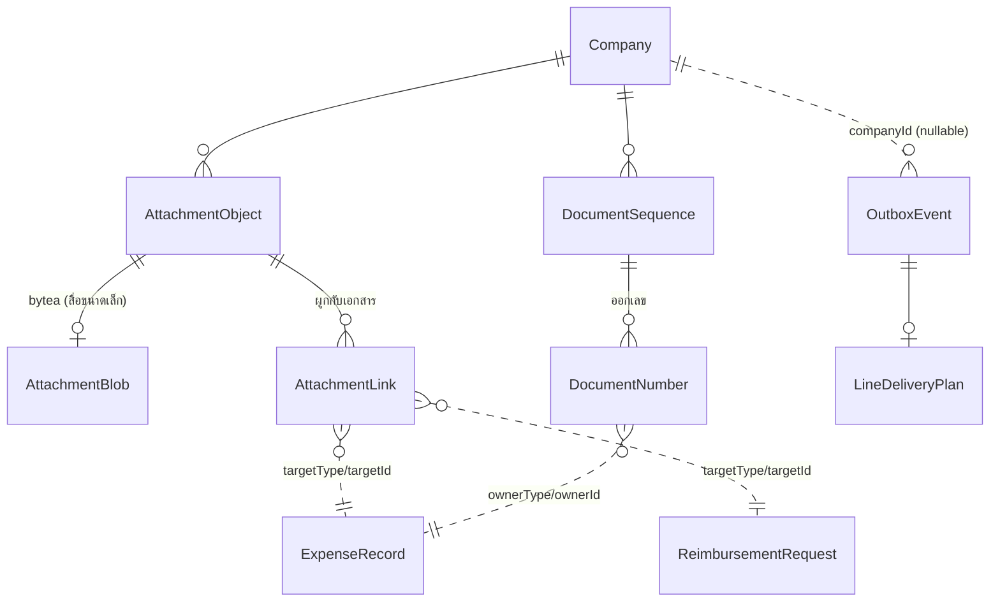

### 5.3 ค่าใช้จ่าย

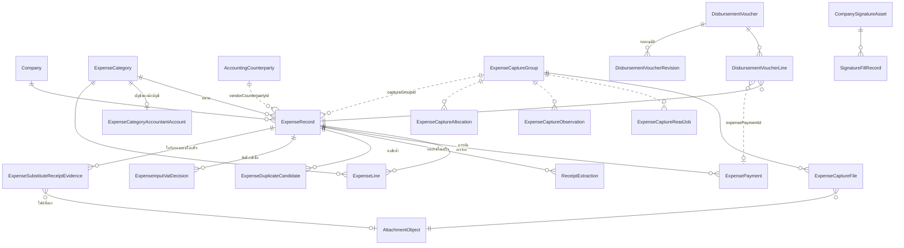

### 5.4 การเบิกจ่าย

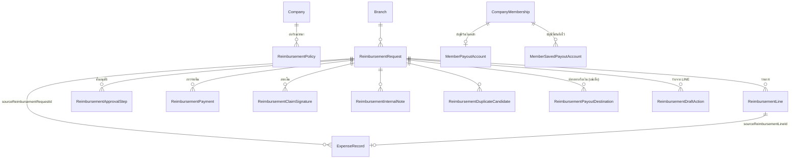

### 5.5 ภาษีหัก ณ ที่จ่าย (ส่วนที่ขายใน ENTERPRISE_1999)

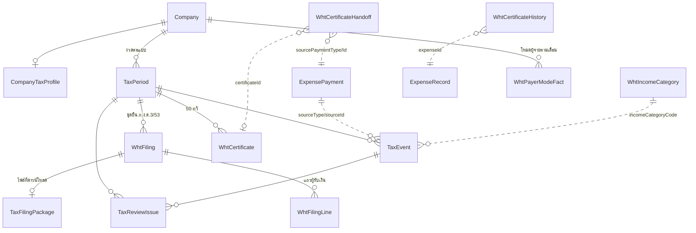

### 5.6 LINE และ AI

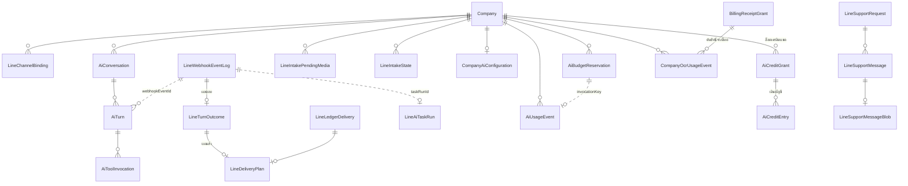

### 5.7 แพ็กเกจ สิทธิ์ และ billing

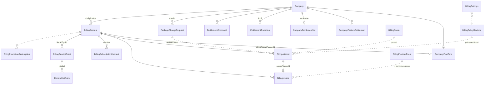

### 5.8 การสมัคร ฝ่ายขาย และรายงานผู้บริหาร

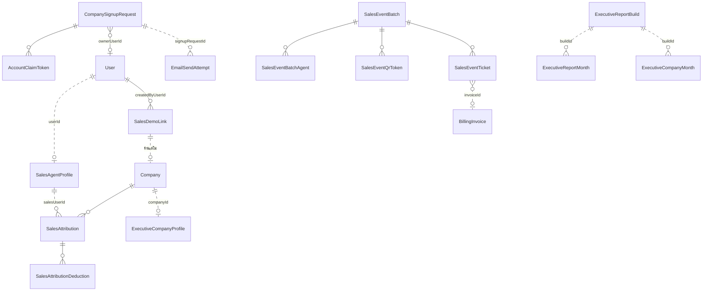

### 5.9 Audit, data rights และการแจ้งเตือน

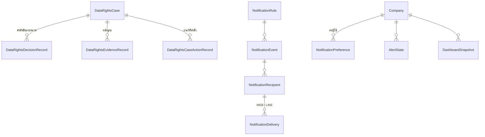

### 5.10 โดเมนนอกขอบเขต (ย่อ)

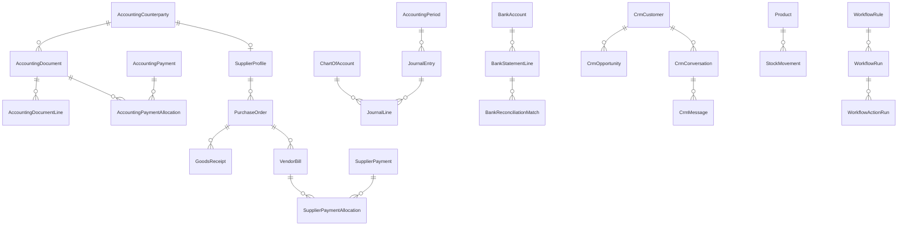

## 6. field สถานะและวงจรชีวิต

### 6.1 วงจรสถานะหลัก (enum) และโค้ดที่บังคับ

**ค่าใช้จ่าย — `ExpenseRecord.status : ExpenseStatus`**
ตารางการเปลี่ยนสถานะอยู่ที่ `ALLOWED_TRANSITIONS` ใน `apps/api/src/modules/expenses/domain/logic/expense-status.logic.ts:91` (`canTransition`, `validateStatusTransition`) เรียกใช้จาก use case ใน `modules/expenses/application/use-cases/` (`expense-draft.use-case.ts`, `expense-upload.use-case.ts`) และ `prisma-expense.repository.ts`

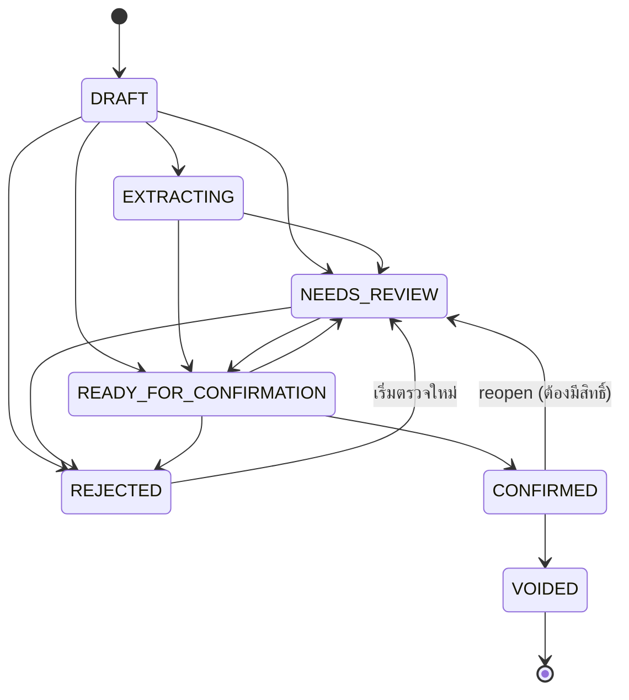

สถานะรองของค่าใช้จ่ายที่คำนวณตาม ไม่ได้ตั้งตรง: `paymentStatus` (`ExpensePaymentStatus`, คำนวณจาก `paidAmount` เทียบ `netPayableAmount`), `postingStatus` (`ExpensePostingStatus`), `duplicateStatus`, `aiVerificationStatus`, `inputVatClaimStatus` (ทุกการเปลี่ยนบันทึกใน `ExpenseInputVatDecision`), `taxEvidenceStatus`

**คำขอเบิก — `ReimbursementRequest.status : ReimbursementRequestStatus`**
`ALLOWED_TRANSITIONS` ใน `apps/api/src/modules/reimbursements/domain/logic/reimbursement.logic.ts:585`

| จาก | ไปได้ |
|---|---|
| `DRAFT` | `PENDING_APPROVAL`, `CANCELLED` |
| `PENDING_APPROVAL` | `APPROVED`, `REJECTED`, `CANCELLED`, `DRAFT`, `READY_FOR_PAYMENT` (เฉพาะรอบแก้บัญชีรับเงิน) |
| `APPROVED` | `FINANCE_REVIEW`, `READY_FOR_PAYMENT`, `CANCELLED`, `VOIDED` |
| `FINANCE_REVIEW` | `READY_FOR_PAYMENT`, `APPROVED`, `CANCELLED`, `VOIDED` |
| `READY_FOR_PAYMENT` | `PAID`, `PARTIALLY_PAID`, `FINANCE_REVIEW`, `CANCELLED`, `VOIDED`, `PENDING_APPROVAL` (ส่งกลับแก้บัญชีรับเงิน) |
| `PARTIALLY_PAID` | `PAID`, `VOIDED` |
| `REJECTED` | `DRAFT`, `CANCELLED` |
| `PAID` | `VOIDED` |
| `CANCELLED`, `VOIDED` | ปลายทาง |

สถานะคู่ขนาน: `ReimbursementApprovalStep.status` (`PENDING → APPROVED/REJECTED/CANCELLED/SKIPPED/EXPIRED`; ขั้นจะถูก invalidate เมื่อ `requestSnapshotHash` ไม่ตรงกับคำขอ), `financeReviewStatus`, `paymentStatus`, `receiptRequirementStatus`, `duplicateStatus`, `postingStatus`; `ReimbursementPayoutDestination.frozenAt` เป็นจุดไม่ย้อนกลับที่บังคับด้วย trigger (7.4); ร่างจาก LINE ใช้ `ReimbursementDraftAction.status` (String + CHECK: `COLLECTING → PREVIEW → APPLIED | CANCELLED | EXPIRED | STALE`)

**ใบสำคัญจ่าย — `DisbursementVoucher.status : DisbursementVoucherStatus`**
`DRAFT → PENDING_APPROVAL → APPROVED → PAID` และ `→ CANCELLED` (รวมถึงยกเลิกหลังจ่าย: `cancelledAfterPaid = true`) สิทธิ์ต่อขั้นคือ `expense.disbursement.prepare` / `.approve` / `.pay` (`modules/expenses/domain/logic/disbursement-voucher.logic.ts:47`) การเปลี่ยนสถานะทำด้วย `updateMany` ที่มีเงื่อนไขสถานะเดิม (compare-and-set) ใน `modules/expenses/application/use-cases/disbursement-voucher.use-case.ts` แต่ละรอบส่งอนุมัติเก็บใน `DisbursementVoucherRevision.decision` (`APPROVED | RETURNED | WITHDRAWN | CANCELLED`)

**ใบรับรองแทนใบเสร็จ — `ExpenseSubstituteReceiptEvidence.status : SubstituteReceiptEvidenceStatus`**
`PREPARED → PAYER_CERTIFIED → ISSUED`; ฉบับเก่ากลายเป็น `SUPERSEDED` เมื่อออกฉบับใหม่ บังคับใน `modules/expenses/application/use-cases/substitute-receipt.use-case.ts` และซ้ำอีกชั้นในฐานข้อมูลด้วย partial unique (ค่าใช้จ่ายหนึ่งรายการมี `PAYER_CERTIFIED` ได้ 1 และ `ISSUED` ได้ 1) กับ CHECK รูปร่างข้อมูลต่อสถานะ (7.2–7.3)

**คำขอสมัคร — `CompanySignupRequest.state : CompanySignupState`**
มีตารางการเปลี่ยนสถานะ 2 ชุดเลือกตาม `source` (`modules/external-signup/domain/company-signup.logic.ts:83` และ `:161`, ฟังก์ชัน `canTransitionCompanySignup`) เรียกจาก `company-signup-core.service.ts`

| ช่องทาง | เส้นทางปกติ |
|---|---|
| `official-site` (อีเมล + claim) | `RECEIVED → VALIDATED → PENDING_REVIEW → EMAIL_PENDING → EMAIL_VERIFIED → PROVISIONING → READY → LINE_LINK_PENDING → COMPLETED` (แตกแขนง: `EMAIL_FAILED`, `EXPIRED → EMAIL_PENDING`, `PROVISIONING_FAILED → PROVISIONING`, `REJECTED`) |
| `line-oa`, `email-otp` | `RECEIVED → VALIDATED → (PENDING_REVIEW →) PROVISIONING → READY → COMPLETED` (สถานะอีเมลทั้งหมดไม่ถูกใช้) |
| ทุกช่องทาง | เกือบทุกสถานะไป `SUSPENDED` ได้ และ `SUSPENDED`/`REJECTED` เป็นปลายทาง |

**เคสสิทธิ์เจ้าของข้อมูล — `DataRightsCase.status : DataRightsCaseStatus`**
`RECEIVED → IDENTITY_VERIFIED → RETENTION_REVIEW → APPROVED → EXECUTING → VERIFICATION → COMPLETED | COMPLETED_WITH_EXCEPTION` และปิดด้วย `BLOCKED | REJECTED | CANCELLED` บังคับ **สองชั้น**: คำสั่งใน `modules/data-rights/data-rights.service.ts` (`verifyIdentity`, `verifyAuthority`, `beginRetentionReview`, `recordDecision`, `recordEvidence`, `approve`, `startExecution`, `startVerification`, `complete`, `close`) และ trigger `DataRightsCase_transition_guard` → function `enforce_data_rights_case_transition()` ที่ปฏิเสธการกระโดดสถานะแม้เขียน SQL ตรง

**ภาษี**

| field | enum | วงจร | โค้ด |
|---|---|---|---|
| `TaxPeriod.status`, `WhtFiling.status` | `TaxPeriodStatus` | `OPEN → NEEDS_REVIEW → READY_FOR_REVIEW → REVIEWED → EXPORTED → FILED → PAID → CLOSED`, `AMENDED`; สถานะ `FILED`, `PAID`, `CLOSED` ถือว่าล็อกงวด | `modules/tax/domain/logic/tax-period.logic.ts:44` (`isPeriodLocked`, `assertPeriodUnlocked`) |
| `TaxEvent.status` | `TaxEventStatus` | `ACTIVE → SUPERSEDED / REVERSED / EXCLUDED` (แก้เอกสารต้นทาง = สร้าง event ใหม่ supersede ของเดิมตาม `sourceHash`) | `modules/tax/domain/logic/tax-event.logic.ts` |
| `WhtCertificate.status` | `WhtCertificateStatus` | `DRAFT → ISSUED → VOIDED`; แก้ไขด้วยการออกใบใหม่ผูก `supersedesCertificateId`/`supersededByCertificateId` | `modules/tax/application/use-cases/create-wht-certificate.use-case.ts`, `issue-wht-certificate-from-handoff.use-case.ts`, `correct-wht-certificate.use-case.ts`, `issue-wht-replacement-copy.use-case.ts` |
| `WhtCertificateHandoff.status` | `WhtHandoffStatus` | `REQUIRED → SYSTEM_ISSUED | EXTERNAL_LINKED | CANCELLED` | `modules/tax/application/use-cases/wht-certificate-handoff.use-case.ts`, `modules/tax/domain/logic/wht-link-evidence.logic.ts`, `wht-handoff-missing.logic.ts` |
| `TaxFilingPackage.status` | `FilingPackageStatus` | `GENERATED → DOWNLOADED → ACCEPTED_MANUAL / REJECTED_MANUAL / VOIDED` | `modules/tax/application/use-cases/generate-tax-filing-package.use-case.ts` |

**ตัวตนและ session**

| field | enum | หมายเหตุ |
|---|---|---|
| `User.status` | `UserStatus` | `ACTIVE ↔ SUSPENDED → DISABLED`; ผู้ใช้ `isSystemProtected` ถูก trigger ห้ามลดสถานะ |
| `Company.status` | `CompanyStatus` | `ACTIVE ↔ SUSPENDED`, `DISABLED`, `ARCHIVED`; สถานะการเข้าถึงที่ผู้ใช้เห็น (`ACTIVE/EXPIRED/HELD`) คำนวณใน `modules/billing/domain/billing-state.ts` จาก `Company.status` + `CompanyPlanTerm` |
| `CompanyMembership.status` | `MembershipStatus` | `DRAFT → INVITED → ACTIVE ↔ SUSPENDED → DISABLED` (โมดูล `employee-access`) |
| `AuthSession.status` | `AuthSessionStatus` | `ACTIVE → REVOKED / EXPIRED`; การนำ refresh token เก่ามาใช้ซ้ำทำให้เพิกถอนทั้ง `familyId` (`modules/auth/application/use-cases/refresh-session.use-case.ts`) |
| token ทั้งหลาย | `VerificationTokenStatus`, `LineWebHandoffTokenStatus`, `LineWebLoginTransactionStatus`, `EmployeeLineLinkTokenStatus` | `PENDING → USED / EXPIRED / REVOKED` ใช้ครั้งเดียว |

**เอกสารและไฟล์**

| field | enum | วงจร |
|---|---|---|
| `DocumentNumber.status` | `DocumentNumberStatus` | `RESERVED → COMMITTED` หรือ `CANCELLED`; ที่ commit แล้ว void ได้เป็น `VOIDED` (use case `reserve-`/`commit-`/`cancel-`/`void-document-number` ใน `modules/data-model-core`) |
| `AttachmentObject.status` | `AttachmentStatus` | `PENDING_UPLOAD → ACTIVE` (หลังตรวจ checksum และสแกนมัลแวร์) หรือ `QUARANTINED`; ลบ = `DELETED` + `deletedAt` (`complete-attachment-upload.use-case.ts`, `delete-attachment.use-case.ts`) |
| `OutboxEvent.status` | `OutboxEventStatus` | `PENDING → PROCESSING → PUBLISHED`; ล้มเหลว `FAILED` (ลองใหม่ตาม `availableAt`) จนถึง `DEAD` |
| `ExpenseCaptureReadJob.status` | `ExpenseCaptureReadStatus` | `QUEUED → PREPARING → READING → DONE | PARTIAL | FAILED | PAUSED | CANCELLED` (`modules/expenses/application/services/expense-capture-read-runner.service.ts`) |
| `ExpenseCaptureGroup.status` | `ExpenseCaptureGroupStatus` | `OPEN → HANDED_OFF | CLOSED_NO_HANDOFF | CANCELLED` |

**สิทธิ์ใช้ฟีเจอร์**
`EntitlementTransition.action : EntitlementTransitionAction` = `ENABLE`, `DISABLE_REQUESTED` (เริ่มปิด ถ่าย `RunoffSnapshot` ของงานค้าง), `OFF` (ปิดสนิท) แต่ละร้าน/feature key มีลำดับ `seq` ต่อเนื่องและ `epoch` เพิ่มทุกครั้งที่เปิดใหม่ ทุกคำสั่งผ่าน `EntitlementCommand` (idempotent ด้วย `commandId` + `expectedSetVersion`) โค้ดอยู่ที่ `modules/employee-access` (apply), `modules/system-partner-management` (คำสั่งของผู้ดูแล) และ `modules/feature-launch` (อ่านเพื่อ gate)

### 6.2 วงจรของโมดูลนอกขอบเขต (อ้างอิงสั้น)

| field | โค้ดที่บังคับ |
|---|---|
| `AccountingDocument.status` (`AccountingDocumentStatus`) | `modules/accounting-documents/application/use-cases/` |
| `PurchaseRequest/PurchaseOrder/VendorBill.status` | `PO_ALLOWED_TRANSITIONS` ฯลฯ ใน `modules/procurement/domain/logic/procurement.logic.ts` (`canTransitionPR/PO/VB`) |
| `JournalEntry.status`, `AccountingPeriod.status` | `modules/ledger/application/use-cases/journal.use-case.ts`, `period.use-case.ts` + trigger `JournalEntry_manual_post_invariants` |
| `CrmFollowUpTask.status`, `CrmBookingProposal.status`, `CrmCampaign.status` | `FOLLOW_UP_TRANSITIONS` (`modules/crm/domain/logic/crm.logic.ts`), `crm-booking-proposal.logic.ts`, `modules/crm-inbox/domain/logic/crm-campaign.logic.ts` |
| `AiDraftRequest.status`, `AiSuggestion.status` | `REQUEST_TRANSITIONS`, `SUGGESTION_TRANSITIONS` ใน `modules/ai-draft/domain/logic/ai-draft-status.logic.ts` |
| `WorkflowRun/WorkflowActionRun.status` | `modules/workflow/` |
| `BankReconciliationSession.status`, `BankAdjustment.status` | `modules/banking/` |

### 6.3 สถานะที่เป็น `String` (ไม่ใช่ Prisma enum)

| field | ค่าที่อนุญาต | ที่มาของรายการค่า |
|---|---|---|
| `PackageChangeRequest.status` | `OPEN`, `APPROVED`, `REJECTED`, `CANCELLED` (คำขอของลูกค้า); ดีลของเซลล์ใช้ `DRAFT`, `PENDING_APPROVAL`, `APPROVED` … ตาม partial unique `PackageChangeRequest_company_open_deal_key` | `packages/contracts` (`PackageChangeRequestStatus`), migration `sales_console` |
| `PackageChangeRequest.kind` | `CUSTOMER_REQUEST`, `SALES_DEAL`, `SPECIAL_INVOICE` | `packages/contracts` (`PackageChangeRequestKind`) |
| `BillingOperation.state` | `DRAFT`, `PREVIEW`, `AWAITING_APPROVAL`, `SCHEDULED`, `QUEUED`, `RUNNING`, `SUCCEEDED`, `UNKNOWN`, `BLOCKED`, `FAILED`, `CANCELLED` | `packages/contracts` (`BillingOperationState`) |
| `BillingAccount.subscriptionState` | ค่าสถานะ subscription ของ Stripe (`active`, `past_due`, `unpaid`, `canceled` …) | `modules/billing/domain/billing-state.ts` |
| `BillingInvoice.providerStatus` / `applyStatus` | สถานะ invoice ของ Stripe (`paid` …) / สถานะการนำไปให้สิทธิ์ | `modules/billing` |
| `BillingAttempt.status` | มีค่า `UNKNOWN` สำหรับผลที่ยังยืนยันไม่ได้ (ต้องจบจากการอ่านผู้ให้บริการเท่านั้น) | `modules/billing` |
| `BillingPromotionRedemption.state` | `RESERVED`, `CONSUMED`, `RELEASED` (CHECK `BillingPromotionRedemption_state_check`) | migration `billing_promotion_campaigns` |
| `AiBudgetReservation.bucket` / `requestKind` | `CHAT`/`OCR`; `TEXT`/`IMAGE`/`OTHER` | CHECK |
| `AiUsageEvent.eventKind` / `usageBasis` / `budgetBucket` | `MODEL_CALL`/`COST_ADJUSTMENT`; `PROVIDER_REPORTED`/`CONSERVATIVE_ESTIMATE`/`OPERATOR_CHARGED_AT_BOUND`/`COMPANY_ABSORBED` (CHECK เดิมของ `usageBasis` ถูก drop แล้วใน migration ภายหลัง — ค่าคุมด้วยโค้ด); `CHAT`/`OCR` | CHECK + comment ใน schema |
| `AiCreditGrant.cycleState` | `PAID`, `RENEWAL_PENDING`, `CLOSED` | CHECK |
| `CompanyAiConfiguration.budgetMode` | `SHARED`, `SPLIT` | CHECK |
| `LineDeliveryPlan.status` | `READY`, `UNKNOWN`, `WAITING_CONTINUATION`, `ACCEPTED`, `CANCELLED`, `REFUSED`, `EXPIRED` | CHECK |
| `EmailAccessChallenge.status` | `PENDING`, `VERIFIED`, `USED`, `REVOKED`, `EXPIRED` | CHECK |
| `EmailVerificationToken.proofKind` | `LINK`, `OTP` (+ `failedAttempts` 0–5) | CHECK `EmailVerificationToken_otp_shape` |
| `SalesEventBatch.state` | `OPEN`, `PAUSED`, `SUSPENDED` | CHECK |
| `SalesEventTicket.state` / `redeemedAs` | `ISSUED`, `RESERVED`, `USED`, `REVOKED` / `DISCOUNT`, `CREDIT` | CHECK `SalesEventTicket_state_check` |
| `SalesAttributionDeduction.kind` | `REFUND`, `DISPUTE` | CHECK |
| `WhtPayerModeFact.mode` | `HEAD_OFFICE_PAYS_ALL`, `EACH_BRANCH_PAYS` | CHECK |
| `MemberSavedPayoutAccount.holderType`, `ReimbursementPayoutDestination.holderType` | `SELF`, `THIRD_PARTY` | CHECK |
| `WhtIncomeCategory.filingRoute` | `SYSTEM_FILLS`, `ACCOUNTANT_PREPARES`, `SEPARATE_PND2` | migration `wht_income_routes_catalog` |
| `EmailSendAttempt.status` | คุมด้วยโค้ด (พบค่า เช่น `SENDING` ซึ่งเป็น default ของคอลัมน์, `ACCEPTED`, `SUPPRESSED`, `CONFIG`, `RETRY`, `NOT_CONFIGURED`) | `modules/auth/application/system-email-delivery.service.ts` |
| `LineWebhookEventLog.status`, `LineAiTaskRun.status`, `AiToolInvocation.status` | คุมด้วยโค้ดใน `modules/line-ai` | — |

## 7. กฎความถูกต้องของข้อมูล

กฎแบ่งเป็นสองชั้น: (ก) กฎที่ฐานข้อมูลบังคับเอง ซึ่งยังทำงานแม้มีคนเขียน SQL ตรง และ (ข) กฎในโค้ดของ `apps/api` ส่วน 7.2–7.3 สร้างจากการไล่อ่าน migration ทั้ง 313 รายการตามลำดับเวลา (ADD แล้วหักด้วย DROP) จึงเป็นสถานะสุดท้ายของ constraint ที่เขียนด้วย raw SQL — constraint เหล่านี้ **ไม่ปรากฏใน `schema.prisma`** (Prisma ไม่รองรับ CHECK, partial index และ trigger) ผู้ที่สร้างฐานใหม่ต้องใช้ `prisma migrate deploy` เท่านั้น ห้ามใช้ `prisma db push` เพราะจะได้ฐานที่ไม่มีกฎเหล่านี้

### 7.1 กฎที่ประกาศใน Prisma schema

| ชนิด | จำนวน | ตัวอย่างที่ควรรู้ |
|---|---|---|
| unique ของ field เดี่ยว (`@unique`) | 311 ตำแหน่ง (รวมที่อยู่ในบรรทัดเดียวกับ `@@unique`) | `User.username`, `User.email`, `Permission.key`, `AuthSession.tokenId`, `OutboxEvent.eventKey`, `LineWebhookEventLog.webhookEventId`, `SalesAgentProfile.salesCode`, hash ของ token ทุกชนิด (`tokenHash`) |
| composite unique (`@@unique`) | 223 | เลขเอกสารไม่ซ้ำในร้าน: `ExpenseRecord(companyId, expenseNumber)`, `ReimbursementRequest(companyId, requestNo)`, `DisbursementVoucher(companyId, documentNumber)`, `WhtCertificate(companyId, certificateNumber)`, `DocumentNumber(companyId, documentType, documentNumber)` · idempotency: `(companyId, idempotencyKey)` / `(companyId, commandId)` ในทุกตารางคำสั่ง · หนึ่งแถวต่อร้าน: `CompanyMembership(companyId, userId)`, `CompanyFeatureEntitlement(companyId, featureKey)`, `ExternalIdentity(provider, providerChannelId, providerUserId)` · LINE redelivery: `ExpenseRecord(companyId, lineMessageId)`, `ExpenseCaptureFile(companyId, lineMessageId)`, `LineIntakePendingMedia(companyId, lineMessageId)` · projection เบิกจ่าย→ค่าใช้จ่าย: `ExpenseRecord(companyId, sourceReimbursementLineId)` |
| tenant-scoped FK | `@@unique([companyId, id])` บน parent + FK `(companyId, parentId)` บน child | `AttachmentLink → AttachmentObject`, `ExpensePayment → ExpenseRecord`, `DisbursementVoucherLine → DisbursementVoucher/ExpenseRecord`, `ReimbursementLine/Payment/… → ReimbursementRequest`, `MemberPayoutAccount → CompanyMembership(companyId, userId)`, `ExpenseRecord → ReimbursementRequest/ReimbursementLine`, กลุ่ม banking, CRM, accounting documents |
| `onDelete` | Cascade 275 / Restrict 50 / SetNull 21 | `Restrict` ใช้กับหลักฐานที่ห้ามหายตาม parent เช่น `ExpensePayment → ExpenseRecord`, `DataRights*Record → DataRightsCase`, เอกสารบัญชี/สมุดรายวัน |
| index | 574 `@@index` | ส่วนใหญ่ขึ้นต้นด้วย `companyId` ตามด้วยสถานะ/วันที่ สำหรับหน้ารายการ และ `(status, leaseUntil/nextAttemptAt)` สำหรับคิวงาน |

index/unique ที่เขียนด้วย raw SQL นอก schema และไม่ใช่ partial: `User_username_lower_idx` (`lower("username")` — ใช้ค้นหาแบบไม่สนตัวพิมพ์; การเลื่อนเป็น UNIQUE ยังค้างตาม `docs/runbooks/username-case-uniqueness-followup.md`) และ sequence `BillingSubscriptionContract_revision_seq`

### 7.2 CHECK constraint ที่ยังมีผล (130 รายการ)

นิพจน์ตัดที่ 170 อักขระ ดูฉบับเต็มใน migration ที่ระบุ

| # | ตาราง | Constraint | นิพจน์ (ย่อ) | migration ที่กำหนดล่าสุด |
|---|---|---|---|---|
| 1 | `AccountingDocument` | `AccountingDocument_output_tax_code_role_check` | `("documentType" IN ('QUOTATION', 'BILLING_NOTE', 'RECEIPT') AND "outputTaxCode" IS NULL) OR ("documentType" = 'INVOICE' AND ("outputTaxCode" IS NULL OR ("outputTaxCode" =…` | `20260713210000_output_vat_tax_code_receipt_boundary` |
| 2 | `AiBudgetReservation` | `AiBudgetReservation_bucket_check` | `"bucket" IN ('CHAT', 'OCR')` | `20260917160000_ai_budget_reservations` |
| 3 | `AiBudgetReservation` | `AiBudgetReservation_requestKind_check` | `"requestKind" IN ('TEXT', 'IMAGE', 'OTHER')` | `20260917160000_ai_budget_reservations` |
| 4 | `AiBudgetReservation` | `AiBudgetReservation_settledCostSatang_check` | `"settledCostSatang" >= 0` | `20260917160000_ai_budget_reservations` |
| 5 | `AiBudgetReservation` | `AiBudgetReservation_status_check` | `"status" IN ('RESERVED', 'DISPATCHED', 'SETTLED', 'UNRESOLVED', 'CANCELLED')` | `20260917160000_ai_budget_reservations` |
| 6 | `AiBudgetReservation` | `AiBudgetReservation_upperBoundSatang_check` | `"upperBoundSatang" >= 0` | `20260917160000_ai_budget_reservations` |
| 7 | `AiConversation` | `AiConversation_binding_check` | `num_nonnulls("channelKind", "messagingChannelId", "chatKeyHash", "membershipId") IN (0, 4)` | `20260927110000_line_conversation_context_v2` |
| 8 | `AiConversation` | `AiConversation_channel_check` | `"channelKind" IS NULL OR ("channel" = 'line' AND "channelKind" IN ('USER','GROUP','ROOM'))` | `20260927110000_line_conversation_context_v2` |
| 9 | `AiConversation` | `AiConversation_state_bounds` | `"stateVersion" >= 0 AND "lifecycleEpoch" >= 0 AND "preferenceVersion" >= 0 AND ("taskStateJson" IS NULL OR octet_length("taskStateJson"::text) <= 16384) AND ("preferenceJ…` | `20260927110000_line_conversation_context_v2` |
| 10 | `AiCreditEntry` | `AiCreditEntry_kind_check` | `"kind" IN ('RESERVE', 'CONSUME', 'RELEASE', 'CORRECTION', 'FREEZE', 'UNFREEZE', 'REVOKE')` | `20260929160000_ai_credit_ledger` |
| 11 | `AiCreditGrant` | `AiCreditGrant_cycleState_check` | `"cycleState" IN ('PAID', 'RENEWAL_PENDING', 'CLOSED')` | `20260929160000_ai_credit_ledger` |
| 12 | `AiCreditGrant` | `AiCreditGrant_sourceKind_check` | `"sourceKind" IN ('INCLUDED_CYCLE', 'ADD_ON_PAID', 'ADD_ON_ADMIN', 'SALES_EVENT')` | `20260929160000_ai_credit_ledger` |
| 13 | `AiCreditGrant` | `AiCreditGrant_units_check` | `"units" >= 0` | `20260929160000_ai_credit_ledger` |
| 14 | `AiUsageEvent` | `AiUsageEvent_budgetBucket_check` | `"budgetBucket" IN ('CHAT', 'OCR')` | `20260917140000_ai_usage_metadata` |
| 15 | `AiUsageEvent` | `AiUsageEvent_eventKind_check` | `"eventKind" IN ('MODEL_CALL', 'COST_ADJUSTMENT')` | `20260917140000_ai_usage_metadata` |
| 16 | `AiUsageEvent` | `AiUsageEvent_requestKind_check` | `"requestKind" IN ('TEXT', 'IMAGE', 'OTHER')` | `20260917140000_ai_usage_metadata` |
| 17 | `AiUsageEvent` | `AiUsageEvent_usageBasis_check` | `"usageBasis" IN ('PROVIDER_REPORTED', 'CONSERVATIVE_ESTIMATE', 'OPERATOR_CHARGED_AT_BOUND', 'COMPANY_ABSORBED')` | `20261015160000_ai_company_absorbed_usage` |
| 18 | `BillingPromotionRedemption` | `BillingPromotionRedemption_environment_check` | `"promotionEnvironmentId" IN ('LIVE', 'TEST') AND "livemode" = ("promotionEnvironmentId" = 'LIVE')` | `20261009120000_billing_promotion_campaigns` |
| 19 | `BillingPromotionRedemption` | `BillingPromotionRedemption_state_check` | `("state" = 'RESERVED' AND "attemptId" IS NOT NULL AND "invoiceId" IS NULL) OR ("state" = 'CONSUMED' AND "invoiceId" IS NOT NULL AND "consumedAt" IS NOT NULL) OR ("state" …` | `20261009120000_billing_promotion_campaigns` |
| 20 | `BillingReceiptGrant` | `BillingReceiptGrant_manual_admin_only` | `"billingAccountId" IS NOT NULL OR "kind" = 'ADMIN_ADJUSTMENT'` | `20260915100000_manual_receipt_adjustments` |
| 21 | `BillingReceiptGrant` | `BillingReceiptGrant_valid_units_period_kind` | `"units" >= 0 AND "serviceStart" < "serviceEnd" AND "availableAt" < "expiresAt" AND "expiresAt" >= "serviceEnd" AND "kind" IN ('INITIAL', 'RENEWAL', 'REPEAT', 'UPGRADE', '…` | `20261009120000_billing_promotion_campaigns` |
| 22 | `ChartOfAccount` | `ChartOfAccount_company_or_system_check` | `"companyId" IS NOT NULL OR "isSystem" = true` | `20260718090000_h02_coa_company_or_system_check` |
| 23 | `Company` | `Company_bookingBufferMinutes_check` | `"bookingBufferMinutes" IN (0, 30, 60, 90, 120)` | `20260801150000_drift_forward_fix` |
| 24 | `Company` | `Company_business_type_check` | `("businessTypeCode" IS NULL AND "businessTypeOther" IS NULL) OR ("businessTypeCode" IS NOT NULL AND ( ("businessTypeCode" ~ '^[0-9]{5}$' AND "businessTypeOther" IS NULL) …` | `20260917200000_company_business_type` |
| 25 | `CompanyAiConfiguration` | `CompanyAiConfiguration_budgetMode_check` | `"budgetMode" IN ('SHARED', 'SPLIT')` | `20260917150000_ai_budget_split_policy` |
| 26 | `CompanyAiConfiguration` | `CompanyAiConfiguration_chatMonthlyBudgetSatang_check` | `"chatMonthlyBudgetSatang" >= 0` | `20260917150000_ai_budget_split_policy` |
| 27 | `CompanyAiConfiguration` | `CompanyAiConfiguration_ocrConfigVersion_check` | `"ocrConfigVersion" >= 0` | `20260827150000_company_ocr_config_version_cas` |
| 28 | `CompanyAiConfiguration` | `CompanyAiConfiguration_ocrMonthlyBudgetSatang_check` | `"ocrMonthlyBudgetSatang" >= 0` | `20260917150000_ai_budget_split_policy` |
| 29 | `CompanyAiConfiguration` | `CompanyAiConfiguration_ocrMonthlyLimit_check` | `"ocrMonthlyLimit" IS NULL OR ("ocrMonthlyLimit" >= 1 AND "ocrMonthlyLimit" <= 1000000)` | `20260827120000_company_ocr_governance` |
| 30 | `CompanyAiConfiguration` | `CompanyAiConfiguration_salesDealChatCreditSatang_check` | `"salesDealChatCreditSatang" IS NULL OR "salesDealChatCreditSatang" >= 0` | `20260923130000_ai_chat_default_credit` |
| 31 | `CompanyAiMonthlyBucketUsage` | `CompanyAiMonthlyBucketUsage_bucket_check` | `"bucket" IN ('CHAT', 'OCR')` | `20260917160000_ai_budget_reservations` |
| 32 | `CompanyEntitlementNormalization` | `CompanyEntitlementNormalization_cohortKind_check` | `"cohortKind" IS NULL OR "cohortKind" IN ('LEGACY', 'EXPLICIT')` | `20260803160000_cohort_kind_check` |
| 33 | `CompanyPlanTerm` | `CompanyPlanTerm_capacity_override_object` | `"capacityOverride" IS NULL OR jsonb_typeof("capacityOverride") = 'object'` | `20260915080000_plan_capacity_override` |
| 34 | `CompanySignupRequest` | `CompanySignupRequest_discovery_source_check` | `("discoverySource" IS NULL AND "discoverySourceOther" IS NULL) OR ("discoverySource" IS NOT NULL AND ( ("discoverySource" IN ('WEBSITE', 'IG', 'TIKTOK', 'FACEBOOK', 'SALE…` | `20260930150000_signup_discovery_source_sales` |
| 35 | `CompanyTaxCodeProfile` | `CompanyTaxCodeProfile_roundingMode_check` | `"roundingMode" IN ('HALF_UP', 'HALF_EVEN', 'DOWN', 'UP')` | `20260714200000_tax_profile_rounding_policy` |
| 36 | `CompanyTaxCodeProfile` | `CompanyTaxCodeProfile_roundingScale_check` | `"roundingScale" BETWEEN 0 AND 4` | `20260714200000_tax_profile_rounding_policy` |
| 37 | `CompanyTaxCodeProfile` | `CompanyTaxCodeProfile_taxAmountTolerance_check` | `"taxAmountTolerance" >= 0` | `20260714200000_tax_profile_rounding_policy` |
| 38 | `CompanyTeamNote` | `CompanyTeamNote_version_check` | `"version" >= 0` | `20261004130000_company_team_note` |
| 39 | `CrmMessageTemplate` | `CrmMessageTemplate_ai_approval_metadata_check` | `("aiApprovedVersion" IS NULL AND "aiApprovedAt" IS NULL AND "aiApprovedByUserId" IS NULL) OR ("aiApprovedVersion" IS NOT NULL AND "aiApprovedAt" IS NOT NULL AND "aiApprov…` | `20260728120000_m03_crm_ai_outbound_policy` |
| 40 | `CrmMessageTemplate` | `CrmMessageTemplate_ai_approval_version_check` | `"aiApprovedVersion" IS NULL OR ("aiApprovedVersion" >= 1 AND "aiApprovedVersion" <= "version")` | `20260728120000_m03_crm_ai_outbound_policy` |
| 41 | `CrmMessageTemplate` | `CrmMessageTemplate_version_check` | `"version" >= 1` | `20260728120000_m03_crm_ai_outbound_policy` |
| 42 | `DataRightsCase` | `DataRightsCase_completion_shape_check` | `("status" IN ('COMPLETED', 'COMPLETED_WITH_EXCEPTION') AND "completedAt" IS NOT NULL AND "completedByUserId" IS NOT NULL AND NULLIF(BTRIM("outcomeSummary"), '') IS NOT NU…` | `20260809120000_data_rights_case_orchestration` |
| 43 | `DataRightsCase` | `DataRightsCase_due_after_received_check` | `"dueAt" > "receivedAt"` | `20260809120000_data_rights_case_orchestration` |
| 44 | `DataRightsCase` | `DataRightsCase_single_admin_marker_check` | `"approvalSingleAdmin" = COALESCE("approvedByUserId" = "createdByUserId", false) AND "executionSingleAdmin" = COALESCE("executionStartedByUserId" = "approvedByUserId", fal…` | `20261002120000_data_rights_single_admin_mode` |
| 45 | `DataRightsCase` | `DataRightsCase_single_admin_reason_check` | `(("approvalSingleAdmin" AND "approvalSingleAdminReason" IS NOT NULL AND char_length(btrim("approvalSingleAdminReason")) >= 20) OR (NOT "approvalSingleAdmin" AND "approval…` | `20261002120000_data_rights_single_admin_mode` |
| 46 | `DataRightsCase` | `DataRightsCase_target_shape_check` | `("caseType" = 'USER_ACCOUNT_ERASURE' AND "targetUserId" IS NOT NULL AND "companyId" IS NULL AND "membershipId" IS NULL) OR ("caseType" = 'MEMBERSHIP_EXIT' AND "targetUser…` | `20260809120000_data_rights_case_orchestration` |
| 47 | `DataRightsDecisionRecord` | `DataRightsDecisionRecord_retention_check` | `("disposition" IN ('RETAIN', 'RESTRICT') AND "retentionUntil" IS NOT NULL AND NULLIF(BTRIM("accessRestriction"), '') IS NOT NULL) OR ("disposition" NOT IN ('RETAIN', 'RES…` | `20260809120000_data_rights_case_orchestration` |
| 48 | `DataRightsDecisionRecord` | `DataRightsDecisionRecord_revision_check` | `"revision" > 0` | `20260809120000_data_rights_case_orchestration` |
| 49 | `DataRightsEvidenceRecord` | `DataRightsEvidenceRecord_completion_hash_check` | `"evidenceType" IN ('IDENTITY_VERIFICATION', 'AUTHORITY_VERIFICATION') OR "sha256" IS NOT NULL` | `20260809120000_data_rights_case_orchestration` |
| 50 | `DataRightsEvidenceRecord` | `DataRightsEvidenceRecord_sha256_check` | `"sha256" IS NULL OR "sha256" ~ '^[0-9a-f]{64}$'` | `20260809120000_data_rights_case_orchestration` |
| 51 | `DataRightsEvidenceRecord` | `DataRightsEvidenceRecord_single_admin_reason_check` | `("singleAdmin" AND "singleAdminReason" IS NOT NULL AND char_length(btrim("singleAdminReason")) >= 20) OR (NOT "singleAdmin" AND "singleAdminReason" IS NULL)` | `20261002120000_data_rights_single_admin_mode` |
| 52 | `EmailAccessChallenge` | `EmailAccessChallenge_attempts_check` | `"failedAttempts" BETWEEN 0 AND 5` | `20260916090000_email_passwordless_access` |
| 53 | `EmailAccessChallenge` | `EmailAccessChallenge_status_check` | `"status" IN ('PENDING','VERIFIED','USED','REVOKED','EXPIRED')` | `20260916090000_email_passwordless_access` |
| 54 | `EmailVerificationToken` | `EmailVerificationToken_otp_shape` | `"proofKind" IN ('LINK', 'OTP', 'BILLING_RECIPIENT') AND "failedAttempts" BETWEEN 0 AND 5 AND ("proofKind" <> 'OTP' OR ("emailRevision" IS NOT NULL AND "securityBindingHas…` | `20260929030000_email_verification_billing_recipient_proof_kind` |
| 55 | `ExecutionAttempt` | `ExecutionAttempt_companyScope_check` | `"companyScope" = COALESCE("companyId", '__platform__')` | `20260802100000_attempt_identity_lease` |
| 56 | `ExpenseInputVatDecision` | `ExpenseInputVatDecision_reason_length` | `"reason" IS NULL OR char_length("reason") BETWEEN 1 AND 500` | `20261014120000_expense_input_vat_decisions` |
| 57 | `ExpenseLine` | `ExpenseLine_vatTreatment_check` | `"vatTreatment" IS NULL OR ("vatTreatment" IN ('ZERO_RATED', 'EXEMPT', 'NON_VAT') AND "vatRate" IS NOT NULL AND "vatRate" = 0)` | `20260827100000_expense_wht_input_vat_treatment` |
| 58 | `ExpensePayment` | `ExpensePayment_intent_pair_check` | `("idempotencyKey" IS NULL AND "payloadFingerprint" IS NULL) OR ("idempotencyKey" IS NOT NULL AND "payloadFingerprint" IS NOT NULL AND "payloadFingerprint" ~ '^[a-f0-9]{64…` | `20260827190000_expense_payment_idempotency` |
| 59 | `ExpenseRecord` | `ExpenseRecord_cc2_vat_classification_check` | `"sourceReimbursementLineId" IS NULL OR "sourceChannelMetadataJson"->>'cc2VatClaimClassification' IN ( 'CLAIMABLE', 'PARTIALLY_RECOVERABLE', 'NON_RECOVERABLE_CONFIRMED', '…` | `20260804170000_reimbursement_cc2_projection_source` |
| 60 | `ExpenseRecord` | `ExpenseRecord_reimbursement_source_pair_check` | `("sourceReimbursementRequestId" IS NULL) = ("sourceReimbursementLineId" IS NULL)` | `20260804170000_reimbursement_cc2_projection_source` |
| 61 | `ExpenseSubstituteReceiptEvidence` | `ExpenseSubstituteReceiptEvidence_business_purpose_check` | `"status" IN ('PREPARED', 'SUPERSEDED') OR length(btrim("businessPurpose")) > 0` | `20260910110000_substitute_receipt_editable_draft_facts` |
| 62 | `ExpenseSubstituteReceiptEvidence` | `ExpenseSubstituteReceiptEvidence_identity_mode_check` | `"payerUserId" IS NOT NULL OR ( "signatureMode" = 'PAPER' AND "approverUserId" IS NULL AND "payerSignatureAttachmentId" IS NULL AND "approverSignatureAttachmentId" IS NULL…` | `20260909231000_substitute_paper_signing_constraints` |
| 63 | `ExpenseSubstituteReceiptEvidence` | `ExpenseSubstituteReceiptEvidence_issued_check` | `"status" <> 'ISSUED' OR ( "approverName" IS NOT NULL AND "approverPosition" IS NOT NULL AND "approvedAt" IS NOT NULL AND "issuedByUserId" IS NOT NULL AND "issuedAt" IS NO…` | `20260909231000_substitute_paper_signing_constraints` |
| 64 | `ExpenseSubstituteReceiptEvidence` | `ExpenseSubstituteReceiptEvidence_payer_certified_check` | `"status" NOT IN ('PAYER_CERTIFIED', 'ISSUED') OR ( "snapshotJson" IS NOT NULL AND "snapshotChecksumSha256" IS NOT NULL AND "payerPosition" IS NOT NULL AND "certifiedAt" I…` | `20260909231000_substitute_paper_signing_constraints` |
| 65 | `ExpenseSubstituteReceiptEvidence` | `ExpenseSubstituteReceiptEvidence_reason_check` | `"status" IN ('PREPARED', 'SUPERSEDED') OR length(btrim("missingReceiptReason")) > 0` | `20260910110000_substitute_receipt_editable_draft_facts` |
| 66 | `ExpenseSubstituteReceiptEvidence` | `ExpenseSubstituteReceiptEvidence_superseded_check` | `"status" <> 'SUPERSEDED' OR ("supersededAt" IS NOT NULL AND length(btrim("supersedeReason")) > 0)` | `20260713150000_substitute_receipt_evidence_hardening` |
| 67 | `ExpenseSubstituteReceiptEvidence` | `ExpenseSubstituteReceiptEvidence_version_check` | `"version" > 0` | `20260713150000_substitute_receipt_evidence_hardening` |
| 68 | `LineDeliveryPlan` | `LineDeliveryPlan_hash_check` | `"id" ~ '^[0-9a-f]{64}$' AND "planHash" ~ '^[0-9a-f]{64}$'` | `20260927120000_line_delivery_plan_v2` |
| 69 | `LineDeliveryPlan` | `LineDeliveryPlan_owner_check` | `num_nonnulls("outcomeId", "ledgerDeliveryId", "outboxEventId") = 1` | `20260927120000_line_delivery_plan_v2` |
| 70 | `LineDeliveryPlan` | `LineDeliveryPlan_size_check` | `octet_length("planJson"::text) <= 262144` | `20260927120000_line_delivery_plan_v2` |
| 71 | `LineDeliveryPlan` | `LineDeliveryPlan_status_check` | `"status" IN ('READY','UNKNOWN','WAITING_CONTINUATION','ACCEPTED','CANCELLED','REFUSED','EXPIRED')` | `20260927120000_line_delivery_plan_v2` |
| 72 | `LineDeliveryPlan` | `LineDeliveryPlan_version_check` | `"version" = 2` | `20260927120000_line_delivery_plan_v2` |
| 73 | `LineDocumentQaJob` | `LineDocumentQaJob_budget_revision_check` | `"budgetAuthorityRevision" >= 0` | `20260927160000_line_document_qa_job` |
| 74 | `LineDocumentQaJob` | `LineDocumentQaJob_input_digest_check` | `"inputDigest" ~ '^[0-9a-f]{64}$'` | `20260927160000_line_document_qa_job` |
| 75 | `LineDocumentQaJob` | `LineDocumentQaJob_input_hash_check` | `"inputSetHash" ~ '^[0-9a-f]{64}$'` | `20260927160000_line_document_qa_job` |
| 76 | `LineDocumentQaJob` | `LineDocumentQaJob_lease_fence_check` | `"leaseFence" >= 0` | `20260927160000_line_document_qa_job` |
| 77 | `LineDocumentQaJob` | `LineDocumentQaJob_owner_digest_check` | `"ownerDigest" ~ '^[0-9a-f]{64}$'` | `20260927160000_line_document_qa_job` |
| 78 | `LineDocumentQaJob` | `LineDocumentQaJob_question_hash_check` | `"questionDigest" ~ '^[0-9a-f]{64}$'` | `20260927160000_line_document_qa_job` |
| 79 | `LineDocumentQaJob` | `LineDocumentQaJob_result_size_check` | `"resultJson" IS NULL OR octet_length("resultJson"::text) <= 65536` | `20260927160000_line_document_qa_job` |
| 80 | `LineDocumentQaJob` | `LineDocumentQaJob_revision_check` | `"revision" > 0` | `20260927160000_line_document_qa_job` |
| 81 | `LineIntakePendingMedia` | `LineIntakePendingMedia_binding_check` | `num_nonnulls("channelKind", "messagingChannelId", "chatKeyHash", "membershipId") IN (0, 4)` | `20260927110000_line_conversation_context_v2` |
| 82 | `LineIntakePendingMedia` | `LineIntakePendingMedia_version_check` | `"revision" >= 0 AND "lifecycleEpoch" >= 0` | `20260927110000_line_conversation_context_v2` |
| 83 | `LineLedgerDelivery` | `LineLedgerDelivery_budget_authority_check` | `"budgetAuthorityRevision" >= 0 AND ("budgetAuthorityJson" IS NULL OR octet_length("budgetAuthorityJson"::text) <= 32768)` | `20260927130000_line_budget_authority_v2` |
| 84 | `LineWebhookEventLog` | `LineWebhookEventLog_budget_authority_check` | `"budgetAuthorityRevision" >= 0 AND ("budgetAuthorityJson" IS NULL OR octet_length("budgetAuthorityJson"::text) <= 32768)` | `20260927130000_line_budget_authority_v2` |
| 85 | `MemberPayoutAccount` | `MemberPayoutAccount_shape_check` | `("payoutMethod" = 'CASH' AND "payoutKind" IS NULL AND "bankName" IS NULL AND "accountName" IS NULL AND "accountNumberEncrypted" IS NULL AND "accountLast4" IS NULL AND "fi…` | `20261001100000_reimbursement_payout_account` |
| 86 | `MemberPayoutAccount` | `MemberPayoutAccount_version_check` | `"version" >= 1` | `20261001100000_reimbursement_payout_account` |
| 87 | `MemberSavedPayoutAccount` | `MemberSavedPayoutAccount_holder_note_check` | `("holderType" = 'SELF' AND "holderNote" IS NULL) OR ("holderType" = 'THIRD_PARTY' AND "holderNote" IS NOT NULL AND length(btrim("holderNote")) BETWEEN 2 AND 200)` | `20261005100000_reimbursement_saved_payout_accounts` |
| 88 | `MemberSavedPayoutAccount` | `MemberSavedPayoutAccount_holder_type_check` | `"holderType" IN ('SELF', 'THIRD_PARTY')` | `20261005100000_reimbursement_saved_payout_accounts` |
| 89 | `MemberSavedPayoutAccount` | `MemberSavedPayoutAccount_shape_check` | `"payoutKind" IN ('BANK_ACCOUNT', 'PROMPTPAY_PHONE') AND "accountLast4" ~ '^[0-9]{4}$' AND (("payoutKind" = 'BANK_ACCOUNT') = ("bankName" IS NOT NULL))` | `20261005100000_reimbursement_saved_payout_accounts` |
| 90 | `Product` | `Product_bookingDurationMinutes_check` | `"bookingDurationMinutes" IS NULL OR ("bookingDurationMinutes" BETWEEN 60 AND 180 AND "bookingDurationMinutes" % 30 = 0)` | `20260801150000_drift_forward_fix` |
| 91 | `Product` | `Product_salePrice_check` | `"salePrice" IS NULL OR "salePrice" >= 0` | `20260712130000_crm_product_service_catalog` |
| 92 | `PublicHomeThemeSetting` | `PublicHomeThemeSetting_singleton` | `"id" = 'homepage'` | `20261022100000_public_home_theme_setting` |
| 93 | `PublicHomeThemeSetting` | `PublicHomeThemeSetting_version_positive` | `"version" > 0` | `20261022100000_public_home_theme_setting` |
| 94 | `ReceiptUnitEntry` | `ReceiptUnitEntry_positive_units_generation` | `"units" > 0 AND "generation" > 0` | `20260929150000_receipt_unit_entries` |
| 95 | `ReimbursementDraftAction` | `ReimbursementDraftAction_actionOrdinal_check` | `"actionOrdinal" >= 1` | `20260927140000_line_reimbursement_draft_action` |
| 96 | `ReimbursementDraftAction` | `ReimbursementDraftAction_channel_check` | `"channel" = 'line' AND "channelKind" = 'USER'` | `20260927140000_line_reimbursement_draft_action` |
| 97 | `ReimbursementDraftAction` | `ReimbursementDraftAction_hashes_check` | `"chatKeyHash" ~ '^([0-9a-f]{16}\|[0-9a-f]{64})$' AND "intentKeyHash" ~ '^[0-9a-f]{64}$' AND ("confirmationDigest" IS NULL OR "confirmationDigest" ~ '^[0-9a-f]{64}$')` | `20260927170000_line_reimbursement_owner_hash_compat` |
| 98 | `ReimbursementDraftAction` | `ReimbursementDraftAction_operation_check` | `"operation" IN ('CREATE', 'UPDATE')` | `20260927140000_line_reimbursement_draft_action` |
| 99 | `ReimbursementDraftAction` | `ReimbursementDraftAction_ownerEpoch_check` | `"ownerEpoch" >= 0` | `20260927140000_line_reimbursement_draft_action` |
| 100 | `ReimbursementDraftAction` | `ReimbursementDraftAction_payload_size_check` | `COALESCE(octet_length("commandJson"::text), 0) + COALESCE(octet_length("previewJson"::text), 0) + COALESCE(octet_length("sourceProofJson"::text), 0) <= 131072` | `20260927140000_line_reimbursement_draft_action` |
| 101 | `ReimbursementDraftAction` | `ReimbursementDraftAction_previewRevision_check` | `"previewRevision" >= 0` | `20260927140000_line_reimbursement_draft_action` |
| 102 | `ReimbursementDraftAction` | `ReimbursementDraftAction_result_size_check` | `COALESCE(octet_length("resultJson"::text), 0) <= 4096` | `20260927140000_line_reimbursement_draft_action` |
| 103 | `ReimbursementDraftAction` | `ReimbursementDraftAction_state_check` | `("status" = 'COLLECTING' AND "previewRevision" = 0 AND "confirmationDigest" IS NULL) OR ("status" = 'PREVIEW' AND "previewRevision" >= 1 AND "previewJson" IS NOT NULL AND…` | `20260927140000_line_reimbursement_draft_action` |
| 104 | `ReimbursementDraftAction` | `ReimbursementDraftAction_status_check` | `"status" IN ('COLLECTING', 'PREVIEW', 'APPLIED', 'CANCELLED', 'EXPIRED', 'STALE')` | `20260927140000_line_reimbursement_draft_action` |
| 105 | `ReimbursementPayoutDestination` | `ReimbursementPayoutDestination_holder_note_check` | `("holderType" = 'SELF' AND "holderNote" IS NULL) OR ("holderType" = 'THIRD_PARTY' AND "holderNote" IS NOT NULL AND length(btrim("holderNote")) BETWEEN 2 AND 200)` | `20261005100000_reimbursement_saved_payout_accounts` |
| 106 | `ReimbursementPayoutDestination` | `ReimbursementPayoutDestination_holder_type_check` | `"holderType" IN ('SELF', 'THIRD_PARTY')` | `20261005100000_reimbursement_saved_payout_accounts` |
| 107 | `ReimbursementPayoutDestination` | `ReimbursementPayoutDestination_shape_check` | `"payoutKind" IN ('BANK_ACCOUNT', 'PROMPTPAY_PHONE') AND "accountLast4" ~ '^[0-9]{4}$' AND (("payoutKind" = 'BANK_ACCOUNT') = ("bankName" IS NOT NULL))` | `20261001100000_reimbursement_payout_account` |
| 108 | `ReimbursementPayoutDestination` | `ReimbursementPayoutDestination_verification_check` | `(("verifiedAt" IS NULL) = ("verifiedByUserId" IS NULL)) AND (("verifiedAt" IS NULL) = ("verifiedVia" IS NULL)) AND ("verifiedAt" IS NULL OR "frozenAt" IS NOT NULL)` | `20261001100000_reimbursement_payout_account` |
| 109 | `ReimbursementPayoutDestination` | `ReimbursementPayoutDestination_version_check` | `"version" >= 1` | `20261001100000_reimbursement_payout_account` |
| 110 | `RemoteReleaseMutationIntent` | `RemoteReleaseMutationIntent_arrays_check` | `jsonb_typeof("beforeDeploymentArnsJson") = 'array' AND jsonb_typeof("beforeActiveConfigurationsJson") = 'array'` | `20260804130000_remote_release_operation_lease` |
| 111 | `RemoteReleaseMutationIntent` | `RemoteReleaseMutationIntent_hashes_check` | `"buildReleaseId" ~ '^[0-9a-f]{40}$' AND "requestHash" ~ '^[0-9a-f]{64}$' AND "desiredConfigHash" ~ '^[0-9a-f]{64}$'` | `20260804130000_remote_release_operation_lease` |
| 112 | `RemoteReleaseMutationIntent` | `RemoteReleaseMutationIntent_kind_check` | `"mutationKind" IN ('CREATE', 'UPDATE')` | `20260804130000_remote_release_operation_lease` |
| 113 | `RemoteReleaseMutationIntent` | `RemoteReleaseMutationIntent_service_key_check` | `"serviceKey" IN ('api-web', 'ai-gateway', 'workers')` | `20260804130000_remote_release_operation_lease` |
| 114 | `RemoteReleaseOperation` | `RemoteReleaseOperation_controller_provenance_check` | `("controllerKind" = 'GITHUB_ACTIONS' AND "githubRunId" IS NOT NULL AND "githubRunAttempt" IS NOT NULL AND "githubActor" IS NOT NULL AND "githubActorId" IS NOT NULL AND "g…` | `20260804130000_remote_release_operation_lease` |
| 115 | `RemoteReleaseOperation` | `RemoteReleaseOperation_deploy_target_check` | `"releaseDeployTarget" IS NULL OR "releaseDeployTarget" IN ('all','api-web','ai-gateway','workers')` | `20260804130000_remote_release_operation_lease` |
| 116 | `SalesAttributionDeduction` | `SalesAttributionDeduction_amount_check` | `"amountSatang" > 0` | `20261002100000_sales_credit_deductions` |
| 117 | `SalesAttributionDeduction` | `SalesAttributionDeduction_kind_check` | `"kind" IN ('REFUND', 'DISPUTE')` | `20261002100000_sales_credit_deductions` |
| 118 | `SalesDemoLink` | `SalesDemoLink_aiCreditUnits_check` | `"aiCreditUnits" BETWEEN 1 AND 300` | `20261106120000_sales_demo_virtual_line` |
| 119 | `SalesDemoLink` | `SalesDemoLink_readLimit_check` | `"readLimit" BETWEEN 1 AND 50` | `20261109120000_sales_demo_link_read_limit` |
| 120 | `SalesEventBatch` | `SalesEventBatch_issue_check` | `"issueCap" >= 1 AND "issuedCount" >= 0 AND "issuedCount" <= "issueCap"` | `20260929180000_sales_event_discounts` |
| 121 | `SalesEventBatch` | `SalesEventBatch_reward_check` | `"discountSatang" >= 0 AND "discountSatang" % 100 = 0 AND "rewardChatCreditUnits" >= 0 AND "rewardChatCreditUnits" % 100 = 0 AND "rewardReceiptImageUnits" >= 0 AND ("disco…` | `20260929180000_sales_event_discounts` |
| 122 | `SalesEventBatch` | `SalesEventBatch_state_check` | `"state" IN ('OPEN', 'PAUSED', 'SUSPENDED')` | `20260929180000_sales_event_discounts` |
| 123 | `SalesEventBatch` | `SalesEventBatch_window_check` | `"claimEndsAt" > "claimStartsAt"` | `20260929180000_sales_event_discounts` |
| 124 | `SalesEventTicket` | `SalesEventTicket_amounts_check` | `"discountSatang" >= 0 AND "rewardChatCreditUnits" >= 0 AND "rewardReceiptImageUnits" >= 0 AND ("appliedDiscountSatang" IS NULL OR "appliedDiscountSatang" >= 0)` | `20260929180000_sales_event_discounts` |
| 125 | `SalesEventTicket` | `SalesEventTicket_revoke_check` | `"state" <> 'REVOKED' OR ("revokedAt" IS NOT NULL AND "revokedByUserId" IS NOT NULL AND "revokeReason" IS NOT NULL)` | `20260929180000_sales_event_discounts` |
| 126 | `SalesEventTicket` | `SalesEventTicket_state_check` | `("state" IN ('ISSUED', 'REVOKED') AND "redeemedAs" IS NULL AND "companyId" IS NULL AND "attemptId" IS NULL AND "invoiceId" IS NULL AND "appliedDiscountSatang" IS NULL) OR…` | `20260929180000_sales_event_discounts` |
| 127 | `WhtFiling` | `WhtFiling_establishmentCode_check` | `"establishmentCode" ~ '^[0-9]{5}$'` | `20261014100000_wht_frozen_filings` |
| 128 | `WhtFiling` | `WhtFiling_sequence_check` | `"sequence" >= 0` | `20261014100000_wht_frozen_filings` |
| 129 | `WhtPayerModeFact` | `WhtPayerModeFact_mode_check` | `"mode" IN ('HEAD_OFFICE_PAYS_ALL', 'EACH_BRANCH_PAYS')` | `20261014110000_wht_payer_mode_facts` |
| 130 | `WhtPayerModeFact` | `WhtPayerModeFact_month_check` | `"effectiveFromPeriodKey" ~ '^[0-9]{4}-(0[1-9]\|1[0-2])$'` | `20261014110000_wht_payer_mode_facts` |

CHECK ที่เคยมีแต่ถูก drop และไม่ได้เพิ่มกลับ: `CrmCustomer_displayNameNormalized_not_null`, `CrmCustomer_marketingRef_not_null`

### 7.3 unique index แบบ partial (25 รายการ)

unique แบบมีเงื่อนไข `WHERE` ใช้บังคับกฎ "มีได้อย่างมากหนึ่งรายการที่ยังเปิดอยู่"

| # | ตาราง | Index | คอลัมน์ | เงื่อนไข WHERE | migration |
|---|---|---|---|---|---|
| 1 | `BillingReceiptGrant` | `BillingReceiptGrant_manual_company_source_key` | `("companyId", "sourceKey")` | `"billingAccountId" IS NULL` | `20260915100000_manual_receipt_adjustments` |
| 2 | `BillingReceiptGrant` | `BillingReceiptGrant_one_trial_carryover_per_company` | `("companyId")` | `"kind" = 'TRIAL_CARRYOVER'` | `20260917130000_trial_receipt_carryover` |
| 3 | `CompanyIdentityReconciliationItem` | `identity_reconciliation_item_pending_key` | `("companyId", "kind", "discriminator")` | `"status" = 'PENDING'` | `20260804180000_company_tax_identity_step0` |
| 4 | `CompanyMessagingChannel` | `CompanyMessagingChannel_lineChannelId_active_key` | `("lineChannelId")` | `"status" <> 'DISABLED'` | `20260705010000_item15a_idempotency_and_channel_uniqueness` |
| 5 | `CompanySignatureAsset` | `CompanySignatureAsset_companyId_submittedByUserId_active_key` | `("companyId", "submittedByUserId")` | `"status" = 'ACTIVE'` | `20260821000000_signature_asset_one_active_per_owner` |
| 6 | `CompanySignupRequest` | `CompanySignupRequest_email_otp_first_key` | `(lower("contactEmail"))` | `"source" = 'email-otp'` | `20260916090000_email_passwordless_access` |
| 7 | `CompanySignupRequest` | `CompanySignupRequest_line_open_key` | `("lineChannelId", "lineProviderUserId")` | `"state" IN ('RECEIVED', 'VALIDATED', 'PENDING_REVIEW', 'PROVISIONING', 'PROVISIONING_FAILED', 'READY')` | `20260904120000_line_first_signup` |
| 8 | `CrmAiAssistFeedback` | `CrmAiAssistFeedback_conversation_kind_request_user_key` | `("conversationId", "kind", "requestId", "createdByUserId")` | `"requestId" IS NOT NULL` | `20260710091000_crm_ai_feedback_unique` |
| 9 | `CrmMessageTemplate` | `CrmMessageTemplate_companyId_title_active_key` | `("companyId", "title")` | `"status" = 'ACTIVE'` | `20260706170000_item15a_crm_message_template` |
| 10 | `DataRightsCase` | `DataRightsCase_active_company_offboarding_target_key` | `("companyId")` | `"caseType" = 'COMPANY_WORKSPACE_OFFBOARDING' AND "status" NOT IN ('COMPLETED', 'COMPLETED_WITH_EXCEPTION', 'BLOCKED', 'REJECTED', 'CANCELLED')` | `20260809120000_data_rights_case_orchestration` |
| 11 | `DataRightsCase` | `DataRightsCase_active_membership_exit_target_key` | `("membershipId")` | `"caseType" = 'MEMBERSHIP_EXIT' AND "status" NOT IN ('COMPLETED', 'COMPLETED_WITH_EXCEPTION', 'BLOCKED', 'REJECTED', 'CANCELLED')` | `20260809120000_data_rights_case_orchestration` |
| 12 | `DataRightsCase` | `DataRightsCase_active_user_erasure_target_key` | `("targetUserId")` | `"caseType" = 'USER_ACCOUNT_ERASURE' AND "status" NOT IN ('COMPLETED', 'COMPLETED_WITH_EXCEPTION', 'BLOCKED', 'REJECTED', 'CANCELLED')` | `20260809120000_data_rights_case_orchestration` |
| 13 | `EmailVerificationToken` | `EmailVerificationToken_one_pending_otp` | `("userId")` | `"proofKind" = 'OTP' AND "status" = 'PENDING'` | `20260915200000_optional_email_otp` |
| 14 | `ExpenseCaptureObservation` | `ExpenseCaptureObservation_companyId_expenseId_version_key` | `("companyId", "expenseId", "version")` | `"fileId" IS NULL` | `20260919120000_expense_capture_push_target` |
| 15 | `ExpenseSubstituteReceiptEvidence` | `ExpenseSubstituteReceiptEvidence_one_issued_key` | `("companyId", "expenseId")` | `"status" = 'ISSUED'` | `20260713150000_substitute_receipt_evidence_hardening` |
| 16 | `ExpenseSubstituteReceiptEvidence` | `ExpenseSubstituteReceiptEvidence_one_payer_certified_key` | `("companyId", "expenseId")` | `"status" = 'PAYER_CERTIFIED'` | `20260713150000_substitute_receipt_evidence_hardening` |
| 17 | `LineIntakeState` | `LineIntakeState_companyId_userId_chatKeyHash_open_key` | `("companyId", "userId", "chatKeyHash")` | `"status" = 'OPEN'` | `20260826120000_line_intake_state` |
| 18 | `NotificationRecipient` | `NotificationRecipient_unread_waiting_key` | `("companyId", "userId", "waitingKey")` | `"waitingKey" IS NOT NULL AND "readAt" IS NULL AND "dismissedAt" IS NULL AND "supersededAt" IS NULL AND "finishedAt" IS NULL` | `20261013110000_notification_waiting_recipient` |
| 19 | `PackageChangeRequest` | `PackageChangeRequest_company_open_deal_key` | `("companyId")` | `"kind" = 'SALES_DEAL' AND "status" IN ('DRAFT', 'PENDING_APPROVAL', 'APPROVED')` | `20260921120000_sales_console` |
| 20 | `PackageChangeRequest` | `PackageChangeRequest_company_open_key` | `("companyId")` | `"status" = 'OPEN'` | `20260904120000_line_first_signup` |
| 21 | `ReimbursementPolicy` | `ReimbursementPolicy_company_default_unique` | `("companyId")` | `"branchId" IS NULL` | `20260821190000_reimbursement_policy_runtime_correctness` |
| 22 | `RemoteReleaseMutationIntent` | `RemoteReleaseMutationIntent_open_service_key` | `("operationId", "serviceKey")` | `"status" = 'OPEN'` | `20260804130000_remote_release_operation_lease` |
| 23 | `RemoteReleaseOperation` | `RemoteReleaseOperation_unresolved_environment_key` | `("targetEnvironment")` | `"status" IN ('RUNNING', 'UNKNOWN')` | `20260804130000_remote_release_operation_lease` |
| 24 | `SalesEventTicket` | `SalesEventTicket_batch_company_key` | `("batchId", "companyId")` | `"state" IN ('RESERVED', 'USED')` | `20260929180000_sales_event_discounts` |
| 25 | `WhtPayerModeFact` | `WhtPayerModeFact_live_month_key` | `("companyId", "effectiveFromPeriodKey")` | `"supersededAt" IS NULL` | `20261014110000_wht_payer_mode_facts` |

### 7.4 trigger และ function ในฐานข้อมูล (24 trigger, 17 function)

| ตาราง | Trigger | จังหวะ | Function | กฎที่บังคับ | migration |
|---|---|---|---|---|---|
| `User` | `User_protected_mutation` | BEFORE UPDATE | `prevent_protected_user_mutation()` | ผู้ใช้ที่ `isSystemProtected = true` ห้ามถูกแก้ field ที่คุ้มครอง (รวมการปลดธงเอง) — error `Protected system user cannot be modified` | `20260626000000_item10a_admin_company_onboarding` |
| `User` | `User_protected_delete` | BEFORE DELETE | `prevent_protected_user_delete()` | ห้ามลบผู้ใช้ระบบที่คุ้มครอง | เดียวกัน |
| `CompanyMembership` | `CompanyMembership_protected_mutation` | BEFORE UPDATE OR DELETE | `prevent_protected_membership_mutation()` | ห้ามแก้/ลบ membership ของผู้ใช้ระบบที่คุ้มครอง | เดียวกัน |
| `MembershipRole` | `MembershipRole_protected_system_admin_mutation` | BEFORE UPDATE OR DELETE | `prevent_protected_system_role_removal()` | ห้ามถอดบทบาทผู้ดูแลระบบออกจากผู้ใช้ที่คุ้มครอง | เดียวกัน |
| `JournalLine` | `JournalLine_tenant_invariants` | BEFORE INSERT OR UPDATE | `enforce_journal_line_tenant_invariants()` | บัญชีและสาขาของบรรทัดต้องอยู่ในร้านเดียวกับสมุดรายวัน; รายการ manual ต้องใช้บัญชี active ที่ลงรายการได้ (SQLSTATE 23514) | `20260718130000_h03_manual_journal_invariants` |
| `JournalEntry` | `JournalEntry_manual_post_invariants` | BEFORE UPDATE OF `status` | `enforce_manual_journal_post_invariants()` | เงื่อนไขก่อนโพสต์รายการ manual; ที่มาและ metadata ภาษีเป็นของ server เท่านั้น | เดียวกัน (สคริปต์ตรวจ: `apps/api/prisma/verification/h03_manual_journal_invariants.sql`) |
| `ReimbursementRequest` | `ReimbursementRequest_fallback_line` | AFTER INSERT | `ensure_reimbursement_request_fallback_line()` | คำขอเบิกทุกใบต้องมีอย่างน้อย 1 `ReimbursementLine`: ถ้า writer รุ่นเก่า insert เฉพาะหัว trigger จะสร้างบรรทัดที่ 1 (`id = 'rbl_' || request id`) ให้ | `20260804150000_reimbursement_line_compatibility` |
| `ReimbursementPayoutDestination` | `ReimbursementPayoutDestination_frozen_guard` | BEFORE UPDATE | `reimbursement_payout_destination_frozen_guard()` | แถวที่ `frozenAt` มีค่าแล้วห้ามแก้ (error `reimbursement_payout_destination_frozen`) | `20261001100000_reimbursement_payout_account` |
| `ReimbursementPayoutDestination` | `ReimbursementPayoutDestination_frozen_delete_guard` | BEFORE DELETE | `reimbursement_payout_destination_frozen_delete_guard()` | แถวที่แช่แข็งแล้วห้ามลบ | `20261001110000_reimbursement_payout_snapshot_delete_guard` |
| `LegalDocumentActionRecord` | `LegalDocumentActionRecord_prevent_update_delete`, `LegalDocumentActionRecord_prevent_truncate` | BEFORE UPDATE OR DELETE / BEFORE TRUNCATE | `prevent_legal_document_action_record_mutation()` | หลักฐานการยอมรับเอกสารกฎหมายเป็น append-only โดยสมบูรณ์ | `20260809110000_legal_document_acceptance` |
| `DataRightsCase` | `DataRightsCase_initial_state_guard`, `DataRightsCase_active_scope_guard` | BEFORE INSERT | `enforce_data_rights_case_initial_state()`, `enforce_data_rights_active_scope()` | เคสใหม่ต้องเริ่มที่ `RECEIVED` และเป้าหมายต้องไม่ซ้อนกับเคสที่ยังเปิด | `20260809120000_data_rights_case_orchestration` |
| `DataRightsCase` | `DataRightsCase_transition_guard` | BEFORE UPDATE | `enforce_data_rights_case_transition()` | เปลี่ยนสถานะได้เฉพาะตามวงจรใน 6.1 และต้องมี field ประกอบครบ | เดียวกัน |
| `DataRightsCase` | `DataRightsCase_no_delete`, `DataRightsCase_no_truncate` | BEFORE DELETE / TRUNCATE | `deny_data_rights_case_delete()` | ห้ามลบเคส | เดียวกัน |
| `DataRightsDecisionRecord` | `DataRightsDecisionRecord_scope_guard` | BEFORE INSERT | `enforce_data_rights_decision_scope()` | คำตัดสินต้องอยู่ในระยะและหมวดที่ถูกต้องของเคส | เดียวกัน |
| `DataRightsEvidenceRecord` | `DataRightsEvidenceRecord_phase_guard` | BEFORE INSERT | `enforce_data_rights_evidence_phase()` | หลักฐานแต่ละชนิดบันทึกได้เฉพาะในระยะที่กำหนด | เดียวกัน |
| `DataRightsDecisionRecord`, `DataRightsEvidenceRecord`, `DataRightsCaseActionRecord` | `<Table>_append_only`, `<Table>_no_truncate` (รวม 6 trigger) | BEFORE UPDATE OR DELETE / TRUNCATE | `deny_data_rights_append_only_mutation()` | ตารางลูกของเคสเป็น append-only | เดียวกัน (โหมดผู้ดูแลคนเดียวเพิ่มใน `20261002120000_data_rights_single_admin_mode`) |

ไม่มี view, materialized view, stored procedure เชิงธุรกิจ, Row Level Security หรือ extension ใดถูกสร้างใน migration (ค้นด้วย `CREATE EXTENSION`, `CREATE POLICY`, `ROW LEVEL SECURITY` ไม่พบ)

### 7.5 กฎที่บังคับในโค้ดของแอป

| กฎ | กลไก | หลักฐาน |
|---|---|---|
| แยก tenant | ทุก query ใส่ `companyId` จาก `RequestContext`; ฐานข้อมูลช่วยด้วย composite FK | `modules/auth/application/use-cases/resolve-request-context.use-case.ts`, repository ของแต่ละโมดูล |
| สิทธิ์ | deny-by-default guard + `@Permissions()` + ABAC ระดับสาขา | `apps/api/src/common/security/deny-by-default.guard.ts`, `permissions.decorator.ts`, `common/security/abac` |
| การเปลี่ยนสถานะ | ตาราง transition ใน domain logic (ส่วนที่ 6) + `updateMany` ที่มีเงื่อนไขสถานะเดิม (compare-and-set) | ดู 6.1 |
| optimistic concurrency | field `version`/`revision`/`setVersion`/`expectedStateVersion` ตรวจใน where ของ update | `DisbursementVoucher.version`, `CompanyEntitlementSet.setVersion`, `BillingAccount.version`, `ReimbursementRequest.updatedAt` (`expectedRequestUpdatedAt`) |
| idempotency ของคำสั่ง | unique `(companyId, idempotencyKey/commandId)` + เทียบ `payloadFingerprint` (canonical fingerprint) | `apps/api/src/common/security/canonical-fingerprint.ts` |
| อนุกรมการตัดสินใจ | `pg_advisory_xact_lock` ต่อทรัพยากร, `SELECT … FOR UPDATE`, transaction ระดับ `Serializable` พร้อม retry | `common/database/line-identity-lock.ts`, `serializable-transaction.ts`, `modules/reimbursements/infrastructure/reimbursement-payout.ts:220` |
| เลขที่เอกสารไม่ซ้ำไม่ข้าม | จองเลขผ่าน `DocumentSequence.nextNumber` ใน transaction แล้ว commit/cancel แยก | `modules/data-model-core/application/use-cases/reserve-document-number.use-case.ts` และพวก |
| หลักฐานไม่เปลี่ยน | ไฟล์หลักฐานเก็บที่ key ที่มี checksum + S3 VersionId; ถ้า bucket ไม่เปิด versioning adapter จะ throw | `modules/data-model-core/infrastructure/storage/s3-storage.adapter.ts:128`, `domain/logic/attachment.logic.ts:801` |
| snapshot + hash | เนื้อหาที่ส่งอนุมัติถูก hash; แก้หลังส่งทำให้การอนุมัติเดิมเป็นโมฆะ | `ReimbursementRequest.approvalSnapshotHash`, `ReimbursementApprovalStep.requestSnapshotHash`, `DisbursementVoucherRevision.snapshotHash`, `DisbursementVoucherLine.sourceHashAtSubmit` |
| งบ AI | จองก่อนเรียก (`AiBudgetReservation.upperBoundSatang`) แล้วชำระยอดจริง; การเรียกที่ล้มเหลวไม่คิดเงินลูกค้า (`usageBasis = COMPANY_ABSORBED`) | `modules/line-ai/application/` (กลุ่ม ai-budget, ai-credit) |
| การลงบัญชี/ภาษี exactly-once | `JournalEntry(companyId, sourceType, sourceId, entryType)` unique, `TaxEvent.idempotencyKey` unique | schema |
| อัตราการเรียก | rate limit + lease + idempotency บน Redis (fail ไป in-memory เมื่อ Redis ล่ม) | `common/security/redis-rate-limit.service.ts` |
| ข้อผิดพลาด unique | แปลง `P2002` เป็น 409 ตามคอลัมน์ผ่าน `uniqueConstraintFields()` | `common/database/prisma-error.ts` |

## 8. ประวัติ migration และ seed

### 8.1 ภาพรวม

- โฟลเดอร์ `apps/api/prisma/migrations` มี **313 migration** (ชื่อรูปแบบ `YYYYMMDDHHMMSS_<name>`) ตั้งแต่ `20260624000000_init` ถึง `20261109130000_line_webhook_message_id` และ `migration_lock.toml` (`provider = "postgresql"`) รายการครบอยู่ในภาคผนวก ก
- ทุก migration เป็นไฟล์ `migration.sql` เดียว เขียน/แก้ด้วยมือได้ จึงมี raw SQL จำนวนมาก (CHECK 130 รายการ, partial unique 25, trigger 24, function 17, data backfill ใน 40 migration)
- การ apply ในทุก environment ใช้ `prisma migrate deploy` จาก release task (`infra/prod-ecs-express/run-release-task.sh:684`) ตามด้วยสคริปต์ sync ที่ idempotent: `prisma/sync-permissions.ts`, `prisma/sync-feature-launch-gates.ts`, `prisma/sync-workflow-templates.ts` และ (เมื่อสั่ง) `prisma/sync-thai-address-master.ts`
- ก่อน/หลัง deploy มีตัวตรวจ: `prisma/verify-applied-migration-catalog.ts` (ยืนยันว่า migration ที่ apply แล้วตรงกับ catalog ใน image แบบ byte-for-byte), `prisma/verify-production-ready-migration.ts` (ตรวจ baseline READY ที่ลงนามแล้วภายใน fence ของฐาน production), `prisma/production-a5/*` (ชุดซ้อม apply บน clone, manifest ที่ review แล้ว, invariant runner), `prisma/run-exclusive-release-operation.ts` (session advisory lock + ตาราง `RemoteReleaseOperation` กันการ deploy ซ้อนกัน)
- สคริปต์ `migration:review` ใน `apps/api/package.json` สร้าง SQL เต็มจากศูนย์ (`prisma migrate diff --from-empty --to-schema …`) สำหรับตรวจ drift

### 8.2 เส้นเวลาตามเดือน

| เดือน | จำนวน | การเปลี่ยนแปลงเด่น |
|---|---|---|
| 2026-06 | 13 | `init` (User, Company, Membership, Role/Permission, AuditLog, OutboxEvent), `item04_data_model_core` (Branch, Attachment, DocumentSequence/Number), inventory + dashboard/notifications, `item07_line_ai_read_only_assistant` (AiConversation/AiTurn), `item10_double_entry_ledger`, onboarding โดยผู้ดูแล + trigger คุ้มครองผู้ดูแลระบบ, partner management, LINE credential กลาง, `item11_thai_tax_mvp`, banking |
| 2026-07 | 81 | reimbursement (`item14`), workflow (`item16`), CRM (`item15`, `item15a_*` กล่องข้อความ/การจอง/แคมเปญ/autonomy), employee access (`item10c`), AI draft (`item17`), document intake + ลายเซ็น (`item09`), reports/BI (`item18`), Thai address master, ใบรับรองแทนใบเสร็จ, โครงภาษีรายธุรกรรม (`item11b_transaction_tax_schema`, PP36, tax evidence gate), ชุด hardening `h02`–`h11` (COA check, manual journal trigger, procurement approval, payment idempotency, attachment immutability), `add_reimbursement_line`, ชุด `p1_*` (PDPA durable cases, tenant FK ของ attachment/branch, AI lineage), refresh token family (`l01_*`), tombstone ของคำขอ PDPA ฝั่ง CRM (`l15`), AI usage ledger + งบรายเดือน + FX |
| 2026-08 | 74 | ผังบัญชีแม่แบบ, feature launch control plane + execution attempt + entitlement normalizer, WHT certificate handoff, remote release lease, ตัวตนภาษีของร้าน (`company_tax_identity_step0`), การยอมรับเอกสารกฎหมาย, data rights case orchestration (trigger ชุดใหญ่), expense partial payment, platform access control, LINE turn observability, signature asset ต่อผู้ใช้, LINE intake state / turn outcome, revenue category + simple income, external signup core, idempotency ของ payment/document/expense payment, OCR governance, LINE web login/handoff, plan term, account merge |
| 2026-09 | 98 | LINE-first signup + support request, ใบรับรองแทนใบเสร็จรุ่นกระดาษ/แก้ไข, **billing Stripe + Postmark** (`stripe_postmark_billing` และ ~25 migration ต่อเนื่อง: receipt grants, invoice/attempt, contract history, operator scope, re-auth, issue SLA, e-mail monitoring/retention, OTP), LINE ledger delivery / read evidence / outcome authorization, AI budget split + reservation + credit ledger, expense capture foundation, sales console + attribution + auto renew, sales event discounts, LINE conversation context v2 / delivery plan v2 / budget authority v2, reimbursement draft action จาก LINE, document Q&A job, billing product foundation, receipt unit entries |
| 2026-10 | 40 | บัญชีรับเงินของการเบิกจ่าย (payout account/destination + trigger แช่แข็ง, สลิป, correction, saved accounts), sales credit deductions, data rights single-admin mode, web entry setting, รายงานผู้บริหาร (report labels, executive summary, sheet facts), WHT income categories แบบเปิด + filing routes + frozen filings + payer mode facts, team note, promotion campaigns, **ใบสำคัญจ่าย** (foundation, commands, revision, signature snapshots), WHT certificate history + เลขรายปี, expense review request, notification waiting recipient, สิทธิ์ภาษีซื้อ (document types, decisions, migrate rights), payment date confirmed, AI company-absorbed usage, public home theme, free expense monthly documents |
| 2026-11 | 7 | `expense_category_accountant_account`, `expense_wht_remittance`, `line_ai_task_runs`, `sales_demo_links`, `sales_demo_virtual_line`, `sales_demo_link_read_limit`, `line_webhook_message_id` |

### 8.3 data migration / backfill ที่ฝังใน migration

| migration | สิ่งที่ทำกับข้อมูล |
|---|---|
| `20260624000002_item04_data_model_core` | เติม `OutboxEvent.aggregateId`/`eventKey` จาก `id` ก่อนตั้ง NOT NULL/unique |
| `20260703000000_item09_document_intake_signature` | `ExpenseRecord.uploadedAt = createdAt` |
| `20260712120000_crm_booking_staff_user_id_backfill`, `…140000_crm_booking_canonical_customer`, `…150000_crm_customer_identity_management` | สร้าง `CrmCustomer` ให้การจองเดิม, ผูกพนักงาน/ลูกค้า, ย้ายอ้างอิงใน `AuditLog`/`CrmActivity` |
| `20260713210000_output_vat_tax_code_receipt_boundary` | ปรับรหัสภาษีขายของ `AccountingDocument` และ `TaxEvent` เดิม |
| `20260714120000_item11b_transaction_tax_schema` | สร้าง `CompanyTaxCodeProfile` + `TaxCodeDefinition` เริ่มต้นให้ทุกร้าน และเติม snapshot ภาษีลงบรรทัดเอกสารเดิม (ซ่อมซ้ำใน `20260715…_heal_item11b_tax_columns`) |
| `20260714170000_vendor_bill_tax_evidence_gate` | ตั้งสถานะหลักฐานภาษีของ `VendorBill`/`VendorBillLine` เดิม |
| `20260718160000_h07_procurement_approval_policy` | เพิ่ม `Permission` ใหม่และผูกกับ `RolePermission` |
| `20260718170000_h06_reimbursement_payment_idempotency` | เติม `ReimbursementPayment.idempotencyKey` |
| `20260726120000_add_reimbursement_line`, `20260804150000_reimbursement_line_compatibility` | สร้าง `ReimbursementLine` บรรทัดที่ 1 ให้คำขอเบิกเดิมทุกใบ + trigger fallback สำหรับ writer รุ่นเก่า |
| `20260731120000_ai_fx_and_platform_budget`, `…130000_ai_usage_fx_source` | เติม `AiUsageEvent.thbPerUsd = 33` และ `thbPerUsdSource = 'env-fallback'` ให้แถวเก่า |
| `20260802100000_attempt_identity_lease`, `20260804130000_remote_release_operation_lease` | เติมคีย์/lease ของ `ExecutionAttempt`, `RemoteReleaseOperation` |
| `20260804170000_reimbursement_cc2_projection_source` | เติม `ExpenseRecord.sourceReimbursementLineId` ให้ค่าใช้จ่ายที่เกิดจากการเบิก |
| `20260804180000_company_tax_identity_step0` | สร้าง `CompanyVatRegistrationFact/State` จากค่าเดิม (`source = LEGACY_SEED`), ตั้ง `Branch.isVatEstablishment`, สร้างรายการกระทบยอดตัวตน |
| `20260806100000_substitute_receipt_approval_mode`, `20260821190000_reimbursement_policy_runtime_correctness`, `20260921170000_reimbursement_finance_review_default_off`, `20260925160000_reimbursement_policy_approver_roles` | ปรับค่านโยบายเดิมให้ตรงพฤติกรรมใหม่ (เช่น ปิด finance review เป็นค่าเริ่มต้น, แปลง `defaultApproverRole` เป็นรายการ `defaultApproverRoles`) |
| `20260810003000_expense_partial_payment_history` | สร้าง `ExpensePayment` ย้อนหลังจาก `ExpenseRecord.paidAmount/paidAt` เดิม |
| `20260810040000_expense_category_ledger_binding_review` | ตั้ง `ledgerAccountReviewedAt` ของหมวดเดิม |
| `20260820220000_signature_asset_personal_activation`, `20260821000000_signature_asset_one_active_per_owner` | ทำให้ลายเซ็น active เหลือหนึ่งต่อผู้ใช้ก่อนสร้าง partial unique |
| `20260829170000_backfill_transaction_branch_defaults` | เติม `branchId` ของ `AttachmentObject`, `ExpenseRecord`, `GoodsReceipt` ฯลฯ ด้วยสาขาเริ่มต้น |
| `20260905173000_signup_claim_activation_window`, `20260906120000_line_support_request_continuity` | เติม field เวลา/ข้อความของคำขอสมัครและเรื่อง support เดิม |
| `20260914100000_billing_pending_plan_change`, `20260914120000_billing_issue_followup`, `20260920150000_billing_purchase_modes` | เรียง `BillingSubscriptionContract.revision` ย้อนหลัง, เติม `BillingIssue.lastSeenAt`, ปรับโหมดต่ออายุของ `BillingAccount` |
| `20260915200000_optional_email_otp` | เพิกถอน `EmailVerificationToken` ที่ค้าง |
| `20260923120000_platform_tenant_brand` | เปลี่ยนชื่อร้านระบบภายในเป็นแบรนด์มั่งมีพลัส |
| `20260929200000_admin_chat_credit_explicit` | ปรับ `CompanyAiConfiguration` ให้เครดิตแชตเป็นค่าที่ตั้งชัดเจน |
| `20261004120000_open_wht_income_categories`, `20261013120100_wht_income_routes_catalog` | **master data:** insert/upsert แค็ตตาล็อก `WhtIncomeCategory` (รหัส เช่น `WHT_PRIZE`, `WHT_INTEREST`, `WHT_DIVIDEND`, `WHT_OTHER_IND/JUR` พร้อม `formType`, `filingRoute`, `defaultRate`, สถานะ `ACTIVE`/`DRAFT`) |
| `20261012110000_wht_certificate_yearly_sequence` | สร้าง `DocumentSequence` รายปีสำหรับเลข 50 ทวิ |
| `20261014120100_migrate_open_input_vat_rights` | แปลงสถานะหลักฐานภาษี/สิทธิ์ภาษีซื้อของค่าใช้จ่ายที่ยังเปิดอยู่ตามกติกาใหม่ |
| `20261014140000_preserve_entered_payment_dates` | ตั้ง `ExpensePayment.paidAtConfirmed` ให้รายการที่ผู้ใช้กรอกวันที่เอง |

### 8.4 seed และสคริปต์ข้อมูลหลัก (ทั้งหมดอยู่ใน `apps/api/prisma/`)

| ไฟล์ | ใช้ที่ไหน | ทำอะไร |
|---|---|---|
| `seed.ts` (3,112 บรรทัด, `pnpm --filter api seed` / `prisma db seed`) | **local/dev เท่านั้น** — โยน error ทันทีถ้า `APP_ENV=production` | เรียก `syncPermissions` → สร้างร้านระบบภายใน (`seed-watchdog-system-company`) และผู้ดูแลระบบที่คุ้มครอง (ชื่อผู้ใช้/รหัสผ่านอ่านจาก env `SEED_SYSTEM_ADMIN_USERNAME`/`SEED_SYSTEM_ADMIN_PASSWORD`; มีค่า default สำหรับเครื่อง dev ฝังในไฟล์ ห้ามใช้กับ environment จริง) → หัวหน้าเซลล์และเซลล์ตัวอย่างพร้อม `SalesAgentProfile` → ร้าน `seed-local-company` (เจ้าของ + ตัวตน DEV) → บัญชี QA ตามบทบาท (`seedQaRoleAccounts`) → workspace เดโม Room45 (`seedRoom45DemoWorkspace`) → ร้านที่สอง "Bloom Beauty Clinic" (`seedBloomDemoWorkspace`: สาขา ลูกค้า CRM) → ข้อมูลปฏิบัติการเดโม (`seedOperationalDemoData`: เอกสาร ค่าใช้จ่าย การเบิก ฯลฯ) → ร้าน plain 5 แบบ |
| `seed-plain-shop.ts` | เรียกจาก `seed.ts` และจากชุดทดสอบ journey | สร้างร้านแบบเรียบสำหรับพิสูจน์ journey: `seed-local-plain-shop` (ไม่จด VAT), `…-unanswered` (ยังไม่ตอบเรื่อง VAT), `seed-local-input-vat-shop`, `seed-local-package-shop` (แพ็ก 999 ไว้ทดสอบอัปเป็น 1999 + ออก 50 ทวิ), `seed-local-free-draft-shop` (หมดช่วงทดลอง) — แต่ละร้านได้บทบาท `OWNER/MANAGER/FINANCE/STAFF`, entitlement ครบทุก key, ผังบัญชี, หมวดค่าใช้จ่าย และ tax config ผ่าน bootstrap service ตัวเดียวกับ production |
| `seed-expenses.ts` | เรียกจาก seed | fixture ค่าใช้จ่ายที่ผ่าน transaction ยืนยัน/จ่ายจริง แยกไฟล์เพื่อทดสอบตัวเลขได้โดยไม่ต่อฐาน |
| `seed-attachment-storage.ts` | เรียกจาก seed | วางไฟล์ตัวอย่างลง storage จริง (local หรือ S3) ก่อนตั้ง `AttachmentObject.status = ACTIVE` — seed จะไม่สร้างเมทาดาทาที่ไม่มีไฟล์ |
| `sync-permissions.ts` | **ทุก environment** หลัง `migrate deploy` | reconcile ทะเบียน `Permission`, บทบาทระบบ และ `RolePermission` ให้ตรงกับ registry ในโค้ด (`packages/contracts`); มี `COMPANY_ROLE_BACKFILLS` ที่เพิ่มสิทธิ์ให้บทบาทของร้านแบบ additive พร้อม audit; รัน `report-label-backfill.ts` ครั้งเดียว |
| `sync-feature-launch-gates.ts` | ทุก environment | สร้างแถว `FeatureLaunchGate` ตาม `FEATURE_LAUNCH_MATRIX`; ไม่เปิดประตูที่ผู้ดูแลปิดไว้ (`--verify-specialist-closed` ใน release task) |
| `sync-workflow-templates.ts` | ทุก environment | upsert `WorkflowTemplate` จาก `WORKFLOW_TEMPLATE_CATALOG` และเปิด `WorkflowRule` ของแม่แบบ `autoEnable` ให้ทุกร้าน active ที่ยังไม่มี (ใช้กับสายแจ้งเตือนการเบิกจ่าย) |
| `sync-thai-address-master.ts` (`pnpm address-master:sync`) + `data/thai-address-master.jsonl` | ทุก environment (สั่งเอง) | **master data ที่อยู่ไทย:** 7,436 แถว (ตำบล/อำเภอ/จังหวัด ไทย–อังกฤษ, รหัส, รหัสไปรษณีย์, พิกัด) โหลดเข้าตารางชั่วคราวแล้ว upsert ลง `ThaiAddressMaster` ด้วย key `subdistrictCode` |
| `add-system-admin.ts`, `reset-system-admin-password.ts`, `system-admin-cutover.ts` | ops (production bootstrap ใช้ `reset-system-admin-password.ts` แทน seed) | สร้าง/รีเซ็ต/สลับบัญชีผู้ดูแลระบบที่คุ้มครอง รับค่าจาก env ไม่พิมพ์รหัสผ่าน |
| `normalize-entitlements.ts` | ops (F2) | แปลงสิทธิ์รุ่นเก่าของทุกร้านเป็นรูปแบบปัจจุบัน โหมด default คือ dry-run; บันทึกผลใน `CompanyEntitlementNormalization` |
| `report-label-backfill.ts` | ครั้งเดียว | ตั้ง `Company.reportClassification` ให้ร้านที่มีก่อน migration `company_report_labels` |
| `crm-mvp1-0-setup.ts` | ops (CRM pilot — นอกขอบเขต) | ตรวจ/ตั้งค่าร้านนำร่องกล่องข้อความ LINE OA |
| `bootstrap-a5-readonly.ts`, `a5-readonly-evidence.ts`, `a5-capacity-mutating.ts`, `production-a5-evidence.ts`, `production-a5/*` | release governance | สร้าง database principal แบบอ่านอย่างเดียว เก็บหลักฐาน และซ้อม migration บน clone |
| `attest-feature-launch-build.ts`, `verify-feature-launch-build-authority.ts`, `retire-launch-builds.ts`, `retire-failed-bootstrap-build.ts` | release governance | บันทึก/ตรวจ/ปลด build ที่ผูกกับ feature launch gate |

**master data ที่ไม่ได้มาจาก seed แต่สร้างตอนเปิดร้าน (provisioning)** — เรียกจาก `modules/system-onboarding/application/use-cases/create-company-onboarding.use-case.ts` (และจาก `seed-plain-shop.ts`):

| ข้อมูล | แหล่ง | ผล |
|---|---|---|
| ผังบัญชี | `TH_SME_COA_V1` ใน `modules/ledger/domain/catalog/th-sme-chart-of-accounts-v1.ts` (ราว 175 รหัสบัญชี + manifest แนะนำการแมป) ผ่าน `bootstrapCompanyChartOfAccounts` | แถว `ChartOfAccount` ของร้าน และบันทึก `Company.chartOfAccountsTemplateKey/Version/Checksum/AppliedAt` |
| หมวดค่าใช้จ่าย | `TH_SME_EXPENSE_CATEGORIES_V1` (`EXPENSE_CATEGORY_TEMPLATE_KEY = 'TH_SME_EXPENSE_CATEGORIES_V1'`) ใน `modules/expenses/application/services/expense-category-bootstrap.service.ts` | แถว `ExpenseCategory` พร้อม `accountHintKey`, `ledgerAccountCode`, `defaultInputTaxCode` (เช่น ค่ารับรอง = `ND` ภาษีซื้อต้องห้าม) ผู้กระทำคือ `system:expense-category-bootstrap` |
| การตั้งค่าภาษี | `modules/tax/application/services/tax-config-bootstrap.service.ts` (ผู้กระทำ `system:tax-config-bootstrap`) | `CompanyTaxCodeProfile` + `TaxCodeDefinition` เริ่มต้น |
| ประเภทเงินได้หัก ณ ที่จ่าย | migration (ดู 8.3) + `modules/tax/application/use-cases/wht-income-category.use-case.ts` | ตาราง `WhtIncomeCategory` ระดับแพลตฟอร์ม |
| permission/role | `sync-permissions.ts` | ตาราง `Permission`, `Role`, `RolePermission` |

## 9. บัญชีรายการข้อมูลส่วนบุคคล (PDPA)

### 9.1 model และ field ที่เก็บข้อมูลส่วนบุคคล

| กลุ่มเจ้าของข้อมูล | Model | field ที่เป็นข้อมูลส่วนบุคคล | การป้องกันในระดับข้อมูล |
|---|---|---|---|
| ผู้ใช้ระบบ (เจ้าของร้าน พนักงาน) | `User` | `displayName`, `username`, `email`, `phoneNumber` | — |
| | `UserCredential` | `passwordHash`, `tempPasswordEncrypted` | scrypt hash; รหัสชั่วคราวเข้ารหัส AES-256-GCM |
| | `AuthSession` | `tokenId`, `previousTokenId`, `familyId`, hash ของ re-auth | เก็บเฉพาะรหัส/แฮช ไม่เก็บ token |
| | `ExternalIdentity` | `providerUserId` (LINE userId), `providerChannelId` | — (จำเป็นต้องเก็บดิบเพื่อ login/push) |
| | `EmailVerificationToken`, `PasswordResetToken`, `EmailAccessChallenge`, `AccountClaimToken`, `LineWebHandoffToken`, `LineWebLoginTransaction`, `EmployeeLineLinkToken`, `AccountMergeTicket` | `newEmail`, `email`, `lineUserId`, `lineProviderUserId`, `claimedLineUserId` | token/OTP เก็บเป็น hash (`tokenHash`, `codeHash`, `browserSecretHash`) มีอายุและใช้ครั้งเดียว |
| | `LegalDocumentActionRecord` | `acceptedByUserId`, `userAgent`, `sessionTokenId`, `locale` | append-only (หลักฐานทางกฎหมาย ต้องเก็บ) |
| พนักงาน | `EmployeeAccessProfile` | `legalName`, `firstName`, `lastName`, `nickname`, `titlePrefix`, `dateOfBirth`, `addressLine`, `postalCode`, `province`, `district`, `subdistrict`, `email`, `phoneNumber`, `identityType`, เลขบัตร | เลขบัตรเก็บ 3 รูป: `identityEncryptedRef` (เข้ารหัส), `identityHash` (ตรวจซ้ำ), `identityLast4` (แสดงผล) |
| | `MemberPayoutAccount`, `MemberSavedPayoutAccount`, `ReimbursementPayoutDestination` | `bankName`, `accountName`, เลขบัญชี, `holderNote` | `accountNumberEncrypted` + `accountLast4` + `fingerprint`; การเปิดดูเลขเต็มผ่าน use case `reimbursement-payout-reveal` ที่บันทึก audit |
| | `ReimbursementRequest`, `ReimbursementLine`, `ReimbursementClaimSignature`, `CompanySignatureAsset` | `requesterDisplayNameSnapshot`, เหตุผล/รายการเบิก, รูปลายเซ็น (ไฟล์แนบ) | ไฟล์อยู่ใน object storage แบบ private |
| ร้าน/ผู้ติดต่อของร้าน | `Company`, `Branch` | `phone`, `email`, `addressJson`, `taxId` (บุคคลธรรมดาที่เป็นเจ้าของกิจการ) | `tinSubjectHmac` ใช้เทียบข้ามร้านโดยไม่เปิดเลข |
| ผู้สมัครใช้งาน | `CompanySignupRequest` | `ownerDisplayName`, `ownerFirstName`, `ownerLastName`, `contactEmail`, `phoneNumber`, `taxId`, `lineProviderUserId`, `lineDisplayName`, `pendingPasswordHash`, `legalUserAgent` | รหัสผ่านเป็น hash |
| คู่ค้า/ผู้รับเงิน (บุคคลภายนอก) | `AccountingCounterparty` | `displayName`, `legalName`, `taxId`, `email`, `phone`, ที่อยู่ | — |
| | `ExpenseRecord` | `vendorNameSnapshot`, `vendorTaxIdSnapshot`, `vendorAddressSnapshot`, `vendorSnapshotJson`, `buyerAsPrintedJson` | snapshot บนเอกสารบัญชี (ต้องเก็บตามกฎหมายภาษี) |
| | `ExpenseSubstituteReceiptEvidence` | `payerName`, `payeeName`, `payeeAddress`, `payeeTaxId`, `approverName`, ลายเซ็น | แช่แข็งพร้อม checksum |
| | `DisbursementVoucher` | `payeeName`, `payeeTaxId`, `payeeBankName`, `payeeAccountName`, เลขบัญชี | `payeeAccountCiphertext` + `payeeAccountLast4` |
| | `TaxEvent`, `WhtCertificate`, `WhtFilingLine`, `WhtCertificateHandoff` | `payeeSnapshotJson`, `payerSnapshotJson`, `payeeAddress`, `lineJson` (ชื่อ เลขผู้เสียภาษี ที่อยู่ ของผู้ถูกหักภาษี) | เอกสารภาษี (ต้องเก็บ) |
| เซลล์ | `SalesAgentProfile` | `legalName`, `address`, `bankName`, เลขบัตร, เลขผู้เสียภาษี, เลขบัญชี | `nationalIdEncrypted`, `taxIdEncrypted`, `bankAccountEncrypted` |
| ผู้ใช้ LINE | `LineWebhookEventLog` | `payloadJson` (เนื้อ event), `lineUserIdHash` | id เก็บเป็น hash; payload ดิบยังอยู่ในแถว |
| | `AiConversation`, `AiTurn`, `LineAiTaskRun`, `LineIntakeAttempt`, `LineIntakeState`, `LineIntakePendingMedia`, `LineDocumentQaJob` | `chatKeyHash`, `userMessagePreview`, `replyPreview`, `questionText`, `caption` | id แชตเป็น hash; ข้อความเก็บแบบ preview ตัดสั้น + `messagePreviewHash`; `LineDocumentQaJob`/`LineDeliveryPlan` มี `purgeAt` |
| | `LineCompanyContext`, `LineSupportRequest`, `LineSupportMessage`, `LineSupportMessageBlob` | `lineUserId` (ดิบ), `requestText`, `lastMessageText`, `text`, `senderName`, ไฟล์สื่อ (bytea) | `lineUserIdHash` คู่กัน |
| | `LineTurnOutcome`, `LineLedgerDelivery`, `LineDeliveryPlan`, `DemoChatMessage` | `messagesJson` (ข้อความตอบที่อาจมีข้อมูลธุรกิจ/บุคคล) | มีอายุ (`expiresAt`/`purgeAt`) |
| ผู้รับอีเมล | `EmailSendAttempt`, `EmailSuppression`, `BillingAccount` | `recipient`, `recipientEmail`, `checkoutAddressJson` | เก็บประวัติตาม `EmailHistoryPolicy.retentionDays` |
| ผู้กระทำใน log | `AuditLog`, `ReportDrilldownAccessLog`, `NotificationRecipient`, ทุก field `...ByUserId` | `actorUserId`, `metadataJson`, `requestId` | CRM มี logic ลบข้อมูลบุคคลออกจาก metadata ของ audit (`pdpa-audit-redaction.logic.ts`) |
| ลูกค้าของร้าน (CRM — นอกขอบเขตการขาย) | `CrmCustomer`, `CrmContactPerson`, `CrmLead`, `CrmChannelIdentity`, `CrmConversation`, `CrmMessage`, `CrmBooking`, `CrmCampaignRecipient` | ชื่อ เบอร์ อีเมล LINE userId `pictureUrl` เนื้อข้อความ ความยินยอม (`consentStatus`) | `personalDataErasedAt`, `marketingRef`, HMAC `pdpa-hmac-v2` |
| ไฟล์ | `AttachmentObject`, `AttachmentBlob` | ใบเสร็จ สลิป ลายเซ็น รูปบัตร (เนื้อไฟล์) และ `originalFileName` | S3 private + presigned URL อายุสั้น; `perceptualHash`, `checksumSha256` |

ข้อมูลอ่อนไหวตามมาตรา 26 (สุขภาพ ศาสนา ชีวมิติ ฯลฯ) **ไม่มี field โดยเฉพาะ** ใน schema; เลขบัตรประชาชน/เลขบัญชีธนาคารถือเป็นข้อมูลที่ต้องคุ้มครองพิเศษในทางปฏิบัติและถูกเข้ารหัสทุกจุดที่เก็บแบบเต็ม

### 9.2 กุญแจและการเข้ารหัส

| กลไก | ใช้กับ | โค้ด / config |
|---|---|---|
| AES-256-GCM (`CREDENTIAL_ENCRYPTION_KEY`, hex 64 ตัว) | `tempPasswordEncrypted`, `accountNumberEncrypted`, `payeeAccountCiphertext`, `identityEncryptedRef`, `nationalIdEncrypted`, `taxIdEncrypted`, `bankAccountEncrypted`, `encryptedSecretJson` (LINE credential) | `modules/system-partner-management/domain/logic/credential-cipher.logic.ts`; schema ของ config ใน `packages/config/src/index.ts:471` |
| HMAC สำหรับ pseudonymization (`PDPA_PSEUDONYMIZATION_KEY`, ต้องต่างจากกุญแจเข้ารหัส — config ตรวจและปฏิเสธถ้าซ้ำกัน) | ตัวระบุที่ย้อนกลับไม่ได้ในเคส data rights และ CRM (`requesterContactHash`, `pdpa-hmac-v2:`) | `packages/config/src/index.ts:474,871–874`, `modules/data-rights/data-rights.service.ts`, `modules/crm-inbox/domain/logic/crm-inbox.logic.ts` |
| HMAC ของ OTP (`EMAIL_OTP_HMAC_KEY` + `_VERSION`) | `EmailVerificationToken`, `EmailAccessChallenge` (`codeHash`, `keyVersion`) | `modules/auth/application/account-email-otp.service.ts`, `email-access.service.ts` |
| scrypt | `UserCredential.passwordHash`, `CompanySignupRequest.pendingPasswordHash` | `modules/auth/domain/logic/password-credential.logic.ts` |
| SHA-256 | `tokenHash`, `chatKeyHash`, `lineUserIdHash`, `messagePreviewHash`, checksum ของไฟล์ | กระจายตามโมดูล |

ค่ากุญแจทั้งหมดอยู่ใน secret store ของ environment ไม่อยู่ในฐานข้อมูลและไม่อยู่ใน repository

### 9.3 การเก็บรักษาและการลบ ตามที่พบในโค้ด

| เรื่อง | พฤติกรรมจริงในโค้ด |
|---|---|
| คำขอใช้สิทธิ์ของผู้ใช้/ร้าน (ลบบัญชี ออกจากร้าน ปิด workspace) | โมดูล `data-rights` เป็น **ระบบจัดการเคสและหลักฐาน** (`DataRightsCase` + คำตัดสิน 12 หมวด + หลักฐาน + ประวัติคำสั่ง) ผู้ดูแลระบบบันทึกการยืนยันตัวตน อำนาจ คำตัดสินรายหมวด (`DELETE/ANONYMIZE/RESTRICT/RETAIN/RETURN/NOT_APPLICABLE` พร้อม `legalBasisCode`, `retentionUntil`) และหลักฐานการดำเนินการ (เช่น `DATABASE_EXECUTION`, `OBJECT_STORAGE_INVENTORY`, `BACKUP_MANIFEST`, `PROCESSOR_CONFIRMATION`) เคสปิดได้ต่อเมื่อหลักฐานครบ (`assertExecutionEvidence`) — **ไม่พบโค้ดที่ลบหรือทำให้ข้อมูลผู้ใช้นิรนามโดยอัตโนมัติจากเคส** การลบจริงเป็นงานปฏิบัติการนอกระบบแล้วนำหลักฐานมาบันทึก (ไม่มีการเรียก `user.delete`/`company.delete` ในโมดูลนี้) |
| โหมดผู้ดูแลคนเดียว | ปกติขั้นอนุมัติ/ดำเนินการ/ตรวจ ต้องต่างคนกัน; เมื่อมีผู้ดูแลระบบ active คนเดียว ทำเองได้โดยต้องใส่เหตุผล (`*SingleAdmin`, `*SingleAdminReason` + CHECK) — migration `20261002120000_data_rights_single_admin_mode` |
| การลบร้านจริงในโค้ด | มีที่เดียวคือร้านเดโมของเซลล์: `modules/sales-demo/application/demo-purge.ts` ลบข้อมูลของร้านเดโมทั้งชุดแล้ว `company.delete` (FK cascade) และลบผู้ใช้ที่ไม่ได้ใช้ร่วมกับร้านอื่น |
| ร่างพนักงาน | `delete-employee-draft.use-case.ts` ลบ membership สถานะ `DRAFT` ได้ |
| ไฟล์แนบ | ลบแบบ tombstone: `AttachmentObject.status = DELETED` + `deletedAt` (ไม่ลบแถว); migration `20260718190000_h11_attachment_evidence_immutability` เพิ่ม `objectVersionId` และ unique `(bucket, objectKey)` เพื่อให้หลักฐานชี้ version เดียวที่ไม่เปลี่ยน; S3 adapter มีฟังก์ชัน inventory ทุก version ของ object สำหรับงานลบตามเคส (`s3-storage.adapter.ts` ช่วงบรรทัด 160–230) |
| ประวัติอีเมล | `maintainEmailHistory` (`modules/auth/application/email-history-retention.ts`) ทำงานเมื่อ `EmailHistoryPolicy.enabled`: ทุก ≥1 ชั่วโมง เลือก `EmailSendAttempt` ที่ส่งสำเร็จและเก่ากว่า `retentionDays` ครั้งละไม่เกิน 100 แถว ตั้ง `historyArchivedAt` (เก็บ ledger การส่งไว้ ไม่ลบแถว) และข้ามรายการที่ยังมีงานค้าง/ถูกระงับ |
| ข้อมูลแชต LINE ชั่วคราว | `LineDocumentQaJob.purgeAt` (ลบผลและ `AttachmentLink` ที่เกี่ยวข้องใน `line-document-qa.service.ts`), `LineDeliveryPlan` ที่หมดอายุถูก `deleteMany` (`line-ledger-delivery.service.ts:291`), preview/ledger บน Redis มี TTL (ส่วนที่ 10) |
| การปฏิเสธให้ AI ประมวลผล | `User.aiAssistantOptOutAt` (migration `user_ai_assistant_opt_out`) |
| ความยินยอม/นโยบายของร้าน | `CompanyBusinessPolicy.retentionPolicyJson`, `consentPolicyJson` |
| ลูกค้า CRM (นอกขอบเขต) | คำขอผ่าน `CrmDataSubjectRequest` (FK ไป `CrmCustomer` เป็น `RESTRICT` ตาม migration `l15_tombstone_durability` เพื่อให้หลักฐานการลบอยู่รอด; การลบเป็นการทำให้นิรนาม ไม่มี hard delete); worker `crm-pdpa` (`apps/workers/src/modules/crm-inbox/crm-pdpa-worker.ts`) เรียก use case `crm-pdpa.use-case.ts` ลบ/ทำให้นิรนามข้อมูลลูกค้า ตั้ง `CrmCustomer.personalDataErasedAt` และ redaction ใน audit |
| เอกสารบัญชี/ภาษี | ไม่มีโค้ดลบ — snapshot ของคู่ค้า/ผู้รับเงินบนค่าใช้จ่าย ใบสำคัญจ่าย 50 ทวิ และ ภ.ง.ด. ถูกออกแบบให้เก็บถาวร (หมวด `ACCOUNTING_TAX_DOCUMENTS` ในเคส data rights ใช้คำตัดสิน `RETAIN`) |
| หลักฐานการยอมรับเอกสารกฎหมาย | append-only ด้วย trigger ลบไม่ได้ |

## 10. Redis และ object storage

### 10.1 Redis

`REDIS_URL` (default `redis://localhost:6379`, บังคับตั้งใน production — `packages/config/src/index.ts:191,813`) ใช้โดย `apps/api` (ioredis โดยตรง) และ `apps/workers` (BullMQ) ส่วน `apps/ai-gateway` ไม่ใช้ Redis

**key ที่ `apps/api` สร้างเอง**

| รูปแบบ key | ชนิด | TTL | จุดประสงค์ | โค้ด |
|---|---|---|---|---|
| `rate-limit:v1:<scope>:<sha256(rawKey)>` | counter (Lua `CONSUME_LUA`) | เท่าหน้าต่างเวลา | จำกัดอัตราการเรียก (รวม quota ของการ refresh session ซึ่งถ้า Redis ล่มจะปล่อยผ่าน ไม่ตัด session) scope ที่พบ: `api-ip`, `login`, `mail`, `llm`, `ocr`, `ai-budget`, `ai-llm-company`, `ai-ocr-company`, `billing-command`, `billing-operator-commands`, `billing-reauthenticate`, `billing-resend`, `billing-resend-admin`, `billing-issue-update`, `line-credential-publication`, `system-email-connection` | `common/security/redis-rate-limit.service.ts:213`, `api-rate-limit.guard.ts`, `modules/auth/application/auth-rate-limit.service.ts` |
| `idempotency:v1:<scope>:<sha256(rawKey:idempotencyKey)>` | string (Lua `CONSUME_ONCE_LUA`) | เท่าหน้าต่างเวลา | นับครั้งเดียวต่อ idempotency key (การลองซ้ำไม่กินโควตา) | เดียวกัน |
| `lease:v1:<scope>:<sha256(rawKey)>` | string `SET NX EX` + ปล่อยด้วย Lua เทียบ token | ตาม `ttlSeconds` | mutex ระยะสั้นข้าม instance — ผู้เรียกที่พบคือการรับเข้างบ AI (scope `ai-monthly-budget`) เพื่อให้การจองงบของร้านเดียวกันไม่ชนกัน | เดียวกัน; `modules/line-ai/application/company-ai-usage-meter.ts:483` |
| `line-ai:draft-preview:<companyId>:<chatKeyHash>` | string (JSON) | 600 วินาที (ปรับได้) | ร่าง/preview ของการกระทำใน LINE ที่รอผู้ใช้ยืนยัน (ตัวใหม่ทับตัวเก่า) | `modules/expenses/application/services/line-draft-preview.store.ts:368` |
| `line-ai:draft-preview-claim:<companyId>:<chatKeyHash>` | string | สั้น | กันสอง request ยืนยัน preview เดียวกันพร้อมกัน | `:372` |
| `line-ai:draft-applied:<companyId>:<chatKeyHash>` | string | — | จำผลของ preview ที่ apply แล้ว เพื่อตอบซ้ำแบบ idempotent | `:378` |
| `line-ai:draft-preview:<companyId>:recover:<previewId>` | string | `LINE_DRAFT_RECOVERY_TTL_SECONDS` | ข้อมูลกู้คืนการกระทำหลัง preview หมดอายุ | `:102–141` |
| `line-ai:draft-preview:<companyId>:wf-choice:<chatKeyHash>:<token>`, `…:voucher-vendor:<chatKeyHash>` | string | ตาม store | ตัวเลือก workflow / ผู้รับเงินของใบสำคัญจ่ายที่กำลังถามในแชต (ใช้ store เดียวกัน) | `process-line-webhook.use-case.ts:4008,4551` |
| `lineai:ledger:<companyId>:<chatKey>` | **Redis Stream** + consumer group (`XADD MAXLEN ~`, `XREADGROUP`, `XACK`, `XAUTOCLAIM`) | `lineAiLedgerTtlSeconds` (`EXPIRE` ทุกครั้งที่ append) | "turn ledger" ของงานที่ทำต่อเบื้องหลังต่อแชต; ตัว drain เก็บตกด้วย `SCAN lineai:ledger:*` + `XAUTOCLAIM` — ออกแบบให้ **fail-open** (Redis ล่ม = ไม่มีงานค้าง, turn เดินต่อ) | `modules/line-ai/application/line-ai-ledger.service.ts:44,496–557`, `drain-line-ledger.use-case.ts` |
| `ai:actor-delegation:v1:<jti>` | string | อายุ token | กันการ replay token มอบอำนาจที่ ai-gateway ใช้เรียก internal tool | `modules/line-ai/infrastructure/actor-delegation.service.ts:189` |

ข้อสังเกต: (1) `RedisRateLimitService` ถอยไปใช้ตัวนับ in-memory ต่อ instance เมื่อ Redis ล้มเหลว และรายงาน `degraded: true`; (2) สถานะที่ต้องทนทาน **ไม่ได้อยู่บน Redis** — `LineIntakeState`, `LineDeliveryPlan`, `LineLedgerDelivery`, marker การ consume (เขียนเป็น `OutboxEvent.eventKey` ผ่าน `line-ai-consumption-marker.ts`) อยู่ใน PostgreSQL โดยเจตนา

**คิว BullMQ ของ `apps/workers`** (key ของ BullMQ ขึ้นต้น `bull:<queue>:…`) — ทุกคิวสร้างผ่าน `createQueue()` ใน `apps/workers/src/common/queue.ts` ซึ่งบังคับ retention `removeOnComplete: 48`, `removeOnFail: 100` และ retry ตาม `QUEUE_RETRY_ATTEMPTS`/`QUEUE_RETRY_BACKOFF_MS`; เมื่อ `DLQ_ENABLED` งานที่หมดจำนวนครั้งถูกคัดลอกไป `<queue>-dlq`

| คิว | งาน | ขอบเขต |
|---|---|---|
| `notifications` | ส่งแจ้งเตือน WEB/LINE | ใน |
| `line-ai-ledger` | drain turn ledger | ใน |
| `expense-capture-read` | รันงานอ่านเอกสาร | ใน |
| `expense-auto-post` | ลงบัญชีค่าใช้จ่ายอัตโนมัติ | นอก (`expense_auto_post` ไม่อยู่ในแพ็กใด) |
| `reimbursement-reconcile` | เก็บตก projection เบิกจ่าย→ค่าใช้จ่าย | ใน |
| `billing-events`, `billing-scan`, `billing-discovery`, `billing-notifications` | ประมวลผล webhook Stripe, กวาดสถานะ, ค้นรายการตกหล่น, ส่งอีเมล billing | ใน |
| `plan-term-sweep` | เตือน/หมดอายุแพ็ก | ใน |
| `signup-claim-email`, `signup-claim-reminder` | อีเมล claim บัญชีและเตือนซ้ำ | ใน |
| `sales-sweep` | งานประจำของ sales console (ต่ออายุ/หมดอายุดีล) | ใน |
| `executive-rebuild` | สร้างรายงานผู้บริหารใหม่ | ใน |
| `workflow` | รันกฎอัตโนมัติ | นอก (ใช้เฉพาะสายแจ้งเตือนเบิกจ่ายผ่านแม่แบบ autoEnable) |
| `ai-draft` | ร่างข้อเสนอแนะ | นอก |
| `crm-inbox`, `crm-trust`, `crm-pdpa`, `crm-campaign-delivery` | SLA กล่องข้อความ, trust score, PDPA ลูกค้า, ส่งแคมเปญ | นอก |

worker ไม่อ่านฐานข้อมูลเอง — แต่ละ job เรียก internal endpoint ของ API ด้วย worker token (`apps/api/src/common/security/worker-token.ts`)

### 10.2 Object storage

- bucket เดียวต่อ environment (`S3_BUCKET`, `S3_REGION` default `ap-southeast-1`); `S3_ENDPOINT`/`S3_FORCE_PATH_STYLE`/`S3_ACCESS_KEY_ID` ใช้เฉพาะ local (config ปฏิเสธ `S3_ENDPOINT` ใน production) — `packages/config/src/index.ts:193–199,819`
- port: `modules/data-model-core/domain/ports/attachment-storage.port.ts`; adapter: `S3StorageAdapter` (production) และ `LocalStorageAdapter` (เก็บไฟล์ใต้โฟลเดอร์ local ด้วยชื่อ token ทึบ, URL `/local-storage/upload|download/<token>`)
- **bucket ต้องเปิด versioning**: `putObject` โยน `S3 bucket versioning is required for immutable evidence.` ถ้าไม่ได้ `VersionId` (`s3-storage.adapter.ts:128`); adapter ยังอ่าน Object Lock configuration ของ bucket ตอนทำ inventory version
- อัปโหลดจาก browser ใช้ presigned PUT อายุ 300 วินาที; ดาวน์โหลดใช้ presigned GET อายุ 900 วินาที ระบุ `VersionId` เมื่อมี (`s3-storage.adapter.ts:69,94`)
- ทุก object มีแถว `AttachmentObject` คู่กัน (`bucket`, `objectKey`, `objectVersionId`, `checksumSha256`, `byteSize`, `mimeType`, `status`) — unique `(bucket, objectKey)`; ไฟล์ผ่านการสแกนมัลแวร์ก่อนเป็น `ACTIVE` (`modules/data-model-core/infrastructure/attachment-malware-scanner.ts`)

| prefix ของ object key | เนื้อหา | ผู้เขียน |
|---|---|---|
| `pending/<companyId>/<uuid>_<fileName>` | ไฟล์ที่ browser กำลังอัปโหลด (ยังไม่ยืนยัน) | `generateObjectKey` — `attachment.logic.ts:796` |
| `evidence/<companyId>/<sha256>/<uuid>_<fileName>` | ไฟล์หลักฐานถาวรหลังยืนยัน checksum (ใบเสร็จ สลิป เอกสารแนบ) — key ผูกกับเนื้อไฟล์ | `generateImmutableObjectKey` — `attachment.logic.ts:801`, `complete-attachment-upload.use-case.ts:144` |
| `<companyId>/generated/expense-substitute/<expenseId>/v<version>-certified-<sha256>-<uuid>.svg` และ `…-issued-…svg` | ใบรับรองแทนใบเสร็จฉบับผู้จ่ายรับรอง / ฉบับออกจริง | `substitute-receipt.use-case.ts:1289,1325,1448` |
| `<companyId>/substitute-receipts/<evidenceId>/issued-<uuid>.svg` | ใบรับรองแทนใบเสร็จ (เส้นทางออกอีกแบบ) | `substitute-receipt.use-case.ts:1912` |
| `<companyId>/generated/expense-signature/<signatureId>/<sha256>-<uuid>.<ext>` | รูปลายเซ็นที่ประมวลผลแล้ว | `signature-asset.use-case.ts:284` |
| `<companyId>/disbursement-vouchers/<voucherId>/<uuid>.pdf` | PDF ใบสำคัญจ่าย | `disbursement-voucher-file.service.ts:48` |
| `<companyId>/tax-filings/<uuid>` | ไฟล์ชุดยื่น ภ.ง.ด. / แบบกระดาษ | `generate-tax-filing-package.use-case.ts:140`, `legacy-withholding-filing.ts:42` |
| `<companyId>/demo-chat/<uuid>` | ไฟล์ที่ส่งในแชตเดโมของเซลล์ | `sales-demo/application/demo-chat.service.ts:87` |
| `report-export/<companyId>/<runId>/<hash>.csv` | ไฟล์ส่งออกรายงาน (นอกขอบเขต) | `reports/application/report.use-cases.ts:663` |
| `crm-media/<companyId>/<messageId>` | สื่อในกล่องข้อความ CRM (นอกขอบเขต; เนื้อไฟล์อยู่ใน `AttachmentBlob`) | `crm-inbox/infrastructure/prisma-crm-inbox.repository.ts:1004` |
| `seed/<companyId>/…`, `demo/<companyId>/…` | ไฟล์ตัวอย่างจาก seed/เดโม | `prisma/seed*.ts`, `sales-demo` |

**ไฟล์ที่เก็บในฐานข้อมูลแทน object storage (bytea):** `AttachmentBlob.data` (สื่อ CRM และงาน Q&A เอกสารของ LINE) และ `LineSupportMessageBlob.data` (สื่อในเธรด support)

## 11. ข้อกำหนดที่ไม่ใช่ฟังก์ชัน (NFR) ด้านข้อมูล

เอกสารนี้ไม่ได้นิยาม FR (ข้อกำหนดเชิงฟังก์ชันอยู่ในเอกสารของแต่ละพื้นที่ ซึ่งอ้าง model ในส่วนที่ 2) แต่นิยาม NFR ด้านข้อมูลที่โค้ดและฐานข้อมูลบังคับจริง ดังนี้

| ID | ชื่อ | ข้อกำหนด | หลักฐาน |
|---|---|---|---|
| NFR-901 | Tenant isolation | ข้อมูลของร้านต้องแยกด้วย `companyId` และตารางลูกสำคัญต้องอ้าง parent ด้วย composite FK `(companyId, id)` | 1.4, 7.1 |
| NFR-902 | Idempotent command | คำสั่งที่เปลี่ยนเงิน/เอกสาร/สิทธิ์ต้องทำซ้ำได้โดยผลไม่ซ้ำ ด้วย unique key + payload fingerprint | 1.7, 7.5 |
| NFR-903 | Immutable evidence | ไฟล์หลักฐานและเอกสารที่ออกแล้วต้องไม่ถูกแก้: key ผูก checksum, S3 versioning บังคับ, snapshot + hash, tombstone แทนการลบ | 7.5, 10.2 |
| NFR-904 | Append-only audit | หลักฐานกฎหมาย เคส data rights ประวัติ entitlement/launch gate และ ledger เครดิต ต้องเป็น append-only (trigger หรือข้อตกลงโค้ด) | 7.4 |
| NFR-905 | State machine integrity | การเปลี่ยนสถานะเอกสารต้องผ่านตาราง transition และ compare-and-set; เคส data rights บังคับซ้ำด้วย trigger | 6 |
| NFR-906 | Concurrency safety | การตัดสินใจบนทรัพยากรเดียวกันต้องเป็นอนุกรม (advisory lock / row lock / Serializable + retry / optimistic version) | 1.7, 7.5 |
| NFR-907 | Money precision | ยอดเงินบัญชีเก็บ `Decimal(18,4)` หน่วยบาท; ยอด billing/ต้นทุน AI เก็บจำนวนเต็มสตางค์ ห้ามใช้ float | 1.5 |
| NFR-908 | Secret & PII protection at rest | รหัสผ่านเป็น scrypt hash; เลขบัตร เลขบัญชี และ credential ภายนอกเข้ารหัส AES-256-GCM; token เก็บเป็น hash; กุญแจ pseudonymization แยกจากกุญแจเข้ารหัส | 9.2 |
| NFR-909 | Data-rights traceability | คำขอสิทธิ์เจ้าของข้อมูลทุกเรื่องต้องมีเคส คำตัดสินรายหมวด หลักฐาน และกำหนดเวลา (`dueAt`) ที่ตรวจย้อนได้ | 9.3 |
| NFR-910 | Migration governance | schema เปลี่ยนผ่าน migration ที่ review แล้วเท่านั้น ตรวจ catalog แบบ byte-for-byte ก่อน deploy และกัน deploy ซ้อนด้วย lease ในฐานข้อมูล | 8.1 |
| NFR-911 | Retention of transient data | ข้อมูลชั่วคราวของแชต/อีเมล/คิวต้องมีอายุ: TTL บน Redis, `purgeAt`/`expiresAt` ในตาราง, retention ของ BullMQ, นโยบายประวัติอีเมล | 9.3, 10.1 |
| NFR-912 | Degradation without data loss | Redis ล่มต้องไม่ทำให้สถานะธุรกิจเสีย: สถานะทนทานอยู่ใน PostgreSQL, rate limit ถอยไป in-memory, ledger ของ LINE fail-open | 10.1 |
| NFR-913 | Reproducible master data | ข้อมูลหลัก (permission, ผังบัญชี, หมวดค่าใช้จ่าย, tax config, ที่อยู่ไทย, ประเภทเงินได้ WHT, launch gate, workflow template) ต้องสร้างซ้ำได้จากโค้ด/ไฟล์ใน repository ด้วยสคริปต์ idempotent | 8.4 |

## 12. นอกขอบเขตแพ็ก 1,999 (มีโค้ดแต่ไม่ได้ขาย)

เกณฑ์: `TIER_FEATURE_PRESETS` (`packages/contracts/src/menu-entitlements.ts:496`) ให้ทุกแพ็กเสียเงินใช้ชุด starter (`dashboard_notifications`, `expenses` + 6 เมนูย่อย, `reimbursement`, `ai_line_assistant`, `employee_access`, `company_settings`) และ `ENTERPRISE_1999` เพิ่มเฉพาะ `wht_pnd53`, `wht_50bis` feature key ที่เหลือใน `FEATURE_CATALOG` ไม่อยู่ในแพ็กใด ตารางของโมดูลเหล่านั้นยังอยู่ในฐานข้อมูลทุก environment (migration เดียวกัน) และถูกทำเครื่องหมาย "นอกขอบเขต" ในส่วนที่ 2

| โมดูล / feature key | model (จำนวน) | หมายเหตุ |
|---|---|---|
| เอกสารขาย — `sales_documents` | `AccountingDocument`, `AccountingDocumentLine`, `AccountingPayment`, `AccountingPaymentAllocation`, `AccountingSimpleIncomeCommand`, `RevenueCategory`, `AccountingDocumentIssueCommand`, `AccountingDocumentBuyerEvidenceRevision`, `AccountingIssueAuthzObservation` (9) | `AccountingCounterparty` ใช้ร่วมกับค่าใช้จ่ายในฐานะ "คู่ค้า" |
| บัญชีแยกประเภท — `double_entry_ledger`, `expense_auto_post` | `ChartOfAccount`, `AccountingPeriod`, `JournalEntry`, `JournalLine`, `PostingRule`, `PeriodCloseRun` (6) | ผังบัญชียังถูก bootstrap ให้ทุกร้านตอนเปิดร้าน |
| ภาษีเต็มรูป — `thai_tax` | `TaxAccountDeterminationRule`, `TaxReportMappingRule`, `TradeTaxEvidence`, `TaxReconciliationRun`, `TaxReconciliationLine`, `TaxRuleSource`, `TaxYearConfig`, `TaxRateConfig`, `TaxCalendarRule`, `TaxReportSnapshot`, `CitLedgerSummary`, `TaxAdjustment`, `TaxVerificationChecklist` (13) | ส่วน ภ.ง.ด.3/53 และ 50 ทวิ ขายแยกใน ENTERPRISE_1999 และอยู่ในขอบเขต |
| ธนาคาร — `bank_reconciliation` | `Bank*` (8) | |
| CRM และกล่องข้อความ — `crm`, `line_oa` | `Crm*` (21), `CompanyMessagingChannel` (รวม 22) | LINE OA ของร้านเอง ต่างจาก OA กลางของแพลตฟอร์มที่อยู่ในขอบเขต |
| สินค้า/สต็อก — `inventory`, `product_catalog` | `Product`, `ProductBarcode`, `InventoryLocation`, `InternalQrLabel`, `StockMovement` (5) | |
| จัดซื้อ — `procurement` | `Supplier*`, `Purchase*`, `GoodsReceipt*`, `VendorBill*`, `Pp36PaymentEvidenceBinding`, `ProcurementApprovalPolicy` (16) | |
| ระบบอัตโนมัติ — `workflow_automation` | `Workflow*` (9) | แม่แบบ autoEnable ถูกใช้เบื้องหลังสายแจ้งเตือนเบิกจ่าย แต่เมนูไม่ได้ขาย |
| AI ร่างข้อเสนอแนะ (โมดูล `ai-draft`) | `AiDraftRequest`, `AiSuggestion`, `AiSuggestionCitation`, `AiDraftArtifact`, `AiCandidateAction`, `AiSuggestionReview`, `AiToolInvocationLog` (7) | |
| รายงาน/BI — `reports` | `ReportView`, `ReportRun`, `ReportExportRequest`, `ReportDrilldownAccessLog` (4) | |

รวม 99 model นอกขอบเขต และ 5 model ใช้ร่วม (`AccountingCounterparty`, `CompanyTaxCodeProfile`, `TaxCodeDefinition`, `AttachmentBlob`, `CompanyBusinessPolicy`)

## 13. สิ่งที่ตรวจสอบไม่ได้ และสิ่งที่พบใน schema แต่ไม่พบการใช้งานในโค้ด

**พบใน schema/migration แต่ไม่พบโค้ดอ่าน-เขียนใน `apps/api/src` (ค้นทั้งชื่อ model แบบ camelCase และชื่อตารางใน raw SQL):**

| model | สถานะ |
|---|---|
| `TaxRuleSource`, `TaxYearConfig`, `TaxRateConfig`, `TaxCalendarRule`, `TaxVerificationChecklist` | ตารางจาก `item11_thai_tax_mvp` ไม่มีโค้ดใช้ (`WhtIncomeCategory.taxRateConfigId` ยังเป็น FK ไปหา `TaxRateConfig`) |
| `AccountingDocumentIssueCommand`, `AccountingDocumentBuyerEvidenceRevision`, `AccountingIssueAuthzObservation` | ตารางจากงาน feature launch control plane ไม่มีโค้ดใช้ |
| `BackfillRun`, `BackfillRunItem` | อ้างเฉพาะใน `prisma/production-a5/reviewed-migration-catalog.ts` |
| `ReceiptAiVerification` | ไม่มีโค้ดเขียน (สถานะการตรวจ AI ปัจจุบันเก็บบน `ExpenseRecord.aiVerification*` และ `ExpenseCaptureObservation`) |
| `BankReconciliationEvidenceExport` | ไม่มีโค้ดใช้ |
| `RemoteReleaseOperation`, `RemoteReleaseMutationIntent` | ไม่ได้ใช้จาก `src/` แต่ใช้จาก `prisma/run-exclusive-release-operation.ts` และ `infra/kamal/release.py` |

**ข้อจำกัดของการตรวจสอบ:**

- คอลัมน์ "โมดูลเจ้าของ" ในส่วนที่ 2 ได้จากการนับจำนวนการอ้างชื่อ model ในไฟล์ที่ไม่ใช่ spec เป็นตัวชี้วัดเชิงสถิติ ไม่ใช่การประกาศความเป็นเจ้าของในโค้ด
- คอลัมน์ "ขอบเขต" จัดตามการจับคู่โมดูล↔feature key ไม่มี field ใดใน schema ระบุขอบเขตการขาย
- ความหมายของ field ในส่วนที่ 3 ที่แสดงเป็น `ชื่อแยกคำ` ใน backtick คือความหมายที่อนุมานจากชื่อและข้อตกลง ไม่ได้ไล่อ่านโค้ดทุก field (1,518 field)
- รายการค่าของสถานะแบบ `String` ที่ไม่มี CHECK (เช่น `BillingAttempt.status`, `BillingInvoice.applyStatus`, `EmailSendAttempt.status`, `LineWebhookEventLog.status`) ไม่ได้รวบรวมครบทุกค่า
- scope ของ rate limit ใน 10.1 รวบรวมจากการเรียกที่ส่งชื่อ scope เป็น string literal อาจมี scope ที่ส่งผ่านตัวแปรตกหล่น
- จำนวนบัญชีในแม่แบบผังบัญชี (ราว 175) นับจากรหัสบัญชีไม่ซ้ำในไฟล์ catalog ไม่ได้รัน bootstrap จริง
- ไม่ได้รันฐานข้อมูลจริง (`prisma migrate deploy`, `prisma validate`) ตามข้อห้ามของงานนี้ สถานะสุดท้ายของ CHECK / partial index / trigger ใน 7.2–7.4 ได้จากการอ่าน migration ตามลำดับ ไม่ได้ยืนยันกับ `pg_catalog`
- สถานะของข้อมูลจริงใน production (จำนวนแถว, ผล backfill) ตรวจไม่ได้เพราะ infrastructure ถูกลบแล้ว

**พบในเอกสาร/ชื่อ แต่โค้ดต่างออกไป:**

- งานที่มอบหมายระบุ "money in satang" เป็นข้อตกลงทั่วไป — ในโค้ดจริงใช้สตางค์เฉพาะ billing/sales/AI cost ส่วนเอกสารบัญชีทั้งหมดใช้ `Decimal(18,4)` หน่วยบาท (1.5)
- งานที่มอบหมายระบุ "soft delete" เป็นข้อตกลง — ในโค้ดจริงมี `deletedAt` เพียงตารางเดียว (`AttachmentObject`) ที่เหลือใช้สถานะ void/cancel/archive (1.3)
- โมดูล `data-rights` ชื่อชวนให้เข้าใจว่าลบข้อมูลอัตโนมัติ — โค้ดจริงเป็นการจัดการเคสและหลักฐาน ไม่มีการลบอัตโนมัติ (9.3)
- runbook `docs/runbooks/username-case-uniqueness-followup.md` (อ้างใน `prisma-error.ts`) ระบุการเลื่อน `lower(username)` เป็น UNIQUE — ใน migration ปัจจุบันยังเป็น index ธรรมดา (`User_username_lower_idx`)

## ภาคผนวก ก — รายการ migration ทั้ง 313 รายการ

คอลัมน์สรุปได้จากการสแกน `migration.sql` ของแต่ละรายการ: **ตารางใหม่** = จำนวน `CREATE TABLE`; **enum ใหม่** = จำนวน `CREATE TYPE`; ธง: `D` = มีคำสั่งแก้ข้อมูล (`UPDATE`/`INSERT`/`DELETE`), `C` = มี CHECK constraint, `T` = มี trigger/function, `P` = มี partial unique index

| # | วันที่ | Migration | ตารางใหม่ | enum ใหม่ | ธง | ตารางที่สร้าง (สูงสุด 6) |
|---|---|---|---|---|---|---|
| 1 | 2026-06-24 | `20260624000000_init` |  |  |  |  |
| 2 | 2026-06-24 | `20260624000001_item02_schema` | 12 | 11 |  | `Company`, `User`, `AuthSession`, `ExternalIdentity`, `LineChannelBinding`, `CompanyMembership` … |
| 3 | 2026-06-24 | `20260624000002_item04_data_model_core` | 6 | 9 | D | `Branch`, `MembershipBranchScope`, `AttachmentObject`, `AttachmentLink`, `DocumentSequence`, `DocumentNumber` |
| 4 | 2026-06-24 | `20260624000003_item05_inventory_item06_dashboard_notifications` | 13 | 18 |  | `Product`, `ProductBarcode`, `InventoryLocation`, `InternalQrLabel`, `StockMovement`, `DashboardSnapshot` … |
| 5 | 2026-06-25 | `20260625000000_item07_line_ai_read_only_assistant` | 4 | 2 |  | `AiConversation`, `AiTurn`, `AiToolInvocation`, `LineWebhookEventLog` |
| 6 | 2026-06-25 | `20260625000001_item10_double_entry_ledger` | 6 | 8 |  | `ChartOfAccount`, `AccountingPeriod`, `JournalEntry`, `JournalLine`, `PostingRule`, `PeriodCloseRun` |
| 7 | 2026-06-26 | `20260626000000_item10a_admin_company_onboarding` | 1 | 1 | T | `UserCredential` |
| 8 | 2026-06-26 | `20260626000001_item10a_onboarding_run` | 1 | 1 |  | `CompanyOnboardingRun` |
| 9 | 2026-06-26 | `20260626000002_item10a_company_lifecycle_archived` |  |  |  |  |
| 10 | 2026-06-26 | `20260626000003_item10a_partner_management_models` | 3 | 2 |  | `CompanyFeatureEntitlement`, `CompanyAiConfiguration`, `CompanyIntegrationCredential` |
| 11 | 2026-06-26 | `20260626000004_item10a_shared_line_credential_and_line_company_context` | 2 |  |  | `PlatformLineCredential`, `LineCompanyContext` |
| 12 | 2026-06-30 | `20260630000000_item11_thai_tax_mvp` | 15 | 11 |  | `CompanyTaxProfile`, `TaxRuleSource`, `TaxYearConfig`, `TaxRateConfig`, `WhtIncomeCategory`, `TaxCalendarRule` … |
| 13 | 2026-06-30 | `20260630090215_add_banking_models` | 33 | 49 |  | `AccountingCounterparty`, `AccountingDocument`, `AccountingDocumentLine`, `AccountingPayment`, `AccountingPaymentAllocation`, `ExpenseCategory` … |
| 14 | 2026-07-01 | `20260701000000_item14_reimbursement_approval` | 5 | 14 |  | `ReimbursementPolicy`, `ReimbursementRequest`, `ReimbursementApprovalStep`, `ReimbursementPayment`, `ReimbursementDuplicateCandidate` |
| 15 | 2026-07-01 | `20260701074822_item16_workflow_automation` | 9 | 10 |  | `WorkflowTemplate`, `WorkflowRule`, `WorkflowRuleVersion`, `WorkflowEventInbox`, `WorkflowRun`, `WorkflowActionRun` … |
| 16 | 2026-07-01 | `20260701083540_item16_workflow_run_trigger_payload` |  |  |  |  |
| 17 | 2026-07-01 | `20260701120000_item15_crm_sales` | 8 | 14 |  | `CrmCustomer`, `CrmContactPerson`, `CrmLead`, `CrmPipelineStage`, `CrmOpportunity`, `CrmActivity` … |
| 18 | 2026-07-01 | `20260701130000_item10c_employee_access_role_management` | 2 | 2 |  | `EmployeeAccessProfile`, `EmployeeLineLinkToken` |
| 19 | 2026-07-01 | `20260701140000_item17_ai_draft_suggestion` | 7 | 11 |  | `AiDraftRequest`, `AiSuggestion`, `AiSuggestionCitation`, `AiDraftArtifact`, `AiCandidateAction`, `AiSuggestionReview` … |
| 20 | 2026-07-01 | `20260701183000_forgot_password_reset` | 2 | 1 |  | `EmailVerificationToken`, `PasswordResetToken` |
| 21 | 2026-07-03 | `20260703000000_item09_document_intake_signature` | 2 | 5 | D | `CompanySignatureAsset`, `SignatureFillRecord` |
| 22 | 2026-07-04 | `20260704120000_item18_reports_bi` | 4 | 5 |  | `ReportView`, `ReportRun`, `ReportExportRequest`, `ReportDrilldownAccessLog` |
| 23 | 2026-07-05 | `20260705000000_item15a_crm_line_oa_channel` | 4 | 12 |  | `CompanyMessagingChannel`, `CrmChannelIdentity`, `CrmConversation`, `CrmMessage` |
| 24 | 2026-07-05 | `20260705010000_item15a_idempotency_and_channel_uniqueness` |  |  | P |  |
| 25 | 2026-07-05 | `20260705150000_item10b_intake_turn_intents` |  |  |  |  |
| 26 | 2026-07-06 | `20260706120000_item15a_crm_media_blob` | 1 |  |  | `AttachmentBlob` |
| 27 | 2026-07-06 | `20260706170000_item15a_crm_message_template` | 1 | 1 | P | `CrmMessageTemplate` |
| 28 | 2026-07-06 | `20260706210000_item15a_crm_inbox_policy` | 1 |  |  | `CrmInboxPolicy` |
| 29 | 2026-07-07 | `20260707160000_user_credential_temp_password` |  |  |  |  |
| 30 | 2026-07-09 | `20260709000000_item10c_employee_wizard_fields` |  |  |  |  |
| 31 | 2026-07-09 | `20260709010000_item15a_crm_customer_tier` |  | 1 |  |  |
| 32 | 2026-07-09 | `20260709020000_item15a_crm_bookings` | 1 | 1 |  | `CrmBooking` |
| 33 | 2026-07-09 | `20260709030000_item15a_crm_reply_retry` |  |  |  |  |
| 34 | 2026-07-09 | `20260709040000_item15a_booking_reminder` |  |  |  |  |
| 35 | 2026-07-09 | `20260709190000_crm_ai_assist_feedback_summary_cache` | 1 | 2 |  | `CrmAiAssistFeedback` |
| 36 | 2026-07-09 | `20260709230000_crm_customer_trust_score` |  |  |  |  |
| 37 | 2026-07-10 | `20260710090000_crm_channel_identity_verified_link` |  |  |  |  |
| 38 | 2026-07-10 | `20260710091000_crm_ai_feedback_unique` |  |  | P |  |
| 39 | 2026-07-10 | `20260710120000_crm_autonomy` |  | 1 |  |  |
| 40 | 2026-07-10 | `20260710130000_crm_autonomy_job` | 1 | 1 |  | `CrmAutonomyJob` |
| 41 | 2026-07-10 | `20260710140000_crm_channel_booking_defaults` |  |  |  |  |
| 42 | 2026-07-10 | `20260710150000_crm_booking_no_show` |  |  |  |  |
| 43 | 2026-07-10 | `20260710160000_crm_conversation_auto_reply_override` |  |  |  |  |
| 44 | 2026-07-11 | `20260711090000_employee_provisioning_draft` |  |  |  |  |
| 45 | 2026-07-11 | `20260711150000_employee_profile_full_address` |  |  |  |  |
| 46 | 2026-07-11 | `20260711190000_thai_address_master` | 1 |  |  | `ThaiAddressMaster` |
| 47 | 2026-07-12 | `20260712090000_crm_campaign_broadcast` | 2 | 2 |  | `CrmCampaign`, `CrmCampaignRecipient` |
| 48 | 2026-07-12 | `20260712100000_employee_nickname` |  |  |  |  |
| 49 | 2026-07-12 | `20260712103000_company_business_policy` | 1 |  |  | `CompanyBusinessPolicy` |
| 50 | 2026-07-12 | `20260712110000_company_booking_buffer` |  |  | C |  |
| 51 | 2026-07-12 | `20260712120000_company_retention_consent_policy` |  |  |  |  |
| 52 | 2026-07-12 | `20260712120000_crm_booking_staff_user_id_backfill` |  |  | D |  |
| 53 | 2026-07-12 | `20260712130000_crm_product_service_catalog` |  |  | C |  |
| 54 | 2026-07-12 | `20260712130000_employee_profile_email` |  |  |  |  |
| 55 | 2026-07-12 | `20260712140000_crm_booking_canonical_customer` |  |  | D |  |
| 56 | 2026-07-12 | `20260712150000_crm_customer_identity_management` |  | 2 | DC |  |
| 57 | 2026-07-12 | `20260712170000_crm_booking_reminder_delivery_state` |  |  |  |  |
| 58 | 2026-07-12 | `20260712200000_mvp1_ai_gap_closure_p1` | 3 | 3 |  | `CrmBookingProposal`, `LineIntakePendingMedia`, `CrmChannelAutoReplyUsage` |
| 59 | 2026-07-12 | `20260712210000_crm_booking_proposal_service_name` |  |  |  |  |
| 60 | 2026-07-12 | `20260712230000_crm_booking_proposal_question_sent_at` |  |  |  |  |
| 61 | 2026-07-12 | `20260712240000_crm_booking_proposal_sweep_indexes` |  |  |  |  |
| 62 | 2026-07-13 | `20260713150000_substitute_receipt_evidence_hardening` | 1 | 1 | CP | `ExpenseSubstituteReceiptEvidence` |
| 63 | 2026-07-13 | `20260713170000_substitute_receipt_company_policy` | 1 | 1 |  | `ExpenseSubstituteReceiptPolicy` |
| 64 | 2026-07-13 | `20260713210000_output_vat_tax_code_receipt_boundary` |  | 1 | DC |  |
| 65 | 2026-07-14 | `20260714120000_item11b_transaction_tax_schema` | 7 | 18 | D | `CompanyTaxCodeProfile`, `TaxCodeDefinition`, `TaxAccountDeterminationRule`, `TaxReportMappingRule`, `TradeTaxEvidence`, `TaxReconciliationRun` … |
| 66 | 2026-07-14 | `20260714150000_pp36_partial_payment_recognition` | 1 |  |  | `Pp36PaymentEvidenceBinding` |
| 67 | 2026-07-14 | `20260714170000_vendor_bill_tax_evidence_gate` |  |  | D |  |
| 68 | 2026-07-14 | `20260714200000_tax_profile_rounding_policy` |  |  | C |  |
| 69 | 2026-07-15 | `20260715120000_heal_item11b_tax_columns` |  | 7 |  |  |
| 70 | 2026-07-18 | `20260718090000_h02_coa_company_or_system_check` |  |  | C |  |
| 71 | 2026-07-18 | `20260718130000_h03_manual_journal_invariants` |  |  | T |  |
| 72 | 2026-07-18 | `20260718160000_h07_procurement_approval_policy` | 1 |  | D | `ProcurementApprovalPolicy` |
| 73 | 2026-07-18 | `20260718170000_h06_reimbursement_payment_idempotency` |  |  | D |  |
| 74 | 2026-07-18 | `20260718190000_h11_attachment_evidence_immutability` |  |  |  |  |
| 75 | 2026-07-26 | `20260726120000_add_reimbursement_line` | 1 |  | D | `ReimbursementLine` |
| 76 | 2026-07-26 | `20260726120000_crm_booking_deposit_amounts` |  |  |  |  |
| 77 | 2026-07-26 | `20260726160000_add_reimbursement_claim_signature` | 1 | 1 |  | `ReimbursementClaimSignature` |
| 78 | 2026-07-28 | `20260728120000_m03_crm_ai_outbound_policy` |  |  | C |  |
| 79 | 2026-07-28 | `20260728120000_stock_movement_single_reversal` |  |  |  |  |
| 80 | 2026-07-28 | `20260728150000_p1_pdpa_durable_cases` | 1 | 1 |  | `CrmDataSubjectRequest` |
| 81 | 2026-07-28 | `20260728160000_p1_attachment_link_tenant_fk` |  |  |  |  |
| 82 | 2026-07-28 | `20260728170000_p1_branch_tenant_integrity` |  |  |  |  |
| 83 | 2026-07-28 | `20260728180000_p1_ai_lineage` |  |  |  |  |
| 84 | 2026-07-28 | `20260728190000_l01_refresh_token_reuse_detection` |  |  |  |  |
| 85 | 2026-07-28 | `20260728191000_l15_tombstone_durability` |  |  |  |  |
| 86 | 2026-07-28 | `20260728192000_l01_refresh_token_family` |  |  |  |  |
| 87 | 2026-07-28 | `20260728200000_user_ai_assistant_opt_out` |  |  |  |  |
| 88 | 2026-07-28 | `20260728210000_add_expense_source_reimbursement` |  |  |  |  |
| 89 | 2026-07-28 | `20260728210000_company_business_category` |  | 1 |  |  |
| 90 | 2026-07-29 | `20260729120000_ai_usage_ledger` | 2 |  |  | `AiUsageEvent`, `CompanyAiMonthlyUsage` |
| 91 | 2026-07-29 | `20260729183000_attachment_perceptual_hash` |  |  |  |  |
| 92 | 2026-07-30 | `20260730120000_company_ai_monthly_budget` |  |  |  |  |
| 93 | 2026-07-31 | `20260731120000_ai_fx_and_platform_budget` | 2 |  | D | `AiFxRate`, `PlatformAiBudgetConfig` |
| 94 | 2026-07-31 | `20260731130000_ai_usage_fx_source` |  |  | D |  |
| 95 | 2026-08-01 | `20260801120000_chart_of_accounts_master_bootstrap` |  |  |  |  |
| 96 | 2026-08-01 | `20260801130000_feature_launch_control_plane_additive` | 10 | 8 |  | `CompanyEntitlementSet`, `EntitlementCommand`, `EntitlementTransition`, `RunoffSnapshot`, `CompanyEntitlementNormalization`, `FeatureLaunchGate` … |
| 97 | 2026-08-01 | `20260801150000_drift_forward_fix` |  |  | C |  |
| 98 | 2026-08-01 | `20260801200000_p0_hardening` |  |  |  |  |
| 99 | 2026-08-02 | `20260802100000_attempt_identity_lease` |  |  | DC |  |
| 100 | 2026-08-02 | `20260802150000_attempt_fence_hardening` |  |  |  |  |
| 101 | 2026-08-03 | `20260803100000_launch_command_results` | 1 | 1 |  | `FeatureLaunchCommandResult` |
| 102 | 2026-08-03 | `20260803110000_normalizer_version` |  |  |  |  |
| 103 | 2026-08-03 | `20260803150000_normalizer_cohort` |  |  |  |  |
| 104 | 2026-08-03 | `20260803160000_cohort_kind_check` |  |  | C |  |
| 105 | 2026-08-04 | `20260804100000_wht_certificate_handoff` | 1 | 1 |  | `WhtCertificateHandoff` |
| 106 | 2026-08-04 | `20260804110000_wht_handoff_link_hardening` |  |  |  |  |
| 107 | 2026-08-04 | `20260804120000_feature_launch_observation_bucket` | 1 |  |  | `FeatureLaunchObservationBucket` |
| 108 | 2026-08-04 | `20260804130000_remote_release_operation_lease` | 2 | 2 | DCP | `RemoteReleaseOperation`, `RemoteReleaseMutationIntent` |
| 109 | 2026-08-04 | `20260804140000_report_view_authority_snapshots` |  |  |  |  |
| 110 | 2026-08-04 | `20260804150000_ai_turn_intent_correction` |  |  |  |  |
| 111 | 2026-08-04 | `20260804150000_reimbursement_line_compatibility` |  |  | DT |  |
| 112 | 2026-08-04 | `20260804170000_reimbursement_cc2_projection_source` |  |  | DC |  |
| 113 | 2026-08-04 | `20260804180000_company_tax_identity_step0` | 9 | 14 | DP | `CompanyLegalIdentityRevision`, `CompanyVatRegistrationState`, `CompanyVatRegistrationCommand`, `CompanyVatRegistrationFact`, `VatRegistrationPrompt`, `CompanyIdentityReconciliationItem` … |
| 114 | 2026-08-04 | `20260804190000_expense_payee_entity_kind` |  |  |  |  |
| 115 | 2026-08-04 | `20260804190000_line_webhook_orphan_recovery` |  |  |  |  |
| 116 | 2026-08-04 | `20260804200000_abbreviated_tax_invoice_document_type` |  |  |  |  |
| 117 | 2026-08-05 | `20260805100000_drop_dead_expense_category_tax_columns` |  |  |  |  |
| 118 | 2026-08-05 | `20260805110000_expense_category_default_input_tax_code` |  |  |  |  |
| 119 | 2026-08-05 | `20260805120000_wht_settlement_capture` |  |  |  |  |
| 120 | 2026-08-06 | `20260806100000_substitute_receipt_approval_mode` |  | 1 | D |  |
| 121 | 2026-08-07 | `20260807100000_substitute_receipt_payee_identity` |  |  |  |  |
| 122 | 2026-08-09 | `20260809110000_legal_document_acceptance` | 1 | 4 | T | `LegalDocumentActionRecord` |
| 123 | 2026-08-09 | `20260809120000_data_rights_case_orchestration` | 4 | 6 | CTP | `DataRightsCase`, `DataRightsDecisionRecord`, `DataRightsEvidenceRecord`, `DataRightsCaseActionRecord` |
| 124 | 2026-08-09 | `20260809130000_expense_category_ledger_account` |  |  |  |  |
| 125 | 2026-08-09 | `20260809140000_accounting_related_document_indexes` |  |  |  |  |
| 126 | 2026-08-10 | `20260810003000_expense_partial_payment_history` | 1 | 1 | D | `ExpensePayment` |
| 127 | 2026-08-10 | `20260810010000_expense_related_view_indexes` |  |  |  |  |
| 128 | 2026-08-10 | `20260810020000_reimbursement_related_view_indexes` |  |  |  |  |
| 129 | 2026-08-10 | `20260810030000_procurement_related_view_indexes` |  |  |  |  |
| 130 | 2026-08-10 | `20260810040000_expense_category_ledger_binding_review` |  |  | D |  |
| 131 | 2026-08-10 | `20260810120000_platform_access_control` | 1 | 1 |  | `PlatformAccessControl` |
| 132 | 2026-08-15 | `20260815000000_employee_title_prefix` |  |  |  |  |
| 133 | 2026-08-15 | `20260815120000_dashboard_scope_branch` |  |  |  |  |
| 134 | 2026-08-16 | `20260816010000_line_ai_turn_observability` |  |  |  |  |
| 135 | 2026-08-16 | `20260816160000_expense_daily_closing_index` |  |  |  |  |
| 136 | 2026-08-16 | `20260816200000_line_multi_entry_media_review` |  |  |  |  |
| 137 | 2026-08-19 | `20260819191244_substitute_receipt_cash_evidence_default` |  |  |  |  |
| 138 | 2026-08-20 | `20260820090000_expense_vat_capture_snapshot` |  |  |  |  |
| 139 | 2026-08-20 | `20260820120000_substitute_receipt_signature_mode_and_channel` |  | 2 |  |  |
| 140 | 2026-08-20 | `20260820170000_line_pending_media_asked_question` |  |  |  |  |
| 141 | 2026-08-20 | `20260820180000_document_delivery_link` | 1 | 1 |  | `DocumentDeliveryLink` |
| 142 | 2026-08-20 | `20260820200000_signature_asset_line_message_unique` |  |  |  |  |
| 143 | 2026-08-20 | `20260820210000_line_pending_media_resolved_signature` |  |  |  |  |
| 144 | 2026-08-20 | `20260820220000_signature_asset_personal_activation` |  |  | D |  |
| 145 | 2026-08-20 | `20260820230000_signature_asset_default_active` |  |  |  |  |
| 146 | 2026-08-21 | `20260821000000_signature_asset_one_active_per_owner` |  |  | DP |  |
| 147 | 2026-08-21 | `20260821010000_employee_job_title` |  |  |  |  |
| 148 | 2026-08-21 | `20260821190000_reimbursement_policy_runtime_correctness` |  |  | DP |  |
| 149 | 2026-08-26 | `20260826120000_line_intake_state` | 1 | 1 | P | `LineIntakeState` |
| 150 | 2026-08-26 | `20260826140000_line_turn_outcome` | 1 |  |  | `LineTurnOutcome` |
| 151 | 2026-08-26 | `20260826160000_revenue_category` | 1 | 1 |  | `RevenueCategory` |
| 152 | 2026-08-26 | `20260826200000_external_signup_core` | 1 | 1 |  | `CompanySignupRequest` |
| 153 | 2026-08-26 | `20260826210000_simple_income_and_adjustment_reason` | 1 |  |  | `AccountingSimpleIncomeCommand` |
| 154 | 2026-08-27 | `20260827090000_accounting_payment_idempotency` |  |  |  |  |
| 155 | 2026-08-27 | `20260827100000_accounting_document_create_idempotency` |  |  |  |  |
| 156 | 2026-08-27 | `20260827100000_expense_wht_input_vat_treatment` |  |  | C |  |
| 157 | 2026-08-27 | `20260827120000_company_ocr_governance` | 2 |  | C | `CompanyOcrUsageEvent`, `CompanyOcrMonthlyUsage` |
| 158 | 2026-08-27 | `20260827150000_company_ocr_config_version_cas` |  |  | C |  |
| 159 | 2026-08-27 | `20260827190000_expense_payment_idempotency` |  |  | C |  |
| 160 | 2026-08-28 | `20260828120000_line_web_login_transaction` | 1 | 1 |  | `LineWebLoginTransaction` |
| 161 | 2026-08-29 | `20260829120000_line_web_handoff_token` | 1 | 1 |  | `LineWebHandoffToken` |
| 162 | 2026-08-29 | `20260829170000_backfill_transaction_branch_defaults` |  |  | D |  |
| 163 | 2026-08-30 | `20260830170000_user_phone_number` |  |  |  |  |
| 164 | 2026-08-30 | `20260830180000_signup_flow_b_delta` | 1 |  |  | `AccountClaimToken` |
| 165 | 2026-08-30 | `20260830180500_company_plan_term` | 1 |  |  | `CompanyPlanTerm` |
| 166 | 2026-08-31 | `20260831120000_account_merge_ticket` | 1 |  |  | `AccountMergeTicket` |
| 167 | 2026-08-31 | `20260831120000_signup_claim_ses_message_id` |  |  |  |  |
| 168 | 2026-08-31 | `20260831210000_signup_owner_name_split` |  |  |  |  |
| 169 | 2026-09-04 | `20260904120000_line_first_signup` | 1 |  | P | `PackageChangeRequest` |
| 170 | 2026-09-05 | `20260905120000_line_signup_push_state` |  |  |  |  |
| 171 | 2026-09-05 | `20260905140000_user_username_lower_idx` |  |  |  |  |
| 172 | 2026-09-05 | `20260905160000_expense_line_charge_kind` |  | 1 |  |  |
| 173 | 2026-09-05 | `20260905170000_line_support_request` | 1 | 1 |  | `LineSupportRequest` |
| 174 | 2026-09-05 | `20260905173000_signup_claim_activation_window` |  |  | D |  |
| 175 | 2026-09-05 | `20260905180000_line_support_request_notified_at` |  |  |  |  |
| 176 | 2026-09-05 | `20260905180000_signup_business_category` |  |  |  |  |
| 177 | 2026-09-06 | `20260906120000_line_support_request_continuity` |  |  | D |  |
| 178 | 2026-09-07 | `20260907130000_line_support_request_resolution` |  |  |  |  |
| 179 | 2026-09-07 | `20260907190000_line_signup_recovery_resolution` |  |  |  |  |
| 180 | 2026-09-09 | `20260909180000_substitute_receipt_funding_source` |  | 1 |  |  |
| 181 | 2026-09-09 | `20260909190000_substitute_document_correction` |  |  |  |  |
| 182 | 2026-09-09 | `20260909230000_substitute_paper_signing` |  |  |  |  |
| 183 | 2026-09-09 | `20260909231000_substitute_paper_signing_constraints` |  |  | C |  |
| 184 | 2026-09-10 | `20260910110000_substitute_receipt_editable_draft_facts` |  |  | C |  |
| 185 | 2026-09-10 | `20260910120000_substitute_receipt_revision_lineage` |  |  |  |  |
| 186 | 2026-09-10 | `20260910180000_reimbursement_source_snapshot` |  |  |  |  |
| 187 | 2026-09-10 | `20260910181000_reimbursement_attachment_snapshot` |  |  |  |  |
| 188 | 2026-09-11 | `20260911120000_expense_draft_number_identity` |  |  |  |  |
| 189 | 2026-09-12 | `20260912150000_stripe_postmark_billing` | 11 |  |  | `EmailSendAttempt`, `EmailSuppression`, `BillingPolicyRevision`, `BillingSettings`, `BillingAccount`, `BillingQuote` … |
| 190 | 2026-09-12 | `20260912150100_email_possible_duplicate` |  |  |  |  |
| 191 | 2026-09-12 | `20260912150200_email_dispatch_fence` |  |  |  |  |
| 192 | 2026-09-13 | `20260913100000_billing_receipt_grants` | 1 |  | C | `BillingReceiptGrant` |
| 193 | 2026-09-13 | `20260913120000_billing_invoice_attempt` |  |  |  |  |
| 194 | 2026-09-13 | `20260913140000_billing_contract_history` | 1 |  |  | `BillingSubscriptionContract` |
| 195 | 2026-09-13 | `20260913150000_billing_repeat_collection` |  |  |  |  |
| 196 | 2026-09-13 | `20260913160000_billing_operator_scope` | 1 |  |  | `BillingOperatorScope` |
| 197 | 2026-09-13 | `20260913170000_billing_reauthentication` |  |  |  |  |
| 198 | 2026-09-13 | `20260913180000_billing_collection_command` |  |  |  |  |
| 199 | 2026-09-13 | `20260913190000_billing_financial_observation` |  |  |  |  |
| 200 | 2026-09-14 | `20260914050000_line_runtime_credentials` |  |  |  |  |
| 201 | 2026-09-14 | `20260914100000_billing_pending_plan_change` |  |  | D |  |
| 202 | 2026-09-14 | `20260914110000_billing_scope_revision` |  |  |  |  |
| 203 | 2026-09-14 | `20260914110000_line_qr_claim_receipt` |  |  |  |  |
| 204 | 2026-09-14 | `20260914120000_billing_issue_followup` |  |  | D |  |
| 205 | 2026-09-14 | `20260914130000_line_read_evidence` | 1 |  |  | `LineReadEvidence` |
| 206 | 2026-09-14 | `20260914140000_line_outcome_authorization` |  |  |  |  |
| 207 | 2026-09-14 | `20260914150000_line_ledger_delivery` | 1 | 1 |  | `LineLedgerDelivery` |
| 208 | 2026-09-14 | `20260914160000_line_delivery_owner` |  |  |  |  |
| 209 | 2026-09-14 | `20260914170000_receipt_quota_runtime` |  |  |  |  |
| 210 | 2026-09-14 | `20260914180000_billing_issue_sla` |  |  |  |  |
| 211 | 2026-09-15 | `20260915010000_billing_scheduled_policy` |  |  |  |  |
| 212 | 2026-09-15 | `20260915060000_admin_receipt_adjustments` |  |  | C |  |
| 213 | 2026-09-15 | `20260915070000_email_delivery_monitoring` |  |  |  |  |
| 214 | 2026-09-15 | `20260915080000_plan_capacity_override` |  |  | C |  |
| 215 | 2026-09-15 | `20260915100000_manual_receipt_adjustments` |  |  | CP |  |
| 216 | 2026-09-15 | `20260915180000_email_history_retention` | 1 |  | C | `EmailHistoryPolicy` |
| 217 | 2026-09-15 | `20260915190000_admin_collection_control` |  |  |  |  |
| 218 | 2026-09-15 | `20260915200000_optional_email_otp` |  |  | DCP |  |
| 219 | 2026-09-16 | `20260916090000_email_passwordless_access` | 1 |  | CP | `EmailAccessChallenge` |
| 220 | 2026-09-17 | `20260917130000_trial_receipt_carryover` |  |  | CP |  |
| 221 | 2026-09-17 | `20260917140000_ai_usage_metadata` |  |  | C |  |
| 222 | 2026-09-17 | `20260917150000_ai_budget_split_policy` |  |  | C |  |
| 223 | 2026-09-17 | `20260917160000_ai_budget_reservations` | 2 |  | C | `CompanyAiMonthlyBucketUsage`, `AiBudgetReservation` |
| 224 | 2026-09-17 | `20260917190000_line_signup_discovery_source` |  |  | C |  |
| 225 | 2026-09-17 | `20260917200000_company_business_type` |  |  | C |  |
| 226 | 2026-09-18 | `20260918100000_ai_credit_hold_reconciliation` |  |  | C |  |
| 227 | 2026-09-18 | `20260918120000_expense_capture_foundation` | 6 | 12 |  | `ExpenseCaptureGroup`, `ExpenseCaptureFile`, `ExpenseCaptureReadJob`, `ExpenseCaptureObservation`, `ExpenseCaptureAllocation`, `LineIntakeAttempt` |
| 228 | 2026-09-19 | `20260919120000_expense_capture_push_target` |  |  | P |  |
| 229 | 2026-09-20 | `20260920120000_line_support_thread` | 2 |  |  | `LineSupportMessage`, `LineSupportMessageBlob` |
| 230 | 2026-09-20 | `20260920140000_expense_vendor_address_snapshot` |  |  |  |  |
| 231 | 2026-09-20 | `20260920150000_billing_purchase_modes` |  |  | D |  |
| 232 | 2026-09-21 | `20260921120000_sales_console` | 1 |  | P | `SalesAgentProfile` |
| 233 | 2026-09-21 | `20260921120000_wht_handoff_payee_address` |  |  |  |  |
| 234 | 2026-09-21 | `20260921150000_expense_buyer_as_printed` |  |  |  |  |
| 235 | 2026-09-21 | `20260921150000_sales_attribution` | 1 |  |  | `SalesAttribution` |
| 236 | 2026-09-21 | `20260921170000_reimbursement_finance_review_default_off` |  |  | D |  |
| 237 | 2026-09-21 | `20260921180000_sales_phase4` |  |  |  |  |
| 238 | 2026-09-21 | `20260921210000_sales_phase5_auto_renew` |  |  |  |  |
| 239 | 2026-09-22 | `20260922000000_expense_record_wht_category` |  |  |  |  |
| 240 | 2026-09-22 | `20260922010000_company_tax_profile_signature_mode` |  |  |  |  |
| 241 | 2026-09-23 | `20260923100000_wht_certificate_correction_replacement` |  |  |  |  |
| 242 | 2026-09-23 | `20260923110000_forced_password_change_session_proof` |  |  |  |  |
| 243 | 2026-09-23 | `20260923120000_platform_tenant_brand` |  |  | D |  |
| 244 | 2026-09-23 | `20260923130000_ai_chat_default_credit` |  |  | C |  |
| 245 | 2026-09-23 | `20260923150000_company_business_type_single_source` |  |  |  |  |
| 246 | 2026-09-25 | `20260925090000_reimbursement_internal_notes` | 1 |  |  | `ReimbursementInternalNote` |
| 247 | 2026-09-25 | `20260925160000_reimbursement_policy_approver_roles` |  |  | D |  |
| 248 | 2026-09-26 | `20260926120000_counterparty_receipt_uploader` |  |  |  |  |
| 249 | 2026-09-27 | `20260927110000_line_conversation_context_v2` |  |  | C |  |
| 250 | 2026-09-27 | `20260927120000_line_delivery_plan_v2` | 1 |  | C | `LineDeliveryPlan` |
| 251 | 2026-09-27 | `20260927130000_line_budget_authority_v2` |  |  | C |  |
| 252 | 2026-09-27 | `20260927140000_line_reimbursement_draft_action` | 1 |  | C | `ReimbursementDraftAction` |
| 253 | 2026-09-27 | `20260927150000_line_ledger_accepted_request` |  |  |  |  |
| 254 | 2026-09-27 | `20260927160000_line_document_qa_job` | 1 | 1 | C | `LineDocumentQaJob` |
| 255 | 2026-09-27 | `20260927170000_line_reimbursement_owner_hash_compat` |  |  | C |  |
| 256 | 2026-09-27 | `20260927180000_line_document_qa_questions` |  |  |  |  |
| 257 | 2026-09-28 | `20260928200000_billing_recipient_columns` |  |  |  |  |
| 258 | 2026-09-28 | `20260928210000_line_support_request_reference` |  |  |  |  |
| 259 | 2026-09-29 | `20260929030000_email_verification_billing_recipient_proof_kind` |  |  | C |  |
| 260 | 2026-09-29 | `20260929120000_billing_product_foundation` |  |  |  |  |
| 261 | 2026-09-29 | `20260929150000_receipt_unit_entries` | 1 |  | C | `ReceiptUnitEntry` |
| 262 | 2026-09-29 | `20260929160000_ai_credit_ledger` | 2 |  | C | `AiCreditGrant`, `AiCreditEntry` |
| 263 | 2026-09-29 | `20260929180000_sales_event_discounts` | 4 |  | CP | `SalesEventBatch`, `SalesEventBatchAgent`, `SalesEventQrToken`, `SalesEventTicket` |
| 264 | 2026-09-29 | `20260929190000_sales_event_discount_per_event` |  |  |  |  |
| 265 | 2026-09-29 | `20260929200000_admin_chat_credit_explicit` |  |  | D |  |
| 266 | 2026-09-30 | `20260930150000_signup_discovery_source_sales` |  |  | C |  |
| 267 | 2026-10-01 | `20261001100000_reimbursement_payout_account` | 2 |  | CT | `MemberPayoutAccount`, `ReimbursementPayoutDestination` |
| 268 | 2026-10-01 | `20261001110000_reimbursement_payout_snapshot_delete_guard` |  |  | T |  |
| 269 | 2026-10-01 | `20261001130000_reimbursement_payment_slip` |  |  |  |  |
| 270 | 2026-10-01 | `20261001150000_reimbursement_payment_payout_confirmation` |  |  |  |  |
| 271 | 2026-10-02 | `20261002100000_reimbursement_payout_correction` |  |  |  |  |
| 272 | 2026-10-02 | `20261002100000_sales_credit_deductions` | 1 |  | C | `SalesAttributionDeduction` |
| 273 | 2026-10-02 | `20261002120000_data_rights_single_admin_mode` |  |  | CT |  |
| 274 | 2026-10-02 | `20261002230000_company_web_entry_setting` | 1 |  |  | `CompanyWebEntrySetting` |
| 275 | 2026-10-03 | `20261003090000_company_report_labels` |  |  |  |  |
| 276 | 2026-10-03 | `20261003091000_executive_report_summary` | 4 |  |  | `ExecutiveReportBuild`, `ExecutiveReportMonth`, `ExecutiveCompanyMonth`, `ExecutiveCompanyProfile` |
| 277 | 2026-10-04 | `20261004120000_open_wht_income_categories` |  |  | D |  |
| 278 | 2026-10-04 | `20261004130000_company_team_note` | 1 |  | C | `CompanyTeamNote` |
| 279 | 2026-10-04 | `20261004150000_executive_company_sheet_facts` |  |  |  |  |
| 280 | 2026-10-05 | `20261005100000_reimbursement_saved_payout_accounts` | 1 |  | CT | `MemberSavedPayoutAccount` |
| 281 | 2026-10-09 | `20261009120000_billing_promotion_campaigns` | 1 |  | C | `BillingPromotionRedemption` |
| 282 | 2026-10-11 | `20261011100000_disbursement_voucher_web_entry_setting` |  |  |  |  |
| 283 | 2026-10-11 | `20261011120000_wht_certificate_history` | 1 |  |  | `WhtCertificateHistory` |
| 284 | 2026-10-11 | `20261011130000_reimbursement_cancellation_certificate_attestation` |  |  |  |  |
| 285 | 2026-10-11 | `20261011134000_disbursement_voucher_foundation` | 3 | 4 |  | `DisbursementVoucher`, `DisbursementVoucherRevision`, `DisbursementVoucherLine` |
| 286 | 2026-10-11 | `20261011140500_disbursement_voucher_draft_commands` | 1 |  |  | `DisbursementVoucherCommand` |
| 287 | 2026-10-11 | `20261011161000_disbursement_voucher_revision_closure` |  |  |  |  |
| 288 | 2026-10-12 | `20261012100000_disbursement_voucher_revision_approver` |  |  |  |  |
| 289 | 2026-10-12 | `20261012110000_wht_certificate_yearly_sequence` |  |  | D |  |
| 290 | 2026-10-12 | `20261012120000_disbursement_voucher_cancel_source_reason` |  |  |  |  |
| 291 | 2026-10-13 | `20261013100000_expense_review_request` |  |  |  |  |
| 292 | 2026-10-13 | `20261013110000_notification_waiting_recipient` |  |  | P |  |
| 293 | 2026-10-13 | `20261013120000_wht_filing_routes` |  |  |  |  |
| 294 | 2026-10-13 | `20261013120100_wht_income_routes_catalog` |  |  | D |  |
| 295 | 2026-10-14 | `20261014100000_wht_frozen_filings` | 2 |  | C | `WhtFiling`, `WhtFilingLine` |
| 296 | 2026-10-14 | `20261014110000_input_vat_document_types` |  |  |  |  |
| 297 | 2026-10-14 | `20261014110000_wht_payer_mode_facts` | 1 |  | CP | `WhtPayerModeFact` |
| 298 | 2026-10-14 | `20261014120000_expense_input_vat_decisions` | 1 |  | C | `ExpenseInputVatDecision` |
| 299 | 2026-10-14 | `20261014120100_migrate_open_input_vat_rights` |  |  | D |  |
| 300 | 2026-10-14 | `20261014130000_expense_payment_date_confirmed` |  |  |  |  |
| 301 | 2026-10-14 | `20261014140000_preserve_entered_payment_dates` |  |  | D |  |
| 302 | 2026-10-14 | `20261014140100_expense_line_wht_category` |  |  |  |  |
| 303 | 2026-10-15 | `20261015130000_disbursement_signature_snapshots` |  |  |  |  |
| 304 | 2026-10-15 | `20261015160000_ai_company_absorbed_usage` |  |  | C |  |
| 305 | 2026-10-22 | `20261022100000_public_home_theme_setting` | 1 |  | C | `PublicHomeThemeSetting` |
| 306 | 2026-10-28 | `20261028090000_free_expense_monthly_documents` |  |  |  |  |
| 307 | 2026-11-04 | `20261104090000_expense_category_accountant_account` | 1 |  |  | `ExpenseCategoryAccountantAccount` |
| 308 | 2026-11-04 | `20261104120000_expense_wht_remittance` |  | 1 |  |  |
| 309 | 2026-11-05 | `20261105001000_line_ai_task_runs` | 1 |  |  | `LineAiTaskRun` |
| 310 | 2026-11-06 | `20261106090000_sales_demo_links` | 1 |  |  | `SalesDemoLink` |
| 311 | 2026-11-06 | `20261106120000_sales_demo_virtual_line` | 1 |  | C | `DemoChatMessage` |
| 312 | 2026-11-09 | `20261109120000_sales_demo_link_read_limit` |  |  | C |  |
| 313 | 2026-11-09 | `20261109130000_line_webhook_message_id` |  |  |  |  |

รวม `CREATE TABLE` 282 ครั้ง และ `CREATE TYPE` 300 ครั้ง ตลอดประวัติ (ตาราง/enum บางตัวถูกสร้างใหม่หรือเปลี่ยนชื่อภายหลัง จึงไม่จำเป็นต้องเท่ากับ 281/291 ของ schema ปัจจุบัน)
