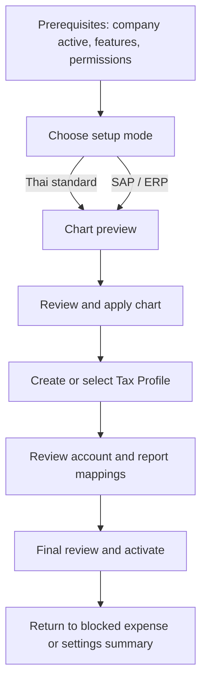

# Accounting and Thai Tax Setup Workflow Spec

## 1. Status

- Status: Implemented; automated verification complete, signed-in browser UAT pending.
- Date: 2026-07-30.
- Owner: Product / Accounting / Web / Tax / Ledger.
- Linked plan: [[plans/accounting-tax-setup-workflow-plan|Accounting and Thai Tax Setup Workflow Plan]].
- Task memory: [[agent-memory/accounting-tax-setup-workflow|Agent Memory]].

## 2. Goal

Make company accounting and Thai VAT setup discoverable and sequential without weakening the existing
chart-of-accounts, Tax Code, account-determination, report-mapping, permission, audit, or activation
boundaries.

A company owner or accountant should be able to:

1. find the setup area from the persistent sidebar;
2. understand the prerequisites before changing data;
3. complete one focused screen at a time;
4. use one clear primary action on each screen;
5. resume an incomplete setup without guessing which technical page to open;
6. review all proposed accounts, Tax Codes, mappings, effective dates, and warnings before activation;
7. return to the blocked source document after setup is complete.

The primary journey must not expose the current three dense maintenance pages as an unordered setup
checklist.

## 3. Problem Statement and Confirmed Baseline

### 3.1 Navigation gap

The current application has implemented routes and permission-filtered cards for:

- `/settings/chart-of-accounts`;
- `/settings/tax-codes`;
- `/settings/tax-accounts`.

However:

- the workspace `settings` module has no sidebar `subItems`;
- the cards exist only on `/settings`;
- child pages do not provide a consistent breadcrumb back to the settings hub;
- some pages rely on cross-links or a user knowing the direct URL;
- active-route and direct-route permission rules are maintained separately from the settings-card registry.

The result is “the page exists, but the user cannot reliably discover or move between it.”

### 3.2 Workflow gap

The existing pages expose implementation concepts rather than a business journey:

- Chart Master Data combines provenance, readiness, preview/apply controls, conflicts, filters, and the
  complete account list.
- Tax Code and Tax Profile combines profiles, built-in templates, manual profile creation, import,
  definitions, and activation.
- Tax Account Determination places account rules, report rules, resolve preview, and all saved rules on
  one page.
- Profile activation reports a general incomplete-profile message while the API already knows the exact
  missing account/report rules.

This makes the required order unclear:

```text
feature entitlement
→ chart of accounts
→ profile/definitions
→ account/report rules
→ activation
→ source-line Tax Code selection
```

The observed UAT journey required direct URLs and repeated manual guidance. A legacy company had zero
chart accounts, a SAP template created 22 definitions when only a domestic non-deductible purchase code
was needed, and account rules were accidentally created against two different definitions with similar
labels.

### 3.3 Existing controls that must remain

- Company chart rows remain company-owned and company-scoped.
- Chart template preview/apply remains checksum- and conflict-guarded.
- Tax profiles and definitions remain draft/review-required until activation.
- Tax Code is authoritative at source-line level.
- Tax account/report rules remain separate from the chart and from Tax Code meaning.
- Missing or ambiguous mappings fail closed.
- Activation remains server-authoritative and audited.
- No workflow may auto-activate productive tax configuration.
- AI/LINE remain read-only and cannot perform final setup mutations.

## 4. Product Decisions

1. Add one primary entry named **ตั้งค่าบัญชีและภาษี** under the persistent Settings navigation.
2. Keep the existing chart, Tax Code, and account-determination routes as advanced maintenance surfaces.
3. Replace the three equal-weight technical cards on the Settings landing page with one primary workflow
   card plus clearly labeled advanced links.
4. The setup journey uses separate routes/screens. It must not render chart setup, Tax Profile creation,
   account mapping, report mapping, and activation on one page.
5. Each screen has at most one primary mutation/continue button. Secondary actions are limited to Back,
   Cancel/leave, and an explicitly labeled advanced-details link.
6. A persistent stepper shows position and state, but only the current screen's fields are rendered.
7. A future step may be opened by URL or menu for authorized users, but it renders a prerequisite blocker
   and a single CTA to the earliest incomplete step. It must not silently redirect or partially render.
8. Setup progress is derived from existing company chart/profile/definition/rule state. Do not add a
   mutable “wizard status” table.
9. When multiple draft profiles exist, the system does not guess. The user selects which profile to
   continue, or creates a new one.
10. Add a reviewed WatchDog domestic-expense baseline for companies that do not use SAP. SAP templates
    remain an advanced/ERP choice.
11. Standard setup may prefill reviewed suggestions from the exact chart-template mapping manifest, but
    suggestions remain `REVIEW_REQUIRED` until an authorized human confirms them.
12. Installing a chart or preset never enables feature entitlements and never activates a Tax Profile.
13. Existing direct routes and APIs remain compatible; the workflow orchestrates them rather than
    replacing their domain ownership.

## 5. Scope

### In scope

- Settings sidebar submenu and active-route behavior.
- Settings landing-page information architecture.
- Multi-route accounting/tax setup workflow.
- Server-derived chart/profile/mapping readiness.
- WatchDog domestic-expense Tax Profile baseline.
- Reviewed account and report mapping suggestions.
- Clear permission, entitlement, loading, empty, conflict, and error states.
- Deep link from a blocked expense to the earliest incomplete setup step and back to the source.
- Desktop and mobile behavior.
- Focused unit, API, integration, and browser/E2E coverage.

### Non-goals

- Replacing the full SAP/ERP import and maintenance surfaces.
- Automatically selecting a company's productive SAP codes.
- Automatically activating a Tax Profile or automatic posting.
- Choosing an account by display-name matching.
- General chart CSV import/designer work.
- Rewriting issued tax snapshots, posted journals, filed returns, or closed periods.
- Changing VAT/WHT/customs/excise ownership boundaries.
- Adding a new permission or feature-entitlement key when current canonical keys are sufficient.
- Making system administrators able to inspect customer accounting or tax data.

## 6. Actors and Permissions

### System admin

- Enables/disables `double_entry_ledger`, `thai_tax`, and optionally `expense_auto_post`.
- Sees partner metadata and entitlement state only.
- Does not open the customer's chart, Tax Codes, mappings, or balances.

### Company Owner / Accountant

- Primary setup actor.
- Must hold the effective permissions required by each step.
- Reviews suggested accounts, report boxes, posting sides, contexts, and effective dates.
- Performs final profile activation.

### Finance / read-only accounting user

- May view progress and configuration when read permissions allow.
- Sees a read-only state with the required role/permission, not disabled mutation controls without
  explanation.

### Other staff

- Do not see setup menu entries and cannot open setup routes.

### Canonical permissions by step

| Step | Read | Mutate |
|---|---|---|
| Prerequisites | `company.settings.view` or `company.setup.manage` | none |
| Chart | `ledger.account.read` | `ledger.account.manage` |
| Tax Profile | `tax.profile.read`, `tax.config.read` | `tax.profile.manage`, `tax.config.manage` |
| Account mapping | `ledger.posting-rule.read`, `tax.config.read` | `ledger.posting-rule.manage`, `tax.config.manage` |
| Report mapping | `tax.config.read` | `tax.config.manage` |
| Activate | `tax.profile.read`, `tax.config.read` | `tax.profile.manage`, `tax.config.manage` |

Backend guards remain authoritative. Sidebar/card visibility is not authorization.

## 7. Navigation and Information Architecture

### 7.1 Settings sidebar

`ตั้งค่าบริษัท` becomes an expandable parent. Its children are built from the same route metadata used
by the Settings landing page and direct-route access checks.

Minimum children, filtered by effective permissions:

1. ภาพรวมการตั้งค่า
2. ตั้งค่าบัญชีและภาษี
3. ผังบัญชี Master Data (ขั้นสูง)
4. Tax Code และ Tax Profile (ขั้นสูง)
5. Tax Account Determination (ขั้นสูง)
6. สาขา
7. ความปลอดภัยบัญชี

LINE OA and CRM catalog keep their existing module ownership; this feature must not create duplicate
sidebar entries for unrelated settings.

Rules:

- The parent expands/collapses and does not navigate.
- `ภาพรวมการตั้งค่า` owns the parent's current `/settings` href.
- The most specific child route is the only active item.
- Mobile navigation closes after route change and preserves the current child highlight when reopened.
- Long Thai labels wrap or truncate without overlapping icons/chevrons.
- Every child route offered in the menu must pass the same permission predicate used by direct access.

### 7.2 Settings landing page

The landing page shows:

- one primary **ตั้งค่าบัญชีและภาษี** card with readiness summary and `เริ่มตั้งค่า` or `ทำต่อ`;
- advanced maintenance links grouped below the workflow card;
- current cards for other settings, permission-filtered as today.

The landing page does not present Chart Master, Tax Profile, and Account Determination as three unrelated
first-choice cards.

### 7.3 Workflow routes

Canonical route family:

```text
/companies/:companyId/settings/accounting-tax-setup
/companies/:companyId/settings/accounting-tax-setup/prerequisites
/companies/:companyId/settings/accounting-tax-setup/chart
/companies/:companyId/settings/accounting-tax-setup/chart/review
/companies/:companyId/settings/accounting-tax-setup/profile
/companies/:companyId/settings/accounting-tax-setup/mappings
/companies/:companyId/settings/accounting-tax-setup/review
```

`/accounting-tax-setup` derives current readiness and offers `เริ่มตั้งค่า`, `ทำต่อ`, or
`ตรวจการตั้งค่าที่ใช้งานอยู่`. It does not guess between multiple incomplete profiles.

The selected `profileId` is an opaque route/query value after the profile step. The server verifies
company ownership on every request. Full profile or account data must not be serialized into the URL.

## 8. Workflow



### Step 1 — Prerequisites and setup mode

Show only:

- company status;
- whether `double_entry_ledger` and `thai_tax` are enabled;
- the actor's read/manage capability for the remaining steps;
- existing chart/profile summary;
- mode choice when a new profile is required.

Modes:

- **บัญชีไทยมาตรฐาน (แนะนำ)** — for a company not using productive SAP Tax Codes.
- **SAP / ERP** — uses existing SAP ERP/S/4HANA template/import behavior.
- **ทำต่อจาก Profile เดิม** — shown for each eligible draft profile.

Primary CTA:

- `ถัดไป: ตรวจผังบัญชี`

Blockers:

- inactive company;
- required feature entitlement off;
- no read access;
- multiple drafts with no selected target.

When an entitlement is off, show its Thai label and instruct the user to contact the system admin. Do not
offer a mutation that the company user cannot perform.

### Step 2 — Chart preview

Show only:

- current chart origin, count, and readiness;
- selected `TH_SME_COA_V1` template metadata;
- exact/missing/conflicting counts after preview;
- a concise explanation of what will and will not change.

Primary CTA:

- already applied and compatible: `ถัดไป: ตั้งค่า Tax Profile`;
- not applied: `ถัดไป: ตรวจผลกระทบ`.

The latter calculates a fresh preview and opens `/chart/review`.

### Step 2b — Chart review and apply

Show:

- all blocking conflicts and dependency counts;
- apply mode;
- explicit acknowledgement when conflicts exist;
- final created/updated/skipped expectation.

Primary CTA:

- `ยืนยันใช้ผังบัญชีและไปต่อ`

Apply keeps current checksum/CAS/serializable transaction behavior. On success, navigate to the profile
step. On stale preview, remain on this screen and provide `ตรวจใหม่`.

New companies already bootstrapped by onboarding skip mutation but still show template provenance before
continuing. Legacy companies with zero accounts follow the normal 175-missing preview/apply path.

### Step 3 — Tax Profile

#### Thai standard path

Create one reviewed preset:

```text
template key: WATCHDOG_TH_DOMESTIC_EXPENSE_V1
source system: WATCHDOG
default status: DRAFT
definition status: REVIEW_REQUIRED
default rounding: HALF_UP / 2
default tolerance: 0.01
```

First-release definitions:

| Code | Meaning | Direction/context | Required result |
|---|---|---|---|
| `V7` | ภาษีซื้อขอคืนได้ 7% | INPUT / DOMESTIC_PURCHASE | claimable input account + PP30 boxes 6/7 |
| `ND` | ภาษีซื้อขอคืนไม่ได้ 7% | INPUT / DOMESTIC_PURCHASE | non-deductible VAT expense account; no PP30 input contribution |

No-VAT expense lines continue to use no Tax Code. The preset does not claim to cover sales, imports,
exports, PP36, deferred VAT, or company-specific SAP semantics.

The user selects an effective-from date. The screen warns when open source documents predate that date.

#### SAP / ERP path

Show one focused choice:

- SAP ERP legacy template;
- SAP S/4HANA current template;
- import a company-owned profile.

Do not render manual profile creation, import textarea, every definition, and activation on the same
screen. Advanced/manual editing remains at `/settings/tax-codes`.

#### Existing draft path

Show the selected draft's:

- source/profile identity;
- definition count and contexts;
- effective window;
- why it is incomplete.

Primary CTA:

- `ถัดไป: ตรวจการผูกบัญชีและรายงาน`

Creating a preset must be idempotent for the same company/template/effective identity.

### Step 4 — Account and report mappings

Show only mappings required by the selected profile, grouped by Tax Code:

- required semantic role;
- posting side;
- transaction context;
- suggested company account;
- required report form/box/amount source;
- effective window;
- status: complete, suggested, missing, conflict.

For `TH_SME_COA_V1`, suggestions may come only from the versioned mapping manifest and must show:

- template key/version/checksum;
- account code and name;
- `REVIEW_REQUIRED`;
- why the suggestion exists.

Example reviewed suggestions include:

- `INPUT_VAT_CLAIMABLE → 1154-00`;
- `NONDEDUCTIBLE_VAT_EXPENSE → 5390-02`.

These are suggestions for the exact reviewed template, not universal name-based defaults.

The workflow may use the existing idempotent upsert endpoints. One click may submit several reviewed
rows sequentially because no row becomes active before profile activation. If one request fails, refetch
readiness, show which rows succeeded, and leave only the remaining rows actionable.

Primary CTA:

- `บันทึกที่ตรวจแล้วและไปต่อ`

There is no free-form account-role dropdown in the standard workflow. Users who need custom roles use
the advanced page.

### Step 5 — Final review and activation

Show:

- target profile and effective window;
- code count;
- account/report readiness per code;
- unresolved warnings and blockers;
- whether another active/default profile overlaps;
- affected contexts;
- actor and audit consequence;
- a reminder that issued snapshots are immutable.

Primary CTA:

- `ยืนยันและเปิดใช้งาน Tax Profile`

Activation calls the existing server-authoritative command. The server revalidates every definition,
account rule, report mapping, semantic constraint, and effective window in the final transaction.

On success:

- profile/definitions/rules become active through current behavior;
- show success summary;
- if a validated same-company `returnTo` exists, offer `กลับไปรายการค่าใช้จ่าย`;
- otherwise offer `กลับภาพรวมการตั้งค่า`.

## 9. Readiness Contract

Add a read-only profile readiness endpoint that reuses the same domain functions as activation:

```text
GET /companies/:companyId/tax/code-profiles/:profileId/readiness
```

Minimum response:

```ts
type TaxProfileSetupReadiness = {
  profileId: string;
  profileStatus: 'DRAFT' | 'ACTIVE' | 'RETIRED';
  definitionCount: number;
  activeDefinitionCount: number;
  canActivate: boolean;
  blockers: Array<{
    code: string;
    taxCodeDefinitionId?: string;
    externalTaxCode?: string;
    kind: 'DEFINITION' | 'ACCOUNT_RULE' | 'REPORT_RULE' | 'EFFECTIVE_WINDOW' | 'PROFILE_OVERLAP';
    accountRole?: string;
    postingSide?: 'DEBIT' | 'CREDIT';
    formType?: string;
    boxKey?: string;
    amountSource?: string;
  }>;
  warnings: Array<{ code: string; externalTaxCode?: string }>;
};
```

Rules:

- The endpoint is read-only and company-scoped.
- It uses `validateTaxCodeDefinition`, `missingConfiguration`, semantic rule validation, and effective
  window coverage from the activation path; no parallel validation implementation.
- `canActivate` is advisory. Activation always revalidates.
- Error/blocker arrays are bounded and contain no customer transaction data.
- The web maps stable codes to Thai text while keeping external codes and account roles visible.

The setup overview combines this response with the existing chart readiness endpoint. Do not add a
second mutable readiness source.

## 10. Source-Document Deep Link

When an expense with VAT has no usable Tax Code:

- preserve the existing blocking validation;
- show one CTA `ตั้งค่าภาษี`;
- link to `/settings/accounting-tax-setup` with a same-company, relative `returnTo`;
- derive the earliest incomplete step on arrival;
- after activation, return to the expense and refetch definitions.

Security:

- accept only relative workspace paths under the same company;
- never accept an external URL;
- never bypass source-document permissions;
- do not place receipt/vendor data in the query string.

For an abbreviated tax invoice, the UI may suggest `ND` after an active applicable definition exists,
but the user still reviews the selection. OCR does not create or activate Tax Codes.

## 11. Page and Interaction Design

### Layout

- One main content column with a readable maximum width.
- One step's content per page.
- No two-column “account rule vs report rule” authoring forms in the guided workflow.
- No full account/definition/rule tables below the current step.
- Stepper at top; Back/Next action bar at bottom.
- Advanced details use a disclosure or link, not another primary card beside the task.

### Button hierarchy

- Exactly one primary CTA per screen.
- Back is secondary.
- Destructive/retire actions are absent from the guided workflow.
- A disabled primary button always has a visible reason.
- Buttons use outcome labels, not generic `Save`, `Activate`, or `Next` when the mutation matters.

### State handling

- Loading covers the current step, not the entire shell.
- API errors use inline `role="alert"` and retain entered choices.
- Empty state says what is missing and provides the one next action.
- Read-only state names the required permission/role.
- Stale preview and concurrent changes require refetch/review.
- Success navigates forward only after the server mutation succeeds.

### Accessibility and responsive behavior

- Stepper exposes an ordered list and current step with `aria-current="step"`.
- Fields have programmatic labels and errors.
- Keyboard focus moves to the new page heading after navigation.
- Mobile uses a compact “ขั้น X จาก Y” header; the full step labels may scroll horizontally or collapse
  into a summary.
- Sticky action bar must not obscure form content.
- Color is not the only complete/warning/blocker signal.

## 12. State Transitions and Exceptions

| Current state | Workflow behavior |
|---|---|
| Features off | Block at prerequisites; name entitlements; no customer mutation |
| Chart missing | Preview/review/apply |
| Chart already compatible | Show provenance; continue |
| Chart conflict | Require explicit review/acknowledgement; no silent overwrite |
| No profile | Choose standard or ERP path |
| One eligible draft | Offer continue; do not auto-select when returning from another target |
| Multiple drafts | Require explicit target selection |
| Active applicable profile | Show complete; allow advanced maintenance |
| Draft has missing mappings | Open mapping step with only missing/conflicting rows |
| Profile effective date too late | Block affected historic documents; allow reviewed date correction while draft |
| Profile activation race | Server rejects; refetch readiness |
| Read-only user | Show progress and required manager permission |
| Source document return target lost | Finish at setup summary |

## 13. Impact Analysis

| Area | Current behavior | Required impact |
|---|---|---|
| Workspace navigation | Settings is a leaf; cards/routes are separate | Add permission-filtered Settings children from shared route metadata |
| Active-route logic | Some settings routes are modules, some moduleless | Add exact setup/advanced route ownership and single-child highlighting |
| Direct-route access | Tax settings rely mainly on page-level capability rendering | Add exact route rules aligned with sidebar/card predicates |
| Settings hub | Three technical cards have equal weight | Replace with workflow card; retain advanced links |
| Chart UI | Dense maintenance + preview/apply/list | Reuse APIs; workflow renders preview and review as separate screens |
| Tax Profile UI | Templates/manual/import/definitions/activation together | Add focused profile step; keep current page advanced |
| Account Determination UI | Account/report forms side by side | Add required-mapping review screen; keep current page advanced |
| Contracts | No per-profile readiness DTO; template type is SAP-only in web | Add readiness DTO and WatchDog template key/source-system support |
| Tax domain | Activation has exact validation but no read endpoint | Reuse validation to expose bounded readiness |
| Tax templates | Only SAP templates | Add reviewed domestic-expense WatchDog preset |
| Ledger catalog | Mapping manifest exists and stays review-required | Surface exact manifest suggestions with provenance; no name matching |
| Feature entitlement | Ledger/tax are deny-by-default for new packages unless enabled | Show prerequisite blocker; do not auto-enable |
| Onboarding | New companies should receive chart bootstrap; legacy companies may not | Skip completed chart step for new; support zero-account legacy apply |
| Expense review | Generic Tax Code blocker with no recovery journey | Add same-company setup deep link and return path |
| Error translation | Activation collapses exact errors into a generic message | Render per-code blockers from readiness/activation details |
| Audit | Existing chart/profile/rule actions audited separately | Keep those actions; navigation/readiness adds no combined mutation |
| Data model | Existing state already describes progress | No wizard/run table or migration |
| API compatibility | Existing direct endpoints used by advanced pages | Additive readiness/preset behavior; no route removal |
| Tests | Logic tests cover cards/nav separately | Add parity, route, step-gate, readiness, standard-preset, and E2E journey coverage |

## 14. Security, Tenant, Audit, and Mutation Boundaries

- Every route and API validates company membership and effective permissions.
- A `profileId` must belong to the route company.
- Chart apply keeps existing serializable/CAS/checksum controls.
- Mapping suggestions resolve to company-owned account IDs after chart apply.
- The workflow never sends an account ID copied from another company or template fixture.
- Client readiness cannot authorize activation.
- Activation remains one final tax mutation with current audit/outbox behavior.
- Existing account/report upserts keep their own permission and audit checks.
- If the workflow submits several upserts, it does not mask the tax and ledger permission domains.
- System admin entitlement changes remain metadata-only and do not call customer setup APIs.
- AI Gateway receives no new mutation tool.

## 15. Analytics and Operational Evidence

Record privacy-safe product events only if the existing analytics seam is available:

- setup opened;
- prerequisite blocked by entitlement/permission;
- step viewed/completed;
- chart preview conflict count;
- profile preset selected;
- activation succeeded/failed by stable reason code;
- returned to source document.

Do not record account names, Tax IDs, receipt data, or raw API payloads.

Audit remains the source for financial configuration mutations; analytics is not audit.

## 16. Acceptance Criteria

- [x] Settings sidebar exposes permission-correct children for overview, setup, and advanced accounting/tax pages.
- [x] Settings cards, sidebar children, active-route logic, and direct-route access use one shared route
      definition or verified parity.
- [x] A user can begin the setup without typing or editing a URL.
- [x] The guided flow renders prerequisites, chart, profile, mappings, and activation on separate screens.
- [x] Each guided screen has at most one primary CTA and explains why it is disabled.
- [x] A legacy zero-account company can preview/apply `TH_SME_COA_V1` and continue.
- [x] A newly onboarded compatible company skips chart mutation and still sees provenance.
- [x] A non-SAP company can create the review-gated domestic-expense baseline without manually authoring a
      profile and each definition.
- [x] Suggested accounts come only from a matching reviewed manifest and remain review-required.
- [x] `ND` requires a non-deductible VAT expense debit mapping and no PP30 input mapping.
- [x] `V7` requires the claimable input VAT mapping and correct PP30 base/tax mappings.
- [x] The workflow shows exact missing mappings before activation.
- [x] Profile activation continues to fail closed on missing, ambiguous, semantically invalid, stale, or
      uncovered rules.
- [x] Multiple drafts require explicit selection.
- [x] Feature-off and read-only users see an actionable blocker without unauthorized data.
- [x] Expense Tax Code errors can enter the workflow and return safely to the same-company expense.
- [x] Existing advanced routes and APIs remain functional.
- [ ] Desktop, mobile, keyboard, loading, error, empty, and stale states are verified.

## 17. Required Test Scenarios

### Navigation

1. Owner with ledger/tax permissions sees setup and all applicable advanced children.
2. Tax-only, ledger-only, and read-only permission combinations show only valid children.
3. Direct routes and sidebar visibility agree.
4. Only the most specific child is active.
5. Mobile drawer closes on navigation and reopens at the active child.

### Workflow logic

6. Earliest incomplete step is derived for features-off, zero-chart, no-profile, missing-mapping, and
   activation-ready states.
7. Multiple drafts are never auto-selected.
8. A completed active profile opens the review/summary state.
9. Invalid or cross-company `profileId` and `returnTo` are rejected.

### Chart

10. Zero-account company previews 175 missing rows and applies through current checksum guards.
11. Stale preview stays on the review screen.
12. Existing compatible chart skips mutation.
13. In-use conflicts remain blocking.

### Tax preset and readiness

14. WatchDog preset is idempotent and creates only the reviewed domestic-purchase definitions.
15. `ND` readiness requires `NONDEDUCTIBLE_VAT_EXPENSE/DEBIT` and no report mapping.
16. `V7` readiness requires `INPUT_VAT_CLAIMABLE/DEBIT` and PP30 boxes 6/7.
17. Readiness output matches activation validation for every missing/invalid fixture.
18. Suggestions resolve only against company-owned accounts from the matching manifest.
19. Effective-window gaps and profile overlaps are visible before activation.

### Integration/browser

20. Enable entitlements → open sidebar → zero-chart apply → standard profile → review mappings → activate
    → return to expense → select applicable Tax Code.
21. Page refresh at every step resumes from server state.
22. API failure during one mapping upsert shows completed and remaining rows without activating.
23. Read-only user can inspect progress but cannot mutate.
24. No console error, duplicate submit, focus loss, or mobile action overlap occurs.

## 18. Rollout and Compatibility

1. Ship navigation reachability first; no backend behavior change.
2. Ship read-only workflow/readiness next.
3. Add the WatchDog preset and reviewed suggestion flow behind the existing `thai_tax` and
   `double_entry_ledger` entitlements.
4. Keep advanced pages available throughout rollout.
5. Add the expense recovery deep link after the workflow is production-ready.
6. Do not redirect old bookmarks away from advanced pages.
7. Existing active profiles, rules, snapshots, and journals are unchanged.

## 19. Production Accounting Review

The WatchDog preset is implemented as an additive reference baseline. Creation leaves the profile in
`DRAFT` and every definition/rule in `REVIEW_REQUIRED`; the application never auto-activates it.
Before production activation, the accountable company tax reviewer must confirm:

- visible Thai names for `V7` and `ND`;
- whether `V7` should start claimable or pending-evidence for the intended customer segment;
- effective-date guidance for historical documents;
- the reviewed PP30 box mapping labels;
- whether the first preset should remain domestic-expense-only or include additional contexts in a later
  separately reviewed version.

These decisions remain a production activation responsibility. They do not block shipping the guided
workflow because the existing permission, review, mapping, and final activation boundaries remain
authoritative and fail closed.
