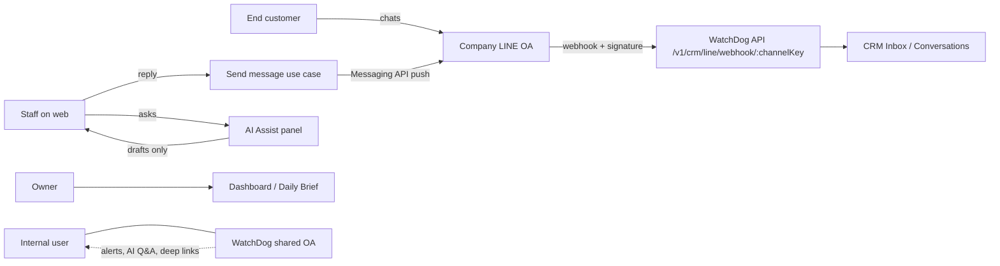

# CRM + Company LINE OA Customer OS Spec

## 1. Status

Ready for design review. Proposed roadmap placement: new item **15A. CRM Customer OS — Company LINE OA Inbox, Customer 360, and AI Assist** in [[plans/master-implementation-checklist|Master Implementation Checklist]], directly after item 15.

This spec extends, and does not replace, [[specs/crm-sales-spec|CRM and Sales Spec]] (item 15). Item 15 remains the owner of customer/contact/lead/opportunity/follow-up/quotation-link primitives. This spec adds the omnichannel layer on top: per-company LINE OA channel, CRM Inbox, Customer 360 workspace, human-in-the-loop AI Assist, appointments, service jobs, and campaigns.

Web-first scope: everything in this spec is designed for the web workspace first. LINE-side rich menus for end customers, LIFF booking pages, and customer-facing automation are explicitly later phases.

Linked plan: [[plans/crm-line-oa-customer-os-plan|CRM + Company LINE OA Customer OS Plan]]

Shared catalog extension: [[specs/crm-product-service-catalog-spec|CRM Product and Service Catalog Spec]] defines the customer-visible Product/Service source used by staff booking and CRM customer AI.

Source requirement: `watchdog_crm_uxui_requirements.md` (owner-provided UX/UI requirements, 2026-07-04).

## 2. Goal

Turn each SME company's own LINE OA into an AI-powered CRM channel:

- End customers chat with the **company's LINE OA** exactly as they do today.
- Every inbound message lands in a web **CRM Inbox** where staff read, reply, tag, assign, and resolve.
- A **Customer 360** profile aggregates identity, conversations, deals, quotations, invoices/payments, appointments, service jobs, notes, and consent in one page.
- **AI Assist** helps staff (summary, suggested reply, intent, sentiment, lead score, next best action) but never talks to the end customer autonomously.
- Staff can create a deal, task, quotation draft, or appointment **from the conversation** in one or two clicks.
- Owner sees a **Daily Brief** dashboard: new customers, unanswered chats, SLA breaches, pipeline value, pending payments, open complaints, and AI-recommended follow-ups.
- Campaigns send segmented broadcasts through the company OA with quota awareness.

One-line definition:

> WatchDog CRM turns an SME's LINE OA into an AI-powered customer operating system — customers keep using LINE as before, while staff and owner work in a structured web CRM behind it.

## 3. Non-goals

- Replacing or merging with the WatchDog shared LINE OA (item 10A/10B). Internal users keep the shared OA for login, alerts, and AI Q&A. End customers never chat with the WatchDog shared OA.
- End-customer accounts, roles, logins, or direct AI Gateway access. End customers are CRM contacts only.
- AI auto-send to end customers. Every AI output is a draft that staff explicitly send. No autonomous outbound.
- Owning quotation/invoice/receipt/payment lifecycle. Accounting Documents item 08 owns official documents; CRM links, displays status, and sends document messages through the OA.
- Owning ledger, tax, or payment verification logic (items 10, 11, 13).
- Non-LINE channels (Facebook, IG, web chat widget, email inbox) in the first pass. The channel model must allow them later.
- Call center/telephony, voice, or video.
- Marketplace order import (item 19) and external ad-platform publishing (item 23).
- Building a marketing landing page. CRM routes open a working workspace directly.

## 4. Channel Model: Two LINE OA Types

| Channel | Audience | Purpose | Owner of credentials |
|---|---|---|---|
| WatchDog shared LINE OA | Internal users (owner/staff) | Login/link, alerts, daily brief push, internal AI Q&A | Platform (item 10A `PlatformLineChannel`) |
| Company LINE OA | End customers of each company | Customer chat, broadcasts, reminders, quotations/invoices delivery | Each company (`CompanyMessagingChannel`, this spec) |

Hard rules:

- Never route end customers to the WatchDog shared OA. Setup UI must warn about this explicitly.
- Company context for inbound end-customer messages resolves from the **channel record** (`channelId -> companyId`), which is safe here because each company registers its own OA credentials. This is the opposite of the shared OA rule (where channel id must never imply company) — the two webhook paths must stay physically separate endpoints and separate code paths.
- Company OA credentials are tenant data: encrypted at rest, masked in every response, never logged, never readable by platform admin UI (item 10A shows readiness metadata only).
- LINE quota/broadcast usage is per company OA and must be surfaced before send.



## 5. Users and Role Experience Targets

End customer (not a user): chats via company LINE OA only; sees the company brand, never WatchDog UI; is stored as `CrmCustomer` + channel identity + consent.

Internal roles map onto existing RBAC roles plus 10C+ capability packs. Per-role UX target — this is the "smart and easy for every role" contract:

| Role | Primary surfaces | 30-second job | UX bar |
|---|---|---|---|
| OWNER | Dashboard/Daily Brief, Reports | "How is my business today and what needs me?" | Whole business state in one screen, zero setup work, every number clickable to detail |
| ADMIN / MANAGER | Settings, Team, Inbox overview, SLA board | "Is the team keeping up and is the system healthy?" | Connect OA in a guided wizard; assign/rebalance in 2 clicks; SLA breaches impossible to miss |
| SALES | Inbox, Deals, Tasks, Quotations | "Answer this customer well and move the deal" | 3-column inbox; Customer 360 beside the chat; AI draft one click away; create deal/quote/task without leaving the conversation |
| SUPPORT (capability pack over STAFF) | Inbox, Service Jobs, Appointments | "Resolve this issue and schedule the work" | Same inbox; service history in sidebar; internal notes visually impossible to confuse with customer replies |
| FINANCE / ACCOUNTANT | Invoices/Payments views, Customer 360 finance tab | "What is outstanding and what proof arrived?" | Payment status color-coded; slip proof queue; read-only elsewhere |
| MARKETING | Segments, Campaigns | "Send the right promo to the right segment within quota" | Recipient count + quota warning before send; preview mandatory |
| AUDITOR_READONLY | All read surfaces | Review without mutation | Existing read-only guarantees extend to inbox/campaigns |

Role provisioning reuses 10C/10C+ (roles, capability packs, job presets). This spec adds new permission keys (section 13) and proposes two new capability packs: `Inbox Agent` and `Campaign Manager`.

## 6. Boundary and Ownership

- This item owns: `CompanyMessagingChannel`, `CrmChannelIdentity`, `CrmConversation`, `CrmMessage`, `CrmMessageTemplate`, `CrmAppointment`, `CrmServiceJob`, `CrmCampaign`, `CrmCampaignRecipient`, conversation AI-assist cache/feedback, and inbox SLA policy.
- Item 15 owns: `CrmCustomer`, `CrmContactPerson`, `CrmLead`, `CrmOpportunity`, `CrmActivity`, `CrmFollowUpTask`, `CrmQuotationLink`, `CrmCustomerSegment`, duplicates/merge, import. This spec extends `CrmCustomer` additively (scoring fields) and writes `CrmActivity` entries for inbox/appointment/service/campaign events.
- Item 08 owns quotations/invoices/receipts/payments. CRM renders status read models and requests drafts via the existing item 15 quotation-link boundary; "send quotation via LINE" produces an outbound `CrmMessage` carrying a permission-checked document link/file — document state stays in item 08.
- Item 06 owns notification delivery; this item provides new event sources (new conversation, SLA breach, assignment, payment proof received, appointment reminder due, campaign result).
- Item 16 owns automation rules; SLA timers and reminder schedules should run through workflow/worker primitives where they exist.
- Item 17 owns the generic AI draft/suggestion layer; conversation AI Assist uses the same AI Gateway boundary and safety rules, with a conversation-scoped fast path (section 16).
- AI Gateway never touches the database and never holds company OA credentials.

## 7. References

- [[specs/crm-sales-spec|CRM and Sales Spec]] — base CRM objects
- [[specs/accounting-documents-spec|Accounting Documents Spec]] — quotation/invoice/payment
- [[specs/line-ai-channel-auth-spec|LINE AI Channel/Auth Spec]] — shared OA rules that must NOT leak into company OA path
- [[specs/admin-company-onboarding-spec|Admin Company Onboarding Spec]] — entitlement flags
- [[specs/employee-access-role-management-v2-phase1-spec|Access v2 Phase 1 Spec]] — capability packs
- [[specs/ai-gateway-agents-spec|AI Gateway Spec]], [[specs/ai-draft-suggestion-layer-spec|AI Draft and Suggestion Layer Spec]]
- [[specs/dashboard-notification-spec|Dashboard and Notification Spec]]
- [[specs/workflow-automation-spec|Workflow Automation Spec]]
- [[specs/permission-matrix|Permission Matrix]], [[specs/auth-authorization-rbac-spec|Auth/RBAC Spec]]
- [[specs/data-model-core-spec|Data Model Core Spec]], [[specs/web-core-workspace-spec|Web Core Workspace Spec]]

## 8. Information Architecture

Extend the existing web shell navigation. CRM becomes a grouped section:

```text
WatchDog CRM (web)
├── Dashboard (existing item 06 + CRM/Daily Brief widgets)
├── Inbox
│   ├── All / Assigned to me / Unassigned / Overdue SLA / Follow-up / Resolved
│   └── Conversation detail (3-column workspace)
├── Customers
│   ├── Customer list (item 15, extended columns)
│   └── Customer 360 (extended detail page)
├── Sales (item 15 existing)
│   ├── Deals pipeline
│   ├── Tasks / Follow-ups
│   └── Quotations (links + item 08 views)
├── Operations
│   ├── Appointments (calendar + list)
│   ├── Service jobs
│   └── Payments (item 08 read views: waiting proof, overdue)
├── Marketing
│   ├── Segments (item 15 segments + builder)
│   ├── Campaigns
│   └── Broadcast history
├── AI Insights (item 17 workspace + CRM widgets)
├── Reports (item 18)
└── Settings
    ├── LINE OA Integration  <- new
    ├── Inbox & SLA policy   <- new
    ├── Message templates    <- new
    ├── Pipeline / Tags / Segments (item 15)
    └── Team & Permission (10C/10C+)
```

Navigation rules:

- Modules hidden by feature entitlement (item 10A `CompanyFeatureEntitlement`) and permission. A user never sees a menu item they cannot open.
- Company switcher stays visible; every CRM surface is company-scoped.
- Deep links from notifications/LINE alerts land on the exact record with permission re-check.

## 9. Core Workflows

### 9.1 Company LINE OA Onboarding (Journey 1)

1. Owner/Admin opens Settings > LINE OA Integration.
2. Step-by-step wizard: (a) explain the two-OA model with a warning card ("this OA is for YOUR customers; do not use the WatchDog OA"); (b) collect OA name, Channel ID, Channel Secret, Channel Access Token; (c) show the per-company webhook URL with a Copy button and LINE Developers walkthrough; (d) Test Connection.
3. API validates the token against LINE (bot info call), stores credentials encrypted, and computes `webhookKey` (unguessable per-channel key embedded in the webhook URL).
4. Status card shows: connection status, webhook verified at, last webhook received, last error, message quota/usage where the LINE API exposes it.
5. First inbound customer message flips channel status to `ACTIVE` and appears in Inbox.
6. Actions: Test connection, Rotate credentials, Copy webhook URL, View setup guide, Disable integration (soft; inbound rejected with audit, no data loss).

Error states must be plain-language and actionable: invalid secret, expired/invalid token, webhook not enabled on LINE side, duplicate channel already connected to another company (blocked).

### 9.2 Inbound Message to Inbox (Journey 2)

1. End customer messages the company OA.
2. LINE calls `POST /v1/crm/line/webhook/:webhookKey`.
3. API resolves the channel by `webhookKey`, verifies `X-Line-Signature` with that channel's decrypted secret, and rejects on mismatch.
4. Idempotency by LINE `webhookEventId`/message id — replays are ignored.
5. API resolves `CrmChannelIdentity` by exact `(channelId, providerUserId)`. An existing identity deterministically reuses its same-company `CrmCustomer.id`; a new identity creates a provisional LINE-origin customer without guessing from name or phone. Profile enrichment is display data only. Possible normalized-phone/name matches appear later in `/customers` for human review.
6. API finds the open `CrmConversation` for that identity or creates one (status `NEW`), appends `CrmMessage` (direction `INBOUND`), updates `lastMessageAt`, unread counters, and SLA `firstResponseDueAt` from inbox policy.
7. Outbox event `crm.conversation.message_received` feeds notification (new/unassigned conversation alerts) and workflow rules.
8. Staff sees the conversation move to the top of Inbox in near-real-time (polling interval or SSE per current web conventions; long-poll/SWR refresh acceptable first pass).

### 9.3 Staff Works a Conversation (Journey 3)

1. Staff opens Inbox; filters: All, Assigned to me, Unassigned, Overdue SLA, Follow-up, Resolved.
2. Conversation list rows show: customer name+avatar, last message preview, time, unread badge, tags, assignee, priority, SLA countdown color, channel icon, status.
3. Opening a conversation shows the 3-column workspace (section 10.2): chat center, Customer 360 sidebar right.
4. Staff reads history, checks AI summary, replies (text, image, sticker/emoji, file), or inserts an AI-suggested draft after editing.
5. Internal notes post into the same thread but are visually distinct (amber background, lock icon, "ทีมเห็นเท่านั้น — ลูกค้าไม่เห็นข้อความนี้") and are structurally a different message visibility, never sendable to LINE.
6. Actions from the conversation: assign, change status, add/remove tags, set priority, create task, create deal, create quotation draft (via item 15/08 boundary), create appointment, create service job, mark resolved, mark spam.
7. Every action appends `CrmActivity` and audits.

### 9.4 Quotation / Invoice over LINE

1. From a conversation or deal, staff creates a quotation draft (existing item 15 -> item 08 boundary).
2. After item 08 issues the quotation, staff clicks "Send to LINE": API renders a message (Flex/preview text + permission-checked short-lived document link or PDF), sends via company OA push, and appends an outbound `CrmMessage` of type `DOCUMENT` with the accounting document ref.
3. Delivery/read state is tracked at message level where LINE exposes it; document business status (viewed/accepted) stays item 08 + activity log.
4. Same pattern for invoices and payment reminders. Customer sends a payment slip image back — it lands in the conversation, and Finance sees it in a "waiting proof review" queue that deep-links to item 08 payment recording (item 09/13 own verification flows).

### 9.5 Owner Daily Brief (Journey 4)

1. Owner opens Dashboard (or receives WatchDog shared OA push from item 06 delivery).
2. Daily Brief card: new customers today, unanswered conversations, SLA breaches, open deals value, quotations awaiting acceptance, payments waiting review/overdue, unresolved complaints, today's appointments, campaign results.
3. AI Daily Insight section (item 17 suggestion template, cited, permission-scoped): who to follow up today, deals likely to close, at-risk customers, complaints to escalate, suggested campaign.
4. Every line has one action button that jumps to the filtered work queue ("ดูแชทที่ยังไม่ตอบ", "ดูดีลที่ควร follow-up").

### 9.6 Appointments

1. Staff creates appointment from conversation, Customer 360, or calendar; fields: customer, service/title, staff assignee, start/end, location/notes.
2. Calendar view (day/week) plus per-staff schedule; conflicts warned.
3. Status flow: `SCHEDULED -> CONFIRMED -> COMPLETED`, plus `RESCHEDULED`, `NO_SHOW`, `CANCELED`.
4. Reminder jobs (worker/workflow) send LINE push to the customer via company OA at configured offsets, and notify assigned staff via item 06.
5. Appointment history renders in Customer 360 timeline.

### 9.7 Service Jobs

1. Created from conversation, appointment, or customer; fields: title, description, assignee(s), scheduled date, cost estimate, linked deal/invoice.
2. Status flow: `NEW -> ASSIGNED -> IN_PROGRESS -> WAITING_CUSTOMER -> COMPLETED`, plus `CANCELED`.
3. Before/after photos via existing attachment primitives; service note per status change.
4. Completion can prompt invoice creation (item 08) and a feedback request message via OA (template, staff-sent).

### 9.8 Campaigns and Broadcast

1. Marketing builds a segment (item 15 segments; add rule builder for: tag, status, inactive N days, bought product X, quotation not accepted, upcoming appointment, birthday month where data exists).
2. Campaign composer: message preview (as LINE bubble), recipient count, consent filter (exclude `REVOKED`), quota estimate + warning, schedule or send now.
3. Send runs in workers with rate limiting and per-recipient result tracking; campaign status: `DRAFT -> SCHEDULED -> SENDING -> SENT / PARTIAL_FAILED / FAILED / CANCELED`.
4. Results: delivered count, failures with reason, replies attributed to campaign (conversation tagged with campaign ref), simple conversion view (replied / created deal / paid — where links exist).
5. Broadcast never includes customers without an active channel identity or with revoked consent. Every send is audited.

## 10. Screen Requirements

### 10.1 Dashboard (Owner/Manager)

Widgets (extend item 06 registry): new customers today, unanswered conversations, SLA breaches, open deal value by stage, quotations awaiting, payments waiting review/overdue, complaints open, today's appointments, team response-time, top customers, campaign performance. AI Daily Insight card (section 9.5). Large-card layout, scannable in 30 seconds, no dense charts, every card has one action.

The `sla_breaches` card, labelled "รอตอบเกินกำหนด", counts exactly the conversations in its `/inbox?overdue=true` destination for the same viewer at the same instant, matching the inbox `overdueCount` chip. All three use the repository's canonical `overdueWhere(now)`: no first staff response (`firstRespondedAt = null`), a stored first-response deadline strictly before now (`firstResponseDueAt < now`), and status neither `RESOLVED` nor `SPAM`. Count newly overdue chats even before the periodic scan runs; exclude answered chats even if `slaBreachedAt` remains set. Scope this card by company and the inbox's existing assignment visibility (`assignedScopeForList`: all company chats for read-all roles; assigned-to-self plus unassigned otherwise). Do not add the brief's customer-owner or customer-branch filters, which the destination list does not apply. This is a current waiting queue in every dashboard period, not a historical count of late replies or scan events; the scan and its notices remain unchanged.

The `unanswered` card, labelled "ยังไม่ได้ตอบ", follows the same rule (browser check 2026-10-03: it counted by the customer's owner and branch and opened the whole inbox, so an owner read 7 beside 14 chats, a salesperson 0 beside 3 unanswered chats, a manager 0 beside 14). It counts exactly the conversations in its `/inbox?unanswered=true` destination for the same viewer, matching the inbox's "ยังไม่ได้ตอบ" chip (`unansweredCount`). The list filter, the chip and the card use the repository's `unansweredWhere()`: no first staff response (`firstRespondedAt = null`) and status neither `RESOLVED` nor `SPAM`, whatever the deadline, so every overdue chat is also unanswered. Same assignment visibility as the overdue card; no customer-owner or customer-branch filter.

### 10.2 CRM Inbox — 3-column workspace

Column 1 — Conversation list: search; filter tabs; sort by latest/SLA; row anatomy per 9.3(2); bulk assign for managers.

Column 2 — Chat window: message bubbles inbound left/outbound right; sticker/image/file rendering; date separators; composer with text, attach, emoji/sticker (later), quick replies from `CrmMessageTemplate` (`/` shortcut), "AI ช่วยร่างคำตอบ" button; internal-note toggle clearly separated from the send button (different color + labeled tab, not a checkbox next to Send); send states (sending/sent/failed with retry).

Column 3 — Customer 360 sidebar: identity card (name, avatar, phone, tags, consent badge), lead score + sentiment chips with "AI-generated" label, latest deal + stage, open tasks, next appointment, recent purchases/outstanding where permitted, AI conversation summary (labeled, refreshable), quick actions: Create deal / task / quotation / appointment / service job, open full Customer 360.

Conversation statuses: `NEW`, `OPEN`, `WAITING_CUSTOMER`, `WAITING_INTERNAL`, `FOLLOW_UP`, `RESOLVED`, `SPAM`.

SLA color: green > 50% time left, amber < 50%, red overdue. New/unread rows bold.

### 10.3 Customer 360 (full page)

Header: identity, status (`Lead/Active/VIP/Inactive/Lost` via tags/segments), owner, lead score, sentiment, risk, lifetime value (derived read model), consent/PDPA badge, quick actions.

Tabs: Overview, Timeline (unified feed: messages summary, activities, deals, quotes, invoices/payments, appointments, service jobs, notes, consent changes), Conversations, Deals, Quotations, Invoices/Payments (permission-gated), Appointments, Service Jobs, Notes, Files, Consent/PDPA.

Timeline is append-only, newest first, icon per event type, each entry deep-links to the source record.

### 10.4 AI Assist Panel

Capabilities (all draft/insight only): summarize conversation; suggested reply; tone adjust (สุภาพขึ้น / สั้นลง / เป็นทางการ / แปลภาษา); intent detection; sentiment; lead score with reasons; next best action; follow-up suggestion; complaint/risk detection.

UX rules: every output labeled "คำแนะนำจาก AI"; buttons Insert to reply (into composer, editable) / Copy / Regenerate; thumbs up/down feedback stored; uncertainty state ("AI ไม่มั่นใจ กรุณาตรวจสอบเอง") when confidence low; provider-down state degrades gracefully (panel shows unavailable, inbox unaffected); no auto-send path exists in the API at all.

### 10.5 Deals / Tasks / Quotations

Item 15 screens continue; additions: create-from-conversation prefill (customer, source ref), deal card shows source `LINE` badge and last conversation link, quotation detail gains "Send to LINE" + send-activity log.

### 10.6 Appointments

Calendar (day/week) + list; create/edit modal; staff filter; status chips; reminder config per appointment (default from settings); conflict warning; customer link mandatory.

### 10.7 Service Jobs

Board or list by status; job detail with photos, notes, costs, linked records; assign; status transitions with note; feedback capture.

### 10.8 Campaigns

Segment picker with live recipient count; message composer with LINE-style preview; consent + quota warnings; schedule; results page (delivered/failed/replies/attributed deals); broadcast history.

### 10.9 LINE OA Integration Settings

Per section 9.1. Credential display: `••••••••` + last 4; reveal button only with `crm.channel.manage` + step-up where 10C+ MFA exists; every reveal audited. Status, last webhook, last error, quota card. Guided wizard for first-time setup; compact status page afterward.

### 10.10 Shared States (all screens)

- Empty states with one CTA (e.g., Inbox before OA connect: "ยังไม่ได้เชื่อมต่อ LINE OA — เชื่อมต่อเพื่อให้ข้อความลูกค้าเข้ามาที่นี่โดยอัตโนมัติ" + Connect button).
- Loading skeletons for list/detail/AI cards.
- Error states with plain Thai explanation + retry/next action.
- Permission state: "คุณไม่มีสิทธิ์เข้าถึงข้อมูลนี้ กรุณาติดต่อ Admin ของบริษัท".
- AI uncertainty state per 10.4.

## 11. Data Model Draft

Business contract shape; align naming with current Prisma conventions at implementation time.

### CompanyMessagingChannel

```text
CompanyMessagingChannel
- id
- companyId
- provider: LINE_OA (enum, extensible: FACEBOOK, WEB_CHAT later)
- displayName
- lineChannelId            // LINE channel id (unique across platform when active)
- channelSecretEncrypted   // AES-GCM, key from platform secret manager
- accessTokenEncrypted
- credentialLast4
- webhookKey               // unguessable url segment, rotatable
- status: PENDING_SETUP, CONNECTED, ACTIVE, ERROR, DISABLED
- lastWebhookAt nullable
- lastErrorAt nullable
- lastErrorCode nullable
- quotaSnapshotJson nullable
- defaultReplyMode nullable
- connectedByUserId
- disabledAt / disabledByUserId / disableReason nullable
- createdAt / updatedAt
- unique lineChannelId where status != DISABLED
- unique companyId,provider,lineChannelId
- index companyId,status
```

### CrmChannelIdentity

```text
CrmChannelIdentity
- id
- companyId
- channelId (CompanyMessagingChannel)
- customerId (CrmCustomer)
- provider: LINE_OA
- providerUserId           // LINE userId, channel-scoped
- displayName nullable
- pictureUrl nullable
- followedAt nullable      // follow/unfollow tracking
- unfollowedAt nullable
- status: ACTIVE, BLOCKED, UNFOLLOWED
- createdAt / updatedAt
- unique channelId,providerUserId
- index companyId,customerId
```

`customerId` must reference a customer in the same `companyId`. Clients never submit or edit `providerUserId`; it comes only from a verified provider webhook/LIFF token. The production Customer Directory may expose a masked identity and a permission-checked explicit link action, but never a raw-id editor.

### CrmConversation

```text
CrmConversation
- id
- companyId
- channelId
- customerId
- channelIdentityId
- status: NEW, OPEN, WAITING_CUSTOMER, WAITING_INTERNAL, FOLLOW_UP, RESOLVED, SPAM
- assignedToUserId nullable
- assignedTeamId nullable
- priority: LOW, NORMAL, HIGH, URGENT
- unreadCount
- lastMessageAt / lastInboundAt / lastOutboundAt nullable
- firstResponseDueAt nullable      // SLA
- firstRespondedAt nullable
- slaBreachedAt nullable
- resolvedAt / resolvedByUserId nullable
- reopenedCount
- campaignId nullable              // attribution
- tagsJson (or join table per repo convention)
- createdAt / updatedAt
- index companyId,status,lastMessageAt
- index companyId,assignedToUserId,status
- index companyId,firstResponseDueAt where open
- index companyId,customerId
```

### CrmMessage

```text
CrmMessage
- id
- companyId
- conversationId
- direction: INBOUND, OUTBOUND
- visibility: CUSTOMER, INTERNAL_NOTE
- authorType: CUSTOMER, STAFF, SYSTEM
- authorUserId nullable            // staff sender
- messageType: TEXT, IMAGE, STICKER, FILE, LOCATION, DOCUMENT, TEMPLATE, SYSTEM
- contentText nullable
- contentJson nullable             // bounded provider payload / flex ref
- attachmentId nullable
- accountingDocumentRef nullable   // for DOCUMENT messages
- aiDraftUsed boolean default false // staff inserted AI draft (analytics)
- providerMessageId nullable       // idempotency + delivery ref
- deliveryStatus: PENDING, SENT, DELIVERED, FAILED
- deliveryError nullable
- sentAt / createdAt
- unique conversationId,providerMessageId where providerMessageId exists
- index companyId,conversationId,createdAt
```

Rules: `INTERNAL_NOTE` rows can never have `direction=OUTBOUND` delivery; the send pipeline hard-rejects them. Message rows are append-only; recall/unsend creates a status marker, not deletion.

### CrmMessageTemplate

```text
CrmMessageTemplate
- id, companyId, title, bodyText, category nullable, variablesJson nullable
- status: ACTIVE, ARCHIVED
- createdByUserId, updatedByUserId nullable, createdAt, updatedAt
- unique companyId,title where active
```

### CrmCustomer extensions (item 15 table, additive)

```text
+ leadScore nullable            // 0-100, AI-produced, labeled
+ leadScoreUpdatedAt nullable
+ sentiment nullable: POSITIVE, NEUTRAL, NEGATIVE
+ riskLevel nullable: LOW, MEDIUM, HIGH
+ lifetimeValueAmount nullable  // cached read model, decimal-safe
+ lifetimeValueUpdatedAt nullable
```

### CrmAppointment

```text
CrmAppointment
- id, companyId, customerId
- conversationId nullable, serviceJobId nullable, opportunityId nullable
- title, note nullable, location nullable
- assignedToUserId
- startAt, endAt, timezone
- status: SCHEDULED, CONFIRMED, RESCHEDULED, COMPLETED, NO_SHOW, CANCELED
- reminderPolicyJson nullable   // offsets, channel
- remindersSentJson nullable
- canceledAt/By/Reason, completedAt nullable
- createdByUserId, updatedByUserId nullable, createdAt, updatedAt
- index companyId,startAt
- index companyId,assignedToUserId,startAt
- index companyId,customerId,startAt
```

### CrmServiceJob

```text
CrmServiceJob
- id, companyId, customerId
- conversationId nullable, appointmentId nullable, opportunityId nullable
- title, description nullable
- assignedToUserId nullable
- scheduledAt nullable
- status: NEW, ASSIGNED, IN_PROGRESS, WAITING_CUSTOMER, COMPLETED, CANCELED
- costEstimateAmount nullable, currency default THB
- invoiceDocumentRef nullable
- feedbackScore nullable, feedbackNote nullable
- photos via existing attachment link table (BEFORE/AFTER kind)
- completedAt, canceledAt/By/Reason nullable
- createdByUserId, updatedByUserId nullable, createdAt, updatedAt
- index companyId,status
- index companyId,assignedToUserId,status
- index companyId,customerId
```

### CrmCampaign / CrmCampaignRecipient

```text
CrmCampaign
- id, companyId, channelId
- name, messageJson (bounded), segmentId nullable, manualRecipientCount nullable
- status: DRAFT, SCHEDULED, SENDING, SENT, PARTIAL_FAILED, FAILED, CANCELED
- scheduledAt nullable, startedAt nullable, finishedAt nullable
- recipientCount, deliveredCount, failedCount, replyCount
- quotaCheckJson nullable
- createdByUserId, approvedByUserId nullable
- createdAt, updatedAt
- index companyId,status,scheduledAt

CrmCampaignRecipient
- id, companyId, campaignId, customerId, channelIdentityId
- status: PENDING, SENT, FAILED, SKIPPED_CONSENT, SKIPPED_UNREACHABLE
- providerMessageId nullable, error nullable, sentAt nullable
- unique campaignId,channelIdentityId
- index companyId,campaignId,status
```

### CrmInboxPolicy (per company settings)

```text
CrmInboxPolicy
- id, companyId (unique)
- firstResponseMinutes default 30
- businessHoursJson nullable       // SLA clock policy
- autoAssignMode: NONE, ROUND_ROBIN (later), MANUAL default MANUAL
- resolveAfterInactiveDays nullable
- updatedByUserId, updatedAt
```

### CrmAiAssistFeedback

```text
CrmAiAssistFeedback
- id, companyId, conversationId nullable, customerId nullable
- assistType: SUMMARY, REPLY_DRAFT, INTENT, SENTIMENT, LEAD_SCORE, NEXT_ACTION
- rating: UP, DOWN
- userId, comment nullable, promptHash nullable, createdAt
```

Conversation AI summary cache lives on `CrmConversation` (`aiSummaryText`, `aiSummaryAt`, `aiSummaryStale` — or a small side table per repo convention).

## 12. Shared Contracts

`packages/contracts/src/crm-inbox.ts` (or per current convention) exposes DTOs/enums for: channel connect/test/status/rotate/disable; conversation list/detail/assign/status/tags/priority; message list/append/send/internal-note; template CRUD; appointment CRUD + calendar query; service job CRUD + transitions; campaign CRUD/preview/schedule/send/results; inbox policy read/update; AI assist request/response/feedback; Customer 360 aggregate read model; dashboard providers.

DTO redaction rules: never expose decrypted credentials, webhook keys in list responses, raw provider payload beyond bounded fields, finance amounts without accounting permission, or internal notes to any customer-facing renderer.

## 13. Permission Contract

New keys:

```text
crm.channel.read
crm.channel.manage          // connect, rotate, disable, reveal (sensitive)
crm.inbox.read
crm.inbox.reply
crm.inbox.assign
crm.inbox.note
crm.inbox.resolve
crm.inbox.policy_manage     // SLA / inbox settings (sensitive)
crm.template.read
crm.template.manage
crm.appointment.read
crm.appointment.manage
crm.service_job.read
crm.service_job.manage
crm.campaign.read
crm.campaign.manage
crm.campaign.send           // sensitive: external outbound at scale
crm.ai.assist               // conversation AI assist
```

Default grants (existing roles; ABAC own/assigned semantics follow item 15):

```text
OWNER, ADMIN: all above
MANAGER: all inbox/appointment/service_job/template read+manage, crm.inbox.assign, crm.campaign.read, crm.ai.assist; campaign.manage/send only if also MARKETING-granted; channel.read
SALES: inbox read/reply/note/resolve (own/assigned + unassigned pickup), template.read, appointment read/manage own, service_job read own, ai.assist
SUPPORT (capability pack on STAFF): inbox read/reply/note/resolve (own/assigned + unassigned pickup), appointment read/manage, service_job read/manage, template.read, ai.assist
FINANCE/ACCOUNTANT: inbox.read limited (payment-proof queue), customer finance tabs via accounting permissions; no reply by default
MARKETING: segment (item 15), template read/manage, campaign read/manage/send, inbox.read (campaign replies), ai.assist marketing-safe
AUDITOR_READONLY: all *.read
End customers: nothing — no principal exists
```

Sensitive (require step-up where 10C+ MFA lands): `crm.channel.manage` (reveal/rotate/disable), `crm.campaign.send`, `crm.inbox.policy_manage`.

## 14. API Behavior

Contract-level routes; align prefix with current conventions.

### Channel

| Action | Route | Permission |
|---|---|---|
| Get channel status | `GET /crm/channels` | `crm.channel.read` |
| Connect channel | `POST /crm/channels` | `crm.channel.manage` |
| Test connection | `POST /crm/channels/:id/test` | `crm.channel.manage` |
| Rotate credentials | `POST /crm/channels/:id/rotate` | `crm.channel.manage` |
| Disable channel | `POST /crm/channels/:id/disable` | `crm.channel.manage` |
| Reveal credential | `POST /crm/channels/:id/reveal` | `crm.channel.manage` + step-up; audited |

### Webhook (public, signature-verified)

| Action | Route | Auth |
|---|---|---|
| LINE inbound | `POST /v1/crm/line/webhook/:webhookKey` | `X-Line-Signature` HMAC with channel secret; idempotent by event id; 200-fast + async processing via queue |

Never shares code path or URL with the shared-OA webhook. Unknown `webhookKey` returns 404 without existence detail. Disabled channel returns 200 and drops with audit metric (LINE retries otherwise).

### Inbox

| Action | Route | Permission |
|---|---|---|
| List conversations | `GET /crm/conversations` | `crm.inbox.read` |
| Conversation detail + messages | `GET /crm/conversations/:id` | `crm.inbox.read` |
| Send message | `POST /crm/conversations/:id/messages` | `crm.inbox.reply` |
| Add internal note | `POST /crm/conversations/:id/notes` | `crm.inbox.note` |
| Assign | `POST /crm/conversations/:id/assign` | `crm.inbox.assign` |
| Change status/priority/tags | `PATCH /crm/conversations/:id` | `crm.inbox.reply` (status), `crm.inbox.resolve` (resolve/spam) |
| Mark read | `POST /crm/conversations/:id/read` | `crm.inbox.read` |
| Templates CRUD | `GET/POST/PATCH /crm/templates` | `crm.template.read/manage` |
| Inbox policy | `GET/PUT /crm/inbox-policy` | `crm.inbox.read` / `crm.inbox.policy_manage` |

Send pipeline: validate conversation open + identity reachable + consent not revoked (for proactive template sends) -> enqueue provider send (retry/backoff) -> update deliveryStatus -> outbox `crm.conversation.message_sent`. Failures surface on the message bubble with retry.

### Customer 360 aggregate

| Action | Route | Permission |
|---|---|---|
| Customer 360 read model | `GET /crm/customers/:id/summary360` | `crm.customer.read`; finance blocks redacted per accounting permissions |
| Unified timeline | `GET /crm/customers/:id/timeline` | `crm.customer.read` + per-source redaction |

### Appointments / Service jobs

Standard CRUD + transition routes guarded by the keys above; calendar query `GET /crm/appointments?from&to&staffId`; transitions append `CrmActivity` and audit; reminder scheduling handled by worker reading `reminderPolicyJson`.

### Campaigns

| Action | Route | Permission |
|---|---|---|
| CRUD/preview | `GET/POST/PATCH /crm/campaigns` | `crm.campaign.read/manage` |
| Recipient preview + quota check | `POST /crm/campaigns/:id/preview` | `crm.campaign.manage` |
| Schedule/send | `POST /crm/campaigns/:id/send` | `crm.campaign.send` (step-up) |
| Cancel | `POST /crm/campaigns/:id/cancel` | `crm.campaign.manage` |
| Results | `GET /crm/campaigns/:id/results` | `crm.campaign.read` |

### AI Assist

| Action | Route | Permission |
|---|---|---|
| Summarize conversation | `POST /crm/conversations/:id/ai/summary` | `crm.ai.assist` |
| Suggest reply / tone adjust | `POST /crm/conversations/:id/ai/reply-draft` | `crm.ai.assist` |
| Insights (intent/sentiment/score/next action) | `POST /crm/conversations/:id/ai/insights` | `crm.ai.assist` |
| Feedback | `POST /crm/ai-assist/feedback` | `crm.ai.assist` |

API gathers bounded, permission-filtered conversation context and calls AI Gateway internal endpoint; AI Gateway never receives credentials or unredacted finance data beyond the caller's scope. Responses carry `aiGenerated: true`, confidence, and refusal/uncertainty envelope. No endpoint exists that both generates and sends.

## 15. SLA, Notification, and Dashboard Hooks

Event sources -> item 06/16:

```text
crm.conversation.created (new customer / unassigned alert)
crm.conversation.message_received
crm.conversation.assigned
crm.conversation.sla_breached
crm.conversation.resolved
crm.payment_proof.received (image in conversation flagged by staff or AI hint)
crm.appointment.reminder_due / crm.appointment.no_show
crm.service_job.status_changed
crm.campaign.finished / crm.campaign.failed
```

Default notification rules: new unassigned conversation > N minutes -> manager; SLA breach -> assignee + manager; payment proof received -> finance; appointment reminder -> customer (company OA) + staff (item 06); campaign finished/failed -> creator + marketing.

Dashboard providers: unanswered count, SLA breach count, median first-response time, conversations by status, campaign stats, appointments today, payment-proof queue size.

## 16. AI Behavior and Safety

- Human-in-the-loop only: AI outputs are drafts/insights rendered to staff. The send action is always a separate staff-initiated API call. No auto-send configuration exists in MVP.
- AI Assist runs through AI Gateway with the same provider config as items 10B/17 (Bedrock primary, disabled = fail-closed panel).
- Permission-scoped context: the API composes context from records the requesting user can read; AI Gateway is stateless regarding CRM.
- Every AI surface is labeled, has feedback capture, and an uncertainty state.
- Lead score/sentiment/risk stored on customer are advisory fields, timestamped, never gate any permission or block any workflow.
- Complaint/risk detection creates suggestions/notifications, never customer-facing output.
- AI never reads or outputs channel credentials, webhook keys, or other companies' data.
- CRM customer AI agents have no customer-master mutation tool. Parsing a staff request into customer fields is a preview-only staff-assist operation; create/update/link/merge stays in the CRM API under item 15 permissions and explicit confirmation.
- Internal LINE AI (shared OA, item 07/10B) may answer staff questions about inbox state via new read tools (`crm.inbox.summary`, `crm.customer.summary360`) under `crm.ai.read` — read-only with source refs, consistent with existing rules.

## 17. Security, Privacy, PDPA

- Tenant isolation: every table carries `companyId`; all queries scoped; cross-company merge/read rejected.
- Credential handling: AES-GCM encryption with platform-managed key; decrypt only in webhook verify and provider-send paths; masked everywhere; reveal audited; rotation invalidates old webhook key optionally.
- Webhook hardening: signature verify before parse; bounded payload size; queue-based processing; replay-safe; per-channel rate anomaly metric.
- End-customer boundary: no principal, no session, no AI Gateway access; customer-supplied content is untrusted input (sanitize rendering, no HTML injection through message text; images/files through existing attachment scanning conventions).
- Consent/PDPA: consent status on customer/contact (item 15 fields); campaign sends exclude revoked; consent change audited; Customer 360 shows consent tab; data export/delete requests use anonymize-not-hard-delete. Erasure sets a durable `personalDataErasedAt` tombstone, follows and scrubs the canonical customer plus every soft-merged alias, rotates every marketing reference, clears direct CRM/message/media/profile copies, preserves only legally retained finance-linked artifacts, and records CRITICAL audit evidence in the same transaction. Background profile/media/AI/trust writers and inbound/outbound sends must atomically reject a tombstoned customer so stale asynchronous work cannot rehydrate erased data.
- Internal note safety: separate visibility enum + separate endpoint + UI separation; send pipeline structurally rejects internal notes.
- Finance data in CRM surfaces requires accounting permissions; otherwise redacted placeholders.
- Audit: channel connect/rotate/disable/reveal; assignment; resolve/spam; template changes; campaign create/send/cancel; appointment/service transitions; AI assist invocations (metadata, not full content); payment-proof flag; consent changes.
- Logs never contain message bodies beyond bounded previews, credentials, or LINE tokens.

## 18. Edge Cases

- Webhook arrives for disabled channel: drop with 200 + audit metric.
- Duplicate LINE channel connected by another company: block with clear error (support unbind flow via platform admin metadata only).
- Same person messages after unfollow/refollow: identity `UNFOLLOWED -> ACTIVE`, same customer, conversation reopened or new per policy.
- A LINE identity whose customer has `personalDataErasedAt` remains only as a provider suppression/deduplication key. New inbound content is acknowledged without persisting PII or invoking AI; the system never auto-reactivates or creates a replacement customer until an explicit re-consent/re-registration policy is completed.
- Two customers merged (item 15): channel identities and conversations re-point to primary; history preserved.
- Owner/Admin re-points a LINE identity to another customer: require `crm.customer.merge`; customer-update/inbox permissions alone are insufficient. Re-point identity/conversations transactionally, audit previous/target ids, and leave remaining secondary records as a duplicate candidate until full merge.
- Normalized phone or name resembles an existing customer: never change the webhook result automatically. Phone is a human-confirmed candidate; name-only is warning-only.
- Reply to a conversation whose identity unfollowed: provider send fails -> message marked FAILED with reason "ลูกค้าบล็อกหรือเลิกติดตาม OA".
- Reply token expired: always use push API with access token; reply token optional optimization only.
- Access token expired/revoked: channel status `ERROR` + notification to admin + banner in Inbox.
- Staff replies to a resolved conversation: auto-reopen to OPEN with activity entry.
- Two staff reply simultaneously: both messages send; ordering by server receive time; no lock in MVP (optimistic presence indicator later).
- AI provider down: assist panel unavailable state; inbox fully functional.
- Campaign mid-send failure: partial results recorded; retry only failed recipients; idempotent by recipient row.
- Campaign to segment where all revoked consent: preview shows 0 sendable with reason breakdown; send blocked.
- Quota exceeded mid-campaign: pause with `PARTIAL_FAILED`, notify, resumable after quota reset.
- Customer sends 100 messages in a minute: conversation aggregates unread; rate metrics flag spam candidate; staff can mark SPAM (stops notifications, keeps data).
- Clock/timezone: SLA and appointment reminders use company timezone with explicit tz storage.
- Attachment too large / unsupported type: message stored with placeholder + error note.
- Payment slip arrives but finance lacks inbox permission: payment-proof queue surfaces it under finance permissions without exposing whole conversation.

## 19. Acceptance Criteria

- [ ] Admin connects a real company LINE OA through the wizard; test connection, webhook verify, status card, masked credentials, and audited reveal all work.
- [ ] End-customer LINE message appears in web Inbox within seconds, creating customer + conversation with correct company scoping.
- [ ] Repeated webhook/LIFF events for the same `(channelId, providerUserId)` reuse exactly one same-company customer even under concurrent first contact; no orphan customer remains after the race-safe transaction.
- [ ] Staff can reply from web and the customer receives it on LINE; delivery failure is visible with retry.
- [ ] Internal notes are visually and structurally separated; no code path can deliver them to LINE.
- [ ] Assign, status, tags, priority, resolve, spam flows work with audit + activity entries.
- [ ] SLA countdown renders and breach events notify assignee/manager.
- [ ] Customer 360 shows identity, timeline, conversations, deals, quotes, permitted finance status, appointments, service jobs, notes, consent.
- [ ] Customer Directory/detail shows masked, read-only LINE-link state and supports permission-checked explicit link; it never exposes an editable raw provider user id.
- [ ] AI Assist produces labeled summary/reply draft/insights with insert-to-composer; no auto-send path exists; provider-down degrades gracefully.
- [ ] Deal/task/quotation draft/appointment/service job can be created from a conversation with prefilled links.
- [ ] Quotation/invoice can be sent to LINE as a message with document ref; document lifecycle stays in item 08.
- [ ] Appointment reminders reach the customer via company OA and staff via notifications.
- [ ] Campaign preview shows recipient count, consent exclusions, quota warning; send is permission+step-up gated, rate-limited, resumable, and fully audited.
- [ ] Owner dashboard shows Daily Brief with actionable CRM widgets and cited AI insight.
- [ ] All new routes deny by default; Sales/Support scope limited to own/assigned + pickup; finance data redacted without accounting permissions.
- [ ] End customer has no principal, session, or AI access anywhere.
- [ ] Shared-OA webhook and company-OA webhook remain separate endpoints/code paths; company resolution rules differ correctly per channel type.

## 20. Test Cases

- Unit: signature verification accept/reject; webhook idempotency; internal-note send rejection; SLA due computation with business hours; consent exclusion in recipient builder; quota gate; credential encrypt/decrypt/mask.
- Integration: inbound webhook -> identity -> customer -> conversation -> message; reply send -> provider mock -> delivery status; merge re-points identities; campaign send with partial failures + resume; appointment reminder job; payment-proof flag -> finance queue.
- Integration: concurrent first inbound/LIFF registration creates one identity and one backing customer; identity re-point rejects Sales/update-only and cross-company callers; full merge re-points identities/conversations/bookings while preserving history.
- Permission: SALES cannot read unassigned-other conversation beyond pickup policy; FINANCE sees proof queue but cannot reply; reveal requires manage + step-up; campaign send blocked without `crm.campaign.send`; AUDITOR read-only everywhere.
- Security: webhook with bad signature 401/403; unknown webhookKey 404; oversized payload rejected; message text rendered inert (no XSS); credentials absent from all responses/logs; cross-company conversation read 404-safe.
- AI: assist returns labeled draft; uncertainty envelope on low confidence; provider disabled -> typed unavailable; no generate-and-send route exists (route table test).
- UI: 3-column inbox on desktop, stacked on mobile; internal-note tab visually distinct; empty/loading/error/permission states; wizard error states; campaign preview warnings; Customer 360 tabs render with redaction.
- E2E happy path (demo flow): customer message -> inbox -> AI summary -> AI draft -> edited reply -> create deal -> quotation draft -> send to LINE -> follow-up task -> owner dashboard reflects all counts.

## 21. Implementation Notes

- API module path: `apps/api/src/modules/crm-inbox` (channel, conversation, message, template, policy) plus `crm-scheduling` (appointment, service job) and `crm-campaign`, or one `crm-inbox` module with clear submodule folders if smaller — follow hexagonal guideline and keep item 15's `crm` module untouched except additive extensions.
- Web feature paths: `apps/web/src/features/crm-inbox`, `crm-appointments`, `crm-service-jobs`, `crm-campaigns`, extending `features/crm` navigation grouping.
- Workers: provider send queue, campaign batch sender, reminder scheduler, SLA scanner (or item 16 SLA trigger where available).
- Contracts: `packages/contracts/src/crm-inbox.ts` etc.; reuse item 15 enums where shared.
- Reuse: attachment primitives (item 04/09), notification (06), workflow (16), AI Gateway provider port (10B/17), accounting read models (08), audit/outbox (04).
- Real-time: first pass may use interval refetch (5–10s) per current web patterns; isolate data hooks so SSE/WebSocket upgrade is drop-in later.
- Provider adapter: wrap LINE Messaging API (push, profile, quota, content download) in one infrastructure adapter with typed errors; no LINE SDK calls outside it.
- Money fields decimal-safe; THB default.
- Feature entitlement flag: `crm_line_inbox` (plus `crm_campaign`, `crm_scheduling` if owner wants separate packaging) enforced at nav + API.

## 22. Resolved Defaults

- First response SLA default: 30 minutes within business hours; business hours default 09:00–18:00 Asia/Bangkok, configurable.
- Auto-assign: manual + pickup in MVP; round-robin later.
- Conversation auto-resolve after inactivity: disabled by default; configurable days.
- New inbound after RESOLVED: reopen same conversation if within 7 days, else new conversation.
- AI assist provider: Bedrock through AI Gateway; `disabled` provider = panel unavailable, never canned text.
- Campaign rate limit: conservative default (e.g., 500 msg/min) configurable per deployment.
- Quota display: read from LINE quota API each campaign preview + daily snapshot.
- Reminder defaults: appointment reminders at 24h and 2h before start.
- Customer display status (Lead/Active/VIP/Inactive/Lost): expressed via tags/segments in MVP, not a new enum.
- Webhook processing: enqueue-then-200 within provider timeout budget; processing worker idempotent.

## 23. Backlog After This Item

- Additional channels: Facebook Messenger, IG, web chat widget behind the same `CompanyMessagingChannel` provider enum.
- LIFF customer-facing booking/quotation-view pages under company branding.
- Advanced auto-reply policy beyond the MVP ON/OFF toggle and safety gates.
- Round-robin/load-based auto-assignment, presence/typing indicators, collision locks.
- Rich Flex message builder and coupon/loyalty modules.
- Campaign A/B, attribution beyond first-touch, scheduled recurring campaigns.
- Voice/call log integration; omnichannel unified identity resolution.
- Plan/seat/AI-usage metering surfaces (billing) once platform billing lands.

## 24. Owner Update 2026-07-06 — Customer AI Auto-Reply, LINE Login Registration, Booking Discovery

These decisions supersede §3 (non-goals), §16 (AI behavior), and §23 (backlog) where they conflict:

- AI auto-reply toggle: a per-company (per-channel) on/off toggle lets AI reply to end customers autonomously. Default OFF. When ON, AI may auto-reply only when the customer's trust score exceeds 80; otherwise the conversation stays in staff-draft mode per §16.
- Customer trust score: computed by AI (owner refinement 2026-07-06 — not a deterministic formula) from customer grade signals — appointment no-show/missed-booking rate, repeat-purchase frequency, and customer tenure — over bounded, permission-checked data only. The score plus its reasoning is stored and timestamped like `leadScore` and recomputed after every successful booking. A customer without a stored score is treated as below threshold (staff-draft mode) until scored. The score grants nothing beyond auto-reply/auto-booking eligibility.
- Booking is the one allowed AI execute, gated on semantic customer confirmation (owner refinement 2026-07-06): AI performs discovery — asks clarifying questions and proposes the nearest available slots when the requested date is unavailable, using permission-checked availability reads. When the customer confirms in chat, AI creates the confirmed appointment directly. Confirmation understanding must be AI semantic/contextual — "คอนเฟิร์ม", "ยืนยัน", "cf", "ok", or any equivalent understood from conversation context; deterministic keyword/phrase lists are forbidden. Deterministic code is allowed only as execution guardrails: slot still actually available at booking time, tenant/channel scope, idempotency against double-booking, audit, and an AI-created marker on the appointment. All other final executes (payments, documents, money/tax/permission state) remain forbidden to AI.
- Customer LINE Login registration: end customers can register through LINE Login (LIFF page under company branding) so the system captures CRM profile data + PDPA consent like a standard CRM membership registration, upgrading their `CrmChannelIdentity`/`CrmCustomer` with verified LINE identity. This amends §3 only this far: customers still receive no internal principal, no role, no session against internal APIs, and no direct AI Gateway access.
- Safety rules that remain unchanged: auto-reply must respect quota/consent, never reveal other customers' data, keep the uncertainty fallback (low confidence -> staff draft + notification), and every auto-sent message is audited and visibly attributable to AI in the inbox thread.

## 25. Owner Update 2026-07-06 — Dedicated CRM Customer AI Agents (separate from employee LINE agents)

- The customer-facing CRM AI must use its own agent family in the AI Gateway (working names): `CrmCustomerIntakeAgent` (semantic turn classification: question / booking request / confirmation / complaint / spam / needs-human), `CrmCustomerReplyAgent` (reply drafting for staff-assist mode and auto-reply composition in autonomous mode, company brand voice), `CrmBookingAgent` (availability discovery, nearest-slot proposals, semantic confirmation detection), `CrmTrustScoreAgent` (AI-computed trust score with reasoning per §24), and staff-only `CrmCustomerProfileExtractAgent` (free text -> bounded editable profile preview; empty tool allowlist, no persistence).
- Hard separation from the employee/shared-OA agent family (items 07/10B: `IntentRouterAgent`, `ResponseComposerAgent`, receipt/OCR agents): separate gateway module, prompts, tool allowlists, and internal endpoints (`POST /internal/ai/crm-*`). The employee intake router must never process company-OA customer traffic, and CRM customer agents must never process shared-OA employee traffic.
- Customer-facing agents receive only bounded CRM-scoped context prepared by the API: conversation window, company public/business profile, message templates, availability slots, and consent state. They get no ERP read tools, no internal-user tools, and no finance/inventory/tax/ledger context.
- Sharing platform infrastructure is allowed (provider port/adapters — Bedrock primary, `disabled` = fail-closed); sharing agents, prompts, or tool allowlists is not.
- All autonomy gates stay deterministic in the API (toggle state, trust score threshold, execution guardrails, audit); agents only classify, compose, and propose — semantic understanding (including confirmation words per §24) is model-driven, never keyword lists.

## 26. Owner Update 2026-07-06 (3) — Inbound Media Support Boundary (video/audio fail-fast; voice-to-text first, later)

- Supported inbound media, stored durably at ingestion (LINE retention window): images and files, size-capped, refused (not truncated) when over the cap. Stickers and locations render from bounded metadata without content download.
- Video and audio (voice messages) are explicitly UNSUPPORTED by owner decision: the message row lands with a fail marker (`contentJson.mediaError = media_type_unsupported`), content is never downloaded, and the inbox shows plain Thai "ยังไม่รองรับวิดีโอ/ข้อความเสียง". No inline player is planned.
- Future direction (backlog, ordered): voice-to-text comes FIRST — transcribe customer voice messages to text (a transcription step in the dedicated CRM agent family per §25, feeding `CrmCustomerIntakeAgent`) so voice joins the same text pipeline (triage, AI assist, autonomy gates). Any playback UI comes only after transcription proves value.

## 27. Owner Update 2026-07-09 — Autonomy Ladder + Deterministic Trust Score

These decisions supersede §24 (trust-gated auto-reply, AI-computed trust score) and §25 (`CrmTrustScoreAgent` role) where they conflict:

- Autonomy ladder replaces the single trust>80 auto-reply gate. Trust no longer gates WHETHER AI replies; it gates WHAT AI may do autonomously:
  - Level 0 — informational replies for EVERYONE, including new/unscored customers: on a toggle-ON channel, when intake = QUESTION with sufficient confidence and the answer grounds in the conversation window / company templates, AI auto-replies. COMPLAINT / BOOKING_REQUEST / SPAM / NEEDS_HUMAN / low confidence / unsupported media always fall to the staff path.
  - Level 1 — personal-data journeys tied to the customer's own records require linked identity (LIFF-registered or Owner/Admin-linked under `crm.customer.merge`, `CrmChannelIdentity`→`CrmCustomer`) and are served by deterministic API reads, never LLM composition. No concrete company-OA journey exists yet; the first ones arrive with appointments (own booking status, 8C). (The expense-summary journey is the SHARED OA / item 10B employee surface — different channel, not this ladder.)
  - Level 2 — commitments on behalf of the company (auto-booking per §24) require trust score > 80. This is now the ONLY consumer of the trust threshold.
- Holding message: on a toggle-ON channel, when a turn falls to the staff path, the customer receives a short deterministic acknowledgement (fixed Thai template, not LLM-composed; `authorType` SYSTEM, excluded from AI caps) so response behavior is consistent. At most one holding message per conversation between staff/AI outbounds (fragmented-input bursts must not stack acknowledgements). Staff draft + notification per §16 unchanged. Toggle OFF = pure staff mode: no AI sends and no holding messages.
- Trust score is a deterministic API-side formula (supersedes the 2026-07-06 "not a deterministic formula" refinement). Signal families stay as §24 (tenure, bookings/no-shows, engagement) plus identity link, consent state, financial identity, and negative intake classifications aggregated as stored counts — the pattern is: LLM classifies EVENTS at the edge, recorded as facts; deterministic code aggregates facts into the score. Stored: score + factor breakdown + timestamp. Hard, unit-tested property: chat-only signals can never sum past 80 — crossing the level-2 threshold requires linked identity plus real-world events (kept booking, payment). `CrmTrustScoreAgent` is demoted to an optional Thai narrative over the stored factor breakdown; an LLM-produced number never feeds an autonomy gate (extends the `leadScore` "advisory — never gate workflows" schema convention to trust).
- Auto-reply trigger is event-driven from the inbound webhook (enqueue with the LINE replyToken; worker processes within seconds) so level-0 replies ride the free reply-token window instead of consuming the monthly push quota that staff notifications share; fall back to push only when the token expired, still under caps. Verify current LINE reply-token lifetime and free-tier quota during MVP1-0 external setup.
- Cap semantics updated: per-channel `autoReplyDailyCap` (default 50, `0` = paused) now bounds level-0 volume across all customers, and a per-conversation daily cap (default 5, counted from `CrmMessage` `authorType='AI'`, no new column) bounds single-user abuse and LLM cost. Cap exhausted → staff path + holding message. Global kill switch env unchanged.
- Unchanged from §24/§25/§16: toggle default OFF, consent respected (REVOKED never auto-replied), no cross-customer data, every AI send audited and visibly AI-marked in the thread, booking execution guardrails, agent-family/module separation.

## 28. Owner Update 2026-07-10 (2) — MVP1 Launch Hardening (gap-closure decisions)

These decisions resolve the 2026-07-10 launch gap audit and supersede §27 where they conflict. Execution plan: `docs/plans/mvp1-prod-gap-closure-codex-handoff.md`.

- **Booking autonomy gate is availability-first** (supersedes the §27 Level-2 trust>80 hard gate; owner decision 2026-07-10, recorded at P4 build). AI may auto-create a booking only when ALL deterministic gates hold: global kill switch ON + per-channel toggle ON + within caps + consent passes + booking-extract confidence ≥ threshold + staff & branch resolved + requested slot free (race-safe re-check at insert). Trust score stays recorded (audit context, future gates) but is NOT a hard gate — pre-launch it is unreachable by design (no kept-booking/payment history exists yet); the deterministic gate set above is the safety envelope.
- **Consent gate compares enum values, never truthiness.** `REVOKED` blocks every automated customer send — autonomous reply, auto-booking confirmation/proposal, holding message — audited as `consent_revoked`. `UNKNOWN`, `GRANTED`, `NOT_REQUIRED` pass Level 0 (Level 0 explicitly serves everyone, incl. new/unscored customers). Missing customer row keeps failing closed.
- **"Sufficient confidence" (§27 Level 0) becomes a deterministic threshold** `CRM_AI_MIN_CONFIDENCE` (env, default 0.7): intake/reply confidence below threshold → staff path (+ holding message); booking-extract confidence below threshold → treated as `unclear` (clarify, never book).
- **Webhook durability:** outbox appends on the CRM inbound path are awaited before the webhook 200 (cheap inserts). The autonomous pipeline (auto-reply + auto-book) is backed by a persisted job row created before the 200 (unique per inbound message = idempotent) and swept for retry after crash/deploy, reusing the existing CRM sweep pattern. Media/profile enrichment keeps the existing derived-candidate backstop sweep.
- **Reply-token-first send** (implements §27's event-driven requirement): the webhook `replyToken` is captured on `LineInboundEvent`, stored on the autonomy job, and autonomous sends use the LINE Reply API while the token is fresh, falling back to the H2-hardened push path (stable idempotency key) when expired/consumed. Holding messages ride the same rule.
- **Booking writes are race-safe:** overlap-check + insert execute atomically inside a transaction holding a per-staff advisory lock (keyed `companyId`+`staffUserId`); ALL booking create/update/autonomous paths route through the shared helper. Conflict keeps the existing propose-nearby fallback. DB exclusion constraint (btree_gist) = future upgrade, noted in code.
- **Channel autonomy controls are owner-operable:** contracts expose `autoReplyEnabled` + `autoReplyDailyCap`; a permission-gated channel-settings endpoint updates them (same permission family as channel connect/rotate/disable); the web channel-settings UI gets the toggle + cap; prod deploy passes `CRM_AUTO_REPLY_ENABLED`.
- **Auto-book staff fallback:** additive channel defaults `defaultBookingStaffUserId` + `defaultBookingBranchId`. Resolution order: `conversation.assignedToUserId` (+ that staff's default branch) → channel defaults → unresolvable falls to the propose/staff path unchanged. Settable in the same channel-settings UI.
- **Appointment lifecycle completes MVP1-6 exit criteria:** `NO_SHOW` added to `CrmBookingStatus` (additive), web supports reschedule / done / no-show, every transition audited.
- **API rate limiting:** an in-process fixed-window limiter finally consumes `RATE_LIMIT_ENABLED` / `RATE_LIMIT_WINDOW_SECONDS` / `RATE_LIMIT_MAX_REQUESTS` (per-task; per-process ceiling + Redis upgrade path noted with a `ponytail:` comment). Health endpoints excluded. The LIFF register limiter stays.
- **Daily Brief completes §9.5:** add open-deals pipeline value, quotations awaiting acceptance, overdue payments, unresolved complaints, average first-response time. Campaign results (no campaigns module in MVP1) and the cited-AI-insight tile are explicitly post-launch.
- **LIFF registration is tenant-presentable:** the register page renders the company's name/branding (derived server-side from the messaging channel), customer `displayName` comes from the verified ID-token name claim (fallback "ลูกค้า LINE"), and the registration link stays tenant-bound (channel-validated). LINE-provider alignment (Login channel ↔ OA messaging channel) is a deploy-checklist item, not code.
- **LIFF registration is parser-safe:** the channel query never enters executable HTML, runtime code is a same-origin external script, `script-src` excludes `'unsafe-inline'`, and no-referrer/no-store headers prevent the registration URL from becoming a token/referrer artifact. LINE ID token and channel id formats/lengths fail before provider/repository work.
- **Quotation send-to-customer stays the re-scoped behavior** (S1-removal decision): composer text with document number/amount + staff attaches the actual document manually. Plans/checklists are updated to this acceptance criterion; no customer document-view route in MVP1.

## 29. Owner Update 2026-07-10 (3) — Per-conversation AI override ("แชทนี้ให้คนตอบ")

Owner decision 2026-07-10: staff must be able to turn autonomous AI off/on for ONE customer conversation without touching the channel toggle. Execution plan: `docs/plans/crm-conversation-ai-toggle-codex-handoff.md`.

- **New deterministic gate**: additive column `CrmConversation.autoReplyEnabled` (default `true`). Effective autonomy for a turn = global env AND channel toggle AND conversation flag. When `false` the conversation is pure staff mode — no Level-0 auto-reply, no auto-booking, and **no holding message** (same semantics as `channel_disabled`), audited as `conversation_disabled`.
- **Staff-assist surfaces unaffected**: summary / reply-draft / insights stay available regardless of the override — it gates autonomous customer-facing sends only.
- **Sticky per conversation row**: reopen within the 7-day window keeps the override; a NEW conversation (after the window) starts enabled. Staff replying does NOT auto-disable the flag (deterministic, no surprise silencing); auto-off-on-staff-takeover is an explicit backlog option, not MVP.
- **Queued jobs re-check at execution**: a `CrmAutonomyJob` retried after the flag flips must honor the current flag (toggle wins over stale queue) — the retry path must read the conversation fresh.
- **Final-mutation-boundary re-check** (Codex objection accepted 2026-07-10): the early `evaluate()` gate alone loses the race against a multi-second AI evaluation — the autonomy job must (a) read the conversation fresh at job start (never gate on the snapshot captured at enqueue) and (b) re-read the flag once more after evaluation, immediately before the send / auto-book / holding-message branches; disabled at that boundary ⇒ audit `conversation_disabled`, job completes with zero outbound and zero booking. Remaining race window is milliseconds (accepted bound — no lock around the send path).
- **Permission**: `crm.inbox.reply` (day-to-day inbox action — SALES/MANAGER/ADMIN). Every change audited (`crm.inbox.auto_reply_override`, actor + previous/new value). This intentionally sits below `crm.channel.manage`: silencing AI for one chat is an operational act, not channel administration.
- **Contract/UI**: conversation summary/detail expose the flag; the inbox conversation header shows the control + a clear "AI ปิดอยู่ (แชทนี้)" state; caps/consent/confidence gates unchanged.

## 30. Owner Update 2026-07-12 — Booking Time Guardrails

- Booking start must be now or later; staff, API availability, reschedule, and AI booking must never offer or create a start time earlier than the current instant.
- Company has one booking-buffer setting, edited on the online-booking page and defaulted to 60 minutes. MVP options are `0`, `30`, `60`, `90`, or `120` minutes.
- Appointment duration keeps the existing 1–3 hour range in 30-minute increments; the 1-hour owner rule means empty buffer after a booking, not duration granularity.
- A candidate conflicts when it overlaps an appointment or starts before the prior appointment's end plus the configured buffer. The same setting is loaded at execution time by manual create, reschedule, availability, race-safe insert, and AI auto-booking; no prompt-local default may override it.
- The deterministic API booking logic is the authority for manual and autonomous paths. AI extracts the exact customer request, then receives only permission-checked future availability computed with the current company buffer.
- Existing tenant/channel, consent, confidence, audit, and idempotency guardrails remain unchanged.

## 31. Owner Update 2026-07-12 — Canonical Customer Link for Every Booking

- Every confirmed `CrmBooking` must reference exactly one canonical `CrmCustomer` in the same company through a required database foreign key. `customerName` is display-history snapshot data only and must never be used as identity.
- Staff-created bookings must select an existing active customer or explicitly quick-create one before the booking write. Quick-create reuses the existing CRM customer API, duplicate warnings, normalized phone handling, permission, audit, and outbox behavior.
- Autonomous LINE bookings keep resolving `CrmChannelIdentity -> CrmCustomer -> CrmConversation.customerId`; the booking use case re-validates that customer inside the company before the final write.
- Booking source is independent from customer identity. MVP source values are `STAFF`, `LINE`, `WEB`, `PHONE`, `FACEBOOK`, `WALK_IN`, and `OTHER`; the staff API may not claim `LINE`, which is assigned only by the autonomous server path.
- Changing a booking's customer re-validates the target active customer and refreshes the display-name snapshot. A missing, cross-company, archived, inactive, or merged customer is rejected before mutation.
- Existing bookings with null `customerId` are migrated without guessing by name: create one provisional CRM customer per legacy booking, link it, then enforce `NOT NULL` + foreign key. Possible duplicates are left for the existing CRM merge workflow rather than silently merging people who share a name.
- Customer 360 booking history, reminder identity lookup, no-show history, trust signals, and future channel adapters must join by `customerId`; no confirmed booking may remain name-only.

## 32. Owner Update 2026-07-12 — Customer Directory and Same-Person Identity Resolution

- `/companies/:companyId/customers` from item 15 is the sole customer-management directory for LINE-, walk-in-, phone-, web-, and manually sourced customers. Inbox and Customer 360 deep-link there; this item does not create a second customer CRUD page.
- Exact verified `(channelId, providerUserId)` reuse is deterministic and happens before any AI call. If no identity exists, webhook/LIFF creates one provisional LINE-origin customer through a race-safe transaction; neither display name nor AI output may select an existing customer automatically.
- Before enforcing the composite same-company identity foreign key, migration repairs any legacy orphan/cross-company identity by creating one deterministic provisional LINE customer per invalid identity and re-pointing that identity's conversations. It never guesses or merges by display name.
- Normalized phone is a duplicate candidate requiring explicit staff confirmation. Name-only similarity is warning-only and never auto-links or auto-merges.
- Identity re-point is a high-risk partial merge: Owner/Admin with `crm.customer.merge` may re-point the identity and its conversations to a selected active same-company customer, then audit previous/target ids. Customer-update/inbox permissions never authorize re-binding; other records on the prior customer remain visible for full merge review.
- Full merge follows item 15: Owner/Admin with `crm.customer.merge` previews impacted relations, supplies primary/secondary/reason, and atomically re-points channel identities, conversations, bookings, contacts, opportunities, activities, follow-ups, quotation links, and lead `convertedCustomerId`. Secondary becomes `MERGED`; no hard delete or issued-accounting-snapshot rewrite occurs.
- LINE/customer AI may parse or summarize identity evidence for a staff preview but has no create/update/link/merge tool. Deterministic ingestion and explicit permission-checked CRM APIs own every mutation.
- Staff profile extraction uses `POST /companies/:companyId/crm/customers/ai-profile-extract` with `crm.customer.create` + `crm.ai.assist`; `{text,locale?}` returns bounded editable name/phone/email/notes suggestions and `ok|uncertain|unavailable`, never a saved record. Its internal gateway route is `POST /internal/ai/crm-customer-profile-extract` and the agent tool allowlist is empty.

## 33. Owner Update 2026-07-14 — Answer-All + Deterministic Greeting

Owner decision: "AI ควรตอบลูกค้าได้หมด ส่วนที่เป็น greeting ให้ใช้ determinating." AI must answer ALL legitimate customer messages; greetings use a deterministic (non-AI) reply. Supersedes §27 Level-0 "intake = QUESTION with sufficient confidence" and §28's "intake/reply confidence below threshold → staff path (+ holding)" where they conflict. Booking-extract confidence gate (§28) is UNCHANGED. Root cause fixed: the model's self-reported `crm-intake`/`crm-reply` confidence sat below `CRM_AI_MIN_CONFIDENCE` for real questions, so every answer fell to the holding message and the AI never actually replied.

- **Standalone greeting → deterministic.** A whole-message greeting (matcher in `crm-auto-reply.logic`, not a substring scan) gets a fixed Thai/English template with no gateway call and no confidence gate. It is `authorType=SYSTEM`, `aiDraftUsed=false`, but — unlike a holding message — it consumes the AI caps and counts as a real response (first-response, status, `autoReplyCount`). A greeting carrying real content ("สวัสดี อยากถามราคา") does not match and reaches the AI.
- **Intake confidence is a special-routing gate, not a reply/no-reply gate.** Only a HIGH-confidence classification enters a higher-impact branch (booking extraction, spam suppression, staff handoff). A low-confidence turn of ANY class falls through to the ordinary AI reply — real questions are never dropped, and a shaky `BOOKING_REQUEST` never enters booking extraction.
- **Reply confidence no longer gates.** The `crm-reply-draft` numeric threshold (§28 gate B) is removed for low-risk replies; the gateway passes `needsHuman` as an advisory signal for the API policy, while malformed output remains `uncertain`. The gateway reply parser still REQUIRES an explicit finite `confidence` and explicit boolean `needsHuman`; missing either remains `uncertain`. Confidence is logged as telemetry to calibrate a future threshold from labeled outcomes.
- **Turn-class routing.** Standalone greeting → deterministic reply. High-confidence `SPAM` → silent (no answer, no holding; `spam_ignored`). High-confidence `COMPLAINT`/`NEEDS_HUMAN` → deterministic staff-handoff = the existing holding acknowledgement (deduped, cap-exempt; `staff_handoff`). High-confidence `BOOKING_REQUEST` → booking extraction (unchanged). Everything else, and every low-confidence turn → AI reply.
- **Ordering preserved.** The greeting decision stays inside `evaluate()`, after the consent/cap gates and after `tryResolveBookingProposal` (CUST-02 confirm/cancel resolves first) — a bare affirmative/greeting can never commit or mishandle a pending booking proposal.
- **Booking-cancel is fail-closed too.** An explicit `ยกเลิก`/`cancel`/`ไม่เอา` cancels even when wrapped; a bare `ไม่`/`no` cancels only when the message is a bare negation; a negation embedded in a substantive sentence ("ไม่ทราบว่าราคาเท่าไหร่") stays UNCLEAR and never cancels a live proposal.
- **Unchanged:** toggle default OFF, per-conversation override (§29), consent enum gate (§28), no cross-customer data, every AI send audited and AI-marked, booking write guardrails, agent-family/module separation.

## 34. Security Remediation 2026-07-28 — Deterministic Autonomous Outbound Policy

This section closes security checklist `M-03` and narrows §33's answer-all rule: every model-composed autonomous reply must pass an API-owned deterministic outbound policy before it can become a customer-facing LINE message.

- `needsHuman` is an advisory model signal only. `true` routes the turn to staff review, while `false` never authorizes a send or bypasses the deterministic policy.
- The policy routes a draft to staff review when it contains an unapproved URL/domain, payment or credential solicitation, a company commitment/guarantee/refund/approval claim, or personal/security-sensitive identifiers such as phone, email, national ID, card/account number, OTP, PIN, CVV, password, or passport data.
- URLs are fail-closed. Only HTTPS hosts explicitly listed in `CRM_AI_OUTBOUND_ALLOWED_DOMAINS` may auto-send; an empty allowlist means every URL requires review. Exact hosts are the default and `*.example.com` explicitly allows subdomains.
- A blocked draft is never persisted or delivered as an AI outbound message. The existing deterministic staff-handoff acknowledgement is sent at most once, and audit metadata records `outbound_policy_<reason>`.
- Quick-reply templates remain available to staff immediately, but an autonomous prompt receives only an ACTIVE template whose current version was explicitly approved for AI use by a user with `crm.template.manage`.
- Creating a template starts at version 1 and unapproved. Editing title/body/category increments the version and clears AI approval; approving records reviewer, time, and the exact version. Archived or stale-version approvals never enter autonomous context.
- Staff-assist drafts remain human-reviewed and may use all ACTIVE quick-reply templates. Customer-agent tool allowlists stay empty.

Acceptance evidence: a table-driven adversarial corpus covers URL/domain, payment, commitment, PII, model-signal, and stored template/catalog cases; an integration test proves each high-risk draft produces zero AI outbound/LINE delivery and follows the staff-review path; template tests prove create/edit/approve/current-version behavior.
