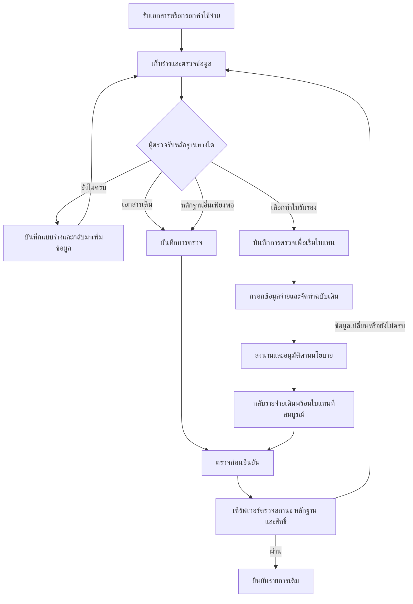

# Spec: ตรวจหลักฐานรายจ่ายและเลือกใช้ใบรับรองแทนใบเสร็จให้ตรงกรณี

วันที่: 11 กันยายน 2569

สถานะ: Implemented และผ่าน focused/local integration checks ตาม [รายงานหลังแก้](../research/expense-evidence-implementation-verification-2026-09-11.md); ยังไม่ merge/deploy และยังไม่ผ่าน usability กับผู้ใช้จริง

ขอบเขตอ้างอิง: branch `codex/substitute-step3-edit-20260910`, HEAD `d6abe87e` และ local changes เดิม ณ วันที่ตรวจ

เอกสารประกอบ: [ผลตรวจบัญชี/ภาษีและโค้ด](../research/substitute-receipt-tax-routing-audit-2026-09-11.md), [แผนแก้และทดสอบ](../plans/expense-evidence-and-substitute-routing-plan.md)

## 1. ปัญหาและผลลัพธ์ที่ต้องได้

ผู้ใช้มีใบเสร็จอยู่ตรงหน้า แต่ระบบเสนอว่า “ไม่มีใบเสร็จ” หลังบันทึกการตรวจ เพราะใช้สถานะตรวจและสถานะหลักฐานภาษีตัดสินทางไปทำใบแทนไม่ครบ ผู้ใช้จึงอาจออกเอกสารที่ไม่จำเป็น หรือเข้าใจว่าต้องสร้างใบแทนจึงบันทึกค่าใช้จ่ายได้

เป้าหมายคือให้ผู้ประกอบการบันทึกรายจ่ายตามข้อเท็จจริง เก็บงานที่ยังไม่ครบไว้ได้ และให้ผู้มีสิทธิ์ตรวจเลือกทางหลักฐานที่เหมาะสม โดยไม่บังคับให้ทุกคนเข้าใจศัพท์บัญชี ไม่ทำให้ใบรับรองภายในกลายเป็นเครื่องมือข้ามกฎภาษี และไม่เพิ่มรายการจ่าย/รายจ่ายซ้ำ

ผลลัพธ์หลัก:

1. มีใบเสร็จที่ใช้ประกอบรายการได้ → ใช้เอกสารเดิม ไม่เสนอทำใบแทนเป็นปุ่มหลัก
2. ไม่มีใบเสร็จหรือเอกสารมีปัญหา → ระบุข้อเท็จจริง แล้วเลือกเพิ่มหลักฐานหรือทำใบรับรองเมื่อเข้าเงื่อนไข
3. ยังไม่ทราบ/หลักฐานยังไม่ครบ → บันทึกแบบร่างและกลับมาแก้รายการเดิมได้ ไม่ต้องเลือกข้อมูลเท็จเพื่อผ่านขั้นตอน
4. ก่อนผู้ตรวจไปขั้นสุดท้าย ต้องบันทึกการตรวจข้อมูลชุดปัจจุบันสำเร็จอย่างน้อยหนึ่งครั้ง และเซิร์ฟเวอร์ตรวจซ้ำตอนยืนยัน
5. การรับหลักฐาน การจ่ายเงินจริง สิทธิหักรายจ่ายภาษีเงินได้ สิทธิ VAT และ WHT เป็นคนละผลลัพธ์

## 2. มุมมองผู้ใช้และขอบเขต

| ผู้ใช้ | สิ่งที่ต้องทำได้ | สิ่งที่ระบบต้องช่วย |
|---|---|---|
| เจ้าของกิจการ/ผู้สูงอายุ | แนบภาพ ตรวจร้าน วันที่ ยอด และรู้ว่าต้องกดอะไรต่อ | คำสั้น ปุ่มชัด ไม่บอกว่าไม่มีใบเสร็จทั้งที่มี ไม่ซ่อนเหตุจำเป็นไว้บนสุดของหน้ายาว |
| พนักงานบันทึกรายจ่าย | เก็บข้อมูลตามสิทธิ์และกลับมาแก้รายการเดิมได้ | ไม่บังคับกดปุ่มตรวจที่ตนไม่มีสิทธิ์ และไม่เปลี่ยน “บันทึกแบบร่าง” เป็น “ตรวจแล้ว” |
| นักบัญชี/ผู้มีสิทธิ์ตรวจ | ตรวจเนื้อหา หลักฐานธุรกิจ ผู้รับเงิน และจัดการ VAT แยกกัน | เห็นไฟล์ที่ใช้อ้างอิง เหตุผล ผู้ตรวจ เวอร์ชัน และสิ่งที่เปลี่ยน |
| ผู้รับรอง/ผู้อนุมัติใบแทน | รับรองข้อเท็จจริงการจ่ายและอนุมัติตามนโยบายเดิม | ไม่ถูกนับว่าลงนามจากการกดบันทึกการตรวจ และไม่ถูกเปลี่ยนข้อมูลที่ลงนามแล้วเงียบ ๆ |

รอบนี้ครอบคลุม FE, API/contract, AI/LINE routing, การเก็บร่าง/ตรวจ/ยืนยัน, การเรียก flow ใบแทนเดิม และผลกระทบต่อข้อมูลบัญชี/ภาษีที่มีอยู่

คำตัดสินล่าสุดของผู้ใช้: ยังไม่มีฟีเจอร์ส่งงานให้บัญชี จึงตัด “ส่งให้บัญชีตรวจ” ออกจากขอบเขต ใช้การบันทึกแบบร่างเป็นทางเก็บงาน ไม่มีปุ่มส่งบัญชี คิวงาน การมอบหมาย หรือ intent `REQUEST_REVIEW` เพิ่มจากงานนี้ สิทธิ์ตรวจและยืนยันเดิมยังคงอยู่

ผลกระทบของการตัดฟีเจอร์: ผู้ใช้ต้องกลับมาเติมข้อมูลและตรวจรายการเอง งานร่างอาจค้างโดยไม่มีการแจ้งเตือนอัตโนมัติ จึงต้องเปิดรายการเดิมแล้วเห็นสถานะร่าง/รอตรวจและข้อมูลที่ยังขาดชัดเจน ผู้ไม่มีสิทธิ์ตรวจเก็บเฉพาะข้อมูลที่แก้ได้และต้องได้รับสิทธิ์ตามระบบเดิมก่อนตรวจต่อ การเปลี่ยนขอบเขตนี้ไม่ต้องเปลี่ยนสูตร VAT/WHT เลข SRC กฎลายเซ็น หรือสถานะข้อมูลการเงินที่สมบูรณ์แล้ว; ยังต้องทดสอบ regression เหล่านี้เมื่อ implement

ไม่เพิ่มเครื่องยนต์วินิจฉัย CIT, แบบใบสำคัญรับเงินใหม่, การจ่ายบางส่วน/หลายแหล่งเงิน, workflow เบิกคืนใหม่, public download link, กฎเลข SRC ใหม่ หรือเปลี่ยนสูตร VAT/WHT ในงานนี้

## 3. หลักบัญชีและภาษีที่ใช้กำหนดผลิตภัณฑ์

ตารางทางเดินใน spec เป็นการออกแบบผลิตภัณฑ์จากหลักเกณฑ์ ไม่ใช่ข้อความว่ากฎหมายบังคับใช้แบบฟอร์มของระบบทุกกรณี

- หลักฐานต้องช่วยพิสูจน์ธุรกรรมที่เกี่ยวกับกิจการและผู้รับเงิน การรับรู้รายจ่ายไม่ได้หมายความว่าจ่ายเงินแล้วเสมอไป และการมีเอกสารภายในไม่รับประกันสิทธิหักรายจ่าย: [มาตรา 65–65 ตรี](https://www.rd.go.th/5939.html)
- ใบรับรองของผู้จ่ายต่างจากใบสำคัญรับเงินที่ผู้รับเงินลงชื่อ ระบบต้องไม่สร้างคำรับรองในนามผู้รับเงินโดยไม่มีข้อเท็จจริง/การลงชื่อ: [แนวทางเอกสารประกอบการลงบัญชี หน้า 11–13](https://www.rd.go.th/fileadmin/download/15277290359.pdf)
- หลักฐานธนาคารที่พิสูจน์ผู้รับและหนี้ของกิจการได้อาจใช้ประกอบรายจ่ายได้ตามข้อเท็จจริง จึงไม่ควรบังคับทำใบรับรองเพิ่มทุกครั้งที่ไม่มีใบเสร็จ ทั้งนี้สลิปทุกใบไม่ได้มีข้อมูลเพียงพอเท่ากัน: [ข้อหารือ กค 0706/4259](https://www.rd.go.th/35306.html)
- ใบกำกับภาษีอย่างย่อไม่ให้เครดิต VAT แต่ไม่ใช่เหตุให้สรุปว่าไม่มีใบเสร็จ: [ประกาศฯ VAT ฉบับที่ 42 ข้อ 2(2)](https://www.rd.go.th/3398.html)
- ใบกำกับภาษีที่หาย/เสียหายต้องขอใบแทนจากผู้ขายตามกรณี ใบรับรองภายในไม่แทนสิทธิภาษีซื้อ: [มาตรา 86/12](https://www.rd.go.th/5208.html), [มาตรา 82/5](https://www.rd.go.th/5206.html)
- VAT ที่เครดิตไม่ได้มีผลทางภาษีเงินได้แตกต่างกันตามเหตุ ไม่แสดงว่าเป็นรายจ่ายหักภาษีได้ทั้งหมดอัตโนมัติ: [คำอธิบายมาตรา 65 ตรี](https://www.rd.go.th/827.html) ส่วน WHT และหนังสือรับรองของ WHT ยังคงเป็นกระบวนการแยก: [มาตรา 50 ทวิในข้อหารือกรมสรรพากร](https://www.rd.go.th/48547.html)

## 4. ข้อกำหนดเดิมที่ต้องรักษา

1. วันที่ค่าใช้จ่ายและวันที่จ่ายเงินแยกกัน แก้วันที่ค่าใช้จ่ายไม่เปลี่ยนวันที่จ่าย ไม่เพิ่มแผงแก้วันที่จ่ายซ้ำในหน้าค่าใช้จ่ายที่ผู้ใช้เคยปฏิเสธ
2. เลข SRC ที่ออกแล้วคงเดิม การเปลี่ยนเดือน/ปีของวันที่จ่ายใช้ modal และ flow แก้ไขเดิม เลขไม่เปลี่ยน/ไม่คืนเลข/ไม่สร้างใบใหม่อัตโนมัติ
3. แก้ข้อมูลสำคัญของใบแทนที่ยังแก้ได้ ต้องให้ลงนามใหม่ตาม revision เดิม; ISSUED หรือผูกข้อมูลการเงินจริงแล้วใช้ขั้นตอนยกเลิก/แก้ไขที่เกี่ยวข้อง เก็บประวัติและสิทธิ์ดาวน์โหลดเดิม
4. ค่า cash policy เดิม `ALLOW_SUPPORTING_EVIDENCE_ONLY` ยังอนุญาตใบแทนเงินสดที่ไม่มีไฟล์แนบและไม่เพิ่มเพดานยอด ส่วนบริษัทที่ตั้ง `REQUIRE_SEPARATE_PAYMENT_EVIDENCE` ยังต้องมีหลักฐานตามเดิม การออกได้ภายใต้นโยบายนี้ไม่ใช่การรับรอง CIT
5. COMPANY/PERSONAL_ADVANCE, จ่ายเต็ม, ลายเซ็นผู้รับรอง/ผู้อนุมัติ, owner self approval และ check-bill proof ใช้กฎเดิม ไม่สร้าง payment หรือ reimbursement จากการตรวจเอกสาร
6. LINE ใช้ permission-checked API และลิงก์กลับเว็บเดิม ไม่เขียนฐานข้อมูลโดย AI ไม่ส่งเอกสารส่วนบุคคลออกเป็น public link
7. หมวดหมู่ระดับเอกสารยังเป็น optional ตาม contract เดิม เงื่อนไขหมวดหมู่ระดับรายการคงเดิม ไม่มีการบังคับกรอกหมวดซ้ำทุกระดับ
8. รักษาทางยอมรับยอด VAT ตามเอกสารและการจัดการส่วนต่างเดิม พร้อมเหตุผล/audit/สิทธิ์เดิม ไม่เพิ่ม `expense.review` ทับการตัดสินยอดที่ผู้มี `expense.confirm` ทำได้อยู่แล้ว และไม่สร้างช่องปัดเศษให้ผู้ใช้กรอกใหม่จากงาน routing นี้

อ้างอิง: [source/ใบแทน sync](substitute-receipt-expense-edit-sync-spec.md), [company payer](substitute-receipt-company-payer-spec.md), [LINE owner decisions D5/D6/D15](line-substitute-receipt-assisted-issuance-spec.md), [explicit review](expense-document-review-before-next-spec.md)

## 5. ตารางเลือกทางหลักฐาน

“ใช้ได้” ในตารางหมายถึงผ่านการตรวจเพื่อดำเนินรายการในระบบ ไม่ใช่อนุมัติหักรายจ่าย CIT โดยอัตโนมัติ ประเมินเนื้อหาและหลักฐานที่เลือกจริง ไม่ใช้ชื่อไฟล์ ตำแหน่งไฟล์แนบ หรืออัตรา VAT ตัดสินลำพัง

| กรณี | ทางที่เสนอ | การทำใบรับรองแทนใบเสร็จ | จุดตรวจสำคัญ |
|---|---|---|---|
| ใบเสร็จ/ใบกำกับเต็ม มีเนื้อหาใช้ประกอบรายการได้ | `SOURCE_DOCUMENT` | ไม่เสนอเป็นปุ่มหลัก | ผู้ขาย ธุรกรรม วันที่ ยอด และ VAT แยกต่างหาก |
| ใบกำกับอย่างย่อ รวมถึงภาพตัวอย่างยอด 680 บาท | `SOURCE_DOCUMENT` | ไม่ต้องทำเพราะเป็นอย่างย่อ | ไม่ให้เครดิต VAT; การไม่มีชื่อผู้ซื้อไม่เท่ากับไม่มีใบเสร็จ |
| บิลเงินสดเขียนมือ อ่านได้และหลักฐานเพียงพอ | `SOURCE_DOCUMENT` | ไม่บังคับเพราะเขียนมือ | ตรวจข้อมูลจริง; ไม่บังคับเลขเอกสาร/TIN ทุกประเภทเหมือนใบกำกับเต็ม |
| ภาพเบลอ แต่เอกสารจริงอาจครบ | รออ่านใหม่/เปลี่ยนภาพ | ยังไม่สรุปว่าเอกสารบกพร่อง | OCR ไม่แน่ใจเป็นคนละเรื่องกับเอกสารไม่มีข้อมูล |
| สลิปและเอกสารธุรกิจเพียงพอให้ผู้ตรวจระบุผู้รับ/ธุรกรรมได้ | `ALTERNATIVE_EVIDENCE` | ไม่บังคับทำเพิ่มในข้อเสนอรอบนี้ | ผู้มีสิทธิ์ตรวจเลือกไฟล์และบันทึกเหตุผลรับหลักฐาน |
| ผู้รับเงินลงชื่อในใบสำคัญรับเงินที่ได้มาจริง | `ALTERNATIVE_EVIDENCE` | ไม่สร้างคำรับรองผู้จ่ายซ้ำเป็นค่าเริ่มต้น | แนบเอกสารจริง ไม่สร้างแบบ/ลายเซ็นผู้รับเงินแทนเขา |
| จ่ายจริง ไม่มีใบเสร็จ ผู้ขายออกให้ไม่ได้ และเลือกใช้ใบรับรอง | `SUBSTITUTE_RECEIPT` | เสนอหลังบันทึกข้อเท็จจริงแล้ว | purpose/payee/funding/payment/signature/policy ตาม flow เดิม |
| ใบเสร็จหาย/ข้อมูลที่ใช้พิสูจน์รายการขาดจริง | เพิ่มหลักฐาน/ขอผู้ขายแก้ก่อน; เลือกใบแทนได้เมื่อเข้าเงื่อนไข | ต้องระบุเหตุจริง ไม่ให้กดผ่านจากทุกใบเสร็จ | เก็บเอกสารที่มีไว้ ไม่ลบเพื่อให้ผ่าน gate |
| ใบกำกับเต็มหาย/เสียหาย ต้องการเครดิต VAT | ขอใบแทนจากผู้ขาย | ใบรับรองภายในไม่แก้สิทธิ VAT | แยกการเก็บรายจ่ายกับการติดตามใบกำกับ |
| มีแค่สลิป แต่ยังไม่รู้จ่ายใคร/จ่ายเรื่องอะไร | เก็บร่าง/เพิ่มหลักฐาน/กลับมาแก้ | ฟอร์มอย่างเดียวไม่ทำให้ผ่าน | ไม่เดาชื่อผู้รับหรือสร้าง TIN ให้ครบ |
| เช็กบิลและจ่ายแล้ว แต่ไม่มีใบเสร็จสุดท้าย | ตรวจจ่ายจริง → หลักฐานอื่นหรือใบแทน | ทำได้ตาม check-bill path เดิม | ต้องมี separate payment proof ตามเงื่อนไขเดิม |
| ใบแจ้งหนี้/เช็กบิลยังไม่จ่าย | เก็บร่างพร้อมสถานะยังไม่จ่าย | ไม่ให้รับรองว่าได้จ่ายแล้ว | กลับมาเพิ่มข้อมูลเมื่อจ่ายจริง ไม่แต่ง paymentDate หรือสมมติว่ามี workflow เจ้าหนี้ |
| ใบเสนอราคา/คำสั่งซื้ออย่างเดียว/ไม่ใช่ธุรกิจ | รอตรวจหรือปฏิเสธตามข้อเท็จจริง | ไม่ใช้ใบแทนเป็นทางลัด | override การจำแนกต้องมีหลักฐานธุรกรรมและ audit เดิม |
| ไม่มีไฟล์เลย จ่ายเงินสดจริง | ใบแทนตาม cash policy เดิม | ทำได้เมื่อ policy อนุญาต | ไม่เพิ่มบังคับอัปโหลด/เพดานยอดใหม่ |
| มีใบแทน PREPARED/PAYER_CERTIFIED อยู่แล้ว | เปิด/แก้ฉบับเดิม | ไม่เสนอสร้างซ้ำ | source revision และการลงนามต้องสอดคล้อง |
| มีใบแทน ISSUED แล้วได้ใบเสร็จภายหลัง | เข้ากระบวนการแก้ไข/ยกเลิกบนรายการเดิม | ไม่สร้างรายจ่ายใหม่ | ตรวจ payment, VAT, WHT, งวดบัญชี และเก็บเอกสารเก่า |

ข้อเสนอเชิงนโยบายที่เพิ่มจากระบบเดิม: ให้ผู้มี `expense.review` รับหลักฐานทางเลือกที่เพียงพอได้ผ่านการบันทึกเหตุผลและไฟล์อ้างอิง การกดรับไม่ใช่สิทธิ์ override ภาษีหรือข้อเท็จจริงที่ขาด หากองค์กรต้องการบังคับใบแทนเพิ่มเติมเป็นนโยบายเฉพาะ ต้องกำหนดต่างหาก; รอบนี้ไม่เพิ่ม policy engine หรือสมมติว่ามี config นี้อยู่แล้ว

## 6. UX และข้อความ

### 6.1 หน้าตรวจเอกสารปกติ

- คงขั้น 1 ตรวจข้อมูล → ขั้น 2 ภาษีและเอกสาร → ขั้น 3 ตรวจก่อนส่ง ไม่เพิ่ม wizard อีกชุด
- หัวข้อการ์ดใช้ “ตรวจเอกสาร” มีภาพและข้อมูลที่ต้องตรวจอยู่ใกล้กัน ประเภทเอกสารแสดงตามข้อเท็จจริง AI เสนอได้แต่ต้องให้ผู้ตรวจยืนยัน
- สถานะหลักฐานภาษีแสดงแยกใต้ข้อมูลหลัก ไม่ใช้เป็นคำตัดสินว่ามีใบเสร็จหรือไม่ และไม่ใช้คำว่า “ผ่านภาษี” จากการตรวจเอกสาร
- เมื่อค่า AI ถูกต้อง ผู้ตรวจกด “บันทึกการตรวจ” ได้ทันที ไม่ต้องแก้ค่าเล่นเพื่อให้ปุ่มทำงาน
- ก่อนตรวจสำเร็จ: ข้อความเหลืองใกล้ปุ่มเพียงจุดเดียว “เลือกประเภทเอกสารและสถานะหลักฐานภาษี แล้วกด ‘บันทึกการตรวจ’” ปรับระบุเฉพาะข้อมูลที่ยังขาดได้
- หลังตรวจสำเร็จ: “บันทึกการตรวจแล้ว” และเปิด “ถัดไป” เมื่อเงื่อนไขทางเดินครบ
- แก้หลังบันทึก: “ข้อมูลเปลี่ยนแล้ว กรุณาบันทึกการตรวจอีกครั้ง” ไม่แสดงคำเตือนซ้ำใน footer
- ใบอย่างย่อใช้คำอธิบาย “ใช้เป็นหลักฐานรายจ่ายได้ แต่ใช้เครดิต VAT ไม่ได้” ภายหลังผู้ตรวจรับเอกสาร ไม่อ้างว่าหักรายจ่าย CIT ผ่านแล้ว
- มีใบเสร็จปกติ: ไม่แสดงปุ่ม “ไม่มีใบเสร็จ” หรือ “ทำใบแทน” เป็นปุ่มข้าง Save review

### 6.2 เอกสารมีปัญหา

แสดงทางเลือกข้อความ “เอกสารมีปัญหา” ในการ์ดใกล้เอกสาร เปิดรายละเอียดในตำแหน่งนั้นและเลื่อน/focus ให้เห็น ไม่วาง banner สำคัญไว้เหนือทั้งฟอร์ม ไม่เปิด popup ที่ไม่จำเป็นทุกครั้งที่แก้ฟอร์ม

คำถามเดียว: “เอกสารนี้มีปัญหาอะไร?” ตัวเลือก “ไม่มีใบเสร็จ”, “ใบเสร็จสูญหาย”, “ข้อมูลสำคัญไม่ครบ”, “ภาพอ่านไม่ชัด” และเลือกกลับมาใช้เอกสารปกติได้ จากนั้นแสดงเฉพาะข้อมูล/การกระทำที่เกี่ยวกับคำตอบ

- มีหลักฐานอื่น: “เพิ่มหลักฐาน” แล้วผู้ตรวจเลือกไฟล์ที่ใช้ประกอบรายการ ไม่ให้อัปโหลดซ้ำเพียงเพราะอยู่คนละช่อง
- ต้องใช้ใบรับรองตามข้อเท็จจริง: หลังบันทึกการตรวจแสดง “จัดทำใบรับรองแทนใบเสร็จ” พร้อมคำอธิบายสั้น “รับรองการจ่ายเงินที่ไม่มีใบเสร็จใช้ประกอบรายการ”
- ภาพไม่ชัด: “เปลี่ยนภาพ” / “อ่านเอกสารอีกครั้ง” ไม่ auto-select เหตุใบเสร็จหายหรือผู้ขายไม่ออกให้
- ไม่แน่ใจ: “บันทึกแบบร่าง” แล้วกลับมาแก้รายการเดิม ไม่มีตัวเลือกที่ทำให้ความไม่แน่ใจกลายเป็นเอกสารครบ
- เอกสารยังไม่จ่าย: บอก “ยังไม่จ่ายเงิน จึงยังทำใบรับรองการจ่ายไม่ได้” พร้อมทางบันทึกแบบร่าง; ไม่บังคับสร้างหลักฐานจ่ายปลอม

### 6.3 ตำแหน่งปุ่มและการป้องกันทางตัน

| สถานะงาน | การกระทำที่มี | การกระทำที่ยังไม่เปิด |
|---|---|---|
| รอตรวจ/ยังไม่ทราบประเภท | เก็บร่าง แก้ข้อมูล แนบไฟล์ กลับมาแก้รายการเดิม | Next สำหรับการตรวจเสร็จ, สร้างใบแทน, ยืนยันลงบัญชี |
| บันทึกการตรวจไม่สำเร็จ | ลองบันทึกอีกครั้ง/โหลดข้อมูลล่าสุดเมื่อ conflict; ค่าที่กรอกไม่หาย | ไม่แสดงว่าบันทึกแล้ว |
| ตรวจแล้ว แต่ยังขาดหลักฐานเฉพาะทาง | เพิ่มหลักฐาน หรือเปิดใบแทนที่เลือกไว้ | final confirm ก่อนเงื่อนไขครบ |
| หลักฐานปกติ/ทางเลือกตรวจแล้ว | ถัดไป → ตรวจก่อนส่ง → ยืนยันตามสิทธิ์ | ไม่มีผลจ่ายเงินจริงจากการกดตรวจ |
| ใบแทนยังไม่สมบูรณ์ | เปิดฉบับเดิมและดำเนินการต่อ | ไม่สร้างฉบับที่สองเพื่อผ่าน gate |
| ผู้บันทึกไม่มีสิทธิ์ตรวจ | เก็บฟิลด์ที่มีสิทธิ์แก้; แจ้งสิทธิ์ที่ต้องมีหากต้องการตรวจต่อ | ไม่บังคับกดปุ่มตรวจที่ใช้ไม่ได้ ไม่เพิ่มสิทธิ์หรือสร้างงานส่งต่อ |

ไม่บังคับว่าข้อมูลทุกชนิดที่ยังไม่ทราบต้องยืนยันสำเร็จได้ “ไม่ให้ติดทางตัน” หมายถึงมี action ที่ชัดเจนให้เก็บงาน แก้/เพิ่มหลักฐาน หรือรอเงื่อนไขที่ระบุ โดยไม่ลดข้อกำหนดความถูกต้องของการยืนยัน การรอเครือข่าย/สิทธิ์/ข้อเท็จจริงไม่ใช่การบันทึกสำเร็จ ดูขอบเขตการรับประกันใน §13

ข้อกำหนดเพิ่มจากการทดลองเว็บจริง B01–B08:

- ในขั้น 2 ผู้มีสิทธิ์แก้ต้องเห็น “บันทึกแบบร่าง” เมื่อยังรอตรวจหรือมีข้อมูลเปลี่ยน ไม่ผูกกับการอยู่ขั้น 1 หรือ `sourceDraft.missingFields` เท่านั้น บันทึกค่าที่ทราบรวมถึงตัวเลือกที่ยังรอตรวจโดยไม่สร้าง acknowledgement
- “บันทึกแบบร่าง” ใช้ได้จากขั้น 2 โดยไม่ต้องผ่าน Next ก่อน เปิดรายการเดิมภายหลังเพื่อกรอกข้อมูลที่ขาดต่อ ตาม §7.6
- กดกลับแล้วค่าคงอยู่ในหน้าเดิมยังไม่นับว่าเก็บร่าง ต้องยืนยันการบันทึกจาก server และเปิดใหม่ได้ ก่อนแจ้ง “บันทึกแล้ว” หากออกจากหน้าขณะยังมีค่าที่ไม่บันทึกให้มีทางเลือกเก็บ/อยู่แก้ต่อ ไม่ใช้การย้อนหน้ามาทดแทนการบันทึก
- เมื่อเก็บร่างสำเร็จ ไม่เปิด Next สำหรับการตรวจเสร็จจนกว่าผู้ตรวจบันทึกข้อมูลชุดปัจจุบันจริง ไม่สร้างใบแทน/เลข/การจ่ายจากการเก็บร่าง

### 6.4 เกณฑ์สำหรับผู้สูงอายุและ accessibility

- ข้อความหลักและ input อย่างน้อย 16 px, ปุ่ม/พื้นที่กดอย่างน้อย 44×44 px; ไม่ใช้สีอย่างเดียวบอกสถานะ
- มือถือ 390 px เรียงหนึ่งคอลัมน์; label และตัวเลือกสำคัญอ่านครบ ไม่ตัดเป็น “รอตรวจประเภทเอก...” หรือซ่อนใน tooltip
- Desktop dropdown เริ่มระดับเดียวกันเมื่อมี AI badge; รองรับ zoom 200% โดยไม่ต้องเลื่อนแนวนอนเพื่ออ่านงานหลัก
- error/warning อยู่ใกล้ field และ action; หาก field พ้นจอให้ focus/scroll ไป field หลัง render โดย sticky footer ไม่ทับ
- หลังเพิ่มรายการ/ค่าบริการ/หลักฐาน เลื่อนไปสิ่งใหม่ตามพฤติกรรมที่ตกลงไว้; ไม่กระโดดกลับหัวหน้าโดยไร้เหตุ
- Loading แสดงข้อความกำลังบันทึก กัน double click; failure ไม่ล้างค่าที่กรอก; keyboard/อ่านหน้าจอรู้สถานะการบันทึก
- Popup เปลี่ยนเดือน/ปีวันที่จ่ายคงข้อความและปุ่ม “ตกลง | ยกเลิก” ตาม spec วันที่เดิม ไม่เพิ่ม popup ภาษีซ้ำในเคสเปลี่ยนวันอย่างเดียว

## 7. Contract และกฎร่วม FE–BE–AI

### 7.1 ใช้สิ่งที่มีอยู่

ต่อยอด `collectSubstituteReceiptEligibilityIssues`, review-fields, current review marker, repository CAS และ prepare/issue flow เดิม ไม่เพิ่ม endpoint หรือฐานข้อมูลแยกเพื่อแก้ปุ่ม

เพิ่ม assessment ที่มีชนิดชัดเจนใน `documentReview` ของ JSON เดิมเป็น version 2 โดยไม่แก้ enum ของ `sourceDocumentType`/`taxEvidenceStatus` ที่ระบบอื่นใช้ ไม่ใช้ `taxEvidenceStatus` เก็บผล CIT

เหตุผลเกี่ยวกับ handwriting/receiptless text ต้องแยกความหมาย โดยเพิ่ม reason code แบบ additive เฉพาะเมื่อของเดิมไม่มีค่าที่ตรง และคงอ่าน legacy `HANDWRITTEN_OR_TEXT_NEEDS_SUBSTITUTE` ได้ อย่าเปลี่ยน enum เก่าเป็นความหมายใหม่เงียบ ๆ `taxEvidenceReasonCode` ใน Prisma เป็น String จึงไม่ต้องเพิ่ม database enum เพื่อแก้เหตุผลนี้

ข้อมูลที่ต้องมีใน contract ใหม่:

| ข้อมูล | ผู้กำหนด/เงื่อนไข |
|---|---|
| `evidenceRoute`: `SOURCE_DOCUMENT`, `ALTERNATIVE_EVIDENCE`, `SUBSTITUTE_RECEIPT` | ผู้ตรวจเสนอ → server ตรวจและบันทึก; null หมายถึงยังไม่มีผลตรวจ ไม่เพิ่มสถานะธุรกรรมใหม่ |
| `receiptProblem`: NONE / NOT_AVAILABLE / LOST / MATERIAL_INCOMPLETE | เลือกตามข้อเท็จจริง; ภาพอ่านไม่ชัดยังไม่ใช่ MATERIAL_INCOMPLETE และยังเก็บเป็น pending |
| source/supporting/payment attachment references | เลือกจากไฟล์ ACTIVE ที่อ่านได้ใน expense/tenant/branch เดียวกัน; เก็บ version/checksum identity ที่มีอยู่เพื่อกันสลับไฟล์ |
| เหตุผลการรับหลักฐานอื่น/เหตุเอกสารมีปัญหา | มีเหตุผลอ่านรู้เรื่องเมื่อใช้ทางเลือก; ใช้ข้อจำกัดข้อความตาม pattern เดิม ไม่ขอเหตุผลยาวทุกใบเสร็จปกติ |
| reviewedAt, reviewedBy, review version และข้อมูลอ้างอิงที่ตรวจ | server-owned; caller ส่งเองไม่ได้; update ใน transaction เดียวกับ review |

ชื่อ field ขั้น implementation ปรับให้ตรง conventions ได้ แต่ semantics และ validation ต้องตามนี้ เก็บนอก OCR-owned payload หรือรักษา subkey นี้ทุก writer เพื่อไม่ให้ OCR ล้างประวัติผู้ตรวจ

GET expense ส่งผลประเมิน action/reason จาก server ให้เว็บและ LINE ใช้ ผลนี้เป็นข้อมูลคำนวณจากสถานะล่าสุด ไม่ใช่ boolean ที่ client ส่งมาเพื่อปลดล็อก prepare/confirm

### 7.2 แยกตรวจเพื่อเปิดฟอร์มกับตรวจเพื่อออกเอกสาร

- `canStartSubstitute`: ตรวจสิทธิ์ สถานะ ผลตรวจปัจจุบัน เหตุเอกสาร และว่ามีฉบับเดิมหรือไม่ เพื่อเปิด wizard เก็บข้อมูลต่อ
- `canPrepareSubstitute`: ตรวจข้อมูลจริงครบทั้ง payee, business purpose, paymentDate, funding, paid-in-full acknowledgement, policy, proof และ CAS ก่อนจองเลข/สร้าง PREPARED
- `canConfirmExpense`: ตรวจหลักฐานที่บันทึกไว้ยังตรงกับข้อมูลปัจจุบัน รวมเงื่อนไขบัญชี/ภาษีและเอกสารตามทางที่เลือก

ใช้กฎย่อยชุดเดียว ไม่ทำสำเนาเงื่อนไขคนละชุดใน JSX กับ controller การเปิดฟอร์มยังไม่ต้องมีข้อมูลลายเซ็นหรือ ISSUED; การบันทึกการตรวจแบบเลือกใบแทนยังไม่ต้องมีใบแทนที่ออกแล้ว มิฉะนั้นจะเกิดวงจรที่เริ่มทำอะไรไม่ได้

### 7.3 การเปลี่ยนข้อมูลและอายุของผลตรวจ

ผลตรวจต้องผูกกับสาระที่ตรวจจริง: ประเภทเอกสาร/ภาษี/route/เหตุ, ไฟล์และ extraction ที่ใช้, ตัวตนผู้ขาย/ผู้รับที่เกี่ยวข้อง, วันที่เอกสาร, รายการ/หมวดที่เกี่ยวข้อง, ยอดและ VAT/WHT และข้อมูลจ่ายเมื่อใช้พิสูจน์ route นั้น

- แก้สาระหรือแทนที่/ลบหลักฐานที่ใช้ → ผลตรวจไม่ current ต้องตรวจใหม่ก่อน final action
- OCR ผลใหม่ต้องไม่เขียนทับข้อมูลที่ลงบัญชีหรือฉบับที่ล็อก; draft ที่เปลี่ยนต้องแจ้งตรวจใหม่
- เพิ่มไฟล์ที่ไม่ใช้ในผลตรวจ, เปิดดู, ดาวน์โหลด, UI state, หรือบันทึกค่าเดิม → ไม่ทำให้ผลตรวจหมดอายุโดยไม่จำเป็น
- ไม่ใช้ `updatedAt` ทั้งแถวเพียงค่าเดียวเป็น fingerprint เพราะการบันทึก acknowledgement เองจะทำให้ stale วนกลับทันที; ใช้ equality/snapshot ของฟิลด์สาระตาม helper เดิม
- เปลี่ยน paymentDate จากใบแทนต้องรักษา revision/signature rules เดิม; การออก ISSUED จากข้อเท็จจริงที่ตรวจชุดเดียวกันไม่ต้องบังคับผู้ใช้ย้อนกลับตรวจซ้ำอีกวง
- เก็บ audit ของผลตรวจเดิมเมื่อ supersede ไม่ปลอม timestamp/ผู้ตรวจใหม่เพื่อ migrate

แบ่ง ownership ให้ชัดเพื่อไม่ให้เกิดวงจรใหม่: review ของ source ผูกกับข้อมูลรายจ่ายที่มีตอนตรวจ ส่วนรายละเอียดผู้จ่าย/ลายเซ็น/วิธีจ่ายที่กรอกเพิ่มใน wizard เป็น certificate-owned facts ซึ่ง prepare/certify/issue ตรวจแยก ไม่ทำให้ review source หมดอายุเพียงเพราะเริ่มกรอกรายละเอียดเหล่านี้ หากแก้ข้อมูล source จริง เช่น ยอดหรือผู้ขาย ต้องกลับตรวจ source ใหม่ตามกฎเดิม

prepare เดิมเขียน purpose/note, missing reason และสถานะภาษี ส่วน issue อาจบันทึก company payment ตามข้อเท็จจริงที่รับรอง: ให้ binding ของ assessment และ certificate snapshot รองรับการเปลี่ยนที่ workflow นี้ทำอย่างถูกต้อง ไม่ใช้การเปลี่ยนแถวเหล่านี้เป็นเหตุให้ ISSUED กลับไปติด Save review โดยอัตโนมัติ ห้ามใช้ข้อยกเว้นนี้กับการแก้ source ผ่าน generic API

### 7.4 Backend ทุกทางเข้าต้องสอดคล้อง

| จุดเข้า | ข้อกำหนด |
|---|---|
| PATCH draft | เก็บงานไม่ครบได้ตามข้อกำหนด draft เดิม; generic save ไม่สร้าง acknowledgement หรืออนุมัติ route |
| PATCH review-fields | `expense.review`, branch/tenant scope, expectedUpdatedAt; เก็บค่ารอตรวจโดยไม่ส่ง acknowledgement ได้; เมื่อส่ง acknowledgement ต้องตรวจ payload และบันทึกผลตรวจแบบ atomic |
| mark-ready / reviewer-mark-ready | รักษา contract และเงื่อนไขพร้อมให้ยืนยันเดิม ไม่เพิ่ม intent ส่งร่าง ไม่เรียก endpoint นี้จาก Save draft; staff ไม่ได้ reviewer permission เพิ่ม |
| POST confirm | ตรวจ current review/route จากข้อมูลจริง ไม่เชื่อ flag client; รายจ่าย pending ไม่ผ่าน final confirm; อ่าน route ที่รับหลักฐานอื่นได้ด้วย; issued artifact/claim authority ใช้การตรวจเฉพาะทางเดิม ไม่บังคับ web marker ที่ workflow นั้นไม่เคยสร้าง |
| POST prepare ใบแทน | ใช้ eligibility ร่วม แก้ช่องว่าง ABB และ handwriting; receipt ที่ใช้ได้ต้องไม่ถูกทำใบแทนโดยเพียงเปลี่ยน tax status |
| amend/certify/approve/รับเอกสารลงนาม | ตรวจ source revision, payment และสถานะเดิม; new review ไม่ข้ามลายเซ็น/อำนาจอนุมัติ |
| แนบ/ลบ/เปลี่ยนหลักฐาน | ไม่ทำให้ route เดิมยัง valid เมื่อไฟล์อ้างอิงใช้ไม่ได้; issued/locked ใช้กฎเดิม |
| LINE/AI tools | resolve expense เป้าหมายให้ชัด ใช้ API เดียวกัน ตรวจสิทธิ์จริงก่อน mutation ไม่อาศัยคำตอบของโมเดลว่า “ตรวจแล้ว” |

แก้ final validator ที่วันนี้ใช้ `primaryAttachmentId` หรือ missing-receipt reason เป็นหลัก ให้รับ assessment ที่ผ่านตรวจแล้ว โดยไม่ลบเหตุใบหายออกจากข้อมูลเพียงเพื่อผ่าน validator และไม่เอาไฟล์ภาพอะไรก็ได้ใส่ primary เพื่อหลบเงื่อนไข

ต้องแก้ทั้ง use case และ `prisma-expense.repository.ts` ใน transaction ยืนยัน ซึ่งมีการตรวจ `reliesOnSubstitute` ซ้ำอยู่ หลัง lock/CAS ต้องโหลด assessment และไฟล์จริง แล้วใช้กฎเดียวกันอีกครั้งก่อน finalize tax/write การแก้เฉพาะ use case จะยังทำให้ F2 ล้มที่ transaction

การใช้เครดิต VAT ต้องอ้างอิงใบกำกับที่ตรวจจริงในรายการนั้น ไม่ใช้เพียง tax type ที่เลือกบวกกับไฟล์ primary ใด ๆ หากเลือกใบกำกับที่อยู่ supporting ให้ผูก source reference ให้ validator ใช้ตรงกัน โดยไม่ข้ามข้อกำหนดใบกำกับและการลงบัญชีเดิม

การยอมรับยอด VAT ตามเอกสารที่ endpoint confirm รองรับอยู่แล้ว ให้ตรวจ assessment ของ input revision ก่อนตัดสิน แล้วเก็บผลปรับยอดและ audit ใน transaction เดิม ไม่บังคับวนกลับ review จากผล normalization ที่ผู้มีสิทธิ์เพิ่งยืนยันภายใน action เดียวกัน

สำหรับ route `ALTERNATIVE_EVIDENCE` การรับต้องมีหลักฐานเชื่อมธุรกรรม/ผู้รับตามกรณีและผู้ตรวจมีสิทธิ์ ไม่ใช่ปุ่ม “ข้าม” ที่ปล่อยผ่านเมื่อไม่รู้จ่ายใคร; สำหรับ route ใบแทนเงินสดที่ไม่มีไฟล์ ใช้ข้อยกเว้น cash policy เดิมเฉพาะทางนั้น

`validateConfirm` เดิมยังตรวจ `hasMissingReceiptPermission` เมื่อไม่มี primary attachment: หลังผู้มีสิทธิ์ตรวจรับหลักฐานแล้ว ผู้มี `expense.confirm` ที่อยู่ใน scope ต้องยืนยันตามผลตรวจนั้นได้โดยไม่ถูกบังคับให้มี `expense.review` ซ้ำด้วย เพียงเพราะไฟล์อยู่ supporting ให้ server ตรวจผู้รับรอง/ผลตรวจจริง ไม่รับ flag ยกเว้นสิทธิ์จาก client และคง authority เฉพาะของ claim/issued เดิม

### 7.5 Standalone ใบแทนและ LINE ไม่เกิดวงจร

ผู้ใช้ที่เริ่ม “ทำใบรับรองแทนใบเสร็จ” โดยตรงยังสร้าง draft ได้ตามสิทธิ์เดิม ก่อนผ่านจากหน้าตรวจรายการให้ผู้มี `expense.review` ยืนยันอย่างชัดเจนว่าไม่มีใบเสร็จ/มีปัญหาใด ระบบบันทึก review ผ่าน API เดิม แล้วจึงเปิดเก็บข้อมูลใบแทนต่อ ไม่เปลี่ยน NEEDS_REVIEW เป็น EXPENSE_NOTE_TEXT เพียงเพราะกด Next หากผู้ใช้ยังไม่ยืนยันข้อเท็จจริง

LINE ที่มีสิทธิ์ prepare อยู่เดิม: ถาม/สรุปข้อเท็จจริงและขอคำยืนยันที่ผูกกับ expense และ revision เฉพาะรายการ แล้วเรียก review-fields ก่อน prepare; ไม่ require ว่าต้องเคยเปิดหน้าเว็บเพื่อสร้าง marker หากเตรียมไม่ได้ให้กลับเว็บพร้อมเหตุที่แก้ได้ ลายเซ็นและอนุมัติยังผ่านเว็บเดิม ผู้ไม่มีสิทธิ์ตรวจได้เพียง capture/เก็บร่างตามสิทธิ์ ไม่ให้ AI ยกระดับสิทธิ์

คำยืนยันหลายใบห้ามนำไปใช้ข้าม expense ไม่ตีความ “บันทึกแล้ว” ว่า “issued/ลงบัญชีแล้ว” โดยไม่อ่านสถานะจริง

### 7.6 การเก็บร่างและกลับมาแก้เมื่อข้อมูลยังไม่ครบ

หลักฐาน B03 ยืนยันว่า review-fields เดิมเก็บประเภทเอกสารพร้อมสถานะภาษีรอตรวจได้โดยไม่สร้าง marker ส่วน B04 เป็นผลตรวจ API เดิมเท่านั้น ไม่ใช่ข้อกำหนดให้เพิ่มการส่งงานบัญชี `MarkExpenseReadyUseCase` ยังคงตรวจ `assertExpenseSourceDraftComplete` ตามเดิม

1. ใช้ PATCH draft เดิมสำหรับข้อมูลธุรกรรมที่ผู้บันทึกมีสิทธิ์ และ review-fields เดิมสำหรับค่าการตรวจที่มีสิทธิ์เก็บ การไม่ทราบข้อมูลใช้ partial/sourceDraft contract เดิม ไม่แต่งยอดเป็นศูนย์หรือเดาผู้รับเพื่อให้ผ่าน required field
2. Save draft เก็บค่าตาม tenant/branch/field permission และ CAS เดิม ไม่มี acknowledgement อัตโนมัติ ไม่มีการส่งงานหรือเปลี่ยนเป็น READY/CONFIRMED เพียงเพราะกดเก็บร่าง รักษา lifecycle ร่างเดิมและแสดงสถานะรอตรวจตามจริง
3. เปิดรายการเดิมจากรายการค่าใช้จ่ายแล้วดึงค่าที่บันทึกทั้งหมดมาวางได้ ผู้ใช้กรอกข้อมูลเพิ่มและกดบันทึกการตรวจเมื่อพร้อม จากนั้นจึง Next ตามกฎเดิม ไม่สร้างรายการใหม่เพื่อกลับมาทำต่อ
4. รักษา rejected/reopen และ issued/financial locks เดิม Save draft ไม่ข้าม classification หรือการแก้ฉบับสมบูรณ์ ผู้ไม่มีสิทธิ์ตรวจยังเก็บฟิลด์ที่ตนแก้ได้ แต่ไม่ถูกยกระดับเป็นผู้ตรวจ
5. แจ้ง “บันทึกแล้ว” หลัง server รับค่าครบที่ตั้งใจเก็บ หากการบันทึกหลายส่วนสำเร็จไม่ครบให้ระบุส่วนที่ยังไม่บันทึก คงค่าไว้และ retry รายการเดิม ไม่ทิ้งค่า/สร้างงานซ้ำ
6. งานนี้ไม่เพิ่มปุ่มส่งบัญชี คิวผู้ตรวจ การมอบหมาย การแจ้งเตือนส่งงาน หรือ `REQUEST_REVIEW` contract; การเก็บร่างไม่เท่ากับตรวจแล้ว จ่ายแล้ว หรือรับรองภาษีแล้ว

## 8. E2E flow ที่ต้องส่งมอบ

ในภาพ “บันทึกแบบร่าง” เก็บงานไว้กลับมาทำต่อ ไม่ได้ทำให้บันทึกการตรวจสำเร็จ และเส้นกลับแก้ข้อมูลใช้ได้เฉพาะสถานะที่แก้ได้ตาม §4

### F1 มีใบเสร็จปกติหรืออย่างย่อ

แนบ → AI เสนอข้อมูล → ผู้ตรวจตรวจร้าน/วัน/ยอด → เลือกประเภท/ภาษีตามจริง → บันทึกการตรวจ → reload แล้วยังตรวจแล้ว → Next → ยืนยันตามสิทธิ์ → รายจ่ายเดิมหนึ่งรายการ ไม่มี SRC เพิ่ม

ตัวอย่าง 680 บาทในภาพ: ภาพมีคำว่า Receipt จึงไม่ควรกล่าวว่าไม่มีใบเสร็จโดยอาศัย SUPPORTING_ONLY หากผู้ตรวจจัดเป็นอย่างย่อ ให้คงยอด 680, ฐาน/VAT ตามเอกสารที่ตรวจ ไม่สร้างเครดิต VAT จากฉบับย่อ และไม่สร้างใบแทน

### F2 ไม่มีใบเสร็จ แต่หลักฐานอื่นเพียงพอ

เก็บร่าง → เลือกเอกสารมีปัญหา → เพิ่ม/เลือกหลักฐานที่มี → ผู้ตรวจบันทึกเหตุและรับหลักฐาน → Next → confirm ผ่าน validator ที่เข้าใจ ALTERNATIVE_EVIDENCE → ไม่มี SRC/payment/VAT credit เพิ่มจากการรับหลักฐาน

นี่เป็นทางใหม่ที่ต้องแก้ FE และ BE พร้อมกัน การซ่อนปุ่มใบแทนอย่างเดียวทำให้เส้นทางนี้ไปติด final confirm จึงยังนับงานไม่เสร็จ

### F3 ไม่มีใบเสร็จ และเลือกทำใบรับรอง

ระบุข้อเท็จจริง/ประเภทที่ตรวจแล้ว → บันทึกการตรวจเลือกทาง `SUBSTITUTE_RECEIPT` → เปิด wizard → retrieve ข้อมูลที่มีอยู่ → เพิ่มเฉพาะข้อมูลจ่าย/ผู้รับรองที่ขาด → prepare จองเลขครั้งเดียว → ลงนาม/อนุมัติหรือ paper flow → ISSUED → กลับรายจ่ายเดิม → ยืนยันได้ตามเงื่อนไข

ผลตรวจขั้นแรกไม่ต้องรอ ISSUED; final confirm เท่านั้นที่ต้องรอเอกสารตามทางที่เลือกครบ ผู้ใช้กลับแก้ได้ตามสถานะที่อนุญาต ไม่เปิด wizard ใหม่ทับฉบับเดิม

### F4 ยังไม่ครบหรือยังไม่จ่าย

เก็บร่างสำเร็จ → ออกจากหน้า → เปิดรายการเดิมดึงค่ากลับมา → เพิ่มข้อมูล/หลักฐาน → บันทึกการตรวจตามสิทธิ์ → เลือก F1/F2/F3 ตามจริง ไม่บังคับกรอก paymentDate ทั้งที่ไม่ได้จ่าย

### F5 หลักฐานมาภายหลัง/แก้สองฝั่ง

- ฉบับยังแก้ได้: บันทึก source ก่อนกลับใบแทน ใช้ expense/evidence เดิม; fields ที่เป็นข้อเท็จจริงร่วม retrieve/update ตาม source ownership เดิม ข้อมูล actual payee ที่แยกจาก vendor ไม่ถูกเขียนทับแบบเหมารวม
- แก้วันที่จ่ายเฉพาะวัน: update ใบแทนตามเดิม ไม่แจ้งเรื่องเดือนเลขรัน; แก้เดือน/ปีใช้ popup เดิม เลขคงเดิม
- ISSUED/ผูกบัญชีหรือการจ่าย: ไม่แก้สาระผ่าน review-fields เพื่อข้าม lock ใช้การยกเลิก/แก้ไขที่เกี่ยวข้อง เก็บไฟล์เก่า; การยกเลิกใบแทนไม่ย้อนการจ่ายเงินจริงเอง
- ได้ใบกำกับเต็มภายหลัง: ใช้รายจ่ายเดิมและกระบวนการปรับสิทธิภาษีที่รองรับตามสถานะ/งวด ไม่สร้างรายจ่ายหรือเครดิตซ้ำ หากระบบยังไม่มีทางแก้ที่รองรับต้องแจ้งข้อจำกัดและรักษาข้อมูลเดิม ไม่อ้างว่ามีฟีเจอร์ส่งงานบัญชีหรือปรับสิทธิอัตโนมัติในงานนี้

## 9. Bug / gap / impact register

| ID | ระดับ | สิ่งที่พบหรือความเสี่ยง | ผลกระทบและสิ่งที่ต้องแก้/พิสูจน์ |
|---|---|---|---|
| G01 | P1 | FE เปิดปุ่มทำใบแทนจาก reviewSaved โดยไม่ประเมินว่าใบเสร็จใช้ได้ | ผู้ใช้ทำเอกสารเกินจำเป็น; ใช้ eligibility projection ทั้งการ์ด/empty viewer/check-bill/footer |
| G02 | P1 | helper กัน RECEIPT/TAX_INVOICE แต่ ABB หลุด | เปลี่ยน UI อย่างเดียว API/LINE ยังทำผิดได้; เติม shared guard แบบอิงเหตุจริง |
| G03 | P1 | handwritten กับข้อความไม่มีใบเสร็จใช้เหตุ “ต้องทำใบแทน” ร่วม | แก้ classifier/reason/ข้อความแยก; ทดสอบบิลครบและไม่ครบ |
| G04 | P1 | primary file ถูกใช้แทนการมี receipt | สลิป/ภาพสุ่มผ่าน หรือ receipt ใน supporting ถูกมองข้าม; ใช้ไฟล์ที่ตรวจจริงโดยรักษา attachment permission |
| G05 | P0 | UI ต้องตรวจแต่ confirm ไม่บังคับ marker เดียวกัน | bypass ผ่าน direct API/old client; server validate current assessment และให้ recovery action |
| G06 | P1 | missingReason บังคับ issued substitute ทั้ง use case และ repository transaction | F2 ติดตอนท้ายแม้ API preflight ผ่าน; ใช้ decision เดียวกันหลัง lock/CAS ไม่ลบข้อมูลเหตุเพื่อหลบ gate |
| G07 | P1 | “รอตรวจ” เก็บงานไม่ได้ หรือ primary-slot permission บังคับ final confirmer มี review ซ้ำ | แยก draft/submit/review/confirm; ใช้ผลตรวจที่ผู้มีสิทธิ์บันทึกแล้ว และทดสอบคนละบทบาท |
| G08 | P1 | require issued ก่อน save review หรือ require web marker ก่อน standalone/LINE | dependency cycle; explicit review ก่อน prepare ตาม §7.5 |
| G09 | P0 | รับเอกสารแล้วถูกนับว่าจ่าย/เครดิต VAT/หัก CIT ผ่าน | ห้ามผลข้างเคียงจาก review; ยืนยัน tax event/payment count ใน integration |
| G10 | P1 | เปลี่ยนไฟล์/ยอดหลังตรวจ แต่ marker ยัง current หรือ stale ทุก save | snapshot เฉพาะสาระ, CAS, OCR writers และ no-op tests |
| G11 | P0 | ใบแทน/รายจ่าย/การจ่ายซ้ำจาก retry, หลายแท็บ, LINE หลายใบ | existing uniqueness/transaction/source version; response lost แล้วอ่านฉบับเดิมก่อน retry |
| G12 | P0 | แก้ ISSUED/ข้อมูลการเงินผ่าน route ใหม่ | preserve locks, audit, cancellation/correction; ทดสอบการโจมตีข้าม UI |
| G13 | P1 | กฎ proof ใหม่ไปบังคับเงินสดศูนย์ไฟล์ที่อนุญาตไว้ | แยก cert cash policy กับ acceptance alternative; regression D5/strict/noncash/check bill |
| G14 | P1 | เอกสารก่อนจ่ายถูกบังคับรับรองจ่ายแล้ว | เก็บร่างและกลับมาเพิ่มข้อมูลเมื่อจ่ายจริง ไม่ auto-set paidAt |
| G15 | P0 | แนบไฟล์คนละบริษัท/branch หรือ client ปลอม reviewer | authoritative permission, file ownership, server metadata; zero mutation เมื่อปฏิเสธ |
| G16 | P1 | old review/issued/claim projection ถูกบังคับย้อนสร้างใบแทน | version compatibility และ authority exception เดิม; ไม่ bulk-reset ข้อมูลสำเร็จแล้ว |
| G17 | P2 | ข้อความยาว ซ้ำ footer, dropdown ตัดคำ/เหลื่อม, action พ้นจอ | ข้อความจุดเดียว responsive/focus/keyboard/older-user usability |
| G18 | P1 | E2E เดิมใช้ภาพ PNG เล็กสุ่มเป็น primary แล้วถือว่ามี receipt | ปรับ fixture ให้จำแนก/ตรวจอย่างชัดเจน ห้ามทำ gate อ่อนลงเพื่อให้ test เดิมผ่าน |
| G19 | P1 | prepare/issue/accepted VAT เขียนข้อมูลตาม workflow แล้วทำให้ review stale เอง | source ownership/snapshot แยกจาก certificate-owned facts; final action ที่ผ่านตรวจไม่ย้อนเข้าวงจรตรวจซ้ำ |
| G20 | P1 | ขั้น 2 ไม่มี Save draft; NEEDS_REVIEW บางรายการไม่มีแม้ขั้น 1; Back เก็บเฉพาะ memory และ reload แล้วค่าที่ไม่ได้บันทึกหาย | พิสูจน์ B01/B02/B07/B08; เปิด partial save ตามสิทธิ์ทุกขั้นที่แก้ข้อมูล ไม่แจ้งสำเร็จจาก local state |
| G21 | P1 | แบบเดิมพึ่งฟีเจอร์ส่งบัญชีที่ยังไม่มีเป็นทางออกของร่าง | ตัด dependency ตามคำสั่งผู้ใช้; ให้ Save draft/reopen ทำงานเองโดยไม่เรียก mark-ready และไม่ลด completeness ของ READY |

P0 ในตารางคือความเสี่ยงที่ต้องป้องกันใน implementation ไม่ได้หมายความว่าทุกรายการยืนยันพบเหตุข้อมูลเสียจริงแล้ว

## 10. Acceptance และชุด E2E ที่ต้องรันจริง

ทุกกรณีใช้บริษัททดสอบและข้อมูลที่ test เป็นเจ้าของ ตรวจ UI + API + persistence หลัง reload; test ด้านการเงินต้องตรวจ record/event ที่เกี่ยวข้อง ไม่จบที่ปุ่มเปลี่ยนสี ใช้ API integration เมื่อไม่จำเป็นต้องผ่าน browser ซ้ำ

| ID | กรณีและการกระทำ | ผลที่ต้องยืนยัน |
|---|---|---|
| T01 | ใบตัวอย่าง 680 บาท ตรวจเป็นอย่างย่อ → review → Next → confirm | รายจ่าย 1, SRC 0, printed VAT คงเดิม, ไม่มี input VAT credit, ไม่เรียกผู้ใช้ว่าไม่มีใบเสร็จ |
| T02 | ใบเต็มที่เข้าเกณฑ์ VAT และผู้ตรวจอนุญาต → confirm | existing VAT validation ผ่าน; ไม่มี SRC; ไม่ตั้ง CLAIMABLE เพียงเพราะประเภทใบเต็ม |
| T03 | ใบเสร็จไม่มี VAT / บิลเขียนมือครบ | normal route ได้; ไม่บังคับ TIN/เลขเอกสารแบบใบเต็มกับทุกบิล |
| T04 | บิลเขียนมือข้อมูลขาด และภาพเบลอ | แยกเหตุจริงกับ OCR uncertainty; เพิ่มหลักฐาน/ภาพแล้วทำต่อได้ |
| T05 | สลิปใน primary + หลักฐานธุรกิจใน supporting → รับหลักฐานอื่น | F2 confirm ได้; ไม่บังคับย้ายไฟล์/สร้างใบแทน; audit มีไฟล์และผู้ตรวจ |
| T06 | ใบเสร็จจริงอยู่ supporting | ผู้ตรวจเลือกเป็นหลักฐาน source ได้; ไม่ถือตำแหน่งไฟล์เป็นข้อเท็จจริง |
| T07 | สลิปไม่รู้ผู้รับ/ไม่รู้ธุรกรรม | draft/reload/กลับมาแก้ได้; final confirm และการเดาข้อมูลไม่ผ่าน |
| T08 | แนบใบสำคัญรับเงินที่ได้จากผู้รับจริง | รับเป็น alternative ได้ตามข้อมูล; ไม่สร้างแบบ/ลายเซ็นในนามผู้รับ |
| T09 | ไม่มีไฟล์ เงินสด policy อนุญาต ยอดสูง | prepare→sign→issue สำเร็จตามกฎเดิม; ไม่มีเพดานยอด/ไฟล์บังคับเพิ่ม |
| T10 | เงินสด policy strict / โอนเงินไม่มี proof | prepare ยังไม่ได้ พร้อม target เพิ่มหลักฐาน; เพิ่ม proof แล้วทำต่อสำเร็จ |
| T11 | check bill จ่ายแล้ว/ยังไม่จ่าย | paid ใช้ separate proof และ flow เดิม; unpaid ไม่ถูกสร้าง payment/date เพื่อผ่าน |
| T12 | ใบแจ้งหนี้/คำสั่งซื้อ/ส่วนตัว/รูปไม่เกี่ยวข้อง | ไม่ certify จ่ายโดยอัตโนมัติ; draft/กลับมาแก้/ปฏิเสธตามข้อเท็จจริง |
| T13 | prefills ถูกต้องยังไม่เคย review | กด Save review ได้โดยไม่เปลี่ยน field; ก่อน save Next/prepare/confirm ยังไม่ผ่าน |
| T14 | NEEDS_REVIEW เก็บร่าง → ปิดหน้า → เปิดใหม่ | ค่าค้างครบ ไม่ปลอม review; มีคำแนะนำจุดเดียวและแก้รายการเดิมต่อได้ |
| T15 | แก้ประเภท/ภาษี/route/ยอด/หลักฐานหลัง review | stale ทั้ง FE/BE; save review ใหม่แล้วไปต่อได้ |
| T16 | save ค่าเดิม/ดูเอกสาร/เพิ่มไฟล์ไม่เกี่ยวกับ assessment | ไม่ stale วนซ้ำ; server ack ของตัวเองยัง current หลัง reload |
| T17 | uploadใหม่/OCRใหม่แข่งกับ save review/ผล OCR ล้ม | ไม่มี marker รับผิดภาพ; ไม่มี partial success/ค่าหาย; retry ได้ |
| T18 | API 500/network timeout/CAS conflict ระหว่าง review | ค่าที่กรอกอยู่; Next ไม่เปิดจาก error; reload conflict ไม่ overwrite งานคนอื่น |
| T19 | direct confirm/prepare โดยไม่มี reviewหรือปลอม metadata | ปฏิเสธพร้อม error code/target ที่แก้ได้; ไม่เขียน finance/จองเลข |
| T20 | ผู้มี update แต่ไม่มี review; และผู้มี confirm แต่ไม่มี review | เก็บฟิลด์ที่มีสิทธิ์ได้; ไม่มี escalation/การส่งงานใหม่; reviewerรับหลักฐานอื่นแล้ว confirmerที่อยู่ในscopeทำต่อได้ แม้ไม่มี primaryไฟล์ |
| T21 | read-only/ต่าง tenant/ต่าง branch/ไฟล์คนอื่น | อ่าน/เขียนเท่าที่มีสิทธิ์; route ไม่เปิดช่องใหม่และไม่มี partial mutation |
| T22 | standalone สร้างใบแทนศูนย์ไฟล์ → explicit review → prepare | ไปครบโดยไม่ต้องสร้าง issued ก่อน review; draftเพียงหนึ่งและเลขหนึ่ง |
| T23 | LINE รูปเดียว/หลายรูป/คำตอบกำกวม/permission ไม่พอ | review/prepare ตรง expense; กำกวมถามระบุรายการ; ไม่รับรองหลายใบจาก consent ใบเดียว |
| T24 | PREPARED/PAYER_CERTIFIED กลับแก้ source แล้วกลับใบแทน | retrieveค่าร่วมถูก; same ID/number; fresh signature เมื่อ material change; no-op ไม่ล้างลายเซ็น |
| T25 | expenseDate เปลี่ยน / paymentDate วันหรือเดือน/ปีเปลี่ยน | independence + same-day/month rules + popupตกลง/ยกเลิกเดิม; เลขไม่เปลี่ยน |
| T26 | ISSUED/ลงบัญชี/งวดปิด ได้ใบเสร็จภายหลัง | ไม่แก้เงียบ; เก็บหลักฐาน/ใช้ correction; ไม่มี expense/payment/tax event ซ้ำ |
| T27 | COMPANY จ่ายเต็มแล้ว/ยังไม่บันทึกจ่าย และ PERSONAL_ADVANCE | existing issue behavior ถูกต้อง; reviewไม่จ่าย; ไม่ duplicate company payment/employee reimbursement |
| T28 | VAT + WHT, supplier/payee ต่างกัน | คง printed VAT/WHT และ payee ownership; routing ไม่ปลดภาษี/สร้าง WHT document เอง |
| T29 | double click / response lost / สองแท็บ prepare | ใช้หลัก idempotency/uniqueness เดิม; อ่านกลับเจอฉบับเดียว ไม่มีเลขถูกจองจาก GET/open |
| T30 | review v1/legacy draft/ISSUED/claim projection | เปิดดูได้; draftมีทาง re-review; issuedไม่ถูกบังคับสร้างใหม่; claim authority เดิมยังทำงาน |
| T31 | เปลี่ยน/ลบไฟล์ที่ assessment อ้างอิง | mutableกลับรอตรวจ; lockedไม่ถูกทำให้หลักฐานหาย; historyและไฟล์เดิมตามสิทธิ์ยังอยู่ |
| T32 | ดาวน์โหลด/พิมพ์ PREPARED, signed, ISSUED, superseded/void | หมายเลข/ข้อมูล/revisionตรงฉบับ; view-only state ไม่กลับไปสร้างฉบับใหม่ |
| T33 | mobile390, desktop1024–1920, zoom200%, keyboard | labelอ่านครบ/ไม่เหลื่อม, footerไม่ทับ, focusถึงจุดแก้, warningเดียว |
| T34 | ผู้ใช้สูงอายุ/ผู้ไม่รู้บัญชีทดลอง 3งาน | แยก “เก็บก่อน”, “ตรวจแล้ว”, “ทำใบแทน” ได้ และหา actionถัดไปพบโดยไม่ต้องสอนศัพท์ภาษี |
| T35 | full invoice อยู่ supporting แต่ primaryเป็นสลิป/ภาพอื่น | VAT validator อ้างใบกำกับที่ตรวจจริง; เปลี่ยน/ลบใบกำกับนั้นต้องไม่ยัง claim ได้จาก primary ที่เหลือ |
| T36 | review → prepare/issue หรือ confirm ใช้ยอด VAT ตามเอกสาร | workflow-owned writes ไม่สร้าง stale loop; source ที่ถูกคนอื่นแก้จริงยัง conflict; สิทธิ์ตัดสินยอดเดิมไม่ถูกเพิ่ม gate |
| T37 | ขั้น 2 เลือกประเภทแล้วภาษียังรอตรวจ ทั้ง desktop/mobile | Save draft ใช้ได้ตามสิทธิ์; reload ค่าเดิมกลับมา; marker/Next ยังไม่ผ่าน; ทดสอบ NEEDS_REVIEW ทั้งมีและไม่มี sourceDraft |
| T38 | Save draft ขั้น 2 โดยไม่มีฟีเจอร์ส่งบัญชี | เก็บแล้วเปิด expense เดิมแก้ต่อได้; ไม่เรียก mark-ready/intent ใหม่ ไม่สร้างคิว/notification/review marker/SRC/payment/journal |
| T39 | sourceDraft ไม่ทราบยอด/ผู้ขาย หรือยังไม่ทราบว่าเป็นรายจ่าย | partial save ได้โดยไม่เดาค่า; ยังเป็นร่าง/รอตรวจตาม lifecycle เดิม; mark-ready/final confirm ยังตรวจความครบและ classification; บันทึกซ้ำไม่ซ้ำรายการ |
| T40 | network/auth/403/CAS และบันทึกหลายส่วนสำเร็จไม่ครบ | แยกสถานะบันทึกจริงกับค่ารอส่ง, รักษาค่าใน session ตามสิทธิ์, แสดง retry/เทียบล่าสุด; ไม่ overwrite ต่าง revision หรือเปิดข้อมูลให้คนละบัญชี; ไม่อ้าง durable offline save |
| T41 | non-THB/รูปแบบใบแทนเกินขนาด/จ่ายบางส่วน/ไม่มีผู้อนุมัติ/งวดปิด | มีร่างหรือสถานะรอพร้อม action และผู้ดำเนินการชัด; ไม่แต่งเต็มยอด ไม่ truncate รายการ ไม่ออกเอกสาร/เปลี่ยนงวดเงียบ ๆ; final ยังไม่ผ่านก่อนเงื่อนไขจริงครบ |
| T42 | เส้นทาง recovery ทั้ง 28 สถานะใน §13 | ผูกทุก edge กับปุ่ม/endpoint/สิทธิ์/สิ่งที่เก็บจริง; ทดสอบจุดล้มและกลับมาทำต่อ; 3 flow หลักผ่าน actual browser/API/transaction หลังแก้ ไม่ใช้ model pass แทน E2E |

T34 เป็น usability session กับคนจริงที่ยังต้องจัด ไม่อ้างว่า browser automation ทดแทนผลจากคนจริงได้ งานทดลอง: ใบอย่างย่อปกติ, ไม่มีใบเสร็จแต่มีสลิป, ข้อมูลยังไม่ครบ ให้ผู้ใช้บอกด้วยคำตนเองว่าเอกสารถูกบันทึก/จ่าย/ตรวจแล้วหรือยัง และสังเกตว่าหลงไปสร้างใบแทนหรือไม่

## 11. Compatibility และการปล่อยงาน

- อ่าน marker v1 เดิมได้แต่ไม่ยกระดับเป็นการยอมรับ alternative ที่ไม่เคยตรวจ ใน draft ที่กฎใหม่ต้องใช้ assessmentเพิ่ม ให้ตรวจซ้ำในฟอร์มเดิมและเก็บงานได้
- รายการสำเร็จแล้วอ่าน/พิมพ์/ประวัติได้ ไม่ bulk-reset review ไม่เปลี่ยน SRC ไม่สร้าง audit ปลอม Existing issue/claim authority ที่ยืนยันตาม workflow ของมันยังใช้เงื่อนไขเดิม
- ระหว่างอัปเดต API/FE, old client ที่ไม่มี assessment อาจเก็บ draft ได้ แต่ห้ามเขียน route ที่ยืนยันไม่ครบ; serverตอบ actionable review-required พร้อมทางกลับฟอร์ม ไม่หลุดไปสร้างรายการใหม่
- ห้ามเปิด F2 เฉพาะ frontend ก่อน backend confirm รองรับ ต้องลง contract/BE ก่อน UI และเปิดใช้งานเป็นชุดที่ทดสอบร่วมแล้ว
- หากต้อง rollback หลังมี F2 record ห้ามย้อน API ไปเวอร์ชันที่อ่าน route นี้ไม่ได้ ต้องคง additive read/confirm support หรือเก็บรายการไว้รอ review โดยไม่ลบหลักฐาน/เปลี่ยนเป็นใบแทน
- บันทึก audit: ผู้ตรวจ เวลา channel expense/evidence references เหตุ และ revision; หลีกเลี่ยง log รูป/TIN/ข้อมูลบัญชีผู้รับเต็มโดยไม่จำเป็น

## 12. เกณฑ์จบและความมั่นใจปัจจุบัน

ข้อเสนอทำ E2E ได้ด้วยการต่อยอด API/workflow เดิม แต่ **ยังยืนยันไม่ได้ว่าระบบปัจจุบันผ่าน flow ใหม่**: F2 ยังต้องแก้ final validator และ F3/LINE ต้องแก้ explicit review ก่อน prepare จึงไม่เกิดวงจร

หลักฐานล่าสุด: existing focused tests 217 ผ่าน, helper probes 17 กลุ่มยืนยันช่องว่างปัจจุบัน 8 ข้อ, browser/API/persistence จริง 8 observations บน fixture แยก และ spec model 28 สถานะ/3 ทางหลักพร้อม fault injection 3 ข้อ รายละเอียดใน [รายงานพิสูจน์](../research/expense-evidence-recovery-proof-2026-09-11.md) ผล model ไม่ใช่ E2E ของโค้ดใหม่

สถานะ ณ รอบพิสูจน์ก่อน implementation: ยังไม่มี application/acceptance หลังแก้ ข้อสังเกตในส่วนนี้เป็น baseline เท่านั้น สถานะล่าสุดและขอบเขต T01–T42 อยู่ใน [รายงานหลังแก้](../research/expense-evidence-implementation-verification-2026-09-11.md); T34 และ UAT/Production ยังไม่ได้ทำ

Definition of done: กฎร่วมถูกเรียกครบทุกทางเข้า, focused/integrationและE2Eสำคัญผ่านพร้อมตรวจข้อมูลที่บันทึกจริง, ไม่มี P0/P1 ค้างโดยไม่มีแผนแก้, docs/memoryตรงโค้ด, และรายงานผล usability/ข้อจำกัดตรงไปตรงมา การ merge/deploy เป็นขั้นงานภายหลังตามคำสั่งผู้ใช้และ runbook ไม่อยู่ในการจัดทำ spec รอบนี้

## 13. ข้อพิสูจน์เรื่องทางตันและขอบเขตที่ต้องรักษา

ข้อสรุป: ระบบปัจจุบันยังมีทางตันตาม G20 และเงื่อนไขหลักฐานตาม G02–G08 ส่วน G21 ปรับแบบให้ไม่พึ่งฟีเจอร์ส่งบัญชีที่ผู้ใช้ตัดออก แบบจำลอง spec มีทางออกของ 28 สถานะที่ระบุครบ และมีเส้นทางจบของ SOURCE_DOCUMENT / ALTERNATIVE_EVIDENCE / SUBSTITUTE_RECEIPT เมื่อข้อเท็จจริงและผู้มีสิทธิ์พร้อม ไม่รับประกันว่าข้อเท็จจริง เครือข่าย หรือสิทธิ์จะเกิดขึ้นเอง

นิยามในการตรวจรับ:

- **เก็บร่างแล้ว**: server รับข้อมูล revision นั้น และเปิดใหม่เรียกคืนได้; การคงค่าในหน้าเดิม/กด Back ยังไม่ใช่การเก็บร่าง
- **รอดำเนินการ**: งานยังไม่สมบูรณ์ ระบุสิ่งที่ขาดและผู้ดำเนินการได้ ไม่ใช้สถานะรอเป็นการยืนยันบัญชี/ภาษี/การจ่าย
- **มีทางแก้**: แสดง action ใกล้จุดที่ติดและทำได้ตามสิทธิ์จริง เช่น เก็บร่าง เพิ่มหลักฐาน เปิดฉบับเดิม หรือแจ้งสิทธิ์/ข้อจำกัดที่ต้องแก้ ไม่บังคับเริ่มรายการใหม่หรือสมมติว่ามีฟีเจอร์ส่งต่อ
- **สมบูรณ์**: final mutation ผ่านเงื่อนไขจริงและ transaction สำเร็จเท่านั้น การมีปุ่ม/graph path ไม่ใช่หลักฐานว่าเขียนบัญชีแล้ว

ข้อผิดพลาดเครือข่ายให้คงค่าที่ยังไม่ส่งใน session ปัจจุบันพร้อม retry เท่าที่ทำได้ ห้ามแจ้งว่าบันทึกแล้ว การเก็บแบบ offline ข้ามปิด tab/ปิดเครื่องไม่อยู่ใน scope เมื่อ session หมดอายุหรือถูกถอนสิทธิ์ ให้ขอ login/สิทธิ์และตรวจ scope ใหม่ ไม่เปิดข้อมูลของผู้ใช้ก่อนหน้าให้บัญชีอื่น และไม่สัญญาว่ายังบันทึก server ได้ขณะไม่มีสิทธิ์

รายการ 28 สถานะพร้อม action/ขอบเขตอยู่ใน [recovery matrix](../research/expense-evidence-recovery-proof-2026-09-11.md#recovery-matrix) และ [executable spec model](../research/expense-evidence-recovery-model-2026-09-11.mjs) ถูกนำมาผูกกับ implementation ใน [รายงานหลังแก้](../research/expense-evidence-implementation-verification-2026-09-11.md) แล้ว ทั้งสามทางหลักผ่าน actual API/DB แต่การฉีด failure ครบทุกสถานะใน browser ยังไม่ได้ทำ

## 14. ผล implementation ตามคำสั่งล่าสุด

ผู้ใช้อนุมัติให้ implement หลังตัดฟีเจอร์ส่งบัญชีออก จึงแก้ shared contract, API/transaction, FE, LINE และ OCR writer แล้ว โดยคงการแยก Save draft/Save review/final confirm และกฎภาษี/จ่าย/ลงนามเดิม

- Review v2 เก็บ route/problem/selected files/reason และ semantic fingerprint; normalize JSONB key order/decimal และ invalidate เมื่อมี OCR request ใหม่
- เก็บตัวเลือกและประวัติการตรวจเดิมเมื่ออ่าน OCR ซ้ำ; ไฟล์ที่ลบไม่ทำให้เหตุผลหาย แต่ต้องเลือกหลักฐานที่ใช้ได้ก่อนตรวจใหม่
- สามทางหลักผ่าน local browser/API/transaction; เส้นใบแทนทดสอบไฟล์ PDF สังเคราะห์กับ object storage จริงใน local
- Legacy mutable draft ตรวจซ้ำได้; amendment ของ PREPARED/PAYER_CERTIFIED และ issued/claim authority เดิมไม่ถูกกักด้วย marker ใหม่
- ไม่มี migration, package.json/dependency, accounting handoff หรือ deployment ในรอบนี้

รายละเอียดคำสั่ง ผลแต่ละ Txx และข้อจำกัดอยู่ใน [รายงานหลังแก้](../research/expense-evidence-implementation-verification-2026-09-11.md) การเก็บรายละเอียดใบแทนก่อน prepare ยังคงเป็น session storage ตาม wizard เดิม ไม่อ้างว่าเป็นข้อมูล server ที่เก็บถาวร การทดลองกับผู้ใช้สูงอายุ T34 ยังไม่ได้ทำ
