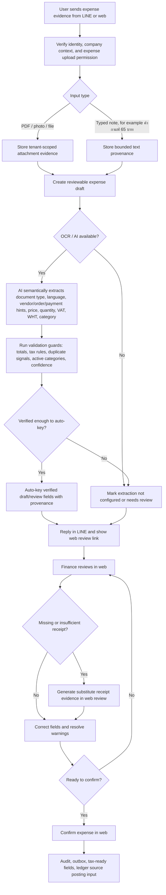

# Expense Receipt Upload Spec

## 1. Status

Implemented and locally verified for checklist items 09, 09A, and 09B. Production/provider rollout evidence and tenant policy follow-ups remain recorded in the linked plans and task memories.

Company approver and cash-evidence settings follow-up: [[plans/substitute-receipt-company-policy-plan|Substitute Receipt Company Policy Plan]]

2026-09-09 implemented locally: [[specs/substitute-receipt-company-payer-spec|Full company/personal funding, signer position and legal-name snapshots]], with [[plans/substitute-receipt-company-payer-plan|verification evidence]]. Scope is substitute receipts only; reimbursement workflow changes are excluded. This follow-up supersedes the funding/correction behavior described below where inconsistent.

Execution role: the primary WatchDog/Codex agent owns implementation. Claude CLI is optional and read-only for development review and test verification only; it must not implement, edit, stage, commit, or deploy. If private-repository review is blocked by platform policy, record that limitation and use an internal independent review instead.

Linked plan: [[plans/expense-receipt-upload-plan|Expense Receipt Upload Plan]]

Focused OCR provider follow-up: [[specs/typhoon-receipt-ocr-spec|Typhoon Receipt OCR Spec]]

Cross-domain image classification follow-up: [[specs/business-document-image-intake-spec|Business Document Image Intake Spec]]

## 2. Goal

Ship the web and LINE receipt/bill and expense-document capture workflow for SME expenses:

- Upload receipt/bill evidence through tenant-scoped attachment storage.
- Treat "bill" broadly for intake: receipts, tax invoices, transfer slips, handwritten cash bills, supplier bills, marketplace order screenshots such as Shopee/Lazada/TikTok, reimbursement-supporting documents, any-language expense documents, and no-receipt spend notes such as `ค่ากาแฟ 65 บาท`.
- Accept receipt, bill, supplier tax-invoice, transfer-slip, cash-bill, marketplace-screenshot, and short expense-note images, PDFs/files, or text from linked LINE users with expense upload permission.
- Make LINE capture feel Paypers-like: user sends a photo/PDF/text note in LINE, AI extracts key fields, detects source document type, classifies to the active company expense category catalogue, auto-keys a reviewable expense draft into web, replies with recognized amount/category/tax summary, and gives a web deep link for correction/confirmation.
- Create OCR/extraction-ready expense drafts from uploads.
- Let AI semantically extract and classify document fields, then verify them against the receipt image/text, calculated totals, duplicate checks, vendor hints, and the configured category catalogue before inserting structured draft/review data.
- Let owner/admin/finance manage company-specific expense categories manually; AI may choose from active configured categories but cannot create categories or make a final category decision without review.
- Let finance review and correct extracted or manually entered fields.
- Decide whether each captured document is usable as tax evidence, supporting-only evidence, not tax evidence, or needs review, with explicit reason codes.
- Split multi-line receipts into reviewable expense lines when the receipt clearly contains multiple line items; fall back to a summary line when uncertain.
- Store reusable company signature assets in the system, allow linked/permitted users to submit signature images through LINE AI or web, create a web approval ticket, require owner approval before active use, optionally remove signature background, and let permissioned web users fill signature placeholders on substitute receipt or review evidence documents.
- Let accounting office users view shared expense evidence through the WatchDog web app with role/permission checks, not through public folders or Google Drive sharing.
- Generate accountant-ready expense export packages from DB-backed filters: generic Thai accounting-office expense index XLSX (plus machine-key CSV in the API response), evidence manifest, and downloadable evidence through permission-checked links.
- Detect likely duplicates before confirmation.
- Confirm expense records with tax, payment, vendor, category, attachment, audit, and posting metadata.
- Expose deterministic ledger-ready source posting inputs for [[specs/double-entry-ledger-closing-spec|Double-Entry Ledger and Period Closing Spec]] item 10.

The first pass must work even when no OCR provider is configured. In that case upload and manual review still work, extraction status is explicit, and no user is blocked from confirming a reviewed expense.

LINE upload is in scope for item 09. A LINE image/file/text message from a linked and permitted user may create an expense draft and insert AI-verified fields for receipts, bills, supplier tax invoices, and short expense notes. Final confirmation, payment, void, export, and ledger posting remain permission-checked business actions and cannot happen from unverified AI output alone.

## 3. Non-goals

- General Ledger, Trial Balance, P&L, Balance Sheet, journal generation, posting rules, and period close. Item 10 owns them.
- Procurement, purchase request/order, goods receipt, supplier AP aging, and full vendor bill workflow. Item 12 owns them.
- Bank account master and bank reconciliation. Item 13 owns them.
- Reimbursement request, manager approval workflow, and employee repayment lifecycle. Item 14 owns them.
- Full Thai tax report filing/export automation. Item 11 owns tax reports; item 09 stores tax-ready source fields only.
- Fixed-asset register, depreciation, or asset disposal workflow. Item 21 owns them.
- Full accounting workspace in LINE; LINE is the fast capture and status channel, not the final accounting console.
- Google Drive/Sheets-style external sync as primary storage. WatchDog stores source evidence in its tenant-scoped attachment system; exports or external sync may be added later through Reports/BI or integration items.
- Public/shared folder links for accounting offices. Accountant access is through web users, roles, permissions, audit, and signed attachment URLs.
- AI or OCR final accounting confirmation, payment, void, export, or posting without explicit permission-checked user confirmation.
- Public buckets, direct object-key exposure, or permanent unauthenticated file URLs.
- Replacing professional accounting review.

## 4. User Roles

- Owner: sees expense status, duplicate risk, payment summary, and high-risk correction history.
- Employee/requester: every standard active employee role can report own receipts through a linked LINE account and view the resulting own expense; broader web create/edit rights remain role/policy controlled.
- Inventory/user with expense permission: uploads receipts from web or LINE tied to own operational purchases when granted.
- Manager: reviews team expense context or exception flags when ABAC/policy allows; full reimbursement approval is item 14.
- Finance: reviews uploads, edits accounting/tax/payment fields, confirms expenses, records paid status, rejects/voids records, and resolves duplicate warnings.
- Accountant: reads confirmed expenses, tax details, source posting status, and later ledger output; may export evidence when granted.
- Auditor readonly: reads expenses, attachment metadata, status history, and audit trail without mutation.
- AI assistant user: uploads receipt evidence from LINE when linked/permitted, receives AI verification summary, and asks for summaries only through permission-checked tools.

## 5. Business Workflow

1. User opens web Expenses workspace or sends receipt/tax-invoice/transfer-slip/handwritten-cash-bill/marketplace-screenshot PDF, photo, file, or short text note in LINE, including no-receipt notes such as `ค่ากาแฟ 65 บาท`. A linked/permitted user may also send a signature image to LINE AI with signature-upload intent; that path creates a web approval ticket, not an expense draft.
2. Web path: user uploads a receipt/bill file or creates a manual expense draft. The web entrances to the manual-entry page (sidebar item, list and ledger buttons, AI-page link, guide shortcut) follow the per-company screen setting "แสดงเมนูบันทึกด้วยมือบนเว็บ" that the system admin switches, hidden by default for every company ([manual-expense-web-entry-flag spec v3.1](manual-expense-web-entry-flag-spec-th.md)). It is not a permission: `POST /expenses`, upload, the substitute-receipt wizard and LINE are unchanged.
3. LINE path: webhook verifies LINE signature, resolves linked user/company/branch context, checks `expense.receipt.line_upload` or equivalent upload permission, downloads LINE media server-side when media exists, and stores files through the shared attachment storage port.
4. Backend creates a draft expense capture record only after shared-LINE media passes the cross-domain document classification and deterministic expense-evidence gate. Quotation, appointment/booking/reservation, quantity-only order, non-financial, unreadable, ambiguous, and multi-document images do not auto-create an expense. Web users who explicitly upload through Expenses keep the draft/attachment, but non-expense classifications apply no financial fields and block ready/confirm until an `expense.review` user explicitly acknowledges a reviewed expense document type with a bounded reason. Text-only notes store bounded, redacted LINE provenance and remain `NEEDS_REVIEW` unless policy later allows a stronger no-receipt path.
5. Backend validates upload completion: company, uploader permission, content type, size, checksum/metadata, and object existence where adapter supports it.
6. Attachment becomes linked to the expense draft as primary receipt evidence.
7. Extraction job is queued when OCR/extraction is configured. Without provider, status becomes `NOT_CONFIGURED` or `NOT_REQUESTED` and manual review remains available.
8. AI verification compares extracted fields with receipt evidence or text-note evidence, calculated totals, duplicate candidates, vendor/counterparty hints, configured expense categories, source document type, language hints, tax rules available in item 09, and confidence thresholds.
9. Verified fields are auto-keyed into draft/review fields in web with provenance. Low-confidence or inconsistent fields remain blank or marked `NEEDS_REVIEW`.
10. LINE replies in a Paypers-like capture style: "บันทึกค่าใช้จ่ายสำเร็จ" when a draft was created, recognized document type, amount/category/date/vendor/tax fields, missing fields, duplicate warnings, and web deep link for review.
11. Finance reviews the draft: vendor, date, document number, amounts, VAT, WHT, category/account hint, payment status, payment method, branch, notes, and attachment evidence.
12. System checks likely duplicates by checksum, vendor, vendor tax id, vendor document number, date, amount, and existing expense links.
13. Finance resolves duplicate warnings by rejecting, linking to existing record, or overriding with reason.
14. Finance confirms the expense.
15. Confirmed expense locks core evidence fields, writes audit/outbox records, and sets posting status `pending` when ledger posting will be required.
16. Item 10 later generates journal entries from deterministic expense source posting input.
17. LINE/AI may summarize draft/confirmed expenses, create allowed draft/ticket intake records, and deep-link to web; final accounting and signature activation actions remain permission-checked and audit-backed in web.

### 5.1 Feature Flow



Flow explanation:

- Intake starts from LINE or web. Supported evidence includes receipt, tax invoice, transfer slip, handwritten cash bill, supplier bill, marketplace screenshot, any-language expense document, PDF/photo/file, and text notes.
- LINE does only fast capture. It verifies linked identity and permission, classifies media before choosing a source module, and creates an expense draft only for accepted expense evidence. Other business-document images receive bounded review guidance or clarification without accounting/CRM mutation.
- OCR/AI auto-keys only draft/review fields: source document type, language hint, category suggestion, vendor/order/payment hints, price, quantity, VAT, WHT, totals, and missing fields.
- AI, not keyword lists, performs semantic extraction and classification. Validation guards decide which AI fields are safe to insert; low-confidence fields stay `NEEDS_REVIEW`.
- Web review is the control point. Finance corrects category/tax/payment fields, resolves duplicates, and creates `ใบแทนใบเสร็จ` when evidence is missing or insufficient.
- Confirmation happens only in web with permission, audit, and source posting output. LINE/AI never confirm, pay, export, post ledger entries, or file tax.

## 6. Core Business Rules

- Web and LINE are allowed capture surfaces for item 09. LINE mutation is limited to receipt media ingestion, attachment creation, draft expense creation, AI verification, insertion of verified draft/review fields, and signature-image intake that creates a pending web approval ticket.
- LINE AI signature-image intake is allowed only when the linked user has signature upload/manage permission or an explicitly configured signature-request permission. The LINE Intake Router Agent from item 10B owns AI/model-driven semantic detection for whether the LINE image/text is likely a signature upload request by looking at the image itself, accompanying text, and conversation intent. This must not be keyword-only routing, regex-only parsing, or a static phrase list such as only matching `ลายเซ็น`. When signature intent is confidently detected, store the original image as a pending company signature candidate, create a web ticket/approval request, reply with status and web link, and do not make the signature active. If confidence is low, do not open the ticket automatically; ask for clarification. Never treat an uncertain image as expense evidence merely because it is not a signature.
- LINE AI must treat receipts, tax invoices, transfer slips, handwritten cash bills, supplier bills, marketplace order screenshots, reimbursement-supporting documents, any-language expense documents, and no-receipt expense notes as the same capture family. Tax-invoice-specific fields such as vendor tax id, branch code, document number, VAT base, VAT amount, WHT, and input VAT claimability are extracted into draft/review fields with provenance and `NEEDS_REVIEW` fallback.
- Source document type is a reviewable field. AI may suggest it, but finance can correct it in web before confirmation.
- Tax evidence status is a reviewable field. AI may suggest it, but finance/accountant must be able to override it with a reason before confirmation or export.
- Any-language document intake is supported as a capture requirement. OCR/AI may auto-key fields when confidence is sufficient; unknown language, unreadable handwriting, or unsupported script must fall back to manual review rather than blocking draft creation.
- Document type, category, and free-text expense-note understanding must be AI/model-driven semantic extraction, not deterministic keyword lists, regex-only routing, or static dictionaries that require adding every vendor/platform/language phrase by hand.
- Deterministic logic is reserved for validation and accounting guards: permission, tenant/branch context, allowed enum/category ids, decimal totals/tax math, duplicate detection, state transitions, audit, source posting input, and final-mutation blocking.
- LINE text-only expense notes may create a draft when amount and purpose/category are semantically detectable. They do not count as receipt evidence, must preserve bounded redacted provenance, and default to review/missing-receipt handling unless finance policy allows otherwise.
- LINE must verify webhook signatures, linked account, active company context, and server-derived permissions before downloading media or creating records.
- LINE user-submitted company id, role, branch, permission, tax treatment, amount, or confirmation state must never override server context.
- Uploads must use Data Model Core attachment primitives. Do not create a separate object storage abstraction for expenses.
- `objectKey`, bucket internals, and storage credentials are never returned directly to web clients.
- Uploaded files must be tenant-scoped and validated for ownership, MIME type, file extension, byte size, and object metadata before they become active evidence.
- Runtime upload limits come from configuration such as `UPLOAD_MAX_BYTES` and `ALLOWED_UPLOAD_MIME_TYPES`; business logic must not hard-code conflicting docs defaults.
- Accepted MVP MIME types are PDF, PNG, and JPEG unless environment config narrows them.
- Browser source-file policy is consistent across initial upload, replacement, supporting/payment evidence, signed-paper copies, accounting/tax attachments and statement images: PDF, PNG, JPG/JPEG/JPE, HEIC/HEIF and GIF (image-only inputs exclude PDF). Reuse the primary receipt decoder to normalize non-canonical images to a static JPEG before requesting upload intent. Preserve canonical PDF/PNG/JPEG bytes and existing limits; signed metadata, PUT bytes, completion size and checksums describe the same normalized file. This does not widen server MIME/byte verification, permissions, scan or signature approval boundaries. CSV/TSV/TXT statement intake remains a separate text policy.
- Receipt/bill upload creates draft or review records only. OCR, AI, or raw extraction cannot create a confirmed expense without an explicit permission-checked confirmation workflow.
- AI-verified fields may be inserted into draft/review columns only when they pass validation and confidence gates. Each inserted field must keep provenance and verification status.
- AI category classification must choose only from active system/default or company-specific categories available to the company. If no category confidently matches, use `อื่นๆ`/needs-review behavior rather than inventing a category.
- AI verification must never invent missing vendor document numbers, tax ids, VAT/WHT values, or payment facts. Unknown values stay blank or `NEEDS_REVIEW`.
- AI may split visible receipt rows into multiple `ExpenseLine` entries only when description, quantity or amount, and line total are sufficiently visible. If line extraction is uncertain, create one summary line, keep raw line suggestions in bounded provenance, and mark the line breakdown `NEEDS_REVIEW`.
- Transfer slips prove payment evidence, not the expense/tax document by themselves. They may set payment hints only after review and should not invent VAT/vendor document fields.
- Marketplace screenshots may create draft expense evidence and seller/order hints, but tax invoice and input VAT claimability stay `NEEDS_REVIEW` unless the image contains valid tax-invoice fields.
- Tax evidence status rules:
  - `USABLE_FOR_TAX`: valid tax invoice/receipt evidence has enough vendor, date, document number where required, amount, and tax fields for finance/accountant review.
  - `SUPPORTING_ONLY`: useful business evidence but not sufficient for tax claim by itself, such as transfer slip, marketplace screenshot without tax invoice fields, or handwritten/text evidence needing substitute receipt.
  - `NOT_TAX_EVIDENCE`: document should not be used as tax evidence, such as payment-only evidence or non-business proof.
  - `NEEDS_REVIEW`: AI or rules cannot decide safely.
- Tax evidence status is not legal advice or automatic filing. Item 11 owns tax report filing/export; item 09 stores source evidence status and reason.
- Handwritten cash bills and text-only notes default to missing-receipt/substitute-receipt review policy before confirmation.
- The canonical product/document title is `ใบรับรองแทนใบเสร็จรับเงิน`. The Revenue Department accounting-evidence guide and its example form/attestation are the primary field baseline: company, date, expense detail, amount, note, total, payer name/position and personal certification, payer signature, and authorized approval. It is an internal company expense certification, not an issuer-created `ใบแทนใบกำกับภาษี`. If a VAT tax invoice is lost, destroyed, or materially damaged and input VAT is expected, the correct route is to request the registered supplier to issue a replacement tax invoice under Revenue Code section 86/12; WatchDog must not manufacture one.
- Internal substitute evidence is eligible only for a real business expense whose receipt is unavailable or materially incomplete. Quotations, purchase/order slips without settlement, appointments, bookings, reservations, ordinary photos, unreadable/multi-document images, personal spend, and an otherwise valid available receipt/tax invoice are not eligible merely because a reviewer enters a reason.
- The issued artifact must show: title `ใบรับรองแทนใบเสร็จรับเงิน`; legal company name and branch; expense/payment date; itemized expense description, quantity when applicable, amount and total in numbers and Thai words; missing-receipt reason; actual payer's name and position; the certification statement `ข้าพเจ้า [ชื่อ] ตำแหน่ง [ตำแหน่ง] ขอรับรองว่ารายจ่ายข้างต้นนี้ไม่อาจเรียกเก็บใบเสร็จรับเงินจากผู้รับได้ และได้จ่ายไปในงานของบริษัทโดยแท้`; actual payer/certifier signature and date; authorized approver signature and date; document number/version; and linked supporting/payment evidence references.
- Required review snapshot before generation: company and branch, expense date/payment date as applicable, positive total, item/purpose details, category/account hint, business-purpose certification, missing/incomplete-evidence reason, actual payer/certifier identity, reviewer/approver identity, and original/supporting/payment evidence references. The certifier must be the employee who actually paid the expense and must attest personally; another user, finance reviewer, or reusable company signature cannot attest on the payer's behalf. The authorized approver is a distinct recorded role. Where a direct payee can acknowledge receipt, capture payee name plus address/tax identifier where policy requires and payee acknowledgement/signature. Where the payee cannot issue evidence, require an explicit exception path and authorized approval rather than inventing payee facts.
- Substitute-receipt approval mode is either `OWNER_SELF` or `DESIGNATED_APPROVERS`. A company with no policy row uses the owner-approved `OWNER_SELF` default; `configured = false` is therefore not by itself a readiness blocker. Runtime still requires at least one active member with effective `expense.confirm` in the expense branch. Self-approval is allowed only for roles explicitly covered by the shared owner/admin/manager exemption; every other payer needs another eligible approver. When one person signs as both payer and approver, the issued online certificate says so under the signatures: `ลงนามโดยเจ้าของกิจการในฐานะผู้จ่ายเงินและผู้อนุมัติ` only when the approving session held OWNER, otherwise `ลงนามโดย <approver name as printed under the signature> ในฐานะผู้จ่ายเงินและผู้อนุมัติ` (2026-10-03: the line no longer claims an unchecked owner role). The paper route records one person signing both on its acceptance record page.
- `DESIGNATED_APPROVERS` requires at least one configured active member with effective `expense.confirm` on `/companies/:companyId/settings/substitute-receipt`; runtime revalidates branch scope and requires an eligible configured approver distinct from the actual payer. Preflight and UI must report `configured` and `ready` separately and must not mislabel a ready default `OWNER_SELF` company as disabled.
- Company cash-evidence policy is either `REQUIRE_SEPARATE_PAYMENT_EVIDENCE` or `ALLOW_SUPPORTING_EVIDENCE_ONLY`. The strict mode requires at least one image/PDF linked as `expense.payment.evidence` in addition to the existing source/supporting attachment. Company instructions describe acceptable evidence, while finance/accountant remains responsible for checking its substance.
- Policy changes are audited and apply to new actions. Pending approvals are revalidated against the current configured approver list and cash-evidence rule; issued immutable evidence is not rewritten.
- Payment evidence is method-aware: transfer/electronic payment should link the transfer record; cheque should link the named/crossed cheque and debit evidence; cash requires the company/accountant policy evidence for the recipient and must not collect unnecessary identity documents. Employee reimbursement must reuse item 14 requester/approval/payment-voucher ownership rather than create a second approval workflow in item 09.
- Internal substitute evidence is always `SUPPORTING_ONLY` and cannot by itself authorize input VAT. Until a valid external tax invoice or issuer-created replacement is attached and reviewed, confirmation/posting/tax sync must keep `inputVatClaimStatus = NON_CLAIMABLE`; `USABLE_FOR_TAX` or active VAT-input creation is invalid for this evidence alone.
- Generation succeeds only after an immutable evidence snapshot and an actual readable review artifact are stored, checksum/version/provenance are recorded, and the artifact is linked as `expense.review.evidence`. A metadata timestamp or synthesized `SUBSTITUTE-*` string is not proof that a document exists.
- Keep the original source document type and all original/supporting attachments. Substitute evidence is a separate versioned evidence role; it must not overwrite the source classification. Regeneration creates a new version and explicitly supersedes the previous version. Retry with the same idempotency key returns the same version.
- A signature/audit record may say `applied` or `signed` only when the selected signature/attestation is rendered into the exact evidence version and the rendered artifact is stored and linked. A reusable company signature is not automatically the payee signature, claimant certification, or approval; those roles remain explicit.
- Signature image pickers accept PNG, JPG/JPEG/JPE, HEIC/HEIF, and GIF sources, including photos taken from a mobile picker. Web must decode and normalize non-PNG/JPEG sources to a static JPEG before upload, then remove the light background, reject a result with no visible ink, crop transparent margins, and show the exact transparent PNG preview. Only the normalized PNG/JPEG and reviewed transparent PNG may cross the attachment boundary or be rendered into the matching payer/approver slot. A payee/recipient signature remains separate cash-payment evidence and must not be rendered or labeled as either certificate signer.
- Generate, render, sign, preview, download, confirm, export, and retention operations enforce tenant, branch ABAC, web-only channel boundaries, exact permissions, mutable state, and compare-and-set/transaction safety. Confirmed or retention-active original/generated evidence is append-only and cannot be hard-deleted through the normal attachment action.
- Evidence baseline: [Revenue Department guide for tax-deductible accounting evidence](https://www.rd.go.th/fileadmin/download/15277290359.pdf), [Revenue Code section 65 ter expense-proof guidance](https://www.rd.go.th/827.html), [Revenue Department ruling 0706/4722](https://www.rd.go.th/31914.html), [Revenue Code section 82/5 input-VAT restriction](https://www.rd.go.th/5206.html), and [Revenue Department Notification No. 36 on issuer-created replacement tax invoices](https://www.rd.go.th/3401.html). The public-sector [บก.111 example from the Office of Planning and Budget, Court of Justice](https://oppb.coj.go.th/th/content/category/detail/id/35/cid/2108/iid/18164) is a layout/reference example only: WatchDog must render the company's legal identity and company-business certification, not claim that a private-company artifact is an official government บก.111 form. These are an implementation baseline, not case-specific legal advice; accountant/legal review remains required before production tax use.
- Signature assets are company-scoped assets stored in WatchDog through tenant-scoped attachment primitives. Web upload/draw/import or LINE AI signature-image intake creates a pending signature asset and a web approval ticket. The signature becomes active and reusable only after an OWNER or explicitly delegated owner-level approver approves it in web; non-owner uploaders cannot self-approve. Background removal creates a derived transparent signature asset and keeps the original for audit/recovery.
- Applying an active signature is a permission-checked web action, not an approval by itself. Store which signature asset was applied, who applied it, when it was applied, and the rendered evidence attachment. LINE/AI may submit a signature candidate and return the web ticket link, but cannot approve, activate, background-remove, apply, or imply a signed document exists.
- Accounting office sharing is a web read/export experience for users with accountant/auditor/expense permissions. It is backed by DB filters and signed attachment URLs, not external folders; virtual year/month folders are UI groupings from `uploadedAt`/`expenseDate` metadata.
- Accountant export package is a web/export action, not Google Drive sync. Default format is a generic Thai accounting-office evidence package: an XLSX index (machine-key CSV still returned by the API) plus `evidence_manifest.json`. Do not copy or depend on a vendor-specific proprietary format.
- Evidence files are downloaded through permission-checked links from the manifest/web export center. First pass does not generate bundled archives; it returns manifest rows and signed download links that expire and re-check the viewer's permission.
- The accountant expense index uses the columns below in this order. The download the UI produces is XLSX (`.xlsx`, real OOXML, not CSV renamed); the CSV in the API response keeps the machine column keys for system-to-system consumers.
- XLSX rendering rules: header row uses the Thai label of each column (not the column key), amount/quantity columns are written as numeric cells so Excel can sum them, and `expense_status` / `source_document_type` / `tax_evidence_status` are rendered with the same Thai wording the UI shows. The header row is frozen; date columns (`uploaded_at`, `document_date`, `paid_at`) render as Thai-Buddhist dates (for example, `28 ก.ค. 2569`) in the XLSX while the CSV keeps ISO values, and `accounting_period` stays `YYYY-MM`.
- The XLSX has two column sets, chosen by `columnSet` on `POST /expenses/accountant-package` (default `summary`):
  - `summary` — everyday view for non-accountants: `document_date`, `vendor_name`, `description`, `category_name`, `grand_total_amount`, `vat_amount`, `expense_status`.
  - `full` — every column below in this order, for the accounting office. The accountant sharing panel always requests `full`.

| Column key | Thai label | Source/notes |
| --- | --- | --- |
| `company_name` | บริษัท | Company snapshot for the export |
| `company_tax_id` | เลขผู้เสียภาษีบริษัท | Nullable if not configured |
| `branch_code` | สาขา | Company/expense branch code or blank |
| `accounting_period` | งวดบัญชี | `YYYY-MM` from document date, or uploaded date if document date is missing |
| `uploaded_at` | วันที่ส่งเข้า | System intake timestamp from LINE/web/API |
| `document_date` | วันที่เอกสาร | Receipt/tax invoice/order/slip date when known |
| `expense_number` | เลขที่ค่าใช้จ่าย | WatchDog expense number or draft id fallback |
| `expense_status` | สถานะรายการ | Draft/review/confirmed/rejected/voided/etc. |
| `source_channel` | ช่องทางส่งเข้า | LINE, WEB, API, IMPORT |
| `source_document_type` | ประเภทเอกสาร | Receipt, tax invoice, transfer slip, handwritten bill, marketplace screenshot, text note, etc. |
| `tax_evidence_status` | สถานะหลักฐานภาษี | Usable/supporting/not evidence/needs review |
| `tax_evidence_reason` | เหตุผลสถานะภาษี | Reason code or reviewer note |
| `requester_name` | ผู้ขอเบิก/ผู้ใช้จ่าย | Nullable for finance-entered expense |
| `uploader_name` | ผู้ส่งเอกสาร | User mapped from LINE/web/API |
| `reviewer_name` | ผู้ตรวจ | Finance/accountant reviewer when present |
| `vendor_name` | ผู้ขาย/ผู้รับเงิน | Vendor/payee snapshot |
| `vendor_tax_id` | เลขผู้เสียภาษีผู้ขาย | Nullable |
| `vendor_branch_code` | สาขาผู้ขาย | Nullable |
| `vendor_document_number` | เลขที่เอกสารผู้ขาย | Receipt/tax invoice/order/slip reference |
| `category_name` | หมวดค่าใช้จ่าย | Active configured category at review/export time |
| `account_hint_key` | ผังบัญชีแนะนำ | Ledger/account hint, not final posting |
| `description` | รายละเอียด | Expense summary or line description |
| `quantity` | จำนวน | Decimal string; blank when not applicable |
| `subtotal_amount` | มูลค่าก่อนส่วนลด/ภาษี | Decimal string, THB unless currency says otherwise |
| `discount_amount` | ส่วนลด | Decimal string |
| `taxable_amount` | ฐานภาษี | Decimal string |
| `vat_amount` | ภาษีมูลค่าเพิ่ม | Decimal string |
| `wht_amount` | หัก ณ ที่จ่าย | Decimal string |
| `grand_total_amount` | ยอดรวม | Decimal string |
| `net_payable_amount` | ยอดสุทธิที่ต้องจ่าย/คืน | `grand_total_amount - wht_amount` unless policy changes |
| `paid_amount` | ยอดที่จ่ายแล้ว | Decimal string |
| `outstanding_amount` | ยอดค้างจ่าย/ค้างคืน | Decimal string |
| `payment_method` | วิธีชำระเงิน | Cash, transfer, card, etc. |
| `paid_at` | วันที่จ่าย | Nullable |
| `payment_reference` | เลขอ้างอิงการจ่าย | Bank/slip/payment ref |
| `substitute_receipt_ref` | อ้างอิงใบแทนใบเสร็จ | Evidence ref or blank |
| `primary_evidence_ref` | ไฟล์หลักฐานหลัก | Manifest evidence ref |
| `supporting_evidence_refs` | ไฟล์แนบเพิ่มเติม | Comma-separated manifest evidence refs |
| `web_url` | ลิงก์เปิดในระบบ | Permission-checked web deep link |
| `notes` | หมายเหตุ | Reviewer/export note |

- `evidence_manifest.json` must include one row per downloadable evidence file with `evidence_ref`, `expense_id`, `attachment_id`, `file_name`, `mime_type`, `file_size_bytes`, `evidence_role`, `source_document_type`, `tax_evidence_status`, `download_url`, `download_url_expires_at`, and `web_url`. Download URLs are generated per request and must not be permanent public URLs.
- Manual category create/update/archive is a web/API admin/finance action protected by `expense.category.manage`; LINE/AI cannot create, rename, archive, or reorder categories.
- LINE reply must never imply final accounting completion. "บันทึกสำเร็จ" means draft/evidence captured unless the web confirmation state is already confirmed by an authorized user.
- Manual expense draft without attachment is allowed only when the user has finance-level permission or policy grants it, and it must store `missingReceiptReason`.
- A draft may have one primary receipt attachment and additional supporting attachments.
- Confirmed expenses must keep stable attachment links. Users cannot hard-delete evidence from confirmed records through normal UI.
- Draft fields remain editable until confirmation or rejection.
- Confirmed expenses lock vendor snapshot, document date, document number, money, tax, category/account hint, and primary attachment evidence. Owner decision 2026-10-04: “แก้ได้จนกว่าจะลงบัญชีหรือออก 50 ทวิ”. `expense.confirm` may reopen to `NEEDS_REVIEW` with a mandatory 3–500 character audited reason before any posted ledger journal, issued/external 50 ทวิ, non-open accounting month, filed/paid/closed PP30/PP36/CUSTOMS_SUPPORT/PND3/PND53 periods for its contributions, or live reimbursement claim (`expense-void-blocker.ts`). Unresolved posting pointers or generated draft journals must be resolved first; controller decision 2026-10-04 keeps this block, with no automatic journal cancellation. Server capability flags/blockers explain the lock and remedy. Document number and payments survive; confirmation/review stamps clear. Saving recalculates outstanding/payment status against retained paid amounts. Re-confirmation checks totals including paid <= payable. Reopen supersedes all active expense tax events and cancels required direct and tax-event handoffs, preventing issuance from retired facts. Existing substitute-receipt edit locks remain.
- `expense.payment.record` may cancel an unposted recorded payment with an audited reason, retaining history as `VOIDED` and subtracting only the cancelled amount from paid and recalculating outstanding/status (including retained legacy paid balances without history rows). Posted/generated-journal payments require the existing document/accounting cancellation workflow. The form prefills outstanding balance and names recording the remainder; disabled payment actions show a reason.
- Confirmed withholding expenses retain the 50 ทวิ action across visits when entitlement, permission and server route capability allow it. Issued certificates offer PDF re-download and existing correction; no withholding means no certificate action. Income categories match the payee's form (individual ภ.ง.ด.3; juristic ภ.ง.ด.53); changing payee type clears incompatible categories. Mangmee manages the catalog; empty applicable lists direct the user to the Mangmee team.
- Uploaded expense evidence follows the shared immutable attachment boundary: review/confirmation uses the server-derived byte SHA-256 and pinned provider version, not attachment id or client-reported checksum. The confirmation source checksum includes every linked attachment id, purpose, and verified byte checksum.
- Corrections after confirmation use the audited, capability-gated reopen above when eligible; otherwise use the existing document/accounting cancellation or adjustment workflow.
- Vendor/counterparty uses item 08 `AccountingCounterparty` with type `VENDOR` or `BOTH` when available. Item 09 extends it; it must not create a competing vendor master.
- Vendor snapshot is copied on confirmation so later counterparty edits do not rewrite historical evidence.
- Expense records are company-scoped and branch-aware. Server-side tenant and branch checks are mandatory.
- Money and quantity math must be decimal-safe. Do not calculate money with JavaScript floating-point math.
- Currency starts as explicit `THB`; keep field present for later multi-currency support.
- VAT mode must be explicit: no VAT, VAT included, VAT excluded, exempt, or needs review.
- Input VAT claimability must be explicit and reviewable. Do not assume every VAT amount is claimable.
- WHT must be explicit. WHT reduces payable/cash payment where applicable but does not reduce expense gross evidence.
- Duplicate warnings do not block confirmation when finance user overrides with reason; confirmed duplicates remain auditable.
- Source posting input must be derived from persisted records, not UI state.
- Confirmed accounting-relevant expenses set `postingStatus = pending`.
- Draft, rejected, and duplicate-only records use `postingStatus = not_required`.
- Item 10 owns journal generation and may update posting status to `posted`, `posting_error`, or `reversed`.
- Period close does not exist until item 10. Item 09 must call a closed-period policy port/interface so item 10 can enforce it later.
- Audit successful and denied high-risk actions.
- Outbox payloads must be bounded and redacted. Do not include raw files, signed URLs, full OCR text, auth tokens, or secrets.
- LINE and AI may create receipt-upload drafts and insert AI-verified draft/review data through allowlisted tools only. They cannot confirm, reject, void, pay, export, post, or silently alter confirmed expenses.

## 7. Statuses and Enumerations

Expense statuses:

```text
DRAFT
EXTRACTING
NEEDS_REVIEW
READY_FOR_CONFIRMATION
CONFIRMED
REJECTED
VOIDED
```

Extraction statuses:

```text
NOT_REQUESTED
NOT_CONFIGURED
QUEUED
PROCESSING
SUCCEEDED
PARTIAL
FAILED
```

AI verification statuses:

```text
NOT_VERIFIED
VERIFYING
AI_VERIFIED
PARTIAL
NEEDS_REVIEW
FAILED
HUMAN_VERIFIED
```

Duplicate statuses:

```text
NOT_CHECKED
NO_MATCH
POSSIBLE_DUPLICATE
CONFIRMED_DUPLICATE
OVERRIDDEN
```

Payment statuses:

```text
UNPAID
PARTIALLY_PAID
PAID
VOIDED
```

Posting statuses:

```text
not_required
pending
posted
posting_error
reversed
```

VAT modes:

```text
NO_VAT
VAT_INCLUDED
VAT_EXCLUDED
EXEMPT
NEEDS_REVIEW
```

Input VAT claim statuses:

```text
CLAIMABLE
NON_CLAIMABLE
NEEDS_REVIEW
```

Tax evidence statuses:

```text
USABLE_FOR_TAX
SUPPORTING_ONLY
NOT_TAX_EVIDENCE
NEEDS_REVIEW
```

Tax evidence reason codes:

```text
VALID_TAX_INVOICE_FIELDS
VALID_RECEIPT_FIELDS
PAYMENT_EVIDENCE_ONLY
MARKETPLACE_SCREENSHOT_ONLY
HANDWRITTEN_OR_TEXT_NEEDS_SUBSTITUTE
MISSING_VENDOR_TAX_ID
MISSING_DOCUMENT_NUMBER
UNREADABLE_OR_LOW_CONFIDENCE
NOT_BUSINESS_EVIDENCE
MANUAL_OVERRIDE
```

Payment methods:

```text
CASH
BANK_TRANSFER
CARD
CHEQUE
OTHER
```

Capture sources:

```text
WEB_UPLOAD
WEB_MANUAL
LINE_UPLOAD
API_INTERNAL
```

Source document types:

```text
RECEIPT
TAX_INVOICE
TRANSFER_SLIP
HANDWRITTEN_CASH_BILL
SUPPLIER_BILL
MARKETPLACE_ORDER_SCREENSHOT
EXPENSE_NOTE_TEXT
SUBSTITUTE_RECEIPT
OTHER_EXPENSE_DOCUMENT
NEEDS_REVIEW
```

Attachment purposes:

```text
expense.receipt.primary
expense.receipt.supporting
expense.review.evidence
expense.signature.asset
```

Document sequence keys:

```text
expense.record
```

If a separate paid expense/payment number is needed and item 08 `AccountingPayment` cannot cover it, use an additive sequence key:

```text
expense.payment
```

Prefer reusing item 08 `AccountingPayment` with direction `PAID` for expense payment records when it exists.

## 8. Data Model Draft

Use repo conventions and current Prisma naming when implementation starts. The shape below is the required business contract, not exact ORM syntax.

### ExpenseRecord

```text
ExpenseRecord
- id
- companyId
- branchId nullable
- expenseNumber nullable until confirmation when sequence policy requires official number
- status
- captureSource
- sourceDocumentType
- sourceDocumentLanguage nullable
- vendorCounterpartyId nullable
- vendorSnapshotJson nullable
- vendorNameSnapshot nullable
- vendorTaxIdSnapshot nullable
- vendorBranchCodeSnapshot nullable
- vendorDocumentNumber nullable
- expenseDate
- receivedAt nullable
- dueDate nullable
- currency
- vatMode
- inputVatClaimStatus
- taxEvidenceStatus
- taxEvidenceReasonCode nullable
- subtotalAmount
- discountAmount
- taxableAmount
- vatAmount
- whtAmount
- grandTotalAmount
- netPayableAmount
- paidAmount
- outstandingAmount
- paymentStatus
- paymentMethod nullable
- paidAt nullable
- bankAccountRef nullable
- expenseCategoryId nullable
- accountHintKey nullable
- taxCategory nullable
- duplicateStatus
- duplicateOfExpenseId nullable
- duplicateOverrideReason nullable
- primaryAttachmentId nullable
- extractionId nullable
- aiVerificationStatus
- aiVerifiedFieldsJson nullable
- aiVerificationSummaryJson nullable
- aiVerificationConfidence nullable
- aiVerifiedAt nullable
- lineMessageId nullable
- lineEventId nullable
- lineReplyTokenHash nullable
- uploadedAt
- sourceChannelMetadataJson nullable
- missingReceiptReason nullable
- substituteReceiptGeneratedAt nullable
- substituteReceiptGeneratedByUserId nullable
- postingStatus
- journalEntryId nullable
- postingError nullable
- note nullable
- internalMemo nullable
- createdByUserId
- updatedByUserId nullable
- reviewedByUserId nullable
- reviewedAt nullable
- confirmedByUserId nullable
- confirmedAt nullable
- rejectedByUserId nullable
- rejectedAt nullable
- rejectReason nullable
- voidedByUserId nullable
- voidedAt nullable
- voidReason nullable
- createdAt
- updatedAt
- unique companyId,expenseNumber when expenseNumber exists
- index companyId,status,expenseDate
- index companyId,uploadedAt
- index companyId,taxEvidenceStatus
- index companyId,branchId,expenseDate
- index companyId,vendorCounterpartyId
- index companyId,paymentStatus
- index companyId,postingStatus
- index companyId,duplicateStatus
- index companyId,primaryAttachmentId
- index companyId,lineMessageId
```

Rules:

- Draft records may lack vendor, tax, payment, and category fields.
- Confirmed records require vendor snapshot or explicit no-vendor reason, expense date, currency, totals, VAT mode, input VAT claim status, category/account hint, payment status, and review metadata.
- `sourceDocumentType` is required by review time; use `NEEDS_REVIEW` until AI or reviewer can classify the source.
- `taxEvidenceStatus` is required by review time; use `NEEDS_REVIEW` until AI or reviewer can decide whether the document is tax evidence, supporting-only evidence, not tax evidence, or needs review.
- `sourceDocumentLanguage` may be BCP-47 when detectable, such as `th`, `en`, `zh`, `ja`, or `unknown`; it is a hint, not an access-control or tax decision field.
- `uploadedAt` is the system intake timestamp from web/LINE/API. `expenseDate` is the receipt/document date used for tax/accounting review. Both must be filterable because users need to view by submitted date or receipt date.
- LINE-created records use `captureSource = LINE_UPLOAD` and store LINE message/event ids for idempotency and audit. Do not store reply tokens in plaintext.
- `aiVerifiedFieldsJson` records field-level source, confidence, validation result, and whether the field was inserted. It does not replace persisted reviewed fields.
- `aiVerificationSummaryJson` records missing fields, warnings, duplicate reasons, and next action. It must be bounded and redacted.
- `netPayableAmount = grandTotalAmount - whtAmount` unless policy changes later.
- `paidAmount` must not exceed `netPayableAmount` unless overpayment handling is explicitly added in a later AP/bank workflow.
- `outstandingAmount = netPayableAmount - paidAmount`.
- `expenseNumber` uses Data Model Core document sequence when official numbering is required.
- Substitute evidence uses the same expense as its source but persists a separate immutable/versioned snapshot and actual readable artifact. Link the artifact as `expense.review.evidence`, keep the original source classification and attachments, and expose only artifact-backed references in accountant exports. A generated timestamp without a resolvable artifact is an incomplete legacy state and must remain `NEEDS_REVIEW`.
- Signature assets have lifecycle `PENDING_OWNER_APPROVAL`, `ACTIVE`, `REJECTED`, or `ARCHIVED`. Only `ACTIVE` signature assets can be filled into documents. Pending/rejected/archived signature assets must remain hidden from fill pickers except for owners/admins reviewing the signature asset.
  - **Superseded 2026-08-20 by [[specs/line-substitute-receipt-assisted-issuance-spec|LINE Substitute-Receipt spec]] D14:** signatures are now personal assets created `ACTIVE` on save with no approval step. `PENDING_OWNER_APPROVAL`/`REJECTED` remain in the enum as history only; nothing produces them. Visibility, invocation, replacement, and archival are owner-only (the submitter), including for `expense.signature.manage` holders. This bullet and the two "PENDING_OWNER_APPROVAL" mentions below (LINE signature intake, signature-asset store) describe the retired approval model.
- If a signature is filled into a substitute receipt or review evidence document, persist the active signature asset id, applier user id, applied timestamp, and rendered evidence attachment id. Do not treat signature fill as expense confirmation or reimbursement approval.

### ExpenseLine

```text
ExpenseLine
- id
- companyId
- expenseId
- lineNumber
- description
- quantity
- unitPrice
- discountAmount
- taxableAmount
- vatRate nullable
- vatAmount
- whtRate nullable
- whtAmount
- lineSubtotalAmount
- lineTotalAmount
- expenseCategoryId nullable
- accountHintKey nullable
- taxCategory nullable
- sourceLineText nullable
- aiLineConfidence nullable
- reviewStatus: SUGGESTED, REVIEWED, NEEDS_REVIEW
- createdAt
- updatedAt
- unique expenseId,lineNumber
- index companyId,expenseCategoryId
```

First UI may optimize for one-line expenses, but domain/API must support multiple lines. AI line splitting should create one `ExpenseLine` per visible receipt line when confidence is sufficient; otherwise create one summary line and mark line breakdown `NEEDS_REVIEW`.

### ExpenseCategory

```text
ExpenseCategory
- id
- companyId nullable for system defaults
- name
- accountHintKey
- taxCategory nullable
- inputVatDefault
- status: ACTIVE, ARCHIVED
- sortOrder
- createdAt
- updatedAt
- unique companyId,name when companyId exists
- index companyId,status
```

System default categories should be conservative SME categories, for example office supplies, rent, utilities, travel, meals, professional fees, software, shipping, repairs, and other. Company-specific categories may be added manually by owner/admin/finance users with `expense.category.manage`.

Category rules:

- Categories are company-scoped plus global defaults; company categories must not leak across tenants.
- Category create/update/archive is explicit web/API administration, not a LINE/AI action.
- Category names are user-facing labels; `accountHintKey`, `taxCategory`, and `inputVatDefault` are hints for review and later posting/tax rules, not final chart-account decisions.
- AI may classify a draft expense line/header into an active category only when the chosen category id/key is present in the current company catalogue and the classification passes confidence/reasonableness gates.
- AI classification must be semantic/model-driven. Do not build or maintain static keyword dictionaries as the primary classifier.
- AI classification must store provenance in `aiVerifiedFieldsJson` or `aiVerificationSummaryJson`; finance can change the category during review.
- If a LINE note says `ค่าเดินทาง 200 บาท`, expected behavior is a draft line with amount `200`, category suggestion such as travel when configured, and `NEEDS_REVIEW`/missing-receipt handling until reviewed.

Exact chart account ids belong to item 10 posting rules, not item 09.

### ReceiptExtraction

```text
ReceiptExtraction
- id
- companyId
- expenseId
- attachmentId
- provider
- status
- rawTextHash nullable
- extractedFieldsJson nullable
- confidenceJson nullable
- warningCodesJson nullable
- errorCode nullable
- errorMessage nullable redacted
- queuedAt nullable
- startedAt nullable
- completedAt nullable
- createdAt
- updatedAt
- unique companyId,expenseId,attachmentId
- index companyId,status,createdAt
```

Rules:

- Store extracted suggestions and confidence, not final accounting truth.
- If raw OCR text is stored at all, bound size, redact where possible, and never include it in audit/outbox payloads.
- Provider-specific raw responses should not leak to web, logs, audit, or outbox.

### ReceiptAiVerification

```text
ReceiptAiVerification
- id
- companyId
- expenseId
- attachmentId
- extractionId nullable
- provider
- modelId nullable
- status
- verifiedFieldsJson
- insertedFieldsJson
- validationResultsJson
- confidenceJson
- warningCodesJson
- duplicateCandidateIdsJson nullable
- promptInputHash nullable
- rawOutputHash nullable
- errorCode nullable
- errorMessage nullable redacted
- requestedByUserId
- requestedFromChannel: WEB, LINE, WORKER
- requestedAt
- completedAt nullable
- createdAt
- updatedAt
- unique companyId,expenseId,attachmentId,requestedAt when practical
- index companyId,status,createdAt
```

Rules:

- AI verification may insert only fields that pass validation guards and confidence gates.
- Inserted fields must be traceable to `ReceiptAiVerification.insertedFieldsJson`.
- AI verification must call allowlisted ERP/service tools only; it cannot access the database directly from AI Gateway.
- Verification uses server-derived user, company, permission, and branch context.
- Raw prompts, raw OCR text, full provider output, images, signed URLs, and object keys must not be stored in audit/outbox payloads.
- Failed or partial verification keeps the draft in `NEEDS_REVIEW` with warnings.

### ExpenseDuplicateCandidate

```text
ExpenseDuplicateCandidate
- id
- companyId
- expenseId
- candidateExpenseId
- reasonCodesJson
- score
- status: OPEN, DISMISSED, CONFIRMED_DUPLICATE
- resolvedByUserId nullable
- resolvedAt nullable
- resolutionReason nullable
- createdAt
- updatedAt
- unique companyId,expenseId,candidateExpenseId
- index companyId,expenseId,status
```

Duplicate reasons may include:

```text
same_checksum
same_visual_fingerprint
same_vendor_document_number
same_vendor_date_amount
same_vendor_tax_id_amount_near_date
same_attachment_hash
```

Duplicate resolution rules:

- Manual rescan and human resolution are allowed only while the expense is editable (`DRAFT`, `EXTRACTING`, `NEEDS_REVIEW`, `READY_FOR_CONFIRMATION`). `CONFIRMED`, `REJECTED`, and `VOIDED` records require their dedicated accounting/state-transition paths; duplicate resolution must never rewrite a posted record's posting state.
- Every duplicate writer takes the company `duplicate-reconciliation` advisory lock before the expense advisory lock, then re-reads and enforces `companyId`, current branch scope, editable status, and non-posted/non-reversed posting state inside the owning transaction. A pre-lock authorization read is not sufficient.
- Detection queries (normalized-field and attachment-checksum paths), detail responses, and resolution targets apply branch ABAC to the candidate expense itself. Detail responses redact both the hidden candidate row and the header-level `duplicateOfExpenseId`; filtering the candidate array alone is insufficient. A scoped rescan must not stale-close a hidden out-of-scope candidate; the aggregate remains blocked and the web UI tells the user that an authorized reviewer must resolve it without exposing that candidate id.
- Candidate identity is bound to `{ id, companyId, expenseId, status: OPEN }`. Human `DISMISSED` and `CONFIRMED_DUPLICATE` evidence is immutable to rescans. Only a system-stale row (`DISMISSED`, no resolver, reason `system:stale_after_rescan`) may reopen when the match returns.
- Manual rescan uses status-preserving upsert, soft-closes stale visible `OPEN` rows with a system reason (never hard-deletes evidence), and recomputes the aggregate from all retained evidence. A confirmed candidate is never downgraded by a later scan. Dismissing one of several `OPEN` candidates leaves the expense `POSSIBLE_DUPLICATE`; only the final dismissal yields `OVERRIDDEN`.
- Confirming a candidate selects exactly one winner, sets `duplicateOfExpenseId`, and soft-closes the remaining `OPEN` candidates with a system reason. A second winner is rejected deterministically.
- Confirm and dismiss both require a trimmed reviewer reason of 3–500 characters. Resolution, aggregate status, provenance fields, and the awaited audit (including candidate id + reason) commit atomically.
- Web review exposes both confirm and dismiss actions, a required reason input, a permission-checked link to each visible matching expense, and an explicit restricted-candidate message when the aggregate is blocked by evidence outside the caller's branch scope.

### ExpensePayment Link

Use item 08 `AccountingPayment` direction `PAID` when available. If it is not implemented by item 08 despite being in the contract, extend it additively rather than creating an unrelated payment model.

Minimum payment link contract:

```text
ExpensePaymentLink
- id
- companyId
- expenseId
- paymentId
- amount
- currency
- paidAt
- createdByUserId
- createdAt
- unique companyId,expenseId,paymentId
- index companyId,paymentId
```

First pass may keep simple paid fields on `ExpenseRecord` and add the link when `AccountingPayment` is ready, but source posting input must expose payment details either way.

### Attachment Links

Use Data Model Core:

```text
AttachmentObject
AttachmentLink
```

Required target conventions:

```text
targetType = expense.record
targetId = ExpenseRecord.id
purpose = expense.receipt.primary | expense.receipt.supporting | expense.review.evidence
```

## 9. Ledger-Ready Source Posting Input

Item 10 must be able to ask item 09 for deterministic source payloads:

```text
ExpenseSourcePostingInput
- companyId
- branchId nullable
- sourceType: expense.record or expense.payment
- sourceId
- sourceEventType: confirmed, paid, voided, reversed
- idempotencyKey
- expenseNumber nullable
- expenseDate
- uploadedAt
- vendorCounterpartyId nullable
- vendorSnapshot nullable
- currency
- vatMode
- inputVatClaimStatus
- taxEvidenceStatus
- taxEvidenceReasonCode nullable
- subtotalAmount
- discountAmount
- taxableAmount
- vatAmount
- whtAmount
- grandTotalAmount
- netPayableAmount
- paidAmount
- outstandingAmount
- paymentStatus
- paymentMethod nullable
- paidAt nullable
- bankAccountRef nullable
- lines[]
- attachments[]
- duplicateStatus
- postingStatus
- reversalOf nullable
```

Required line fields:

```text
lineNumber
description
quantity
unitPrice
discountAmount
taxableAmount
vatRate nullable
vatAmount
whtRate nullable
whtAmount
lineTotalAmount
expenseCategoryId nullable
accountHintKey nullable
taxCategory nullable
```

Rules:

- Idempotency key must remain stable for the same source event.
- Attachment entries include ids, purpose, MIME type, checksum hash where available, and created metadata only. Do not include object keys or signed URLs.
- Item 09 does not choose final debit/credit accounts. It provides category/account hints for item 10 posting rules.
- Item 09 does not generate journal entries.

## 10. Tax-Ready Source Fields

Store enough detail for item 11 Thai Tax MVP to review expense-side tax:

- Source document type and language hint.
- Vendor legal name snapshot.
- Vendor tax id and branch code where available.
- Vendor document number.
- Expense date and received date.
- VAT mode.
- Input VAT claim status.
- Taxable amount.
- VAT amount.
- WHT rate and WHT amount by line where available.
- Grand total, net payable, paid amount, and outstanding amount.
- Attachment evidence refs.
- Duplicate override reason if any.
- Finance reviewer and confirmation timestamps.

Tax treatment remains reviewable. Do not file, export, or auto-submit tax reports in item 09.

## 11. API Behavior

All protected routes are under `/v1/companies/:companyId/expenses` unless reusing shared attachment routes. Route `companyId` is a tenant selection hint and must be verified against request context.

LINE webhook routes may live under the existing LINE module from item 07, but they must call the same expense application use cases and policy checks. Do not let AI Gateway or LINE code write expense tables directly.

```text
GET /expenses
- Permission: expense.read or expense.read_own with ABAC.
- Lists expenses by status, date range, vendor, category, payment status, posting status, duplicate status, and uploader.

POST /expenses
- Permission: expense.create
- Creates manual expense draft. Requires attachment or missingReceiptReason according to policy.

POST /expenses/receipt-uploads
- Permission: expense.receipt.upload
- Creates draft ExpenseRecord plus pending AttachmentObject upload intent using Data Model Core storage port.

POST /expenses/:expenseId/receipt-uploads/:attachmentId/complete
- Permission: expense.receipt.upload for own draft or expense.review for finance.
- Completes upload, validates metadata, activates attachment, links it as primary or supporting evidence, and queues extraction when configured.

GET /expenses/:expenseId
- Permission: expense.read or expense.read_own with ABAC.
- Returns header, lines, attachments metadata, extraction suggestions, AI verification provenance, duplicate warnings, status history, and posting status.

PATCH /expenses/:expenseId
- Permission: expense.update for own draft fields or expense.review for finance review fields.
- Updates draft/review fields only. Rejects confirmed, voided, and rejected records except allowed status transitions.

POST /expenses/:expenseId/extraction-request
- Permission: expense.ocr.request or expense.review.
- Queues or retries extraction for active receipt attachment. Returns explicit not-configured status when no provider exists.

POST /expenses/:expenseId/ai-verification-request
- Permission: expense.ai.verify or internal service permission plus requester must have expense.read_own/expense.review scope for the draft.
- Runs AI verification against active attachment/extraction data, inserts only validated fields into draft/review data, records provenance, and returns document type, category, price, quantity, VAT, WHT, warnings, and missing fields.

POST /line/expense-receipts
- Permission: resolved from linked LINE user: expense.receipt.line_upload or expense.receipt.upload.
- Internal endpoint/use case called by LINE webhook after signature verification and account context resolution. For media/file messages it downloads LINE media server-side, stores attachment evidence, creates draft ExpenseRecord with captureSource LINE_UPLOAD, queues extraction and AI verification, and replies with draft status/deep link. For text-only expense notes it uses AI semantic extraction for amount/purpose/date/category hints, creates a no-receipt review draft with bounded LINE provenance, and replies with draft status/deep link.

POST /line/expense-signatures
- Permission: resolved from linked LINE user: expense.signature.self_manage (legacy `expense.signature.manage` is accepted for compatibility); always owner-scoped.
- Internal endpoint/use case called by LINE webhook after signature verification, account context resolution, and AI semantic signature-upload intent detection. Detection may use the image and accompanying text/conversation context, but must not depend on static keyword dictionaries. Downloads the LINE image server-side, stores it as a company-scoped pending signature candidate with lifecycle `PENDING_OWNER_APPROVAL`, creates a web approval ticket/request for OWNER review, and replies with pending status plus web ticket link. It must not create an expense draft, activate the signature, remove background, apply the signature, or imply a signed document exists.

POST /line/expense-receipts/:lineMessageId/retry-verification
- Permission: expense.receipt.line_upload for own draft or expense.review for finance.
- Re-runs extraction/AI verification idempotently for a LINE-created draft.

POST /expenses/:expenseId/duplicate-check
- Permission: expense.review.
- Recomputes duplicate candidates.

POST /expenses/:expenseId/duplicates/:candidateId/confirm
- Permission: expense.duplicate.resolve.
- Marks draft as confirmed duplicate of another expense and keeps audit trail.

POST /expenses/:expenseId/duplicates/:candidateId/dismiss
- Permission: expense.duplicate.resolve.
- Dismisses candidate with reason.

POST /expenses/:expenseId/substitute-receipt
- Permission: expense.review, tenant and branch ABAC, web authentication only.
- Validates the missing/incomplete-evidence eligibility matrix, positive reviewed amount, category/account hint, tax treatment, certification/approval roles, and required original/supporting/payment evidence.
- Creates or idempotently returns a versioned immutable evidence snapshot and readable artifact linked as `expense.review.evidence`; preserves the original source classification and attachments.
- Forces internal substitute evidence to `SUPPORTING_ONLY` and input VAT to `NON_CLAIMABLE` unless a separately attached issuer-created replacement tax invoice is reviewed.
- Returns typed blockers rather than claiming success when artifact render/storage/link fails. Concurrent confirmation or source mutation must fail the generation transaction.

POST /expenses/:expenseId/confirm
- Permission: expense.confirm.
- Validates required fields, closed-period policy, duplicate state, totals, attachment/missing receipt policy, and sets posting status.

POST /expenses/:expenseId/reject
- Permission: expense.reject.
- Rejects draft/review expense with reason. Posting status becomes not_required.

POST /expenses/:expenseId/void
- Permission: expense.void.
- Voids confirmed expense with reason, checks period policy, emits reversal-ready event, and audits high-risk action.

POST /expenses/:expenseId/payment
- Permission: expense.payment.record.
- Records paid/partial-paid status or links AccountingPayment direction PAID where item 08 payment model exists.

GET /expense-categories
- Permission: expense.read.
- Lists active categories and account hints.

POST /expense-categories
- Permission: expense.category.manage.
- Creates company-specific category/hint for manual use and AI semantic classification. Does not create ledger accounts.

PATCH /expense-categories/:categoryId
- Permission: expense.category.manage.
- Updates category display, status/archive state, sort order, and hints.

POST /expense-signatures
- Permission: expense.signature.self_manage or legacy expense.signature.manage; creates only the caller's personal signature.
- Stores a company-scoped signature asset from upload/draw/import using shared attachment primitives, creates it as `PENDING_OWNER_APPROVAL`, and creates an owner approval request when workflow/task primitives are available. Keeps original asset and audit metadata.

POST /expense-signatures/:signatureId/approve
- Permission: expense.signature.approve.
- OWNER or explicitly delegated owner-level approver activates a pending company signature asset. Non-owner uploaders cannot self-approve.

POST /expense-signatures/:signatureId/reject
- Permission: expense.signature.approve.
- Rejects a pending company signature asset with a reason. Rejected assets cannot be filled into documents.

POST /expense-signatures/:signatureId/remove-background
- Permission: expense.signature.self_manage or legacy expense.signature.manage, and the caller must own the signature.
- Creates a derived transparent signature asset for document fill preview/use. First pass should use deterministic light-background removal: normalize/crop the signature image, make near-white/light pixels transparent, preserve dark ink pixels, and let the user preview before saving the derived PNG. It does not overwrite the original signature asset.

POST /expenses/:expenseId/signature-fill
- Permission: expense.review plus access to the selected signature asset.
- Renders a selected active signature asset into a substitute receipt or review evidence signature placeholder, stores rendered evidence, and audits applier/provenance metadata.

GET /expenses/shared-evidence
- Permission: expense.read or expense.export with ABAC.
- Returns accountant/auditor web view data grouped as virtual year/month folders from DB metadata. Attachment preview/download links still require normal signed URL checks.

POST /expenses/accountant-package
- Permission: expense.export plus source read permission for all included records.
- Creates or requests an accountant-ready export package from DB filters. Supported filters include uploaded date range, expense/document date range, source document type, tax evidence status, category, uploader/requester, payment status, posting status, and virtual year/month bucket.
- Evidence warning chips also narrow the displayed total and export: submit the visible matched expense IDs across all loaded pages, intersected server-side with tenant, branch and ordinary filters. An empty selection matches no rows; malformed selections fail closed. Changing any filter clears the old export result and invalidates an in-flight result. The confirmation states the matched count; the existing 500-row package limit must still be disclosed if truncated.
- Package contents include a generic Thai accounting-office expense evidence index XLSX (machine-key CSV in the same response), `evidence_manifest.json`, source refs, and individual signed evidence links through the web export center. Do not generate bundled archives in the first pass.

GET /expenses/:expenseId/source-posting-input
- Permission: internal service permission or ledger source adapter only.
- Returns deterministic source posting input without signed URLs, object keys, raw OCR text, or secrets.
```

Error cases:

```text
400 invalid totals, missing required review fields, unsupported MIME, too large, invalid VAT/WHT combination
401 unauthenticated
403 missing permission, branch not allowed, target not owned when using own permission
404 not found or hidden by tenant/ABAC policy
409 duplicate idempotency conflict, invalid status transition, already confirmed, closed-period policy rejection
422 extraction unsupported/not configured when caller requires OCR result, AI verification cannot validate required fields
```

## 12. Permission Keys

Add these permissions:

```text
expense.read
expense.read_own
expense.create
expense.receipt.upload
expense.receipt.line_upload
expense.update
expense.review
expense.confirm
expense.reject
expense.void
expense.payment.record
expense.duplicate.resolve
expense.ocr.request
expense.ai.verify
expense.category.manage
expense.signature.self_manage
expense.signature.manage
expense.signature.approve
expense.export
```

Default grants:

```text
OWNER: all expense permissions
INTERNAL EMPLOYEE BASELINE: expense.read_own, expense.create, expense.receipt.upload, expense.receipt.line_upload, expense.update own drafts, expense.signature.self_manage
ADMIN: employee baseline plus expense.read, expense.category.manage, expense.signature.manage, expense.export
MANAGER: employee baseline plus expense.read for team/ABAC, expense.review for team/ABAC, expense.duplicate.resolve for team/ABAC
FINANCE: all expense permissions except expense.signature.approve and role/system admin-only grants if split later
ACCOUNTANT: employee baseline plus expense.read, expense.export
AUDITOR_READONLY: expense.read, expense.export
SALES, INVENTORY, MARKETING, STAFF: employee baseline
```

`expense.ai.verify` is normally granted to service/internal actors, not broad human roles. `expense.receipt.line_upload`, `expense.ai.verify`, `expense.signature.manage`, `expense.signature.approve`, `expense.confirm`, `expense.void`, `expense.payment.record`, and `expense.export` are sensitive and must be audited.

## 13. UI Behavior

### Web

The Expenses workspace must follow item 03 web shell and feature-folder conventions.

Required screens:

- Expense review queue with tabs or filters for drafts, extracting, needs review, ready, confirmed, rejected, voided, duplicate risk, and posting errors.
- Date filters must support both submitted/uploaded date and receipt/document date.
- Upload panel/dropzone that supports PDF/image files and mobile browser file capture.
- Expense detail/review screen with receipt viewer, source document type/language, extraction suggestions, editable review form, duplicate warning panel, price/quantity/tax breakdown, VAT/WHT section, payment section, category/account hint, attachment list, substitute receipt evidence, status history, and posting status.
- Guided step flow in the expense detail popup for editable documents (`DRAFT`/`NEEDS_REVIEW`/`READY_FOR_CONFIRMATION` with mutate rights): 4 steps — (1) document & AI read with re-extract, (2) vendor + line items + amounts, (3) tax evidence review + substitute receipt, (4) review summary + duplicate warnings + submit/confirm. Step chips stay freely clickable, step state derives from server truth (✓ done / ⚠ attention / step number), and `READY_FOR_CONFIRMATION` opens on the final step. All other statuses and read-only viewers keep the continuous-scroll layout unchanged.
- No-invoice routing: an editable expense with no ACTIVE primary receipt attachment and no started substitute path (no missing-receipt reason, generated timestamp, evidence record, or `SUBSTITUTE_RECEIPT` source type) marks the tax-evidence step ⚠ and shows a reviewer banner with both exits — attach the receipt file, or a one-click guided entry into the substitute-receipt flow that presets `EXPENSE_NOTE_TEXT` + `SUPPORTING_ONLY` only where values are still `NEEDS_REVIEW`, saves the document review, and opens the substitute form. The same guided entry appears next to "แนบใบเสร็จ" in the empty document-viewer pane, the upload tab links the no-document case into the substitute-receipt flow for users who may both create and review expenses (the flow lets only reviewers record a new expense or prepare a certificate, so others do not see the link), and the confirm button explains the receipt-or-substitute rule instead of failing at the server. Because the document-viewer pane is desktop-only, small screens show the same "แนบไฟล์ใบเสร็จ" control (primary-receipt slot) in a strip at the top of the detail popup whenever an editable expense has no attachments.
- Manual expense form for finance or policy-allowed users.
- Category management view for finance/admin if current web scope supports settings screens.
- Signature asset management or picker for permissioned users, including upload/draw/import, pending owner approval, approve/reject for owners, remove-background action, preview, and apply-to-signature-placeholder action for substitute receipt/review evidence documents.
- Accountant shared evidence view that shows permission-filtered virtual folders by year/month and signed attachment previews/downloads inside the web app.
- Accountant package/export action with generic Thai accounting-office index XLSX, evidence manifest, package status, and individual evidence download actions through normal export permissions.
- Read-only detail state for confirmed/voided records.
- Forbidden, empty, loading, extraction failed, upload failed, duplicate warning, and closed-period blocked states.

UI rules:

- Keep layout dense and finance-friendly. Do not create marketing/landing pages.
- Do not hide server validation behind client-only checks.
- Do not show object keys or permanent file URLs.
- Receipt preview should use signed download/view URL requested after permission check.
- Extraction suggestions must be visibly reviewable and editable before confirmation.
- Duplicate warnings must show reason codes and safe candidate metadata.
- Confirm/void/payment actions require explicit user action and clear validation results.
- Substitute receipt generation requires explicit reviewer action, missing receipt reason, and clear label that it is substitute evidence.
- The no-invoice case must be routed, not discovered: every dead end of the receipt-or-substitute confirm rule (upload tab without a file, manual draft without attachment, empty viewer, disabled confirm) points the permitted user into either attaching a receipt or the substitute-receipt flow. Guided presets never overwrite an already-reviewed source document type or tax evidence status.
- Signature fill requires an explicit web action, visible preview, permission check, and audit trail. Removing a signature background must not overwrite the original uploaded signature asset.
- Accountant shared view must reuse normal web authorization and signed attachment access; do not expose public folder URLs.
- Text and controls must fit mobile and desktop widths without overlap.

### LINE and AI

LINE/AI can:

- Accept receipt, tax invoice, transfer slip, handwritten cash bill, supplier bill, marketplace screenshot, or other expense-document image/PDF/file messages from linked users with `expense.receipt.line_upload`.
- Accept text-only expense notes such as `ค่ากาแฟ 65 บาท` from linked users with `expense.receipt.line_upload` and create reviewable no-receipt drafts when amount and purpose/category are detectable.
- Create expense draft and attachment evidence through server-side expense use cases.
- Run extraction and AI verification.
- Insert AI-verified draft/review fields when validation and confidence gates pass.
- Suggest/insert an expense category only from active configured categories, with provenance and review fallback.
- Suggest source document type, document language, price, quantity, VAT, and WHT fields when evidence supports them.
- Reply with concise verification summary, missing fields, duplicate warnings, and web deep link.
- Answer expense summaries if user has expense read permission.
- Show upload/review status counts.
- Explain why a record is blocked, duplicate, incomplete, or needs finance review.
- Submit a signature image as a pending company signature candidate and create a web owner-approval ticket when the linked user has the required signature upload/manage permission.
- Detect signature-upload intent semantically from image/text context, such as a standalone signature-like image or a natural-language request to upload a signature, without relying on deterministic keyword lists.

LINE/AI cannot:

- Confirm, reject, void, pay, export, post ledger entries, or change expense category as final business action.
- Create, rename, archive, reorder, or otherwise administer expense categories.
- Generate substitute receipt evidence from LINE without web review.
- Approve, activate, background-remove, apply, or administer signature assets beyond allowed pending signature-image intake.
- Treat low-confidence OCR suggestions as inserted verified fields.
- Invent missing tax ids, invoice numbers, VAT/WHT, vendor, payment, or branch facts.
- Read attachments without the same permission and signed-URL checks as web.
- Bypass web review queue for records with duplicate warnings, failed totals, missing fields, or low confidence.

## 14. Audit and Outbox

Always audit:

```text
expense.upload_intent.create
expense.line_upload.receive
expense.line_upload.reject
expense.upload.complete
expense.extraction.request
expense.extraction.fail
expense.ai_verification.request
expense.ai_verification.insert_fields
expense.ai_verification.fail
expense.review.update
expense.duplicate.confirm
expense.duplicate.dismiss
expense.confirm
expense.reject
expense.void
expense.payment.record
expense.category.create
expense.category.update
expense.signature.create
expense.signature.approve
expense.signature.reject
expense.signature.background_remove
expense.signature.fill
expense.accountant_package.create
expense.export
```

Audit metadata may include:

- expense id and expense number
- attachment id and checksum hash
- vendor counterparty id
- vendor document number hash or short safe display
- date, totals, VAT/WHT totals
- status transition
- duplicate candidate ids and reason codes
- reviewer/actor ids
- reason text for reject, void, duplicate override

Audit metadata must not include:

- object keys
- signed URLs
- raw file bodies
- full OCR provider payloads
- auth tokens or secrets

Outbox event keys:

```text
expense.receipt_uploaded
expense.line_receipt_uploaded
expense.extraction_completed
expense.extraction_failed
expense.ai_verification_completed
expense.ai_verification_failed
expense.ai_fields_inserted
expense.duplicate_flagged
expense.confirmed
expense.rejected
expense.voided
expense.payment_recorded
expense.posting_status_changed
```

Payloads are bounded ids, status, totals, and idempotency keys only.

## 15. Edge Cases

- Upload completes after draft was rejected: keep attachment active but block link or link as orphan review evidence according to attachment policy; audit outcome.
- File MIME extension mismatch: reject completion or require finance override only if storage adapter verified safe content type.
- Upload too large: reject before active status.
- LINE webhook signature invalid: reject before media download or record creation.
- LINE user not linked or no active company context: reply with link/account guidance and create no expense data.
- LINE media download fails or expires: keep no active attachment, return retry guidance, and audit safe failure metadata.
- LINE message retried by LINE platform: idempotency by lineMessageId returns existing draft or current processing status.
- Same receipt uploaded twice by same user: flag duplicate by checksum and link candidate.
- Same vendor document number and amount across two users: flag duplicate candidate.
- OCR extracts wrong tax/VAT: finance edited values override suggestions and preserve extraction confidence metadata.
- AI verification conflicts with calculated totals: do not insert conflicting fields; mark `NEEDS_REVIEW`.
- AI verification sees missing or unreadable fields: insert only verified fields and list missing fields in LINE reply/web review.
- OCR provider unavailable: manual review remains available and status explains provider state.
- Missing vendor tax id: allow review if vendor is unknown, but mark tax fields needs review.
- No receipt: require missing receipt reason and permission/policy.
- Confirm with unresolved possible duplicate: require duplicate override reason.
- Confirm in closed period after item 10 exists: reject through period policy port.
- Void confirmed expense after posting: emit reversal-ready event and let item 10 reverse/update posting status.
- Attachment download by unauthorized user: return 404/403 according to existing security pattern, never a URL.
- Cross-company attachment id on expense: reject.
- Retrying same idempotency key with different payload: return 409.

## 16. Acceptance Criteria

- [ ] Web user can upload PDF/PNG/JPEG receipt into a draft expense using tenant-scoped attachment flow.
- [ ] Linked LINE user with `expense.receipt.line_upload` can send receipt, tax invoice, transfer slip, handwritten cash bill, supplier bill, marketplace order screenshot, any-language expense document, or file and create a draft expense with attachment evidence.
- [ ] Every standard active employee role receives `expense.receipt.line_upload` and `expense.read_own`; `AUDITOR_READONLY`, platform `SYSTEM_ADMIN`, and demo-only `COMPANY_VIEW` remain outside employee expense intake.
- [ ] Linked LINE user with `expense.receipt.line_upload` can send text-only expense note such as `ค่ากาแฟ 65 บาท` and create a reviewable draft with semantic amount/category suggestion, no-receipt provenance, and web review link.
- [ ] LINE receipt upload verifies webhook signature, linked account, active company, permission, MIME type, size, and idempotency before draft creation.
- [ ] Upload completion validates company, permission, MIME type, size, metadata, and ownership before active evidence.
- [ ] Draft expense can be reviewed manually when OCR provider is missing.
- [ ] Extraction suggestions are stored as suggestions with confidence and never auto-confirm expense fields.
- [ ] AI verification inserts only fields that match receipt/text evidence, source document type, validation guards, confidence gates, and duplicate policy.
- [ ] AI verification suggests `taxEvidenceStatus` and reason code, while finance/accountant can override before confirmation/export.
- [ ] Receipt with multiple visible line items can become multiple reviewable `ExpenseLine` rows; uncertain line extraction falls back to one summary line with line breakdown `NEEDS_REVIEW`.
- [ ] LINE reply shows AI verification summary, inserted fields, missing fields, duplicate warnings, and web deep link.
- [ ] Owner/admin/finance can manually create/update/archive company expense categories, and AI semantic category classification uses only active configured categories.
- [ ] Document type, category, and text-note understanding work from semantic AI interpretation for new wording/synonyms without adding keyword rules.
- [ ] Finance can edit source document type/language, vendor, date, document number, line price/quantity/tax amounts, VAT mode, WHT, category/account hint, and payment fields.
- [ ] Finance can create substitute receipt evidence (`ใบแทนใบเสร็จ`) for missing/insufficient receipt cases without marking it as an external tax invoice.
- [ ] A user with no invoice/receipt at all is routed into the substitute-receipt flow from the journey itself: the upload tab links users who may create and review expenses into the substitute-receipt flow, a no-file draft opens on a ⚠ tax-evidence step with an attach-or-substitute banner, the guided entry presets eligible `EXPENSE_NOTE_TEXT` + `SUPPORTING_ONLY` review values and opens the substitute form, and the confirm button explains the receipt-or-substitute rule client-side.
- [ ] Permissioned user can upload/draw/import a company signature asset from web, or submit a signature image through LINE AI; both create a pending web owner-approval ticket, owner approval activates it, background removal creates a derived preview asset, and only active approved signatures can fill a signature placeholder on substitute receipt/review evidence with audit metadata.
- [ ] Accountant/auditor users can view shared expense evidence through the web app using permission-filtered virtual folders by year/month; no public or external folder share is required.
- [ ] Accountant package export can be generated from uploaded-date or receipt-date filters and contains the generic Thai accounting-office index columns, evidence manifest, tax evidence status/reasons, and permission-checked evidence download links.
- [ ] Expense lists and accountant views can filter/sort by submitted/uploaded date and receipt/document date separately.
- [ ] Duplicate detection flags same checksum, visually equivalent JPEG/PNG content, and normalized vendor/date/amount/document-number patterns. A different camera angle that changes the visual fingerprint must still flag when normalized OCR vendor name, document date, and total match, even before the vendor is linked to a counterparty.
- [ ] Finance can dismiss or confirm an in-scope `OPEN` duplicate candidate with a 3–500 character reason; company/branch/status/posting state are revalidated under company→expense locks, hidden branch candidates remain blocked but undisclosed, stale evidence is soft-closed, multiple candidates have one deterministic winner, and confirm records `duplicateOfExpenseId` without mutating posted expenses.
- [ ] Confirmed expense locks evidence and core money/tax/vendor fields.
- [ ] Confirmed expense has posting status `pending` and deterministic source posting input for item 10.
- [ ] Rejected and draft records use posting status `not_required`.
- [ ] Confirmed expense attachment links cannot be hard-deleted through user UI.
- [ ] Expense payment or paid status is captured for ledger-ready source output.
- [ ] Server enforces tenant, branch, owner/team ABAC, and permission checks on every route.
- [ ] Sensitive actions write audit records with redacted metadata.
- [ ] Outbox events are bounded and redacted.
- [ ] Web exposes review queue, upload flow, receipt preview, duplicate warnings, confirmation, rejection, void, payment status, and read-only confirmed detail.
- [ ] LINE/AI can create receipt-upload drafts and insert AI-verified draft data, but cannot confirm, reject, void, pay, export, or post expenses.

## 17. Test Cases

- Unit: money calculator handles VAT included, VAT excluded, no VAT, WHT, net payable, paid, and outstanding amounts using decimal-safe logic.
- Unit: status transition rejects confirmed-to-draft, rejected-to-confirmed, and void without reason.
- Unit: source posting input is deterministic and excludes signed URLs/object keys/raw OCR.
- Unit: AI verification insertion rejects fields that fail total/tax validation or fall below confidence threshold.
- Unit: tax evidence status mapping returns usable/supporting/not-evidence/needs-review with reason codes for tax invoice, transfer slip, marketplace screenshot, handwritten/text evidence, and low-confidence cases.
- Unit: line splitting falls back to one summary line when item-level evidence is incomplete.
- Unit: duplicate scoring returns candidates for same checksum, close perceptual hash, normalized vendor/date/amount/document number, and same-bill photos whose camera angle changes the visual hash but preserves normalized OCR vendor/date/amount identity.
- Integration: upload intent creates draft plus pending attachment under same company.
- Integration: upload completion rejects cross-company attachment id.
- Integration: unsupported MIME or oversized file cannot become active evidence.
- Integration: extraction not configured still allows manual review.
- Integration: LINE receipt upload creates `LINE_UPLOAD` draft idempotently from verified webhook/media event.
- Integration: LINE text-only note creates one reviewable draft from AI semantic amount/purpose/category hints and does not require raw full-message retention.
- Integration: transfer slip creates payment evidence hints but keeps VAT/vendor-document fields `NEEDS_REVIEW` unless supported by another document.
- Integration: marketplace screenshot creates seller/order/amount hints and keeps tax-invoice fields `NEEDS_REVIEW`.
- Integration: multi-line receipt creates multiple draft lines when line descriptions/totals are visible and preserves review fallback when not.
- Integration: substitute receipt generation requires missing receipt reason, reviewer identity, and review evidence attachment/provenance.
- Integration: web signature upload and LINE AI signature-image intake both create pending company assets plus web owner-approval tickets; owner approval activates the asset, background removal keeps the original and creates a derived transparent asset, and applying it renders signed evidence with applier/provenance metadata.
- Integration: LINE AI signature-image intake opens a pending ticket only when AI semantic image/text detection is confident; ambiguous images/text ask for clarification or continue normal expense-document handling instead of creating a signature ticket.
- Integration: accountant shared web view lists only permitted expense evidence and returns attachment previews/downloads through normal signed-URL checks.
- Integration: accountant package export uses the same filters and permission checks as the web view and blocks download after permission revocation.
- Integration: AI category classification chooses only from active company/default categories, handles unseen wording without keyword updates, and marks uncertain categories `NEEDS_REVIEW`.
- Integration: unlinked LINE user or missing `expense.receipt.line_upload` creates no expense data.
- Integration: AI verification stores provenance and inserts verified vendor/date/amount/tax/category hints into draft fields.
- Integration: AI verification partial/failure keeps record in `NEEDS_REVIEW` and does not insert uncertain fields.
- Integration: confirm requires required review fields and duplicate resolution/override reason.
- Integration: confirmed expense emits audit and outbox events.
- Integration: void confirmed expense emits reversal-ready event.
- API permission: staff can upload/read own drafts but cannot confirm, void, export, or read other users' expenses.
- API permission: finance can review/confirm within allowed company/branch.
- API permission: auditor readonly can read but cannot mutate.
- API security: attachment download URL requires expense/attachment access.
- API security: AI Gateway/LINE layer cannot call expense persistence directly; it must use allowlisted API/use cases.
- Web logic: review form shows extraction suggestions separately from confirmed values.
- Web logic: duplicate warning blocks confirm until resolved or overridden.
- Web responsive smoke: upload/review/detail screens fit desktop and mobile widths without overlapping controls.

## 18. Implementation Notes

- Prefer module path `apps/api/src/modules/expenses` unless current codebase standardizes another name before item 09 starts.
- Prefer web feature path `apps/web/src/features/expenses`.
- Prefer contract namespace `expense` or `expenses` inside `packages/contracts` matching existing export style.
- Use item 08 accounting counterparty and payment primitives when implemented. Extend them additively for vendor/paid expense support.
- Use Data Model Core `AttachmentObject`, `AttachmentLink`, `DocumentSequence`, `AuditLog`, and `OutboxEvent` primitives.
- Keep OCR/extraction behind a port. Provider implementation can be no-op/manual in first pass.
- Keep workers optional but wire queue/outbox conventions if item 06/07 already established worker patterns.
- Keep item 10 integration as a source adapter/query, not a ledger import.

## 19. Resolved Owner Defaults

- Web and LINE are canonical receipt/bill capture surfaces for item 09.
- Web remains the canonical full review, confirmation, payment, void, export, and audit surface.
- OCR/extraction is suggestion-only. AI verification may insert validated draft/review fields with provenance, but manual finance review remains mandatory before final confirmation unless a later owner-approved policy adds LINE confirmation.
- No OCR provider is required for first pass to be usable.
- Confirmed expense is ledger-ready, not ledger-posted.
- Use item 08 counterparty/payment primitives where available.
- Expenses can be created from web receipt upload, LINE receipt upload, or finance manual entry.
- Reimbursement approval remains item 14.
- Procurement/AP aging remains item 12.

## 19a. Addendum 2026-07-10 — Web Upload Extraction + Review Edit (Owner Decisions)

Gap found in production pilot: web receipt uploads never trigger extraction (only the LINE webhook path calls receipt OCR), so web-channel drafts stay at ฿0.00 with no vendor, and the review panel has no way to correct vendor/amounts/lines. The upload screen already promises "AI อ่านข้อมูล สร้างเป็นฉบับร่าง". Owner decisions closing this gap (plan: `docs/plans/web-receipt-ocr-review-edit-codex-handoff.md`):

1. **Request-driven extraction, no queue.** `POST /expenses/:expenseId/extraction-request` (already mandated in §11) runs extraction synchronously in-request and returns the result. The web client calls it right after upload complete and shows progress; the same endpoint is the retry. No background worker, no `EXTRACTING` stuck states.
2. **Permission**: `expense.ocr.request` or `expense.review`, **or** the draft uploader themself (`expense.receipt.upload` + `createdByUserId` match) — mirrors the complete-upload permission model so staff who can upload can also extract their own draft.
3. **One shared apply path.** The OCR field-apply logic (currently private in the LINE webhook use-case) moves into the expenses module; LINE and web both call it. Behavior identical to today's LINE path: suggestion-only, `aiVerificationStatus = PARTIAL`, provenance in `aiVerifiedFieldsJson`/`aiVerificationSummaryJson`, one derived expense line, review still mandatory.
4. **JPEG/PNG only** (Typhoon first slice, `typhoon-receipt-ocr-spec.md` §"first slice"); PDF/other → explicit `unsupported` status and the draft stays manual-review. Size cap respects the gateway 16 MB JSON body limit.
5. **Storage read**: extraction reads bytes via a new `getObject` on `AttachmentStoragePort` (S3/MinIO + local adapters). No signed-URL round-trip, no raw bytes in responses.
6. **Review edit form (web)**: the expense review panel gains editable vendor name/tax id, document number, expense date, VAT mode, and line items (description, quantity, unit price, discount, VAT rate) saved via existing `PATCH /expenses/:expenseId` (which already recomputes totals server-side). A deterministic mismatch warning shows when the OCR-read grand total differs from the computed line total. **Owner follow-up 2026-08-18:** a computed bill total of ฿0.00 is a blocking inline error at the data step, matching the confirmation boundary instead of letting the reviewer reach a dead end later. A zero-priced free item remains valid when another line makes the bill total positive; zero discount, VAT, and WHT values remain valid. Extraction suggestions thereby become "visibly reviewable and editable before confirmation" as §13 requires.
7. **Out of scope now**: PDF page rendering for perceptual matching, extraction for supporting (non-primary) attachments, and batch re-extraction. **Shipped 2026-07-29:** primary receipt completion checks the server-verified SHA-256 automatically for both web and LINE against non-voided expenses in the same company. JPEG/PNG completion also stores a server-derived 64-bit perceptual hash; a bounded 180-day scan treats Hamming distance at most 6 as a review candidate. OCR completion automatically reruns duplicate detection with normalized document number, tax id, date, and amount. All non-byte-exact signals create `POSSIBLE_DUPLICATE` candidates only; they never reject, merge, or confirm an expense automatically. LINE's deferred media-clarification path uses the same attachment fingerprint check.

**Shipped 2026-07-10** — commits `6ba67242` (W1 API extraction endpoint + shared apply path), `f3a53272` (W2 web upload wiring + outcome banners + retry), `7948cc2b` (W4a e2e EXP-07/EXP-08), `f8d5c348` (W3 review edit form + mismatch warnings). §13 "extraction suggestions … visibly reviewable and editable before confirmation" is now satisfied on web. Verified: api suite 1,448/1,448; web tests 220/220; web production build; live e2e expenses 9/9 (real MinIO + postgres).

## 19b. Addendum 2026-07-13 — Classify Before Expense Draft

Owner found that an order/check image containing food items and quantities but no price or total can be treated as a receipt. This addendum supersedes every unconditional media-to-expense sentence in earlier sections.

1. Shared-LINE media must be classified before `initReceiptUpload` or expense creation.
2. `RECEIPT` requires a positive printed transaction total plus receipt/settlement evidence. Quantity-only item lists are `ORDER_OR_CHECK_BILL`, never receipts.
3. Quotation, appointment card, booking/reservation confirmation, non-financial, unreadable, ambiguous, and multi-document images do not auto-create expense records.
4. Router/provider unavailable plus uncaptioned media must use pending clarification, not the legacy expense fallback. Explicit user expense context may still choose the manual-review path.
5. Web users intentionally uploading in Expenses keep the explicit draft/attachment, but extraction returns a non-expense outcome and applies no vendor/money/line fields.
6. Global image classification stays separate from expense `SourceDocumentType`; accepted expense-family kinds map into existing expense values only.
7. Commercial and scheduling images receive review guidance/deep links only. Image classification cannot issue a quotation or create/confirm a booking.

Canonical details and acceptance matrix: [[specs/business-document-image-intake-spec|Business Document Image Intake Spec]].

## 19c. Addendum 2026-07-28 — VAT Capture vs Input-VAT Claimability (Owner-reported)

Owner report: a BENLAI card sale slip printing `TAX RATE 7% / TAX AMT 37.94 / TAX Exclude 542.06 / paid 580.00` produced a draft with unit price 542.06, empty VAT rate, `vatMode = NO_VAT`, and every total 542.06 — understating the expense by the ฿37.94 VAT actually paid. Three defects combine:

1. Extraction cannot carry a printed VAT rate (`ReceiptOcrFieldResult` has no `vatRate`), and the shared apply path guesses `0.0700` only when `vatAmount` happened to be extracted.
2. The apply path never completes obvious arithmetic (`580.00 − 542.06 = 37.94`) when exactly one of base/VAT/total is missing from extraction.
3. Draft review (web `ExpensesPages` + `UpdateExpenseDraftUseCase`) forces `vatMode = NO_VAT` and wipes line `vatRate` for every non-`TAX_INVOICE` document, conflating input-VAT claimability with the document's price structure. This contradicts §6 ("VAT mode must be explicit"; "Input VAT claimability must be explicit" — separate axes) and contradicts the ledger, which already absorbs non-claimable VAT into expense cost (`normalizeExpenseVatForLedger` zeroes only the INPUT_VAT split, keeping the gross debit) and gates PP30 input sync on `inputVatClaimStatus = CLAIMABLE`.

Decisions:

1. **Two independent axes.** `vatMode` + line `vatRate` describe the document arithmetic exactly as printed. `inputVatClaimStatus` × `taxEvidenceStatus` alone decide tax treatment. A receipt/card slip with 7% VAT records `VAT_EXCLUDED` (base + VAT) or `VAT_INCLUDED` (gross) per the document; it stays `NON_CLAIMABLE`, posts the full gross to expense cost, and never syncs PP30 input VAT. Recorded `grandTotalAmount`/`netPayableAmount` must equal the amount actually paid on the document.
2. **Review-save keeps VAT data.** Client and server stop forcing `vatMode = NO_VAT` / clearing line `vatRate` for receipt/substitute/supporting-only documents. Still enforced unchanged: `inputVatClaimStatus` forced `NON_CLAIMABLE`, `CLAIMABLE` rejected, domestic Tax Code selection rejected/cleared (Tax Codes remain `TAX_INVOICE` + not-supporting-only).
3. **Extraction carries the printed rate.** `ReceiptOcrFieldResult.vatRate` (optional decimal-fraction string, valid only when `0 < r < 1`) joins the contract, OCR prompt (`TAX RATE 7%` → `"0.07"`), and gateway parser. It is exempt from the verbatim numeric cross-check (rates print as percentages); server arithmetic validates it instead.
4. **Deterministic server-side completion (capture, not AI invention).** In the shared OCR apply path, when exactly one of {`taxableAmount`, `vatAmount`, `grandTotalAmount`} is missing and the other two were extracted, complete it by arithmetic when the implied rate is sane (`0 < vat/taxable ≤ 0.20`). Line `vatRate` = extracted rate when consistent (`|taxable×rate − vat| ≤ 0.05`), else `vat/taxable` rounded 4dp (snapped to `0.0700` within ±0.002). `vatMode`: extraction's explicit valid value wins, except explicit `NO_VAT`/missing/invalid contradicted by proven VAT arithmetic (`vat > 0` and `|taxable + vat − grandTotal| ≤ 0.05`) resolves to `VAT_EXCLUDED`. Missing `subtotalAmount` defaults to `taxableAmount`. Inconsistent triples complete nothing — extracted values stay as-is and existing mismatch warnings apply. `aiVerifiedFieldsJson` keeps the original AI output; completion affects stored money columns and the derived line only. §6 "never invent VAT values" binds the AI; deterministic arithmetic between two printed, cross-checked values is capture.
   The derived OCR summary line must also survive a review-save recomputation without reducing the amount paid. For `VAT_EXCLUDED`, its pre-discount line subtotal is `taxableAmount + discountAmount`; for other VAT modes it is `grandTotalAmount + discountAmount`. This deliberately folds a printed service charge or other surcharge into the reviewable summary line when it explains the difference from the receipt's merchandise subtotal, while the original printed `subtotalAmount` remains in `aiVerifiedFieldsJson` as provenance.
5. **No historical migration.** Existing understated drafts heal via "อ่านเอกสารอีกครั้ง" (re-extraction) or manual review edit after this ships.

Acceptance (BENLAI slip): draft line qty 1 × 542.06, `vatRate 0.07`, `vatAmount 37.94`; `vatMode VAT_EXCLUDED`; `grandTotal/netPayable/outstanding 580.00`; `inputVatClaimStatus NON_CLAIMABLE`; Tax Code selector still hidden for receipts; confirm+post debits expense at gross with no INPUT_VAT journal line and no PP30 input event; reviewer-entered `vatRate` on a receipt survives save.

## 19d. Addendum 2026-07-28 — Satang Rounding Policy for Recorded Money

Defect: `calcLineTotals` (expenses) kept VAT at 4dp — 542.06 × 0.07 = 37.9442 → grand total 580.0042 — while every Thai document prints satang (37.94 → 580.00). A review save recomputed totals up to 4dp even when OCR captured the printed 2dp values, so recording the printed payment 580.00 left outstanding 0.0042 and `paymentStatus PARTIALLY_PAID`, displayed as ฿0.00 outstanding. §19c makes VAT_EXCLUDED receipts common and its acceptance already requires stored `37.94` / `580.00`, so the exposure grows with it.

Policy — one satang rule for recorded document money: every money component (subtotal, discount, taxable, VAT, WHT, line total) is rounded to 2dp **at compute time, per line**, and document totals re-round the sums. `VAT_INCLUDED` derives `taxable = round2(gross / (1 + rate))` and `VAT = gross − taxable`, so the printed gross is preserved exactly. Storage columns stay `Decimal(18,4)` and API strings stay 4dp-formatted (`"37.9400"`); the value, not the format, carries the policy.

Module status: `accounting-totals.logic` already complied (reference implementation). `expense-totals.logic` complies as of this addendum. `procurement` complies as of 2026-07-28: satang rounding at compute time covers the live vendor-bill money path (`authoritativeVendorBillLine` plus the create-use-case document sums) and the canonical `procurement.logic` helpers; the `supplier-payment` allocation guard accepts up to half a satang of overshoot; and payment/void writes re-round bill `outstandingAmount` to satang so `outstanding.isZero()` settles pre-policy 4dp residue as `PAID` (PP36 final-payment recognition uses the same half-satang test). `vendorBillTaxSourceChecksum` hashes stored line strings, so pre-policy bills keep their checksums, and PP36 proration keeps its own `formatTransactionTaxAmount` rounding policy.

Settlement tolerance for pre-policy rows: stored 4dp totals (e.g. 580.0042) are not migrated (§19c decision 5). Instead `derivePaymentStatus` treats `net − paid < ฿0.005` as `PAID` and `calcPaymentAmounts` rounds outstanding to satang, so paying the printed amount settles legacy rows; a real ฿0.01 shortfall still reads `PARTIALLY_PAID`. Totals themselves heal on the next review save.

## 19e. Addendum 2026-07-30 — Automatic Expense Category Suggestion

Goal: reduce repetitive Finance review work by suggesting one reporting category for each receipt/bill while preserving the existing mandatory review, tenant, permission, audit, and final-mutation boundaries.

Decisions:

1. **One document, zero or one category.** The first slice categorizes the expense header and its single OCR-derived fallback line with the same `ExpenseCategory`. Multi-line category splitting remains out of scope. A category is a reporting dimension only; it must not select or change a GL account, Tax Code, VAT treatment, posting input, approval, payment, or confirmation state.
2. **Only the active API catalogue is eligible.** Before OCR extraction, the API supplies the AI Gateway with the company's active category catalogue (`id`, `name`), including allowed global defaults. The model may return only an ID from that bounded catalogue. Category names and OCR text are untrusted data, never instructions.
3. **Evidence-bound, high-confidence auto-fill.** A model suggestion includes `expenseCategoryId`, confidence, and one or more short evidence signals copied exactly from the stage-1 OCR text. The gateway drops unknown IDs, malformed confidence, absent evidence, or evidence not present in the OCR text. The API auto-fills only at confidence `>= 0.85`.
4. **The API is authoritative at mutation time.** Inside the existing receipt-apply transaction, the API re-checks that the suggested category is still `ACTIVE` and belongs to the request company or is a global category. A stale, archived, foreign-company, low-confidence, or otherwise invalid suggestion is ignored and the expense remains uncategorized for review.
5. **Never overwrite reviewed data.** Re-extraction preserves an existing header category and copies that same value to the recreated OCR-derived line. When the header is empty, the validated receipt-OCR suggestion wins; LINE's existing router hint may be used only as a high-confidence fallback and must pass the same API catalogue check.
6. **Web and LINE share the same behavior.** Both paths send the same active catalogue to receipt OCR and use the shared apply service. Responses and verification summaries report `category` as missing whenever no effective category exists. The Finance web review remains the canonical place to inspect or correct the category.
7. **Failure is non-blocking.** A missing provider, oversized catalogue, ambiguous receipt, provider error, or rejected suggestion must not block receipt capture or other OCR fields. The draft stays reviewable with category missing.
8. **No new model-selectable accounting tool.** Receipt categorization extends the deterministic API-owned receipt OCR pipeline. The AI Gateway does not query ERP repositories directly, and the existing rule that receipt intake is not a model-selectable mutation tool remains unchanged.

Acceptance:

- A food receipt whose exact OCR evidence supports an active `meals` category can auto-fill the same category on the draft header and derived line at confidence `>= 0.85`.
- Unknown, archived, foreign-company, low-confidence, or evidence-free suggestions apply no category.
- Re-extracting a Finance-reviewed draft preserves its existing category even when the model suggests another one.
- Web and LINE use the current active catalogue; LINE cannot overwrite an accepted OCR category with a conflicting route hint.
- Every categorization outcome remains a draft/review mutation only and produces no GL, tax, confirmation, payment, or posting mutation.

## 19f. Addendum 2026-07-30 — Additional Charges and Total Reconciliation

Receipts may print additive amounts after their merchandise/service subtotal, including service charge, delivery, packaging, platform/convenience fees, tips, and positive rounding. These amounts are part of the expense evidence and must not disappear when the review form recomputes the lines.

The canonical design and acceptance criteria are in [[specs/receipt-additional-charges-reconciliation-spec|Receipt Additional Charges and Total Reconciliation Spec]]. Summary:

1. OCR may return at most ten positive, evidence-backed `additionalCharges`; discounts and negative rounding remain in `discountAmount`.
2. ERP Core reuses generic `ExpenseLine` rows and accepts a split only when the resulting VAT, gross, and WHT reconcile within ฿0.05. Otherwise it preserves the printed gross in one reviewable summary line and retains the raw breakdown as AI provenance.
3. Explicit line VAT rate `0` remains zero. Printed WHT reduces net payable, never gross.
4. An OCR/server gross mismatch above ฿0.05 blocks confirmation until Finance reviews and saves after that OCR run.
5. Printed VAT on a non-claimable receipt does not require a Tax Code snapshot; claimable VAT retains the existing tax-evidence and resolved-snapshot gates.
6. Deposit/credit allocation, credit/debit notes, refunds, and FX remain separate document/settlement work.

## 19g. Addendum 2026-08-04 — Unknown VAT Rate Is Not Zero (Owner-reported)

Owner report: a Starbucks card slip printing `TAX INVOICE(ABB) … 11.78 VAT TTL / 168.22 Net TTL / 180.00 paid` produced a draft whose header reads `VAT รวม (7%)` while its money card reads VAT `฿0.00` and taxable base `฿180.00`. The slip is an ordinary VAT-included document — `180 × 7/107 = 11.78`, `180 − 11.78 = 168.22` — so nothing about it is non-standard; the model simply failed to read the printed VAT amount and the pipeline then asserted a rate of zero. The owner also asked what a genuinely non-7% document should look like. Both are answered here.

Four defects combine:

1. **Unknown reads as zero at capture.** `defaultLineVatRate` returns the string `'0'` whenever no rate was extracted and no `vatAmount` was read, even while `vatMode` stays `VAT_INCLUDED`/`VAT_EXCLUDED`. The stored draft then contradicts itself: the mode says VAT applies, the arithmetic says there is none, and the whole gross lands in `taxableAmount`.
2. **Blank means two different things.** `expense-totals.logic.taxRate` treats a blank line rate as `0.07`; the web preview (`calculateManualExpenseTotals`) treats it as `0`; and `buildExpenseDraftReviewPayload` drops a blank rate from the PATCH body entirely. A reviewer who clears the rate field sees VAT `฿0.00`, saves, and gets 7% VAT stored — the previewed number is not the recorded number.
3. **A printed 0% rate is discarded.** The gateway receipt parser keeps a document `vatRate` only when `0 < r < 1`, so a zero-rated document (export, international transport, services used abroad) loses its printed rate and falls into the same ambiguous path as an unread one — even though the shipped prompt explicitly asks for `"0"` and the sibling `additionalCharges` rule accepts `>= 0`.
4. **The review checklist hides the result.** `deriveExpenseAuditChecks` compares `taxableAmount × 0.07` against `vatAmount` and reports any difference as the informational "VAT ไม่ใช่อัตรามาตรฐาน 7%", so a document with the VAT silently missing is presented as a legitimate non-standard rate.

Nothing in §19c–§19f blocks the resulting draft: `validateConfirm` has no VAT-consistency gate, and the OCR grand-total gate passes because the gross is correct. For a `NON_CLAIMABLE` receipt the ledger debit is unaffected (§19c decision 1 already absorbs VAT into cost), but the recorded tax base is wrong on accountant evidence export, and the same defect on a `CLAIMABLE` `TAX_INVOICE` understates input VAT.

Decisions:

1. **Unknown is a distinct third state.** A line VAT rate is either a known number (including an explicit `0`) or unknown. §6 already binds the model — "unknown values stay blank or `NEEDS_REVIEW`" — and the arithmetic layers must obey the same rule instead of substituting a guess in either direction. Unknown is represented by a null/blank rate, and every layer treats it identically:
   - **Capture** — `defaultLineVatRate` returns `null`, never `'0'`, when the document neither printed a rate nor proved one arithmetically. The apply path reports `vatRate` in `missingFields` so the review UI demands it.
   - **Arithmetic** — `taxRate` no longer defaults a blank rate to `0.07`. Blank contributes zero VAT, so no rate is ever invented; the review gate below, not a silent default, is what prevents an unknown rate from being recorded as final.
   - **Review** — a blank rate on a line of a `VAT_INCLUDED`/`VAT_EXCLUDED` document is a validation error (`expenses.v_vat_rate_required`), and `buildExpenseDraftReviewPayload` sends the rate explicitly rather than omitting it, so the previewed totals equal the stored totals.
   - **Confirmation** — `validateConfirm` rejects a `VAT_INCLUDED`/`VAT_EXCLUDED` expense that still has a line with no rate. An `EXPENSE` with mode `NO_VAT`/`EXEMPT`/`NEEDS_REVIEW` is unaffected.
2. **Explicit zero is unchanged.** §19f decision 3 stands: a line rate of `0` stays zero through capture, review, and recompute. Only the *unknown* case stops being written as zero. The gateway sanitizer accepts `0 <= r < 1` for the document rate, matching its own prompt and the `additionalCharges` rule; `r >= 1` remains a misread percentage and is still dropped.
3. **The header states the mode, the lines state the rate.** `EXPENSE_VAT_MODE_LABELS` stops hardcoding `(7%)`: the modes read `ไม่มี VAT`, `VAT รวมในราคา`, `VAT แยกจากราคา`, `ยกเว้น VAT`, `รอตรวจ VAT`. Wherever the mode is displayed, the effective rate derived from the stored lines is shown beside it — a single rate as `· 7%`, several distinct rates as `· หลายอัตรา`, no known rate as `· ยังไม่ระบุ`. A per-line rate already supports mixed-rate documents (a receipt combining VAT-bearing goods with exempt items); this makes that visible instead of implying one document-wide rate.
4. **The reviewer enters what the document prints.** Documents print a VAT *amount* in baht (`11.78 VAT TTL`) far more often than a rate, and the rate itself is not always 7% — zero-rated supplies, exempt supplies, foreign VAT/GST on overseas invoices, and per-line rounding all produce something else. The line editor therefore accepts any of: a preset (`7%` standard / `0%` zero-rated / กำหนดเอง), a percent value, or the printed VAT amount, and derives the stored rate — `VAT_INCLUDED`: `vat / (afterDiscount − vat)`; `VAT_EXCLUDED`: `vat / afterDiscount`. Storage keeps the expense-side decimal fraction (`0.0700`); the percent and baht forms are input affordances only. Expense lines store fractions while Tax Code configuration stores percentages (bridged by `taxDefinitionRateForSource`) — this addendum introduces no third unit.
5. **The checklist distinguishes missing from non-standard.** `deriveExpenseAuditChecks` compares the recorded VAT against the document's own effective rate rather than a hardcoded 7%. A VAT-mode document with no VAT recorded and no known rate is a `warn` ("โหมดเอกสารระบุว่ามี VAT แต่ยังไม่มียอด VAT"); a document whose known rate is simply not 7% stays `info`; a document whose VAT matches its own rate is `pass`.
6. **No historical migration** — same precedent as §19c decision 5. Existing rows heal on re-extraction ("อ่านเอกสารอีกครั้ง") or the next review save. Rows already storing an explicit `0` from the old fallback are indistinguishable from a genuine printed zero, so they are left alone rather than rewritten on a guess.

Acceptance (Starbucks ABB slip): re-extraction that reads `vatAmount 11.78` records taxable `168.22`, VAT `11.78`, rate `0.0700`, gross `180.00`. Re-extraction that still cannot read the VAT records rate `null`, reports `vatRate` in `missingFields`, shows `VAT รวมในราคา · ยังไม่ระบุ` with a `warn` checklist row, blocks confirmation, and is resolved by the reviewer choosing the `7%` preset or typing `11.78` into the printed-VAT field — either of which yields the same `168.22 / 11.78 / 180.00`. A reviewer who clears the rate field sees the same totals before and after saving. A zero-rated export invoice keeps its printed `0%` end to end and confirms without the missing-rate block.

Out of scope here, recorded for follow-up: whether zero-rated supply deserves a first-class mode alongside `EXEMPT`, given PP30 reports them in separate boxes. The ใบกำกับภาษีอย่างย่อ (`TAX INVOICE (ABB)`) question raised by the same slip is resolved in §19h.

## 19h. Addendum 2026-08-04 — ใบกำกับภาษีอย่างย่อ Is Not a Tax Invoice (Owner-confirmed)

Found while investigating §19g: the same Starbucks slip prints `TAX INVOICE(ABB)` — an abbreviated tax invoice under Revenue Code section 86/6 — yet reached the review page badged `ใช้เป็นหลักฐานภาษีได้`. `deriveTaxEvidence` recognises one `TAX_INVOICE` type and grants `USABLE_FOR_TAX` on seller tax id + document number + a positive total, all of which an abbreviated invoice carries. The AI classification enum likewise had a single `TAX_INVOICE` kind, so nothing upstream could report the difference.

Exposure: `validateDomesticInputVatEvidence` admits domestic input VAT on `TAX_INVOICE` + `USABLE_FOR_TAX` + attachment + seller tax id + document number. The reported slip satisfies all five. `inputVatClaimStatus` starts at `NEEDS_REVIEW` so nothing is claimed automatically, but the badge actively tells Finance the credit is available; setting `CLAIMABLE` with a Tax Code would then produce an `INPUT_VAT` journal split and a PP30 input event for VAT that section 82/5 bars from credit.

Owner confirmed the rule on 2026-08-04: an abbreviated tax invoice cannot support an input-VAT credit. Its VAT is absorbed into expense cost, which is what §19c decision 1 already does for every non-claimable document.

Decisions:

1. **A distinct document type, not a flag on `TAX_INVOICE`.** `ABBREVIATED_TAX_INVOICE` joins `SourceDocumentType` (Prisma enum + contract) and `BUSINESS_DOCUMENT_KINDS`. The two forms are different documents with different legal effect, so conflating them and carrying a modifier would leave every downstream reader responsible for remembering the exception. The reviewer picks it from the existing document-type control; the AI proposes it like any other kind.
2. **Buyer identification is the discriminator.** The full form (section 86/4) must name the **buyer**; the abbreviated form (section 86/6) need not. The receipt-OCR prompt classifies `ABBREVIATED_TAX_INVOICE` when the document titles itself `ใบกำกับภาษีอย่างย่อ` / `TAX INVOICE (ABB)`, or is a retail point-of-sale slip showing a seller tax id and VAT but identifying no buyer; `TAX_INVOICE` is reserved for the full form naming both parties. A printed title decides on its own. This is a form distinction, never a completeness gap — a missing buyer name on an abbreviated invoice is not a missing field and produces no reason code.
3. **Non-creditable by document type, not by evidence status.** `deriveTaxEvidence` returns `SUPPORTING_ONLY` + the new `ABBREVIATED_TAX_INVOICE_NOT_CREDITABLE` reason for every abbreviated invoice carrying a positive total, no matter how complete it is; only a missing amount still yields `NEEDS_REVIEW`. `isReceiptOrSupportingOnly` and `validateDomesticInputVatEvidence` name `ABBREVIATED_TAX_INVOICE` alongside `RECEIPT`/`SUBSTITUTE_RECEIPT` rather than relying on the `SUPPORTING_ONLY` clause, so a reviewer who moves the evidence status cannot open the input-VAT path on a document the law bars. Obtaining the credit means asking the seller for the full form — a different document, recorded as `TAX_INVOICE`. Extraction eligibility is unchanged: an abbreviated invoice is a real paid expense and must still reach a draft, with its printed VAT captured per §19c.
4. **No historical migration; review instead.** Consistent with §19c decision 5 and §19g decision 6, and additionally because an abbreviated invoice already stored is *indistinguishable* from a full-form one in any stored column — the discriminator is printed on the attachment. Any backfill would be a guess written over confirmed accounting records. In its place, the `expense.accountant_evidence` report gains `expenseStatus` and `inputVatClaimStatus` columns, so an accountant can list `CONFIRMED` + `TAX_INVOICE` + `USABLE_FOR_TAX` + `CLAIMABLE` expenses and check those against their images. Unlike §19c/§19g — which under-recorded, and so were safe to leave — this defect over-stated tax evidence and may have reached a filed PP30, so surfacing the affected rows is part of the change rather than optional.

Acceptance: a slip titled `TAX INVOICE (ABB)` with seller tax id, document number, and a positive total records `sourceDocumentType ABBREVIATED_TAX_INVOICE`, `taxEvidenceStatus SUPPORTING_ONLY`, reason `ABBREVIATED_TAX_INVOICE_NOT_CREDITABLE`, and a review checklist row naming the document and the remedy rather than the generic supporting-only line. Its printed VAT is still captured on the line (§19c/§19g). The Tax Code selector stays hidden; `CLAIMABLE` is rejected; marking it `USABLE_FOR_TAX` by hand still cannot attach a Tax Code or claim input VAT; confirm+post debits expense at gross with no `INPUT_VAT` journal line and no PP30 input event. A full-form invoice naming the buyer is unaffected.

## 19i. Addendum 2026-08-04 — An Add-On Item Is Not a Discount (Owner-reported)

Owner report on the same Starbucks slip as §19g/§19h. It prints an item block — `1 V.SIGNATURE CH 175.00`, a `* SKUPSIZE1 -15.00` promotion, and a `>1 1 SHOT 20.00` extra shot — then `Sub Total 195.00 / Total Discount -15.00 / Total Amount 180.00`, with `11.78 VAT TTL / 168.22 Net TTL`. The review form showed ราคาต่อหน่วย `200`, ส่วนลด `20`. The owner's reading is the document's own: the drink is 175, the extra shot is a 20-baht *item*, 195 less the 15-baht discount is the 180 paid.

The stored extraction was `{"vatMode":"VAT_INCLUDED","discountAmount":"20.00","grandTotalAmount":"180.00", …}` — the model reported the positive add-on line as the discount and read neither `Sub Total 195.00` nor `Total Discount -15.00`. Nothing downstream could question it: `deriveLineSubtotal` folds `discountAmount` back into the pre-discount line so a printed surcharge survives a review recompute (§19f), so a ฿20 phantom discount became a ฿200 unit price — a figure the slip prints nowhere, and one the §13 value cross-check cannot catch because it only checks values the model returns, not values the apply path derives.

Two defects, both fixed here:

1. **The prompt never defined a discount.** It said only that discounts belong in `discountAmount` rather than `additionalCharges`, leaving "which printed line is a discount" to the model. Retail slips print add-ons, options, and modifiers as positive sub-items directly beneath their parent product — exactly where a discount also appears — and only the sign distinguishes them.
2. **An unproven discount was applied anyway.** A discount changes the recorded pre-discount subtotal and the reviewer-visible split, so a wrong one is visible on every review screen and every accountant evidence export even though the paid total stays right.

Decisions:

1. **A discount is a printed reduction, identified by label or sign.** The receipt-OCR prompt defines `discountAmount` as a line labelled ส่วนลด / ลด / DISCOUNT / TOTAL DISCOUNT / PROMOTION / COUPON / VOUCHER / REDEEM, or an amount printed negative (`-15.00`, `(15.00)`, `15.00-`). A positive item, option, modifier, or add-on line — extra shot, upsize, topping, side order, indented sub-item — is merchandise the buyer paid for, belongs in `subtotalAmount`, and is never a discount regardless of where it sits in the item block. The model must also copy the printed pre-discount subtotal whenever the document shows one, and check `subtotal − discount + additionalCharges` against the printed total before answering.
2. **Capture carries only the discount the printed figures prove.** `verifyDiscountAmount` runs ahead of §19c completion, on the raw model output: `subtotalAmount − discountAmount + additionalCharges` must reach the charged base — `taxableAmount` (or `grandTotal − vat`) when VAT is added on top, the grand total otherwise. A discount those figures contradict is corrected to what they imply; a discount no printed subtotal can prove is dropped. Because decision 1 makes the minus sign a marker the model reads, `discountAmount` arrives signed either way and is stored as a magnitude. This is the §19c decision 4 rule — deterministic completion from printed values, never AI invention — applied to the discount, and the §19g decision 1 rule that unknown is not a guess.
3. **The recorded total never moves.** The summary line nets back to the charged base whatever the discount is (`unit price = base + discount`, `net = unit − discount`), so both branches of decision 2 preserve the amount paid, the VAT split, and the OCR/server gross gate of §19f decision 4. Only the reviewer-visible pre-discount price and discount change. The model's original `discountAmount` stays in `aiVerifiedFieldsJson` as provenance, and a dropped discount is not reported in `missingFields`: the reviewer sees the receipt beside the form, and a document-level discount is re-enterable at any time without changing what is recorded.
4. **No historical migration** — same precedent as §19c decision 5, §19g decision 6, and §19h decision 4. A stored discount is indistinguishable from a proven one in any column, existing rows record the correct total either way, and rows heal on re-extraction ("อ่านเอกสารอีกครั้ง") or the next review save.
5. **WHT is entered once after the line list (owner follow-ups 2026-08-18 / 2026-10-04).** One block begins with “หัก ณ ที่จ่ายไหม” (ไม่หัก / หัก); only หัก reveals payee type, income category, unit/rate or amount, optional base and accepted withholding amount, in a single column. The category fills the editable percent rate. Clearing the rate/amount or choosing ไม่หัก clears withholding values/errors and saves explicit zero through the existing input contract; non-empty invalid inputs still block. Untouched mixed historical line rates remain unchanged until the reviewer replaces them. An empty catalog explains why an unclassified withholding document cannot be confirmed and directs the reader to the Mangmee team, which manages the category catalog; read-only viewers see the same guidance, with loading/failure distinguished from empty. Details and contract boundaries: [expense withholding input spec](expense-wht-input-units-mixed-vat-spec.md#review-interaction-2026-10-04).

Acceptance (the reported slips): re-extraction that reads `Sub Total 195.00` and `Total Discount -15.00` records unit price `195.00`, discount `15.00`, net `180.00` — the owner's reading. Re-extraction that reports the ฿20 extra shot as a discount without a subtotal records unit price `180.00`, discount `0.00`, net `180.00`: nothing invented, total unchanged, and the reviewer can type the printed 195/15 by hand. A receipt whose printed subtotal, discount, service charge, and total agree keeps all four unchanged (§19f), and a VAT-exclusive receipt proves its discount against the ex-VAT base rather than the gross. A multi-item Starbucks bill renders no WHT field inside its item cards and exactly one block after the final item; entering `3` uses the existing explicit RATE input for 3%, while leaving an existing mixed-rate draft untouched preserves its original line values. Blank rate/amount and ไม่หัก save zero withholding without classification errors.

## 19j. Addendum 2026-08-10 — Field Format Canon: Tax ID, Document Number, Branch (Owner-reported)

Owner report from UAT: a hospital ใบเสร็จรับเงิน sent through LINE produced a draft whose
เลขผู้เสียภาษี was empty even though the number is printed on the receipt, and whose
เลขที่เอกสาร contained the receipt's **date**. Root cause is structural, not a one-off
misread: the extraction pipeline guards numeric money fields and `expenseDate` with the
§13 value cross-check, but the three identity string fields — `vendorTaxId`,
`documentNumber`, `vendorBranchCode` — have **no format definition in the prompt and no
deterministic gate anywhere** (`parseReceiptOcrJson` accepts any non-empty string;
`ReceiptOcrApplyService` writes it straight to the record).

Exposure of the date-as-document-number half is worse than a blank field: `deriveTaxEvidence`
grants a RECEIPT `USABLE_FOR_TAX` on total + vendor name + *any* document number, so the
wrong number makes the draft look complete instead of flagging it; the value also feeds the
duplicate scorer (+30 on exact `vendorDocumentNumber` match, threshold 20), so two same-day
receipts from the same vendor whose "numbers" are both the date become a false duplicate
pair; and the fake reference lands in the accountant evidence export.

Format ground truth (families, print patterns, labels, collision traps, language envelope)
is researched and recorded in
`docs/research/thai-receipt-field-format-conventions.md` — the field-format sibling of the
classification rubric. Rules below follow ADR-0011's division of labour: the model only
*selects* values; deterministic code verifies membership and format, and never guesses.

Decisions:

1. **The prompt defines the three identity fields instead of naming them.**
   `vendorTaxId`: the Thai 13-digit เลขประจำตัวผู้เสียภาษี, possibly printed with dashes or
   spaces (`0-1055-61000-10-5`) — return digits only; look in the header *and* the footer
   (hospitals and POS slips print it in small type at the bottom); on a full ใบกำกับภาษี
   showing seller and buyer tax IDs, return the **seller's** (the issuer header side), never
   the buyer's; never a phone number. `documentNumber`: the printed running number labelled
   เลขที่ / เลขที่ใบเสร็จ / เลขที่เอกสาร / เลขที่ใบกำกับภาษี / No. / Receipt No. / Invoice
   No.; when the document uses a carbon-book pair, combine as `เล่มที่/เลขที่` (e.g. เล่มที่
   12 เลขที่ 345 → `12/345`); **never the date**, and never HN/AN/VN (hospital patient and
   visit numbers), queue or table numbers, POS terminal/merchant ids, card approval codes,
   the tax ID, or a phone number — if only a date is visible where the number should be,
   omit the field. `vendorBranchCode`: the issuing-branch designation next to the seller tax
   ID — สำนักงานใหญ่ / สนญ / HO / HQ / Head Office → `00000`; สาขาที่ N / Branch N → the
   5-digit branch number.
2. **Deterministic gates join the §13 cross-check for the three fields.** All comparisons
   run on Thai-digit-mapped text with `[-\s]` separators stripped between digits.
   `vendorTaxId` survives only when its normalized form is exactly 13 digits **and** that
   digit sequence appears in the normalized OCR text (selection, not invention — same bar as
   amounts). `documentNumber` survives only when (a) its entire trimmed value does **not**
   read as a calendar date — a full-span date candidate under the ADR-0011 canon
   (`extractValueCandidates`) or an ISO `YYYY-MM-DD` value rejects it, while running numbers
   like `123/2569` survive because 123 is no valid day; (b) every digit run inside it appears
   in the normalized OCR text (so a composed `12/345` from เล่มที่ 12 เลขที่ 345 passes); and
   (c) it is ≤ 50 characters (the review-form bound). `vendorBranchCode` is normalized (HQ
   words → `00000`; digits zero-padded to 5) and survives only as `/^\d{5}$/` whose digits —
   or whose head-office label — appear in the OCR text. A field that fails its gate is
   dropped to `missingFields`; with no document number the RECEIPT honestly falls to
   `SUPPORTING_ONLY / MISSING_DOCUMENT_NUMBER` instead of green with a fake reference.
   `deriveTaxEvidence` itself is unchanged.
3. **Tax-ID recovery is single-candidate selection, never a guess.** When `vendorTaxId` is
   absent after gating, deterministic code scans the normalized OCR text for 13-digit runs.
   Exactly one distinct candidate → adopt it (it is a value the document prints — the same
   provenance bar as every other field; the draft is still NEEDS_REVIEW and the reviewer
   sees it). Zero or multiple distinct candidates (e.g. a full tax invoice printing seller
   *and* buyer IDs) → stay in `missingFields` for the reviewer, per ADR-0011's discovery
   policy: unambiguous → auto, ambiguous → never guess. The mod-11 checksum is **not** a
   gate in either direction: it is documented for citizen IDs but not for DBD juristic
   numbers, and rejecting a printed number on an unverified algorithm would discard real
   evidence (research doc §1). Repo-wide validation stays `13 digits exactly`.
4. **Language envelope is explicit.** Stage 1 (Typhoon OCR) is bilingual Thai + English by
   design; those are Tier 1 with full field extraction. Documents in other languages get no
   invented fields — stage 2 omits what it cannot ground, the gates above enforce it, and
   the existing classification/review path decides handling. No new behavior for Tier 2
   beyond honesty.
5. **No historical migration** — same precedent as §19c/§19g/§19h/§19i: a wrong stored
   document number is indistinguishable from a right one in any column; rows heal on
   re-extraction ("อ่านเอกสารอีกครั้ง") or review-form correction, and both identity fields
   are editable on the review page today.

Acceptance (the reported hospital receipt and its neighbours): a hospital ใบเสร็จรับเงิน
whose footer prints `เลขประจำตัวผู้เสียภาษีอากร 0-9940-0016-30-11`, whose header prints
`HN 123456`, and whose เลขที่/วันที่ boxes sit adjacent extracts `vendorTaxId`
`0994000163011` (recovered when stage 2 misses it, because it is the only 13-digit run),
a `documentNumber` that is the printed receipt number — never `10/08/2569`, never the HN —
or, when the model returns the date anyway, a draft whose `documentNumber` is dropped to
`missingFields` and whose evidence status reads `SUPPORTING_ONLY / MISSING_DOCUMENT_NUMBER`.
A full tax invoice printing two tax IDs recovers nothing when stage 2 returns neither
(two candidates), keeps the seller's when stage 2 selects it (membership passes), and a
`123/2569`-style running number survives the date gate while `10/08/2569` and `2026-08-10`
do not. `สำนักงานใหญ่` and `สาขาที่ 3` normalize to `00000` and `00003`. Every gated field
either holds a value the document provably prints or is honestly missing.

## 19k. Addendum 2026-08-11 — Named-Month Dates and Printed VAT Amounts (Owner-reported)

Owner report from UAT: the latest Starbucks LINE receipt was recognized as
`ABBREVIATED_TAX_INVOICE`, `VAT_INCLUDED`, vendor Starbucks Coffee, and total 333.00,
but `expenseDate` and `vatAmount` were absent even though both are visibly printed. The
failure is format-family coverage, not a Starbucks-only rule: the shared date normalizer
supports day-before-month names but not month-before-day (`Aug 23 26`) or punctuation-lost
Thai abbreviations (`กค`, `สค`), while the stage-2 prompt describes VAT mainly through a
printed rate/tax block and does not state that a VAT amount can stand alone without `%`.

Internet research and the resulting format canon are recorded in
`docs/research/thai-receipt-field-format-conventions.md` §§4–5. Unicode CLDR supplies the
locale/date families and explicitly permits abbreviated symbols with or without their
abbreviation marker. AWS Textract and Microsoft Document Intelligence both model receipt
tax as a monetary field; Microsoft keeps amount and rate separate. RD section 86/4 also
names the VAT amount and issue date as separate invoice fields.

Decisions:

1. **One shared named-month grammar covers the family.** `extractValueCandidates` accepts
   Thai full months, standard dotted abbreviations, and OCR punctuation-stripped aliases
   (`มค กพ มีค เมย พค มิย กค สค กย ตค พย ธค`); English full/abbreviated months with an
   optional period; both `d MMM y` and `MMM d, y`; optional English ordinal suffix and
   apostrophe before a two-digit year. Four-digit BE/CE behavior is unchanged. A named Thai
   month anchors a two-digit year to BE 25xx; a named English month anchors it to CE 20xx.
   This resolves `23 สค 69` and `Aug 23 26`, but does not weaken the guard for unanchored
   numeric `23/08/26`, which remains ambiguous and is dropped to review. If stage 2 omits
   the date, deterministic recovery may select it only when exactly one unambiguous candidate
   is attached to an explicit receipt/transaction/issue/document-date label; an unlabeled or
   multiply-labelled candidate set stays missing.
2. **`vatAmount` is independent of `vatRate`.** The extraction prompt treats `VAT/TAX`
   `AMT`, `AMOUNT`, `TTL`, `TOTAL`, `ภาษี`, `ยอดภาษี`, and `ภาษีมูลค่าเพิ่ม` as amount
   labels in either direction (`VAT AMT 21.79` or `21.79 VAT TTL`). A printed decimal money
   value maps to `vatAmount` even when no percentage is printed. A percentage maps only to
   `vatRate`; a baht amount is never interpreted as a percent. Existing `VAT_INCLUDED` /
   `VAT_EXCLUDED` arithmetic and review rules remain unchanged.
3. **Narrow deterministic recovery closes model omissions.** After the existing numeric
   membership cross-check, when `vatAmount` is absent, the gateway may recover exactly one
   distinct decimal/currency amount immediately adjacent to a strong VAT/tax amount label.
   The value still has to be printed in stage-1 OCR text. A rate-only line (`VAT 7.00%`),
   multiple different tax amounts, an unlabeled number, or a value requiring arithmetic is
   not recovered. Unknown stays in `missingFields`; the draft stays `NEEDS_REVIEW`.
4. **No vendor template, schema change, or historical rewrite.** Starbucks is a regression
   fixture only. Web upload and LINE share the same gateway path; records heal on
   re-extraction or manual review. OCR still cannot confirm, post, pay, claim VAT, or mutate
   final accounting state.

Acceptance: the UAT format family keeps (or recovers from one explicit date label) an English month-first date such as `Aug 23 26` as
ISO `2026-08-23`; `23 Aug. ’26`, `23 ส.ค. 69`, `23 สค 69`, and `23 สิงหาคม 2569` resolve
to the same day, while `23/08/26` remains ambiguous. `21.79 VAT TTL`, `VAT AMT 21.79`, and
`ภาษีมูลค่าเพิ่ม 21.79 บาท` yield `vatAmount: "21.79"` without inventing `vatRate`;
`VAT 7.00%` alone yields no amount; two distinct labeled tax amounts yield no automatic
recovery. Existing numeric, full-year, Thai-digit, and tax-block behavior remains green.

### 19l. VAT source amount, rate, and reconciliation follow-up

The durable design for receipts that print a VAT rate, VAT amount, both, or only a
VAT-inclusive total is defined in
[[specs/expense-vat-source-reconciliation-spec|Expense VAT Source Capture and Reconciliation]].
It supersedes only the earlier assumption that percent/baht are temporary input affordances:
source VAT is persisted separately from versioned system calculation and the single
accepted accounting amount. Existing ExpenseRecord and ExpenseLine totals remain authoritative
for tax, ledger, and reporting integrations. It also defines the narrow conditional
document-arithmetic exception to SIMPLE capture; Tax Code and claimability remain hidden.

### 19m. Expense payment retry integrity and actual paid date (2026-08-27)

Capture-first follow-up: the existing `POST /expenses/:id/payment` must distinguish a
retry from a genuine second payment. This does not choose the open P28 purchase-credit
policy, enable bank/reconciliation integrations, or change posting/settlement arithmetic.

- The request adds optional `idempotencyKey` (`[A-Za-z0-9_-]{8,64}`). A supplied malformed
  key, including null/blank, fails closed. The web sends one UUID for one payment intent
  and retains both key and payload through uncertain errors. A deliberate edit starts a
  visibly identified new intent; controls are disabled while submission is pending.
- An initial definitive HTTP 4xx refusal (except timeout 408) clears the pending intent
  and uncertainty notice, shows the translated error, and returns to the normal submit
  action without a duplicate-payment warning on edit. Network/timeout 408, HTTP 5xx, or
  missing-status failures preserve the exact key/payload and show retry guidance. If an
  earlier attempt had an uncertain outcome, a later 4xx cannot disprove that earlier
  commit and must retain the same intent and ambiguity. The specific HTTP 409
  `expense_payment_idempotency_conflict` instead shows check-history guidance and disables
  same-key submission; only an explicit edit starts a new intent with the duplicate-risk
  warning. Confirmed success plus a successful detail refresh, or deliberate edits,
  reset the prior failure history.
- A known-successful payment POST followed by a failed detail GET is **saved, refresh
  pending**, not a rejected or unknown payment. Keep the exact intent and input until
  the payment-only detail refresh succeeds; show persistent Thai saved-but-not-refreshed
  guidance, not a misleading save-error banner. Retrying sends the original key/body so
  it only replays the committed payment. A later POST refusal does not erase that known
  success or create a new key; an explicit idempotency conflict still blocks submission.
  A deliberate edit remains the visible new-intent exit with a duplicate-risk warning.
  Only after fresh detail is available clear the intent/input/notice, then run the
  existing refresh callback outside payment-error classification. Shared `load()` for
  other actions is unchanged; it catches errors internally and cannot prove refresh success.
- Legacy callers without a body key use a namespaced SHA-256 of the normalized request ID,
  never a truncated ID. Repeating an `X-Request-Id` protects that retry; legacy callers
  issuing fresh request IDs still create distinct payments. Historical rows remain
  unkeyed; no existing payment is guessed or backfilled as an intent.
- A company-scoped unique key and transaction lock serialize same-key commands, including
  commands aimed at different expenses. Same key + same canonical payload reuses the
  original payment and returns the **current authorized ExpenseRecord**. Changed payload
  or target with the same key returns HTTP 409. A new key is a genuine second payment,
  subject to the existing outstanding balance and source-state checks.
- The versioned server fingerprint covers expense, source currency/branch, exact validated
  money, method, trimmed bank reference, and civil paid date. Keep the existing positive
  accounting money grammar (at most two decimals), four-decimal storage, and satang
  settlement tolerance. Equivalent accepted decimal spellings normalize without rounding
  distinct accepted values together. An omitted date has a null fingerprint marker; its
  default instant is assigned only on first creation, so retries across midnight are safe.
  Existing optional method/date/reference nulls normalize to omission; a blank/whitespace
  bank reference normalizes to null. The standard HTTP string-trimming pipe still applies.
- `expense.payment.record` permission is enforced at command entry against the resolved
  request context. Inside the transaction, the repository rereads the company-scoped source
  and checks its branch against the supplied resolved request scopes before replay or mutation;
  it does not perform a fresh database permission lookup inside that transaction.
  Replaying a payment after source void returns current voided state
  without restoring payment, source totals, or posting. Claim-backed expenses remain
  exclusively settled through reimbursement.
- Payment row, totals, success audit, and one payment-recorded outbox event commit together.
  Any audit/outbox failure rolls all of them back. Replay creates no audit, event, or new
  posting source. Existing posting source identity remains the original payment ID.
- The web requires an explicit actual paid date, initially today's **civil date**, through
  the existing themed date input. It transmits `YYYY-MM-DD` unchanged, never converts the
  selected day through browser UTC. This date is what the P27 paid-money ledger filters.

Acceptance: registered tests cover malformed keys/money/date, equivalent and changed
payloads, different target conflict, legacy request-ID compatibility, new-key second
payment, revoked branch access and void replay, atomic failures, and a real PostgreSQL
concurrent same-key race producing one payment/audit/outbox and one totals increment.
CI must require the PostgreSQL suite rather than silently skip it. Registered web tests
cover first definitive refusal, network then forbidden retry, timeout, idempotency conflict,
and success/edit reset. EXP-29 covers a real committed payment with only the following
detail GET failed, followed by same-key replay and one payment row; EXP-28 covers mocked
POST errors only. Browser acceptance checks desktop/mobile date entry, distinct
refusal/retry/conflict feedback, disabled pending controls, readable Thai copy, payment
history, and the paid-date ledger period. The additive migration's `ALTER TABLE ... ADD
CHECK` validates existing rows with a full scan under an `ACCESS EXCLUSIVE` lock; the
non-concurrent unique-index build also locks writes. Production rollout timing remains
an operator decision, not authorization to migrate a shared database in local development.

## 20. Backlog After MVP

- Typhoon OCR provider implementation for receipt/tax-invoice AI capture. See [[specs/typhoon-receipt-ocr-spec|Typhoon Receipt OCR Spec]].
- Vendor-specific extraction templates.
- Optional LINE explicit-confirmation policy for low-risk expenses, if owner later wants it and security/audit gates are designed.
- Expense policy engine with configurable approvals and thresholds.
- Corporate card feed and bank reconciliation matching.
- Supplier AP aging and purchase document linkage from item 12.
- Reimbursement payout workflow from item 14.
- Fixed asset capitalization handoff from item 21.
- Bulk expense import/export beyond accountant evidence export.

### Receipt date clarification — 2026-09-17
- The upload page has no receipt-date input (owner follow-up 2026-09-17). Read the date from AI; if unread, leave the review field empty for the user. An omitted date is unknown, never a confirmed upload/today date.
- Use the existing `dateStatus`/`dateResolution` contract: a date explicitly entered by the user takes precedence over re-extraction; otherwise use the date read from the receipt.
- If unread, list/review show no document date and confirmation stays blocked by the existing date-review guard. Preserve legacy records; no data migration. The required database date remains an internal placeholder only while `dateStatus=unverified`.

## Thai wording and saved-file guidance — 2026-10-03

Sold expense/reimbursement upload pickers, validation and guides share Thai file-format names and use “เมกะไบต์” for size. Allowed source formats, size limits and file bytes do not change. Stored attachment MIME values and recognized foreign-currency codes are displayed as Thai names, with a Thai fallback for unknown currencies. Capture failure notices may say the file is saved only when that is true; an offer to fill details manually is qualified by edit permission rather than promised to an upload-only employee. Expense status errors do not echo enums or tell a voided/confirmed document to return to review without an allowed transition.

The camera and dropzone hints describe this web upload flow only; they do not promise LINE intake when the shop may have disabled that feature.

## Browser regression amendment — 2026-10-04

The expense review form chooses wording from the same dictionary according to whether the displayed field can be edited. Read-only users see missing/invalid facts, without instructions to fill, select, shorten or correct fields. Editors retain existing prompts. This applies to every validation issue and extraction-missing hint, including the summary and document classification section. No edit permission is granted by the wording change.

A partial or paused read displays its reason before the existing permission-safe help. Informational notices have no success tick. Document type and tax-evidence selectors use the full form width and wrap the selected label when necessary, including the review pane at 1280 px.


## Controller correction amendment — 2026-10-04

- Reopening uses the same period reader as atomic confirmation: the expense date's accounting month must be OPEN/REOPENED when a row exists; PP30, PP36 and CUSTOMS_SUPPORT contributions cannot belong to FILED/PAID/CLOSED periods. Withholding adds PND3 for individuals and PND53 otherwise, using formPeriodKey. (Controller correction 2026-10-04: the withholding forms stop a REOPEN only. Atomic confirmation keeps its earlier gate — accounting month, PP30, PP36, CUSTOMS_SUPPORT — because a document confirmed after a withholding return was filed is left to the tax sync, which skips or flags it for an amended filing, as before.) Active events in a different recognition period also fence their retirement. Capability reads and locked mutations use the same facts. Only the actual locked forms/months appear, as separate short Thai list items.
- Draft journals remain a blocker (controller decision 2026-10-04). Reopening does not cancel accounting entries; the accountant resolves drafts. Ledger posting compares confirmedAt and required source/payment state under the lifecycle lock, not updatedAt, which posting and claim projection can stamp without correction. Reopen clears confirmedAt and confirmation assigns it again; ordinary posting/projection does neither.
- Reopening atomically supersedes ALL ACTIVE expense tax events (header VAT_INPUT, finalized tax-line components and WHT) and cancels REQUIRED direct/event-backed handoffs. Unconfirmed documents never contribute to VAT/WHT reports. A sync holding stale expense facts cannot write after correction: it rechecks status and confirmedAt under the lifecycle lock, allowing ordinary posting/projection stamps to updatedAt. Reconfirmation/sync uses the edited date, new line ids, VAT and payee/WHT facts and creates one active set only; no old-period/old-line events survive. Rejection or void after reopen leaves no active tax events or required handoff.
- Recorded payments remain during review. Rejection is refused while any payment is RECORDED; cancel unposted payments with a reason first. A legacy paid balance without cancellable history also blocks rejection and points to an authorized financial void rather than a nonexistent payment action. The rejection dialog explains this and offers the same server-authorized cancellation history. The existing financial void path is available for a reopened paid plain expense and atomically voids its recorded payments, preserving history.
- Blocker words have one source in contracts. Reopen/payment-record/payment-cancel refusals name their own operation. Where an action depends on accountant rights or an unsold ledger pack, guidance says to contact the accountant rather than promise an unavailable button.

Acceptance: each accounting/tax lock refuses reopening and is exposed by detail; an open-period expense reopens, edits and confirms again. Registered PostgreSQL specs prove retirement between transitions, new line ids/date/VAT/payee and withholding add/remove after reconfirmation, and rejection/void payment cleanup.

### Controller browser follow-up and payment date decision (2026-10-04)

Confirmed-document lock guidance, correction action and server refusal list appear beside the main document actions for every reader, independent of ledger access. An open correction retains its number and payments; its persistent marker derives from the reopen audit. Payment history remains visible near totals during all review steps. Overpayment is named immediately (including in list/payment state), includes the excess and an available next step, and disables confirmation before a write. Legacy balances with no cancellable rows direct the reader to a person authorized to void the document.

Correction and cancellation dialogs identify the action/payment and explain the transition. Cancellation within the rejection dialog preserves that dialog and its typed reason, refreshing history in place. Blocked rejection shows only its refusal and available next step. Each refused write is shown once beside its action; document-change refusals reload detail without retrying the write. Mobile review has at most two exposed actions, with secondary actions under “เพิ่มเติม”; issued certificate download stays compact and certificate correction stays in the document body. Cancelled payments are visibly distinct with their persisted audit reason. The in-app guide uses the actual shared action names.

Owner decision 2026-10-04: “ห้ามวันอนาคต”. Only expense-payment recording in this lane rejects a supplied paid date after today's civil date in Asia/Bangkok, on the use-case boundary and in the form (maximum date, disabled action and the shared Thai reason). Yesterday/today are allowed, including the Bangkok day boundary at 17:30 UTC. Existing future-dated payments are unchanged and can still be cancelled. Leading zeros in a positive payment amount are accepted and normalized through the existing amount validation; precision/positivity limits are unchanged.

## Amendment 2026-10-23 — accountant export cleanup

The files that reach an accountant are now governed by `docs/specs/accountant-export-cleanup-spec.md` (backlog #25) and, for files an accounting program imports, `docs/specs/accounting-software-export-spec.md` (backlog #13). Where they disagree with this spec, they win.

Status: DRAFT for the accountant-export cleanup (blocked on: RC-F2 (selection intersect) review before Phase 1.4; Phase S and 1.1–1.3 can start); the accounting-software export documents are READY (docs-first). Review rounds 1–3 and the focused blocker checks (last one 2026-10-24) applied. The blockers and their failing scenarios are listed in §0 "Must close before coding" of `accountant-export-cleanup-spec.md`.

Replaced here:
- §6 "Accountant export package … XLSX index … plus `evidence_manifest.json`" and the two XLSX column sets (`summary` / `full`): the downloaded Excel and the `สารบัญ.xlsx` inside the evidence ZIP use one accountant workbook (new spec §7.2) — an expense sheet, a payment sheet built from payment records, a withholding sheet built from the same per-payment projection the ภ.ง.ด. sync uses (rows already filed show the filed snapshot; every row states filed / closed period / needs review / ready, because the live projection is not the filed record), a file sheet (ZIP only) and an "about this file" sheet — with Thai values only (§7.3). Columns are hidden only by package, shop structure or the caller's rights, never by the month's data.
- The column table's `web_url` row ("ลิงก์เปิดในระบบ — Permission-checked web deep link") for the XLSX: no file that leaves the shop links to an app page. The only links are relative links to files inside the same ZIP part.
- "Evidence files are downloaded through permission-checked links … First pass does not generate bundled archives": the evidence ZIP exists; its folder and file names carry no internal ids (new spec §7.4).
- Staff names (`uploader_name`, `reviewer_name`, input-VAT decider) no longer appear in the Excel files.

Unchanged, byte for byte for the same data: the machine-key CSV (`indexCsv`, all 56 keys in `ACCOUNTANT_INDEX_COLUMNS` order), `indexRows` and `evidenceManifest` in the API response, and every permission gate on the export endpoints. Because the ZIP file names change, the export keeps a separate legacy projection: `indexRows`/`indexCsv.bundle_file_names` keep the first-version file names, which no longer match paths in the new ZIP (new spec §7.1, G8). The workbook's file sheet is the description of the current ZIP.

Signed links — corrects the revocation claims in §6 (line 182) and §17 ("blocks download after permission revocation", line 1257): the evidence ZIP is read on the server at download time (`downloadBundle` → `readBytes`), so a revoked permission stops the next ZIP download immediately. The `download_url` values in `evidenceManifest` are S3 presigned URLs; permission is checked when a URL is minted, and an already-issued URL stays usable until it expires (default 900 seconds, `apps/api/src/modules/data-model-core/infrastructure/storage/s3-storage.adapter.ts:94`; AWS: presigned URLs are bearer tokens, https://docs.aws.amazon.com/AmazonS3/latest/userguide/using-presigned-url.html). Immediate revocation of an issued URL would need an authenticated download boundary; the new accountant files contain no presigned URLs.

### Known stale statements (review 2026-10-24)

The sections below are not rewritten. Where they disagree with the current behaviour listed here, this amendment supersedes them.

| Section of this spec | Stale statement | Current behaviour (evidence) |
|---|---|---|
| §5 step 2 (line 73) | Manual-entry web entrances "follow the per-company screen setting … hidden by default for every company" | Accurate description of current code (`apps/api/src/modules/system-partner-management/domain/logic/manual-expense-web-entry.logic.ts:12`, `:20`), but it contradicts the owner's later rule that features are always on and only sold packs decide what a shop gets. Treat the switch as legacy behaviour to retire under its own spec (`manual-expense-web-entry-flag-spec-th.md`); no new work may read it or add a similar per-company switch. |
| §13 "LINE/AI cannot" (line 1094) | LINE/AI cannot confirm, void, pay … as a final business action | The AI only prepares a preview; a person confirms it with a signed LINE card, and the API then runs the permission-checked action: confirm (`apps/api/src/modules/line-ai/application/line-expense-action.service.ts:926`), delete draft (`:928`), claim actions (`:929-931`), record payment (`:932`), void (`:934`). Export is still not available from LINE. Backlog and acceptance items that assume the blanket prohibition are superseded by this boundary. |
| §19h decision 3 (line 1432) and its acceptance | An abbreviated tax invoice gets `taxEvidenceStatus SUPPORTING_ONLY` | A positive-total abbreviated invoice is `USABLE_FOR_TAX` with `VALID_RECEIPT_FIELDS` as expense evidence (`apps/api/src/modules/expenses/domain/logic/expense-document.logic.ts:61-63`); its input VAT stays non-claimable. Do not revert to `SUPPORTING_ONLY`. |
| §19j decision 2 (line 1505) | A document number survives when "every digit run inside it appears" in the text | Insufficient: a value with no digits (`FAKE`) passes on an empty digit list, and `FAKE-180` passes when only the total 180 is printed (`apps/ai-gateway/src/modules/line-ai/presentation/http/line-ai-internal.controller.ts:1696-1701`). Bug B17 in `accountant-export-cleanup-spec.md` §13; the fix (its plan Phase 3.3) must keep the documented book/serial composition (`เล่มที่ 12 เลขที่ 345` → `12/345`, line 1492), which a whole-value match alone would reject. |
| §19j decisions 2–3 and acceptance (lines 1536-1540) | A seller tax ID is recovered "because it is the only 13-digit run"; a full tax invoice printing two tax IDs "recovers nothing when stage 2 returns neither" | Matching and recovery read only the issuer side of the text (`receiptIssuerText`, `line-ai-internal.controller.ts:1661-1662`): a returned ID survives only if it appears there (`:1663-1668`), and a missing ID is recovered only from candidates on or right after a tax-ID label on the issuer side, when exactly one exists (`:1670-1682`). So a lone unlabelled 13-digit number is not recovered, and a seller ID can be recovered even when a separate buyer ID is printed outside the issuer block. |
| §5 step 4 (line 78), §5.1 (line 123), §19b | LINE creates a draft "only after shared-LINE media passes the cross-domain document classification" / "only for accepted expense evidence" | For files sent through the LINE capture path, the draft and its attachment are stored first and the durable read is queued afterwards (`apps/api/src/modules/line-ai/application/use-cases/process-line-webhook.use-case.ts:11000-11022`); a read that fails or finds a non-receipt can leave that stored draft. A retained draft is kept evidence, not an accepted accounting fact: it stays unconfirmed until a person reviews it. |
| §6 WHT certificate handoff (formType) | Handoffs carry the RD form from the payee kind | For an individual payee the handoff prefill stores `PND3` regardless of category (`apps/api/src/modules/expenses/infrastructure/prisma-expense.repository.ts:4946-4947`), and the handoff filter accepts only `PND3|PND53` (`apps/api/src/modules/tax/application/use-cases/wht-certificate-handoff.use-case.ts:211-215`), while sync and the accountant workbook route `SEPARATE_PND2` categories to ภ.ง.ด.2 (`sync-tax-events.use-case.ts:74`). Bug B22; fix and snapshot repair in the cleanup plan Phase 3.4, keeping the refusal to system-issue unsupported forms. The handoff contract and screen also know only `PND3`/`PND53` (`packages/contracts/src/tax.ts:55`, `:476`) and label any other value `ยังไม่รู้แบบภาษี` (`apps/web/src/features/expenses/WhtCertificatesPage.tsx:43`); Phase 3.4 adds a handoff-only form type with PND2, its label, URL parsing and filter option, without widening the issuance-only type. |
| §19k decision 1 (line 1572) | Numeric `23/08/26` "remains ambiguous and is dropped to review" | Receipt parsing (`documentContext: 'receipt'`, `line-ai-internal.controller.ts:1483`) resolves a two-digit year to the single plausible year (2026) and keeps an assumed-date marker (`packages/contracts/src/line-ai-value-normalizer.ts:405-413`). Chat text keeps the two-reading ambiguity and asks. |
| §19a decisions 1 and 4 (lines 1301, 1304) | Extraction is synchronous with no queue; JPEG/PNG only, PDF → `unsupported` | Historical first slice. A PDF is read by a durable capture job (`ExpenseCaptureReadJob`, governed by `docs/specs/marketplace-buyer-expense-capture-contract-appendix-th.md` lines 45-49) and the request returns as soon as the job exists (`apps/api/src/modules/expenses/application/use-cases/expense-extraction.use-case.ts:116-119`) with `readJobId`/`readStatus` (`packages/contracts/src/expenses.ts:39-45`; statuses `QUEUED…DONE|FAILED|PAUSED|CANCELLED`, `packages/contracts/src/expense-capture.ts:32-33`). The web polls `GET /expenses/:expenseId/read-status` (`apps/api/src/modules/expenses/presentation/http/expense-capture.controller.ts:181-184`, client `apps/web/src/features/expenses/expenses.api.ts:272`); the runner leases jobs, retries a timed-out window once and stops after `EXPENSE_CAPTURE_MAX_ATTEMPTS = 5` with `attempts_exhausted` (`apps/api/src/modules/expenses/application/services/expense-capture-read-runner.service.ts:45`, `:209-210`, `:289`). Images stay synchronous. Known defect B23: on LINE, a PDF stored before the job insert fails still gets a "reading" reply (`process-line-webhook.use-case.ts:11018-11022`, `:11094`). Sending the same file again is not a recovery: de-duplication is by LINE message id (`:11057`), so a new message creates another draft (`apps/api/src/modules/expenses/application/use-cases/expense-upload.use-case.ts:136`). Fix in the cleanup plan Phase 3.5: a truthful card with a `เริ่มอ่านอีกครั้ง` button bound to the existing draft. |
| §19k research baseline (line 1557 → `docs/research/thai-receipt-field-format-conventions.md:191`) | Cites Unicode CLDR 45 Thai locale data | CLDR 49 was released on 2026-10-22 (https://cldr.unicode.org/index/downloads). Spot-check 2026-10-24 of https://unicode.org/cldr/charts/49/summary/th.html (Buddhist calendar section only): era พุทธศักราช / พ.ศ.; long `d MMMM y`, medium `d MMM y`, short `d/M/yy` — consistent with the day-first receipt convention used here. Month-name tables were not re-read. No date-grammar change is proven. The research note itself still cites CLDR 45 and the development LDML copy (`cldr-smoke.unicode.org`); that file is outside this amendment's lane, so until its owner re-pins it, **this row governs**: the reference is the released CLDR 49 data and the released LDML specification (https://www.unicode.org/reports/tr35/), not CLDR 45 or the smoke-test copy. Re-read the CLDR 49 Thai month tables before the next date-grammar change. |
| §17 tests (lines 1262, 1271) | Confirm requires duplicate resolution/override; a duplicate warning blocks confirm | Possible duplicates do not block confirmation; candidate rows stay open and visible. Only a human-marked `CONFIRMED_DUPLICATE` blocks confirm (`apps/api/src/modules/expenses/domain/logic/expense-status.logic.ts:290-296`). Tests must assert that rule. |
| §6 (line 182), §17 (line 1257) | Signed links "re-check the viewer's permission" / export "blocks download after permission revocation" | See "Signed links" above. |
| §16, §19a decision 2 (line 1302) | Extraction is allowed to `expense.ocr.request` or `expense.review`, or the draft's uploader | **Security defect B26 (current code):** `ExpenseExtractionUseCase.extract` loads the expense by company only (`apps/api/src/modules/expenses/application/use-cases/expense-extraction.use-case.ts:92`) and checks those permissions without branch or read scope, then reads the file, may queue a PDF read and returns recognised `fields` (`:216`). A branch-A reviewer can read a branch-B receipt by id. The permission rule in §19a stands only together with the same branch/read scope as the expense detail; fix in the cleanup plan Phase S — the design passed the focused review on 2026-10-24 (R3-F1 closed), so Phase S can ship first, on its own. |
| §19j decision 2 branch rule; footer tax-ID acceptance (line 1534) | A branch code survives when its digits appear on the issuer side; a seller tax ID printed in the footer is found | Branch: a hallucinated `00016` passes because it is a substring of the seller tax ID `0994000163011`, and is persisted even when the receipt prints head office (`apps/ai-gateway/src/modules/line-ai/presentation/http/line-ai-internal.controller.ts:1712-1718`; `apps/api/src/modules/expenses/application/services/receipt-ocr-apply.service.ts:1026`) — bug B27. Footer: in plain OCR with a hospital header and a `ผู้ป่วย` line, the other-party state never resets before the seller's footer, so the footer tax ID is dropped from matching and recovery (`apps/ai-gateway/src/modules/line-ai/domain/logic/expense-capture-read.logic.ts:560-570`) — bug B28. Both fixed in the cleanup plan Phase 3.6. |
| Header (line 15), §19j decision 4 (line 1523), §20 (line 1689) | Stage 1 is Typhoon OCR; a Typhoon provider implementation is pending backlog | Stage 1 is the configured vision reader (`createProvider(this.config…)`, `line-ai-internal.controller.ts:766`), per owner decision 2026-08-28 which replaced the 2026-07-03 Typhoon-only rule (`:742-746`). Thai + English reading is product scope, not a limitation of one provider; the Typhoon backlog item is superseded. |
| Signature assets: §2 (line 33), §6 (line 178), §8 (line 540), §11 (lines 897, 952), §13 (lines 1053, 1089), §16 (line 1218), §17 (lines 1254-1255) | Signature assets are company assets that wait for owner approval through a web ticket; LINE submits pending candidates | Signature assets are personal and are activated by their submitting owner at creation (`apps/api/src/modules/expenses/application/use-cases/signature-asset.use-case.ts:205-208`: `status: 'ACTIVE'`, `approvedByUserId: ctx.userId`). No pending owner-approval ticket exists; acceptance and tests that expect one are superseded (the line-541 note already records the 2026-08-20 change for the substitute-receipt flow). |
