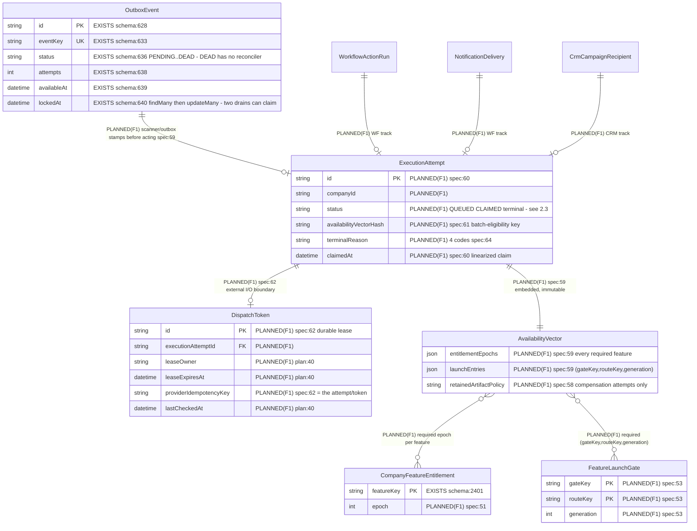
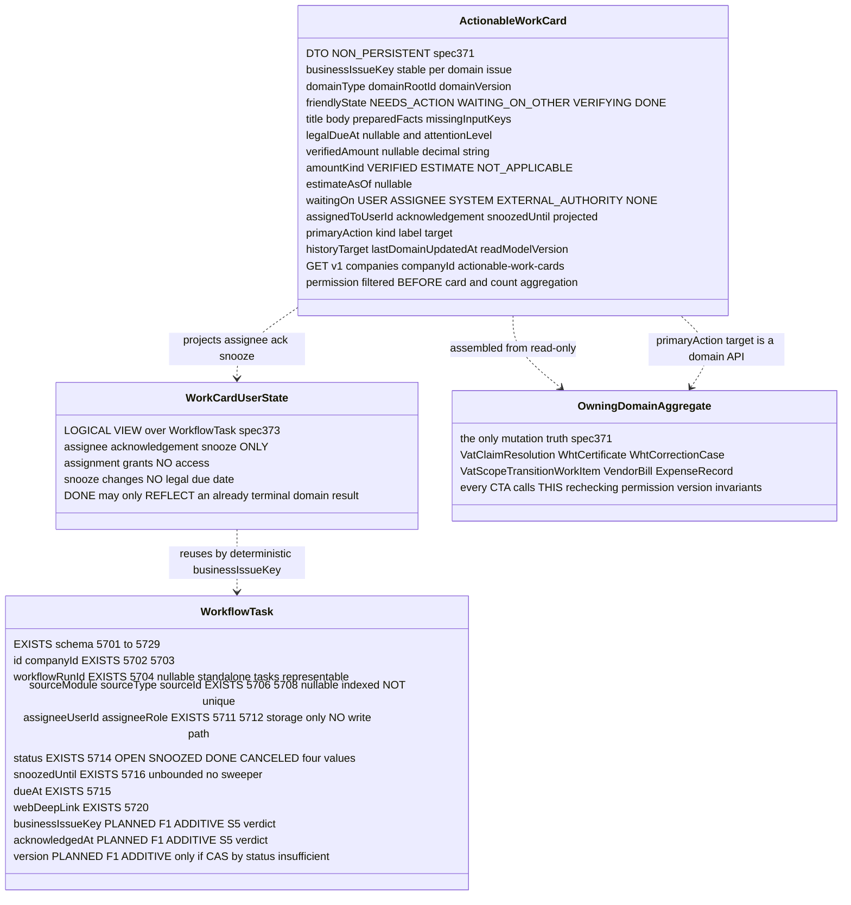

# Derived Views — feature-entitlement decoupling (F0.C)

> ## NON-NORMATIVE — DERIVED VIEWS ONLY
>
> **The normative rows live in the spec and the two matrices.** This file is a rendering of them for
> architects, implementers, reviewers and support.
>
> - Where this file and a normative row disagree, **the row wins**.
> - This file **cannot broaden any permission, entitlement, launch route or runoff policy**. If a reading here
>   would allow more than the row it cites, the row is correct and this file is wrong.
> - Nothing here is a decision. Anything that looked like a genuine contradiction while assembling this file is
>   recorded verbatim in **§5 Discrepancies for owner** and is *not* resolved here.
> - Every entity, state, term and invariant carries a link back to its exact normative source (`spec:NNN` =
>   `docs/specs/feature-entitlement-decoupling-spec.md` line NNN; `plan:NNN` = the plan; `runoff:…` / `launch:…`
>   = the matrices; `schema:NNN` = `apps/api/prisma/schema.prisma`).

Generated **2026-07-31** · repo HEAD `8f369e4996c0c50738135cdc0b4cad26849920a2` (branch `develop`) · lane **F0.C** · status **DRAFT-FOR-F0-EXIT**

**Deliverable for** Spec §6.3 line 326 ("F0 also produces derived, non-normative ERD/aggregate-boundary views,
state-transition tables, a Thai/English glossary and invariant→test-id map for CC1 plus each affected aggregate.
Those views link back to the exact normative row and cannot broaden it.") and Plan §3 F0 line 31.
Counts toward AC29 (spec:452).

**Normative sources**

| Source | Path | Used for |
|---|---|---|
| Spec (sole normative source, spec:7) | `docs/specs/feature-entitlement-decoupling-spec.md` | §5 CC1–CC7 (47-238), §6 (239-326), §8 FR, §9, §10 AC |
| Plan | `docs/plans/feature-entitlement-decoupling-plan.md` | F1 planned models (33-45), §7 verification |
| RUNOFF_MATRIX | `docs/specs/feature-entitlement-runoff-matrix.md` + `.json` | 743 rows, key `(featureKey, surfaceKind, surfaceId)` |
| FEATURE_LAUNCH_MATRIX | `docs/specs/feature-entitlement-launch-matrix.md` + `.json` | 22 rows, key `(gateKey, routeKey)` |
| Launch-control runbook | `docs/runbooks/feature-launch-control.md` | health-view field/state names, TBD-F1 seam register, OPEN items |
| `WorkflowTask` reuse survey | `docs/agent-memory/f0-workflowtask-reuse-survey.md` | S5 verdicts, real enum, additive-field candidates |

**Legend used throughout**

| Marker | Meaning |
|---|---|
| `EXISTS(file:line)` | Present in the codebase today at that exact location |
| `PLANNED(F1)` | Named by Spec CC1–CC7 / Plan F1; **no schema, no code, no test exists** |
| `PLANNED(FIN)` / `PLANNED(track)` | Named by Spec; owned by an implementation workstream after F1 |
| `DTO` | Non-persistent read contract — never a table, never domain truth (spec:371, spec:407) |
| `CAS` | CAS / expected-version / generation field — a concurrency fence, not data |
| `INTERNAL` | Internal-only. Never rendered to a customer, partner, tenant user or AI surface (spec:53, spec:55) |

---

## 1. ERD / aggregate-boundary views

Three planes. They are drawn separately because they have **different owners and different mutation authorities**;
drawing them as one graph is what produces the mistake of letting a work card write domain truth.

### 1.1 Plane A — entitlement and launch control plane

Two distinct object families live here and they are **not the same state machine** (runbook §0.1 R-a):
a *tenant* entitlement lifecycle (`ON | DRAINING | OFF`, per company × feature) and a *global* launch gate
(`OPEN | CLOSED`, per `(gateKey, routeKey)`, one row set per environment, runbook §0).

```mermaid
erDiagram
    Company ||--o{ CompanyFeatureEntitlement : "has (EXISTS schema:291)"
    Company ||--o| CompanyEntitlementSet : "PLANNED(F1) batch-CAS root"
    Company ||--o{ EntitlementCommand : "PLANNED(F1) whole-set idempotency"
    CompanyFeatureEntitlement ||--o{ EntitlementTransition : "PLANNED(F1) append-only child"
    CompanyEntitlementSet ||--o{ EntitlementTransition : "PLANNED(F1) written in one txn"
    Company ||--o| CompanyEntitlementNormalization : "PLANNED(F1) CC7, separate state"
    CompanyFeatureEntitlement ||--o{ RunoffSnapshot : "PLANNED(F1) frozen at cutoff"
    FeatureLaunchGate ||--o{ FeatureLaunchGateTransition : "PLANNED(F1) append-only child"
    FeatureLaunchGateTransition ||--|| ControlPlaneSnapshot : "PLANNED(F1) immutable, embedded"

    CompanyFeatureEntitlement {
        string id PK "EXISTS schema:2399"
        string companyId FK "EXISTS schema:2400"
        string featureKey "EXISTS schema:2401"
        boolean enabled "EXISTS schema:2402 - only 2 states today"
        string updatedBySystemAdminUserId "EXISTS schema:2403"
        datetime updatedAt "EXISTS schema:2405 - NOT a fence, re-stamped by any toggle"
        int epoch "PLANNED(F1) spec:51 CAS-key"
        int lastSeq "PLANNED(F1) spec:51 CAS-key"
        string grantOrigin "PLANNED(F2) spec:236 LEGACY grandfather marker"
    }
    CompanyEntitlementSet {
        string companyId PK "PLANNED(F1) spec:51"
        int setVersion "PLANNED(F1) spec:51 CAS-key, +1 per successful command"
        datetime lastTransitionAt "PLANNED(F1) spec:51"
    }
    EntitlementCommand {
        string companyId PK "PLANNED(F1) spec:51"
        string commandId PK "PLANNED(F1) spec:51 unique companyId+commandId"
        string payloadFingerprint "PLANNED(F1) spec:51 reuse-with-other-payload rejects"
        int expectedSetVersion "PLANNED(F1) spec:51 CAS-input"
        int resultSetVersion "PLANNED(F1) spec:51"
        json resultJson "PLANNED(F1) spec:51 replayed before CAS"
    }
    EntitlementTransition {
        string companyId PK "PLANNED(F1) spec:51"
        string featureKey PK "PLANNED(F1) spec:51"
        int seq PK "PLANNED(F1) unique companyId+featureKey+seq"
        int epoch "PLANNED(F1) spec:51"
        string commandId "PLANNED(F1) unique companyId+featureKey+commandId"
        string action "PLANNED(F1) ENABLE DISABLE_REQUESTED OFF"
        string actorUserId "PLANNED(F1) or SYSTEM"
        json reasonJson "PLANNED(F1)"
    }
    RunoffSnapshot {
        string companyId PK "PLANNED(F1) spec:57"
        string featureKey PK "PLANNED(F1) spec:57"
        datetime cutoffAt "PLANNED(F1) spec:57 immutable"
        json preCutoffRoots "PLANNED(F1) spec:57 membership NEVER widens"
    }
    CompanyEntitlementNormalization {
        string companyId PK "PLANNED(F2) spec:234"
        string status "PLANNED(F2) EXPLICIT only when COMPLETED"
        string snapshotHash "PLANNED(F2) spec:235 revalidated under lock"
        string runId "PLANNED(F2) spec:234"
        string error "PLANNED(F2) spec:234"
    }
    FeatureLaunchGate {
        string gateKey PK "PLANNED(F1) spec:53 INTERNAL-ONLY"
        string routeKey PK "PLANNED(F1) spec:53 separate validated field spec:275"
        string state "PLANNED(F1) OPEN or CLOSED only"
        int generation "PLANNED(F1) spec:53 CAS-key, this row only"
        int lastSeq "PLANNED(F1) spec:53"
        string reason "PLANNED(F1) free text - NEVER authoritative spec:54"
    }
    FeatureLaunchGateTransition {
        string gateKey PK "PLANNED(F1) spec:53"
        string routeKey PK "PLANNED(F1) spec:53"
        int seq PK "PLANNED(F1) unique gateKey+routeKey+seq"
        int generation "PLANNED(F1) spec:53"
        string commandId "PLANNED(F1) unique gateKey+routeKey+commandId"
        string action "PLANNED(F1) OPEN or CLOSE"
        string payloadFingerprint "PLANNED(F1) spec:53"
    }
    ControlPlaneSnapshot {
        string targetEnvironment "PLANNED(F1) spec:54 required"
        string buildReleaseId "PLANNED(F1) spec:54 required immutable"
        int expectedGeneration "PLANNED(F1) spec:54 CAS-input"
        string routeClass "PLANNED(F1) ORDINARY or SPECIALIST_LEGAL"
        string validationEvidenceRef "PLANNED(F1) required iff SPECIALIST_LEGAL"
        string validationEvidenceHash "PLANNED(F1) required iff SPECIALIST_LEGAL"
        string specialistApprovedByUserId "PLANNED(F1) required iff SPECIALIST_LEGAL OPEN"
        string releaseApprovedByUserId "PLANNED(F1) required on normal OPEN and CLOSE"
        boolean emergencyClose "PLANNED(F1) true forbids OPEN"
        string emergencyAuthorityUserId "PLANNED(F1) required iff emergencyClose"
        string incidentRef "PLANNED(F1) required iff emergencyClose"
    }
```

**Ownership boundaries — who may mutate what** (derived; each cell cites its row)

| Object | Sole mutation authority | Explicitly denied | Normative row |
|---|---|---|---|
| `CompanyFeatureEntitlement` + `EntitlementTransition` + `CompanyEntitlementSet` | partner/commercial entitlement command (system-partner-management) and the CC7 SYSTEM bootstrap | anything else; no per-feature partial write outside the whole-set command | spec:51-52, spec:235 |
| `RunoffSnapshot` | written once inside the disable transaction | any later widening, by anyone, including a reconciler | spec:57, spec:66 |
| `FeatureLaunchGate` + transitions (INTERNAL) | internal control-plane command only; RO executes, TS co-approves SPECIALIST_LEGAL, OC may only emergency CLOSE | customer, partner, tenant user, AI/agent — all four named | spec:53, spec:55, runbook §1 |
| `ControlPlaneSnapshot` | written with the transition, immutable thereafter | reconstruction from logs or `reason` | spec:54 |
| `CompanyEntitlementNormalization` | CC7 bootstrap run only; separate from feature transitions | a stale normalization overwriting a concurrent partner change | spec:234-235 |

**CAS / fence fields** (CAS) — `CompanyEntitlementSet.setVersion`, per-feature `epoch` + `lastSeq`,
`FeatureLaunchGate.generation` + `lastSeq`, `EntitlementCommand.expectedSetVersion`,
`ControlPlaneSnapshot.expectedGeneration`, and every `(companyId, commandId)` / `(gateKey, routeKey, commandId)`
uniqueness pair. `CompanyFeatureEntitlement.updatedAt` **EXISTS but is not a fence** — it is re-stamped by any later
toggle (runbook §2.4, `expense-auto-post.use-case.ts:107-108`).

**Canonical lock order** (spec:60): tenant-local company entitlement rows sorted by feature key, **then** global
launch-gate rows sorted by `(gateKey, routeKey)`. Gate *claims* take the shared side; gate OPEN/CLOSE takes the
exclusive side, so many tenants do not serialize on one global gate.

### 1.2 Plane B — work-stamping plane

Every queued / outbound / final-mutation row created after rollout carries an **availability vector**: every required
entitlement epoch **and** every required `(gateKey, routeKey, generation)` entry — not only its owning feature (spec:59).

Boundary rules this diagram encodes (do not read more into it):

1. The vector is **stamped at creation and never mutated** — no back-stamping, even pre-first-close (spec:63).
2. The **final guard is uncached and per durable attempt** (spec:60-61). Request/job memoization is planning-only
   (spec:60, spec:334).
3. A **DB final mutation commits inside the claim transaction**; **external I/O never holds a DB lock across the
   network** and uses the durable token as its linearization boundary instead (spec:60, spec:62).
4. `OutboxEvent` is the only EXISTS row here. Known measurement caveats (runbook §2.4): appends are mostly
   fire-and-forget `void this.outbox.append(...)` outside the caller's transaction; the claim is `findMany` +
   separate `updateMany` (`prisma-outbox.repository.ts:46-71`), so two drains can claim the same rows; `DEAD` has
   no reconciler, handler or alert (T14 / OPEN-5).
5. The 63 async surfaces inventoried in S3 include **60 with no entitlement check today**
   (`docs/agent-memory/f0-inventory-async-surface.md`) — that is the size of the stamping job, not a design choice.

### 1.3 Plane C — work-card plane

`ActionableWorkCard` is a **DTO**. It is computed, permission-filtered, rebuildable, and is *never* filing, payment,
certificate, correction, VAT-position or workflow truth (spec:371, spec:407). There is deliberately **no generic
"complete card" mutation** (spec:371, plan:165).

Field-by-field DTO contract (authoritative reading of spec:372, kept out of the diagram so nothing is lost to
diagram syntax): `businessIssueKey`; `domainType`, `domainRootId`, `domainVersion`;
`friendlyState = NEEDS_ACTION | WAITING_ON_OTHER | VERIFYING | DONE`; localized `title`, `body`, `preparedFacts`,
`missingInputKeys`; `legalDueAt` nullable and `attentionLevel`; `verifiedAmount` nullable,
`amountKind = VERIFIED | ESTIMATE | NOT_APPLICABLE`, `estimateAsOf` nullable;
`waitingOn = USER | ASSIGNEE | SYSTEM | EXTERNAL_AUTHORITY | NONE`; projected `assignedToUserId`, acknowledgement and
`snoozedUntil`; `primaryAction { kind, label, target }` nullable only when no authorized action is available;
`historyTarget`; `lastDomainUpdatedAt`; `readModelVersion`. List order after permission filtering: overdue → nearest
legal deadline → blocking attention → larger verified amount → oldest domain update → stable `businessIssueKey`; the
badge counts only permitted `NEEDS_ACTION` cards whose snooze has not validly deferred routine attention (spec:372).

**S5 survey verdicts carried into this view** (`docs/agent-memory/f0-workflowtask-reuse-survey.md` §8):

| Capability | Verdict | Consequence for this plane |
|---|---|---|
| Deterministic identity | `NEEDS_MINIMAL_ADDITIVE_FIELD` | zero `@@unique` on `WorkflowTask` today (schema:5726-5728); smallest fix `businessIssueKey String?` + `@@unique([companyId, businessIssueKey])` |
| Application idempotency | `NEEDS_MINIMAL_ADDITIVE_FIELD` | must be `upsert` on that key — **never** create→catch-P2002 inside `$transaction` (repo rule) |
| Assignment | `REUSABLE_AS_IS` (storage) | columns + read-side scoping exist and correctly grant no access; **no assignment write path exists at all** |
| Acknowledgement | `NEEDS_MINIMAL_ADDITIVE_FIELD` | smallest fix `acknowledgedAt DateTime?` |
| Snooze | `REUSABLE_AS_IS` (storage) | app layer must bound by `dueAt` and compute an effective status; no sweeper exists today |
| Domain-terminal projection | `UNSAFE` | `POST /tasks/:id/complete` is exactly the forbidden generic completion mutation — the work-card surface must not expose it |
| Concurrency safety | `UNSAFE`, fixable without schema | all three mutations are unguarded read-then-write; `updateTask` omits `companyId` from `where` |

---

## 2. State-transition tables

One table per state machine. `Guard` = what must be true; `Actor` = who may cause it; `Ref` = the exact normative row.
**No state below is invented**: where the Spec names no state for a transition, the cell says so.

### 2.1 Launch-gate row — `FeatureLaunchGate.state` (INTERNAL) (PLANNED F1)

Per `(gateKey, routeKey)`, one row set per environment. `state ∈ {CLOSED, OPEN}` only — never `ON/DRAINING/OFF`
(runbook §0.1 R-a).

| From | To | Action | Generation | Guard | Actor | Ref |
|---|---|---|---|---|---|---|
| — | CLOSED | seed | `0` | every SPECIALIST_LEGAL row seeds CLOSED; ordinary already-live rows may seed OPEN only from proven current behaviour | deploy (F1 G2.1) | spec:398, launch:§1 |
| CLOSED | OPEN | `OPEN` (normal) | **+1, this row only** | matrix row `RESOLVED`; `targetEnvironment` + `buildReleaseId` + `expectedGeneration` match; `emergencyClose=false`; `releaseApprovedByUserId` present; sibling state irrelevant | RO | spec:54, runbook §4.1 |
| CLOSED | OPEN | `OPEN` (specialist/legal) | **+1, this row only** | all of the above **plus** `validationEvidenceRef` + `validationEvidenceHash` equal to the *current* matrix values, plus `specialistApprovedByUserId` | RO executes, TS approves | spec:54-55, runbook §4.2 |
| OPEN | CLOSED | `CLOSE` (normal) | **+1, this row only** | environment/build/expected generation recorded + release authority under the ordinary command policy | RO | spec:54, runbook §4.3 |
| OPEN | CLOSED | `CLOSE` (emergency) | **+1, this row only** | `emergencyClose=true` + `emergencyAuthorityUserId` + `incidentRef`; release/specialist approval **may be omitted** so shutdown is not delayed | OC alone | spec:54-55 |
| any | (unchanged) | replayed command | unchanged | same `commandId` + same fingerprint + same action returns the **original result** | any authorized | spec:53 |
| any | **rejected** | key reuse | unchanged | same `commandId` with a different payload **or** a different action rejects | — | spec:53 |
| any | **rejected** | stale CAS | unchanged | a delayed distinct command with a stale `expectedGeneration` cannot reopen or close the row | — | spec:53 |
| CLOSED | **forbidden** | `OPEN` on an emergency snapshot | — | `emergencyClose=true` forbids `action=OPEN` on that command | — | spec:54 |
| CLOSED | OPEN | reopen | +1 | a reopen **is** a normal OPEN against the *current* build/environment/evidence/generation; an old approval never reopens a new generation | RO (+TS) | spec:55, runbook §4.4 |

Invariants that are not transitions: an OPEN sibling never authorizes another route (spec:53); a row with
`matrixRowStatus=BLOCKED` must never be OPEN (runbook §2.1); a feature is executable only when its entitlement
lifecycle permits **and** every exact route the action needs is OPEN (spec:53).

### 2.2 Feature lifecycle — `ON | DRAINING | OFF` (PLANNED F1, per company × feature)

`DRAINING` is **derived**, never a stored free state: latest `DISABLE_REQUESTED` + open items in the immutable
runoff snapshot (spec:66). Transition actions are `EntitlementTransition.action ∈ {ENABLE, DISABLE_REQUESTED, OFF}`
(spec:51).

| From | To | Action | Epoch | Guard | Actor | Ref |
|---|---|---|---|---|---|---|
| OFF (or absent) | ON | `ENABLE` | **+1** (real non-`ON`→`ON`) | whole-set lock/CAS in canonical feature-key order; proposed final set validates; command + result + all child transitions atomic | partner command / SYSTEM bootstrap | spec:51-52 |
| ON | DRAINING | `DISABLE_REQUESTED` | **unchanged** | in the same transaction: reject new interactive root mutations + external sends, record cutoff, write `RunoffSnapshot` of only pre-cutoff roots the approved matrix allows | partner command | spec:51, spec:57 |
| DRAINING | ON | `ENABLE` (cancel/resume) | **+1 — new epoch required** | returning with the pre-disable epoch is **forbidden** | partner command | spec:51 |
| DRAINING | OFF | `OFF` | unchanged | all snapshot items closed; completion **appends** OFF | system (completion) or reconciler repair | spec:66 |
| DRAINING | DRAINING | reconciler pass | unchanged | repairs missed completion events, alerts on age; **does not widen snapshot membership** | runoff reconciler | spec:66 |
| OFF | OFF | retained-artifact compensation | unchanged (fresh attempt vector) | exact pre-cutoff legal artifact; only provenance-linked credit/void/correct/replacement/external-handoff; **cannot create an ordinary new commercial root**; not held open in DRAINING | narrow retained permission | spec:58 |
| any | (unchanged) | idempotent retry | **unchanged** | `commandId` dedup; stale expected state conflicts and is safely retried; never split-brain | — | spec:51, spec:56 |
| ON | ON | disable of a *dependency* | unchanged | a dependency may be disabled while its owner stays on (test named at spec:67) | partner command | spec:67 |

Cascade: disabling a parent with active structural children returns **one truthful impact preview** and a **one-click
explicit atomic cascade**; it never silently strands or disables a child. Concurrent parent-disable/child-enable has
one winner; the loser safely refreshes the preview (spec:52).

### 2.3 `ExecutionAttempt` and its dispatch token (PLANNED F1)

NOTE: Spec CC1 names the *claim* states and the *terminal* reasons but **does not name a success terminal**, and it
describes `DISPATCHING` as a **token/lease**, not as an attempt status (spec:60, spec:62; Plan F1 line 34 lists
"`ExecutionAttempt`/dispatch tokens" as two things; runbook T7/T8 register them as two seams). The split below is a
derived reading — see **§5 D-2**.

**Attempt**

| From | To | Guard | Actor | Ref |
|---|---|---|---|---|
| — | QUEUED | durable work row created **with** its availability vector (every required epoch + every `(gateKey,routeKey,generation)`) | owning domain / scanner / outbox stamping | spec:59 |
| QUEUED | CLAIMED | canonical lock protocol (entitlement rows by feature key → gate rows by `(gateKey,routeKey)`; gate side = shared/conditional-CAS); **uncached** read; every epoch matches; every stamped gate OPEN at the same generation; claim recorded | claimant worker | spec:60 |
| QUEUED | `SUPPRESSED_FEATURE_DISABLED` / `SKIPPED_FEATURE_DISABLED` | entitlement epoch mismatch / feature disabled at claim | claimant | spec:64 |
| QUEUED | `SUPPRESSED_LAUNCH_GATE_CLOSED` / `SKIPPED_LAUNCH_GATE_CLOSED` | required gate CLOSED or generation mismatch at claim | claimant | spec:64 |
| QUEUED | explicit handoff | the row's `FEATURE_LAUNCH_MATRIX` close-time treatment says handoff rather than terminal | matrix policy | spec:64-65 |
| CLAIMED | committed DB final mutation | the mutation commits **in the same transaction as the claim** | claimant | spec:60 |
| CLAIMED | dispatch (external) | a durable `DISPATCHING` token/lease is committed first; no DB lock is held across the network | claimant | spec:62 |
| CLAIMED | `UNKNOWN_EXTERNAL_OUTCOME` | crash/timeout **after** dispatch with no authoritative provider result | system | spec:62 |
| terminal | terminal | reopen / re-enable | **never revives** — Resume/Reissue creates a *new* row under the current vector | — | spec:64 |
| NULL-stamped (pre-ship) | terminal / handoff / approved Reissue | fixed cutover cutoff; default terminal-or-handoff; only an enumerated safe internal projection or an approved Reissue proceeds; **never back-stamp** | RO decides, domain executes | spec:63, runbook §4.6 |

**Dispatch token / lease**

| From | To | Guard | Ref |
|---|---|---|---|
| — | committed token | claim held; token doubles as the **provider idempotency key** wherever supported | spec:62 |
| committed, provider not yet called | prevented | a close/disable prevents any **new** token | spec:62 |
| committed, provider called | explicitly **in flight** | cannot be unsent; matrix policy decides bounded wait vs. record/handoff as already dispatched; the worker records the eventual result **once**; **no retry under a closed/mismatched generation** | spec:62 |
| lease expired **before** provider invocation | resume same attempt/token under the **current** guard | plan:40 | plan:40 |
| ambiguous timeout **after** invocation | `UNKNOWN_EXTERNAL_OUTCOME` | poll the provider **or** require one prefilled manual reconciliation; **never blind-retry or claim failure/success** | spec:62, plan:40 |
| `UNKNOWN_EXTERNAL_OUTCOME` | recorded terminal result | provider poll answers, or a human records the actual outcome once; **never mint a second attempt to "check"** | spec:62, runbook §4.7 |
| poison / retries exhausted | one support-visible reconciliation item | never blind-retries | plan:40 |

UI/preview must report **both** in-flight and unknown-outcome counts (spec:62). Batch claim is forbidden until F0
capacity evidence passes; any later bounded batch is one company + one identical complete vector hash, one persisted
claim **and** token per item in the same linearized transaction, with a cap that keeps CLOSE bounded, and a guard is
never reused across transaction, company, vector, build or generation (spec:61).

### 2.4 `BackfillRun` / `BackfillRunItem` (PLANNED F1, CC3)

| Object | From | To | Guard | Actor | Ref |
|---|---|---|---|---|---|
| Run | — | `AUTHORIZED` | the **feature-enable command itself** is the authorization (`confirmationSource=FEATURE_ENABLE`); it snapshots actor, policy/rule/config versions and authorization fingerprint. **No second migration confirmation** | user's one click **เปิดใช้งานและเตรียมข้อมูล** | spec:80 |
| Run | `AUTHORIZED` | `MATERIALIZED` / `RUNNING` | **only after** the fixed-scope immutable item manifest is complete (source identity/version, company, authorized source types/cutoff, per-source counts, item-set hash, actor, status, checkpoints, error summary) | readiness | spec:81 |
| Run | `RUNNING` | resumed | adapters resume from item checkpoints | adapters | spec:82 |
| Run | (new linked run) | inherits the same authorization | a repair run for a **proven scanner omission inside the exact authorization** inherits it and shows an audit delta with no user action; it **never mutates the frozen manifest** | system | spec:83 |
| Run | (new authorization) | requires new confirmation | only when the customer **deliberately expands** historical/cutover/source scope, or approves a closed/external adjustment/review exception; the UI shows the prefilled delta | user | spec:83 |
| Item | pending | `SKIPPED` | already posted → **idempotent** skip | revalidation | spec:82 |
| Item | pending | `NEEDS_REVIEW` | source changed or invalid; **no item is silently replaced** | revalidation | spec:82 |
| Item | pending | applied | idempotent via `findGeneratedJournal` + source uniqueness; **never rewrites a closed period** | adapter | spec:84 |
| Item | pending | current-open adjustment preview/task | closed/external row | adapter | spec:84 |

Documents dated **after** the cutoff use the normal flow and never enter the run (spec:82). Review rows land in one
consolidated queue (spec:84). NOTE: Spec CC3 names `AUTHORIZED`, `MATERIALIZED`/`RUNNING`, `SKIPPED` and `NEEDS_REVIEW`
but **no completion or failure state name** — see **§5 D-3**.

### 2.5 `CompanyEntitlementNormalization` (PLANNED F2, CC7)

| From | To | Guard | Actor | Ref |
|---|---|---|---|---|
| — | started (`startedAt` set) | dry-run effective-state diff + `snapshotHash` computed | CC7 run | spec:235 |
| started | `COMPLETED` | lock the company entitlement set (or expected-version CAS) → **recompute and require the same hash** → one retry-idempotent SYSTEM bootstrap command increments `setVersion` **once**, materializes every deterministic effective row (`grantOrigin=LEGACY`, valid initial epoch/last-seq, append-only audit transitions) → mark COMPLETED **in the same company transaction** | SYSTEM bootstrap | spec:235 |
| started | conflict → retry | a concurrent partner change conflicts; a **stale normalization never overwrites it** | — | spec:235 |
| `COMPLETED` | `COMPLETED` (no-op) | an already-matching bootstrap returns its **stored result** | — | spec:235 |
| any | (error recorded) | `error` column exists on the row; **CC7 names no failure state** — see §5 D-4 | — | spec:234 |

Cohort semantics: a company is **EXPLICIT only when status is COMPLETED**; the resolver uses legacy **or** explicit
semantics **for the entire company, never per feature** (spec:234-235). `expense_auto_post` becomes ON only with
execution evidence (spec:235). `grantOrigin=LEGACY` is a durable grandfather marker with **no time-based expiry**
(spec:236). Rollout clock: deploy day 0 → fix-forward remaining failures by day 14 → **seven consecutive zero days**
→ only then one PR removes API and web legacy semantics **together** (spec:237).

### 2.6 `WorkflowTask.status` — the real 4-value enum (EXISTS)

`schema:5526-5531`, mirrored at `packages/contracts/src/workflow.ts:35`. Plan line 24 and spec:373 both write the
three-value form `OPEN|SNOOZED|DONE` — see **§5 D-1**.

| From | To | Trigger today | Guard today | Concurrency today | Ref |
|---|---|---|---|---|---|
| — | `OPEN` | `createTask` (always forces `OPEN`) | `findTaskByActionRunId` check-then-create — TOCTOU, **no DB constraint backing it** | duplicate creation possible | repo `prisma-workflow.repository.ts:379-380`, S5 §2 |
| `OPEN` | `SNOOZED` | `POST .../tasks/:taskId/snooze` | **no bound against `dueAt`** — raw request value is written | read-then-write, no txn/CAS/version | S5 §5.3, §6 |
| `SNOOZED` | (never auto-returns) | — | **no sweeper, no effective-status computation** — a SNOOZED task leaves the `status:'OPEN'` list permanently | — | S5 §5.3 |
| `OPEN`/`SNOOZED` | `DONE` | `POST .../tasks/:taskId/complete` | **user-asserted; no domain-terminality check** | read-then-write, last write wins | S5 §5.4 |
| `OPEN`/`SNOOZED` | `CANCELED` | `POST .../tasks/:taskId/cancel` | `cancelReason` free text | same race | S5 §2 |
| any | (deleted) | **no delete site exists anywhere in `apps/api/src`** | rows disappear only via `Company` cascade (schema:5723) | — | S5 §2 |

**Required work-card behaviour that today's machine does not provide** (spec:373, plan:165-166): `DONE` may only
*reflect* an already-terminal domain result; the work-card surface must not expose the generic completion route;
snooze must be bounded by the legal due date and must lapse back into view; assignment and acknowledgement never
grant access or complete the domain.

NOTE: Cross-feature side effect to carry into F1: `delete-expense.use-case.ts:66-76` blocks expense deletion when **any**
`WorkflowTask` matches `sourceType:'expense_record'` — **with no status filter**. Writing work-card tasks against
expenses will newly block expense deletion (S5 §5.6).

### 2.7 Runoff policy states (RUNOFF_MATRIX §2, lines 30-41)

Not a lifecycle — a **per-surface policy assignment** applied at disable. 743 rows keyed `(featureKey, surfaceKind,
surfaceId)`. Fallback copy never contains a gate key, route key or generation (runoff:41, spec:273).

| Policy | Meaning on disable | Resume path | Customer-facing Thai fallback |
|---|---|---|---|
| `ALLOWED_WHILE_OFF` | surface keeps working, including for facts captured after disable | `NONE` | — (no message) |
| `VISIBLE_SNAPSHOT_ONLY` | pre-disable data stays readable; no new work of any kind | `RESUME` | ดูข้อมูลเดิมได้ แต่เพิ่มรายการใหม่ไม่ได้ |
| `BLOCK_NEW_ROOT` | new commercial roots refused (403 `feature_not_enabled`); snapshotted roots unaffected | `RESUME` | ยังไม่ได้เปิดฟีเจอร์นี้ สร้างรายการใหม่ไม่ได้ |
| `PRE_CUTOFF_RUNOFF_ONLY` | allowed only for a root **inside the disable-time snapshot**, as the child/compensation §6.3 names | `RESUME` | ทำต่อได้เฉพาะรายการเดิมที่ค้างอยู่ |
| `STOP_IMMEDIATELY` | external send / AI action stops at once; due retries become terminal; hand off to staff | `REISSUE` | ตอนนี้ยังส่งข้อความหาลูกค้าไม่ได้ *(AI surfaces: ผู้ช่วย AI ยังใช้ส่วนนี้ไม่ได้)* |
| `SKIP_SUPPRESS` | execution skipped/suppressed; evidence retained as skipped, **never replayed automatically** | `NONE` | ระบบจะข้ามการแจ้งเตือนนี้ไว้ก่อน |
| `PLATFORM_EXEMPT` | platform invariant / security / self-service; no commercial toggle reaches it | `NONE` | — (no message) |
| `BLOCKED` | §6.3 does not cover this row. **Route stays CLOSED, disable is preflight-blocked**, an evidence owner is named | `BLOCKED` | ยังไม่ได้เปิดฟีเจอร์นี้ NOTE: see §5 D-5 |

---

## 3. Thai / English glossary

Three columns as required: **term (EN)** · **Thai customer-facing wording** (or `internal-only — never shown`) ·
**meaning + normative ref**. Everything marked INTERNAL-ONLY is internal-only. Spec §6.1 line 273, CC1 line 53 and FR-D line 369
all state it directly: customers, partners, tenant users and AI never see gate keys, route keys, generations, CAS,
epochs or projection terminology.

### 3.1 Commercial / entitlement vocabulary

| Term (EN) | Thai customer-facing wording | Meaning + normative ref |
|---|---|---|
| Feature entitlement | **สิทธิ์ใช้งานฟีเจอร์** | What the company purchased. Distinct from *permission* (tenant/user authorization). spec:331 |
| Feature not enabled (error) | **ยังไม่ได้เปิดฟีเจอร์นี้** | `assertFeatureEnabled` → HTTP **403** `{code:'feature_not_enabled', featureKey}`. Feature absence is **never** a 400. spec:330-332 |
| Purchased but temporarily unavailable | *(copy not yet written — runbook OPEN-9)* | A CLOSED launch route. UX must say the purchased capability is **temporarily unavailable**, explicitly **not** "not purchased". spec:65 |
| Enable and prepare data | **เปิดใช้งานและเตรียมข้อมูล** | The single button for enable-later. There is no second migration confirmation. spec:80 |
| Readiness states | **พร้อมใช้** / **กำลังเตรียมข้อมูลเบื้องหลัง** / **ต้องตรวจบางรายการ** | Activation readiness status after a feature is enabled. spec:384 |
| Platform baseline key | *(never a toggle — no wording)* | `employee_access`, `company_settings`: always on for active companies, non-sellable, outside commercial toggles. spec:261-262 |
| Grandfather marker (`grantOrigin=LEGACY`) | INTERNAL-ONLY — never shown | Durable cohort marker preserving an existing company's normalized effective access without charge until its next confirmed renewal. **No time-based expiry.** spec:236 |
| Impact preview / cascade | *(rendered as plain consequences, no key names)* | Truthful preview + one-click explicit atomic cascade before disabling a parent with structural children. spec:52 |

### 3.2 Disable / runoff vocabulary

| Term (EN) | Thai customer-facing wording | Meaning + normative ref |
|---|---|---|
| Runoff | **ทำต่อได้เฉพาะรายการเดิมที่ค้างอยู่** | Finishing only the roots inside the disable-time snapshot, through the child/compensation actions §6.3 names. spec:311-325 |
| Runoff snapshot | INTERNAL-ONLY — never shown | Immutable set of pre-cutoff roots written **in the disable transaction**. Later work cannot join it; membership never widens. spec:57, spec:66 |
| Cutoff | INTERNAL-ONLY (dates may be shown as plain facts) | The instant recorded with the disable request; everything after it is "new work". spec:57 |
| `DRAINING` | INTERNAL-ONLY — never shown | **Derived** lifecycle state: latest `DISABLE_REQUESTED` + open snapshot items. Completion appends `OFF`. Customers see the friendly fallback, not this word. spec:66 |
| Handoff | **ส่งต่อให้พนักงานดำเนินการ** *(staff view/handoff, §6.3 r1)* | Work that stops being automatic and is passed to a human, instead of terminalizing silently. spec:64-65 |
| Resume | *(shown as the ordinary action becoming available again)* | Explicit action that mints a **new** row under the current availability vector. It never revives suppressed work. spec:64, runoff:§2 |
| Reissue | *(shown as an explicit "send again" style action)* | The external/legal counterpart of Resume. **External/legal mutations never auto-resume after reopen.** spec:64-65 |
| Retained-artifact compensation | *(shown only as "correct/cancel this document")* | Narrow post-`OFF` authority over an **exact pre-cutoff legal artifact**: credit/void/correct/replacement/external-handoff only. It can **never** create an ordinary new commercial root. spec:58, spec:311 |
| Suppressed / skipped | **ระบบจะข้ามการแจ้งเตือนนี้ไว้ก่อน** *(notification surfaces)* | Terminal reasons `SUPPRESSED_FEATURE_DISABLED`, `SKIPPED_FEATURE_DISABLED`, `SUPPRESSED_LAUNCH_GATE_CLOSED`, `SKIPPED_LAUNCH_GATE_CLOSED`. Never replayed. spec:64 |
| Customer outbound stopped | **ตอนนี้ยังส่งข้อความหาลูกค้าไม่ได้** | `STOP_IMMEDIATELY` on CRM/LINE outbound. runoff:§2 |
| AI unavailable | **ผู้ช่วย AI ยังใช้ส่วนนี้ไม่ได้** | `STOP_IMMEDIATELY` on AI surfaces. runoff:§2 |
| Read-only history | **ดูข้อมูลเดิมได้ แต่เพิ่มรายการใหม่ไม่ได้** | `VISIBLE_SNAPSHOT_ONLY`. runoff:§2 |
| New roots blocked | **ยังไม่ได้เปิดฟีเจอร์นี้ สร้างรายการใหม่ไม่ได้** | `BLOCK_NEW_ROOT`. runoff:§2 |
| AI orchestrator refusal | **ยังไม่เปิดใช้งาน** | Gateway maps a denial to this friendly Thai copy. plan:118, spec:333 |

### 3.3 Launch-control vocabulary — **all internal-only** (INTERNAL)

Every row here is a contract breach if it reaches a customer, partner, tenant user or AI surface (spec:53, spec:55,
runbook §2.3).

| Term (EN) | Thai customer-facing wording | Meaning + normative ref |
|---|---|---|
| `gateKey` | INTERNAL-ONLY — **never shown** | Sellable feature key or named non-sellable gate namespace (`cap.wht50bis`, …). A **separate validated field** from `routeKey`; `gateKey/routeKey` is documentation shorthand only. spec:53, spec:275 |
| `routeKey` | INTERNAL-ONLY — **never shown** | The exact operational route. `DEFAULT` when no staged route exists. Rollout controls — **never packages, entitlements or customer/partner commercial settings**. spec:53 |
| `generation` | INTERNAL-ONLY — **never shown** | Monotonic fence incremented on every real OPEN↔CLOSED transition of **that row only**. An OPEN sibling never authorizes another route. spec:53 |
| CAS / expected-version | INTERNAL-ONLY — never shown | Compare-and-set concurrency fence (`setVersion`, `epoch`, `lastSeq`, `generation`, `expectedGeneration`). Users see a friendly "ข้อมูลมีการเปลี่ยนแปลง" style refresh, never this word. spec:51-53, spec:376 |
| Epoch | INTERNAL-ONLY — never shown | Per-company-feature fence; +1 on every real non-`ON`→`ON` transition including resume from DRAINING. spec:51 |
| Availability vector | INTERNAL-ONLY — never shown | The stamped set of required entitlement epochs **and** `(gateKey, routeKey, generation)` entries on a work row. spec:59 |
| Route class | INTERNAL-ONLY — never shown | `ORDINARY` \| `SPECIALIST_LEGAL`. The latter needs specialist evidence + approval to OPEN. spec:54 |
| Control-plane snapshot | INTERNAL-ONLY — never shown | The 11 immutable required fields on every gate transition. **No required field may be reconstructed later from logs or `reason`.** spec:54 |
| Emergency CLOSE | INTERNAL-ONLY — never shown | One authorized on-call operator may CLOSE one exact row immediately with `incidentRef` + audit; it forbids OPEN. spec:55 |
| Canary (v5.1 meaning) | INTERNAL-ONLY — never shown | **Environment + immutable build only.** No tenant cohort, no percentage rollout, no per-customer route override. spec:55 |
| `would_block` | INTERNAL-ONLY — never shown | Shadow counter; meaningful pre-flip only. After the enforcement flip any nonzero value means a **missing catalog row**. spec:398, runbook §2.1 |
| Health view | INTERNAL-ONLY — never shown | Read-only, support-safe, **tenant-anonymous** operator view. Cannot call domain mutations. spec:406, runbook §2 |

### 3.4 Work-card vocabulary

| Term (EN) | Thai customer-facing wording | Meaning + normative ref |
|---|---|---|
| Global action hub | **งานที่ต้องทำให้จบ** | The one permission-filtered global surface for business issues. spec:369 |
| Finance section of the hub | **งานบัญชีและภาษีที่ต้องดำเนินการ** | Finance/tax section inside that surface. spec:369 |
| Work card | *(the card itself; the word "card" is not user-facing terminology)* | `ActionableWorkCard` — a **non-persistent, rebuildable** read contract. Never filing, payment, certificate, correction, VAT-position or workflow truth. spec:371 |
| `businessIssueKey` | INTERNAL-ONLY — never shown | Stable key derived from company + canonical domain issue/root identity. Survives source/global entry points, SYSTEM→EXTERNAL fallback, session recovery and copy changes. spec:371 |
| Verified amount | *(shown as the plain amount)* | `amountKind=VERIFIED`; populated **only** from verified domain truth. spec:372 |
| Estimate | **ประมาณการ** (+ as-of date) | `amountKind=ESTIMATE`. Never placed in `verifiedAmount`, never styled or spoken as an exact liability/refund, and **cannot outrank a verified amount** in list order. spec:372 |
| Checking the result | **กำลังตรวจสอบผล** | The card state for `UNKNOWN_EXTERNAL_OUTCOME`: poll or one evidence-backed manual reconciliation, **never resend**. spec:376 |
| Manual external stepper | **ตรวจข้อมูลที่ระบบเตรียมไว้ → ดาวน์โหลดหรือมอบหมาย → ดำเนินการภายนอก → บันทึกเลขรับ/หลักฐาน → เสร็จสิ้น** | The one resumable stepper over the same domain case. Each checkpoint is **domain evidence, not card state**. spec:375 |
| Delegation (accountant) | *(shown as inviting/assigning a company member)* | Authenticated company-member invitation + scoped role + card/task assignment + audited permission-checked packet download. **Anonymous links, public bearer URLs and unauthenticated LINE/file-share tokens are forbidden.** spec:374 |
| `WorkCardUserState` | INTERNAL-ONLY — never shown | Logical assignee/acknowledgement/snooze view over `WorkflowTask`. Assignment grants no access; snooze changes no legal due date; task state never closes/approves/mutates the domain. spec:373 |
| `readModelVersion` / `domainVersion` | INTERNAL-ONLY — never shown | Staleness/CAS fields on the DTO. spec:372 |

### 3.5 Thai tax / finance vocabulary

| Term (EN) | Thai customer-facing wording | Meaning + normative ref |
|---|---|---|
| Withholding tax certificate (50 ทวิ) | **หนังสือรับรองหัก ณ ที่จ่าย (50 ทวิ)** | Payment-owned legal artifact. Its identity is `(companyId, sourcePaymentType, sourcePaymentId, payeeId)`. spec:200-201 |
| Replacement copy | **ใบแทน** | A **same-content** certified copy. Preserves identity, number and statutory-content hash; **no statutory re-key**. SYSTEM `ใบแทน` needs OPEN `cap.wht50bis/SYSTEM_REPLACEMENT_COPY`; otherwise an external replacement-copy handoff. spec:202, spec:299 |
| External certificate required | **ระบบจะออกหนังสือรับรองหัก ณ ที่จ่ายให้ภายนอก แล้วแนบเข้ามาได้** | `EXTERNAL_CERTIFICATE_REQUIRED` handoff when the SYSTEM route is CLOSED. Payment still settles. spec:293, launch:§3.1 |
| `RECORDED_EXTERNAL` | **ระบบไม่ได้ยื่นหรือยืนยันการรับแบบ** | The system recorded what a **human** filed externally. It is **submission evidence only** — it never closes the return branch and never claims RD acceptance. spec:223, spec:301 |
| Manual filing packet ready | **ระบบเตรียมเอกสารให้ครบ แล้วยื่นกับสรรพากรเองได้เลย** | CLOSED `cap.thai_tax.external_filing_correction/*` fallback. launch:§3.1 |
| Authority completion | *(shown as "สรรพากรยืนยันแล้ว" style status, not the enum)* | Only an exact-revision, route-policy-allowed `WhtCorrectionAuthorityOutcome` with `terminalEffect=COMPLETE_RETURN_BRANCH` closes the return branch (ป.ป.01/ป.ป.02 → `DATABASE_UPDATE_VERIFIED`; e-filing → `EFILING_ACCEPTED_VERIFIED`). spec:219-221 |
| Data-only / wrong-form correction | **ป.ป.01** / **ป.ป.02** | Filed-return correction routes. spec:211 |
| Refund claim | **ค.10** | Refund route; never auto-filed until claimant rights + current RD capability are confirmed. spec:211, spec:224 |
| VAT registration answer | **จดทะเบียนแล้ว / ไม่ได้จดทะเบียน / ไม่แน่ใจ** | Three options. **"ไม่แน่ใจ" preserves `UNKNOWN`** and guides ภ.พ.20 checking or accountant assignment — it never defaults to false. spec:377 |
| Pending input VAT | **ภาษีซื้อ-ยังไม่ถึงกำหนด** (1155-00) | `INPUT_VAT_PENDING`. Only **unresolved** VAT enters it; it never contributes to ภ.พ.30. spec:91, spec:99 |
| Claimable input VAT | **ภาษีซื้อ** (1154-00) | `INPUT_VAT_CLAIMABLE`. spec:90 |
| VAT refund receivable | **ลูกหนี้-กรมสรรพากร** (1156-00) | `VAT_REFUND_RECEIVABLE`, **net period credit/refund only**. spec:92 |
| Gross output VAT | **ภาษีขาย** (2135-00) | `OUTPUT_VAT_PAYABLE` — the **gross control**, explicitly **not** the net Revenue Department liability. spec:93 |
| Net VAT payable | **เจ้าหนี้กรมสรรพากร** (2137-00) | `VAT_SETTLEMENT_PAYABLE`, **net period payable only**. spec:94 |
| System prepared the accounts | **ระบบเตรียมบัญชีให้แล้ว** | One non-blocking notice after the system provisions a missing VAT-control account on a writable custom chart. spec:98 |
| Credit carried forward externally | **ยอดภาษีคงเหลือจะยกไปตามที่บัญชีตกลงกับสรรพากร** | CLOSED `cap.thai_tax.vat_scope_credit_transfer/*` fallback — external-first conserved reconciliation. launch:§3.1 |
| Deferred offset candidate | **เก็บเรื่องนี้ไว้ให้บัญชีตรวจก่อน ยังไม่ตัดยอดอัตโนมัติ** | `[LATER] cap.thai_tax.vat_credit_in_product_offset` — CLOSED throughout v5.1, one prefilled **no-mutation** task. launch:§3.1, spec:304 |
| Filing scope | *(shown as สำนักงานใหญ่ / รวมทุกสาขา / รายสาขา — the business meaning)* | `TaxFilingScopeSnapshot`, kinds `HEAD_OFFICE \| CONSOLIDATED \| BRANCH \| CONFIGURED_GROUP`. Owns the authoritative review/file/pay/close lifecycle; `TaxPeriod` is compatibility/derived only. spec:166-167 |
| Cutover | *(shown as "งวดสุดท้ายที่ยื่นเอง")* | Per `(companyId, formType, canonical filingScopeId)`, keyed by the **last externally handled filing period** — not a blanket source-date exclusion. spec:169 |
| `LEGACY_RECONCILED` | INTERNAL-ONLY — never shown | Non-verifying compatibility marker for durable legacy FILED/PAID facts. Never fabricates amounts, evidence or Ledger clearing. spec:167 |
| `LEGACY_UNRESOLVED` | INTERNAL-ONLY — never shown | Retained certificate metadata with **no fabricated artifact**, plus one discoverable task. Never asks for historical re-upload. spec:205 |
| VAT states | *(shown as plain outcomes; enum names never shown)* | `CLAIMABLE \| PARTIALLY_RECOVERABLE \| NON_RECOVERABLE_CONFIRMED \| EXTERNAL_OR_UNRESOLVED \| NOT_APPLICABLE`. spec:99 |
| Ordinary delayed-claim last month vs outer review date | *(shown as two plain dates)* | `ordinaryDelayedClaimLastTaxMonth` and `outerReviewDate` are derived **separately**; one ambiguous `claimDeadline` is **forbidden**. spec:162 |

---

## 4. Invariant → test-id map

**Every row is `PLANNED`.** No test in this map exists today; the two spec files that touch these seams
(`feature-gate.logic.spec.ts`, `set-partner-features.use-case.spec.ts`) cover today's fail-open behaviour, not these
invariants. Any row claiming otherwise would be false.

**Test-id conventions used** (verified against the repo):
`<file path> > "<test name>"`, where the file follows
`apps/api/src/modules/<module>/application/use-cases/<name>.use-case.spec.ts` or
`apps/api/src/modules/<module>/domain/logic/<name>.logic.spec.ts`, packages use
`packages/contracts/src/<name>.spec.ts`, workers use `apps/workers/src/modules/<area>/<name>.spec.ts`, and E2E uses
`e2e/<area>.spec.ts`. Structure is `describe('<UseCaseName>') > it('<behaviour>')`.
NOTE: **Every new api spec must be added to the hand-maintained `apps/api` `test` script list or it silently never runs**
(plan:207, AC27).

**Matrix row-key patterns referenced in the last column**

- `LAUNCH[gateKey/routeKey]` — a `FEATURE_LAUNCH_MATRIX` row (JSON keys `gateKey`, `routeKey`).
- `RUNOFF[featureKey · surfaceKind · surfaceId]` — a `RUNOFF_MATRIX` row (JSON keys `featureKey`, `surfaceKind`, `surfaceId`); `policy=` names the `runoffPolicy` value the invariant protects.

### 4.1 CC1 — effective availability, disable lifecycle, generation vector, runoff (spec:49-67)

| Id | Clause (≤1 line, quoted) | Spec | Planned test id | Phase | Protects |
|---|---|---|---|---|---|
| CC1-1 | "`setVersion` increments exactly once per successful multi/single-key entitlement command" | 51 | `…/employee-access/application/use-cases/entitlement-set-command.use-case.spec.ts > "increments setVersion exactly once per successful command"` | F1 | `LAUNCH[*/DEFAULT]` |
| CC1-2 | "same key/fingerprint returns the stored result before CAS" | 51 | same file > `"replays the stored result before CAS for the same commandId and fingerprint"` | F1 | `LAUNCH[*/DEFAULT]` |
| CC1-3 | "key reuse with another payload rejects" | 51 | same file > `"rejects commandId reuse with a different payload fingerprint"` | F1 | `LAUNCH[*/DEFAULT]` |
| CC1-4 | "a distinct stale expected-set version changes nothing" | 51 | same file > `"changes nothing when a distinct command carries a stale expectedSetVersion"` | F1 | `LAUNCH[*/DEFAULT]` |
| CC1-5 | `EntitlementTransition` "is unique by `(companyId, featureKey, seq)` and `(companyId, featureKey, commandId)`" | 51 | `…/entitlement-transition.use-case.spec.ts > "enforces both transition uniqueness pairs"` | F1 | `LAUNCH[*/DEFAULT]` |
| CC1-6 | "epoch increments exactly once on every real non-ON→ON transition… not on disable or idempotent retry" | 51 | same file > `"increments epoch once per real resume and never on disable or retry"` | F1 | `LAUNCH[*/DEFAULT]` |
| CC1-7 | "Returning DRAINING→ON with the pre-disable epoch is forbidden" | 51 | same file > `"rejects a DRAINING to ON resume that reuses the pre-disable epoch"` | F1 | `LAUNCH[*/DEFAULT]` |
| CC1-8 | "locks/CASes the complete affected company entitlement set in canonical feature-key order" | 52 | `…/system-partner-management/application/use-cases/partner-dependency-cascade.use-case.spec.ts > "locks the complete affected set in canonical feature-key order"` | F1 | `LAUNCH[*/DEFAULT]` |
| CC1-9 | "one truthful impact preview and a one-click explicit atomic cascade; it never silently strands" | 52 | same file > `"returns an impact preview and cascades atomically instead of stranding a child"` | F1 | `LAUNCH[expense_auto_post/DEFAULT]` |
| CC1-10 | "Concurrent parent-disable/child-enable has one winner and the loser safely refreshes the preview" | 52 | same file > `"resolves concurrent parent disable and child enable to one winner"` | F1 | `LAUNCH[expense_auto_post/DEFAULT]` |
| CC1-11 | "A durable `FeatureLaunchGate` stores `(gateKey, routeKey, state…, generation, lastSeq, reason, updatedAt)`" | 53 | `…/employee-access/application/use-cases/launch-gate.use-case.spec.ts > "persists one durable row per gateKey and routeKey"` | F1 | all 22 `LAUNCH[*]` |
| CC1-12 | transition "is unique by `(gateKey, routeKey, seq)` and `(gateKey, routeKey, commandId)`" | 53 | same file > `"enforces both gate-transition uniqueness pairs"` | F1 | all 22 `LAUNCH[*]` |
| CC1-13 | "command lookup happens before expected-generation CAS" | 53 | same file > `"looks up the command before the expected-generation CAS"` | F1 | all 22 `LAUNCH[*]` |
| CC1-14 | "Every real OPEN↔CLOSED transition increments only that route row's `generation`" | 53 | same file > `"increments only the target row generation and leaves siblings untouched"` | F1 | `LAUNCH[cap.wht50bis/*]` |
| CC1-15 | "executable only when its entitlement lifecycle permits… **and** every exact launch route… is OPEN" | 53 | `…/employee-access/domain/logic/availability-vector.logic.spec.ts > "requires entitlement and every exact route to be OPEN"` | F1 | all `LAUNCH[*]` |
| CC1-16 | "never exposes route keys, gate state or generation" | 53 | `apps/web` contract test + `e2e/launch-gate-fallback.spec.ts > "customer surfaces never render a route key or generation"` | F1 | all `LAUNCH[*]` |
| CC1-17 | "persists an immutable, queryable `controlPlaneSnapshot` rather than relying on free-text `reason`" | 54 | `…/launch-gate.use-case.spec.ts > "persists the immutable control-plane snapshot on every transition"` | F1 | all `LAUNCH[*]` |
| CC1-18 | "Normal OPEN requires target environment, build/release id, expected generation… and `releaseApprovedByUserId`" | 54 | same file > `"rejects a normal OPEN missing any required snapshot field"` | F1 | 16 sellable `LAUNCH[*/DEFAULT]` |
| CC1-19 | "SPECIALIST_LEGAL OPEN additionally requires both validation-evidence fields and `specialistApprovedByUserId`" | 54 | same file > `"rejects a specialist OPEN with missing or stale validation evidence"` | F1 | `LAUNCH[cap.*/*]` |
| CC1-20 | "Emergency CLOSE requires `emergencyClose=true`, `emergencyAuthorityUserId` and `incidentRef`, forbids OPEN" | 54 | same file > `"allows emergency CLOSE with an incident ref and forbids OPEN on that command"` | F1 | all `LAUNCH[*]` |
| CC1-21 | "No required field may be reconstructed later from logs or `reason`" | 54 | `packages/contracts/src/feature-launch-matrix.spec.ts > "requires every control-plane snapshot field at the contract boundary"` | F1 | all `LAUNCH[*]` |
| CC1-22 | "unavailable to customer, partner, tenant-user and AI surfaces" | 55 | `…/launch-gate.use-case.spec.ts > "rejects a customer, partner, tenant-user or AI caller"` | F1 | all `LAUNCH[*]` |
| CC1-23 | "an old approval never reopens a new generation" | 55 | same file > `"requires a fresh approval to reopen after a close"` | F1 | `LAUNCH[cap.wht50bis/*]` |
| CC1-24 | "there is no hidden tenant cohort, percentage rollout or per-customer operational-route override" | 55 | same file > `"exposes no tenant cohort, percentage or per-customer route override"` | F1 | all `LAUNCH[*]` |
| CC1-25 | "writes the entitlement row + transition + any runoff snapshot in one transaction" | 56 | `…/employee-access/application/use-cases/runoff-snapshot.use-case.spec.ts > "writes row, transition and snapshot in one transaction"` | F1 | all `LAUNCH[*/DEFAULT]` |
| CC1-26 | "records a cutoff and a `RunoffSnapshot` of only the pre-cutoff roots… later work cannot join" | 57 | same file > `"excludes post-cutoff roots from the runoff snapshot"` | F1 | `RUNOFF[* · policy=PRE_CUTOFF_RUNOFF_ONLY]` |
| CC1-27 | "It permits only provenance-linked credit/void/correct/replacement/external-handoff actions" | 58 | `…/employee-access/application/use-cases/retained-artifact-compensation.use-case.spec.ts > "permits only linked compensation and refuses a new commercial root"` | F1 | `RUNOFF[thai_tax · …]`, spec:311 |
| CC1-28 | "invocation creates a fresh audited compensation attempt whose availability vector records…" | 58 | same file > `"stamps a fresh vector with the retained-artifact policy and current generations"` | F1 | `LAUNCH[cap.wht50bis/*]` |
| CC1-29 | "stores an **availability vector** containing every required entitlement epoch and `(gateKey, routeKey, generation)`" | 59 | `…/domain/logic/availability-vector.logic.spec.ts > "stamps every required epoch and route, not only the owning feature"` | F1 | all `LAUNCH[*]` |
| CC1-30 | "Scanner/outbox paths without a durable queue row create a stamped attempt before acting" | 59 | `apps/workers/src/modules/outbox/outbox-availability-vector.spec.ts > "creates a stamped attempt before acting"` | F1 | 63 `RUNOFF[* · ASYNC · *]` |
| CC1-31 | "An `ExecutionAttempt` claims QUEUED→CLAIMED under the same canonical lock protocol" | 60 | `…/employee-access/application/use-cases/execution-attempt-claim.use-case.spec.ts > "claims under the canonical entitlement-then-route lock order"` | F1 | all `LAUNCH[*]` |
| CC1-32 | "actions for many tenants do not serialize on one global gate" | 60 | same file > `"does not serialize many-tenant claims on one shared gate"` | F1 | all `LAUNCH[*]` |
| CC1-33 | "a concurrent disable/close therefore either commits first and prevents the claim, or observes the already claimed attempt" | 60 | same file > `"resolves a close between planning and claim to exactly one outcome"` | F1 | all `LAUNCH[*]` |
| CC1-34 | "A database final mutation commits with this claim/guard in the same transaction" | 60 | same file > `"commits the DB final mutation inside the claim transaction"` | F1 | `RUNOFF[* · policy=BLOCK_NEW_ROOT]` |
| CC1-35 | "A guard result may never be reused across a transaction, company, vector, build or generation" | 61 | same file > `"never reuses a guard result across transaction, company, vector, build or generation"` | F1 | all `LAUNCH[*]` |
| CC1-36 | "External I/O uses a durable `DISPATCHING` token/lease… never hold database locks across the network" | 62 | `…/employee-access/application/use-cases/dispatch-token.use-case.spec.ts > "commits a durable token and holds no DB lock across the network"` | F1 | `RUNOFF[* · policy=STOP_IMMEDIATELY]` |
| CC1-37 | "Disable/close prevents any new token… no retry is permitted under a closed/mismatched generation" | 62 | same file > `"prevents a new token after close and refuses retry under a closed generation"` | F1 | `RUNOFF[* · policy=STOP_IMMEDIATELY]` |
| CC1-38 | "Send the durable attempt/token as the provider idempotency key wherever supported" | 62 | same file > `"sends the durable token as the provider idempotency key"` | F1 | `RUNOFF[line_oa · ASYNC · *]` |
| CC1-39 | "crash/timeout after dispatch with no authoritative result becomes `UNKNOWN_EXTERNAL_OUTCOME`… never blind-retry" | 62 | same file > `"marks a crash after dispatch UNKNOWN_EXTERNAL_OUTCOME and never blind-retries"` | F1 | `RUNOFF[* · policy=STOP_IMMEDIATELY]` |
| CC1-40 | "UI/preview reports both in-flight and unknown-outcome counts" | 62 | `e2e/feature-entitlement-cycle.spec.ts > "disable preflight shows in-flight and unknown-outcome counts"` | F1 | all `LAUNCH[*]` |
| CC1-41 | "Never back-stamp old work with current epochs/generations, even before the first disable/close" | 63 | `…/execution-attempt-claim.use-case.spec.ts > "reconciles pre-ship NULL-stamped rows without back-stamping"` | F1 | all `LAUNCH[*]` |
| CC1-42 | "it never replays automatically. Re-enable/reopen does not revive it" | 64 | same file > `"leaves terminal rows untouched on reopen and mints a new row only on Resume"` | F1 | `RUNOFF[* · resumePath=RESUME\|REISSUE]` |
| CC1-43 | "Gate-close UX says the purchased capability is temporarily unavailable rather than 'not purchased.'" | 65 | `e2e/launch-gate-fallback.spec.ts > "shows temporarily-unavailable copy for a closed route"` | F1 | all `LAUNCH[*]` NOTE: §5 D-5 |
| CC1-44 | "`DRAINING` is derived from latest `DISABLE_REQUESTED` plus open items… it does not widen snapshot membership" | 66 | `…/runoff-snapshot.use-case.spec.ts > "derives DRAINING and repairs completion without widening membership"` | F1 | all `LAUNCH[*/DEFAULT]` |

### 4.2 CC2 — reimbursement standalone (spec:69-76)

| Id | Clause | Spec | Planned test id | Phase | Protects |
|---|---|---|---|---|---|
| CC2-1 | "A unique `(companyId, reimbursementClaimLineId)` source link makes materialization idempotent" | 71 | `…/reimbursements/application/use-cases/materialize-claim-expenses.use-case.spec.ts > "is idempotent on the unique claim-line source link"` | FIN | `LAUNCH[reimbursement/DEFAULT]` |
| CC2-2 | "invokes the shared **full expense-confirm unit of work**… not `validateConfirm` alone" | 71 | same file > `"runs the full confirm unit of work including duplicate scan, audit and outbox"` | FIN | `LAUNCH[reimbursement/DEFAULT]` |
| CC2-3 | "Run it at finance review, or at final approval when the configured journey has no finance-review step" | 72 | same file > `"projects at final approval when the journey has no finance review"` | FIN | `LAUNCH[reimbursement/DEFAULT]` |
| CC2-4 | "a suspected/confirmed duplicate… never blocks reimbursement payout" | 72 | same file > `"leaves a duplicate READY_FOR_CONFIRMATION without blocking payout"` | FIN | `RUNOFF[reimbursement · API · payout]` |
| CC2-5 | "Duplicate resolution is available from the reimbursement exception queue without enabling the Expenses UI" | 73 | `…/reimbursements/application/use-cases/reimbursement-duplicate-queue.use-case.spec.ts > "resolves duplicates without the expenses entitlement"` | FIN | `LAUNCH[reimbursement/DEFAULT]` |
| CC2-6 | "Reverse collision (later direct upload against a claim-born line) is detected" | 73 | same file > `"detects a later direct upload colliding with a claim-born line"` | FIN | `LAUNCH[expenses/DEFAULT]` |
| CC2-7 | "entitlement state never hard-codes `NON_CLAIMABLE`" | 74 | `…/materialize-claim-expenses.use-case.spec.ts > "records EXTERNAL_OR_UNRESOLVED instead of a hard-coded NON_CLAIMABLE"` | FIN | `LAUNCH[thai_tax/DEFAULT]` |
| CC2-8 | "Ledger-owned backfill needs `journal.entry.create` + `journal.entry.post`, not `expense.read`" | 75 | `…/ledger/application/use-cases/expense-backfill.use-case.spec.ts > "requires only the ledger permissions for backfill"` | FIN | `RUNOFF[double_entry_ledger · API · backfill]` |
| CC2-9 | "`FEATURE_DEPENDENCIES` contains no `reimbursement ⇒ expenses`" | 76 | `packages/contracts/src/feature-dependencies.spec.ts > "declares no reimbursement to expenses dependency"` | F1 | `LAUNCH[reimbursement/DEFAULT]` |

### 4.3 CC3 — one enable authorization, one durable backfill run (spec:78-84)

| Id | Clause | Spec | Planned test id | Phase | Protects |
|---|---|---|---|---|---|
| CC3-1 | "the user clicks only **เปิดใช้งานและเตรียมข้อมูล**—there is no second migration confirmation" | 80 | `…/ledger/application/use-cases/backfill-run.use-case.spec.ts > "authorizes the safe scope from the enable command with no second prompt"` | FIN | `LAUNCH[double_entry_ledger/DEFAULT]` |
| CC3-2 | "The run moves AUTHORIZED → MATERIALIZED/RUNNING only after that fixed-scope manifest is complete" | 81 | same file > `"leaves the run AUTHORIZED until the frozen manifest is complete"` | FIN | `LAUNCH[double_entry_ledger/DEFAULT]` |
| CC3-3 | "All source adapters resume from item checkpoints" | 82 | same file > `"resumes from item checkpoints after interruption"` | FIN | `LAUNCH[double_entry_ledger/DEFAULT]` |
| CC3-4 | "already-posted becomes idempotent SKIPPED, a changed/invalid source becomes NEEDS_REVIEW" | 82 | same file > `"skips already-posted items and reviews changed sources"` | FIN | `LAUNCH[double_entry_ledger/DEFAULT]` |
| CC3-5 | "A linked repair run… inherits it and shows an audit delta without user action" | 83 | same file > `"inherits authorization for a linked repair run without mutating the manifest"` | FIN | `LAUNCH[double_entry_ledger/DEFAULT]` |
| CC3-6 | "New confirmation is allowed only when the customer deliberately expands… scope" | 83 | same file > `"asks again only when the customer expands scope"` | FIN | `LAUNCH[thai_tax/DEFAULT]` |
| CC3-7 | "Runs are idempotent… resumable, and never rewrite closed periods" | 84 | same file > `"never rewrites a closed period and creates a current-open adjustment preview"` | FIN | `LAUNCH[double_entry_ledger/DEFAULT]` |

### 4.4 CC4 — Thai VAT pending account, role binding, effective registration (spec:86-196)

| Id | Clause | Spec | Planned test id | Phase | Protects |
|---|---|---|---|---|---|
| CC4-1 | "Add separate canonical `statementPresentationKey` metadata without changing the immutable v1 `reportGroup` or checksum" | 88 | `…/ledger/domain/logic/chart-template.logic.spec.ts > "adds statementPresentationKey without changing the v1 reportGroup or checksum"` | FIN | `LAUNCH[double_entry_ledger/DEFAULT]` |
| CC4-2 | "backfills only exact verified standard accounts and system-created role accounts" | 88 | `…/ledger/application/use-cases/vat-role-binding.use-case.spec.ts > "derives presentation from the effective role for a preserved custom account"` | FIN | `LAUNCH[double_entry_ledger/DEFAULT]` |
| CC4-3 | "Runtime journals resolve effective semantic role → company account ID; hard-coded codes are… examples only" | 89 | same file > `"resolves each of the five roles to a company account id at runtime"` | FIN | `LAUNCH[double_entry_ledger/DEFAULT]` |
| CC4-4 | "Resolver precedence is applicable reviewed FINAL snapshot/tax rule → explicit reviewed company binding → system-required" | 95 | same file > `"applies FINAL then explicit then system-required precedence"` | FIN | `LAUNCH[thai_tax/DEFAULT]` |
| CC4-5 | "require company/tenant ownership, `status=ACTIVE`, `isPosting=true`, `isControlled=false`… otherwise fail closed" | 95 | same file > `"fails closed on any ownership, status, posting, control, type, side, presentation or window violation"` | FIN | `LAUNCH[double_entry_ledger/DEFAULT]` |
| CC4-6 | "must each use a distinct posting `accountId`; v5.1 permits no sequential or overlapping cross-role alias" | 95 | same file > `"rejects two VAT roles sharing one posting account, including from a FINAL mapping"` | FIN | `LAUNCH[thai_tax/DEFAULT]` |
| CC4-7 | "A later binding supersedes by effective date and never rewrites posted provenance" | 95 | same file > `"supersedes by effective date without rewriting posted provenance"` | FIN | `LAUNCH[double_entry_ledger/DEFAULT]` |
| CC4-8 | "only when every ownership/status/posting/control/type/side/presentation/effective-window rule… and the exact template key/version/checksum pass" | 96 | same file > `"binds all five controls for a pristine TH_SME_COA_V1 only on exact checksum match"` | FIN | `LAUNCH[double_entry_ledger/DEFAULT]` |
| CC4-9 | "may reuse each untouched role row only when stored template provenance plus its complete versioned row fingerprint… still matches" | 96 | same file > `"reuses an untouched role row only on provenance plus full row fingerprint"` | FIN | `LAUNCH[double_entry_ledger/DEFAULT]` |
| CC4-10 | "Conflicts or absence map to UNRESOLVED, never a permissive default" | 97 | `…/ledger/application/use-cases/chart-mutation-policy.use-case.spec.ts > "maps conflicts and absence to UNRESOLVED"` | FIN | `LAUNCH[double_entry_ledger/DEFAULT]` |
| CC4-11 | "A custom chart is never mapped from account name alone… The same account can never satisfy two VAT-control roles" | 98 | `…/vat-role-binding.use-case.spec.ts > "provisions a role-tagged account under lock and never selects by name"` | FIN | `LAUNCH[double_entry_ledger/DEFAULT]` |
| CC4-12 | "atomically prepend/extend a non-overlapping binding segment to that earliest date" | 98 | same file > `"extends a non-overlapping segment for a late earlier open-period source"` | FIN | `LAUNCH[double_entry_ledger/DEFAULT]` |
| CC4-13 | "presents one consolidated, prefilled chart exception containing every missing role/code/evidence" | 98 | same file > `"emits one consolidated locked-chart exception for all missing roles"` | FIN | `RUNOFF[double_entry_ledger · API · *]` |
| CC4-14 | "only unresolved VAT enters `INPUT_VAT_PENDING`… Pending VAT never contributes to ภ.พ.30" | 99 | `…/tax/application/use-cases/vat-claim-resolution.use-case.spec.ts > "grosses up known-nonrecoverable VAT and keeps pending out of PP30"` | FIN | `LAUNCH[thai_tax/DEFAULT]` |
| CC4-15 | "One versioned `company.vat_registration.read\|manage` service/endpoint owns CAS/audit and is usable with `thai_tax` off" | 100 | `…/tax/application/use-cases/company-vat-registration.use-case.spec.ts > "reads and manages the registration fact with thai_tax off"` | FIN | `RUNOFF[* · policy=ALLOWED_WHILE_OFF]` |
| CC4-16 | "Retained authority is company/branch/cutoff/hash scoped, exposes masked prefilled facts only" | 100 | `…/vat-claim-resolution.use-case.spec.ts > "masks unrelated source detail under retained authority"` | FIN | spec:289 §6.2 row |
| CC4-17 | "Its classification and reviewed allocation commit atomically whether Ledger is on or off" | 101 | same file > `"commits the resolution atomically with Ledger off"` | FIN | `LAUNCH[double_entry_ledger/DEFAULT]` |
| CC4-18 | "nonrecoverable/unresolved amounts have no active contribution" | 101 | same file > `"creates a TaxEvent contribution only for the recoverable amount"` | FIN | `LAUNCH[thai_tax/DEFAULT]` |
| CC4-19 | "never use one blanket 5390-02 fallback without review" | 104 | same file > `"projects nonrecoverable VAT back to original destinations without a blanket fallback"` | FIN | `LAUNCH[double_entry_ledger/DEFAULT]` |
| CC4-20 | "`ledgerProjectionStatus=PENDING`… Tax completion is not blocked" | 105 | same file > `"leaves the ledger projection PENDING and completes tax work"` | FIN | `LAUNCH[thai_tax/DEFAULT]` |
| CC4-21 | "Posting/replay keys on the immutable projection ID and persisted `postedVatClassification`, not merely journal existence" | 105 | `…/ledger/application/use-cases/vat-claim-projection.use-case.spec.ts > "keys replay on the projection id and posted classification"` | FIN | `LAUNCH[double_entry_ledger/DEFAULT]` |
| CC4-22 | "recoverable + nonrecoverable equals commercial VAT and line allocation + rounding sums exactly" | 161 | `…/ledger/domain/logic/vat-settlement-math.logic.spec.ts > "balances recoverable, nonrecoverable and line rounding exactly"` | FIN | `LAUNCH[thai_tax/DEFAULT]` |
| CC4-23 | "a posted head receives an exact linked reversal plus current-open replacement" | 161 | `…/vat-claim-projection.use-case.spec.ts > "supersedes an unposted head and reverses plus replaces a posted head"` | FIN | `LAUNCH[double_entry_ledger/DEFAULT]` |
| CC4-24 | "one ambiguous `claimDeadline` is forbidden" | 162 | `…/vat-claim-resolution.use-case.spec.ts > "derives the ordinary last month and the outer review date separately"` | FIN | AC28 |
| CC4-25 | "the system neither auto-writes off the amount nor includes it in a current-period claim" | 162 | same file > `"neither auto-claims nor auto-writes-off after the ordinary window"` | FIN | AC28 |
| CC4-26 | "That aggregate version advances even when there was no fact, so UNKNOWN→concurrent first-fact insertion makes an old resolution command stale" | 163 | `…/company-vat-registration.use-case.spec.ts > "makes an UNKNOWN-based resolution command stale after a concurrent first fact"` | FIN | `LAUNCH[thai_tax/DEFAULT]` |
| CC4-27 | "creates or provenance-links exactly one TaxEvent/contribution… never mutates filed history" | 164 | `…/tax/application/use-cases/vat-claim-resolution.use-case.spec.ts > "consumes the pending tax projection once on enable without touching filed history"` | FIN | `LAUNCH[thai_tax/DEFAULT]` |
| CC4-28 | "Never reinterpret an entitlement-off default as legal nonrecoverability" | 165 | same file > `"leaves ambiguous legacy rows EXTERNAL_OR_UNRESOLVED with one lazy review"` | FIN | `LAUNCH[thai_tax/DEFAULT]` |
| CC4-29 | "active scopes form a disjoint partition and every eligible event/contribution has exactly one frozen scope assignment" | 166 | `…/tax/application/use-cases/vat-filing-scope-partition.use-case.spec.ts > "activates a disjoint partition with exactly one assignment per event"` | FIN | `LAUNCH[thai_tax/DEFAULT]` |
| CC4-30 | "`TaxFilingScopeSnapshot` owns the authoritative review/file/pay/close lifecycle… TaxPeriod status is compatibility/derived only" | 167 | same file > `"derives TaxPeriod status from the scope lifecycle"` | FIN | `LAUNCH[thai_tax/DEFAULT]` |
| CC4-31 | "Never net events, report state, filing packages or ordinary carry credit across filing scopes" | 167 | `…/tax/application/use-cases/vat-scope-credit-position.use-case.spec.ts > "never nets credit across filing scopes"` | FIN | `LAUNCH[thai_tax/DEFAULT]` |
| CC4-32 | "A scope-policy change with zero available/reserved credit transitions automatically" | 167 | `…/tax/application/use-cases/vat-scope-transition.use-case.spec.ts > "transitions automatically when credit is zero"` | FIN | `LAUNCH[cap.thai_tax.vat_scope_credit_transfer/*]` |
| CC4-33 | "a cross-transfer unique origin-position/allocation identity prevents reuse" | 167 | same file > `"rejects reuse of an origin allocation across transfers"` | FIN | `LAUNCH[cap.thai_tax.vat_scope_credit_transfer/*]` |
| CC4-34 | "Canonical serialization of the complete child set must equal any retained request JSON and the reviewed matrix hash" | 167 | same file > `"rejects an external outcome whose child serialization does not match the reviewed hash"` | FIN | `LAUNCH[cap.thai_tax.vat_scope_credit_transfer/*]` |
| CC4-35 | "Final approval is deterministic… every other state mutates nothing and returns the same card" | 168 | same file > `"creates INTERNAL only when the route is OPEN and both values are NOT_STARTED"` | FIN | `LAUNCH[cap.thai_tax.vat_scope_credit_transfer/*]` |
| CC4-36 | "`OFFSET_APPLIED` is allowed only for a proven `EXTERNAL_UNMODELED` liability" | 167 | `…/tax/application/use-cases/vat-refund-outcome.use-case.spec.ts > "applies an offset only to EXTERNAL_UNMODELED and keeps an in-product candidate a no-mutation task"` | FIN | `LAUNCH[[LATER] cap.thai_tax.vat_credit_in_product_offset/DEFAULT]` NOTE: §5 D-6 |
| CC4-37 | "Tax cutover is authoritative per `(companyId, formType, canonical filingScopeId)`… keyed by the last externally handled **filing period**" | 169 | `…/vat-filing-scope-partition.use-case.spec.ts > "keys cutover on the last externally handled filing period per scope"` | FIN | `LAUNCH[thai_tax/DEFAULT]` |
| CC4-38 | "Nonzero REVIEWED_CONFIRMATION without evidence is invalid… Source documents and G/L 1156 are never opening-credit authority" | 170 | `…/vat-scope-credit-position.use-case.spec.ts > "rejects a nonzero opening without durable filed-return evidence"` | FIN | `LAUNCH[thai_tax/DEFAULT]` |
| CC4-39 | "This projection is ordered before any settlement that credits/uses 1156" | 171 | `…/ledger/application/use-cases/vat-claim-projection.use-case.spec.ts > "orders the opening-credit projection before any settlement using 1156"` | FIN | `LAUNCH[double_entry_ledger/DEFAULT]` |
| CC4-40 | "A `VatClaimTaxProjection=PENDING` solely because `thai_tax` is off never blocks Ledger close" | 172 | `…/ledger/application/use-cases/period-close-vat-projection.use-case.spec.ts > "does not block close for a tax projection pending only because thai_tax is off"` | FIN | `LAUNCH[thai_tax/DEFAULT]` |
| CC4-41 | "child sums must equal the aggregate… No immutable settlement row is used as a mutable concurrency counter" | 173 | `…/vat-scope-credit-position.use-case.spec.ts > "keeps allocation child sums equal to the aggregate under CAS"` | FIN | `LAUNCH[thai_tax/DEFAULT]` |
| CC4-42 | "never treats gross `OUTPUT_VAT_PAYABLE` 2135-00 as the net liability" | 174 | `…/vat-settlement-math.logic.spec.ts > "keeps gross 2135 distinct from net 2137"` | FIN | `LAUNCH[thai_tax/DEFAULT]` |
| CC4-43 | "`C_used = min(B_available, max(N, 0))`… `C_used` and `C_created` cannot both be positive" | 177-178 | same file > `"uses available credit maximally and never creates and uses credit together"` | FIN | `LAUNCH[thai_tax/DEFAULT]` |
| CC4-44 | "the journal satisfies `O + C_created = I + C_used + P`" | 182 | same file > `"satisfies the full filed-revision journal equation"` | FIN | `LAUNCH[double_entry_ledger/DEFAULT]` |
| CC4-45 | "A superseding revision never posts an unqualified delta" | 184 | `…/vat-claim-projection.use-case.spec.ts > "posts an exact linked reversal plus a full replacement, never a delta"` | FIN | `LAUNCH[double_entry_ledger/DEFAULT]` |
| CC4-46 | "Bank evidence may be ACTIVE with a null cash Ledger account while Ledger is off" | 185 | `…/tax/application/use-cases/tax-cash-evidence-link.use-case.spec.ts > "activates evidence with a null cash account while Ledger is off"` | FIN | `LAUNCH[bank_reconciliation/DEFAULT]` |
| CC4-47 | "mark-paid resolves and locks the current root scope/revision/settlement and rejects a late command naming a superseded settlement" | 186 | `…/tax/application/use-cases/vat-filing-payable-position.use-case.spec.ts > "rejects a late mark-paid naming a superseded settlement"` | FIN | `LAUNCH[thai_tax/DEFAULT]` |
| CC4-48 | "Tax-only artifacts therefore persist PENDING without inventing a Ledger period" | 187 | `…/vat-claim-projection.use-case.spec.ts > "persists a tax-only projection with a null accounting period"` | FIN | `LAUNCH[double_entry_ledger/DEFAULT]` |
| CC4-49 | "Every PUT looks up the command before CAS… Fact ranges cannot overlap" | 188 | `…/company-vat-registration.use-case.spec.ts > "looks up the command before CAS and rejects overlapping fact ranges"` | FIN | `LAUNCH[thai_tax/DEFAULT]` |
| CC4-50 | "`false` never seeds NOT_REGISTERED… A v1 GET→PUT echo of the same tuple is a no-op" | 190-193 | same file > `"treats a same-tuple v1 echo as a no-op and rejects a changed legacy tuple"` | FIN | AC8 |
| CC4-51 | "A deduplicated `VatRegistrationPrompt`… enforces 'ask once'… never ask at feature enable" | 194 | same file > `"asks once at resolution and never at feature enable"` | FIN | `LAUNCH[thai_tax/DEFAULT]` |
| CC4-52 | "there is no silent write-off" | 195 | `…/ledger/application/use-cases/period-close-vat-projection.use-case.spec.ts > "requires an approved reason at close and never writes off silently"` | FIN | `LAUNCH[double_entry_ledger/DEFAULT]` |
| CC4-53 | "approved/paid/closed rows receive a prefilled correction/adjustment case and are never silently repriced" | 196 | `…/expenses/application/use-cases/expense-draft-vat-decouple.use-case.spec.ts > "repairs only unapproved rows and creates a correction case otherwise"` | FIN | `LAUNCH[expenses/DEFAULT]` |

### 4.5 CC5 — payment-owned 50ทวิ and post-filing correction (spec:198-224)

| Id | Clause | Spec | Planned test id | Phase | Protects |
|---|---|---|---|---|---|
| CC5-1 | "identity is `(companyId, sourcePaymentType, sourcePaymentId, payeeId)`" | 200 | `…/tax/application/use-cases/wht-certificate-issue.use-case.spec.ts > "keys the settled payment event on the four-part identity"` | FIN | `LAUNCH[cap.wht50bis/SYSTEM_INITIAL_ISSUE]` |
| CC5-2 | "'active' means `status IN (DRAFT, ISSUED) AND supersededByCertificateId IS NULL`" | 200 | same file > `"enforces one active linked certificate across SYSTEM, EXTERNAL and LEGACY_RECONCILED origins"` | FIN | `LAUNCH[cap.wht50bis/*]` |
| CC5-3 | "registry, domain result and pointer commit or roll back together, and cross-family key reuse rejects" | 200 | `…/tax/application/use-cases/wht-command-registry.use-case.spec.ts > "rolls back registry and domain together and rejects cross-family key reuse"` | FIN | `LAUNCH[cap.wht50bis/*]` |
| CC5-4 | "atomically creates one nonterminal case plus its first immutable revision referencing the same registry result" | 200 | `…/tax/application/use-cases/wht-correction-case.use-case.spec.ts > "creates the case and its first revision in one command"` | FIN | `LAUNCH[cap.thai_tax.external_filing_correction/*]` |
| CC5-5 | "Persist immutable payer, payee and line snapshots; withholding date is payment date" | 201 | `…/wht-certificate-issue.use-case.spec.ts > "persists immutable payer, payee and line snapshots"` | FIN | `LAUNCH[cap.wht50bis/SYSTEM_INITIAL_ISSUE]` |
| CC5-6 | "Only `settlementStatus=SETTLED AND withheldAmount>0` with valid WHT lines whose sum equals that amount… qualifies" | 201 | same file > `"qualifies only a SETTLED positive-WHT event with exact-sum lines and a complete snapshot"` | FIN | `LAUNCH[cap.wht50bis/SYSTEM_INITIAL_ISSUE]` |
| CC5-7 | "Neither non-applicable nor unresolved review reserves a number or creates a request/PDF" | 201 | same file > `"reserves no number for a NOT_APPLICABLE or unresolved review"` | FIN | `LAUNCH[cap.wht50bis/SYSTEM_INITIAL_ISSUE]` |
| CC5-8 | "it creates/returns one durable `WhtCertificateHandoff` unique by company/payment/payee" | 202 | same file > `"settles the payment and creates exactly one handoff when the SYSTEM route is closed"` | FIN | `LAUNCH[cap.wht50bis/SYSTEM_INITIAL_ISSUE]` |
| CC5-9 | "A SYSTEM `ใบแทน` requires OPEN `cap.wht50bis/SYSTEM_REPLACEMENT_COPY`" | 202 | `…/tax/application/use-cases/wht-replacement-copy.use-case.spec.ts > "produces an external replacement-copy handoff while the route is closed"` | FIN | `LAUNCH[cap.wht50bis/SYSTEM_REPLACEMENT_COPY]` |
| CC5-10 | "A number-only initial-issue DRAFT is immutably VOID/CANCELLED with its number consumed" | 203 | `…/wht-certificate-issue.use-case.spec.ts > "cancels a number-only draft on close and hands off externally"` | FIN | `LAUNCH[cap.wht50bis/SYSTEM_INITIAL_ISSUE]` |
| CC5-11 | "Its number is atomically registered in the same company `tax.wht_certificate` number namespace" | 204 | same file > `"registers an external number in the company namespace and skips it on later reservation"` | FIN | `LAUNCH[cap.wht50bis/SYSTEM_INITIAL_ISSUE]` |
| CC5-12 | "Opening `cap.wht50bis/SYSTEM_INITIAL_ISSUE` later never auto-issues historical rows" | 204 | same file > `"never auto-issues historical rows when the route opens"` | FIN | `LAUNCH[cap.wht50bis/SYSTEM_INITIAL_ISSUE]` |
| CC5-13 | "Seed an ORIGINAL copy artifact only from durable legacy PDF/content-hash evidence" | 205 | same file > `"retains LEGACY_UNRESOLVED instead of fabricating an ORIGINAL copy"` | FIN | `LAUNCH[cap.wht50bis/*]` |
| CC5-14 | "Numbers/artifacts are never reused, edited in place, or hard-deleted" | 206 | same file > `"never reuses, edits in place or hard-deletes a number or artifact"` | FIN | `LAUNCH[cap.wht50bis/*]` |
| CC5-15 | "Certificate-content correction is distinct from return correction and does not require buying `thai_tax`" | 207 | `…/tax/application/use-cases/wht-certificate-correction.use-case.spec.ts > "corrects certificate content with thai_tax off"` | FIN | spec:298 §6.2 row |
| CC5-16 | "the transaction compares all four before any number registration/reservation" | 207 | same file > `"returns STALE_CORRECTION_REVIEW_REQUIRED and creates no artifact on any stale expected value"` | FIN | `LAUNCH[cap.wht50bis/SYSTEM_CONTENT_CORRECTION]` |
| CC5-17 | "Both paths atomically mark the old record `VOIDED` with `voidReasonCode=SUPERSEDED`" | 207 | same file > `"supersedes the old certificate with bidirectional links on both SYSTEM and EXTERNAL paths"` | FIN | `LAUNCH[cap.wht50bis/SYSTEM_CONTENT_CORRECTION]` |
| CC5-18 | "`FILED_PAID`: never mutate the filed record" | 211 | `…/wht-correction-case.use-case.spec.ts > "routes by return state and never mutates a filed record"` | FIN | `LAUNCH[cap.thai_tax.external_filing_correction/*]` |
| CC5-19 | "One nonterminal case may exist per active certificate… MIXED/UNKNOWN blocks automatic refund routing" | 213 | same file > `"allows one nonterminal case and blocks refund routing for MIXED or UNKNOWN funding"` | FIN | `LAUNCH[cap.thai_tax.external_filing_correction/*]` |
| CC5-20 | "a late old-slip payment… supersedes the draft packet and approval, creates a new route revision" | 213 | same file > `"invalidates the approval and creates a new route revision after a late slip payment"` | FIN | `LAUNCH[cap.thai_tax.external_filing_correction/*]` |
| CC5-21 | "the system appends `RECORDED_EXTERNAL` and states 'ระบบไม่ได้ยื่นหรือยืนยันการรับแบบ'" | 223 | same file > `"records the external filing with the no-submission label"` | FIN | `LAUNCH[thai_tax/DEFAULT]` |
| CC5-22 | "`SUBMISSION_RECORDED`, `RECEIPT_RECORDED`… are never authority completion" | 221 | same file > `"refuses to close the return branch on submission or receipt evidence alone"` | FIN | AC10 authority closure |
| CC5-23 | "ป.ป.01/ป.ป.02 normally require `DATABASE_UPDATE_VERIFIED`, while e-filing requires `EFILING_ACCEPTED_VERIFIED`" | 221 | same file > `"closes the return branch only on a route-policy-allowed authority outcome"` | FIN | `LAUNCH[cap.thai_tax.external_filing_correction/*]` |
| CC5-24 | "`REJECTED_EVIDENCED`, `WITHDRAWN_EVIDENCED` or any pending branch can never close the case" | 221 | same file > `"reopens review on a rejected or withdrawn authority outcome"` | FIN | AC10 authority closure |
| CC5-25 | "CLOSED requires all applicable branches" | 221 | same file > `"closes only when every required certificate, return and refund branch is terminal"` | FIN | `LAUNCH[cap.thai_tax.external_filing_correction/*]` |
| CC5-26 | "Only automated dispatch, product-generated statutory finalization or system-claimed RD acceptance additionally requires the exact OPEN… route row" | 213 | same file > `"denies any system RD-acceptance claim while the exact tuple row is closed or unknown"` | FIN | `LAUNCH[cap.thai_tax.external_filing_correction/*]` |
| CC5-27 | "Never auto-file or auto-create ค.10 until claimant rights and current RD capability are confirmed" | 224 | same file > `"never auto-files or auto-creates a refund claim"` | FIN | `LAUNCH[cap.thai_tax.external_filing_correction/*]` |

### 4.6 CC6 — PDPA scope split (spec:226-230)

| Id | Clause | Spec | Planned test id | Phase | Protects |
|---|---|---|---|---|---|
| CC6-1 | "**MUST for all families**: `company.policy.read/manage`, controller/capability/settings migration" | 228 | `…/employee-access/application/use-cases/company-policy.use-case.spec.ts > "guards company policy on the new permission keys"` | CRM | `RUNOFF[company_settings · * · policy=PLATFORM_EXEMPT]` |
| CC6-2 | "entitlement-independent purge/self-service regression tests" | 228 | same file > `"keeps purge and self-service working regardless of entitlement"` | CRM | `RUNOFF[* · policy=PLATFORM_EXEMPT]` |
| CC6-3 | "`UNKNOWN`, missing, or withdrawn status is excluded… and provide working opt-out" | 229 | `…/crm-inbox/application/use-cases/campaign-consent-preflight.use-case.spec.ts > "excludes UNKNOWN, missing and withdrawn consent and honours opt-out"` | CRM | `LAUNCH[crm/DEFAULT]` |

### 4.7 CC7 — legacy normalization has its own company state (spec:232-237)

| Id | Clause | Spec | Planned test id | Phase | Protects |
|---|---|---|---|---|---|
| CC7-1 | "A company is EXPLICIT only when status is COMPLETED" | 234 | `…/employee-access/application/use-cases/entitlement-normalization.use-case.spec.ts > "treats a company as EXPLICIT only after COMPLETED"` | F2 | `LAUNCH[*/DEFAULT]` |
| CC7-2 | "recompute and require the same hash → one retry-idempotent SYSTEM bootstrap… marks COMPLETED in the same company transaction" | 235 | same file > `"revalidates the hash under lock and completes in one transaction"` | F2 | `LAUNCH[*/DEFAULT]` |
| CC7-3 | "A concurrent partner change conflicts and retries; stale normalization never overwrites it" | 235 | same file > `"never overwrites a concurrent partner change"` | F2 | `LAUNCH[*/DEFAULT]` |
| CC7-4 | "The resolver uses legacy or explicit semantics for the entire company, never per feature" | 235 | `…/employee-access/domain/logic/feature-gate.logic.spec.ts > "resolves legacy or explicit semantics per company, never per feature"` | F2 | `LAUNCH[*/DEFAULT]` |
| CC7-5 | "`expense_auto_post` becomes ON only with execution evidence" | 235 | `…/entitlement-normalization.use-case.spec.ts > "enables expense_auto_post only with execution evidence"` | F2 | `LAUNCH[expense_auto_post/DEFAULT]` |
| CC7-6 | "`grantOrigin=LEGACY` is the durable grandfather-cohort marker and has no time-based expiry" | 236 | same file > `"preserves the grandfather marker with no date-triggered disable"` | F2 | AC24 |
| CC7-7 | "observe zero incomplete companies for seven consecutive days. Only after that… remove API and web legacy semantics together" | 237 | same file > `"blocks legacy-semantics removal until the seven-zero-day evidence exists"` | F2 | AC24 |

### 4.8 Foundation acceptance slices — AC29 and AC30

| Id | Clause | Spec | Planned test id | Phase | Protects |
|---|---|---|---|---|---|
| AC29-1 | "Every launch transition is internal-only and command-id/expected-generation safe" | 452 | `…/employee-access/application/use-cases/launch-gate.use-case.spec.ts > "is internal-only and command-id and generation safe"` | F1 | all 22 `LAUNCH[*]` |
| AC29-2 | "Specialist/legal OPEN rejects missing or stale validation evidence, wrong environment/build, absent… approval and any tenant/AI/customer caller" | 452 | same file > `"rejects every invalid specialist OPEN precondition"` | F1 | `LAUNCH[cap.*/*]` |
| AC29-3 | "Emergency CLOSE with incident/audit stops only the exact row; reopen requires fresh normal approval" | 452 | same file > `"stops only the exact row on emergency close"` | F1 | all `LAUNCH[*]` |
| AC29-4 | "Environment/build promotion is the only v5.1 canary and tests prove there is no tenant cohort/override" | 452 | same file > `"proves no tenant cohort or per-customer route override exists"` | F1 | all `LAUNCH[*]` |
| AC29-5 | "F0's all-domain matrices, derived ERD/state/glossary/invariant-test map, `WorkflowTask` reuse survey, health-view/runbook and capacity evidence are approved" | 452 | `packages/contracts/src/feature-launch-matrix.spec.ts > "every seeded row exists in the approved matrix and no BLOCKED row is OPEN"` + `…/runoff-matrix.spec.ts > "every stamped surface has exactly one matrix row"` | F1 | this file + both matrices + runbook + S5 survey |
| AC29-6 | "no batch claim runs before the evidence, and any later bounded batch preserves an individual attempt/token and bounded CLOSE" | 452 | `…/execution-attempt-claim.use-case.spec.ts > "refuses batch claim without capacity evidence and keeps one token per item"` | F1 | all `LAUNCH[*]` |
| AC30-1 | "emits one stable `businessIssueKey` per domain issue without storing business truth or leaking hidden counts" | 453 | `…/workflow/application/use-cases/actionable-work-card.use-case.spec.ts > "emits one stable businessIssueKey and filters permission before counting"` | F1 | AC30 / spec:371 |
| AC30-2 | "Logical assignee/ack/snooze state reuses surveyed `WorkflowTask` behavior by default and never grants access or completes the domain" | 453 | `…/workflow/application/use-cases/work-card-user-state.use-case.spec.ts > "never grants access or completes the domain from task state"` | F1 | S5 verdicts |
| AC30-3 | "Tests cover concurrent assignment/snooze/ack, domain completion versus stale task state" | 453 | same file > `"resolves concurrent assignment, snooze and acknowledgement under CAS"` | F1 | S5 §6 |
| AC30-4 | "authenticated accountant invitation/assignment/controlled packet download and rejection of anonymous/public tokens" | 453 | `e2e/actionable-work-cards.spec.ts > "rejects anonymous packet access and audits an invited member download"` | F1 | spec:374 |
| AC30-5 | "The same card survives 409, lost response, `UNKNOWN_EXTERNAL_OUTCOME`, permission/route changes and session expiry" | 453 | `e2e/actionable-work-cards.spec.ts > "keeps one businessIssueKey through every recovery class"` | F1 | spec:376 |
| AC30-6 | "Role-adaptive copy, VAT 'ไม่แน่ใจ', notification dedupe/escalation, WCAG 2.2 AA and 44×44 high-risk targets pass" | 453 | `e2e/actionable-work-cards.spec.ts > "passes role copy, VAT unknown, dedupe and accessibility checks"` | F1 | spec:377-379 |

**Counts** — CC1 44 · CC2 9 · CC3 7 · CC4 53 · CC5 27 · CC6 3 · CC7 7 · AC29/AC30 12 = **162 invariant ids, all PLANNED**.

---

## 5. Discrepancies for owner

Not resolved here. Each is a genuine disagreement or an unfilled hole found while rendering the normative rows; each
names the exact conflicting sources.

| Id | Discrepancy | Sources in conflict | Why it matters |
|---|---|---|---|
| **D-1** | `WorkflowTask.status` has **four** values (`OPEN\|SNOOZED\|DONE\|CANCELED`); the Spec and Plan both write the three-value form and omit `CANCELED`. | `schema:5526-5531` + `packages/contracts/src/workflow.ts:35` **vs** spec:373 and plan:24 | The work-card `friendlyState` mapping has no defined target for `CANCELED`. Already raised by the S5 survey; still unresolved. |
| **D-2** | `DISPATCHING` is described as a **token/lease** in CC1 and as an `ExecutionAttempt` state in the lane framing; Plan F1 and the runbook register `ExecutionAttempt` and the dispatch token as **two separate seams**. CC1 also names four terminal *suppression* reasons but **no success terminal**. | spec:60 + spec:62 **vs** plan:34, runbook T7/T8 | F1 cannot model the attempt state machine without knowing whether `DISPATCHING` is a status value or a child row, and there is no name for "attempt completed normally". §2.3 is therefore a derived reading. |
| **D-3** | CC3 names `AUTHORIZED`, `MATERIALIZED`/`RUNNING`, item `SKIPPED` and `NEEDS_REVIEW` but **no run completion or failure state**, while the runbook health view requires a `backfill.failed` count. | spec:81-82 **vs** runbook §2.2 (`backfill.{authorized, running, needsReview, failed}`) | The health view counts a state the Spec never defines. |
| **D-4** | `CompanyEntitlementNormalization` has an `error` column and the runbook counts `normalizationIncomplete`, but CC7 names only `COMPLETED`. | spec:234-235 **vs** runbook §2.2 | "Incomplete" is not a defined status; the day-14 / seven-zero-day evidence rule (spec:237) depends on counting it. |
| **D-5** | The `BLOCKED` runoff policy assigns the fallback **ยังไม่ได้เปิดฟีเจอร์นี้**, but CC1 requires a CLOSED launch route to say the purchased capability is **temporarily unavailable**, explicitly *not* "not purchased" — and BLOCKED rows keep their route CLOSED. | runoff:39 (`BLOCKED` → ยังไม่ได้เปิดฟีเจอร์นี้) **vs** spec:65; runbook OPEN-9 says the CLOSED-route string is still unwritten | 102 BLOCKED runoff rows plus 2 BLOCKED launch rows would render the forbidden wording. Needs the missing Thai string decided before F1 UX work. |
| **D-6** | The gate key for the deferred offset is written **`[LATER] cap.thai_tax.vat_credit_in_product_offset`** — the `[LATER] ` prefix is a document annotation, but it appears inside the `gateKey` position in both the Spec catalog and the launch-matrix table/JSON. | spec:266, spec:271, launch:§3 table + `feature-entitlement-launch-matrix.json` | F1 seeds gate rows from that file (runoff:8). Seeding literally would create a persisted `gateKey` containing a bracket and a space. |
| **D-7** | Two launch rows are **namespace placeholders**, not real `(gateKey, routeKey)` rows: their `routeKey` values are `<formType:correctionRoute:channelVersion> (namespace — catalog not enumerable)` and `<transitionKind> (namespace — catalog not enumerable)`. Spec §6.1 requires **one explicit allowlisted row per tuple/kind**. | spec:269-270 **vs** launch:§3 rows + JSON | The "22 rows" total counts two rows that cannot be materialized. F1's "materialize/validate 100% of the explicit route catalog" (spec:398) has no complete catalog to validate against for these two namespaces. |
| **D-8** | Every one of the 16 sellable `DEFAULT` rows is seeded **OPEN** with `matrixRowStatus=RESOLVED` while carrying a **BLOCKED disable/close preflight** (unresolved runoff rows). The runbook makes `matrixRowStatus=RESOLVED` an OPEN precondition but says nothing about a blocked *close* path. | launch:§2 table **vs** spec:326 ("anything not explicitly covered is a disable-preflight blocker") + runbook §4.1/§4.3 | A route that can be opened but cannot be safely closed inverts the "degrade toward closed" property the runbook relies on (runbook §4.8 Rule 2). Owner should confirm this is intended for the grandfathered seed. |
| **D-9** | `ai_line_assistant/DEFAULT` shows a **CLEAR** close preflight, yet the launch matrix's own §1 note says AI disable is not provably safe because 24 AI-gateway-plane rows declare no feature ownership. | launch:§2 row 13 **vs** launch:§1 note (102 unattributable BLOCKED rows) | A per-row CLEAR that is contradicted by an unattributed bucket could be read as authorization to open/close AI independently. |
| **D-10** | Spec CC1 keeps a free-text `reason` column on `FeatureLaunchGate` while simultaneously forbidding any required field from being reconstructed from `reason`. | spec:53 (`reason` in the row) **vs** spec:54 | Harmless if `reason` is documented as advisory-only, but F1 needs an explicit "never authoritative" contract note so it is not used as an approval record. |

---

## 6. What this file is *not*

- Not a schema. No field name here is a migration input; `PLANNED(F1)` names come from Spec prose and may change.
- Not an authorization. Nothing here grants a permission, opens a route, or widens a runoff policy.
- Not a decision record. §5 lists disagreements; it resolves none of them.
- Not a test plan. §4 names *planned* ids so F1 can register them in the hand-maintained `apps/api` test list; no
  listed test exists.
