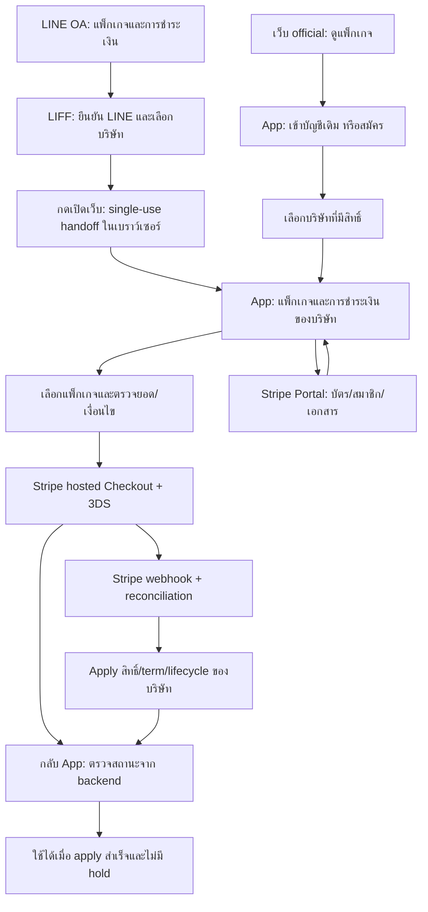

# จ่ายค่าสมาชิกจาก LINE และเว็บ — journey, routes และ UI

> **Implementation update 2026-09-14 — IN PROGRESS:** actual Next/Nest/PostgreSQL/Chromium + isolated marketing ผ่าน158กลุ่มกับ Stripe/Postmark/LINE จำลอง รวมAdminกู้สิทธิ์จากใบเสร็จเดิมที่เลือกและตรวจeventตกหล่น. สมัครเว็บ8และยืนยันอีเมล6เป็นหลักฐานแยก ไม่รวมใน158. API/web typechecks, billing/DTO29, PostgreSQL35ผ่าน. Root CI34801493799(7ca2d7a8)ผ่าน; รอบ34803284452(6da65148)ติดจังหวะlegal redirectในsignup fixture ซึ่งแก้และรันsignup8ผ่านแล้ว รอCIใหม่ของโค้ดรอบนี้. Marketing CI34802725764(0cd88eb)ผ่าน. Controls/fullsignup/fullLINE/mailยังมีงานค้าง; email password recoveryรอOwner. Receipt-only HIDDEN/Enterprise Coming soon; ยังไม่merge/deploy. ดู[หลักฐาน](../evidence/billing-integration-2026-09-13/README.md).


> **Owner amendment 2026-09-13:** [มติล่าสุด](mangmee-billing-pack-amendment-2026-09-12.md): ซื้อเริ่ม/จ่ายทันที, VAT OFF ปรับผ่าน Admin, upgrade จ่ายส่วนต่างเริ่มทันที/วันสิ้นรอบเดิม, downgrade สิ้นรอบที่จ่ายแล้ว, รายปีได้โควตา 12 เท่าทันที; ใช้หมดซื้อแพ็กเกจเต็มเพิ่ม ซื้อเฉพาะใบเป็น HIDDEN ตามมติล่าสุด: ซ่อนไว้ทุกช่องทางและยังไม่เปิดขาย. ซื้อแพ็กเกจเดิมซ้ำเพิ่มโควตาทันทีและต่ออายุจากวันหมดอายุเดิม; ยังไม่เปิดขายก่อน readiness. ไม่มี deploy; full paid E2E ยัง IN PROGRESS.

> **Package amendment 2026-09-11:** [สิทธิ์/ราคา/7เมนู default](mangmee-package-entitlements-spec-th.md) และ [PE-S0–S5 / PE01–PE36](../plans/mangmee-package-entitlements-plan-th.md) เป็นข้อกำหนดล่าสุด: สมัครอย่างเดียวได้ starter7เมนู + FREE_TRIAL_15 (1สาขา/ผู้ใช้รวม2คน/15ใบต่อเดือน/30วัน) ไม่ผูกบัตร; paid รองรับ month/year ตามรูป; มติ2026-09-13ให้ annual quota12เท่าทันทีและซื้อแพ็กเกจเต็มซ้ำต่ออายุจากวันเดิม. Trial/manualคงโควตารายเดือนเดิม. ENTERPRISE_1999 ทั้งเดือน/ปี + ภ.ง.ด.53/50ทวิ Coming soon ห้ามจ่าย; ไม่กระทบ PRO_999. B01/B02/B09 ตัดสินแล้วเฉพาะขอบเขตนี้; นโยบายอื่นคงเดิม. Full spec/native provider acceptance ยังไม่ครบ; local simulated browser/HTTP checkpoint ดูหลักฐาน integration ล่าสุด ไม่ใช้แทน native provider acceptance.

> **Controls 1–8 / no-deploy design 2026-09-11:** [C01–C08 spec](mangmee-billing-controls-spec-th.md) และ [implementation/CT01–CT32 plan](../plans/mangmee-billing-controls-plan-th.md) ครอบคลุมoverview, issue queue, safe repair, permissions, versioned policies, action gates, reconciliation และaudit/temporary overrides. Routine settingsผ่านเว็บหลังinitialimplementation; web/LINE/marketingอ่านapprovedrevisionเดียวกัน. ปิดขายใหม่ไม่หยุดpaid apply/recovery; rich menuเก่าต้องกลับไปstatus/supportได้. Target control suiteยังไม่implemented/NOT RUN; currentrepair evidenceแยกจากStripe/native acceptance.

สถานะ: **DESIGN SPEC 2026-09-11 / existing entry-recovery repairs implemented and tested locally / new billing UI, Stripe provider and native-device E2E NOT RUN**.

รายละเอียด data/transaction/worker/rich menu/webhook/support อยู่ใน [developer design ส่วนที่มั่งมีทำเอง](mangmee-owned-billing-integration-spec-th.md); ผลซ่อมจริงอยู่ใน [GW register](../research/stripe-line-web-gap-closure-2026-09-11.md).

ส่วนขยายของ [P26](mangmee-billing-subscription-spec-th.md) §9/§14 และ [แผน Stripe](../plans/mangmee-stripe-billing-implementation-and-test-plan-th.md) S2/S4. ใช้ [แผน UI และ acceptance](../plans/mangmee-line-web-billing-ui-plan-th.md) และ [developer reference](../research/line-stripe-browser-payment-reference-th.md). Route/API ด้านล่างเป็น **target contract ที่ออกแบบจาก routing ปัจจุบัน**; ยังไม่ใช่ endpoint ที่เรียกใช้งานได้. ก่อนเขียน consumer ต้องลง DTO ใน packages/contracts และทำ backend ให้ตรง.

## 1. ขอบเขตและข้อเท็จจริง

- ลูกค้าสมัครทางเว็บหรือ LINE ใช้บัญชี/บริษัท/แพ็กเกจ/สิทธิ์/การเรียกเก็บชุดเดียวกัน. จ่ายต่อบริษัท ไม่ใช่ต่อ LINE user หรือช่องทางสมัคร. การจ่ายไม่สร้างบริษัทหรือเริ่ม trial ใหม่.
- mangmee_web เป็นหน้าประชาสัมพันธ์และทางเข้า; app ใน mangmeeplus ถือ auth, UI billing และ backend; Stripe ถือ hosted Checkout, บัตร/3DS, Portal และ customer Invoice/Receipt. Postmark ส่ง transactional mail ของแอป ส่วน Receipt ค่า Postmark เป็นค่าใช้จ่ายบริษัทเรา ตาม [email spec](mangmee-transactional-email-provider-spec-th.md).
- การเลือก Stripe และ LINE optional ยืนยันแล้ว. B01–B10 เรื่องวันเริ่มคิดเงิน ภาษี grace ยกเลิก เปลี่ยนแพ็กเกจ และ refund ยังต้องปิดเฉพาะส่วนที่เกี่ยวก่อนเปิดขาย; wireframe ใช้ค่าจาก approved offer/quote ไม่ตั้งราคา/นโยบายใหม่.
- UI flow พร้อมกำหนดงานได้ แต่ยังไม่มีหน้าจอ billing ใหม่, Checkout/webhook adapter หรือ native LINE E2E ที่ผ่าน. ผล manual-renew เดิมไม่แทนหลักฐานนี้.

| สิ่งที่มีอยู่ใน code | ช่องว่างที่ต้องปิด |
|---|---|
| LINE handlePackageChangeRequest ยังเป็นคำขอให้แอดมิน; current repairใช้selectedcompany/pickerและรองรับexpiry-only recoveryแล้ว | Paid CTA ยังต้องเป็นbilling purpose/contractใหม่ ไม่ใช้support requestเป็นหลักฐานซื้อ |
| LIFF start/session/handoff current repairให้บริษัทexpiry-onlyกลับหน้า /renew; security/admin holdsยังปฏิเสธ | billing purpose, quote/Checkout/Portalยังเป็นtargetงานใหม่; ห้ามถอดrecoveryที่มีแล้วขณะเพิ่มpurpose |
| /companies/[companyId]/renew มี owner contact, employee neutral และ loading/error | เพิ่มทางเข้า billing เมื่อเปิดแล้ว; คง support เมื่อ provider/gate ไม่พร้อม |
| company/system layoutใช้trustedrequestpathกับsafe return helperแล้ว | เพิ่มbillingroutesโดยรักษาcompany/attempt queryและขยายbrowsertestsของbilling; ไม่กลับไปใช้fixeddashboard |
| mangmee_web pricing มี paid disabled; trial ยังเป็น request modal | ต่อ paid intent เข้า app หลังพร้อม; ไม่ใช้ modal ส่ง lead แทนการสมัครหรือชำระเงิน |

หลักฐานที่ตรวจ: [LINE command](../../apps/api/src/modules/line-ai/application/use-cases/process-line-webhook.use-case.ts), [LIFF session](../../apps/api/src/modules/auth/application/use-cases/exchange-liff-session.use-case.ts), [handoff exchange](../../apps/api/src/modules/auth/application/use-cases/exchange-line-handoff-token.use-case.ts), [web handoff](../../apps/web/app/l/[token]/route.ts), [company layout](../../apps/web/app/(workspace)/companies/[companyId]/layout.tsx), [renew UI](../../apps/web/src/features/plan-term/CompanyTermExpiredPage.tsx).

## 2. เส้นทางหลักที่ใช้ร่วมกัน



### 2.1 เว็บ official และเว็บแอป

1. ก่อน LIVE: trial และ paid preview ใช้สถานะปัจจุบัน ปุ่ม paid disabled จริง. ไม่พาไปเก็บบัตรจาก CTA ที่ยังไม่เปิด.
2. หลังผ่าน gate: official ส่งเพียง offerKey และ entrySource=marketing เข้า APP_WEB_BASE_URL/billing ที่ allowlist. ไม่มีราคา, companyId ที่เป็น authority, Stripe IDs หรือ identity token จาก marketing.
3. /billing ใช้ session เดิม; signed out → /login พร้อม safe next; ผู้ใหม่เลือก /signup ที่มีจริงและกลับมาต่อหลัง provision. ยังไม่สัญญา OTP/passwordless ที่เป็นข้อเสนอใน signup spec. ไม่มี LINE ก็ใช้เส้นอีเมล/บัญชีเว็บได้.
4. มีบริษัทเดียวที่เป็น OWNER ให้เปิด overview พร้อมชื่อบริษัทชัด; หลายบริษัทให้เลือก ไม่ใช้ default company เงียบ ๆ; ยังไม่มีบริษัทให้สมัคร/ติดตามคำขอเดิมก่อนซื้อ. Employee เห็นทางกลับไปใช้/ติดต่อเจ้าของโดยไม่เห็นรายการเงิน.
5. เลือกแพ็กเกจ → review quote → consent → สร้าง Checkout จาก backend → redirect ในแท็บเดิม. ซื้อแล้วจากอีกช่องทางต้องกลับสถานะเดิม ไม่สร้าง subscription ใหม่.

### 2.2 LINE OA / LIFF

1. เมนู “แพ็กเกจและการชำระเงิน”, quota CTA และข้อความหมดอายุ ใช้ generic LIFF URL `https://liff.line.me/<LIFF_ID>/billing`; ไม่มี bearer handoff, Checkout URL, Portal URL หรือ Invoice URL เก็บค้างในแชต. ใน group/room ให้เพียงทางเข้าไปยืนยันตัวตนส่วนบุคคล ไม่เปิดเผยยอด/เอกสาร/สถานะหนี้.
2. เพิ่มหน้า `/v1/auth/line/link-page/billing` ใต้ LIFF endpoint เดิม; reuse liffPageHtml/CSP/SDK และ token verifier. เมื่อ init พร้อม ส่ง ID token ให้ backend ตรวจ channel/audience/expiry/identity; ไม่รับ profile/userId ที่ client อ้างเป็นหลักฐาน. ไม่ย้าย LIFF endpoint ทั้งระบบเพื่อหน้าจ่ายหน้าเดียว.
3. ขยาย POST `/v1/auth/line/liff/session` ด้วย optional `purpose=start|billing` (default start คงพฤติกรรมเดิม). billing branch ตรวจ current OWNER + company.setup.manage + membership และสร้างรายการ ACTIVE/term-expired ที่เข้าขอบเขต recovery. ถ้ามีหลายบริษัทให้เลือกเสมอ; company hint จาก URL ไม่ใช่สิทธิ์. explicit company ผิดต้องปฏิเสธ ไม่ fallback ไปบริษัทอื่น.
4. บัญชีถูกระงับ/LINE link ถูกถอดให้แจ้งเข้าไม่ได้/เข้าสู่ระบบบัญชีเดิม; ไม่ส่งไปสร้างร้านใหม่อัตโนมัติ. ไม่มี identity จริงจึงเสนอ “เข้าสู่ระบบบัญชีเดิม” และ “สมัครใช้มั่งมี”. contact email ไม่ใช้ merge บัญชี.
5. เมื่อเลือกแล้ว backend mint handoff ณ การใช้งาน โดยผูก user/company/targetPath และ surface=liff_billing; hash-only, TTL 15 นาที และ single-use ตามของเดิม. อนุญาตเป้าหมายเฉพาะ billing overview/renew ที่ server กำหนด. UI เตรียมลิงก์แล้วแสดงปุ่ม “เปิดหน้าชำระเงินในเบราว์เซอร์”; เรียก liff.openWindow ด้วย external=true จากการกดตรง ๆ ไม่ await การเรียกเครือข่ายก่อนเปิดหน้าต่าง.
6. เป้าหมายแรกของ external browser คือ /l/<token> ที่ตั้ง httpOnly session แล้วล้าง token จาก URL ก่อนโหลด app. ทำให้ไม่ต้องแชร์ cookie ระหว่าง LIFF กับ Safari/Chrome. ห้าม consume token ใน LIFF ก่อนแล้วเอา token เดิมไปเปิดอีก browser. ถ้าเปิดจาก external browser อยู่แล้ว ใช้ navigation ปกติ ไม่พึ่ง liff.openWindow.
7. หมดอายุ/ถูกใช้แล้ว/เปิดไม่ขึ้น: กลับ LIFF ขอ handoff ใหม่หลังตรวจ identity หรือใช้ LINE login/QR ที่มีจริงและ safe next. ไม่ส่ง raw token ให้ copy หรือใส่ analytics; ไม่ใช้ GET link preview เป็นคำสั่งเริ่มเก็บเงิน. แสดงชื่อบัญชีและบริษัทใน review เสมอเพราะ handoff อาจแทน session เดิมบนเครื่องร่วมกัน.
8. ที่ app ใช้หน้าจอ/Checkout/Portal เดียวกับเว็บ. ผู้สมัคร LINE ไม่ต้องตั้งรหัสผ่านเพียงเพื่อจ่าย และไม่ต้องยืนยันอีเมล login ถ้าไม่ได้เปลี่ยน identity. เก็บ billing email สำหรับ Stripe documents แยกจาก account recovery.
9. กลับจาก Stripe ใน browser เดิมเพื่ออ่านสถานะ. “กลับ LINE” เป็นทางเลือกผ่าน OA link ที่ตั้งค่าไว้; ไม่บังคับ auto deep-link/closeWindow และไม่ถือว่ากลับ LINE ได้ทุกเครื่อง. เข้าเมนูเดิมอีกครั้งจะเห็นข้อมูลล่าสุด แม้ปิด browser ก่อนกลับ.

**Recovery ที่ต้องทำจริง:** เพิ่มเงื่อนไขแบบเดียวกันใน LIFF selection, handoff exchange, auth/company resolution, web proxy/layout และ backend billing guards. ยกเว้นเฉพาะ term-expiry สำหรับ recovery; surface string จาก client ไม่ใช่สิทธิ์. ไม่เปิด dashboard/ธุรกรรมของบริษัทหมดอายุหรือยก admin/security/platform hold. ทดสอบ LINE-only OWNER ที่มีแต่บริษัท DISABLED และคนที่มีบริษัท A ACTIVE + B EXPIRED โดยเริ่มจาก B.

## 3. หน้า UI และเส้นทาง

ให้ `B = /companies/{companyId}/settings/billing`; ทุกหน้าระบุชื่อบริษัทตลอด. `/renew` ยังเป็น entry เดิม. ประวัติเป็น tab ของ overview เพื่อลดหน้าซ้ำ. รายการนี้รวม app, LINE และหน้าที่ Stripe รับผิดชอบ.

| ID | หน้า / route เป้าหมาย | สิ่งที่ลูกค้าต้องเห็นและทำได้ |
|---|---|---|
| U01 | mangmee_web pricing/FAQ | trial แยก paid, ราคา/รอบ/ภาษี/limits/availability ตรง catalog; CTA trial, paid หรือขอคำแนะนำตรงสถานะ |
| U02 | /billing + login/signup เดิม | ใช้บัญชีเดิม, เลือกบริษัท, pending signup/ไม่มีบริษัท/non-owner; จำ offer hint แต่ revalidate ก่อน review |
| U03 | LINE card + LIFF /billing | อธิบายว่าจะเปิดเว็บ, identity loading/denied/เลือกบริษัท/hand-off ready/expired/open blocked; ไม่กรอกบัตรในแชต |
| U04 | B overview | แพ็กเกจปัจจุบัน, usage/limit/reset, trial/paid-through, การต่ออายุ/วันตัดถัดไป, pending action, billing email และประวัติ |
| U05 | B/plans | เปรียบเทียบ offer ที่ซื้อได้, current plan, quota คงเหลือหลังเปลี่ยน, unavailable reason; enterprise/contact ตาม catalog |
| U06 | B/review?offerKey=… | บริษัท/แพ็กเกจ, ยอดวันนี้และรอบถัดไป/ภาษี, service period, trial ที่เหลือ, email/ข้อมูลออกเอกสารที่ต้องมี, consent, “ดำเนินการชำระเงิน” |
| U07 | Stripe hosted Checkout | บัตร/3DS/decline และยอดสุดท้าย; branding/ภาษาเท่าที่ Stripe รองรับ. ไม่สร้างช่อง card/CVC ใน app |
| U08 | B/return?attemptId=… | checking, action-required, pending, paid/applying, applied, held, canceled/expired, outage; อ่าน backend ก่อนแสดงผลทุกครั้ง |
| U09 | B?tab=history | วัน/เลข Invoice/ยอด THB/สถานะ/รอบบริการ, เปิด Invoice/PDF/Receipt ตาม availability; empty/loading/error/pagination |
| U10 | Stripe hosted Portal | จัดการบัตรและ billing contact, invoice history, เปลี่ยน/ยกเลิกตาม policy/config ที่อนุมัติ; กลับ B แล้ว sync สถานะ |
| U11 | /companies/{companyId}/renew + banner | OWNER ต่ออายุ/แก้การชำระผ่าน B; employee ข้อความกลาง; expired, grace, cancel-scheduled, held และ provider outage ไม่ใช้ข้อความเดียว |
| U12 | ช่องติดตาม/support จาก B/U08 | เลขอ้างอิงคัดลอกได้และช่องติดต่อเดิม, paid-but-locked/หนี้เก่า/refund/dispute; ไม่สัญญาว่าคืนเงินแล้วหรือเปิดสิทธิ์แล้วจากการส่งคำขอ |

### 3.1 Wireframe เนื้อหาหลัก (mobile-first; ค่าตัวอย่างเป็น placeholder)

```text
U04 แพ็กเกจและการชำระเงิน
[บริษัท: ชื่อบริษัท]                       [เปลี่ยนบริษัท]
แพ็กเกจปัจจุบัน: {ชื่อ}                    {สถานะจริง}
ใช้ใบเสร็จ {used}/{limit}   เริ่มนับใหม่ {resetAt}
ใช้ได้ถึง {accessEndsAt}    ตัดรอบถัดไป {nextChargeAt/ไม่มี}
{banner: ต้องแก้บัตร / กำลังเปิดสิทธิ์ / ยกเลิกมีผลวันที่…}
[ดูแพ็กเกจที่ซื้อได้] [จัดการบัตรและสมาชิก]
แพ็กเกจ | ประวัติการชำระเงิน
{Invoice rows หรือ ยังไม่มีประวัติ}
[ติดต่อทีมงาน]
```

```text
U06 ตรวจสอบก่อนชำระ
บริษัท {ชื่อ} · บัญชีที่ดำเนินการ {ชื่อผู้ใช้}
แพ็กเกจ {ชื่อ} · รายเดือน · {limits}
ยอดวันนี้ {amountDueToday} THB ({taxDisplay})
รอบถัดไป {nextAmount/วิธีคำนวณที่อนุมัติ} วันที่ {date}
สิทธิ์เริ่ม {effectiveAt} · trial คงเหลือ {ตาม B01}
โควตาคงเหลือ {remaining} · reset {resetAt}
ส่งเอกสารไปที่ {billingEmail} [แก้ไข]
{ข้อมูลนิติบุคคล/ภาษีที่ B06 กำหนด} [แก้ไข]
[ ] ยอมรับการเรียกเก็บรายเดือนและเงื่อนไขฉบับ {revision}
[ดำเนินการชำระเงิน]                     [กลับไปเลือกแพ็กเกจ]
```

```text
U08 ตัวอย่างเมื่อจ่ายแล้ว แต่สิทธิ์ยังไม่พร้อม
รับชำระแล้ว กำลังเปิดใช้งาน
บริษัท {ชื่อ} · แพ็กเกจ {ชื่อ} · {amount} THB
ไม่ต้องชำระซ้ำ ระบบกำลังตรวจสอบการเปิดสิทธิ์
ตรวจล่าสุด {observedAt} · อ้างอิง {reference}
[ตรวจสถานะอีกครั้ง] [กลับหน้าบริษัท] [ติดต่อทีมงาน]
หลัง backend applied + access allowed:
ใช้งานแพ็กเกจแล้ว · ใช้ได้ถึง {paidThrough}
[เริ่มใช้งาน] [ดู Invoice / Receipt] [กลับ LINE ถ้าเลือกใช้]
```

Desktop ใช้สองคอลัมน์ใน review (รายละเอียด/สรุปยอด); mobile 390px เรียงหนึ่งคอลัมน์และ CTA ไม่บังเงื่อนไข/คีย์บอร์ด. ตาราง history ย่อเป็นรายการที่อ่านได้ ไม่บังคับเลื่อนแนวนอน. Reuse UI components/tokens เดิม; loading ต้องไม่กระพริบเป็น success/ไม่มีสิทธิ์. รองรับ keyboard, focus หลัง error, label/aria-live สำหรับสถานะ, ข้อความที่ไม่ใช้สีเพียงอย่างเดียว และวันเวลา Asia/Bangkok. ไม่มีราคา placeholder หรือข้อความ TBD ในหน้าขายจริง: ข้อมูลไม่ครบให้ปิด action พร้อมเหตุผลที่เข้าใจได้.

## 4. State และ next action จาก server

Payment, access, subscription และ document เป็นคนละแกน. ชื่อด้านล่างเป็น projection สำหรับ UI ไม่บังคับสร้าง DB enum ที่รวมทุกอย่าง.

| สถานการณ์ | ข้อความ / next action | สิ่งที่ต้องไม่เกิด |
|---|---|---|
| ยังโหลด/ไม่รู้ผล | กำลังตรวจสอบ; Retry เมื่ออ่านล้มเหลว | เปลี่ยนเป็น failure, paid หรือ employee โดยเดา |
| กำลังสร้าง Checkout / response หาย | ตรวจ attempt เดิมและรอผล | POST สร้างใหม่ด้วย key ใหม่ทันที |
| ต้องยืนยันบัตร/decline | ยืนยัน/แก้บัตรผ่าน hosted action ที่ backend ให้ | เปิด paid rights จาก 3DS redirect หรือรายละเอียดที่ client บอก |
| pending payment | รอการยืนยัน พร้อม reference | ชวนซื้อซ้ำขณะที่ยังมี collection ได้ |
| paid + applying | รับชำระแล้ว กำลังเปิดใช้งาน; status/support | เก็บเงินใหม่หรือรอ payout/อีเมลก่อน apply |
| applied + allowed | ใช้งานแพ็กเกจแล้ว; ไป business action | อ้าง success จาก invoice paid เพียงอย่างเดียว |
| paid + access held | รับชำระแล้ว แต่บริษัทยังมีข้อจำกัด; ติดต่อทีมงาน | เปิด hold อัตโนมัติ/อ้างว่ายังไม่จ่าย |
| Checkout กลับด้วย cancel/back | ตรวจสถานะล่าสุด; กลับ review/continue ตามผลจริง | ตีความเป็น cancel subscription หรือ payment failed ทันที |
| session/attempt terminal | หมดอายุ; backend reconcile ก่อนเสนอเริ่มใหม่ | จ่าย void invoice หรือสร้างสอง subscription |
| renewal past_due/grace/expired | บอกวันและสิทธิ์ตาม B03; แก้การชำระเดิม | ใช้ grace สมมติหรือเพิ่มเดือนจาก invoice เก่าที่หมด period |
| cancellation scheduled | บอกวันใช้สุดท้ายและสถานะตัดรอบถัดไปตาม B04 | บอกยกเลิกสำเร็จก่อน Stripe ยืนยัน/ถือ refund = cancel |
| 401 / 403 / 5xx / offline | เข้าบัญชีต่อที่เดิม / ไม่มีสิทธิ์ / ลองใหม่ | เปิดเผยเงินของบริษัทอื่นหรือเสีย attempt ตอน login |
| ไม่มี/ยังไม่พร้อม document | ยังไม่มีเอกสาร/กำลังจัดเตรียม; กลับมาตรวจ | null link, PDF ว่าง หรือทำเลขเอกสารใหม่เอง |

Polling U08: เริ่มอ่านทันที แล้วทุก 2 วินาทีไม่เกิน 30 วินาทีและทุก 5 วินาทีต่อจนครบ 2 นาที; เคารพ Retry-After/429. หยุดเมื่อซ่อนหน้า/offline/unmount/เปลี่ยนบริษัท/terminal; กลับ visible ให้อ่านใหม่โดยไม่เริ่มรอบ 2 นาทีซ้ำอัตโนมัติ. ครบเวลาแสดง “ยังตรวจสอบอยู่” พร้อม manual refresh/reference/support; ไม่เปลี่ยนเป็น failed. Backend reconciliation ทำงานต่อได้เมื่อปิดหน้า. กัน response เก่าของบริษัท A มาเขียนทับ B และ invalidation หลัง Portal/paid apply ต้องโหลด entitlement/session ใหม่.

## 5. Contract ที่จะ implement

เส้นทางด้านล่างอยู่ใน app API `/v1`; BFF ใช้ session/httpOnly/CSRF convention เดิม. ทุก company route ใช้ path companyId เท่ากับ X-Company-Id; OWNER และ permission ตรวจใหม่ทุก request. ใช้ 404 แบบไม่เปิดเผยกับ attempt/document ต่างบริษัท, 403 สำหรับผู้ใช้ไม่มีสิทธิ์ action, 401 สำหรับหมด session; business error codes ต้องลง shared contract ก่อน consumer.

| Method/path เป้าหมาย | Input / output ขั้นต่ำ |
|---|---|
| GET /billing/companies | projection ของ membership source เดิม: id/name, canManageBilling/recoveryReason; ไม่มี invoice/ยอดของ non-owner. ใช้ใน /billing picker ไม่สร้าง identity directory อีกชุด |
| GET /companies/:companyId/billing | summary + approved offers + billing profile + current attempt + capabilities + observedAt + policyRevision; ไม่มี provider secret/hosted URLs ค้างใน payload |
| POST /companies/:companyId/billing/quote | offerKey; คืน quoteId/version/expiresAt, company, THB integer amounts, tax display, effective period, next charge, quota, termsRevision และ required billing fields |
| POST /companies/:companyId/billing/checkout | quoteId/version, consent revision, billing fields และ Idempotency-Key; คืน attemptId/state และ hosted URL เมื่ออนุญาต. ไม่รับราคา/Stripe customer ID/return URL จาก client |
| GET /companies/:companyId/billing/attempts/:attemptId | company-bound payment/access projection + reference + observedAt + allowed nextActions; rate-limited server refresh ใช้ durable reconcile เดียวกับ webhook |
| POST /companies/:companyId/billing/attempts/:attemptId/resume | action ที่ server อนุญาต, idempotency; ตรวจ current Stripe Session/Invoice/Subscription ก่อนส่ง hosted URL เดิม/ใหม่. ไม่เป็น API pay arbitrary invoice |
| POST /companies/:companyId/billing/portal | allowed action enum; backend map Customer/config/return URL; คืน temporary hosted URL |
| GET /companies/:companyId/billing/history | cursor/limit; local documentId, type, provider status, period, amount, availability; no raw card/bearer URL |
| POST /companies/:companyId/billing/documents/:documentId/open | kind=invoice/receipt/pdf; authorize แล้ว lookup Stripe mapping คืน URL เท่าที่มี; ไม่รับ provider URL จาก client |

Quote เป็น snapshot ที่มีอายุและต้องตรวจซ้ำ ไม่จำเป็นต้องมีตารางใหม่ถ้า durable attempt เดิมรองรับ. ห้ามรับ consent ของยอด/period เก่าเมื่อ quote หรือ billing profile เปลี่ยน: คืน `BILLING_QUOTE_STALE` และให้ review ใหม่. Runtime amounts ที่ Stripe จะแสดงต้องเทียบกับ quote; หาก tax/address หรือ discount ทำให้ยอดเปลี่ยน ต้องแสดงยอดและเงื่อนไขสุดท้ายให้ลูกค้ายืนยันใน Checkout อย่างชัดเจน ไม่กล่าวว่า amount ตัวอย่างเป็นยอดที่ล็อกแล้ว.

Error vocabulary เป้าหมาย: BILLING_UNAVAILABLE, BILLING_POLICY_NOT_READY, BILLING_QUOTE_STALE, BILLING_ATTEMPT_IN_PROGRESS, BILLING_ATTEMPT_TERMINAL, BILLING_ACCESS_HELD และ BILLING_DOCUMENT_NOT_READY. Reuse existing generic auth/permission/validation/rate-limit codes; ไม่แสดง Stripe raw error หรือบุคคลอื่นในข้อความ.

success_url และ cancel_url จาก server ชี้ U08 เดียวกันพร้อม local attemptId; arrival hint เป็นข้อมูล UI เท่านั้น. จะใช้ `{CHECKOUT_SESSION_ID}` เพิ่มเพื่อ reconcile ก็ต้องตรวจ mapping/OWNER และไม่ถือเป็น secret login หรือหลักฐานสิทธิ์. Portal return ไป B พร้อม safe marker แล้วอ่านใหม่. ไม่มี payment side effect จาก URL query, GET page หรือ marketing analytics.

## 6. Safety ของธุรกรรมและสิทธิ์

- ต่อ company/environment มี base subscription และ intent ที่ยัง collect ได้ตาม invariant ใน P26. LINE+เว็บ/หลาย OWNER/หลายแท็บชนกันต้อง reuse หรือ conflict พร้อมทางดู attempt เดิม; ย้ายบริษัทแล้วต้องสร้าง quote ใหม่. ความสำเร็จของ HTTP ไม่แทน payment/apply.
- Non-owner อ่านเพียงข้อความกลางตาม P29; ไม่เปิด history/Portal/invoice links และไม่เปิด self-service ด้วย company.setup.manage อย่างเดียวถ้าไม่ใช่ OWNER. Revoked/old owner ต้องถูกปฏิเสธครั้งถัดไป. ไม่มีการ auto-promote payer เป็น OWNER.
- อายุของ hosted URL เป็นข้อจำกัดของ Stripe: ลิงก์ที่ออกให้แล้วอาจยังใช้ได้จนหมดอายุ จึงไม่อ้างว่า revoke Mangmee session แล้ว revoke Portal/Invoice URL ที่ถูกคัดลอกได้ทันที. ไม่ persist URL ในแชต/analytics; reauthorize ทุกครั้งที่ออกใหม่ และมี support procedure สำหรับ ownership change ที่กระทบการเงิน.
- Privacy ของ billingEmail แยกจาก loginEmail และ LINE identity; prefill แล้วให้ OWNER ตรวจ/แก้ก่อนส่งให้ Stripe. การแก้ที่อยู่/เลขภาษีมีผลตาม Stripe document lifecycle; ห้ามแก้ invoice เก่าที่ finalized ด้วยการเขียน customer profile ย้อนเอง.
- ถ้า provider หรือ new-sales gate ปิด ต้องยังมีทางดูสถานะเดิม/ขอยกเลิก/ติดต่อ support ตามสิทธิ์ที่อนุญาต; ไม่แปลว่าหยุด recurring charges แล้ว. ไม่มีการส่งข้อความ/ตัดเงินจริงในงานออกแบบนี้.

## 7. เอกสารและการแจ้งเตือนหลังจ่าย

- U09 แยก Invoice/Receipt และ refunded/void/uncollectible; เปิดเฉพาะ URL ที่ Stripe คืนจริง. Invoice PDF/hosted URL อาจยังไม่มีเมื่อยังไม่ finalized. Receipt สำหรับ charge อาจหมดอายุ ต้องดึงสถานะ/link ตาม provider และมีทาง Portal; ไม่สร้าง PDF หรือเลข receipt เอง. ดู [Stripe document reference](../research/stripe-developer-reference-th.md#stripe-customer-documents).
- ใน LINE/LIFF ให้ “เปิดเอกสารในเบราว์เซอร์” ผ่าน billing UI หลัง auth; ไม่พึ่ง HTML download attribute ใน LIFF. ไม่ส่งเอกสารการเงินหรือ bearer URL เข้ากลุ่ม.
- Stripe email เป็น Invoice/Receipt ของลูกค้า; app in-app notice และ LINE OA notification เป็นสถานะบริการ เช่น “เปิดใช้งานแพ็กเกจแล้ว” ไม่ส่ง receipt ซ้ำผ่าน Postmark.
- LINE notification ใช้ NotificationEvent/Recipient/Delivery และ preference/active identity เดิม; ส่งเฉพาะผู้มีสิทธิ์ ณ เวลาส่งใน 1:1. ประเภทที่ต้องออกแบบ template: paid+applied, paid+applying ที่ต้องติดตาม, renewal action-required, upcoming expiry/cancellation effective, support outcome. จำนวน/เวลาตาม policy ที่อนุมัติ ไม่ทำ retry spam.
- dedupe ตาม business event + recipient + channel; failed email/blocked OA/หมด messaging quota ต้อง retry/วัดผลแยก ไม่ถอนสิทธิ์หรือเก็บเงินซ้ำ. ไม่ใช้ liff.sendMessages จาก client เป็นหลักฐานว่าจ่ายแล้ว; backend ยืนยัน state แม้ user ไม่กลับหน้า success.

## 8. เกณฑ์ปิดงาน

Design ครบเมื่อ U01–U12, routes, identity/recovery, states, shared contracts, owner-policy dependencies และ test mapping อ้างตรงกันสอง repo. Runtime ครบเมื่อ [LB01–LB20](../plans/mangmee-line-web-billing-ui-plan-th.md) และ P26 T01–T42 ที่เกี่ยวผ่านตามชั้นหลักฐานจริง; native LINE iOS/Android/3DS ต้องมีเครื่องจริง ไม่ใช้ viewport emulation แทน. ก่อน live ต้องผ่าน release protocol แยก; ผล local repairs ไม่แทนการทดสอบ billing routes ที่ยังไม่มีหรือ Stripe/native LINE.
