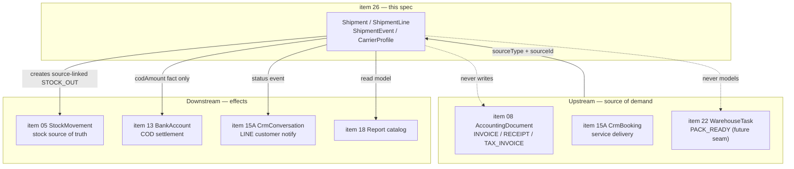
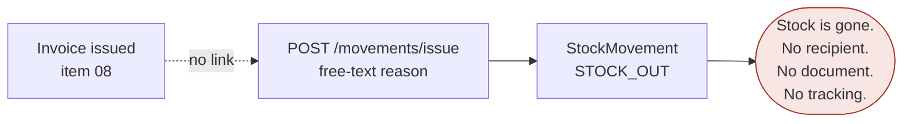
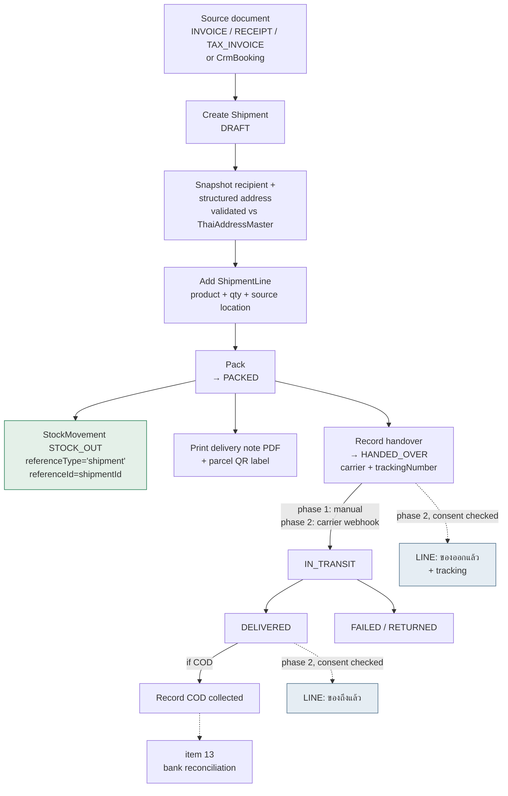
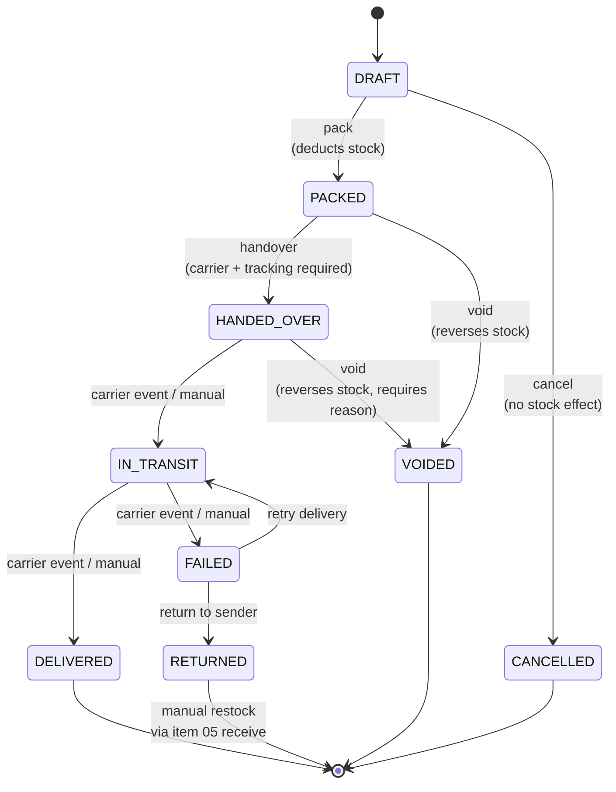
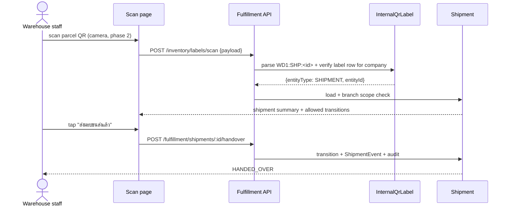
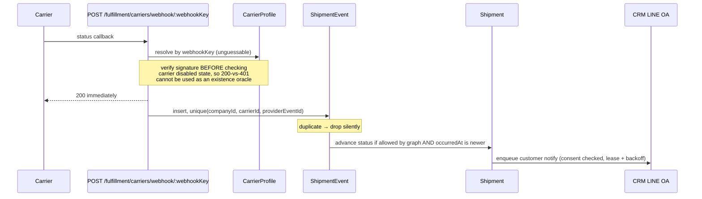

# Outbound Fulfillment and Shipping Spec

## 1. Status

Draft for owner review. Not yet on the canonical checklist — proposed as **item 26. Outbound Fulfillment and Shipping**, placed after item 22 in dependency order but implementable before it.

Active implementer target: Sonnet 4.6 or later.

Linked plan: `plans/outbound-fulfillment-shipping-plan.md` (to be authored after this spec is approved)

This spec **amends the item 22 non-goal** that reads "External carrier booking, shipping labels, customs, freight rating, or transport management". Item 22 keeps freight rating, customs, and transport management as non-goals. This spec takes ownership of **shipping labels, carrier tracking, and outbound delivery documents** only. Carrier *booking* (calling a carrier API to request pickup) stays a non-goal here as well — see section 3.

Owner decisions for first pass:

- Web is the only mutation surface for shipments. LINE and AI are read-only, plus system-originated status notifications to the end customer.
- Inventory stock movements from item 05 remain the operational stock source of truth. A shipment must create source-linked `StockMovement` rows and must never edit balances directly.
- A shipment does **not** create revenue, receivables, or ledger entries. Accounting documents from item 08 remain the revenue source of truth. A shipment links to them; it does not replace or post them.
- Carrier selection is per-company configuration data, never hard-coded carrier constants.
- Tracking numbers are entered by a human in phase 1. Carrier webhooks in phase 2 may only *append status events*; they may never mutate lines, quantities, addresses, or COD amounts.
- COD collection is recorded as a fulfillment fact. Settlement against the bank remains item 13's responsibility.
- Bins, lots, batches, serials, and expiry are out of scope here and stay owned by item 22. This spec must not model them.
- The module ships behind a new feature entitlement and is off by default.

## 2. Goal

Ship the first trustworthy outbound fulfillment layer for WatchDog-BMS, so a Thai SME can answer "where is my customer's parcel" without leaving the system:

- A first-class **outbound document** (`Shipment`) that is the structural mirror of item 12's `GoodsReceipt` — currently outbound stock leaves the company as a bare `POST /movements/issue` with a free-text reason and no document, no recipient, and no trace.
- **Carrier tagging**: which carrier, which tracking number, which service level, what weight and dimensions, how much COD.
- **Parcel QR tagging** so a physical box maps to a system record, extending the existing `InternalQrLabel` mechanism rather than inventing a second one.
- **Delivery note (ใบส่งของ) PDF** rendered by the same document engine as tax invoices and receipts.
- **Source-linked stock deduction**, so every unit that leaves is attributable to a recipient and a document instead of a free-text string.
- **Structured Thai delivery addresses** validated against the existing geocoded `ThaiAddressMaster`.
- Phase 2: real camera scanning, carrier webhook status ingestion, automatic LINE notification to the end customer, and COD reconciliation hooks.

This module must extend inventory rather than replace it, and must extend accounting rather than duplicate it.

## 3. Non-goals

- Rebuilding item 05 inventory product, location, or movement primitives.
- Rebuilding item 08 accounting document, revenue, or payment workflow.
- Bins, zones, lot, batch, serial, expiry, warehouse tasks, putaway, picking, replenishment, or cycle count — all owned by item 22.
- **Carrier booking / pickup request** — calling a carrier API to *create* a shipment on their side. Phase 1 and 2 are read-and-tag only. The company books with the carrier as they do today.
- Freight rating, rate shopping, freight cost allocation, landed cost, or customs.
- Transport management, route optimization, driver dispatch, vehicle tracking, or proof-of-delivery signature capture.
- Multi-parcel splitting of one shipment into many tracked boxes. Phase 1 is one shipment = one tracked parcel. See backlog.
- Return merchandise authorization, reverse logistics workflow, or restocking automation beyond a manual reversal.
- Marketplace order import — owned by item 19.
- Inventory valuation, COGS, or automatic ledger posting from stock. This remains absent system-wide and is called out in section 15.
- Direct LINE/AI mutation of shipments, stock, addresses, COD, or carrier configuration.

## 4. User Roles

| Role | Capability |
| --- | --- |
| Warehouse staff | Create a shipment from a source document, pack it, print the delivery note and parcel QR, record handover, scan to advance status. |
| Sales / CRM staff | Read shipment status from Customer 360 and from the inbox conversation. Cannot pack or void. |
| Finance | Read COD amounts and collection state. Reconcile COD against bank deposits (item 13). |
| Owner / Admin | Configure carriers, void shipments, override a blocked status transition with a reason. |
| End customer | Receives LINE status notifications. Never touches the system. |
| LINE staff assistant | Read-only shipment summary and lookup by tracking number. No mutation. |

## 5. Boundary and Ownership



Rules:

- A shipment **reads** its source document and snapshots the recipient. It never writes back to the source.
- A shipment **creates** stock movements through the item 05 movement use case, not by direct repository write, so branch scope, negative-stock policy, and audit stay in one place.
- A shipment **never** creates a journal entry, a receivable, or a tax event.
- Item 22, when built, will produce a `WarehouseTask` in `PACK_READY`. That task becomes an additional `sourceType` for a shipment. Nothing in this spec may pre-model bins or lots to accommodate it.

## 6. Current Repository Baseline

Verified against branch `20260711` by direct code read, not from documentation.

**Exists and is reusable:**

- `StockMovement` (`schema.prisma:893`) — `movementNumber`, `productId`, `locationId`, `movementType`, `direction`, `quantity`, `reason?`, `referenceType?`, `referenceId?`, `transferGroupId?`, `reversesMovementId?`, `actorUserId`, `occurredAt`. Indexed on `[companyId, referenceType, referenceId]`. **This index is the attachment point** — a shipment sets `referenceType='shipment'`.
- `GoodsReceipt` (`schema.prisma:2972`) + `GoodsReceiptLine` (`:3004`) — the exact structural template: numbered document, party snapshot, `inventoryMovementBatchRef`, per-line `inventoryMovementId`, `postingStatus`, void chain.
- `InternalQrLabel` (`schema.prisma:802`) — `entityType`, `entityId`, `payload`, `labelText`, `printedAt`. Payload format `WD1:P:<id>` / `WD1:LOC:<id>`, prefix `WD1` (`domain/logic/stock-movement.logic.ts`). Generation is idempotent by payload.
- `ThaiAddressMaster` (`schema.prisma:5472`) — `subdistrictCode` PK, `postalCode`, TH/EN names for subdistrict/district/province, `latitude`/`longitude` `Decimal(10,7)`, indexed on `postalCode` and `[provinceCode, districtCode]`. Already used by the employee address form.
- `DocumentSequence` (`:688`) + `DocumentNumber` (`:711`) — numbering.
- `AttachmentObject` (`:631`) / `AttachmentBlob` (`:663`) / `AttachmentLink` (`:673`) — label and delivery-note PDF storage.
- `CompanyIntegrationCredential` (`:2139`) + `CompanyCredentialKind` + `CompanyCredentialHealth` — encrypted, versioned carrier API keys.
- `WorkflowEventInbox` (`:4554`) and `LineWebhookEventLog` (`:1170`) — the dedupe/idempotency pattern for inbound carrier webhooks.
- `OutboxEvent` (`:572`) — reliable dispatch.
- `CrmBooking` (`:4078`) reminder lease — `reminderSentAt`, `reminderClaimedAt`, `reminderAttemptCount`, `reminderNextAttemptAt`, `reminderLastError`. The template for retrying customer notification.
- `CrmCustomer.shippingAddressJson` (`:3995`) and `AccountingDocument.shippingAddressJson` (`:1285`) — unstructured JSON, no validation, no consumer. **These are the only shipping-related bytes in the repository.**
- `AuditLog` (`:549`).

**Does not exist — confirmed zero hits across `apps/` and `packages/` source:**

`shipment`, `courier`, `carrier`, `waybill`, `parcel`, `logistics`, `trackingNumber`, `deliveryNote`, `packing`, `picking`, `pickList`, `ใบส่งของ`, and every Thai carrier name. There is no outbound counterpart to `GoodsReceipt`. `AccountingDocumentType` (`:1198`) has no delivery type.

**Known constraints that shape this spec:**

- `ScanPageClient` (`features/inventory/InventoryPages.tsx`) is a **text input**, not a scanner. No `getUserMedia`, no barcode library. Phase 2 must build a real camera flow.
- Stock balances are **derived** by `groupBy` over `StockMovement` at query time (`infrastructure/queries/balance.query.ts`), clamped at 0. There is no reservation or allocation concept, so two shipments can both promise the last unit.
- There is **no costing anywhere** — no `unitCost`, no valuation, no COGS, no ledger posting from stock. See section 15.
- `LINE_ALLOWED_TOOL_CATEGORIES` (`packages/contracts/src/ai-tools.ts:6`) excludes any mutation category. AI tools here must be read-only.

## 7. References

- `specs/inventory-mvp-spec.md`, `plans/inventory-mvp-plan.md` — item 05. Its Out of Scope section explicitly names "picking, packing, and shipping".
- `specs/manufacturing-mrp-warehouse-spec.md` — item 22. Section 3 non-goals, section 12 `WarehouseTask` (`PACK_READY`), section 10 task types.
- `specs/procurement-supplier-ap-spec.md` — item 12. `GoodsReceipt` is the inbound mirror of this module.
- `specs/accounting-documents-spec.md` — item 08. Source document contract.
- `specs/crm-line-oa-customer-os-spec.md` — item 15A. Company LINE OA, PDPA consent, conversation push.
- `specs/bank-reconciliation-spec.md` — item 13. COD settlement target.
- `specs/data-model-core-spec.md` — `DocumentSequence`, attachments, outbox.

## 8. Core Product Decisions

| # | Decision | Rationale |
| --- | --- | --- |
| D1 | `Shipment` is a document, not a status flag on an invoice. | One invoice may ship in several deliveries; one delivery may cover several invoices later (backlog). A flag cannot express either. |
| D2 | Stock deducts when status enters **`PACKED`**, not at handover. | The goods physically leave the shelf when packed. This matches `GoodsReceipt`, which posts on receipt rather than on bill. Void before handover reverses via `reversesMovementId`. |
| D3 | One shipment = one tracked parcel in phase 1. | Multi-parcel needs a `ShipmentPackage` child and per-package tracking. Deferred to keep phase 1 at 1.5 days. |
| D4 | Carriers are `CarrierProfile` rows per company, seeded with common Thai carriers but editable. | The tax module already proves the pattern — never hard-code external-party rules. A company using a local motorcycle courier must be first-class. |
| D5 | Tracking number is free text with an optional per-carrier regex validation from config. | Carrier formats change. A hard-coded pattern becomes a bug the day a carrier changes their scheme. |
| D6 | Delivery address is **structured and validated** against `ThaiAddressMaster.subdistrictCode`, with a free-text line for house number and a free-text override for unmatched addresses. | Enables zone reporting and future rating. The override prevents the validator from blocking a real delivery. |
| D7 | The existing `shippingAddressJson` blobs are **snapshot sources, not the model**. A shipment copies from them into structured columns at creation. | They are unvalidated and have no consumer. Reading them keeps existing data useful without inheriting their shape. |
| D8 | Parcel QR extends `InternalQrEntityType` with `SHIPMENT`, payload `WD1:SHP:<shipmentId>`. | A second QR mechanism would fragment the scan resolver and the label printer. |
| D9 | Carrier webhooks may only **append `ShipmentEvent`** rows and advance status along the allowed graph. They may never touch lines, quantity, address, or COD. | An external system must not be able to alter what we owe or what we shipped. |
| D10 | Customer LINE notification requires an active PDPA consent and reuses the item 15A company OA channel. | Consent is already fail-closed for auto-reply; shipping notifications must not be a consent bypass. |
| D11 | COD is a fulfillment **fact** (`codAmount`, `codCollectedAt`, `codReference`). Matching it to a bank deposit is item 13's job. | Keeps money settlement in one module that already has matching, override reasons, and audit. |
| D12 | The module is gated by a new entitlement `fulfillment_shipping`, default **off**. | Matches how every module is packaged and sold. Service businesses should never see it. |
| D13 | No stock reservation in phase 1. Packing checks available balance and fails closed if negative. | Reservation is a system-wide gap (section 6) that must be solved once, in item 05, not locally here. |

## 9. Business Workflow

### 9.1 Today (as-is)



Nothing records who received the goods, how they travelled, or whether they arrived.

### 9.2 Target (phase 1 + phase 2)



### 9.3 Shipment state machine



Transition rules:

- `DELIVERED` is terminal. A delivered shipment can never be voided; correct it with a return flow instead.
- `VOIDED` from `PACKED` or `HANDED_OVER` creates compensating `STOCK_IN` movements carrying `reversesMovementId`. It never deletes the original movements.
- `RETURNED` does **not** auto-restock. Goods coming back must be inspected. Restock is an explicit item 05 receive, linked by `referenceType='shipment'`.
- A carrier webhook may only drive `HANDED_OVER → IN_TRANSIT → DELIVERED | FAILED`. Every other transition requires a human with permission.
- Out-of-order carrier events are applied by `occurredAt`, never by arrival order. A late event that would move status backwards is stored as a `ShipmentEvent` but does not change `Shipment.status`.

### 9.4 Parcel QR scan



### 9.5 Carrier webhook ingestion (phase 2)



This mirrors the item 15A `crm-line-webhook.controller.ts` security ordering exactly, including the unguessable key and the deliberate signature-before-state-check.

## 10. Statuses and Enumerations

```prisma
enum ShipmentStatus {
  DRAFT
  PACKED
  HANDED_OVER
  IN_TRANSIT
  DELIVERED
  FAILED
  RETURNED
  CANCELLED
  VOIDED
}

enum ShipmentSourceType {
  ACCOUNTING_DOCUMENT
  CRM_BOOKING
  WAREHOUSE_TASK   // reserved for item 22 PACK_READY; not populated in phase 1
  MANUAL
}

enum ShipmentEventSource {
  SYSTEM       // internal transition
  USER         // human action
  CARRIER      // webhook
  SCAN         // parcel QR scan
}

enum CarrierKind {
  PARCEL          // Kerry, Flash, J&T, ThaiPost
  ON_DEMAND       // Lalamove, Grab
  SELF_DELIVERY   // own vehicle / staff
  CUSTOMER_PICKUP // รับเองที่ร้าน
  OTHER
}

enum CarrierStatus {
  ACTIVE
  DISABLED
}

enum CodStatus {
  NOT_APPLICABLE
  PENDING
  COLLECTED
  REMITTED     // carrier has paid us; item 13 matches the deposit
}

enum ShipmentAddressSource {
  SOURCE_DOCUMENT   // copied from AccountingDocument.shippingAddressJson
  CUSTOMER_PROFILE  // copied from CrmCustomer.shippingAddressJson
  MANUAL
}
```

Additions to existing enums:

```prisma
// item 05 — extend, do not replace
enum InternalQrEntityType {
  PRODUCT
  LOCATION
  SHIPMENT   // NEW — payload WD1:SHP:<shipmentId>
}
```

## 11. Shared Contracts

New file `packages/contracts/src/fulfillment.ts`, exported from `packages/contracts/src/index.ts`.

```ts
export const SHIPMENT_STATUSES = [
  'DRAFT', 'PACKED', 'HANDED_OVER', 'IN_TRANSIT',
  'DELIVERED', 'FAILED', 'RETURNED', 'CANCELLED', 'VOIDED',
] as const;
export type ShipmentStatus = (typeof SHIPMENT_STATUSES)[number];

/** Single source of truth for the state machine. API guard and web UI both read this. */
export const SHIPMENT_TRANSITIONS: Record<ShipmentStatus, ShipmentStatus[]> = {
  DRAFT:       ['PACKED', 'CANCELLED'],
  PACKED:      ['HANDED_OVER', 'VOIDED'],
  HANDED_OVER: ['IN_TRANSIT', 'VOIDED'],
  IN_TRANSIT:  ['DELIVERED', 'FAILED'],
  FAILED:      ['IN_TRANSIT', 'RETURNED'],
  RETURNED:    [],
  DELIVERED:   [],
  CANCELLED:   [],
  VOIDED:      [],
};

/** Transitions a carrier webhook is permitted to drive. Everything else needs a human. */
export const CARRIER_DRIVABLE_TRANSITIONS: ReadonlyArray<[ShipmentStatus, ShipmentStatus]> = [
  ['HANDED_OVER', 'IN_TRANSIT'],
  ['IN_TRANSIT', 'DELIVERED'],
  ['IN_TRANSIT', 'FAILED'],
];

export type ShipmentAddress = {
  recipientName: string;
  recipientPhone: string;
  addressLine: string;              // house no., street, building
  subdistrictCode: string | null;   // FK to ThaiAddressMaster; null when unmatched
  subdistrictTh: string | null;
  districtTh: string | null;
  provinceTh: string | null;
  postalCode: string | null;
  freeformOverride: string | null;  // used when subdistrictCode is null
  latitude: string | null;
  longitude: string | null;
  note: string | null;              // "ฝากไว้ที่ รปภ."
};

export type ShipmentLineInput = {
  productId: string;
  inventoryLocationId: string;
  quantity: string;                 // decimal as string, repo convention
  description?: string;
  unitName?: string;
};

export type CreateShipmentInput = {
  branchId?: string;
  sourceType: ShipmentSourceType;
  sourceId?: string;
  customerId?: string;
  address: ShipmentAddress;
  addressSource: ShipmentAddressSource;
  lines: ShipmentLineInput[];
  carrierId?: string;
  codAmount?: string;
  note?: string;
};

export type HandoverShipmentInput = {
  carrierId: string;
  trackingNumber: string;
  serviceLevel?: string;
  weightKg?: string;
  widthCm?: string; heightCm?: string; lengthCm?: string;
  handedOverAt: string;
};
```

`SHIPMENT_TRANSITIONS` is the contract that keeps the guard and the UI honest. The web must derive its enabled buttons from it; the API must validate against it. Two copies of a state machine is a defect.

## 12. Data Model Draft

```prisma
model CarrierProfile {
  id             String        @id @default(cuid())
  companyId      String
  code           String        // KERRY, FLASH, JT, THAIPOST, LALAMOVE, SELF
  name           String
  nameTh         String?
  kind           CarrierKind   @default(PARCEL)
  status         CarrierStatus @default(ACTIVE)
  trackingUrlTemplate String?  // "https://.../track?no={trackingNumber}"
  trackingPattern String?      // optional regex, config not code (D5)
  supportsCod    Boolean       @default(false)
  sortOrder      Int           @default(0)

  // phase 2 — webhook ingestion
  webhookKey     String?       // unguessable per-carrier path segment
  credentialId   String?       // -> CompanyIntegrationCredential
  webhookEnabled Boolean       @default(false)

  createdByUserId String
  updatedByUserId String?
  createdAt      DateTime      @default(now())
  updatedAt      DateTime      @updatedAt

  company        Company       @relation(fields: [companyId], references: [id], onDelete: Cascade)
  shipments      Shipment[]
  events         ShipmentEvent[]

  @@unique([companyId, code])
  @@unique([webhookKey])
  @@index([companyId, status, sortOrder])
}

model Shipment {
  id                String             @id @default(cuid())
  companyId         String
  branchId          String?
  shipmentNumber    String?            // via DocumentSequence 'fulfillment.shipment'
  status            ShipmentStatus     @default(DRAFT)

  sourceType        ShipmentSourceType
  sourceId          String?
  customerId        String?
  customerSnapshotJson Json?           // mirrors GoodsReceipt.supplierSnapshotJson

  // structured recipient + address (D6, D7)
  recipientName     String
  recipientPhone    String
  addressLine       String
  subdistrictCode   String?
  subdistrictTh     String?
  districtTh        String?
  provinceTh        String?
  postalCode        String?
  addressFreeform   String?
  addressNote       String?
  latitude          Decimal?           @db.Decimal(10, 7)
  longitude         Decimal?           @db.Decimal(10, 7)
  addressSource     ShipmentAddressSource @default(MANUAL)

  // carrier tagging
  carrierId         String?
  trackingNumber    String?
  serviceLevel      String?
  weightKg          Decimal?           @db.Decimal(10, 3)
  widthCm           Decimal?           @db.Decimal(10, 2)
  heightCm          Decimal?           @db.Decimal(10, 2)
  lengthCm          Decimal?           @db.Decimal(10, 2)

  // COD (D11)
  codStatus         CodStatus          @default(NOT_APPLICABLE)
  codAmount         Decimal?           @db.Decimal(18, 2)
  codCollectedAt    DateTime?
  codReference      String?

  // stock linkage — mirrors GoodsReceipt
  inventoryMovementBatchRef String?

  packedAt          DateTime?
  packedByUserId    String?
  handedOverAt      DateTime?
  handedOverByUserId String?
  deliveredAt       DateTime?
  failedReason      String?

  deliveryNoteAttachmentId String?     // -> AttachmentObject
  note              String?

  voidedByUserId    String?
  voidedAt          DateTime?
  voidReason        String?

  createdByUserId   String
  updatedByUserId   String?
  createdAt         DateTime           @default(now())
  updatedAt         DateTime           @updatedAt

  company           Company            @relation(fields: [companyId], references: [id], onDelete: Cascade)
  carrier           CarrierProfile?    @relation(fields: [carrierId], references: [id])
  lines             ShipmentLine[]
  events            ShipmentEvent[]

  @@unique([companyId, shipmentNumber])
  @@index([companyId, status, createdAt])
  @@index([companyId, sourceType, sourceId])
  @@index([companyId, customerId])
  @@index([companyId, carrierId, trackingNumber])
  @@index([companyId, codStatus])
  @@index([companyId, postalCode])
}

model ShipmentLine {
  id                  String   @id @default(cuid())
  companyId           String
  shipmentId          String
  lineNumber          Int
  productId           String
  description         String
  inventoryLocationId String
  quantity            Decimal  @db.Decimal(18, 4)
  unitName            String?
  inventoryMovementId String?  // set on pack; mirrors GoodsReceiptLine
  reversalMovementId  String?  // set on void
  sourceLineId        String?  // AccountingDocumentLine, when applicable
  createdAt           DateTime @default(now())
  updatedAt           DateTime @updatedAt

  shipment            Shipment @relation(fields: [shipmentId], references: [id], onDelete: Cascade)
  company             Company  @relation(fields: [companyId], references: [id], onDelete: Cascade)

  @@unique([shipmentId, lineNumber])
  @@index([companyId, productId])
  @@index([companyId, inventoryLocationId])
}

model ShipmentEvent {
  id              String              @id @default(cuid())
  companyId       String
  shipmentId      String
  source          ShipmentEventSource
  carrierId       String?
  providerEventId String?             // carrier's own event id, for dedupe
  fromStatus      ShipmentStatus?
  toStatus        ShipmentStatus?
  statusApplied   Boolean             @default(false) // false = recorded but out of order
  description     String?
  rawPayloadJson  Json?               // carrier payload retained verbatim
  occurredAt      DateTime
  actorUserId     String?
  createdAt       DateTime            @default(now())

  shipment        Shipment            @relation(fields: [shipmentId], references: [id], onDelete: Cascade)
  carrier         CarrierProfile?     @relation(fields: [carrierId], references: [id])
  company         Company             @relation(fields: [companyId], references: [id], onDelete: Cascade)

  @@unique([companyId, carrierId, providerEventId])
  @@index([companyId, shipmentId, occurredAt])
}
```

Notes:

- `@@unique([companyId, carrierId, providerEventId])` is the idempotency guarantee for webhooks, matching the item 15A `unique(companyId, providerMessageId)` precedent. Postgres treats `NULL` as distinct, so internal events with a null `providerEventId` are never blocked by it.
- `@@unique([webhookKey])` is global on purpose — the key is the routing identifier and must be unguessable and unambiguous before any company context exists.
- `@@index([companyId, postalCode])` exists for phase-2 delivery-zone reporting, not for phase 1.
- No `unitCost` field. Costing is deliberately absent system-wide; adding it here alone would create a second, conflicting notion of cost. See section 15.

## 13. Inventory Movement Rules

- Packing calls the existing item 05 movement creation path with `movementType: 'STOCK_OUT'`, `direction: 'OUT'`, `referenceType: 'shipment'`, `referenceId: <shipmentId>`, and a shared `inventoryMovementBatchRef` on the shipment. It must not write `StockMovement` directly.
- One `ShipmentLine` produces exactly one `StockMovement`. The resulting id is stored on `ShipmentLine.inventoryMovementId`.
- Packing is atomic: either every line's movement is created or none is. A partial pack is a defect.
- Available balance is checked at pack time against the derived balance for `(productId, inventoryLocationId)`. Insufficient stock **fails closed** with `shipment_insufficient_stock`, listing the offending lines. There is no backorder and no negative stock (D13).
- Void creates one compensating movement per packed line — `movementType: 'STOCK_IN'`, `direction: 'IN'`, `reversesMovementId` pointing at the original, same `referenceType`/`referenceId` — and stores it on `ShipmentLine.reversalMovementId`. Originals are never deleted or edited.
- `RETURNED` performs **no** automatic movement (section 9.3). Restocking is an explicit item 05 receive.
- Branch scope is enforced by the item 05 movement path. This module must not re-implement it.

## 14. Costing and Ledger Rules

- Phase 1 and phase 2 create **no** journal entries, no receivables, and no tax events. A shipment is an operational document only.
- `postingStatus` is deliberately **not** modelled on `Shipment`, unlike `GoodsReceipt`. Adding the field would imply a posting path that does not exist and cannot exist until inventory valuation exists.
- COD collection sets `codStatus` and `codCollectedAt` as facts. It does not create a bank transaction. Item 13 matches the carrier's remittance deposit against `codReference`.
- When inventory valuation and COGS eventually land, the correct hook is the `StockMovement` produced at pack time — because it already carries `referenceType='shipment'` — not a new field here.

## 15. Known System Gap This Spec Deliberately Does Not Fix

The repository has **no inventory costing of any kind**: no `unitCost`, no average cost, no FIFO, no valuation, no COGS, and no ledger posting from stock. `Product` carries `salePrice` only.

Consequence: the balance sheet has no inventory value and the profit-and-loss has no true cost of goods sold, regardless of what this module does. This is invisible for service businesses and material for retail and trading businesses.

This spec does not fix it because a correct fix belongs in item 05 plus item 10 posting rules, must choose a costing method as an owner decision, and would double this module's size. It is recorded here so that "the warehouse is done" is never mistaken for "the accounts are right". Proposed as a separate item — **inventory valuation and COGS** — and it should outrank phase 2 of this module if the target customers hold stock.

## 16. API Behavior

Base: `/v1/companies/:companyId/fulfillment`

| Method | Path | Permission | Notes |
| --- | --- | --- | --- |
| GET | `/carriers` | `fulfillment.carrier.read` | Active first, `sortOrder`. |
| POST | `/carriers` | `fulfillment.carrier.manage` | |
| PATCH | `/carriers/:carrierId` | `fulfillment.carrier.manage` | |
| POST | `/carriers/:carrierId/disable` | `fulfillment.carrier.manage` | Blocked when an open shipment references it. |
| POST | `/carriers/:carrierId/rotate-webhook-key` | `fulfillment.carrier.manage` | Phase 2. Mirrors LINE channel rotate. |
| GET | `/shipments` | `fulfillment.shipment.read` | Filter: status, carrier, customer, date, branch, `trackingNumber`, `sourceId`. |
| POST | `/shipments` | `fulfillment.shipment.create` | Validates address, lines, source. |
| GET | `/shipments/:shipmentId` | `fulfillment.shipment.read` | Includes lines + events. |
| PATCH | `/shipments/:shipmentId` | `fulfillment.shipment.update` | `DRAFT` only. |
| POST | `/shipments/:shipmentId/pack` | `fulfillment.shipment.pack` | **Deducts stock.** Atomic. |
| POST | `/shipments/:shipmentId/handover` | `fulfillment.shipment.handover` | Requires carrier + tracking. |
| POST | `/shipments/:shipmentId/status` | `fulfillment.shipment.update` | Manual advance; validated against `SHIPMENT_TRANSITIONS`. |
| POST | `/shipments/:shipmentId/cancel` | `fulfillment.shipment.update` | `DRAFT` only. |
| POST | `/shipments/:shipmentId/void` | `fulfillment.shipment.void` | Reverses stock. Reason required. |
| POST | `/shipments/:shipmentId/cod-collected` | `fulfillment.cod.record` | Sets `codStatus`, `codCollectedAt`, `codReference`. |
| POST | `/shipments/:shipmentId/qr` | `fulfillment.label.manage` | Idempotent; reuses item 05 QR generator with `SHIPMENT`. |
| GET | `/shipments/:shipmentId/delivery-note` | `fulfillment.shipment.read` | PDF via the item 08 document engine. |
| GET | `/shipments/by-tracking/:trackingNumber` | `fulfillment.shipment.read` | Lookup; also backs the LINE read tool. |
| POST | `/carriers/webhook/:webhookKey` | `@Public()` + signature | **Phase 2.** No company in path. Ack 200 first, process async. |

Behavior rules:

- Every mutation validates against `SHIPMENT_TRANSITIONS` from contracts. An illegal transition returns `shipment_invalid_transition` with the allowed set, never a generic 400.
- `POST /pack` is idempotent by shipment id — a repeat call on an already-`PACKED` shipment returns the existing result rather than double-deducting.
- The webhook endpoint resolves `webhookKey` → `CarrierProfile`, verifies the signature **before** checking `webhookEnabled`, and returns a generic 404 for an unknown key. This is the item 15A ordering and exists so the endpoint cannot be used to enumerate which carriers a company uses.
- Webhook events insert a `ShipmentEvent` first, then attempt the status advance. A duplicate `providerEventId` is dropped silently with 200.

### AI / LINE tools

Two read-only tools, registered in `packages/contracts/src/ai-tools.ts` with `category: 'read_detail'` and `requiresErpPermissionCheck: true`:

- `fulfillment.get_shipment_status` — `requiredPermissions: ['fulfillment.shipment.read']`, optional `trackingNumber` / `customerNameQuery`.
- `fulfillment.list_pending_shipments` — `requiredPermissions: ['fulfillment.shipment.read']`, `category: 'read_summary'`.

Both must have working ERP adapters at ship time. The repository already carries five registered-but-unimplemented tools that return `unsupported_module`; this spec must not add a sixth.

## 17. Permission Contract

New keys for `apps/api/src/modules/auth/permission-registry.ts`:

| Key | Risk |
| --- | --- |
| `fulfillment.shipment.read` | LOW |
| `fulfillment.shipment.create` | LOW |
| `fulfillment.shipment.update` | LOW |
| `fulfillment.shipment.pack` | MEDIUM |
| `fulfillment.shipment.handover` | LOW |
| `fulfillment.shipment.void` | HIGH |
| `fulfillment.carrier.read` | LOW |
| `fulfillment.carrier.manage` | MEDIUM |
| `fulfillment.cod.record` | HIGH |
| `fulfillment.label.manage` | LOW |

Grants:

- `OWNER` — all (automatic; `OWNER` is defined as every company key).
- `ADMIN`, `MANAGER` — all except `cod.record`.
- `INVENTORY` — read, create, update, pack, handover, label.manage.
- `SALES` — `shipment.read`, `carrier.read`.
- `FINANCE` — `shipment.read`, `cod.record`.
- `ACCOUNTANT`, `AUDITOR_READONLY` — `shipment.read`, `carrier.read`.
- `STAFF` — none.

Capability packs in `domain/registries/capability-pack.registry.ts`:

- `pack.fulfillment.operate` → read/create/update/pack/handover/label, `featureEntitlementKey: 'fulfillment_shipping'`.
- `pack.fulfillment.view` → read + carrier.read.
- `pack.fulfillment.manage` → + void + carrier.manage + cod.record.

Feature entitlement:

- Add `fulfillment_shipping` to `APPROVED_FEATURE_KEYS` (12 → 13) in `system-partner-management/domain/feature-registry.ts`.
- **Not** added to `DEFAULT_ENABLED_FEATURE_KEYS`. Off for new companies.
- Add `'fulfillment.'` → `['fulfillment_shipping']` to `PREFIX_FEATURE_RULES` in `employee-access/domain/logic/feature-gate.logic.ts`. Without this, any `fulfillment.*` key not covered by a pack would be ungated — the exact defect that already affects five existing namespaces.

## 18. UI Behavior

New feature folder `apps/web/src/features/fulfillment`.

| Route | Content |
| --- | --- |
| `/companies/:companyId/fulfillment` | Shipment list. Status chips, carrier, tracking (click → carrier tracking URL), recipient, COD badge. Filters: status, carrier, date, branch. Default filter: open shipments. |
| `/companies/:companyId/fulfillment/new` | Create form. Pick source document → recipient and address auto-fill from `shippingAddressJson` → lines auto-fill from document lines → pick location per line. |
| `/companies/:companyId/fulfillment/:shipmentId` | Detail. Timeline from `ShipmentEvent`. Actions gated by both permission and `SHIPMENT_TRANSITIONS`. Print delivery note, print parcel QR. |
| `/companies/:companyId/settings/carriers` | Carrier config. Under settings group "บริษัท" per the menu proposal. |
| `/companies/:companyId/inventory/scan` | Extended: a `SHIPMENT` scan result routes to the shipment detail with its allowed actions. Phase 2 replaces the text input with a camera. |

Requirements:

- Thai copy throughout. The accounting module's English drift must not be repeated.
- Address input uses the existing postal-code lookup component from `AddEmployeePrototypePage`, which already queries `ThaiAddressMaster`.
- Action buttons are computed from `SHIPMENT_TRANSITIONS` ∩ viewer permissions. A button the user cannot use must not render — the discount-policy and role-matrix pages both render buttons that 403 on submit, and that pattern must not spread.
- Customer 360 (`features/crm/Customer360Page`) gains a shipments tab. Note it currently has a `PlaceholderCard` for service jobs; this tab must be real or absent, never a placeholder.
- The shipment list is reachable from the accounting document detail via a "จัดส่ง" action when the document is `ISSUED`.

## 19. Audit, Outbox, and Notifications

Audit (`AuditLog`) for: `fulfillment.shipment.created`, `.packed` (MEDIUM), `.handed_over`, `.status_changed`, `.voided` (HIGH), `.cod_recorded` (HIGH), `fulfillment.carrier.created|updated|disabled`, `.webhook_key_rotated` (HIGH), `fulfillment.label.generated|printed`.

Carrier webhook events are audited only when they cause a status change, to avoid an audit flood from carrier polling.

Outbox (`OutboxEvent`): `shipment.packed`, `shipment.handed_over`, `shipment.delivered`, `shipment.failed` — consumed by the notification rules engine and, in phase 2, by the customer LINE notifier.

Notification rules (`NotificationRule`), new trigger keys: `fulfillment.shipment.failed`, `fulfillment.shipment.stuck` (a `SLA_SCAN` over `HANDED_OVER`/`IN_TRANSIT` older than N days), `fulfillment.cod.pending_remittance`.

Customer LINE notification (phase 2):

- Only on `HANDED_OVER` and `DELIVERED`.
- Requires an `ACTIVE` company messaging channel, a linked `CrmChannelIdentity`, and a PDPA consent that is not `REVOKED`. Unknown consent **fails closed**, matching `crm-ai-auto-reply.use-case.ts`.
- Delivery uses the `CrmBooking` reminder lease pattern: `notifyClaimedAt`, `notifyAttemptCount`, `notifyNextAttemptAt`, `notifyLastError` on `Shipment`, with exponential backoff.
- The message is a fixed template with the tracking number and carrier link. It is **not** AI-generated — there is no human in the loop for an automatic push, so a generated message would violate the item 15A human-in-the-loop rule.

## 20. Reporting and Read Models

New datasets in `reports/domain/report-catalog.ts`, all with `sourcePermission: 'fulfillment.shipment.read'`:

- `fulfillment.shipment_summary` — count and value by status, carrier, and period.
- `fulfillment.carrier_performance` — average `handedOverAt → deliveredAt`, failure rate, by carrier. The argument for tracking a carrier at all.
- `fulfillment.cod_outstanding` — COD collected but not remitted. Feeds item 13.
- `fulfillment.delivery_zone` — volume by province and postal code, using `@@index([companyId, postalCode])`. Phase 2.

Existing datasets must not change shape. `inventory.stock_movement` already exposes `referenceType`/`referenceId`, so shipment-linked movements become traceable there with no schema change.

## 21. Edge Cases

| Case | Behavior |
| --- | --- |
| Two shipments claim the last unit | Both pass creation. The second `pack` fails closed with `shipment_insufficient_stock`. No reservation exists (D13) — this is a known accepted limitation of phase 1 and must be stated in the UI empty/error copy. |
| Carrier event arrives before handover is recorded | `ShipmentEvent` stored with `statusApplied: false`. No status change. Visible in the timeline. |
| Carrier sends `DELIVERED` then a late `IN_TRANSIT` | Late event stored, `statusApplied: false`, because `occurredAt` is older and `DELIVERED` is terminal. |
| Duplicate carrier webhook | Dropped by `@@unique([companyId, carrierId, providerEventId])`, 200 returned. |
| Unknown `webhookKey` | Generic 404 with no detail. Never reveals whether the key format is valid. |
| Void after `DELIVERED` | Rejected. `SHIPMENT_TRANSITIONS.DELIVERED` is empty. Use a return flow. |
| Address has no matching subdistrict | `subdistrictCode: null`, `addressFreeform` required. Delivery still proceeds; the zone report excludes it. |
| Source document voided after shipment packed | Shipment is unaffected. The goods physically left. Flagged in the shipment detail as a source-mismatch warning. |
| Carrier disabled with open shipments | Disable blocked with `carrier_has_open_shipments` and the count. |
| Product archived after a shipment is drafted | Pack fails with `shipment_product_archived`. |
| Customer has no LINE identity | Notification skipped silently. Not an error — most customers will not have one. |
| Consent unknown or revoked | Notification skipped. Fails closed. |
| Same tracking number entered twice | Warning, not an error. Some carriers legitimately reuse numbers across years. `@@index([companyId, carrierId, trackingNumber])` is not unique for this reason. |

## 22. Acceptance Criteria

Phase 1:

1. A shipment can be created from an issued invoice, and the recipient and address are pre-filled from the document's `shippingAddressJson` with a Thai address validated against `ThaiAddressMaster`.
2. Packing deducts stock atomically via the item 05 path, and every resulting `StockMovement` carries `referenceType='shipment'` and the correct `referenceId`.
3. Packing with insufficient stock fails closed and names the offending lines.
4. A delivery note PDF renders with the company header from the company-profile settings page, the recipient, and the lines.
5. A parcel QR is generated with payload `WD1:SHP:<id>`, is idempotent on repeat, and resolves through the existing scan endpoint to the shipment.
6. Handover requires a carrier and a tracking number, and the tracking number links to the carrier's tracking page.
7. Void reverses every packed line with `reversesMovementId` set, and deletes nothing.
8. Every illegal transition is rejected against `SHIPMENT_TRANSITIONS`, and the UI never renders a button for one.
9. With `fulfillment_shipping` disabled, every `fulfillment.*` permission is stripped for every role including `OWNER`, and the menu entry is absent.
10. Every route carries `@RequirePermissions`, verified by a controller spec in the style of `partner.controller.spec.ts`.

Phase 2:

11. A camera scan on a mobile browser resolves a parcel QR and offers the allowed transitions.
12. A carrier webhook with a valid signature advances `HANDED_OVER → IN_TRANSIT → DELIVERED`, and a replayed event changes nothing.
13. A webhook with an invalid signature is rejected before the enabled-state check.
14. A customer with an active consent and a linked LINE identity receives exactly one message on handover and one on delivery, and a revoked consent receives none.
15. `fulfillment.get_shipment_status` returns real data through a working ERP adapter, never `unsupported_module`.

## 23. Test Cases

- `shipment.logic.spec.ts` — the transition table: every legal edge, a sample of illegal ones, terminal states, and `CARRIER_DRIVABLE_TRANSITIONS` as a strict subset of `SHIPMENT_TRANSITIONS`.
- `pack-shipment.use-case.spec.ts` — atomic multi-line pack; insufficient-stock fail-closed; idempotent repeat; branch-scope denial; archived-product rejection.
- `void-shipment.use-case.spec.ts` — one reversal per packed line; `reversesMovementId` set; originals untouched; void-after-delivered rejected.
- `shipment-address.logic.spec.ts` — subdistrict match; postal-code lookup; unmatched address requires `addressFreeform`; geocode copied from `ThaiAddressMaster`.
- `carrier-webhook.controller.spec.ts` — signature verified before enabled check; unknown key → generic 404; duplicate `providerEventId` → 200 no-op; out-of-order event → `statusApplied: false`.
- `shipment-notify.use-case.spec.ts` — consent revoked → skip; consent unknown → skip; no LINE identity → skip; lease prevents double-send; backoff on failure.
- `feature-gate.logic.spec.ts` — extend: `fulfillment.*` stripped when the entitlement is off, including for `OWNER`.
- `permission-registry.spec.ts` — extend: the ten new keys exist and every role grant references only real keys.
- Contract test — `SHIPMENT_TRANSITIONS` in contracts matches the API guard's table. This is the defence against the two-copies-of-a-state-machine defect.

## 24. Resolved Decisions and Backlog

Resolved in this spec: D1–D13 (section 8). Statuses, transitions, permission keys, entitlement key, QR payload format, webhook security ordering, and stock-deduction timing are settled.

Open for owner:

1. **Seeded carrier list.** Proposal: Kerry, Flash Express, J&T, ไปรษณีย์ไทย, Lalamove, Grab, ส่งเอง, รับเองที่ร้าน — all as editable `CarrierProfile` rows, none hard-coded.
2. **Phase-2 carrier priority.** Which carrier's webhook first? Each is a separate adapter; the first one sets the abstraction.
3. **Does inventory valuation outrank phase 2?** Section 15. If the target customer is retail or trading, valuation should come first, because their balance sheet is wrong today.

Backlog after phase 2:

- `ShipmentPackage` for multi-parcel shipments with per-package tracking (D3).
- Many-invoices-to-one-shipment consolidation.
- Stock reservation at shipment creation — belongs in item 05, not here (D13).
- Carrier booking / pickup request — currently a non-goal (section 3).
- Rate shopping and freight cost allocation.
- Return merchandise authorization and reverse-logistics restocking.
- Proof-of-delivery photo and signature capture.
- Marketplace order → shipment adapter, after item 19.
- Item 22 `WarehouseTask` `PACK_READY` → shipment adapter, after item 22. `ShipmentSourceType.WAREHOUSE_TASK` is reserved for it.
- Delivery-zone rating using the `ThaiAddressMaster` geocode.
