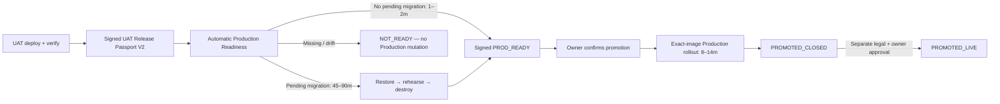

# Production A5 V2 Spec

Status: Execution frozen; deterministic runtime/IAM blockers must be fixed and proved before any workflow run
Owner: Platform / release owner
Last reviewed: 2026-08-12
Related:

- `docs/specs/uat-fast-selective-deployment-spec.md`
- `docs/specs/production-fast-promotion-spec.md`
- `docs/specs/production-global-maintenance-mode-spec.md`
- `docs/plans/production-a5-v2-readiness-matrix.md`
- `docs/plans/production-a5-v2-plan.md`

## 1. Outcome

เมื่อ UAT ผ่าน ระบบต้องทำงานที่เหลือซึ่ง Production เท่านั้นที่พิสูจน์ได้ให้เสร็จ
**ก่อน** เริ่ม deploy แล้วออกหลักฐาน `PRODUCTION_RELEASE_READY_V2` สำหรับ release นั้น
Production promotion จึงเหลือเพียง:

1. ตรวจว่า release passport และ readiness certificate ยังตรงและไม่หมดอายุ
2. ใช้ image digest เดิมที่ UAT รับรองแล้ว
3. apply migration ที่ A5 ซ้อมผ่านแล้ว เฉพาะเมื่อมี pending migration จริง
4. rollout เฉพาะ service ที่จำเป็นด้วย canary/rollback เดิม
5. ตรวจ digest, serving mode และ health แล้วปิด release operation

Production ห้ามรัน source CI, typecheck, unit test, build application image, สร้าง
SBOM หรือเซ็น application image ซ้ำ เพราะทั้งหมดเป็นหน้าที่ของ UAT Release Passport

ข้อเท็จจริงที่ตัดออกไม่ได้คือ UAT ไม่สามารถพิสูจน์ migration ledger, active service,
secret, network หรือ AWS policy ของ Production ณ เวลาจริงได้ V2 จึงไม่ลบการตรวจเหล่านี้
แต่ย้ายไปเป็น readiness ที่คำนวณล่วงหน้าและ retry ได้โดยยังไม่แตะบริการ Production

## 2. Goals

- UAT ที่ผ่านสร้าง release unit เดียวที่ Production ใช้ได้โดยไม่ rebuild/retest
- ปัญหาที่คาดเดาได้ทั้งหมดหยุดใน readiness ไม่ใช่กลาง deploy
- release ที่ไม่มี pending migration ได้ READY ภายในเป้าหมาย 1–2 นาที
- release ที่มี pending migration ทำ A5 clone rehearsal ล่วงหน้าและ deploy ได้ทันที
  หลัง READY
- release ปกติใช้ GitHub-hosted runner, GitHub OIDC และ AWS roles ที่มีจริง ไม่พึ่ง workstation,
  AWS root, `psql`, `cosign`, `shellcheck`, `actionlint` หรือ `yq` ที่ติดตั้งบนเครื่องคน
- รองรับ selective deployment โดย fail-safe เป็น `all`
- แยก technical deployment, maintenance closure และ customer launch/legal approval
  ออกจากกันอย่างชัดเจน
- retry ได้โดยไม่สร้าง parent/child race และไม่ต้องตั้งใจปล่อย workflow ให้ fail เพื่อ
  ค้นหา prerequisite ชิ้นถัดไป

## 2.1 Proof-before-execution contract

GitHub Actions มีต้นทุนและห้ามใช้เป็นเครื่องมือค้นหา error ของ deployment. ก่อน dispatch ใด ๆ
ทุกขั้นตั้งแต่ PR/CI, UAT, Passport, bootstrap, Readiness, clone, Production promotion, verification
จนถึง cleanup ต้องอยู่ใน proof matrix เดียวและมีสถานะ `PASS`. ช่องที่เป็น `UNKNOWN`, `ASSUMED`,
stale หรือพิสูจน์เฉพาะจาก template แต่ยังไม่ตรง live state ทำให้ทั้ง flow เป็น `BLOCKED`.

หลักฐานขั้นต่ำมีสี่ชั้น:

1. static contract ผูก caller, command/API, input/output และ state transition จริง
2. focused/adversarial test รวม provider response shape, lost response, timeout และ cleanup
3. live read-only exact readback ของ trust, policy, configuration, quota และ resource state
4. non-business-mutating provider canary สำหรับ runtime semantics ที่ read-only พิสูจน์ไม่ได้

ก่อน workflow จริงต้องทำ dry traversal ครบทุก action ด้วย matrix
`principal + action + resource + condition`, credential/TTL budget, binary/filesystem/network
prerequisite และ safe terminal state. ห้ามแก้เฉพาะ error ล่าสุดแล้ว retry; sibling path ที่ใช้ image,
role, helper หรือ provider contract เดียวกันต้องถูกกวาดและแก้ใน change เดียว.

## 2.2 One-shot image runtime contract

`migration-tool` เป็น runtime ร่วมของ reader bootstrap, readonly evidence, migration catalog,
clone/readiness clone และ reviewed Production apply. ก่อนออก Passport image ต้องพิสูจน์ว่า:

- OCI config มี `VOLUME ["/tmp"]`; directory `/tmp` เป็น `root:root 1777`, container ยังเป็น
  non-root `node`, root filesystem ยัง read-only และ exact `/tmp` bind เขียนได้
- child process ใช้ binary ที่มีอยู่จริงใน image โดยตรง ได้แก่
  `/app/apps/api/node_modules/.bin/prisma` และ `/app/node_modules/.bin/tsx`; ห้ามพึ่ง runtime
  `pnpm`, Corepack download หรือ internet package registry
- Prisma/TSX smoke ทำงานภายใต้ `--network none`, read-only root และ writable `/tmp`
- task definitions ทั้งห้าเส้นยังเป็น one-container, no task role, exact execution role,
  Fargate 1.4.0 และ mount `/tmp` เดียวกัน

การเปลี่ยน Dockerfile หรือ one-shot source ทำให้ migration-tool/release-task digest เปลี่ยน จึงต้อง
ออก UAT Passport ใหม่; Passport ที่ pin image เก่าใช้ต่อไม่ได้.

## 3. Non-goals

- ไม่รับรองว่า AWS/ECS/GitHub จะไม่มีเหตุขัดข้องจาก provider
- ไม่ใช้ UAT เป็นหลักฐานแทนสถานะ Production DB หรือ cloud ปัจจุบัน
- ไม่ข้าม legal gate เพื่อเปิดบริการแก่ลูกค้า
- ไม่เปลี่ยน branch protection, reviewer policy หรือ incident deployment authority
- ไม่ทำ A5 clone ทุก release เมื่อไม่มี migration
- ไม่ให้ candidate source ควบคุม Production security validator หรือ IAM policy
- ไม่เปิด customer traffic อัตโนมัติเพียงเพราะ technical deployment ผ่าน

## 4. Release states

| State | ความหมาย | อนุญาตให้ทำอะไร |
| --- | --- | --- |
| `UAT_ACCEPTED` | UAT deploy, health, finalization, images และ evidence ผ่านสำหรับ exact source | เริ่ม Production Readiness |
| `PROD_CHECKING` | กำลังอ่าน Production และ/หรือซ้อม A5 แบบไม่แก้ Production DB/service | รอหรือ retry readiness เท่านั้น |
| `PROD_READY` | signed readiness ยัง valid และ baseline ไม่ drift | เริ่ม Production promotion ได้หนึ่ง release |
| `PROMOTING` | Production mutation เริ่มแล้ว | rollout/recovery ตาม controller เท่านั้น |
| `PROMOTED_CLOSED` | exact release อยู่ Production แต่ global maintenance ยังปิด | admin-onboard ตรวจ/ควบคุมได้; ลูกค้ายังเข้าไม่ได้ |
| `PROMOTED_LIVE` | exact release อยู่ Production และ legal/launch gate อนุมัติให้เปิด | ผู้ใช้เข้าได้ตามสิทธิ์ปกติ |
| `NOT_READY` | prerequisite ขาด, drift หรือ rehearsal ไม่ผ่าน | แก้เหตุแล้วสร้าง readiness attempt ใหม่ |
| `EXPIRED` | passport/readiness หมดอายุหรือ baseline เปลี่ยน | ตรวจ readiness ใหม่; ห้าม deploy |

`UAT_ACCEPTED` ไม่เท่ากับ `PROD_READY`, และ `PROMOTED_CLOSED` ไม่เท่ากับ
`PROMOTED_LIVE` การตั้งชื่อ artifact, UI และ log ต้องไม่ทำให้สามขอบเขตนี้ปนกัน

## 5. Trust and source boundaries

### 5.1 Candidate authority

Application bytes มาจาก exact `candidateCommit` ที่ UAT ยอมรับเท่านั้น ได้แก่:

- `api-web`, `ai-gateway`, `workers`
- `release-task`
- `migration-tool` สำหรับทุก Production-eligible resolved-`all` passport
- migration catalog และ application-owned sync inputs

ทุก image ต้องอ้าง immutable digest, มี keyless signature, SBOM/attestation และ source
metadata ที่ตรวจกลับไปยัง UAT run เดียวกันได้

### 5.2 Controller authority

Production workflows, validators, IAM templates, security scripts และ evidence schema
ต้องมาจาก `github.workflow_sha` บน protected `main` เท่านั้น ไม่ execute
`candidate/infra/security/**`, candidate workflow หรือ candidate validator

Controller identity ใช้ protected commit + Git blob identity + `contractVersion=2` เป็น
authority หลัก ห้ามสร้างเครือข่าย hash constants ซ้ำใน YAML หลายไฟล์จนทุก commit
ทำให้ contract เก่าแตกเป็นลูกโซ่

### 5.3 Runtime authority

ทุก per-release AWS access ใช้ GitHub OIDC assume role แบบ least privilege ตาม stage ไม่มี
ขั้นตอน release ใดต้องใช้ local AWS profile, workstation root credential หรือ token ที่ส่งต่อ
ข้ามเครื่อง ข้อยกเว้นครั้งเดียวคือ platform administrator สร้าง temporary bootstrap role จาก
reviewed template. หากไม่มี non-root platform administrator จริง เจ้าของอาจอนุมัติเป็นลายลักษณ์
อักษรให้ root สร้างและลบเฉพาะ temporary role/user bridge ได้ แต่ root ห้ามรัน helper หรือแก้
durable target; mutation จริงทั้งหมดต้องอยู่ใต้ temporary non-root role และต้องพิสูจน์
`NoSuchEntity` ของ bridge/role หลัง ceremony

Temporary boundary นี้เป็น prerequisite ceremony ครั้งเดียวก่อน release และต้องครอบคลุม exact
IAM contracts ที่ readiness/deploy/runtime ใช้ทั้งหมด รวม runtime/task roles, workers cleanup,
A5 controller/execution roles, UAT deploy policy ที่จะใช้ก่อนสร้าง Passport และการซ่อม exact
Production S3 lifecycle ที่ตรวจพบว่า drift แล้ว
จากนั้นลบ temporary authority ทันที รายละเอียดอยู่ใน
`docs/runbooks/production-promotion-prerequisite-bootstrap.md`.

## 6. UAT Release Passport V2

UAT resolved-`all` ที่สำเร็จต้องสร้างและเซ็น `UAT_RELEASE_PASSPORT_V2` หนึ่งชิ้น
Production ไม่ประกอบ release จาก artifacts หลาย run เอง

Passport ต้องมีอย่างน้อย:

- repository, source SHA, UAT run id/attempt, controller SHA และเวลาหมดอายุ
- requested target, resolved target และ change-classification evidence
- exact digest ของ `api-web`, `ai-gateway`, `workers` และ `release-task`
- exact migration-tool digest สำหรับ repository catalog ของ source นั้น
- migration catalog hash, ordered migration names/checksums และ Prisma schema hash
- signature/bundle, SBOM, provenance และ scan result ของทุก image ที่ต้องใช้
- UAT deploy result, active revision/digest readback, health และ release finalization
- artifact hashes และ schema/contract version

Passport ออกได้เฉพาะ resolved-`all` เพราะ Production ต้องมี digest ครบสาม service แม้
ภายหลัง selective classifier จะเลือก deploy เพียงหนึ่ง service Single-service UAT run ใช้
ทดสอบเร็วได้ แต่ไม่ mint Production passport

ต้องสร้าง migration-tool ทุก passport ไม่ใช่เฉพาะ commit ที่เพิ่งเพิ่ม migration เพราะ
Production อาจค้าง applied catalog หลายรุ่น ขณะที่ diff จาก UAT release ก่อนหน้าไม่มีไฟล์
Prisma เปลี่ยน Readiness เป็นผู้ตัดสินจาก Production ledger ว่าต้องใช้ tool หรือไม่

Passport อายุไม่เกิน 24 ชั่วโมงสำหรับ readiness attempt และ artifact retention ต้องไม่ต่ำกว่า
7 วัน การหมดอายุไม่ทำให้ต้อง rebuild หาก immutable image/signature ยังอยู่และ policy อนุญาต;
ให้ rerun UAT acceptance/readback เพื่อออก passport ใหม่แทน

## 7. One-time A5 bootstrap

Production A5 reader bootstrap เป็น prerequisite ของ readiness ไม่ใช่ส่วนหนึ่งของ deploy
parent และไม่พึ่ง migration-tool ที่สร้างภายหลังจาก parent เริ่มแล้ว

Workflow bootstrap ต้อง:

1. รับ UAT passport ที่มี signed bootstrap/migration-tool digest
2. ใช้ GitHub OIDC bootstrap role และ isolated task ที่มีคำสั่งตายตัว
3. สร้าง/ตรวจ PostgreSQL role `watchdog_a5_prod_ro` และ secret
   `watchdog-bms/production/a5-readonly-database-url`
4. พิสูจน์ `default_transaction_read_only=on`, exact SELECT scope, ไม่มี DML/DDL,
   ownership, role escalation หรือ broad inherited privilege
5. เก็บเฉพาะ connection secret ใน Secrets Manager; ไม่เขียน credential ลง artifact/log
6. self-revoke mutation authority หลังสำเร็จหรือแม้ attempt ล้มเหลวเป็น exact metadata-only
   recovery policy; การ bootstrap ใหม่ต้องให้ administrator re-apply exact reviewed IAM template
   ก่อน ห้ามให้ workflow re-arm ตัวเอง
7. ออก signed bootstrap evidence ที่ผูก account, region, DB resource, role policy hash และเวลา
8. reconcile task-definition ทุก revision ที่ตรง exact bootstrap-family ARN ทั้งก่อน fast path และ
   ก่อน self-revoke โดย list ACTIVE definitions แบบ account-wide แล้ว filter ด้วย exact local regex;
   AWS `family-prefix` รับ full family name ไม่ใช่ arbitrary prefix. ใช้
   `ListTaskDefinitions`/`DeregisterTaskDefinition` ที่ `Resource:"*"` ตาม ECS
   authorization model, พิสูจน์ ACTIVE set ว่าง แล้วจึง revoke เป็นขั้นสุดท้าย
9. ถ้า `RunTask` response หาย ต้อง reconcile ด้วย stable client token/startedBy ก่อนลบ secret หรือ
   execution authority; ห้ามปล่อย untracked task ทำงานหลัง workflow จบ

Bootstrap command ต้อง classify exact controller/secret/execution tuple ก่อน image access ทุกครั้ง
และยอมรับเฉพาะ completed tuple หลังพิสูจน์ sole AWSCURRENT, exact tagged secret, execution role
absent, exact recovery policy/no attachment/sole inline policy และ task/task-definition stable-empty
ด้วย pure metadata reads แล้วออก EXISTING ได้ การ bootstrap ใหม่ที่ต้องใช้ mutation ยังคงเป็น
administrator ceremony ไม่ใช่สิทธิ์ถาวรใน GitHub workflow

## 8. Production Readiness V2

`production-readiness` เริ่มอัตโนมัติหลังมี UAT passport หรือเริ่มซ้ำโดยระบุ UAT run id
ได้ โดยไม่ต้องมี Production deploy run ที่ `in_progress` Automatic attempt ใช้
`requestedServingMode=maintenance_closed` ซึ่งตรงกับการ deploy ครั้งแรกของระบบนี้ การขอ
`live` ต้องเป็น explicit readiness attempt หลัง legal evidence พร้อม; READY ของ closed mode
นำไปเปิด live ไม่ได้

### 8.1 Cheap common checks

ก่อนแตะ RDS snapshot readiness ต้องพิสูจน์:

- source DB เป็น `postgres` 18.3, มี encrypted automated snapshot `available` อายุไม่เกิน 36 ชั่วโมง
  และ AWS-managed `alias/aws/secretsmanager` resolve เป็น exact enabled KMS key ที่ review แล้ว
- AgentCore runtime เป็น exact approved runtime/source SHA, versioned content-addressed S3 artifact,
  entry point `runtime.js`, MMDSv2, Production deployment identity และ exact execution role ที่ไม่มี
  permissions boundary/managed-policy attachment

- passport signature/schema/source/digest/expiry ถูกต้องและ artifact ไม่หมดอายุ
- GitHub main protection, production environment และ OIDC role bindings ตรง policy
- AWS account/region, ECR repositories, exact SSM service pointers, cluster/default VPC/public
  subnets/security groups, S3 versioning/lifecycle, log groups/KMS/SNS และ IAM/runtime/service-linked
  roles ตรง controller templates
- runtime secret metadata ครบ มี AWSCURRENT ไม่ scheduled deletion และ KMS state ใช้ได้;
  A5 reader secret และ read-only privilege proof ผ่าน โดย readiness ห้ามอ่าน secret value
- RDS/Redis encryption, availability, backup, failover และ deletion-protection baseline ผ่าน
- Production services เป็น stable singleton และอ่าน exact SHA/digest/config ได้
- current baseline เป็น ancestor ที่จำแนก change ได้; unknown/malformed/non-ancestor เป็น `all`
- legal state ตรง requested serving mode

### 8.2 Migration classification

Reader task อ่านเฉพาะ `_prisma_migrations` แล้วเทียบ exact name/checksum set กับ catalog ใน
candidate image โดยคงลำดับ `started_at,id` ของ Production เป็นหลักฐานประวัติจริง แต่ไม่บังคับให้
ประวัตินั้นเท่ากับลำดับชื่อ directory ปัจจุบัน เพราะ migration ที่มี timestamp เก่ากว่าอาจถูกเพิ่มและ
apply ใน release หลังได้:

- exact catalog: `pendingMigrationCount=0` → quick readiness
- valid checksum-matching applied subset + exact repository set difference: ต้อง A5 clone,
  effective target=`all`; pending set เรียงตาม repository เพื่อผูกกับลำดับที่ Prisma จะ apply
- edited checksum, unknown/duplicate migration, duplicate/invalid applied order, failed/unfinished
  migration หรืออ่านไม่ได้:
  `NOT_READY`; ห้ามซ่อมหรือ apply ระหว่าง readiness
- historical reorder หรือ migration ชื่อเก่าที่ยังไม่ applied ไม่ใช่ drift เมื่อทุก applied checksum
  ตรง exact repository file; migration ที่ยังไม่ applied ต้องอยู่ใน pending set และผ่าน clone เหมือนกัน
- ค่า schema เดิม `status=APPEND_ONLY_PENDING` คงไว้เพื่อ compatibility ของ signed artifacts แต่มี
  ความหมายเป็น checksum-compatible pending set ตามกติกาข้างต้น ไม่ใช่ positional suffix
- pending set ที่มี known destructive SQL เช่น `DROP TABLE/COLUMN/TYPE`, `TRUNCATE` หรือ
  `DELETE FROM` ไม่เข้า automatic promotion แม้ UAT ผ่าน ต้องใช้ reviewed migration path แยก
- destructive guard ใช้ parser/scanner เดียวกับ A5 เดิมและรันซ้ำตอน classify, ใน clone และ
  ภายใน durable Production DB fence ก่อน `prisma migrate deploy`

การดูเพียง Git diff ไม่ใช่ migration authority Production ledger เป็นคำตอบสุดท้าย

### 8.3 No-migration path

เมื่อไม่มี pending migration readiness ออก certificate หลัง common checks โดยไม่ restore
snapshot ไม่ build image และไม่สร้าง release operation เป้าหมายเวลา 1–2 นาทีและ hard
budget 5 นาที หากเกินให้หยุดเป็น infrastructure timeout ไม่ปล่อย deploy ต่อ

### 8.4 Migration path (A5 clone)

เมื่อมี pending migration:

1. เลือก encrypted automated snapshot ของ Production ที่อายุอยู่ใน policy
2. restore ไป isolated private subnet/SG แบบ endpoint-only, `PubliclyAccessible=false`
3. ใช้ exact signed migration-tool digest จาก passport; ห้าม build ใน A5
4. ตรวจ PRE invariants และ exact applied name/checksum set พร้อม historical execution order
5. apply exact pending repository set ภายใต้ lock/statement/overall timeout ที่กำหนด
6. ตรวจ POST schema/data invariants และ compatibility suites
7. เก็บ tenant-anonymous evidence เท่านั้น
8. ลบ clone DB, managed secret, task definition และ residual ENI/resource
9. ออก READY ได้เมื่อ cleanup ยืนยัน `DESTROYED` และ residual count เป็นศูนย์เท่านั้น

Clone controller ต้อง bind provider authorization จริงด้วย:

- `RestoreDBInstanceFromDBSnapshot` ครอบ exact target DB, snapshot, DB subnet group,
  parameter group และ option group ที่อ่านจาก source DB; ห้ามใช้ชื่อที่เดาเอง
- `ecs:ListTasks` ใช้ `Resource:"*"` พร้อม exact `ecs:cluster` condition สำหรับ Fargate;
  task/run/stop และ task-definition lifecycle คงแยก least-privilege ตาม resource type ที่รองรับ
- source snapshot KMS, DB class/engine orderability และ service quota/headroom ต้องผ่าน live
  read-only proof ก่อน restore

Readiness timeout หรือ cleanup failure คือ `NOT_READY`; ห้ามเปลี่ยนเป็น advisory และห้าม
เริ่ม Production deploy ในขณะที่ clone ยังเหลืออยู่

Private endpoint policies are part of the same fail-closed runtime contract, not a provisioning
detail. The apply execution role must be able to pull the exact migration tool, read only the
Production writer secret and write only `/ecs/watchdog-bms-production-a5-apply`. The shared
Production execution role must be able to write both the three `/ecs/watchdog-bms-prod-*` service
groups and `/ecs/watchdog-bms-release-task`. Readiness and the deploy boundary exact-compare these
policies before any release task or database mutation.

## 9. Production Release Ready certificate

Signed `PRODUCTION_RELEASE_READY_V2` ต้องผูกอย่างน้อย:

- passport hash/run/source และ exact runtime/release/migration image digests
- controller SHA และ contract version
- requested/effective target และ serving mode
- active Production SHA/digest/config ของทั้งสาม service ณ readiness
- Production migration ledger hash (รวม historical execution order) และ exact pending set
- AWS account/region, role-policy hash, network/secret/readiness inventory hash
- A5 rehearsal evidence hash เมื่อมี pending migration
- legal readiness reference ที่ mode ต้องใช้
- issued/expiry time และ readiness run id/attempt

Certificate อายุไม่เกิน 24 ชั่วโมง แต่ baseline drift ทำให้หมดอายุทันทีแม้ยังไม่ถึงเวลา
หนึ่ง certificate ใช้กับหนึ่ง exact release attempt; retry หลัง mutation เริ่มต้อง reconcile
durable release state ก่อน ห้าม reuse แบบไม่ตรวจ

## 10. Selective deployment

Production เปรียบเทียบ passport source กับ full SHA ของ active service แต่ละตัวโดยใช้
build-input mapping เดียวกับ UAT:

- เปลี่ยนเฉพาะ service เดียวและไม่มี shared/Prisma/controller impact → service นั้น
- มากกว่าหนึ่ง service, shared package, root manifest, config/contracts, Prisma,
  deployment controller, unknown path, malformed SHA หรือ non-ancestor → `all`
- pending migration, maintenance transition หรือ baseline ที่ยัง split → `all`
- no application change → no-op success หลังพิสูจน์ digest/config; ไม่ rollout

Current Production baseline ณ 2026-08-12 ยัง split ระหว่าง API/AI กับ workers ดังนั้น release
แรกที่ทำให้ baseline convergence ต้องเป็น `all`

Explicit single-service target ยังคงเป็น incident authority เท่านั้น Normal promotion ใช้
`target=auto` และ controller เป็นผู้ resolve

## 11. Minimal Production promotion

Production workflow รับเพียง UAT passport reference, readiness run/reference และ serving mode
ที่ขอ ก่อน assume mutation-capable deploy role หรือสร้าง DB/service mutation ต้องตรวจแบบรวดเร็ว:

1. signature/hash/expiry ของ passport และ READY
2. current Production baseline hash เท่ากับ certificate
3. exact image digests/signatures ยังอยู่
4. legal gate สำหรับ mode ที่ขอ
5. ไม่มี active release/migration operation ที่ขัดกัน

หากข้อใดไม่ตรงให้จบเป็น `NOT_READY` ก่อน mutation และชี้เหตุเดียวที่แก้ได้ ไม่เริ่ม build,
test, clone หรือ discovery chain ใน deploy workflow

หลังผ่าน gate:

- no migration: run idempotent sync/release prepare แล้ว rollout target
- pending migration: ปิด ingress/quiesce ตาม mode, recheck ledger hash แล้ว apply exact suffix
  ที่ A5 ซ้อมผ่าน จากนั้น rollout `all`
- verify exact digest/source/config/health/readiness และ finalize durable release
- recovery ต้องกลับไปยัง known-safe serving state; ห้าม rollback schema แบบ destructive

## 12. Maintenance and customer launch

อ้างอิง journey ใน `production-global-maintenance-mode-spec.md`:

- หน้า login คงอยู่
- เมื่อระบบปิด มีเพียง `admin_onboard` ที่ login และเข้าหน้า control ได้
- user อื่นไม่สร้าง persistent session และเห็นข้อความ “ระบบกำลังปรับปรุง”
- `admin_onboard` เป็น internal operational role จึงไม่ต้องผ่าน customer Terms/Privacy
  clickwrap ระหว่าง maintenance แต่ไม่ได้ถูกยกเว้น PDPA, access logging หรือ internal privacy
  controls
- Cloudflare host-proxy ของ UAT และ Production ต้องไม่แนบ body เมื่อ forward `GET`/`HEAD` แต่
  ต้องรักษา body ของ mutation methods; custom-domain maintenance probes ต้องผ่านก่อนรับรอง closed

OPEN → CLOSED ต้องปิด ingress/background processing และรอ signed URL drain 900 วินาที
หนึ่งครั้งก่อนรับรอง closed state ส่วน CLOSED → CLOSED ต้องพิสูจน์ว่าปิดต่อเนื่องและ reuse
`closedSince`; ห้ามรอ 900 วินาทีใหม่ทุก release

การเปิด CLOSED → LIVE เป็น config-only rollout ของ exact digest ที่ deploy และตรวจแล้ว
พร้อม legal/launch approval ใหม่ ไม่ rebuild/retest application image และไม่ควบรวมการเปิด
ลูกค้าไว้กับ technical deploy

Maintenance ยังมี residual processing เช่น IP/traffic log และ operator access จึง defer ได้
เฉพาะ launch-specific legal evidence ไม่ใช่ยกเว้น PDPA ทั้งหมด

## 13. Failure, retry and idempotency

- ทุก attempt มี stable id และ artifact แยก; rerun ห้ามผสม evidence ต่าง attempt
- missing prerequisite หยุดที่ named readiness step แรกพร้อม exact error/remediation; ไม่มีการ
  สร้าง READY บางส่วนหรือไล่พบ blocker ต่อหลังเริ่ม mutation
- readiness retry ไม่ต้อง rerun UAT ถ้า passport ยัง valid และ immutable bytes ไม่เปลี่ยน
- AWS transient timeout retry ได้ภายใน bounded attempt; semantic drift ต้องเริ่ม attempt ใหม่
- Production baseline drift หลัง READY ทำให้ stop ก่อน mutationและคำนวณ readiness ใหม่
- clone cleanup ทำงานแบบ always-run และ READY ห้ามออกก่อนพิสูจน์ cleanup
- promotion failure หลัง mutation ต้อง reconcile durable release operation ก่อน retry
- ห้ามใช้ intentional failing parent, manual child dispatch race หรือ artifact จาก failed parent
  เป็นเส้นทางปกติ

## 14. Evidence and retention

Artifacts ต้องเป็น attempt-specific, signed และไม่มี secret/customer row payload:

- `UAT_RELEASE_PASSPORT_V2`
- `PRODUCTION_A5_BOOTSTRAP_V2`
- `PRODUCTION_A5_CLONE_REHEARSAL_V2` เมื่อใช้
- `PRODUCTION_RELEASE_READY_V2`
- `PRODUCTION_RELEASE_RESULT_V2`

เก็บ metadata ที่จำเป็นต่อ audit: run/attempt, actor, source/controller SHA, image digests,
policy hashes, observed statuses/timestamps, migration names/checksums, target/mode และ cleanup
result Artifact retention ขั้นต่ำ 7 วัน; release/result record ที่ต้องใช้ตรวจสอบย้อนหลังต้องถูก
copy ไป evidence store ตาม retention policy ของบริษัท

## 15. Timing contract

| Process | Evidence/estimate | Working target | Hard decision point |
| --- | --- | --- | --- |
| UAT resolved-all warm run | observed 14m51s deploy; 19m17s end-to-end before V2 passport | 15–22m with parallel migration-tool | เกิน 26m ให้แยก queue/build/rollout cause |
| UAT selective service | design estimate from existing rollout | 12–17m | fail-safe `all` ถ้าจำแนกไม่ชัด |
| Quick Production Readiness | V2 locally implemented, not yet measured live | 1–2m | stop at 5m |
| A5 migration readiness | no complete green run yet; script bounds dominate | 45–90m | no READY until first full restore/rehearse/delete green |
| Production no-DB promotion | component estimate from existing ECS timings | 8–14m | investigate at 20m excluding provider incident |
| First OPEN → CLOSED | required signed-URL drain | promotion + 15m | only first transition |
| CLOSED → CLOSED promotion | continuous closure proof | same 8–14m | no repeated drain |
| CLOSED → LIVE | config-only rollout estimate | 7–10m | legal/launch gate required |

เวลา A5 45–90 นาทีเป็น planning budget ไม่ใช่ measured success เพราะ clone workflow เดิม
มี 11 attempts และยังไม่มี end-to-end success ณ 2026-08-12 หลังได้ first green ต้องบันทึก
ช่วง restore, rehearsal และ cleanup แยก แล้วปรับ SLO จากหลักฐานจริง

## 16. Acceptance criteria

- UAT passport มี exact images/tools/evidence ครบและ validator ปฏิเสธ missing/tampered bytes
- Production workflow ไม่มี typecheck/test/application build/SBOM/signing step
- readiness quick path ผ่านใน fixture; live read-only proof ต้องผ่านหลัง approval โดยไม่ mutate service/DB
- migration classification ครบ exact/pending/edited/unknown/duplicate/failed cases และพิสูจน์ว่า
  historical reorder/missing-middle ที่ checksum ตรงถูกจำแนกเป็น exact pending set โดยไม่เกิด false drift
- A5 full path restore→rehearse→delete ผ่านหนึ่งครั้งและ residual เป็นศูนย์ก่อนเปิดใช้
- automatic path ปฏิเสธ destructive pending SQL ทั้ง classify, clone และ pre-mutation recheck
- candidate security/controller path ไม่ถูก execute; controller มาจาก protected main เท่านั้น
- missing reader secret, role drift, expired artifact, baseline drift และ legal block หยุดก่อน
  Production credentials/mutation
- selective classifier fail-safe เป็น `all` และ first split baseline resolves `all`
- CLOSED → CLOSED ไม่รอ 900 วินาทีซ้ำ; OPEN → CLOSED รอครบและมี evidence
- live opening ใช้ exact deployed digestและ legal approval; ไม่มี `skip_legal`
- retry ไม่ต้องสร้าง PR/commit ใหม่เมื่อ bytes ไม่เปลี่ยน
- มี focused contract tests, fake-AWS tests, YAML parse และ shell syntax ก่อน merge และมี one
  live read-only readiness proof ก่อน Production mutation
- exact linux/amd64 migration-tool ผ่าน offline image-runtime verifier โดยไม่มี network และไม่มี
  runtime `pnpm`; ทุก five-path task render ผ่าน contract เดียวกัน
- IAM simulator/provider authorization proof ครบ bootstrap cleanup, clone restore และ clone
  task reconciliation; live template/readback ตรงก่อน dispatch
- forced-failure canary พิสูจน์ residual task, task definition, clone DB, managed secret และ ENI
  เป็นศูนย์ก่อนเรียกเส้นทาง Production ว่า stable

## 17. Explicitly forbidden

- build/test/typecheck application source ใน Production promotion
- build migration-tool หรือ release-task ใน A5/Production จาก candidate source
- execute candidate `infra/security`, workflow, IAM template หรือ validator
- hard-coded self-referential SHA chain ในหลาย workflow
- workstation/root credential หรือ manual upload/signing เป็น release prerequisite
- deploy parent ที่ตั้งใจให้ fail เพื่อค้น prerequisite
- child workflow ที่ต้องแข่ง dispatch ขณะ parent `in_progress`
- A5 clone เมื่อ Production ledger ไม่มี pending migration
- Production mutation ก่อน `PROD_READY`
- เปิดลูกค้าเมื่อ legal/customer-launch evidence ยัง blocked
