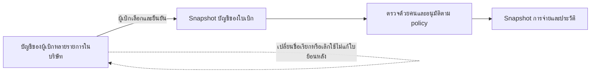

# Spec: หลายบัญชีรับเงินคืน และผู้เบิกเลือกบัญชีต่อใบ

> **หมายเหตุผู้ควบคุมงาน 2026-10-05:** เอกสารนี้เขียนจาก working tree ที่ยังไม่มีฟีเจอร์ "บัญชีรับเงินคืนและสลิป" (#962/#963 ซึ่งขึ้น Production 2026-10-05) จึงบรรยายสิ่งที่มีอยู่แล้วว่ายังไม่มี และบางข้อขัดกับคำตัดสินเจ้าของ 1 ต.ค. 2569 ฉบับที่ใช้ลงมือทำคือ [สเปกหลายบัญชีรับเงินคืน ฉบับปรับตามระบบจริง](reimbursement-multi-payout-accounts-spec-th.md) ซึ่งบอกว่ารับข้อใด ไม่รับข้อใด และเพราะอะไร เอกสารนี้เก็บไว้เป็นข้อเสนอและที่มาของคำตัดสินเจ้าของ 5 ต.ค. 2569

วันที่: 2026-10-05
สถานะ: Design proposal พร้อมแผนและ scenario audit; ยังไม่ implement
ขอบเขต: สมาชิกบริษัทจัดทำใบและเลือกบัญชีรับเงินคืนของตนหรือบุคคลอื่น รวมคนนอกที่ไม่มีผู้ใช้ในระบบ → เลือกในใบเบิก → ตรวจด้วยคน → บันทึกจ่าย → เอกสาร/ประวัติ

เอกสารประกอบ: [แผน](../plans/reimbursement-recipient-bank-account-plan-th.md), [bug/gap/impact และเกณฑ์ทดสอบ](../research/reimbursement-multi-account-gap-impact-2026-10-05-th.md), [memory](../agent-memory/reimbursement-recipient-bank-account.md), [วิเคราะห์เดิม](../research/reimbursement-recipient-bank-account-impact-2026-09-29-th.md), [spec หลัก](reimbursement-approval-spec.md), [journey](reimbursement-step-journey-spec-th.md), [source consistency](reimbursement-source-consistency-spec.md)

## 1. เป้าหมายและลำดับความสำคัญ

พนักงานเก็บบัญชีรับเงินคืนของตนหรือบุคคลอื่น รวมคนนอกบริษัทที่ไม่มีผู้ใช้ในระบบ ได้หลายบัญชี และเป็นผู้เลือกเองว่า **ใบเบิกนี้ให้คืนเข้าบัญชีใด** ผู้ตรวจและผู้จ่ายใช้ข้อมูลชุดที่พนักงานเลือกและผ่านการตรวจ ย้อนหลังได้แม้รายการบัญชีส่วนตัวเปลี่ยนไป

ข้อกำหนดที่ยืนยันแล้ว:

- คำขอ 2026-10-05: หลายบัญชีอยู่ในรอบแรก ผู้เบิกเป็นผู้เลือกตอนเบิก
- ข้อสรุปเดิม 2026-09-29: ใช้คนตรวจบัญชี ระบบไม่ยืนยันเจ้าของบัญชีผ่านธนาคารหรือจับคู่ชื่ออัตโนมัติ
- คงหนึ่งใบ → ผู้เบิกหนึ่งคน → วิธีรับเงินหนึ่งวิธี → บัญชีปลายทางหนึ่งบัญชี → จ่ายเต็มจำนวน ตามโมเดลใบเบิกเดิม หลายบัญชีให้เลือกไม่ได้หมายถึงแบ่งยอดใบเดียวเข้าหลายบัญชี
- คง approval/finance-review policy โดยเพิ่ม approval floor สำหรับบัญชีบุคคลอื่นตาม §3.3; คง self-approval/solo-owner exceptions และสองช่องลายเซ็นตาม journey เดิม การเลือกบัญชีไม่ใช่ลายเซ็นและไม่เพิ่มอำนาจอนุมัติ
- เอกสารนี้แทนข้อเสนอเดิมที่เลื่อน saved accounts/หลายบัญชีไปภายหลัง เฉพาะขอบเขตบัญชีรับเงิน; ไม่เปลี่ยน ownership ของ expense, ledger, banking หรือ AI Gateway

รายละเอียดด้าน UX, API และ recovery ด้านล่างเป็นแบบที่เสนอจากคำขอนี้ ไม่ใช่คำตัดสินย้อนหลังของผู้ใช้ และไม่ใช่พฤติกรรมที่มีในระบบแล้ว

คำตัดสินผู้ใช้ 2026-10-05: **รวมบัญชีบุคคลอื่นได้ เมื่อผู้อนุมัติตรวจและยอมรับ** ผู้เบิกระบุ `holderType: SELF | THIRD_PARTY` เอง ไม่อนุมานจากการเทียบชื่อ; THIRD_PARTY ต้องระบุความเกี่ยวข้องและเหตุผลต่อใบ และผู้อนุมัติต้องยอมรับปลายทางฉบับนี้อย่างชัดเจนตาม §3.3 การตรวจยังเป็นงานของคน ไม่ยืนยันความเป็นเจ้าของผ่านธนาคาร

### 1.1 คำชี้แจงผู้ใช้: รับเงินคืนให้คนนอกบริษัทได้

ผู้ใช้ยืนยันเพิ่มเติม 2026-10-05 ว่าเพิ่มบัญชีของบุคคลใดก็ได้ รวมผู้ที่ไม่ได้อยู่ในระบบหรือบริษัท เพื่อเบิกคืนบุคคลนั้นได้ ไม่จำกัดแค่โอนเงินของพนักงานไปบัญชีพนักงานอีกคน

แยกตัวตน 4 อย่าง:

| ตัวตน | ตัวอย่าง/ความหมาย |
|---|---|
| ผู้สร้างร่าง `createdByUserId` | A หรือ finance ผู้เตรียมเอกสาร เป็นผู้ใช้ในบริษัท |
| ผู้ยื่นเบิก `requesterUserId` | A สมาชิกที่รับผิดชอบคำขอและเลือก/ยืนยันบัญชี ไม่บังคับว่า A เป็นผู้รับเงินหรือผู้สำรองจ่ายจริง |
| ผู้มีสิทธิ์รับคืน `beneficiarySnapshot` | A หรือ B คนนอกบริษัทที่สำรองจ่ายจริง; B ไม่ต้องมี userId/membership/login |
| เจ้าของบัญชี `accountHolderName` | ชื่อผู้ถือบัญชีปลายทาง อาจเป็นผู้รับคืนหรือบุคคลอื่นที่ผู้อนุมัติยอมรับ ไม่อนุมานตัวตนจากชื่อหรือเลขบัญชี |

A เพิ่มชื่อบัญชี ธนาคาร เลขบัญชีของ B แล้วเลือกกับใบที่ A ยื่นได้ ไม่ต้องสร้าง user/employee/supplier ให้ B และไม่ต้องรอ B เข้าเว็บยืนยัน A เป็นผู้ยืนยันข้อมูลที่ตนยื่นและผู้อนุมัติรับรองตามหลักฐาน

ข้อมูล saved account เป็นรายการที่ A ดูแลในบริษัท ส่วนข้อมูลเจ้าของบัญชีเป็น free-form ที่ตรวจด้วยคน ไม่มี foreign key บังคับไป User/Employee ของเจ้าของบัญชี และไม่เปิดเผยสมุดบัญชีของสมาชิกคนอื่นให้ A

ข้อกำหนดนี้แทนขอบเขตเดิม 2026-09-11 ที่เลื่อน external/no-account payee ออกนอกระบบตาม [source consistency](reimbursement-source-consistency-spec.md) เฉพาะ design ใหม่; โค้ดปัจจุบันยังไม่ได้รองรับ external payer และต้องปรับ source/approval/projection ตาม §4.4 ก่อนอ้างว่าทำงานครบ

## 2. ขอบเขตเล็กสุดที่ทำงานครบ

- เพิ่ม/ดู/ตั้งชื่อเรียก/เลิกใช้บัญชีของตนภายในบริษัทเดียว และเพิ่มบัญชีจากหน้าใบเบิกได้
- เลือกบัญชีอย่างชัดเจนทุกใบ แม้มีบัญชีเดียว ไม่มีการเลือกบัญชีแรกหรือบัญชีล่าสุดให้อัตโนมัติ ไม่มีระบบบัญชีหลักในรอบนี้
- รองรับทั้งบัญชีตนเองและบุคคลอื่นที่ผู้อนุมัติยอมรับ; saved account เป็นรายการที่ผู้เบิกจัดการ ไม่ใช่ข้อพิสูจน์ว่าผู้เบิกเป็นเจ้าของบัญชีธนาคาร
- แสดงธนาคาร ชื่อบัญชี เลขท้าย และชื่อเรียก; เปิดดูเลขเต็มตามสิทธิ์ก่อนยืนยัน
- เก็บ snapshot บัญชีในใบและ payment แยกจาก saved account; การตรวจเป็นรายใบ ไม่ใช้ badge “บัญชีเคยตรวจแล้ว” แทนการตรวจใบใหม่
- รองรับเงินสด/เช็ค/อื่น ๆ ตาม enum เดิมโดยระบุวิธีรับเงินในใบก่อนส่ง ไม่มีช่องบัญชีของโอนค้างในวิธีอื่น และห้ามใช้ OTHER บันทึกการโอนเพื่อหลบกฎบัญชี
- ไม่เพิ่ม automatic bank transfer, PromptPay, OCR สมุดบัญชี, bank verification, payroll, บัญชีร่วมข้ามบริษัท, partial/split payment หรือ bulk-payment UI
- ไม่บังคับแนบสมุดบัญชีในรอบนี้ ผู้ตรวจใช้ข้อมูลที่มีและปฏิเสธ/ขอข้อมูลเพิ่มได้ หากเพิ่มหลักฐานบัญชีภายหลังต้องเป็น attachment purpose แยกจากใบเสร็จและมีสิทธิ์เฉพาะ ไม่ให้แนบเลขบัญชีใน internal note ที่อ่านได้กว้างกว่า

## 3. Journey และหน้าจอ

### 3.1 ผู้เบิกทำเอง

1. เปิดสร้างใบเบิกตามจุดเข้าเดิม รวมทางต่อจากค่าใช้จ่าย/ใบทดแทนที่จ่ายส่วนตัว
2. ส่วน **การรับเงินคืน** เลือกวิธีรับเงิน; ถ้าโอน แสดง **เลือกบัญชีรับเงินคืน** และ **เพิ่มบัญชี**
3. ถ้าไม่มีบัญชี แสดงเหตุผลและปุ่มเพิ่ม เก็บร่างได้ แต่ส่งไม่ได้จนเลือกบัญชี ถ้าเพิ่มบัญชีไม่สำเร็จห้ามล้างรายการค่าใช้จ่ายหรือไฟล์ที่กรอกไว้
4. ตัวเลือกเป็น radio/card บนมือถือหรือ select พร้อมรายละเอียดบน desktop: `ชื่อเรียก · ธนาคาร · ••••1234 · ชื่อบัญชี` เลขท้ายชนกันยังแยกได้ด้วยชื่อเรียก/ชื่อบัญชี และปุ่มดูเลขเต็ม
5. เพิ่มบัญชีสำเร็จแล้วกลับมาที่ร่างเดิม ให้ผู้เบิกกดยืนยันใช้บัญชีนี้ การ retry ไม่สร้างบัญชีหรือใบซ้ำ
6. หน้าตรวจร่างก่อนส่งแสดงวิธีรับเงินและบัญชีที่เลือกพร้อมข้อความ “ใบนี้รับเงินเข้าบัญชี …” กดส่งโดยผู้เบิกนับเป็นการยืนยัน snapshot ปัจจุบัน
7. หลังส่ง ข้อมูลบัญชีเป็น readonly; ผู้อนุมัติและผู้จ่ายเห็นชุดเดียวกัน

### 3.2 เตรียมใบแทนสมาชิกอีกคน (คนละกรณีกับคืนเงินคนนอก)

- ในหัวข้อนี้ B คือสมาชิกที่ถูกระบุเป็น `requesterUserId` ไม่ใช่คนนอกที่รับเงิน ถ้า A ยื่นคืนเงินคนนอก B ให้ใช้ A เป็น requester และทำตาม §3.2.1 ไม่มีการขอ B ยืนยัน
- Finance ยังเตรียมรายการให้ B ได้ตามสิทธิ์เดิม แต่ไม่มีสิทธิ์เลือก/เปลี่ยน/รับรองบัญชีแทน B เพียงเพราะมี `finance_review`
- หน้าผู้จัดทำแสดง “รอผู้เบิกเลือกบัญชีรับเงินคืน” พร้อมลิงก์ไปใบให้ B ไม่แสดงสมุดบัญชีทั้งหมดของ B
- B เปิดร่าง เลือกวิธีรับเงิน/บัญชี และกด “ยืนยันการรับเงินคืน” จากนั้น B ส่งเอง หรือ finance ส่งร่างฉบับที่ B ยืนยันแล้วได้
- การยืนยันผูกกับเนื้อหาร่างที่ตรวจเห็น (ยอด สกุลเงิน รายการ หลักฐาน และปลายทาง) ถ้า finance เปลี่ยนเนื้อหาที่มีผลต่อ snapshot ต้องให้ B ยืนยันใหม่ ป้องกันการยืนยันใบเก่าแล้วนำไปใช้กับร่างใหม่
- การเปลี่ยน requester ใน create form ก่อนบันทึกต้องล้าง selection/confirmation และยกเลิกผล fetch เก่า; requester ของร่างที่สร้างแล้วคงแก้ไม่ได้ตาม contract เดิม
- ผู้เบิกไม่มีบัญชี/เข้าใช้งานไม่ได้: คง DRAFT แสดงสาเหตุและทางกู้การเข้าใช้งานตาม employee-access เดิม ไม่ให้ผู้จัดทำสวมสิทธิ์เลือกแทน

### 3.2.1 A ยื่นเบิกคืนคนนอกบริษัท

1. A เลือก “เบิกคืนให้บุคคลภายนอก” กรอกชื่อผู้รับคืน ความเกี่ยวข้องและเหตุผลที่สำรองจ่าย ไม่ต้องค้นหาหรือสมัครสมาชิกให้คนนอก
2. A ระบุรายการและหลักฐานของผู้สำรองจ่ายจริงตาม §4.4 เลือก/เพิ่มบัญชีปลายทางแล้วกดยืนยันเอง
3. หน้าตรวจแสดงแยก “ผู้ยื่นเบิก A”, “ผู้รับเงินคืน B”, “ชื่อบัญชี …” ให้เห็นพร้อมกัน ถ้าชื่อบัญชีไม่ใช่ B ให้ผู้อนุมัติตรวจเหตุผลการจ่ายเข้าบัญชีนั้นด้วย
4. ผู้อนุมัติตรวจผู้มีสิทธิ์รับคืน หลักฐานการสำรองจ่าย และบัญชี แล้วรับรอง snapshot ปัจจุบันก่อนจ่าย ไม่มีงานรอ B login/เซ็นในระบบ
5. ใบพิมพ์ยังมีผู้ยื่นเบิก A และผู้อนุมัติเป็นผู้ลงนามในระบบตามหน้าที่ ไม่แสดงลายเซ็น A ว่าเป็นลายเซ็นรับเงินของ B; การลงนามไม่ใช่ gate การจ่ายเพิ่ม

### 3.3 ตรวจและจ่าย

- ผู้อนุมัติเห็นผู้เบิกและเจ้าของบัญชีพร้อมกัน เปิดเลขเต็มเมื่อตรวจ และรับรอง “ตรวจข้อมูลบัญชีรับเงินคืนฉบับนี้แล้ว” ในการอนุมัติ transaction เดียวกัน
- บัญชี THIRD_PARTY ต้องมี approval เสมอ: `requiresApproval = thresholdRequiresApproval || holderType === THIRD_PARTY || beneficiaryKind === EXTERNAL_PERSON` ตรึงเหตุผลนี้ใน policy snapshot โดยไม่เปลี่ยน threshold ทั้งบริษัท ผู้อนุมัติเดิมตาม routing ต้องรับรอง “ยอมรับให้คืนเงินเข้าบัญชีบุคคลอื่นตามเหตุผลในใบนี้” พร้อม actor/time/destination version; ถ้าไม่มี approver ที่มีสิทธิ์ให้ใช้ routing/recovery เดิม ไม่ให้ finance/payer รับรองแทน เว้นแต่บุคคลนั้นมีอำนาจ approver ของใบนี้ด้วย
- คง self-approval/solo-owner policy เดิม จึงไม่ได้เพิ่มกฎว่าผู้ตรวจต้องเป็นคนที่สอง; แสดงการอนุมัติตนเองให้เห็นชัด ในกรณีที่ policy ไม่อนุญาตห้ามใช้ account review ข้าม self-approval guard
- ถ้าคนตรวจพบว่าระบุ SELF แต่เป็นบัญชีคนอื่น ให้ reject/return เพื่อเปลี่ยนประเภทและส่งใหม่ ห้ามกดยอมรับให้ผ่านในขั้นจ่ายเพียงอย่างเดียว
- เมื่อ approval ถูกข้ามสำหรับ beneficiary REQUESTER และบัญชี SELF ผู้ตรวจการเงินรับรองในขั้น finance review; หากข้ามทั้งสองขั้น ผู้จ่ายรับรองก่อนเริ่มจ่าย ต้องมี human review อย่างน้อยหนึ่งครั้งสำหรับ destination version ปัจจุบัน
- แม้ตรวจแล้ว ผู้จ่ายต้องเทียบข้อมูลผู้รับที่ธนาคารแสดงกับ snapshot ก่อนยืนยันโอน การตรวจในระบบไม่ใช่ธนาคารยืนยันบัญชีและไม่ใช่หลักฐานโอนสำเร็จ
- หน้าจ่ายเติมวิธีจ่ายจากใบและเป็น readonly ไม่เริ่มจาก CASH ดังเดิม แสดงบัญชีปลายทางและยอดเต็ม ปุ่มคัดลอกเลขเต็มทำได้เฉพาะผู้มีสิทธิ์
- “บัญชีบริษัทที่ใช้จ่าย” (`bankAccountId` เดิม) กับ “บัญชีรับเงินคืนของผู้เบิก” ต้องอยู่คนละ field/label และไม่ใช้ ID แทนกัน
- การพิมพ์/ลงนามยังเปิดหลังส่งตามกฎเดิม ไม่เพิ่มเป็นเงื่อนไขก่อนจ่าย

### 3.4 State ของ UI ที่ต้องมี

โหลดรายการ, ไม่มีบัญชี, โหลดล้มเหลวพร้อม retry, บัญชีที่เลือกถูกเลิกใช้ก่อนส่ง, เลือกผิดบริษัท/สมาชิก, รอผู้เบิกยืนยัน, ข้อมูลร่างเปลี่ยน, ส่งสำเร็จแต่ response หาย, ไม่มีสิทธิ์ดูเลขเต็ม, review ค้าง, ผู้จ่ายคนอื่นกำลังทำ, ผลโอนไม่แน่ชัด, บันทึกจ่ายไม่สำเร็จหลังโอน, recovery ค้าง, PAID/VOIDED readonly ต้องมีข้อความและ action ที่ทำต่อได้

ห้ามเลือกบัญชีใหม่เองเมื่อ fetch ล้มเหลว/บัญชีเดิมหาย; ปิด submit ระหว่าง loading และบอกเหตุผล ใช้ server action capabilities ไม่เดาจาก role string รองรับ keyboard, screen reader, label/aria, mobile focus และไม่ส่งเลขเต็มใน analytics/browser error log/localStorage

## 4. Saved account, snapshot และ validation

### 4.1 ข้อมูลที่เสนอ

ชื่อ field/route เป็น proposed contract ต้องตรวจ naming ของ repo อีกครั้งตอน implement:

| จุดเก็บ | ข้อมูล/ข้อบังคับ |
|---|---|
| `ReimbursementRecipientAccount` | `id, companyId, membershipId, ownerUserId (เจ้าของรายการ ไม่ใช่เจ้าของบัญชีธนาคาร), holderType, label, bankCode, bankNameSnapshot, accountHolderName, accountNumberEncrypted, accountLast4, accountFingerprint, status ACTIVE/ARCHIVED, version, createdAt, updatedAt` |
| Request | `repaymentSchemaVersion`, `requestedPaymentMethod`, `recipientAccountId`, `recipientSnapshotJson`, `recipientSnapshotHash`, `recipientVersion`, `recipientSelectedByUserId/At`, `requesterConfirmationHash/At`, `replacesRequestId` (ใบแทนที่ยกเลิกเสร็จแล้ว), `beneficiarySnapshot` (kind REQUESTER/EXTERNAL_PERSON, name, relationship/reason, claim-scoped ref; ไม่มี userId บังคับสำหรับคนนอก), `thirdPartyRelationship/Reason`, ผล third-party acceptance และ human review ของ version นี้ |
| `recipientSnapshotJson` | schema version, company/requester, account ID/version ที่ผู้เบิกเลือก, holderType, bank/name, encrypted number, last4, stable server digest; ไม่เก็บ plaintext ใน JSON/metadata |
| Source payer binding ต่อ line | ข้อเท็จจริงผู้สำรองจ่ายจริง/หลักฐาน/เวอร์ชันต้นทาง และผลรับรองโดย approver ตาม §4.4; ไม่ใส่ userId ปลอมให้คนนอก |
| Human review | `reviewedByUserId, reviewedAt, reviewedRecipientVersion, reviewStage APPROVAL/FINANCE/PAYMENT` แสดงผลเป็น “คนตรวจแล้ว” |
| Payment | immutable copy ของ requested method/destination version/hash และ snapshot ที่จ่ายจริงในเส้นทางปกติ; เชื่อมกับ payment execution attempt |
| Payment execution | attempt ID, actor, destination version/hash, request version ที่ล็อก, state, timestamps, resolution reason; ใช้ request lock และ storage ภายใน reimbursement เดิม |

saved account อยู่ใน reimbursement domain ไม่บังคับมี EmployeeAccessProfile เพราะสมาชิก OWNER/ADMIN/custom role มีสิทธิ์เบิกด้วย ยึด company membership และ requesterUserId ไม่ใช้ข้อมูลระดับ global user; ไม่ใช้ company BankAccount, SalesAgentProfile หรือ SupplierBankAccount เป็น recipient master

### 4.2 อายุข้อมูลบัญชี

- เพิ่มได้หลายรายการ; list มี pagination ตาม pattern เดิม ไม่สร้างข้อจำกัดจำนวนบัญชีทางธุรกิจโดยไม่มี requirement
- แก้ข้อมูล saved account ได้ด้วย expectedVersion แล้วเพิ่ม version; ข้อมูลในใบเป็น snapshot แยกที่ไม่แก้ตาม master แม้ยังเป็น DRAFT ถ้าร่างเลือก master version เก่าต้อง refresh และให้ผู้เบิกยืนยันข้อมูลปัจจุบันก่อนส่ง ไม่สร้างบัญชีใหม่ทุกครั้งที่แก้ชื่อเจ้าของเพื่อหลบ unique constraint
- การเปลี่ยนชื่อเรียกใน master ไม่แก้บัญชี/ผลตรวจ/ลายเซ็นของใบที่ส่งแล้ว; financial snapshot ของใบและ payment คงเป็นข้อมูลถาวรตาม revision
- `ARCHIVED` หมายถึงไม่ให้เลือกสำหรับการส่งใบใหม่ ไม่ใช่คำสั่งเปลี่ยน/ยกเลิกบัญชีในใบที่ส่งแล้ว ไม่มี hard delete ผ่าน UI
- ก่อน archive แสดงใบ DRAFT/ค้างจ่ายที่อ้างอิงและข้อความว่าใบที่ส่งแล้วคงบัญชีเดิม พร้อมลิงก์ไปแก้ตาม §7 หากบัญชีใช้รับเงินไม่ได้ต้องหยุดจ่ายใบที่เกี่ยวข้องและเข้า correction ไม่คิดว่า archive ป้องกันการโอนของใบเก่าโดยอัตโนมัติ
- ขณะ submit ต้องตรวจ ACTIVE และ ownership ของรายการบัญชีที่บันทึกในสมุดของผู้ยื่นภายใน transaction; ไม่ตรวจ membership ของเจ้าของบัญชีคนนอก; draft snapshot ที่ archive ไปต้องให้เลือกใหม่เอง
- ไม่ cascade ลบ snapshot/payment เมื่อเลิกใช้บัญชีหรือปิดสมาชิก การ retention/deletion ใช้ lifecycle ของบริษัทที่มีอยู่ ไม่กำหนดระยะเวลาใหม่จากงานนี้
- membership ถูกลบแล้วสร้างใหม่ไม่ยึดบัญชีเก่าด้วย email/ชื่อ; ต้องยืนยันตัวตนผ่าน workflow เดิมก่อนกู้ ownership ไม่ copy อัตโนมัติ

### 4.3 Validation

- `accountNumber` เป็น string เก็บเลข 0 นำหน้า รับ input รูปแบบอ่านง่ายแล้ว normalize เฉพาะช่องว่าง/ขีดที่ UI อนุญาต ห้ามใช้ Number หรือ strip อักขระที่ไม่รู้จักจนกลายเป็นบัญชีอื่น
- กรอบระบบที่เสนอสำหรับบัญชีธนาคารในประเทศ: ASCII digits 6–20 ตัว, bankCode จากรายการธนาคารที่ระบบกำหนด, holder name trim แล้ว 1–200 ตัวอักษร, label ไม่บังคับไม่เกิน 80 ตัว กรอบนี้เป็น validation ของผลิตภัณฑ์ ไม่อ้างว่าเป็นกฎธนาคารทุกแห่ง ต้องทดสอบตัวอย่างธนาคารเป้าหมายก่อน release
- THIRD_PARTY ต้องมีความเกี่ยวข้อง (ข้อความ 1–100 ตัวอักษร) และเหตุผล (1–500 ตัวอักษร) ต่อใบ ไม่ขอเลขบัตรประชาชน/เบอร์โทรของบุคคลนั้นโดยไม่มีความจำเป็น ผู้เบิกและผู้อนุมัติตรวจทั้งชื่อ ธนาคาร เลขบัญชี และเหตุผล ไม่คัดลอก acceptance จากใบอื่น
- ชื่อภาษาไทย/อังกฤษ/คำนำหน้า/ช่องว่างต่างกันไม่ผ่านหรือไม่ผ่านด้วยชื่อ string อย่างเดียว ผู้ตรวจเป็นคนตัดสินตามนโยบายเจ้าของบัญชี
- ภายใน company+member เดียวกัน ห้ามรายการซ้ำจาก bankCode+normalized number แม้เปลี่ยนชื่อเรียก ตรวจ unique ด้วย server HMAC ที่มี scope และ secret โดย exclude ID ของบัญชีที่แก้เอง; duplicate ที่ archive แล้วให้เปิดรายการเดิมและยืนยันเปิดใช้ ไม่สร้างซ้ำเงียบ ๆ
- คนละสมาชิก/บริษัทใช้เลขเดียวกันไม่ตอบ error ที่เผยว่ามีใครใช้อยู่ ไม่สร้าง global lookup; การยอมรับเจ้าของบัญชีเป็นงานของผู้ตรวจ
- currency ของ payment ต้องเท่ากับ request; ไม่แปลงสกุลเงินและไม่ถือว่า snapshot บัญชีพิสูจน์ว่าธนาคารรับทุก currency ได้ รอบนี้บัญชีโอนใหม่รองรับ THB; ใบ foreign currency เดิมอ่านได้แต่ต้องใช้ recovery/วิธีที่รองรับอย่างชัดเจนก่อนจ่าย ไม่แปลงยอดเอง

### 4.4 ค่าใช้จ่ายที่คนนอกสำรองจ่ายจริง

การเพิ่มบัญชีบุคคลอื่นอย่างเดียวไม่พิสูจน์ว่าใครสำรองจ่าย และยังไม่ทำให้ source guard เดิมรองรับคนนอก ต้องแยกสอง flow:

- A สำรองจ่ายเองแต่ขอให้คืนเข้าบัญชี B: beneficiary = REQUESTER, holderType = THIRD_PARTY; source payer ยังเป็น A ใช้ member source rules เดิม
- B คนนอกสำรองจ่ายจริงและ A ยื่นให้: beneficiary = EXTERNAL_PERSON; source payer ต้องเป็น B จากข้อเท็จจริง/คำรับรองและหลักฐานที่ approver ตรวจ ไม่เขียน `payerUserId=A` เพียงเพราะ A อัปโหลด

ใช้ snapshot ผู้มีสิทธิ์รับคืนระดับใบ และ `sourcePayerBinding` ต่อรายการภายใน reimbursement domain ไม่สร้างทะเบียนบุคคลภายนอก/บัญชีผู้ใช้ใหม่:

- binding เก็บ beneficiary ref ของใบ, ชื่อผู้สำรองจ่ายตามหลักฐาน, source/attachment IDs+checksums+versions หรือ missing-receipt reason ที่ policy เดิมยอมรับ, คำยืนยันผู้ยื่นและ actor/time; ขณะร่าง/ส่งเป็น pending human review
- submit ตรวจความครบถ้วน/สิทธิ์และข้อห้าม source เดิม แต่ external mode มีทางรับกรณี payer เป็นคนนอกอย่างชัดเจน; approval transaction ต้องรับรอง external payer binding พร้อมบัญชีสำหรับรายการทั้งใบ แล้ว finance/projection/payment ตรวจ binding รุ่นเดียวกัน ไม่ยอมให้ pending binding เป็น payable
- ใบเสร็จ standalone ที่ A แนบต้องระบุการสำรองจ่ายของ B แยกจาก uploader; หลักฐานที่ไม่พอตัดสินให้ reject/ขอข้อมูลตาม flow เดิม ไม่ถือว่าเลขบัญชีพิสูจน์การสำรองจ่าย
- ค่าใช้จ่าย/ใบทดแทนที่เชื่อมอยู่และไม่มี payerUserId รวม paper payer name ต้องผ่าน external binding ที่มนุษย์รับรองได้ ไม่ลบ `payer_unlinked` guard ทั้งระบบหรือจับคู่ชื่ออัตโนมัติ; source fields/checksums เดิมไม่ถูกเขียนทับ
- ถ้าต้นทางระบุสมาชิก C เป็นผู้จ่ายจริง ห้ามเลือก external mode เพื่อข้าม `wrong_payer`; ต้องแก้ข้อเท็จจริงต้นทางผ่านเส้นทางที่ได้รับสิทธิ์ก่อน ถ้าเป็น A จ่ายเองแต่ปลายทาง B ให้ใช้ REQUESTER flow ข้างต้น
- source tenant/branch/currency/issued/personal-funding/tax/settled/posted/void/duplicate/derived-projection guards เดิมยังใช้ทุก mode; source option query และ attachment alias resolution ต้องใช้กติกาเดียวกับ submit ไม่บอกว่าเลือกได้แล้วมาติดตอนจ่าย
- หนึ่งใบมี beneficiary เดียว ทุกรายการต้องเป็นการสำรองจ่ายของคนเดียวกัน กรณีหลายคนแยกใบ; ไม่รวมคนจากชื่อเหมือนกัน/บัญชีเดียวกัน
- source snapshot ใหม่ต้อง version แยกจาก V1 ที่ผูก requester=payer; requester confirmation/approval/signature รวม beneficiary และ source payer binding; review metadata ไม่เข้า content hash ไม่ทำให้เซ็นวน
- รายงาน/claim projection/payment source display ใช้ผู้รับคืนจริง B คู่กับผู้ยื่น A ไม่สร้างข้อมูลว่าบริษัทจ่ายหนี้ของ A เพียงเพราะ A เป็น requester; คง source identity/ยอด/ภาษี/การกันลงค่าใช้จ่ายซ้ำและ ledger rules เดิม หาก adapter ยังรองรับแต่ employee payer ให้ทำให้รองรับ explicit beneficiary ก่อนเปิด external mode
- คนนอก B ไม่ได้รับ user permission, notifications, public link หรือการส่งข้อความจากการกรอกชื่อบัญชี; status แจ้ง A/ผู้ตรวจ/ผู้จ่ายตามสิทธิ์เดิม การเข้าถึงของ B ไม่ใช่ dependency ของ flow

## 5. สิทธิ์และข้อมูลอ่อนไหว

| Actor | จัดการ saved accounts | เลือก/ยืนยันต่อใบ | เลขเต็มของ snapshot |
|---|---|---|---|
| ผู้เบิกที่เป็น active company member | ของตนในบริษัทปัจจุบัน ผ่าน self-service permission pack | ร่างของตน + branch scope; เป็น actor ที่ server บันทึก | ของใบตนตามสิทธิ์อ่านเดิม |
| Finance ผู้จัดทำแทน | ไม่แก้สมุดบัญชีของผู้อื่น | ไม่เลือกแทน; ส่งได้เมื่อเจ้าของยืนยันร่างปัจจุบัน | เฉพาะใบที่มีหน้าที่ตรวจ/จ่ายใน scope; การจัดทำแทนอย่างเดียวไม่พอ |
| ผู้อนุมัติที่ได้รับ assignment | ไม่เห็นสมุดบัญชีทั้งหมด | ไม่เปลี่ยน | ใบที่มีอำนาจตรวจจริง รวม frozen assignment ตาม policy เดิม |
| ผู้ตรวจ finance / ผู้จ่าย | ไม่เห็นสมุดบัญชีทั้งหมด | ไม่เปลี่ยน | ใบใน scope ที่ตรวจ/จ่ายได้ |
| read/read_related/export/auditor อย่างเดียว | ไม่ได้ | ไม่ได้ | masked; การอ่านใบไม่แปลว่าสิทธิ์เห็นเลขเต็ม |
| AI/LINE/notification | ไม่ได้ | ไม่ได้ | ไม่มีเลขเต็ม มีสถานะและ web link |

เสนอคีย์ self-service เฉพาะ `reimbursement.recipient_account.manage_own` ใน pack สมาชิกทุก role (รวม custom/read-only company roles ตาม self-service เดิม) และใช้ read-own สำหรับอ่านบัญชีตน ไม่ใช้ employee admin permission มอบอำนาจเพิ่มแก่ finance

การเปิดเลขเต็มใช้ endpoint แยกที่ authorize tenant/member/branch/exact assignment ทุกครั้ง ตอบ `Cache-Control: no-store` และ audit actor/target/time/result โดยไม่มีเลขเต็ม list/detail/export ปกติส่งเฉพาะ masked summary; plaintext อยู่เฉพาะ response ที่ได้รับสิทธิ์ การเป็นผู้อนุมัติครั้งก่อนอย่างเดียวไม่ให้ full-read ตลอดไปหลังงานจบ หากไม่มี current scope อื่น

สำเนาที่เซ็น/ไฟล์แนบของใบแบบใหม่อาจมีเลขเต็มบนกระดาษ ให้ถือ original signed-copy bytes เป็น sensitive โดย default และตรวจสิทธิ์เดียวกับ full snapshot ทั้ง preview/download/URL; ผู้อ่านทั่วไปเห็น metadata และสถานะการรับรอง ไม่ได้สิทธิ์อ่านเลขเต็มผ่านไฟล์แทน API ไม่พยายาม OCR/redact แล้วอ้างว่าปลอดภัย ใบ legacy คงกฎเอกสารเดิมจนมีการเปลี่ยน policy แยก

เก็บเลขเข้ารหัสด้วย authenticated-encryption helper/config pattern เดิม; ขาด key/decrypt ไม่ได้ต้อง fail closed ห้าม fallback plaintext หมุน encryption key แล้ว approval/signature hash ต้องไม่เปลี่ยน เก็บ stable server digest แยกจาก randomized ciphertext และห้ามส่ง account fingerprint ออก public API

## 6. API และ transaction boundary

### 6.1 Contract เพิ่มแบบ additive

| Contract ที่เสนอ | กติกา |
|---|---|
| `GET/POST /reimbursements/recipient-accounts` | list/create ของผู้เรียกในบริษัท; create รับ bank/name/number/label + idempotency key ไม่รับ owner/verified จาก client |
| `PATCH /reimbursements/recipient-accounts/:id` | bank/name/number/holderType/label/status พร้อม expectedVersion; server normalize/encrypt/check duplicate/increment version; ไม่แก้ request snapshots |
| `GET /reimbursements/recipient-accounts/:id/sensitive` | เลขเต็มบัญชีตนเท่านั้น; ไม่ใช้ route นี้ให้ reviewer ไล่ดู wallet ผู้อื่น |
| create/update draft | เพิ่ม beneficiary kind/name/reason และ payer-binding declaration; requester เป็นสมาชิกเสมอแต่ beneficiary ภายนอกไม่ต้องมี userId; create รับ optional replacesRequestId เมื่อยกเลิกใบเดิมเสร็จและตรวจ source ใหม่; เพิ่ม requestedPaymentMethod/recipientAccountId/expected account version; มีเฉพาะผู้เบิกที่เขียนส่วนนี้ได้ server สร้าง snapshot |
| `POST /reimbursements/:id/confirm-recipient` | ผู้เบิกยืนยัน hash ของร่างปัจจุบัน เก็บ actor จาก session; finance ส่ง actor ID ปลอมไม่ได้ |
| submit | require expected request version + confirmed recipient/current draft hash; ผู้เบิก submit ยืนยันได้ใน transaction เดียว; การทำแทนต้องมี confirmation ที่ตรงกันอยู่แล้ว |
| approve/finance | รับ expected snapshot/recipient version และ explicit human-review acknowledgement; ไม่มีการส่ง bank details ใหม่; approval ของ THIRD_PARTY/EXTERNAL_PERSON ต้องมี explicit beneficiary/destination acceptance |
| `GET /reimbursements/:id/recipient-sensitive` | full snapshot ตาม §5 เท่านั้น ไม่ดึง latest saved account |
| prepare/resolve payment execution | claim actor ownership ก่อนโอน/จ่ายจริง และ resolve ตาม §8 โดยตรวจ under lock |
| record payment | รับ execution ID, expected recipient version/hash และข้อมูลจ่ายเดิม; server copy snapshot ไม่รับปลายทางเลขใหม่ |
| paper signed-copy ack | เพิ่ม snapshot hash/revision ที่ผู้แนบเห็นและตรวจ under request lock; requestNo อย่างเดียวไม่พอ |

DTO ต้อง reject forged server-owned fields และ malformed/partial recipient input ไม่ ignore แล้วใช้บัญชีอื่น การ clear method/account ใช้ explicit null ตาม contract ไม่ merge ให้มี old bank residue

### 6.2 Atomicity และ hash

- draft select/confirm/submit/reopen/approve/finance/cancel/prepare/payment/sign/scan acknowledgement ใช้ request lock เดิมและ expected version; ตอนเลือก/submit เพิ่ม account/member check ใน transaction ที่เกี่ยวข้อง
- กำหนด lock order ให้สอดคล้อง payment lock → request lock เดิม และ account/member lock ที่เพิ่ม ห้ามคนละ path จับสลับกันจน deadlock; ทดสอบกับ PostgreSQL จริงก่อนรับ implementation
- hash ใหม่รวม requested method, holderType, third-party relationship/reason, beneficiary snapshot, source payer binding และ canonical destination facts; requester confirmation รวม current draft contents ด้วย ผล review/เวลาเปิดเลข/การเปลี่ยนชื่อเรียกใน master ไม่เข้า content hash
- master account version เพิ่มทุก mutation; request recipient version/digest เปลี่ยนเมื่อ financial destination/holderType/เหตุผลที่รับรองเปลี่ยน โดยไม่ใส่ชื่อเรียกหรือ master update time ใน content hash; re-submit หลัง return ต้องยืนยันและตรวจใหม่แม้เลขเดิม การ retry payload เดิมคืนผลเดิม; key เดิม payload อื่นเป็น conflict
- version marker ต้องใช้เลือก legacy hash algorithm อย่างชัดเจน ห้าม fallback legacy hash ถ้าใบมี destination ใหม่แล้ว
- payment use-case มี early replay branch และ repository มี idempotency branch: ต้องเปรียบเทียบ destination/execution binding ทั้งสองจุด และตรวจสิทธิ์ก่อนคืนผล
- audit/outbox ของ selection/review/prepare/record เก็บพร้อม state transaction; log event ID/version/last4 ไม่เก็บเลขเต็ม ชื่อบัญชี/เอกสารธนาคารไม่ไหลไป AI หรือ notification อัตโนมัติ

Error codes ที่เสนอ: `recipient_required`, `recipient_account_unavailable`, `recipient_account_stale`, `recipient_confirmation_required`, `recipient_confirmation_stale`, `recipient_review_required`, `recipient_snapshot_stale`, `payment_method_mismatch`, `payment_currency_mismatch`, `payment_execution_owned`, `payment_outcome_unknown`, `legacy_recipient_reissue_required` ใช้ HTTP 400/403/404/409/422 ตาม pattern เดิม ไม่ใช้ error แยกที่เปิดเผยข้อมูลข้าม tenant

## 7. การแก้ไขตามสถานะ

| สถานะ | ทางแก้และผลต่อข้อมูล |
|---|---|
| DRAFT | ผู้เบิกเลือกใหม่ได้; ยกเลิก confirmation/review เก่า; submit ตรวจใหม่ |
| PENDING_APPROVAL | ผู้เบิก withdraw ผ่าน reopen เดิมก่อนตัดสิน → DRAFT; race กับ approve มีผู้ชนะเดียว |
| REJECTED | reopen เดิม → DRAFT → ผู้เบิกยืนยันใหม่ → submit; เก็บเหตุผล/history |
| FINANCE_REVIEW | NEEDS_INFO เดิมใช้ได้เฉพาะ guard ที่อนุญาต ไม่มี recorded payment/live projection; กลับ DRAFT และ review/ลายเซ็นปัจจุบันหมดผล |
| APPROVED / READY_FOR_PAYMENT / มี live projection | ใช้ cancel-and-reissue; จบ cancellation/projection cleanup แล้วจึงสร้างใบแทนและเลือกใหม่ ไม่เพิ่ม generic READY→DRAFT shortcut |
| cancellationPending | ห้ามเริ่มจ่าย/ส่ง/เซ็น; แสดง cleanup ค้างและ retry intent เดิมตาม actor/สิทธิ์เดิม ไม่ออกใบแทนก่อนปลด source สำเร็จ |
| payment IN_PROGRESS / OUTCOME_UNKNOWN | ห้ามแก้/ยกเลิก/ออกใบแทนจน resolve ผลการจ่าย; ห้ามเชื่อแค่ยังไม่มี payment row |
| PAID / PARTIALLY_PAID ที่มีอยู่เดิม | เก็บปลายทางที่จ่ายจริง; ห้ามแก้ทับหรือใช้ฟีเจอร์นี้เพิ่ม partial payment; ใช้ void/reversal/reconciliation guard เดิม |
| CANCELLED / VOIDED | readonly; สร้างใบใหม่ได้เฉพาะ source ยัง eligible และไม่คัดลอก confirmation/verification/payment |

Cancel-and-reissue ต้องบันทึกความสัมพันธ์ old/new request และ reason เพื่อ trace/duplicate review ใช้ source validation/evidence permissions เดิม ห้าม copy live derived projections เป็นค่าใช้จ่ายต้นทางใหม่หรือรวมยอดซ้ำ ถ้าช่วงบัญชีปิด/reconciliation ล็อก ให้ผู้มีสิทธิ์ทำ recovery ตาม ledger/banking workflow เดิมก่อน retry ไม่ปลด guard จากหน้าบัญชีรับเงิน

ลายเซ็นและ paper copy ฉบับเก่าคงเป็นหลักฐานประวัติพร้อม revision/invalidation reason ไม่ใช้รับรองร่างใหม่ หากโค้ดเดิมลบ signature/link ตอน return ต้องปรับการเก็บประวัติที่จำเป็นใน scope นี้พร้อมสิทธิ์อ่าน ไม่สรุปว่ามี archive แล้วเพียงเพราะไฟล์ต้นฉบับยังอยู่

## 8. การโอนภายนอกและบันทึกจ่าย

ระบบไม่สั่งธนาคารโอน การกัน record ซ้ำเพียงอย่างเดียวไม่กันคนสองคนโอนเงินจริง จึงเสนอ execution ownership ขนาดเล็กต่อใบภายใต้ request lock:

1. ผู้จ่ายกด “เริ่มจ่ายใบนี้” server ตรวจ payable/source/projection/duplicate/review/recipient แล้วบันทึก attempt actor + snapshot; คนอื่นเห็นผู้รับผิดชอบและไม่เริ่มอีก attempt
2. `IN_PROGRESS` ไม่มี auto-expiry ที่เปิดให้โอนใหม่เมื่อปิด browser หรือ session หมดอายุ กลับเข้ามาพบ attempt เดิม; ไม่ล็อกฐานข้อมูลค้างข้ามการไปธนาคาร
3. ก่อนโอนพบเลขผิด/บัญชีปิด และยืนยันได้ว่ายังไม่โอน: actor ยุติ attempt พร้อมเหตุผล จึงเข้า correction §7 ได้
4. ธนาคาร timeout/ไม่ทราบผล: `OUTCOME_UNKNOWN` คง hold และหลักฐาน/เลขอ้างอิงที่มี ต้องตรวจธนาคารก่อน ห้าม retry transfer จาก timeout อย่างเดียว
5. ยืนยันโอนไม่สำเร็จและไม่มีเงินออก: actor resolve พร้อมเหตุผล/หลักฐานอ้างอิง → เปิด attempt ใหม่ได้ ไม่ใช้ void payment เพราะยังไม่มี successful payment
6. โอนสำเร็จ: record payment ด้วย attempt เดิมและยอด/currency/method/destination ตรงใบ; commit payment snapshot + attempt completion + source facts แบบ atomic
7. โอนสำเร็จแต่บันทึกล้มเหลว/response หาย: reload และ retry **บันทึก** ด้วย key เดิม ห้ามสั่งโอนซ้ำ payment number/posting retry ต้องไม่สร้าง payment อีกชุด
8. Actor ไม่อยู่/ถูกถอนสิทธิ์: ผู้มี payment.record ใน scope ทำ takeover ได้หลังยืนยันผลธนาคารและให้เหตุผล พร้อม audit; ถ้ายังไม่ทราบผล takeover ได้เพื่อสืบต่อ แต่ยังเริ่มการจ่ายใหม่ไม่ได้ ไม่มี timeout bypass
9. โอนผิดบัญชี/ผิดยอด/ผิดวิธี: คง exception hold และบันทึกหลักฐาน incident ตามสิทธิ์การเงิน ห้ามใส่ approved snapshot แล้วอ้างว่าจ่ายเข้าบัญชีนี้สำเร็จ หรือ mark PAID เพื่อปิดงาน ต้องจัดการเงินที่โอนผิด/คืนเงินภายนอกและ accounting correction ตาม workflow เดิมก่อน resolution; ถ้าต้องการรับรองปลายทางอื่นย้อนหลังเป็น settlement ต้องออกแบบนโยบายแยก
10. Void/reversal ลบผลทางระบบไม่ได้เรียกเงินจริงกลับ หลัง void ต้อง resolve ว่าเงินจริงถูกคืน/ยกเลิกแล้วก่อนเปิด attempt โอนใหม่ รักษา reconciliation/closed-period blockers เดิม

ใช้กับวิธีจ่ายใหม่ทุกวิธีเพื่อไม่ให้สลับ CASH หลบ ownership; ไม่อ้างว่าป้องกันคนโอนจากธนาคารโดยไม่เปิดระบบได้ หลักฐาน execution/audit คือการประสานงาน ไม่ใช่ bank settlement confirmation อัตโนมัติ

## 9. เอกสาร การรวมจ่าย และผลกระทบโดเมนข้างเคียง

- ใบพิมพ์/preview แยกชื่อผู้ยื่นกับผู้รับคืนจริง และใช้ snapshot ของใบ; payment history ใช้ snapshot ของ payment ไม่ join master สด พิมพ์ธนาคาร ชื่อบัญชี เลขท้ายและวิธีรับเงิน; default print/export ปิดเลขเต็ม
- ถ้าจำเป็นต้องพิมพ์เลขเต็ม ให้เป็น explicit sensitive-print action ที่ใช้สิทธิ์เดียวกับ reveal, audit และ no-store ไม่ให้ URL/cache ของไฟล์เต็มหลุดไปยังผู้อ่าน masked
- digital signature acknowledgement และ paper scan acknowledgement ผูก revision เดียวกัน; การเปลี่ยนบัญชีทำให้ลายเซ็น/scan เดิมไม่รับรองฉบับใหม่ การจ่าย/ผลตรวจที่เป็น metadata ไม่ทำให้ผู้เบิกต้องเซ็นซ้ำโดยไม่มี content change
- source facts, amount, VAT/WHT, ledger liability, payment mirror, bank matching `sourcePaymentRef` ใช้ identity/จำนวนเงินเดิม ห้ามบัญชีรับเงินกลายเป็น BankAccount ของบริษัทหรือเพิ่ม journal เพราะเปลี่ยนธนาคาร
- หากมีการรวมใบสำคัญจ่าย/ไฟล์โอน ต้องจัดกลุ่มอย่างน้อย company+requester+beneficiary ref+currency+method+destination fingerprint ไม่รวมด้วย requester หรือชื่อบุคคลภายนอกอย่างเดียว; beneficiary ภายนอกเป็น ref ระดับใบ จึงไม่ auto-group ข้ามใบจากชื่อ/เลขบัญชีที่เหมือนกัน และต้องมี mapping กลับรายใบ ห้าม bulk action เปลี่ยนบัญชีที่ผู้เบิกเลือก
- ยังไม่พบ voucher implementation ใน reimbursement paths ที่ตรวจ งานนี้ไม่สร้าง bulk voucher engine; แก้ข้อกำหนดใน spec หลักเพื่อไม่ให้ implementation ภายหลังรวมคนละบัญชี
- LINE/AI แจ้ง “รอเลือกบัญชี/รอตรวจ/รอจ่าย/ต้องตรวจผลธนาคาร” พร้อม web link ได้เท่านั้น ห้ามเลือกบัญชี เปิดเลขเต็ม อนุมัติ หรือบันทึกจ่ายผ่านข้อความ AI Gateway ใช้ permission-checked APIs ต่อไป

## 10. ใบเดิม การทยอยเปิด และ rollback

| ใบเดิม | นโยบายที่เสนอ |
|---|---|
| PAID/CANCELLED/VOIDED ไม่มีบัญชี | อ่าน/พิมพ์ด้วย legacy hash/layout แสดง “ไม่มีข้อมูลบัญชีที่บันทึกไว้” ไม่อนุมานจากโปรไฟล์หรือ bankAccountId |
| DRAFT หรือ reopen/resubmit | ต้องเลือกวิธีรับเงินและบัญชีตามกฎใหม่เมื่อเปิด feature |
| PENDING_APPROVAL | withdraw/reject แล้วเลือก/ยืนยันใหม่ก่อนส่ง ไม่ append บัญชีหลังเซ็นเงียบ ๆ |
| FINANCE_REVIEW ที่ return ได้ | NEEDS_INFO แล้วทำตามกฎใหม่ |
| APPROVED/READY_FOR_PAYMENT ไม่มี destination | hold การจ่ายใหม่ → cancel/reissue ตาม §7; ไม่มี synthetic review/backfill จาก master |
| โอนแล้วแต่ยังไม่บันทึก ณ cutover | inventory และ settle/reconcile ด้วย workflow เดิมก่อนเปิด enforcement; ถ้าหลุดมาให้เข้า explicit exception recovery ห้ามสั่งโอนใหม่หรือเติม destination ย้อนหลังเพื่อให้ผ่าน |
| Foreign currency/partial/สมาชิกปิดแล้ว/period lock | แยก inventory และ owner ของ recovery ก่อนเปิด ไม่ปล่อยปุ่มที่กดแล้วติดโดยไม่มีคำอธิบาย; ไม่สร้างทางเลือกบัญชีแทนพนักงาน |

เพิ่ม schema แบบ nullable ก่อน, backend รองรับ old/new และ masked read ก่อน, deploy client/permission pack ให้ครบ, inventory outstanding + unknown transfers, แล้วจึงเปิด enforcement แก่บริษัทที่พร้อม New writer ห้าม drop recipient fields เมื่อเจอ old client; old client mutation ที่ไม่ส่ง version/selection ให้ error พร้อม reload โดยไม่แก้ใบ

Rollback ปิด new creation/selection ได้แต่ต้องคง reader/payment safety guards/hash สำหรับใบที่มี destination แล้ว ห้าม rollback ไป writer เก่าที่เพิกเฉยบัญชีในใบใหม่ ห้ามลบ migration/snapshot/key ขณะยังมีใบอ้างอิง การทำ rollout จริงต้องอ่าน cloud operations และ mandatory UAT/Production protocol ตาม AGENTS.md; งานออกแบบนี้ไม่ได้เรียก cloud หรือ deploy

## 11. Acceptance และขอบเขตความมั่นใจ

เกณฑ์รายกรณีและชั้นทดสอบอยู่ใน [scenario matrix](../research/reimbursement-multi-account-gap-impact-2026-10-05-th.md#scenario-matrix) นโยบายบัญชีบุคคลอื่นได้รับคำตอบแล้ว; design ใช้ approval floor และ explicit acceptance ข้างต้น ทุก P0/P1 ต้องมีหลักฐานก่อนรับ implementation ไม่มีคำว่า “ครบทุก scenario” ที่พิสูจน์ได้จากอ่านโค้ดอย่างเดียว รายงานครอบคลุมสถานะ สิทธิ์ ช่องทาง race เอกสาร migration และ recovery ที่ระบุ และแยกสิ่งที่ยังไม่ได้ทดสอบจริง

พร้อมรับ design เมื่อ: ผู้เบิกมีหลายบัญชีและเลือกต่อใบชัดเจน, ทำแทนไม่เลือกแทน, snapshot/review/payment ไม่เปลี่ยนย้อนหลัง, ทุกสถานะมีทางแก้ที่ไม่ฝืน guard, sensitive data ไม่รั่ว, ledger/source เดิมไม่ผิด, และมี test plan ครอบคลุม matrix พร้อมแยก design proposal จาก implemented state
